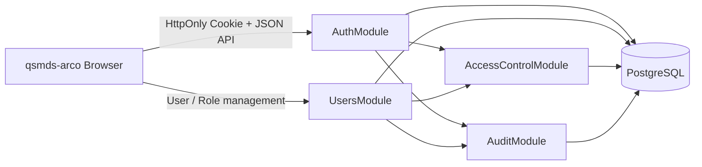
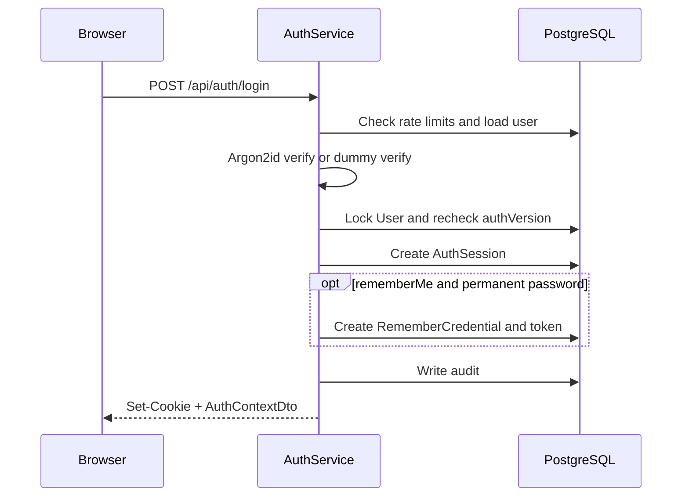
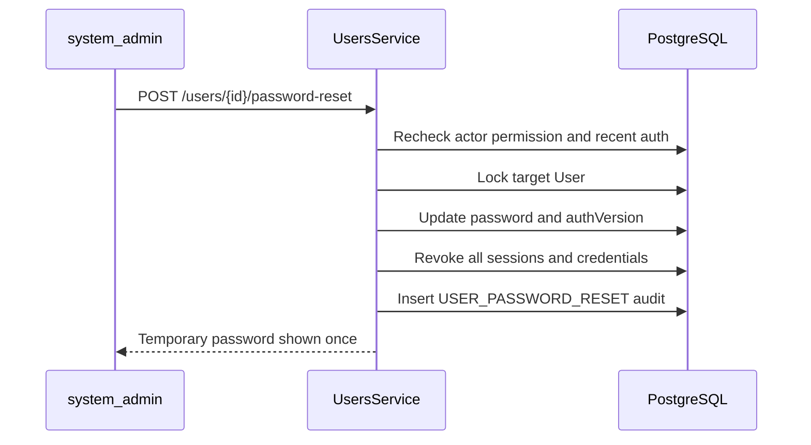

# 千树 DMS 用户认证与权限体系设计

## 文档信息

| 项目 | 内容 |
| --- | --- |
| 状态 | 设计完成，待实施确认 |
| 版本 | `1.0` |
| 日期 | 2026-07-16 |
| 现状核查基线 | `189c606726e6b4dca66b59249bf6cdc1b18c6dab` |
| 适用范围 | `server/`、`web/apps/qsmds-arco/`、PostgreSQL、OpenAPI |
| 接口形态 | 第一方同源 Web + HTTP API |
| 会话真相源 | PostgreSQL |

本文是用户、密码登录、会话、持久登录、RBAC、设备管理、强制改密和超级管理员重置密码的统一设计真相源。本文描述目标方案，不表示相关数据库表、公共 API 或页面已经实现。

任何实施动作都会新增数据库 Schema 和公共 API，必须在本设计确认后另行取得实施授权，并按照 TDD、OpenAPI 同步、数据库 migration 和小步 Git 提交要求执行。

## 1. 目标与边界

### 1.1 目标

本方案需要建立以下完整闭环：

1. 管理员创建用户并安全交付临时密码。
2. 用户通过 `username + password` 登录。
3. 服务端通过短期 `AuthSession` 鉴别请求身份。
4. 用户显式选择后，通过设备级 `RememberCredential` 无感恢复登录。
5. 服务端通过 RBAC 判断操作权限，前端只负责权限体验。
6. 用户能够修改密码、退出当前设备、退出全部设备和管理已记住设备。
7. `system_admin` 能够执行受保护的用户管理和密码重置操作。
8. 所有高风险状态变化均可审计、可撤销、可测试。
9. 首期不依赖 Redis，PostgreSQL 是唯一认证状态真相源。

### 1.2 首期范围

- 用户创建、查询、编辑、启用和禁用。
- 密码登录、当前用户、当前退出、全部退出和修改密码。
- 普通 Session、持久登录、设备查看与单设备撤销。
- 用户、角色、权限及用户角色、角色权限关系。
- 静态前端路由按权限码过滤。
- `system_admin` 近期二次认证和重置用户密码。
- PostgreSQL 限流、审计、Token 轮换和重放检测。
- 同源 Cookie 认证的 CSRF 防护。

### 1.3 明确不做

- 公开注册。
- 邮件、短信或安全问题自助找回密码。
- JWT、OAuth 2.0、OpenID Connect、SSO。
- MFA、Passkey、WebAuthn。
- Redis Session、Redis 限流或进程内 Session。
- 后端动态菜单。
- 用户级直接权限授权。
- 显式 Deny 权限。
- 通用数据范围 DSL 或自动行级过滤。
- 多账号 Token 槽位。
- 跨域携带 Cookie。
- 用户、角色和审计记录的硬删除。

上述能力需要真实业务或合规需求后另行设计，不在首期预留伪实现。

## 2. 当前工程事实

### 2.1 后端

- Server 已使用 Node.js 24、NestJS 11、Prisma 7、`@prisma/adapter-pg`、`pg` 和 PostgreSQL。
- `server/src/http.modules.ts` 当前只注册 `HealthModule`。
- `server/prisma/schema.prisma` 当前没有 model 或 enum。
- 当前唯一正式 HTTP 能力是 `GET /api/health`。
- 全局已经具备 `/api` 前缀、Server-generated `X-Request-Id`、严格 DTO 校验、HTTP `422` 和统一 `ApiError`。
- OpenAPI 的 Controller、DTO 和 decorators 是接口真相源，正式快照是 `server/openapi/openapi.json`。
- `ApiApplicationContract` 当前覆盖 `401/403/404/409/422/500`，尚未覆盖认证限流需要的 `429`。
- 当前依赖中没有生产密码 Hash、Cookie 解析、Session 或认证框架。

### 2.2 前端

- 正式业务应用是 `web/apps/qsmds-arco/`，使用 Vue、Pinia、Vue Router、Axios、Fantastic Admin 和 Arco Design Vue。
- 当前登录、权限和修改密码 API 全部是 `fake: true`。
- 当前“记住我”只保存 `login_account`，不是持久认证凭证。
- 当前 Token、账号、头像和多账号 Token 均进入 `localStorage`。
- 当前 `isLogin` 只检查本地 Token 字符串，不执行 `/auth/me` 服务端恢复。
- 当前任意 `401` 都直接触发本地登出，没有 Session 无感续期。
- 当前登录页仍包含扫码登录、公开注册、忘记密码和演示账号，与首期范围冲突。
- 当前前端权限码、路由 `meta.auth`、菜单过滤和 `AppAuth` 可继续作为体验层使用。
- 当前同源 `/api` 或反向代理部署前提适合 HttpOnly Cookie。

### 2.3 必须替换的旧链路

目标实现必须删除以下认证真相：

```text
localStorage Token
  -> custom Token Header
  -> fake login
  -> frontend-only isLogin
  -> any 401 means logout
```

替换为：

```text
HttpOnly Cookie
  -> PostgreSQL AuthSession
  -> /auth/me bootstrap
  -> explicit Session recovery
  -> backend RBAC guard
```

## 3. 已确认决策

### 3.1 登录身份

- 首期只支持 `username + password`。
- 用户由授权管理员创建，不开放注册。
- `username` 是稳定技术标识；`displayName` 是可编辑展示名称。
- 登录错误不得泄露账号是否存在、禁用或临时密码是否过期。

### 3.2 时效矩阵

| 凭证 | 空闲过期 | 绝对过期 | 作用 |
| --- | ---: | ---: | --- |
| `AuthSession` | 24 小时 | 7 天 | 访问业务 API |
| 普通用户 `RememberCredential` | 7 天 | 14 天 | 换取新 Session |
| `system_admin` 的 `RememberCredential` | 不单独设置 | 7 天 | 换取新 Session |
| 近期二次认证 | 不适用 | 5 分钟 | 高风险操作 |
| 临时密码 | 不适用 | 24 小时 | 首次登录或管理员重置后改密 |

所有期限都由服务端使用 PostgreSQL 时间判断。达到边界时按失效处理，即 `now >= expiresAt` 时拒绝。

### 3.3 新 Session 的期限封顶

`RememberCredential` 不能突破密码认证的最终期限。由持久凭证换取的新 Session 必须使用：

```text
session.absoluteExpiresAt =
  min(databaseNow + 7 days, rememberCredential.absoluteExpiresAt)

session.idleExpiresAt =
  min(databaseNow + 24 hours, session.absoluteExpiresAt)
```

临时密码建立的受限 Session 还必须使用：

```text
temporarySession.absoluteExpiresAt =
  min(databaseNow + 7 days, user.temporaryPasswordExpiresAt)

temporarySession.idleExpiresAt =
  min(databaseNow + 24 hours, temporarySession.absoluteExpiresAt)
```

`AuthenticationGuard` 在 `databaseNow >= temporaryPasswordExpiresAt` 时必须拒绝已有的 `TEMPORARY_PASSWORD` Session，不能让临时密码在到期前建立一个继续存活数天的改密入口。

由此保证：

- 普通用户最长 14 天必须重新输入密码。
- `system_admin` 最长 7 天必须重新输入密码。
- `system_admin` 的持久凭证只解决 7 天内浏览器关闭或 Session 空闲失效后的恢复。

普通用户持久凭证的“空闲”定义为该设备没有有效认证活动，而不是 Token 本身没有被兑换。登录时创建的初始 Session 必须关联 `rememberCredentialId`；该 Session 有效活动时同步刷新凭证的 `lastUsedAt`，但不得延长 `absoluteExpiresAt`。否则 Session 和凭证都为 7 天边界时，活跃用户会在首次需要续期前错误失效。

### 3.4 超级管理员重置密码

- 权限码为 `users:reset-password`。
- 该权限是 `systemOnly`，首期只允许内置 `system_admin` 持有。
- 操作者必须在 5 分钟内完成当前密码二次认证。
- 管理入口禁止重置本人密码。
- 允许重置另一名 `system_admin`，但必须二次认证并完整审计。
- 禁用用户不能通过重置密码被隐式启用。
- 服务端生成临时密码，明文只返回一次，24 小时过期。
- 重置成功后撤销目标全部 Session 和全部持久凭证。
- 用户必须修改临时密码后才能进入业务系统。

## 4. EARS 需求基线

### 4.1 登录与 Session

1. 当用户提交账号和密码时，系统必须使用统一响应防止账号枚举，并只在凭据、用户状态和限流状态全部有效时创建 Session。
2. 当用户未选择“在此设备保持登录”时，系统必须只签发非持久的普通 Session Cookie。
3. 当用户选择“在此设备保持登录”且密码不是临时密码时，系统必须同时创建普通 Session 和设备级持久凭证。
4. 当 Session 连续 24 小时没有有效活动时，系统必须在服务端拒绝该 Session。
5. 当 Session 创建达到 7 天时，无论是否活跃，系统必须拒绝该 Session。
6. 当 Session 不存在或过期且持久凭证有效时，系统必须轮换持久 Token、创建受凭证剩余期限封顶的新 Session，并只重试原请求一次。
7. 当 Session 被安全事件撤销时，客户端不得自动使用持久凭证恢复。

### 4.2 持久登录与设备

1. 当普通用户的设备连续 7 天没有有效认证活动时，系统必须拒绝该持久凭证。
2. 当普通用户持久凭证签发达到 14 天时，系统必须拒绝该凭证。
3. 当 `system_admin` 持久凭证签发达到 7 天时，系统必须拒绝该凭证。
4. 当持久凭证成功换取 Session 时，系统必须原子轮换 Token，旧 Token 不得继续创建 Session。
5. 当已消费 Token 在并发宽限期外再次出现时，系统必须撤销对应凭证族和派生 Session，并写入重放审计。
6. 当用户撤销某个设备时，系统必须撤销该设备凭证及其派生 Session。
7. 当用户退出当前设备时，系统必须同时撤销当前 Session 和当前设备持久凭证，避免立即自动登录。

### 4.3 密码与强制改密

1. 当管理员创建用户或重置密码时，系统必须生成高熵临时密码，只保存 Argon2id Hash，并设置 24 小时强制改密期限。
2. 当用户使用临时密码登录时，系统必须创建受限 Session，且不得签发持久凭证。
3. 当用户处于强制改密状态时，系统只能允许 `GET /api/auth/me`、`POST /api/auth/password/change` 和 `POST /api/auth/logout`。
4. 当临时密码过期、再次重置或完成改密时，旧临时密码必须失效。
5. 当密码修改成功时，系统必须撤销旧 Session 和全部持久凭证，并创建新的密码认证 Session。

### 4.4 RBAC

1. 当请求访问受保护 API 时，系统必须先验证 Session，再验证强制改密状态，最后验证权限。
2. 当用户拥有多个角色时，系统必须使用角色权限并集。
3. 当没有任何明确允许权限时，系统必须默认拒绝。
4. 当前端隐藏按钮或路由时，后端仍必须独立执行相同权限判断。
5. 当角色或权限关系变化时，系统必须从下一次请求开始使用 PostgreSQL 当前值。
6. 当授予或移除 `system_admin` 时，系统必须要求操作者近期二次认证，并撤销目标全部 Session 和持久凭证。
7. 当操作会导致没有有效 `system_admin` 时，系统必须拒绝操作。

### 4.5 超级管理员重置密码

1. 当操作者没有 `users:reset-password` 时，系统必须返回 `403` 且不改变目标状态。
2. 当操作者没有 5 分钟内的二次认证时，系统必须返回 `REAUTHENTICATION_REQUIRED`。
3. 当目标是操作者本人时，系统必须返回 `SELF_PASSWORD_RESET_NOT_ALLOWED`。
4. 当目标用户禁用时，系统必须返回 `USER_DISABLED`，且不得隐式启用。
5. 当重置成功时，系统必须原子更新密码、强制改密状态、认证版本、Session、持久凭证和审计事件。
6. 当响应临时密码时，系统必须设置禁止缓存 Header，且密码不得进入日志、审计、URL 或前端持久化状态。

## 5. 总体架构



### 5.1 模块边界

建议后端模块：

```text
server/src/modules/auth/
server/src/modules/users/
server/src/modules/access-control/
server/src/modules/audit/
```

继续遵循当前：

```text
Controller -> Service -> PrismaService -> PostgreSQL
```

不为认证预建 Repository、UseCase 或 Domain Entity。只有 Token 生成、密码 Hash、Cookie 构造、权限 decorator 等稳定基础能力拆为小型可测试 provider。

### 5.2 Guard 顺序

```text
Request
  -> CsrfProtectionGuard / middleware
  -> AuthenticationGuard
  -> PasswordChangeRequiredGuard
  -> PermissionGuard
  -> RecentAuthenticationGuard
  -> Controller
```

- `@Public()`：登录、健康检查等真正公开操作。
- `@AllowPasswordChangeRequired()`：强制改密状态允许的三个操作。
- `@RequirePermissions(...)`：声明权限码。
- `@RequireRecentAuthentication(300)`：声明 5 分钟二次认证。

高风险 Service 必须在业务事务内再次检查用户状态、权限和 `reauthenticatedAt`，不能只依赖事务外 Guard。

## 6. 安全与信任边界

### 6.1 Cookie

生产 Cookie：

| Cookie | 属性 | 说明 |
| --- | --- | --- |
| `__Host-qianshu_session` | `Secure; HttpOnly; SameSite=Strict; Path=/` | 非持久 Session Cookie，不设置 `Domain` 和 `Max-Age` |
| `__Host-qianshu_remember` | `Secure; HttpOnly; SameSite=Strict; Path=/` | 显式保持登录时设置 `Max-Age`，服务端期限仍为最终真相 |

本地开发可以使用不带 `__Host-` 前缀的开发 Cookie，但只允许 localhost；`production` 必须拒绝非 Secure 配置。Cookie 不使用签名，因为高熵 secret 已在服务端按 Hash 验证。

### 6.2 CSRF

当前架构只支持同源部署，不启用通配 CORS。使用无额外 CSRF Session 状态的组合防护：

1. 所有状态修改只允许 `POST/PUT/PATCH/DELETE`。
2. 请求只接受 `application/json`，拒绝跨站表单可发送的简单内容类型。
3. 前端所有不安全方法携带固定 `X-Qianshu-CSRF: 1` Header。
4. 服务端严格比较 `Origin` 与受信任配置 `APP_ORIGIN`。
5. 拒绝 `Origin: null`、不匹配 Origin 和 `Sec-Fetch-Site: cross-site`。
6. 登录、续期、退出、改密和密码重置同样执行检查，防止 Login CSRF。
7. 不信任客户端 `Host`、任意 `X-Forwarded-*` 或未配置代理提供的 Origin。

无请求体的 `POST /api/auth/logout` 和 `DELETE /api/auth/devices/{credentialId}` 也必须显式发送 `Content-Type: application/json`；服务端接受空 JSON body，但不为这些操作放宽内容类型检查。

如果未来改为跨域 Cookie 或第三方登录，必须重新设计 CORS 和 CSRF，不能只修改 base URL。

### 6.3 Token

- Session secret 和 Remember secret 均使用至少 256-bit CSPRNG 随机值。
- Cookie 使用 `selector.secret` 形式，selector 只用于定位数据库行。
- 数据库只保存 secret 的 `SHA-256` Hash。
- 高熵随机 Token 可以使用快速 Hash；用户密码不能使用快速 Hash。
- Token、Cookie、Hash、密码和完整认证请求体不得进入日志、审计、错误响应或 OpenAPI example。

### 6.4 密码

- 单因素密码最少 15 个 Unicode code point。
- 最大长度 128 个 code point，至少满足 64 字符长口令要求。
- 接受空格和 Unicode；Hash 前使用 Unicode NFC。
- 不强制大小写、数字、符号组合。
- 不要求无风险的周期性改密。
- 新密码与本地弱密码 blocklist、账号名及项目高概率词比较。
- 允许密码管理器、自动填充、粘贴和显示密码。
- 密码使用 Argon2id PHC 字符串保存。
- 参数不得低于 `m=19456 KiB, t=2, p=1`，并在生产规格上压测后只允许向更强方向调整。
- Server 使用维护中的 `argon2` package 并在 `server/pnpm-lock.yaml` 固定解析版本，首期不依赖 Node.js experimental Argon2 API。
- 临时密码使用至少 20 个无歧义随机字符，明文不落库。

弱密码列表作为版本化 UTF-8 资产放在 `server/src/modules/auth/security/data/password-blocklist.txt`，同目录 README 记录来源、许可、版本和更新日期；运行时不依赖外网。更新必须通过密码策略测试，日志不得输出命中的原始密码。

### 6.5 来源地址与运行配置

- Server 直连时只使用 socket remote address。
- 反向代理部署时，Server 端口只允许受信任代理访问，并通过明确 hop 数或 CIDR 配置 `trust proxy`；禁止配置为无条件 `true`。
- 统一把 IPv4-mapped IPv6 规范成 IPv4，把 IPv6 按 `/64` 前缀用于限流和脱敏展示；原始地址不得进入应用日志。
- `APP_ORIGIN` 必须是单一精确 origin，不允许通配符、路径或动态回显请求 Origin。

生产启动必须校验以下认证配置，缺失或强度不足时失败关闭：

```text
APP_ORIGIN
AUTH_RATE_LIMIT_HMAC_KEY
AUTH_AUDIT_IP_HMAC_KEY
REMEMBER_ISSUE_ENABLED
REMEMBER_RENEW_ENABLED
TRUST_PROXY_HOPS or TRUST_PROXY_CIDRS
```

两个 HMAC Key 至少 256 bit，彼此隔离且不得复用 Token、密码或数据库材料。`.env.example` 只声明空模板；真实值由部署密钥管理能力注入。首期不支持无停机 Key 轮换，轮换必须进入维护窗口：先停止认证写流量，清理限流桶，记录审计 Hash 关联中断点，再整体切换。

## 7. 数据模型

以下是逻辑模型；实施时由 Prisma Schema 和不可变 migration 落地。

### 7.1 User

| 字段 | 说明 |
| --- | --- |
| `id` | UUID 主键 |
| `username` | 原始技术账号 |
| `usernameNormalized` | trim 后小写规范值，唯一 |
| `displayName` | 用户展示名称 |
| `passwordHash` | Argon2id PHC 字符串，禁止进入 DTO |
| `status` | `ACTIVE` 或 `DISABLED` |
| `mustChangePassword` | 是否强制改密 |
| `temporaryPasswordExpiresAt` | 临时密码绝对过期时间 |
| `passwordChangedAt` | 最近密码变更时间 |
| `authVersion` | 密码、禁用或高权限变化时递增 |
| `lastLoginAt` | 最近成功密码登录时间 |
| `createdByUserId` | 创建者，可为空表示系统初始化 |
| `disabledAt` / `disabledByUserId` | 禁用审计字段 |
| `createdAt` / `updatedAt` | 生命周期时间 |

约束：

- `usernameNormalized` 唯一，不依赖数据库默认大小写行为。
- 用户不硬删除；离职或停用使用 `DISABLED`。
- `status != ACTIVE`、临时密码过期或 `mustChangePassword` 状态由所有认证路径统一检查。
- 登录昂贵 Hash 校验后，创建 Session 的事务必须重新检查 `authVersion`，解决登录与密码重置并发。

### 7.2 Role

| 字段 | 说明 |
| --- | --- |
| `id` | UUID 主键 |
| `code` | 稳定英文权限角色码，唯一 |
| `name` | 中文展示名 |
| `description` | 说明 |
| `isSystem` | 是否系统内置 |
| `isEnabled` | 是否可用于授权 |
| `createdAt` / `updatedAt` | 生命周期时间 |

`system_admin` 是不可删除、不可改码、不可禁用的系统角色。其他角色停用后不再提供权限，但保留历史关系和审计。

### 7.3 Permission

| 字段 | 说明 |
| --- | --- |
| `id` | UUID 主键 |
| `code` | `resource:action` 稳定权限码，唯一 |
| `name` | 中文展示名 |
| `description` | 权限边界 |
| `systemOnly` | 是否只允许系统角色持有 |
| `createdAt` / `updatedAt` | 生命周期时间 |

Permission 是代码管理的目录，由 migration 或幂等 seed 同步；管理 UI 不能任意创建权限码。

### 7.4 UserRole 与 RolePermission

- `UserRole(userId, roleId)` 使用复合唯一键。
- `RolePermission(roleId, permissionId)` 使用复合唯一键。
- 不建立用户直接权限表。
- 多角色权限取并集。
- `systemOnly` 权限不得授权给非系统角色。
- CI 必须检查 `system_admin` 拥有全部预期权限。

### 7.5 AuthSession

| 字段 | 说明 |
| --- | --- |
| `id` | Cookie selector 与 UUID 主键 |
| `userId` | 用户 |
| `tokenHash` | Session secret Hash，唯一 |
| `authVersion` | 创建时用户认证版本 |
| `authMethod` | `PASSWORD`、`TEMPORARY_PASSWORD` 或 `REMEMBER_CREDENTIAL` |
| `rememberCredentialId` | 可为空；关联设备凭证 |
| `createdAt` | 创建时间 |
| `lastActivityAt` | 最近有效请求时间 |
| `idleExpiresAt` | 空闲过期 |
| `absoluteExpiresAt` | 绝对过期 |
| `reauthenticatedAt` | 最近密码二次认证时间 |
| `supersededAt` | 被新 Session 取代的时间，可空 |
| `supersededBySessionId` | 继任 Session，可空 |
| `supersessionGraceUntil` | 仅二次认证轮换使用的普通请求宽限，可空 |
| `revokedAt` / `revokedReason` | 撤销信息 |

规则：

- `idleExpiresAt <= absoluteExpiresAt`。
- 每个有效请求使用数据库时间验证并更新活动时间；首期正确性优先，不使用进程内节流。
- 如果关联普通用户持久凭证，同时更新其设备活动时间，但绝不移动凭证绝对期限。
- Session 在登录时全新签发；改密递增 `authVersion` 并安全撤销所有旧 Session，再签发新 Session。
- 二次认证通过时创建新 Session 行，禁止更新主键。旧行标记 superseded，在 age `< 10 seconds` 时只允许已进入或普通低风险请求完成，绝不获得新 Session 的 `reauthenticatedAt`；只有二次认证响应设置新 Cookie，旧请求不写 Cookie，因此不会发生响应乱序覆盖。age `>= 10 seconds` 后旧行按 `SESSION_EXPIRED` 处理。
- 首期不做周期性轮换，避免为普通请求引入额外 Cookie 交付协议。
- 通过持久凭证创建的 Session 设置 `authMethod = REMEMBER_CREDENTIAL`、`reauthenticatedAt = null`。
- 权限不存入 Session，Guard 每次读取 PostgreSQL 当前关系。
- `AuthenticationGuard` 每次必须比较 `AuthSession.authVersion === User.authVersion`。不一致时把 Session 标记为安全撤销并返回 `401 SESSION_REVOKED`；服务端续期同样拒绝已撤销凭证，不能只依赖前端不调用 renew。
- selector 存在但 secret Hash 不匹配时只返回未认证并计入限流，不得撤销真实 Session，避免随机 Token 造成注销型 DoS。

### 7.6 RememberCredential

`RememberCredential` 表示一个浏览器配置文件上的设备级授权，不是强密码学设备绑定。

| 字段 | 说明 |
| --- | --- |
| `id` | 凭证族 UUID |
| `userId` | 用户 |
| `authVersion` | 签发时用户认证版本 |
| `policyClass` | `STANDARD` 或 `SYSTEM_ADMIN` |
| `deviceLabel` | 浏览器和系统摘要 |
| `userAgentSummary` | 截断后的 UA 摘要 |
| `lastIpPrefix` | 脱敏展示信息，不作为硬绑定 |
| `createdAt` | 首次签发 |
| `lastUsedAt` | 设备最近认证活动 |
| `idleExpiresAt` | 普通用户有值；管理员为空 |
| `absoluteExpiresAt` | 不可滑动 |
| `revokedAt` / `revokedReason` | 撤销信息 |

`policyClass` 在签发时根据当前角色确定，但每次续期仍读取用户当前角色并要求 Credential `authVersion` 等于 User 当前值。用户被授予或移除 `system_admin` 时直接撤销全部 Session 和持久凭证，不能让旧普通凭证继承 14 天期限。

### 7.7 RememberCredentialToken

该表保留轮换历史，支持可靠重放检测：

| 字段 | 说明 |
| --- | --- |
| `id` | Cookie selector |
| `credentialId` | 所属凭证族 |
| `tokenHash` | secret Hash |
| `generation` | 递增代次 |
| `issuedAt` | 签发时间 |
| `consumedAt` | 成功兑换时间；为空表示当前 Token |

通过 PostgreSQL partial unique index 保证每个凭证族至多一个 `consumedAt IS NULL` 的当前 Token，并使用 `UNIQUE(credentialId, generation)` 保证代次唯一。这样避免 Credential 与 Token 之间的循环必填 FK；Token 对 Credential 使用受控级联删除，Credential 只有在整个保留期结束后才允许清理。已消费历史至少保留至凭证绝对过期后 7 天，再由小批量清理删除。

### 7.8 AuthRateLimit

| 字段 | 说明 |
| --- | --- |
| `scope` | 登录账号、登录 IP、二次认证、续期、重置操作者或目标 |
| `subjectKeyHash` | HMAC 后的不可逆主体键 |
| `bucketStartedAt` | 时间桶 |
| `attemptCount` | 尝试次数 |
| `blockedUntil` | 阻断截止时间 |
| `updatedAt` | 最近更新 |

`(scope, subjectKeyHash)` 唯一，使用 PostgreSQL 原子 upsert。禁止通过永久账号锁定响应攻击，否则攻击者可对合法账号实施拒绝服务。

`subjectKeyHash` 使用独立的 `AUTH_RATE_LIMIT_HMAC_KEY` 计算。该密钥至少 256 bit，由部署环境的密钥管理能力注入；代码、migration、日志和已提交的 `.env.example` 均不得包含真实值。轮换该密钥会自然切换到新限流桶，因此必须作为受控运维操作执行并记录。

首期默认值：

| 场景 | 限制 |
| --- | --- |
| 登录账号 | 15 分钟内 5 次失败，阻断 15 分钟 |
| 登录 IP | 15 分钟内 30 次失败，阻断 15 分钟 |
| 二次认证用户 | 15 分钟内 5 次失败，阻断 15 分钟 |
| 二次认证 IP | 15 分钟内 30 次失败，阻断 15 分钟 |
| 二次认证 Session | 15 分钟内 5 次失败，作为辅助维度 |
| 修改密码用户 | 15 分钟内 5 次当前密码失败，阻断 15 分钟 |
| 重置操作者 | 1 小时内 10 次请求 |
| 重置目标 | 1 小时内 3 次请求 |
| 无效续期 IP | 15 分钟内 30 次 |

限流返回 `429 AUTH_RATE_LIMITED` 和 `Retry-After`。不存在账号时仍执行固定 dummy Argon2id 校验。

二次认证必须同时检查 `REAUTH_USER + userId`、`REAUTH_IP + sourceIpHash` 和 `REAUTH_SESSION + sessionId`；新建 Session 不得清除用户或 IP 维度失败计数。只有密码验证成功后才清除或衰减相应失败桶，防止持有 Remember 凭证的攻击者通过不断换 Session 绕过限流。

### 7.9 AuditEvent

| 字段 | 说明 |
| --- | --- |
| `id` | UUID |
| `eventType` | 稳定英文事件码 |
| `outcome` | `SUCCEEDED` 或 `FAILED` |
| `occurredAt` | PostgreSQL 时间 |
| `actorUserId` | 操作者，可空 |
| `targetType` / `targetId` | 目标 |
| `requestId` | 对应 `X-Request-Id` |
| `reasonCode` | 安全原因码 |
| `sourceIpHash` | 脱敏来源 |
| `userAgentSummary` | 截断摘要 |
| `metadata` | 有 schema 和大小限制的安全 JSON |

禁止进入审计：

- 密码和临时密码。
- Session、Remember Token、Cookie 和 Token Hash。
- 完整认证请求体。
- 数据库连接串、SQL 参数、原始异常和堆栈。

关键安全状态修改与成功审计必须处于同一事务；审计失败时状态修改回滚。登录失败等失败事件使用独立事务记录。

`sourceIpHash` 使用独立的 `AUTH_AUDIT_IP_HMAC_KEY`，不得与限流 HMAC Key 或任何认证 Token 材料复用。

### 7.10 PostgreSQL 物理约束与保留期

- 所有时间字段使用 `timestamptz`，所有 256-bit Token Hash 使用 32-byte `bytea`。
- 数据库 `CHECK` 强制 `idleExpiresAt <= absoluteExpiresAt`、非负 generation/attempt count，以及撤销时间与原因同时为空或同时有值。
- 为 Session 和 Credential 建立 `(userId, revokedAt, absoluteExpiresAt)`、`idleExpiresAt` 清理索引；为 Token 建立 `(credentialId, generation)` unique 与 `consumedAt IS NULL` partial unique index。
- 为 Audit 建立 `occurredAt`、`actorUserId + occurredAt`、`targetType + targetId + occurredAt` 索引；为 RateLimit 建立 `blockedUntil`、`updatedAt` 清理索引。
- Prisma Schema 无法完整表达的 partial index 和 `CHECK` 必须写入生成后的不可变 migration SQL，并由 PostgreSQL 集成测试验证，不能只停留在应用校验。

默认保留期：已过期或撤销的 Session 与 Credential family 保留 30 天；Remember Token 历史至少保留到凭证绝对过期后 7 天并随 family 最终清理；RateLimit 行在最后更新 7 天后清理；安全 Audit 保留 365 天。业务或合规要求变更保留期时必须形成独立决策，所有清理任务使用小批量 `FOR UPDATE SKIP LOCKED`，不得长事务扫全表。

## 8. 核心流程

### 8.1 密码登录



登录成功事务提交后才设置 Cookie。未知账号、密码错误、禁用账号和不可用临时密码统一返回 `401 INVALID_CREDENTIALS`。

重新登录且 `rememberMe=false` 时，如果浏览器带有旧持久 Cookie，服务端必须撤销可识别的当前设备凭证并清除 Cookie，保证用户取消保持登录的选择生效。

### 8.2 冷启动与无感恢复

```text
GET /api/auth/me
  -> 200: hydrate authenticated state
  -> 401 AUTHENTICATION_REQUIRED or SESSION_EXPIRED
       -> POST /api/auth/session/renew once
            -> 200: hydrate new AuthContext
            -> 409 REMEMBER_ROTATION_IN_PROGRESS: wait and retry once
            -> other failure: anonymous
  -> 401 SESSION_REVOKED: anonymous, no renew
  -> network/5xx: unavailable, do not pretend logout
```

业务请求只在明确 `AUTHENTICATION_REQUIRED` 或 `SESSION_EXPIRED` 时进入恢复。全局 Guard 必须在 Controller 业务副作用之前拒绝，保证原请求最多一次重放是安全的。

### 8.3 Remember Token 轮换

续期事务固定步骤：

1. 解析 `tokenId.secret`。
2. 非锁定读取 Token selector，只用于得到 `userId` 与 `credentialId`；随后按固定顺序锁定 User、Credential 和目标 Token，并复验三者关联。
3. 验证 secret Hash、`authVersion`、用户状态、强制改密、当前角色和期限。
4. 当前 Token 匹配时，将其标记 consumed，生成下一代 Token。
5. 创建受凭证剩余期限封顶的新 Session。
6. 写轮换和 Session 审计。
7. 提交后设置两个新 Cookie；Remember Cookie 的 `Max-Age` 必须等于绝对期限剩余秒数，轮换不能重新写完整 14 天或 7 天。

并发与重放：

- 已消费真实 Token 的 age `< 10 seconds` 时返回 `409 REMEMBER_ROTATION_IN_PROGRESS`，不创建 Session，也不撤销凭证。
- 前端等待首个请求更新共享 Cookie 后，只重试一次。
- age `>= 10 seconds` 时按重放处理，撤销整个凭证族及其派生 Session，记录 `AUTH_REMEMBER_REPLAY_DETECTED`。
- 随机错误 secret 即使带有效 selector，也只返回无效并计入限流，不能撤销真实设备，避免注销型 DoS。

固定数据库锁顺序：

```text
User
  -> RememberCredential ordered by id
  -> RememberCredentialToken ordered by id
  -> AuthSession ordered by id
  -> AuditEvent
```

### 8.4 修改密码

1. 当前 Session 验证用户输入的当前密码或临时密码。
2. 新密码执行长度、NFC 和 blocklist 校验。
3. 在事务外完成新 Argon2id Hash。
4. 事务内锁定 User，重新检查 `authVersion`。
5. 更新 Hash，递增 `authVersion`，清除强制改密与临时密码期限。
6. 撤销全部持久凭证和全部旧 Session。
7. 创建新的密码认证 Session。
8. 写 `USER_PASSWORD_CHANGED` 审计。

新 Session 不自动签发持久凭证；用户下次密码登录时重新选择是否保持登录。

### 8.5 二次认证

`POST /api/auth/reauth` 验证当前用户密码。成功后轮换 Session ID，并设置：

```text
reauthenticatedAt = databaseNow
```

持久登录创建 Session、普通页面活动和 Token 轮换都不得更新该字段。高风险事务必须验证：

```text
databaseNow < reauthenticatedAt + interval '5 minutes'
```

二次认证失败同时计入用户、来源 IP 和 Session 三个限流维度；换新 Session 不能重置用户/IP 维度。成功后只清理当前用户与来源对应的失败桶。

### 8.6 超级管理员重置密码



生成临时密码前读取目标 `expectedAuthVersion`，临时密码 Hash 在事务外计算。事务内锁定目标 User 后必须先比较当前版本；版本变化则返回 `409 AUTH_STATE_CHANGED`，不得返回一个可能立刻失效的临时密码。同一并发批次只允许一个重置成功。

事务内继续重新检查：

- 操作者 Session 仍有效。
- 操作者仍为 `system_admin` 且拥有 `users:reset-password`。
- `databaseNow < reauthenticatedAt + interval '5 minutes'`。
- 目标存在、未禁用且不是操作者本人。

成功响应：

```http
Cache-Control: no-store
Pragma: no-cache
```

临时密码“只显示一次”不等于“只能成功登录一次”。在 24 小时内，它可以再次建立受限 Session；这样用户关闭改密页后仍能恢复。完成改密、再次重置或过期后立即失效。

### 8.7 启用、禁用与角色变化

- 禁用用户、密码变化和授予或移除 `system_admin` 时递增 `authVersion`。
- 禁用用户和高权限角色变化在同一事务撤销全部 Session、持久凭证并写审计。
- 普通角色变化不必撤销 Session，因为权限每次请求实时读取；下一请求生效。
- 已经通过 Guard 的普通在途请求可能完成；高风险写操作在业务事务内再次检查权限。
- 禁止禁用或移除最后一个有效 `system_admin`。
- 所有授予、移除、禁用或 bootstrap `system_admin` 的事务必须先锁定同一条 `code = 'system_admin'` 的 Role 行，再统计有效管理员并修改，防止两个事务分别锁不同 UserRole 后都把计数从 2 降到 0。
- 角色替换必须先计算 old/new diff。`users:assign-roles` 只能管理普通角色；diff 涉及 `system_admin` 时额外要求 `roles:manage-system`、近期认证，并在事务内复查权限。
- `POST /api/users` 不允许直接携带系统角色；需要超级管理员时，先创建普通用户，再通过上述受控角色事务授予。
- 当目标当前是 `system_admin` 时，启用、禁用、认证撤销、角色变更和密码重置都额外要求 `roles:manage-system` 与近期认证。基础权限和最后管理员保护不能替代该目标敏感性检查。

### 8.8 撤销与恢复矩阵

| 操作或原因 | 撤销范围 | `authVersion` | 是否允许 Remember 恢复 |
| --- | --- | ---: | --- |
| Session 自然空闲/绝对过期 | 当前 Session | 不变 | 是，凭证仍有效时 |
| 当前设备退出 | 当前 Session、当前 Credential 及派生 Session | 不变 | 否 |
| 退出全部设备 | 全部 Session、全部 Credential | 递增 | 否 |
| 管理员撤销用户认证 | 全部 Session、全部 Credential | 递增 | 否 |
| 密码修改或重置 | 全部旧 Session、全部 Credential | 递增 | 否 |
| 禁用或 `system_admin` 变化 | 全部 Session、全部 Credential | 递增 | 否 |
| Remember 重放 | 该 Credential 及派生 Session | 不变 | 其他有效设备仍可恢复 |

`SESSION_EXPIRED` 只表示自然过期，可进入 renew；`SESSION_REVOKED` 只用于显式或安全撤销，相关 Credential 必须已撤销或被 `authVersion` 阻断。`/api/auth/session/renew` 自身必须在服务端验证这些条件，客户端错误分支只是体验控制，不是安全边界。

## 9. RBAC 设计

### 9.1 权限语义

- 权限码格式：`resource:action`。
- 权限纯允许、默认拒绝。
- 多角色权限取并集。
- 角色用于组织权限，不作为 Controller 内的业务判断字符串。
- 后端 Permission Guard 是安全真相源。
- 前端 `meta.auth`、菜单过滤、`AppAuth` 和按钮隐藏只改善体验。
- `v-auth` 仅修改显示，敏感操作优先条件渲染，但两者都不能替代后端。

### 9.2 首期权限目录

| 权限码 | 说明 | systemOnly |
| --- | --- | --- |
| `users:read` | 查询用户 | 否 |
| `users:create` | 创建用户 | 否 |
| `users:update` | 编辑基础信息 | 否 |
| `users:enable` | 启用用户 | 否 |
| `users:disable` | 禁用用户 | 否 |
| `users:assign-roles` | 分配普通角色 | 否 |
| `users:revoke-authentication` | 撤销用户全部认证状态 | 否 |
| `users:reset-password` | 管理员重置密码 | 是 |
| `roles:read` | 查询角色与权限目录 | 否 |
| `roles:create` | 创建普通角色 | 否 |
| `roles:update` | 编辑或停用普通角色 | 否 |
| `roles:assign-permissions` | 分配非 systemOnly 权限 | 否 |
| `roles:manage-system` | 授予或移除 `system_admin` | 是 |
| `audit:read` | 查询安全审计 | 是 |

`system_admin` 通过受控 seed 显式拥有全部权限；Guard 不按用户 ID 或隐藏账号绕过权限。

### 9.3 数据范围

首期 RBAC 只回答“能否执行某类操作”。业务数据归属、组织范围和字段可见性必须由未来领域模块在查询和事务中显式实现，不能由通用 Guard 自动拼接 Prisma 条件。

## 10. API 契约草案

以下 API 是设计目标，实施时必须使用 NestJS DTO、`ApiApplicationContract`、`ApiContractResponse` 和 OpenAPI snapshot 正式落地。

### 10.1 Auth API

| Method | Path | Success | 说明 |
| --- | --- | --- | --- |
| `POST` | `/api/auth/login` | `200 AuthContextDto` | 密码登录 |
| `GET` | `/api/auth/me` | `200 AuthContextDto` | 当前认证上下文 |
| `POST` | `/api/auth/session/renew` | `200 AuthContextDto` | 持久凭证换取 Session |
| `POST` | `/api/auth/reauth` | `204` | 当前密码二次认证并轮换 Session |
| `POST` | `/api/auth/password/change` | `200 AuthContextDto` | 修改密码并创建新 Session |
| `POST` | `/api/auth/logout` | `204` | 退出当前设备 |
| `POST` | `/api/auth/logout-all` | `204` | 退出全部设备 |
| `GET` | `/api/auth/devices` | `200 RememberedDeviceDto[]` | 当前用户设备 |
| `DELETE` | `/api/auth/devices/{credentialId}` | `204` | 撤销一个设备 |

`AuthContextDto` 只包含：

```ts
interface AuthContextDto {
  user: {
    id: string
    username: string
    displayName: string
    status: 'ACTIVE'
  }
  roles: string[]
  permissions: string[]
  passwordChangeRequired: boolean
  session: {
    authMethod: 'PASSWORD' | 'TEMPORARY_PASSWORD' | 'REMEMBER_CREDENTIAL'
    idleExpiresAt: string
    absoluteExpiresAt: string
    recentlyAuthenticated: boolean
  }
}
```

响应不得包含 Session Token、Remember Token、Token Hash 或 Cookie 值。

`POST /api/auth/logout` 是 CSRF 保护的幂等终止操作，不参与自动续期。即使 Session 已过期，也必须清除两个 Cookie，并在 Cookie 中的 selector/secret 仍可验证时撤销当前 Session、当前 `RememberCredential` 及其派生 Session；重复调用仍返回 `204`。

### 10.2 User API

| Method | Path | Permission | 说明 |
| --- | --- | --- | --- |
| `GET` | `/api/users` | `users:read` | 分页查询 |
| `POST` | `/api/users` | `users:create` | `201 CreateUserResultDto`；创建用户并一次性返回临时密码 |
| `GET` | `/api/users/{userId}` | `users:read` | 用户详情 |
| `PATCH` | `/api/users/{userId}` | `users:update` | 只编辑基础资料 |
| `POST` | `/api/users/{userId}/enable` | `users:enable` | 启用 |
| `POST` | `/api/users/{userId}/disable` | `users:disable` | 禁用并撤销认证状态 |
| `PUT` | `/api/users/{userId}/roles` | `users:assign-roles` | 替换角色集合；涉及 `system_admin` 时附加高风险控制 |
| `POST` | `/api/users/{userId}/authentication/revoke` | `users:revoke-authentication` | 递增 `authVersion` 并撤销全部 Session 与 Credential |
| `POST` | `/api/users/{userId}/password-reset` | `users:reset-password` | 高风险重置密码 |

通用 `PATCH` 不允许修改密码、状态或角色，防止绕过专用事务和审计。

- `POST /api/users` 不接受 `system_admin` 或其他系统角色；一次性响应 DTO 只包含显式 `user` 摘要、`temporaryPassword` 和 `temporaryPasswordExpiresAt`，并设置 `Location`、`Cache-Control: no-store` 和 `Pragma: no-cache`。
- `PUT /api/users/{userId}/roles` 的基础权限是 `users:assign-roles`；当新旧集合差异包含 `system_admin` 时，还必须同时拥有 `roles:manage-system`、通过 5 分钟近期认证，并在事务内执行最后管理员保护、`authVersion` 更新、认证状态撤销和审计。客户端不能通过只声明基础权限绕过这些条件。

### 10.3 Role API

| Method | Path | Permission | 说明 |
| --- | --- | --- | --- |
| `GET` | `/api/roles` | `roles:read` | 角色列表 |
| `POST` | `/api/roles` | `roles:create` | 创建普通角色 |
| `GET` | `/api/roles/{roleId}` | `roles:read` | 角色详情 |
| `PATCH` | `/api/roles/{roleId}` | `roles:update` | 编辑或停用普通角色 |
| `PUT` | `/api/roles/{roleId}/permissions` | `roles:assign-permissions` | 替换权限集合 |
| `GET` | `/api/permissions` | `roles:read` | 代码管理的权限目录 |
| `GET` | `/api/audit-events` | `audit:read` | 安全审计查询 |

首期不提供用户、角色、权限和审计硬删除 API。

`system_admin` 角色本身以及它的权限集合不能通过通用 Role API 修改；通用接口只能管理普通角色和非 `systemOnly` 权限。所有针对 `system_admin` 用户目标的安全状态操作还要执行 8.7 的条件授权。

### 10.4 错误码

| HTTP | code | 场景 |
| ---: | --- | --- |
| `401` | `INVALID_CREDENTIALS` | 登录信息不可用，统一外显 |
| `401` | `AUTHENTICATION_REQUIRED` | 没有 Session，可尝试持久恢复 |
| `401` | `SESSION_EXPIRED` | Session 过期，可尝试持久恢复 |
| `401` | `SESSION_REVOKED` | 安全撤销，不得自动恢复 |
| `401` | `REMEMBER_CREDENTIAL_INVALID` | 持久凭证不可用 |
| `401` | `REAUTHENTICATION_FAILED` | 二次认证失败 |
| `403` | `FORBIDDEN` | 权限不足 |
| `403` | `PASSWORD_CHANGE_REQUIRED` | 需要先改密 |
| `403` | `REAUTHENTICATION_REQUIRED` | 缺少近期认证 |
| `403` | `CSRF_REJECTED` | CSRF 组合检查失败 |
| `404` | `USER_NOT_FOUND` | 已授权管理端目标不存在 |
| `409` | `USER_DISABLED` | 禁用用户不允许该操作 |
| `409` | `SELF_PASSWORD_RESET_NOT_ALLOWED` | 禁止管理入口自重置 |
| `409` | `REMEMBER_ROTATION_IN_PROGRESS` | 合法并发宽限 |
| `409` | `AUTH_STATE_CHANGED` | 并发期间认证版本变化 |
| `409` | `LAST_SYSTEM_ADMIN_REQUIRED` | 最后管理员保护 |
| `422` | `PASSWORD_POLICY_VIOLATION` | 新密码策略不满足 |
| `429` | `AUTH_RATE_LIMITED` | 认证相关限流 |

所有错误继续使用：

```ts
interface ApiError {
  code: string
  message: string
  fieldErrors?: Record<string, string[]>
  requestId: string
}
```

`ApiError.requestId` 必须与 `X-Request-Id` 相同。`429` 必须补入 OpenAPI response、`Retry-After` Header、前端 Header 读取和契约测试。

### 10.5 OpenAPI

实施需要：

- `DocumentBuilder` 分别注册 `sessionCookie` 与 `rememberCookie` security scheme；所有需要普通 Session 的 operation 使用 `ApiCookieAuth`/OpenAPI `security`，Session renew 只声明 `rememberCookie`，登录显式无 Cookie security。幂等 logout 的可选 Cookie 语义在 operation 说明和契约测试中单独覆盖。
- 扩展或显式声明 `429 ApiError`。当前 `ApiException`/Filter 需要增加严格 allowlist 的安全响应 Header 能力，或使用专用 `RateLimitException`；只允许输出 `Retry-After` 等已批准 Header，禁止透传任意异常 Header。
- `429` 的 `ApiContractResponse` 必须显式描述 `Retry-After` integer Header。
- 每个 operation 使用稳定 `operationId`。
- Cookie 和密码不得出现在 example。
- 从根运行 `node --run contract:sync`，禁止手工修改 snapshot。
- 契约测试同时断言 components security scheme、operation-level `security`、公开端点无 Session security，以及 `429` Header；只存在 scheme 定义不算完成。

## 11. 前端设计

### 11.1 DESIGN SPECIFICATION

| 项目 | 设计 |
| --- | --- |
| Purpose Statement | 为日常数据管理用户提供稳定的长会话体验，同时让高风险管理操作保持清晰、可验证和可撤销。认证界面必须降低误操作，不隐藏安全状态。 |
| Aesthetic Direction | Industrial / utilitarian，延续现有 Fantastic Admin 与 Arco 管理台语言 |
| Color Palette | `#18181B` foreground、`#3F3F46` secondary、`#D4D4D8` border、`#F4F4F5` surface、`#DC2626` destructive；业务主色继续使用现有 `--primary` Token |
| Typography | 中文使用 `PingFang SC` / `Microsoft YaHei`，技术标识使用 `JetBrains Mono`；不为认证功能新增 Web Font |
| Layout Strategy | 保留现有登录页分栏能力；管理页桌面采用高密度表格，窄屏改用纵向信息卡和抽屉，不横向压缩危险操作 |

本方案不重新设计产品主题，light/dark 均继续使用当前 zinc 基础色与 CSS variables。

### 11.2 Account Store 状态机

```text
unknown
  -> bootstrapping
       -> authenticated
       -> password_change_required
       -> anonymous
       -> unavailable
```

`renewing` 和 `reauthenticating` 是协调子状态。Store 只持有内存态：

- `user`
- `roles`
- `permissions`
- `sessionSummary`
- `authState`
- 共享 `bootstrapPromise` 和 `renewPromise`

不得持久化 Token、Cookie、Session ID、权限或临时密码。

### 11.3 API Client

- 删除 `getToken` Hook 和自定义 `Token` Header。
- 保持同源 `/api`；Axios 明确启用 Cookie 请求语义。
- 不安全方法自动附加 `X-Qianshu-CSRF: 1`。
- 只有 `AUTHENTICATION_REQUIRED` 和 `SESSION_EXPIRED` 触发恢复。
- `SESSION_REVOKED`、登录、续期和二次认证自己的 `401` 不得递归恢复。
- 页面内并发请求共用一个 `renewPromise`。
- 跨标签页优先使用 Web Locks；`BroadcastChannel` 只广播恢复、退出和状态变化，不传播 Token。
- 原请求最多重放一次；当前通用网络重试仍不得自动重放非幂等 `POST`。
- 只有 bootstrap 或 Session renew 的 Network/`5xx` 才使认证状态进入 `unavailable`，显示重试且不伪装成登出；普通业务请求失败时保持 `authenticated`，交给业务错误层处理。

认证控制错误必须先于通用 Toast 分发：

| code | 前端归属 |
| --- | --- |
| `PASSWORD_CHANGE_REQUIRED` | Account Store 与 Router 进入强制改密流程 |
| `REAUTHENTICATION_REQUIRED` | 返回原调用方，由高风险操作弹出二次认证 |
| `REMEMBER_ROTATION_IN_PROGRESS` | 只交给 renew coordinator 等待并单次重试 |
| `INVALID_CREDENTIALS` / `REAUTHENTICATION_FAILED` | 登录或二次认证表单内联错误 |
| `FORBIDDEN` | 才显示通用“没有权限执行此操作”提示 |
| `CSRF_REJECTED` | 停止请求并显示安全错误，不自动续期 |

### 11.4 路由

- 应用首次导航无论目标是否 public，都等待唯一 `bootstrap()`；登录页只在最终状态为 `anonymous` 时渲染，避免有效 Cookie 用户看到登录页闪烁或重复登录。
- 访问登录页时，`authenticated` 跳转到经过校验的站内 `redirect` 或首页，`password_change_required` 跳转强制改密页，`unavailable` 显示恢复重试状态。
- `password_change_required` 只能进入强制改密页。
- 强制改密页不是 public route，使用独立 route meta。
- 登录 `redirect` 只接受站内相对路径，拒绝协议、`//` 和外部地址。
- 权限随 `AuthContextDto` 一次返回，避免当前单独 permission 请求与路由生成竞态。
- 删除认证路径中的空 `catch {}`，按 401、403、network 和 5xx 分类。

### 11.5 登录页

首期只保留：

- 账号。
- 密码。
- “在此设备保持登录”复选框，默认不勾选。
- 提示“仅在个人或受管设备使用”。
- 登录按钮和安全错误提示。

移除或仅开发环境保留：

- 二维码登录。
- 公开注册。
- 自助忘记密码。
- admin/test 演示账号和硬编码 `123456`。

账号使用 `autocomplete=username`，密码使用 `autocomplete=current-password`。复选框不再保存账号。

### 11.6 强制改密页

- 隐藏业务导航。
- 输入当前临时密码、新密码和确认密码。
- 可以复用现有 `FaPasswordStrength` 的展示能力，但必须传入定制规则，禁止沿用其默认“8 字符加大小写、数字和符号组合”规则。
- 前端只校验 Unicode code point 长度 15–128、两次输入一致和通用提示；不得直接使用按 UTF-16 code unit 计数的 `z.string().min()` 代替 code point 校验。弱密码 blocklist 以服务端 `422 fieldErrors` 为准。
- 当前密码或临时密码使用 `autocomplete=current-password`，新密码和确认密码使用 `autocomplete=new-password`。
- 只提供“保存新密码”和“退出”。
- 改密成功后进入新的密码认证 Session。

### 11.7 设备管理

桌面使用 `FaTable`，窄屏使用纵向 `FaCard`。显示：

- 当前设备标记。
- 浏览器和系统摘要。
- 创建时间。
- 最近活动。
- 空闲与绝对到期时间。

支持撤销单设备和退出全部设备。撤销当前设备后进入登录页。IP 和 User-Agent 只用于展示和风险信号，不宣称密码学设备绑定。

### 11.8 超级管理员重置密码

用户行操作只在拥有 `users:reset-password` 时渲染：

1. `FaModal` 展示目标账号、姓名和状态并二次确认。
2. 后端返回 `REAUTHENTICATION_REQUIRED` 时，弹出当前管理员密码验证。
3. 二次认证成功后自动重试原重置一次。
4. 成功后显示一次性临时密码、24 小时期限和复制按钮。
5. 不自动复制，不进入 Pinia、Storage、URL、埋点或日志。
6. Modal 销毁时清空内存，关闭后无法再次查看。

禁用用户和本人操作在 UI 禁用并说明原因，但后端仍执行完整拒绝。

### 11.9 旧功能处理

- `multipleAccounts` 首期保持关闭，删除持久化 Token 的切换逻辑。
- 当前纯前端锁屏不能阻止 HttpOnly Cookie 请求，不是安全边界；首期关闭。
- 当前 `localStorage` 账号、Token、头像和多账号 Token 认证恢复全部移除。
- Shell 用户展示改用 `displayName + username`，无头像字段时使用姓名首字 fallback；首期不在 `AuthContextDto` 中隐式保留旧 `avatar` 字段。
- 标签、收藏等非认证本地偏好可以保留，但必须等待 bootstrap 后以稳定的 `user.id` 作为分区键；旧账号字符串键不自动迁移，避免跨账号错配。
- 当前配置 `mobile: false` 保持不变；窄屏卡片仅覆盖可用的窄桌面或平板窗口，首期不因此开放手机端。
- 删除或停用旧 `AppLoginAgain`、`expiredMode` popup 和 `requestLogout` 恢复链路；它们不能复用为 5 分钟二次认证弹窗。

## 12. 审计与可观测性

稳定审计事件码至少包括：

```text
AUTH_LOGIN_SUCCEEDED
AUTH_LOGIN_FAILED
AUTH_LOGIN_RATE_LIMITED
AUTH_SESSION_CREATED
AUTH_SESSION_ROTATED
AUTH_SESSION_EXPIRED
AUTH_SESSION_REVOKED
AUTH_LOGOUT_CURRENT
AUTH_LOGOUT_ALL
AUTH_REMEMBER_ISSUED
AUTH_REMEMBER_ROTATED
AUTH_REMEMBER_REVOKED
AUTH_REMEMBER_REPLAY_DETECTED
AUTH_REAUTH_SUCCEEDED
AUTH_REAUTH_FAILED
AUTH_REAUTH_RATE_LIMITED
AUTH_CSRF_REJECTED
USER_CREATED
USER_STATUS_CHANGED
USER_PASSWORD_CHANGED
USER_PASSWORD_RESET
USER_ROLE_ASSIGNED
USER_ROLE_REMOVED
ROLE_CREATED
ROLE_UPDATED
ROLE_PERMISSION_CHANGED
SYSTEM_BOOTSTRAP
```

运行指标只统计数量和延迟：

- 登录成功、失败和限流计数。
- Session 验证延迟。
- Argon2id P50/P95/P99。
- Remember 轮换、并发冲突和重放计数。
- PostgreSQL 行锁等待与事务回滚。
- CSRF 拒绝和管理员重置计数。

日志只使用 `requestId`、稳定事件码和脱敏标识，不记录原始请求体或异常对象。

## 13. 无 Redis 的一致性设计

PostgreSQL 是唯一认证真相源：

- 不使用进程内 Session、权限或限流状态。
- 不要求负载均衡 sticky session。
- 所有时效使用数据库时间。
- 状态修改使用事务、行锁、唯一约束和条件更新。
- 权限从数据库实时读取。
- 多实例清理使用小批量 `FOR UPDATE SKIP LOCKED`。

关键竞态：

| 竞态 | 处理 |
| --- | --- |
| 登录校验与密码重置 | Argon2id 在事务外；创建 Session 时锁 User 并重查 `authVersion` |
| Remember 续期与设备撤销 | 两者先锁同一个 `RememberCredential` |
| 两次并发密码重置 | Hash 前读取 `expectedAuthVersion`；事务内版本不匹配者返回 `409 AUTH_STATE_CHANGED`，一次 200、其余 409 |
| 两个管理员同时移除最后管理员 | 先锁共享 `system_admin` Role 行，再统计有效管理员并修改 |
| 多标签页同时续期 | Token 历史、10 秒宽限、Web Locks 和单次重试 |
| 审计写入失败 | 关键状态事务整体回滚 |

后续只有在指标证明 Session activity、权限查询或限流热点造成 PostgreSQL 瓶颈时，才重新评估 Redis；不在首期预先引入双真相源。

## 14. 威胁模型

| 威胁 | 控制 | 剩余风险 |
| --- | --- | --- |
| 撞库和暴力破解 | Argon2id、账号/IP 双限流、blocklist、统一错误、dummy Hash | 分布式低速攻击依赖监控 |
| 用户枚举 | 统一 `INVALID_CREDENTIALS` 和接近一致的 Hash 路径 | 仍需时序压测 |
| Session 固定 | 登录时全新签发，二次认证和改密后轮换 ID | 首期不做周期性轮换，依赖 7 天绝对期限 |
| Cookie 被盗 | TLS、Secure、HttpOnly、SameSite、Hash、期限和撤销 | XSS 仍可借当前浏览器执行操作 |
| CSRF/Login CSRF | 精确 Origin、JSON-only、自定义 Header、Fetch Metadata、无 CORS | 同源 XSS 不受 CSRF 控制 |
| Remember 重放 | 每次轮换、消费历史、超宽限撤销凭证族 | 10 秒宽限是明确残余窗口 |
| 随机 Token 注销 DoS | 只有匹配真实历史 Token 才触发重放撤销 | 持有真实旧 Token 仍可触发安全撤销 |
| 权限提升 | 默认拒绝、实时 DB 权限、systemOnly、最后管理员保护 | 首期没有 MFA |
| 管理员接管同行账号 | 5 分钟二次认证、禁止自重置、审计 | 没有双人审批 |
| 数据库泄漏 | 密码 Argon2id、Token 仅 Hash、DTO 显式选择 | 应用与数据库同时失陷仍属高危 |
| 日志泄密 | 不记录凭据、Cookie、请求体和原始异常 | DevTools 可看到一次性密码响应 |
| 长 Session | 24 小时 idle、7 天 absolute、敏感操作重认证 | 未锁定的受信设备仍有风险 |
| 设备伪装 | UA/IP 只作风险信号，不硬绑定 | 被盗 Remember Cookie 可异地首次使用 |

若未来需要高保证设备绑定或 AAL2 类能力，应引入 WebAuthn、Passkey、DBSC 或受管设备证书，而不是继续延长 Bearer Credential。

## 15. 首个 system_admin 初始化

不提供公开 bootstrap API，不在 migration、seed、`.env` 或代码中放置默认密码。

提供一次性 TTY 命令：

```bash
pnpm -C server auth:bootstrap-admin
```

规则：

- 只接受交互式 TTY。
- 用户名、展示名和密码通过提示输入；密码隐藏输入并二次确认。
- 密码不进入命令参数、shell history、日志或环境变量。
- 应用完整密码策略。
- 已存在有效 `system_admin` 时拒绝执行。
- 事务开始时获取固定 PostgreSQL transaction advisory lock，再检查和创建；并发 CLI 只能有一个进入临界区。
- 创建后写 `SYSTEM_BOOTSTRAP` 审计。
- 始终保护至少一个有效 `system_admin`。

## 16. 测试策略

所有实现按 TDD 推进，先建立失败测试。

### 16.1 后端单元测试

- Session 空闲、绝对和等号边界。
- 新 Session 被 Remember 剩余期限封顶。
- 普通用户与 `system_admin` Remember 策略。
- 密码 NFC、长度、blocklist 和 Argon2id。
- Token Hash 和 Cookie 属性。
- 权限并集、默认拒绝和 `systemOnly`。
- 错误码和中文公开文案。
- 审计敏感字段过滤。

### 16.2 PostgreSQL 集成测试

- 10 至 100 个并发续期只有一个成功轮换，其余不误撤销。
- 10 秒后旧 Token 重放撤销凭证族和派生 Session。
- 随机错误 secret 不撤销真实凭证。
- 登录与密码重置竞态。
- 续期与设备撤销竞态。
- 两次并发重置断言一次 `200`、一次 `409 AUTH_STATE_CHANGED`，成功响应中的临时密码保持有效。
- 最后一个 `system_admin` 并发保护。
- 多实例共享限流和重启后状态不丢失。
- 审计失败导致关键事务回滚。
- 固定锁顺序无死锁。

### 16.3 API/E2E

- 登录不泄露账号状态。
- `rememberMe=false` 不签发持久 Cookie，并撤销旧设备凭证。
- Session `24h/7d` 与 Remember `7d/14d`、管理员 `7d`。
- Session 期限受 Remember 最终期限封顶。
- 密码修改、重置、禁用和退出全部设备撤销矩阵。
- 强制改密 API 白名单。
- CSRF 覆盖登录、续期、退出、改密、重置和设备撤销。
- Cookie 属性、`Cache-Control: no-store` 和 `Retry-After`。
- `ApiError.requestId` 与 Header 一致。
- OpenAPI 包含 `401/403/404/409/422/429/500`。

建议文件：

```text
server/test/auth.e2e-spec.ts
server/test/remember-credential.e2e-spec.ts
server/test/rbac.e2e-spec.ts
server/test/password-reset.e2e-spec.ts
```

### 16.4 前端

在 `web/` 依赖域新增 Vitest、Vue Test Utils 与 `happy-dom`，提供 `test:unit` 脚本，并让现有 `check` 聚合该脚本。API 契约测试继续使用当前 Node/tsx 入口；Store、Router、API Client 与 Vue 交互测试进入 Vitest。Web Locks、`BroadcastChannel` 和 Cookie 只使用可控测试替身，不在测试中保存真实凭证。

- 冷启动五种终态。
- 并发 401 只触发一次续期。
- 原请求最多重放一次，续期失败不循环。
- Network/5xx 不误判登出。
- 站内 redirect 校验。
- 强制改密路由封锁。
- 保持登录默认未选且不保存账号。
- 设备撤销和跨标签退出。
- 二次认证后只重试重置一次。
- 临时密码关闭即销毁且不进入任何持久化位置。

### 16.5 安全与容量

- Argon2id 在生产规格上的延迟和并发内存。
- 登录洪泛下 Node 与 PostgreSQL 稳定性。
- Session activity 写放大和热点行锁。
- XSS、CSRF、Session 固定、重放、IDOR 专项测试。
- 日志、OpenAPI、构建产物和浏览器 Storage 的敏感信息扫描。

## 17. 分阶段上线

### 阶段一：基础数据层

- 增量创建 User、RBAC、Session、Remember、限流和审计表。
- 创建索引、唯一约束和系统权限种子。
- 上线首个管理员 CLI。
- 暂不开放认证 API。

### 阶段二：密码登录与普通 Session

- 上线登录、`/auth/me`、改密、当前退出和全部退出。
- 上线 Cookie、CSRF、全局 Guard 和认证错误码。
- 前端切换掉 `localStorage Token + Token Header`。
- `GET /api/health` 显式保持 `@Public()`。

### 阶段三：RBAC 与用户管理

- 上线用户、角色和权限管理。
- 验证 default-deny、实时权限和最后管理员保护。
- 后端 Guard 先成为真相源，再开放前端入口。

### 阶段四：持久登录与设备管理

- 在测试环境验证轮换、宽限、重放和多标签页。
- 通过独立功能开关逐步开放签发与续期。
- `REMEMBER_ISSUE_ENABLED=false` 只停止新签发；`REMEMBER_RENEW_ENABLED=false` 立即停止接受现有凭证。安全事件下先关闭两者，再批量撤销全部 Credential 并写审计。

### 阶段五：二次认证与密码重置

- 上线 5 分钟近期认证。
- 再开放 `users:reset-password`。
- 监控管理员重置、二次认证失败和重放事件。

### 阶段六：安全收口

- 正式环境移除 fake 登录、演示账号和旧 Header。
- 关闭不安全的纯前端锁屏和 Token 多账号。
- 完成 OpenAPI、并发、安全、备份恢复和日志验收。

## 18. 回滚与故障处理

- 所有 migration 使用 expand/contract，首期只新增，不破坏旧结构。
- 应用回滚时保留新增表，不执行生产破坏性降级。
- 阶段二的 Cookie 认证切换要求 Web 与 Server 协调发布、协调回滚，不支持单端回滚；旧 HTML 必须失效，静态资源使用内容 Hash，避免旧 Web 携带 `Token Header` 连接只接受 Cookie 的新 Server。
- 首期不设计旧 Header 与新 Cookie 双协议窗口；若协调回滚不可满足，必须另行安全设计并重新评审，不能临时恢复 localStorage Token。
- 持久登录可先关闭 `REMEMBER_ISSUE_ENABLED`，需要紧急止血时再关闭 `REMEMBER_RENEW_ENABLED` 并批量撤销全部 `RememberCredential`，退回纯 Session 模式。
- 认证异常时可撤销特定用户、设备或全体持久凭证，不需要重启应用。
- 数据库不可用时认证请求失败关闭，不降级为前端本地登录。
- Network/5xx 不清除客户端仍可能有效的 Cookie；恢复后重新 bootstrap。
- 任何 Token 重放、管理员异常重置或审计写入失败必须进入安全告警。

## 19. 实施验证命令

实际实施阶段至少运行：

```bash
pnpm -C server check
node --run contract:sync
node --run contract:check
pnpm -C web test:api
pnpm -C web test:unit
pnpm -C web check
pnpm -C web build
node --run check
git diff --check
```

数据库 E2E 使用仓库既有隔离 PostgreSQL 流程，不能连接共享开发库或生产库。

## 20. 安全参考

- [OWASP Authentication Cheat Sheet](https://cheatsheetseries.owasp.org/cheatsheets/Authentication_Cheat_Sheet.html)
- [OWASP Session Management Cheat Sheet](https://cheatsheetseries.owasp.org/cheatsheets/Session_Management_Cheat_Sheet.html)
- [OWASP Password Storage Cheat Sheet](https://cheatsheetseries.owasp.org/cheatsheets/Password_Storage_Cheat_Sheet.html)
- [OWASP CSRF Prevention Cheat Sheet](https://cheatsheetseries.owasp.org/cheatsheets/Cross-Site_Request_Forgery_Prevention_Cheat_Sheet.html)
- [OWASP Logging Cheat Sheet](https://cheatsheetseries.owasp.org/cheatsheets/Logging_Cheat_Sheet.html)
- [NIST SP 800-63B Password Authenticators](https://pages.nist.gov/800-63-4/sp800-63b/authenticators/)
- [NIST SP 800-63B Session Bindings](https://pages.nist.gov/800-63-4/sp800-63b.html#session-bindings)
- [RFC 9700 Section 4.14: Refresh Token Protection](https://www.rfc-editor.org/rfc/rfc9700.html#section-4.14)

RFC 9700 面向 OAuth；本文仅类比采用其 Token 轮换、重放检测和凭证族撤销性质，不声称千树 DMS 是 OAuth 实现。

## 21. 最终验收

设计实施完成后必须同时满足：

- 浏览器 Storage 中不存在任何认证 Token。
- 未勾选保持登录时不创建持久凭证。
- 普通用户最多 14 天、`system_admin` 最多 7 天必须重新输入密码。
- 任意 Session 最多 24 小时空闲、7 天绝对有效。
- Remember 轮换不会因正常多标签页并发误撤销。
- 重放、改密、重置、禁用和退出全部设备能够服务端撤销。
- 强制改密不能访问业务 API。
- `users:reset-password` 只属于 `system_admin`，且需要 5 分钟二次认证。
- 后端是权限真相源，前端隐藏不能形成越权。
- `429`、两个 Cookie security scheme、operation-level security 和所有认证错误进入 OpenAPI。
- 日志、审计、错误、OpenAPI、Storage 和构建产物不含密码或 Token。
- PostgreSQL 单独支撑 Session、轮换、限流和审计，不存在 Redis 双真相源。
