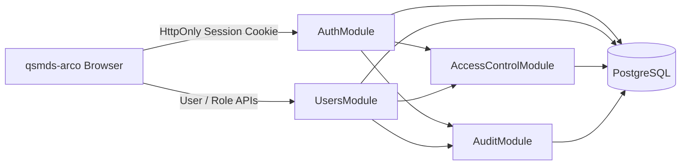

# 千树 DMS 用户认证与权限体系设计

## 文档信息

| 项目 | 内容 |
| --- | --- |
| 文档状态 | 已确认，功能分支本地验收完成 |
| 方案定位 | 单 `AuthSession`、可用性优先的首期方案 |
| 适用范围 | `server/` 与 `web/apps/qsmds-arco/` |
| 最后更新 | 2026-07-18 |
| 实施状态 | 核心 Auth、User、RBAC、Audit、Web 管理流程、真实浏览器认证及管理界面关键操作场景均已落地；根 `node --run check` 已通过，GitHub 平台和生产门禁仍待真实验收 |

本文取代此前包含 `RememberCredential`、设备管理、近期二次认证、临时密码、Web Locks、passive probe 和 suspension sentinel 的高复杂度方案。

设计原则是：先实现一个足够安全、容易理解、能够稳定运行的用户体系；未来只有在真实业务和风险证据出现后，再增加 MFA、设备管理或更强的浏览器并发控制。

## 1. 目标与边界

### 1.1 目标

- 使用 `username + password` 完成登录。
- 使用服务端 `AuthSession` 支撑关闭浏览器后的持续登录。
- Session 空闲 48 小时失效，创建 30 天后绝对失效。
- 使用 PostgreSQL 作为用户、Session、权限、限流和审计的唯一真相源。
- 支持用户、角色、权限和 `system_admin` 管理。
- 支持管理员直接创建用户密码、设置或重置用户密码。
- 支持管理员决定用户下次登录后是否必须修改密码。
- 支持用户主动修改密码、退出当前登录和退出全部登录。
- 前端只负责展示和交互，后端 Guard 始终是认证与权限真相源。

### 1.2 首期范围

- 用户创建、查询、编辑、启用和禁用。
- 密码登录、Session 校验、Session 活动续期和退出。
- 用户主动改密和强制改密。
- 管理员直接设置或重置用户密码。
- Role、Permission、UserRole 和 RolePermission。
- 管理操作审计、登录限流和认证数据清理。
- `system_admin` 初始化和离线恢复。
- OpenAPI、Server 测试和 Web 接入。

### 1.3 明确不做

首期不实现：

- `RememberCredential`、Refresh Token 或任何 Session renew 接口。
- 设备列表、设备命名、当前设备判断或单设备撤销。
- 临时密码、一次性密码展示或密码 24 小时过期。
- 近期二次认证、`/auth/reauth` 或 `reauthenticatedAt`。
- MFA、短信、邮件、Passkey、WebAuthn、SSO 或第三方登录。
- 用户自助注册、忘记密码邮件和短信找回。
- JWT、前端 Token、`localStorage` Token 或自定义 `Token` Header。
- Redis Session、Redis 权限缓存或 Redis 限流。
- Web Locks 强制门禁、Cookie mutation coordinator 或服务端 fencing。
- 60 至 75 秒 passive probe、前台 freshness clock 或 suspension sentinel。
- Service Worker kill-switch；本项目首期不注册 Service Worker。
- 组织、部门、租户和业务数据范围。

### 1.4 已接受的首期残余风险

- Session 最长可持续 30 天；受信浏览器在 48 小时内有活动就不会因 idle 退出。
- 没有 MFA 和近期二次认证。被盗且尚未撤销的管理员 Session 可以执行其已有权限允许的管理操作。
- 多标签同时登录和退出时，浏览器最后处理的 Session Cookie 响应生效；下一次 `/me` 或业务请求重新读取服务端真相。
- BroadcastChannel 消息可能丢失。没有继续请求的旧标签可能暂时显示旧页面，但任何新业务请求仍由后端重新鉴权。
- 用户无法查看或单独撤销某个 Session；只能退出当前登录或退出全部登录。
- 管理员重置密码不经过双人审批。
- Session 活动以 5 分钟窗口合并写入；每个请求仍校验 Session，但真实最后活动到 idle 失效可能最多提前不到 5 分钟。
- Network unknown 时，mutation transport 在客户端 settled 不代表 Server 事务一定已结束；操作后新发起的 `/me` 只表示其查询时刻的服务端身份，在途 mutation 稍后提交时由下一次 `/me` 或业务请求继续收敛。

## 2. 当前功能分支事实

### 2.1 后端

当前 `server/` 已有：

- NestJS、Prisma、PostgreSQL 和统一 `/api` 前缀。
- `X-Request-Id`、统一 `ApiError`、DTO 校验和异常脱敏。
- OpenAPI 生成、契约同步、CI、E2E 和发布归档基础设施。
- `GET /api/health`。
- `AuthModule`、`UsersModule`、`RolesModule`、`PermissionsModule` 和 `AuditModule`。
- User、Role、Permission、关系、AuthSession、AuthRateLimit 和 AuditEvent 的 Prisma Schema 与不可变 migration。
- 登录、当前身份、退出、改密、用户、角色、权限目录和审计查询的 Cookie Session API。
- `system_admin` 初始化、离线恢复和认证数据清理命令。

公开 API 与数据库结构已经按本轮用户确认落地；后续任何公共 API、数据结构或数据库 Schema 变化仍需按仓库规则单独确认。

### 2.2 前端

当前 `qsmds-arco` 已有：

- 真实 `username + password` 登录、启动 `/api/auth/me` 恢复和 Cookie Session 退出流程。
- `loading`、`anonymous`、`authenticated`、`password_change_required`、`logging_out`、`unavailable` 六态身份生命周期。
- 共享普通/强制改密 Modal，以及用户、角色、权限目录和审计管理界面。
- `withCredentials`、固定 CSRF Header、统一 401 收口、`authEpoch` 和 best-effort `BroadcastChannel` 同步。
- 从 `/api/auth/me` 读取的权限快照，以及按权限控制的菜单、路由和按钮。
- 启动前 best-effort 删除历史认证 Storage，Account Store `persist: false`，不保存或发送 Token。

`app.ts` 中仍保留的 fake route 只服务路由、偏好、标签栏、收藏和通知等非认证框架能力，不是身份或权限真相源。旧 fake 认证、Token 读取/写入和 Header 注入已经退出正式身份链路。

### 2.3 仓库边界

- 根目录只做治理和编排，不是 pnpm workspace。
- `server/` 和 `web/` 是独立依赖域。
- Web 与 Server 只通过 HTTP 和 OpenAPI 协作。
- 本轮数据库 Schema 和公共 API 已取得用户确认；未来变更仍需按仓库规则单独确认。

## 3. 已确认决策

### 3.1 Session

| 项目 | 决策 |
| --- | --- |
| 认证凭证 | 仅 `AuthSession` |
| 空闲过期 | 48 小时 |
| 绝对过期 | 30 天 |
| 浏览器关闭后 | Cookie 持久化，仍可继续使用未过期 Session |
| 续期 | 不存在 `/renew`；有效请求只延长 Session idle |
| 活动写入 | 每次请求都校验；距上次持久化活动至少 5 分钟才 touch |
| 权限来源 | 每次请求读取 PostgreSQL 当前关系 |
| Redis | 不使用 |

服务端时间是最终真相。达到边界即失效：

```text
databaseNow >= idleExpiresAt
OR databaseNow >= absoluteExpiresAt
```

新 Session：

```text
createdAt = databaseNow
lastActivityAt = databaseNow
idleExpiresAt = databaseNow + 48 hours
absoluteExpiresAt = databaseNow + 30 days
```

有效请求都必须在数据库线性化点复查 Session 有效性。只有满足以下条件才写活动时间：

```text
databaseNow >= lastActivityAt + 5 minutes
```

需要 touch 时原子更新：

```text
lastActivityAt = databaseNow
idleExpiresAt = min(databaseNow + 48 hours, absoluteExpiresAt)
```

`databaseNow` 必须来自 PostgreSQL `clock_timestamp()`。安全期限不能使用固定在事务开始时间的 `now()` 或 `transaction_timestamp()`。

窗口内的请求不写 Session 行，用上一个已持久化活动点表示。不启动后台心跳，不使用 Redis。

### 3.2 Session Cookie

生产只使用：

```text
__Host-qianshu_session
```

属性：

```text
Secure
HttpOnly
SameSite=Strict
Path=/
无 Domain
Max-Age = 当前 Session 绝对期限剩余秒数
Expires = absoluteExpiresAt
```

Cookie 是持久 Cookie，但 Cookie 到期时间不是安全真相。即使浏览器仍携带 Cookie，服务端也必须拒绝 idle 过期、绝对过期、撤销、用户禁用或 `authVersion` 不匹配的 Session。

development/test 只允许使用独立名称 `qianshu_session_dev`。本地 HTTP 联调时只允许精确 loopback `APP_ORIGIN`，设置 `HttpOnly`、`SameSite=Strict`、`Path=/`、无 `Domain`，且只允许在非 production 配置中省略 `Secure`。除 Cookie name 和允许省略 `Secure` 外，`Max-Age`、`Expires` 和服务端期限语义与 production 完全一致。production 若尝试使用 dev Cookie 或省略 `Secure`，Server 必须拒绝启动。受版本控制的 OpenAPI snapshot 仍只声明一个 `sessionCookie` security scheme，Cookie name 使用 production 的 `__Host-qianshu_session`；dev name 只是运行时 provider 替换，不生成第二个 scheme。

### 3.3 管理员创建和重置密码

- 创建用户时由管理员直接输入初始密码。
- 重置密码时由管理员直接输入新密码。
- 管理员勾选 `mustChangePassword` 决定用户登录后是否必须改密。
- 新密码立即成为用户真实登录密码。
- 不生成临时密码，不返回密码，不设置密码过期时间。
- 不要求管理员再次输入自己的密码。
- 不要求近期二次认证。
- 管理接口禁止管理员重置本人密码；本人改密走普通改密流程。
- 可以重置禁用用户，但用户状态必须继续保持 `DISABLED`。
- 成功后递增目标 `authVersion` 并撤销目标全部 Session。
- 密码明文不得进入响应、日志、审计、URL、Store 或持久化 Storage。

### 3.4 强制改密

`mustChangePassword` 是独立布尔字段，不再与临时密码或到期时间绑定。

- `false`：用户登录后可正常访问有权限的业务。
- `true`：密码登录成功并创建受限 Session，但只能访问 `/auth/me`、改密和退出。
- 前端进入 `password_change_required` 状态后，由应用根认证层自动打开不可关闭的强制改密 Modal；不创建独立页面或路由，不挂载业务菜单或业务 Shell。
- 强制改密 Modal 只显示新密码、确认密码、提交和退出，不再次要求当前密码；关闭按钮、Esc 和遮罩点击都不能关闭，正常交互中只有改密成功或退出才能结束，Session 失效时仍按统一 `401` 流程返回登录。
- 强制改密成功后清除标志、撤销全部旧 Session并创建一个新的完整 Session。
- 新密码必须与管理员设置的现有密码不同。

### 3.5 普通主动改密

不处于强制改密状态的用户主动改密时：

- 从用户菜单打开可关闭的普通改密 Modal，不创建独立页面或路由，不改变当前业务路由。
- 必须提交并验证当前密码。
- 必须满足新密码策略。
- 新密码必须与当前密码不同。
- 成功后递增 `authVersion`、撤销全部旧 Session并创建一个新的当前 Session，关闭 Modal并留在当前有权限的业务路由。

## 4. EARS 需求基线

### 4.1 登录与 Session

1. 当没有有效 Session 的用户提交正确 username 和 password 时，系统必须创建新的 `AuthSession` 并设置持久 Session Cookie。
2. 当账号不存在、密码错误、用户禁用或密码状态不可用时，系统必须统一返回 `INVALID_CREDENTIALS`。
3. 当 login 请求已经携带有效 Session 时，系统必须返回 `ALREADY_AUTHENTICATED`；切换账号必须先 logout。
4. 当 Session 最后一个已持久化活动点达到 48 小时时，系统必须拒绝该 Session；活动写入精度为 5 分钟。
5. 当 Session 创建达到 30 天时，无论是否活跃，系统必须拒绝该 Session。
6. 当有效受保护请求通过且距上次持久化活动已满 5 分钟时，系统必须原子更新 `lastActivityAt` 和受绝对期限封顶的 `idleExpiresAt`；窗口内只校验不写入。
7. 当 Session 被撤销、用户被禁用或 `authVersion` 不匹配时，系统必须拒绝该 Session。
8. 当 Session 不可用时，客户端必须清理身份状态并回到登录流程，不得尝试 renew。
9. 当用户退出当前登录时，系统必须撤销当前 Session并清除 Cookie。
10. 当用户退出全部登录时，系统必须递增 `authVersion`、撤销该用户全部 Session并清除 Cookie。

### 4.2 密码

1. 当管理员创建用户时，系统必须接收初始密码和 `mustChangePassword`，只保存密码 Hash。
2. 当管理员重置用户密码时，系统必须接收新密码和 `mustChangePassword`，不生成或返回临时密码。
3. 当管理员重置密码成功时，系统必须原子更新密码、递增 `authVersion`、撤销全部 Session并写审计。
4. 当管理员重置禁用用户时，系统不得隐式启用该用户。
5. 当管理员通过管理接口重置本人密码时，系统必须拒绝。
6. 当 `mustChangePassword=true` 的用户登录时，系统必须创建受限 Session并禁止业务 API。
7. 当受限用户提交合规且不同的新密码时，系统必须完成改密并创建新的完整 Session。
8. 当普通用户主动改密时，系统必须先验证当前密码。
9. 当任何密码操作失败时，系统不得在响应、日志或审计中暴露密码。

### 4.3 RBAC

1. 当请求访问受保护 API 时，系统必须先验证 Session，再验证强制改密状态，最后验证权限。
2. 当用户拥有多个角色时，系统必须使用角色权限并集。
3. 当没有明确允许权限时，系统必须默认拒绝。
4. 当前端隐藏按钮或路由时，后端仍必须独立检查权限。
5. 当普通 Role 或 RolePermission 变化时，系统必须从下一次请求开始使用 PostgreSQL 当前值。
6. 当操作可能移除最后一个 active `system_admin` 时，系统必须拒绝该操作。
7. 当修改角色和权限分配时，系统必须只允许 `system_admin` 持有的 `systemOnly` 管理权限执行。

### 4.4 前端身份生命周期

1. 当应用启动时，前端必须调用一次共享 `/api/auth/me` 后再决定显示登录页还是业务系统。
2. 当 `/me` 返回有效 Context 且 `mustChangePassword=false` 时，前端必须进入业务系统；当 `mustChangePassword=true` 时，前端必须进入 `password_change_required` 状态并自动显示不可关闭的强制改密 Modal，不得导航到独立改密页面或挂载业务 Shell。
3. 当受保护请求返回确定的 Session 失效 `401` 时，前端必须只执行一次共享身份清理。
4. 当 Network 或 `5xx` 发生时，前端不得把用户当成已经退出。
5. 当 logout 返回 `204` 时，前端必须清除全部身份域状态后再显示登录页。
6. 当旧请求晚于 logout、登录或改密返回时，前端必须通过只在身份边界变化时递增的 `authEpoch` 拒绝旧结果，并以内部取消错误结束原 Promise。
7. 当收到跨标签认证变化提示时，前端必须把消息当成重新调用 `/me` 的提示，而不是认证证明。
8. 当 BroadcastChannel 不可用或消息丢失时，系统可以继续工作，并在下一次 API、reload 或 pageshow 时收敛。
9. 当 login、改密、logout 或 logout-all 结果未知时，前端必须使用在该 mutation transport settled 之后发起的新 `/me` 判断服务端状态，不得复用 mutation 之前开始的请求。
10. 当远端标签的失效提示导致本标签进入 anonymous 时，本标签不得再广播相同失效消息；已是 anonymous 的重复失效必须幂等。
11. 当非强制改密用户从用户菜单选择修改密码时，前端必须在当前业务路由打开可关闭的普通改密 Modal，不得导航到独立改密页面。

### 4.5 运行与发布

1. 当 production 启动时，系统必须要求 HTTPS、精确 `APP_ORIGIN` 和受控代理配置。
2. 当返回任何依赖身份、权限或数据范围的 API 响应时，系统必须设置 `Cache-Control: private, no-store`。
3. 当执行密码 Hash 或 verify 时，系统必须使用统一有界 Argon2 资源 provider。
4. 当认证状态修改成功时，系统必须在同一事务写安全审计。
5. 当清理认证数据时，系统必须由单一外部 Cron 运行，并使用小批删除和超时。
6. 当两个 cleanup 命令重叠运行时，系统必须通过单个 PostgreSQL advisory lock 只允许一个执行删除，另一个安全跳过。
7. 当首次将旧 fake/Token Header 链路切换为 Cookie Session 时，系统必须使用维护窗口作为单一版本切换边界，不得对外混跑不兼容 Web/Server。

## 5. 总体架构



### 5.1 模块

```text
server/src/modules/auth/
server/src/modules/users/
server/src/modules/access-control/
server/src/modules/audit/
```

继续使用：

```text
Controller -> Service -> PrismaService -> PostgreSQL
```

首期不增加 Repository、UseCase 或 Domain Entity 层。Token 生成、密码 Hash、Cookie 构造、权限 decorator 和限流 provider 可以作为小型 provider。

### 5.2 Guard 顺序

```text
Request
  -> CsrfProtectionGuard / middleware
  -> AuthenticationGuard
  -> PasswordChangeRequiredGuard
  -> PermissionGuard
  -> Controller
```

- `@Public()`：健康检查和登录。
- `@OptionalSession()`：只用于 logout；仍先执行 CSRF 检查，有有效 Session 就撤销，没有或无效则只清 Cookie并返回 `204`。
- `@AllowPasswordChangeRequired()`：只用于 `/auth/me`、改密、logout 和 logout-all。
- `@RequirePermissions(...)`：声明权限。
- 不存在 `RecentAuthenticationGuard` 或 `@RequireRecentAuthentication(...)`。

### 5.3 事务与时间

- 密码 verify/hash 在事务外完成，但必须先取得有界 Argon2 slot。
- 事务内锁定 User 后必须重新比较 `passwordHash`、`authVersion` 和状态。
- 多 User 或 Role 锁按 UUID 排序取得。
- 授权图写入先收集完整待锁 Role 集合并按 UUID 排序锁定，再锁排序后的 User，最后写关系。
- 所有可能减少 active `system_admin` 数量的操作必须把唯一 `system_admin` Role 纳入完整待锁 Role 集合，在所有 Role 按 UUID 排序锁定且 User 锁定后重新计数，才能修改。
- AuthenticationGuard 必须把“Session 有效性复查与按窗口 touch”定义为一个数据库线性化操作；在该点之后发生的撤销影响后续请求，不回溯取消已通过 Guard 的在途请求。
- 密码修改、重置、禁用和 logout-all 在同一事务撤销 Session并写 Audit。
- 所有 Session 撤销只更新 `revokedAt IS NULL` 的记录，并在第一次撤销时同时写入 `revokedAt=databaseNow` 和固定 `revokedReason`；重复操作不得覆盖原撤销时间或原因。首期原因枚为 `LOGOUT`、`LOGOUT_ALL`、`PASSWORD_CHANGED`、`PASSWORD_RESET`、`USER_DISABLED` 和 `ADMIN_RECOVERY`。
- 所有安全期限在取得所需锁后，以 PostgreSQL `clock_timestamp()` 捕获本次 `databaseNow`。
- 事务设置合理的 `lock_timeout` 和 `statement_timeout`，超时安全失败，不无限等待。

## 6. 安全与信任边界

### 6.1 Session Token

Cookie 值格式：

```text
sessionId.secret
```

- `sessionId` 是不可预测 UUID selector。
- `secret` 使用 CSPRNG 生成，至少 256 bit。
- 数据库只保存 32-byte Hash。
- secret Hash 比较使用 constant-time API。
- Session、Cookie、secret 和 Hash 不进入日志、审计、URL 或 OpenAPI example。
- 不使用 JWT，不在客户端保存认证 Token。

### 6.2 CSRF

同源 Cookie 认证保留以下组合防护：

1. 状态修改只使用 `POST/PUT/PATCH/DELETE`。
2. 不安全方法只接受 `application/json`。
3. 前端发送 `X-Qianshu-CSRF: 1`。
4. 服务端严格比较 `Origin` 与 `APP_ORIGIN`。
5. 拒绝 `Origin: null`、不匹配 Origin 和 `Sec-Fetch-Site: cross-site`。
6. 不启用通配 CORS。
7. login、改密、logout、用户创建和密码重置同样执行检查。

Session activity touch 是安全 GET 的认证附带状态，不属于业务领域状态修改。

### 6.3 密码

- 所有 password 输入在策略判断、比较、Hash 或 verify 前统一执行 Unicode NFC，包括 login password、currentPassword、newPassword、bootstrap、recovery 和管理员创建/重置输入。
- 长度为 8 至 20 个 Unicode code point。
- 接受空格和 Unicode；任何 password 输入都不 trim，不强制字符组合。
- 使用 Argon2id PHC 字符串保存。
- 参数不得低于 `m=19456 KiB, t=2, p=1`，生产压测后只允许增强。
- 所有 Hash 和 verify 共用有界并发与有界队列。
- 登录密码输入长度为 8 至 20 个 Unicode code point，超出范围时在 Argon2 前拒绝。
- 成功验证旧参数 Hash 后可以在受控资源内升级 Hash 参数。

### 6.4 来源、Origin 与代理

- `APP_ORIGIN` 必须由可信 Web 与 API 独占。
- 用户上传、富文本 active content 和低信任应用必须位于不携带认证 Cookie 的独立 origin。
- HTTP 入口只接受精确 production authority，并重定向到固定 `APP_ORIGIN`；不回显请求 Host。
- Server 直连时使用 socket remote address。
- 代理部署必须明确 hop/CIDR，禁止 `trust proxy=true`。
- proxy 到 Server 必须使用 mTLS、同机 Unix socket或受操作系统隔离的 loopback。
- Server 端口只允许受信代理或本机访问。

### 6.5 Header、缓存和日志

- 所有认证、用户、角色、权限、审计及业务敏感响应使用 `Cache-Control: private, no-store`。
- 设置或清除 Cookie 的响应同样使用 `private, no-store`。
- Web 入口 HTML 使用 `Cache-Control: no-cache, must-revalidate`，发布和回滚时主动失效边缘上的旧 HTML；带内容 Hash 的静态资源使用 `Cache-Control: public, max-age=31536000, immutable`。
- 密码输入 API 不记录请求体。
- 结构化日志只记录 requestId、operation、结果码和脱敏主体。
- production 使用 HSTS、CSP、`nosniff`、`DENY`/`frame-ancestors 'none'` 和 `Referrer-Policy: no-referrer`。
- 本项目首期不注册 Service Worker，认证 API 不进入 CacheStorage。

## 7. 数据模型

以下是逻辑模型。实施时由 Prisma Schema 和不可变 migration 落地。

### 7.1 User

| 字段 | 说明 |
| --- | --- |
| `id` | UUID |
| `username` | 稳定登录名 |
| `usernameNormalized` | NFC、trim、lowercase 后唯一 |
| `displayName` | 展示名称 |
| `passwordHash` | Argon2id PHC |
| `status` | `ACTIVE` 或 `DISABLED` |
| `mustChangePassword` | 独立强制改密标志 |
| `passwordChangedAt` | 最近密码变更时间 |
| `authVersion` | 全部认证状态版本 |
| `lastLoginAt` | 最近成功登录 |
| `createdByUserId` | 可空创建者；bootstrap 创建首个管理员时为 `null` |
| `disabledAt` / `disabledByUserId` | 禁用信息 |
| `createdAt` / `updatedAt` | 审计时间 |

约束：

- `usernameNormalized` 唯一。
- `status=ACTIVE` 时禁用字段为空；`DISABLED` 时禁用字段完整。
- `authVersion` 非负。
- 创建 User 时 `passwordChangedAt=databaseNow`、`lastLoginAt=null`、`authVersion=0`；每次密码登录成功时在同一事务更新 `lastLoginAt=databaseNow`。
- `mustChangePassword` 不再与任何密码到期字段绑定。
- `createdByUserId=null` 只允许系统 bootstrap 路径，并由 `SYSTEM_BOOTSTRAP` Audit 的 system actor 记录来源。
- User 不返回 `passwordHash` 或 `authVersion`。

### 7.2 Role 与 Permission

`Role`：

| 字段 | 说明 |
| --- | --- |
| `id` | UUID |
| `code` | 稳定唯一代码 |
| `name` / `description` | 中文名称与说明 |
| `isSystem` | 是否内置角色 |

`Permission`：

| 字段 | 说明 |
| --- | --- |
| `id` | UUID |
| `code` | `resource:action` |
| `name` / `description` | 中文名称与说明 |
| `systemOnly` | 是否只允许内置系统角色持有 |

关系：

- `UserRole(userId, roleId)` 唯一。
- `RolePermission(roleId, permissionId)` 唯一。
- `system_admin` 是唯一 `isSystem=true` 的首期系统角色。
- `systemOnly` 权限不能通过通用 API 分配给普通角色。

### 7.3 AuthSession

| 字段 | 说明 |
| --- | --- |
| `id` | Cookie selector |
| `userId` | 所属用户 |
| `tokenHash` | 32-byte Hash，唯一 |
| `authVersion` | 创建时 User 认证版本 |
| `createdAt` | 创建时间 |
| `lastActivityAt` | 最近有效活动 |
| `idleExpiresAt` | 48 小时空闲期限 |
| `absoluteExpiresAt` | 30 天绝对期限 |
| `revokedAt` / `revokedReason` | 撤销信息 |

有效条件：

```text
User.status = ACTIVE
AND session.revokedAt IS NULL
AND session.authVersion = User.authVersion
AND databaseNow < session.idleExpiresAt
AND databaseNow < session.absoluteExpiresAt
```

数据库必须具有：

- `UNIQUE(tokenHash)`。
- `CHECK(idleExpiresAt <= absoluteExpiresAt)`。
- 撤销时间与原因同时为空或同时有值。
- `(userId, revokedAt, absoluteExpiresAt)` 和 `idleExpiresAt` 索引。

Session 不包含：

```text
rememberCredentialId
reauthenticatedAt
supersededAt
predecessorSessionId
sourceRememberTokenId
deviceLabel
```

### 7.4 AuthRateLimit

最小范围：

| scope | 默认限制 |
| --- | --- |
| `LOGIN_USERNAME` | 15 分钟 5 次失败 |
| `LOGIN_IP` | 15 分钟 30 次失败 |
| `PASSWORD_CHANGE_USER` | 15 分钟 5 次当前密码失败 |
| `PASSWORD_CHANGE_IP` | 15 分钟 30 次失败 |

字段：

```text
scope
subjectKeyHash
bucketStartedAt
attemptCount
blockedUntil
updatedAt
```

- `(scope, subjectKeyHash)` 唯一。
- username、userId 和来源 IP 使用独立 HMAC key。
- 边缘还必须提供有限基数的全局请求限制，避免大量随机 username/IP 制造无限数据库行。
- 限流必须在昂贵 Argon2 前生效：一次操作涉及的 username/userId 与 IP 桶必须在同一短事务中原子预占，并按固定顺序取得行锁；任一桶拒绝时整笔预占回滚，事务不得跨 Argon2 持锁。
- 凭证错误保留本次预占；验证成功、Argon2 capacity、数据库或状态竞争等非凭证错误只释放本次预占，不清除并发请求已经形成的真实失败计数。释放必须携带固定窗口 key，迟到释放不得误减下一窗口。正确凭证在业务事务前通过独立短事务单次释放；释放提交结果未知时采用 fail-closed，不重试，避免误减同窗口的其他真实失败计数。
- 若进程在预占提交后、释放前被强制终止，该次预占会保留到 15 分钟窗口结束；当前不新增 reservation table 或字段，接受这项有界残余。

### 7.5 AuditEvent

最小字段：

```text
id
eventType
outcome
occurredAt
actorType
actorUserId
targetType
targetId
requestId
correlationId
reasonCode
sourceIpHash
metadata
```

禁止写入：

- 当前密码、新密码或管理员设置的密码。
- Session Cookie、Session secret 或 tokenHash。
- 完整认证请求体。
- 数据库连接串、SQL 参数和原始异常。

关键状态修改与成功 Audit 必须处于同一事务。

### 7.6 保留与清理

- Session 实际结束时间定义为 `LEAST(idleExpiresAt, absoluteExpiresAt, COALESCE(revokedAt, 'infinity'::timestamptz))`，实际结束 30 天后删除。
- RateLimit 最后更新 7 天后且未阻断时删除。
- 安全 Audit 在线保留 365 天。
- `pnpm -C server auth:cleanup` 由单一外部 Cron 每日调用。
- cleanup 命令入口使用一个固定 session-level `pg_try_advisory_lock` 防止重入；未取得锁时记录 `skipped_already_running` 指标并成功退出，不执行删除。同一个专用 PostgreSQL connection 必须负责 acquire、持有和 release，在整轮批次结束前保持打开，并在 `finally` 中执行 `pg_advisory_unlock` 后断开。不得通过无法保证连接一致的普通池化 Prisma 调用持锁；测试必须断言 lock/unlock 使用同一 backend PID。
- cleanup 使用固定 cutoff、小批删除和 statement timeout，每批独立事务；只统计已提交批次，任一未恢复失败都非零退出，由 Cron 告警并在下次重试。
- API 实例不自行启动定时器。

## 8. 核心流程

### 8.1 登录

```text
POST /api/auth/login
  -> 校验 CSRF、DTO 和登录限流
  -> 若请求已有有效 Session，返回 ALREADY_AUTHENTICATED
  -> 规范化 username
  -> 查询 User 或使用固定 dummy Hash
  -> 取得 Argon2 slot 并验证密码
  -> 事务锁 User，复查 passwordHash/authVersion/status
  -> 更新 lastLoginAt=databaseNow
  -> 创建 48h/30d AuthSession
  -> 写 AUTH_LOGIN_SUCCEEDED Audit
  -> 提交后设置持久 Session Cookie
  -> 返回 AuthContextDto
```

未知用户、密码错误和禁用用户统一：

```text
401 INVALID_CREDENTIALS
```

登录 request 不包含 `rememberMe`。登录成功不返回 Session Token。

### 8.2 启动和恢复

```text
GET /api/auth/me
  -> 200: 使用服务端 AuthContext
  -> 401 AUTHENTICATION_REQUIRED: 清理并显示登录页
  -> Network/5xx: unavailable，允许重试
```

没有 renew、Remember fallback 或自动重放。

### 8.3 Session Guard

每个受保护请求：

1. 解析 `sessionId.secret`。
2. 有界查询 selector。
3. constant-time 验证 secret Hash。
4. 使用同一个 `clock_timestamp()` 在一个数据库操作中复查 User 状态、`authVersion`、撤销和两个期限；无有效行时返回 `401`。
5. 距上次持久化活动已满 5 分钟时，在同一数据库操作中条件 touch；窗口内不写 Session 行。多个并发请求跨过窗口时最多一个实际更新。
6. 从 PostgreSQL 当前 Role/Permission 关系构造请求身份。
7. 继续执行强制改密和 Permission Guard。

每次成功通过 AuthenticationGuard 的请求都属于有效活动，包括 `GET /api/auth/me`，但持久化写入按 5 分钟窗口合并。login 和 optional-session logout 不 touch。前端不发送后台心跳，`lastActivityAt` 表示最近一次已持久化活动。

任何不可用 Session 对客户端统一返回：

```text
401 AUTHENTICATION_REQUIRED
```

具体原因只用于内部 Audit 和指标。

### 8.4 用户主动改密

正常模式：

```text
currentPassword + newPassword
```

强制改密模式：

```text
newPassword
```

固定流程：

1. 验证当前 Session。
2. 正常模式先限流并验证当前密码；强制模式以受限 Session 作为准入证明。
3. 校验新密码，拒绝与现有密码相同。
4. 事务锁 User 和当前 Session，复查状态与版本。
5. 更新 Hash、`passwordChangedAt`、`mustChangePassword=false`。
6. 递增 `authVersion`。
7. 撤销全部旧 Session，创建一个新的完整 Session。
8. 写 `USER_PASSWORD_CHANGED` Audit。
9. 提交后设置新 Cookie并返回 AuthContext。

### 8.5 创建用户

```http
POST /api/users
```

```json
{
  "username": "alice",
  "displayName": "Alice",
  "password": "administrator supplied password",
  "mustChangePassword": true
}
```

- 仅有 `users:create` 的管理员可以调用。
- 密码在组件局部输入，经 TLS 发送，只保存 Hash。
- 首期不在创建请求中接受 roles；角色通过专用接口分配。
- 成功响应只返回 User DTO，不返回密码。
- 新用户默认 `ACTIVE`，是否强制改密由 request 决定；创建时设置 `passwordChangedAt=databaseNow`、`lastLoginAt=null`、`authVersion=0`。
- 创建成功后若尚未分配任何 Role，管理页必须明确提示“用户已创建，当前无业务权限”并提供分配角色入口。

### 8.6 管理员设置或重置密码

```http
POST /api/users/{userId}/password-reset
```

```json
{
  "newPassword": "administrator supplied password",
  "mustChangePassword": true
}
```

固定流程：

1. Guard 验证 Session 和 `users:reset-password`。
2. 在 Hash 前拒绝 target 等于 actor，读取 target 的 `passwordHash/authVersion/status` 快照；校验密码并在有界 Argon2 slot 中生成 Hash。
3. 事务按 UUID 锁 actor/target User，再锁 actor current Session；不预先查询或逐行锁定 target 的全部 Session。
4. 重新确认 actor Session 和 actor 状态仍有效，再次拒绝自重置，并比较 target 快照；已变化则返回 `AUTH_STATE_CHANGED`。
5. 更新密码 Hash、`mustChangePassword` 和 `passwordChangedAt`。
6. 递增 target `authVersion`。
7. 使用一次批量 `UPDATE` 撤销 target 全部 Session；User 锁与 `authVersion` 防止并发 login 产生遗漏的旧版本 Session。
8. 写 `USER_PASSWORD_RESET` Audit；metadata 只记录 `mustChangePassword`。
9. 提交后返回更新后的 User DTO。

该流程：

- 不调用 `/auth/reauth`。
- 不检查 `reauthenticatedAt`。
- 不生成或返回临时密码。
- 允许 target 为 `DISABLED`，但不得改变其状态。
- 允许重置另一名 `system_admin`。
- 不需要 `LAST_SYSTEM_ADMIN_REQUIRED`，因为密码重置不改变角色或启用状态。

### 8.7 启用、禁用和角色变化

- 禁用用户时设置 `status=DISABLED`、`disabledAt=databaseNow`、`disabledByUserId=actor.id`，递增 `authVersion`、批量撤销全部 Session并审计。
- 启用用户时同时设置 `status=ACTIVE`、`disabledAt=null`、`disabledByUserId=null`；不修改 `authVersion`，不恢复旧 Session。
- 授予或移除角色时直接更新关系集合并审计。
- 普通角色和权限变化不撤销 Session；下一请求实时读取新权限。
- 已通过 Permission Guard 的在途请求允许完成；权限撤销从下一次请求生效，不为首期增加全局授权 revision 或跨事务锁。
- 禁止禁用或移除最后一个 active `system_admin`；操作必须把 `system_admin` 纳入完整待锁 Role 集合，按 UUID 排序锁定全部 Role 后再锁 User、重新计数并决定是否返回 `LAST_SYSTEM_ADMIN_REQUIRED`。
- active `system_admin` 固定定义为 `User.status=ACTIVE` 且存在 `UserRole -> Role.code='system_admin'`。
- 管理接口禁止把 `systemOnly` 权限授予普通角色。
- `users:assign-roles` 和 `roles:assign-permissions` 首期只允许 `system_admin`。

### 8.8 退出

`POST /api/auth/logout`：

- 使用 `@OptionalSession()`；有效 Session 存在时幂等撤销当前 Session。
- 无有效 Session 时仍使用相同属性清 Cookie并返回 `204`。
- 无论 Session 是否有效都必须通过 CSRF 检查，且不得泄露 Cookie 对应 Session 是否曾存在。

`POST /api/auth/logout-all`：

- 要求有效 Session。
- 递增当前 User `authVersion`。
- 撤销该用户全部 Session。
- 清 Cookie并返回 `204`。

两者都不包含设备概念。

## 9. RBAC 设计

### 9.1 语义

- 权限码格式为 `resource:action`。
- 权限纯允许、默认拒绝。
- 多角色权限取并集。
- Role 只组织权限，不在 Controller 中判断角色字符串。
- 后端 Permission Guard 是安全真相源。
- 前端路由、菜单和按钮只改善体验。
- 权限不写入 Session。

### 9.2 首期管理权限

| 权限码 | 说明 | systemOnly |
| --- | --- | --- |
| `users:read` | 查询用户 | 是 |
| `users:create` | 创建用户并设置初始密码 | 是 |
| `users:update` | 编辑基础信息 | 是 |
| `users:enable` | 启用用户 | 是 |
| `users:disable` | 禁用用户 | 是 |
| `users:assign-roles` | 分配角色 | 是 |
| `users:reset-password` | 设置或重置用户密码 | 是 |
| `roles:read` | 查询角色和权限目录 | 是 |
| `roles:create` | 创建普通角色 | 是 |
| `roles:update` | 编辑普通角色 | 是 |
| `roles:assign-permissions` | 分配普通权限 | 是 |
| `audit:read` | 查询安全审计 | 是 |

首期只有内置 `system_admin` Role 持有这些管理权限。业务权限可以由 `system_admin` 分配给普通角色。

### 9.2.1 产品管理扩展权限

产品管理占位阶段只建立与现有页面一一对应的最小权限：

| 权限码 | 说明 | systemOnly |
| --- | --- | --- |
| `products:read` | 访问产品列表页面 | 否 |
| `products:create` | 访问新增产品页面 | 否 |

两个权限随迁移授予内置 `system_admin` Role；产品模型和业务 API 未进入本阶段，不提前声明更新、启停或删除权限。

### 9.2.2 资金账户路由权限

资金账户首期只建立两个空白读取入口，使用同一个系统专用权限：

| 权限码 | 说明 | systemOnly |
| --- | --- | --- |
| `fund-accounts:read` | 访问资金账户列表与资金账户流水页面 | 是 |

该权限随迁移仅授予内置 `system_admin` Role。普通角色不能通过角色权限维护接口获得该权限；Web 的父分组和两个叶子路由同时声明该权限，分别约束菜单和直接 URL 访问。本阶段没有资金账户业务 API。

### 9.2.3 打木架费用提报与付款

| 权限码 | 说明 | systemOnly |
| --- | --- | --- |
| `packaging-costs:create` | 上传包装、报价截图并提交已到仓货件的包装费用 | 否 |
| `packaging-costs:read` | 查询打木架付款队列、提报详情及私有截图 | 否 |
| `packaging-costs:pay` | 按包装费用资金规则确认付款并记账 | 否 |

三个权限默认只授予内置 `system_admin`，普通角色需显式配置。财务工作台、实收实付分组和打木架付款页都纳入 `packaging-costs:read`；提报与付款按钮分别受对应写权限约束。服务端继续通过 Permission Guard 和写事务内的权限复核执行授权，客户端提供的归属人、金额变更和付款人不作为可信来源。

具体流程见[打木架费用提报与付款](../../specs/warehouse-packaging-costs/implementation.md)。

### 9.3 防止权限提升

- 通用 API 不能修改 `system_admin` Role 本身。
- `systemOnly` Permission 不能分配给普通 Role。
- 普通用户不能给本人分配 Role。
- 只有 `system_admin` 可以修改 UserRole 和 RolePermission。
- 角色和权限关系修改必须在事务内复查 actor 权限。
- `Permission` ID 不存在时整体返回 `PERMISSION_NOT_FOUND`，不得部分替换。
- User roles 请求含任一不存在 Role ID 时整体返回 `ROLE_NOT_FOUND`。

### 9.4 数据范围

首期 RBAC 只回答能否执行某类操作。业务数据范围由未来领域模块在查询和写事务中显式实现。

## 10. API 契约

### 10.1 Auth API

| Method | Path | 成功响应 | 说明 |
| --- | --- | --- | --- |
| `POST` | `/api/auth/login` | `200 AuthContextDto` | 密码登录并设置 Session Cookie |
| `GET` | `/api/auth/me` | `200 AuthContextDto` | 读取当前 AuthContext |
| `POST` | `/api/auth/password/change` | `200 AuthContextDto` | 普通改密或强制改密 |
| `POST` | `/api/auth/logout` | `204` | 退出当前 Session |
| `POST` | `/api/auth/logout-all` | `204` | 退出全部 Session |

不存在：

```text
/api/auth/session/renew
/api/auth/reauth
/api/auth/devices
```

`LoginRequestDto`：

```ts
interface LoginRequestDto {
  username: string
  password: string
}
```

`ChangePasswordRequestDto`：

```ts
interface ChangePasswordRequestDto {
  currentPassword?: string
  newPassword: string
}
```

条件：

- `mustChangePassword=false` 时 `currentPassword` 必填。
- `mustChangePassword=true` 时忽略并禁止依赖客户端当前密码字段。
- confirm password 只存在于前端表单，不进入 API。

`AuthContextDto`：

```ts
interface AuthContextDto {
  user: {
    id: string
    username: string
    displayName: string
    mustChangePassword: boolean
  }
  permissions: string[]
  session: {
    createdAt: string
    lastActivityAt: string
    idleExpiresAt: string
    absoluteExpiresAt: string
  }
}
```

`AuthContextDto.permissions` 必须去重并按 Permission code 升序返回。

### 10.2 User API

| Method | Path | Permission | 成功响应 | 说明 |
| --- | --- | --- | --- | --- |
| `GET` | `/api/users` | `users:read` | `200 UserPageDto` | 分页查询 |
| `POST` | `/api/users` | `users:create` | `201 UserDto` | 创建用户并设置初始密码 |
| `GET` | `/api/users/{userId}` | `users:read` | `200 UserDto` | 用户详情 |
| `PATCH` | `/api/users/{userId}` | `users:update` | `200 UserDto` | 只编辑 `displayName` |
| `POST` | `/api/users/{userId}/enable` | `users:enable` | `200 UserDto` | 启用 |
| `POST` | `/api/users/{userId}/disable` | `users:disable` | `200 UserDto` | 禁用并撤销 Session |
| `PUT` | `/api/users/{userId}/roles` | `users:assign-roles` | `200 UserDto` | 替换角色集合 |
| `POST` | `/api/users/{userId}/password-reset` | `users:reset-password` | `200 UserDto` | 直接设置或重置密码 |

`UserDto` 与分页：

```ts
interface UserDto {
  id: string
  username: string
  displayName: string
  status: 'ACTIVE' | 'DISABLED'
  mustChangePassword: boolean
  roleIds: string[]
  lastLoginAt: string | null
  createdAt: string
  updatedAt: string
}

interface UserPageDto {
  items: UserDto[]
  page: number
  pageSize: number
  total: number
}

interface UserListQueryDto {
  page?: number
  pageSize?: number
  username?: string
  status?: 'ACTIVE' | 'DISABLED'
}
```

`GET /api/users` 接受 `page`、`pageSize`、可选 `username` 和可选 `status`。`username` 只做服务端规范化后的精确匹配，不做模糊搜索；`status` 只接受 `ACTIVE` 或 `DISABLED`。两个条件可以组合，分页总数与当前页必须使用同一个过滤条件。分页默认 `1/20`，`pageSize` 最大为 `100`，固定按 `usernameNormalized ASC, id ASC` 排序。

`CreateUserRequestDto`：

```ts
interface CreateUserRequestDto {
  username: string
  displayName: string
  password: string
  mustChangePassword: boolean
}
```

`UpdateUserRequestDto` 和 `ReplaceUserRolesRequestDto`：

```ts
interface UpdateUserRequestDto {
  displayName: string
}

interface ReplaceUserRolesRequestDto {
  roleIds: string[]
}
```

`PasswordResetRequestDto`：

```ts
interface PasswordResetRequestDto {
  newPassword: string
  mustChangePassword: boolean
}
```

响应只返回 User DTO，绝不返回 request 中的密码。`username` 不允许通过 PATCH 修改；`roleIds=[]` 表示清空角色集合，但仍必须执行最后 `system_admin` 保护。`roleIds` 在响应中去重并按 UUID 升序。

enable 和 disable 使用 required empty JSON object `{}`；不通过 query 或隐式默认携带状态修改参数。

### 10.3 Role API

| Method | Path | Permission | 成功响应 |
| --- | --- | --- | --- |
| `GET` | `/api/roles` | `roles:read` | `200 RoleDto[]` |
| `POST` | `/api/roles` | `roles:create` | `201 RoleDto` |
| `GET` | `/api/roles/{roleId}` | `roles:read` | `200 RoleDto` |
| `PATCH` | `/api/roles/{roleId}` | `roles:update` | `200 RoleDto` |
| `PUT` | `/api/roles/{roleId}/permissions` | `roles:assign-permissions` | `200 RoleDto` |
| `GET` | `/api/permissions` | `roles:read` | `200 PermissionDto[]` |
| `GET` | `/api/audit-events` | `audit:read` | `200 AuditEventPageDto` |

```ts
interface RoleDto {
  id: string
  code: string
  name: string
  description: string | null
  isSystem: boolean
  permissionIds: string[]
}

interface CreateRoleRequestDto {
  code: string
  name: string
  description?: string
}

interface UpdateRoleRequestDto {
  name?: string
  description?: string | null
}

interface ReplaceRolePermissionsRequestDto {
  permissionIds: string[]
}

interface PermissionDto {
  id: string
  code: string
  name: string
  description: string | null
  systemOnly: boolean
}

type AuditEventType =
  | 'AUTH_LOGIN_SUCCEEDED'
  | 'AUTH_LOGIN_FAILED'
  | 'AUTH_LOGOUT'
  | 'AUTH_LOGOUT_ALL'
  | 'USER_CREATED'
  | 'USER_UPDATED'
  | 'USER_ENABLED'
  | 'USER_DISABLED'
  | 'USER_PASSWORD_CHANGED'
  | 'USER_PASSWORD_RESET'
  | 'USER_ROLES_CHANGED'
  | 'ROLE_CREATED'
  | 'ROLE_UPDATED'
  | 'ROLE_PERMISSIONS_CHANGED'
  | 'SYSTEM_BOOTSTRAP'
  | 'SYSTEM_ADMIN_RECOVERED'
  | 'AUTH_RETENTION_PURGED'

type AuditOutcome = 'SUCCESS' | 'FAILURE'

interface AuditEventDto {
  id: string
  eventType: AuditEventType
  outcome: AuditOutcome
  occurredAt: string
  actorType: string
  actorUserId: string | null
  targetType: string | null
  targetId: string | null
  requestId: string
  correlationId: string | null
  reasonCode: string | null
  metadata: Record<string, string | number | boolean | null>
}

interface AuditEventPageDto {
  items: AuditEventDto[]
  page: number
  pageSize: number
  total: number
}

interface AuditEventListQueryDto {
  page?: number
  pageSize?: number
  requestId?: string
  eventType?: AuditEventType
  outcome?: AuditOutcome
}
```

`UpdateRoleRequestDto` 至少必须提供 `name` 或 `description` 中的一个字段，空对象返回 DTO validation 错误，不写 Audit。`Role.code` 和 `Role.isSystem` 不允许通过 PATCH 修改；`permissionIds=[]` 表示清空普通权限集合。Role 与 Permission 目录按 `code ASC, id ASC` 返回，`permissionIds` 去重并按 UUID 升序。

`GET /api/audit-events` 使用与 User 列表相同的 `page/pageSize` 边界，并支持可组合的精确 `requestId`、`eventType` 与 `outcome` 条件。`requestId` 长度为 1–64 个 Unicode code point，`eventType` 只接受 OpenAPI 声明的审计事件枚举，`outcome` 只接受 `SUCCESS` 或 `FAILURE`。分页总数与当前页必须使用同一个过滤条件，结果固定按 `occurredAt DESC, id DESC` 排序。

首期不提供 User、Role、Permission 和 Audit 业务硬删除 API。

### 10.4 错误码

| HTTP | code | 场景 |
| ---: | --- | --- |
| `401` | `INVALID_CREDENTIALS` | 登录失败，统一外显 |
| `401` | `AUTHENTICATION_REQUIRED` | Session 缺失或不可用 |
| `403` | `FORBIDDEN` | 权限不足 |
| `403` | `PASSWORD_CHANGE_REQUIRED` | 必须先改密 |
| `403` | `CSRF_REJECTED` | CSRF 检查失败 |
| `404` | `USER_NOT_FOUND` | 用户不存在 |
| `404` | `ROLE_NOT_FOUND` | Role 不存在 |
| `404` | `PERMISSION_NOT_FOUND` | Permission 不存在 |
| `409` | `SELF_PASSWORD_RESET_NOT_ALLOWED` | 禁止管理接口重置本人 |
| `409` | `ALREADY_AUTHENTICATED` | login 请求已有有效 Session，切换账号必须先退出 |
| `409` | `AUTH_STATE_CHANGED` | Hash 后认证状态已变化 |
| `409` | `LAST_SYSTEM_ADMIN_REQUIRED` | 最后管理员保护 |
| `409` | `USERNAME_ALREADY_EXISTS` | username 已存在 |
| `409` | `ROLE_CODE_ALREADY_EXISTS` | Role code 已存在 |
| `422` | `CURRENT_PASSWORD_INVALID` | 当前密码错误 |
| `422` | `PASSWORD_POLICY_VIOLATION` | 新密码策略不满足 |
| `422` | `PASSWORD_MUST_DIFFER` | 新旧密码相同 |
| `429` | `AUTH_RATE_LIMITED` | 登录或密码操作限流 |
| `503` | `AUTH_CAPACITY_UNAVAILABLE` | Argon2 资源暂不可用 |

所有错误使用：

```ts
interface ApiError {
  code: string
  message: string
  fieldErrors?: Record<string, string[]>
  requestId: string
}
```

### 10.5 OpenAPI

- 只注册一个 `sessionCookie` security scheme。
- login 显式无认证 security；logout 接受可选 Session Cookie；其他受保护 operation 使用 Session Cookie。
- 所有 unsafe operation 声明 required `X-Qianshu-CSRF` 和 JSON body。
- logout/logout-all 使用 required empty object `{}`。
- 每个 operation 明确成功 DTO、状态码、错误码和 Header。
- 所有身份相关响应声明 `Cache-Control: private, no-store`。
- Cookie 和密码不得出现在 example。
- 从根运行 `node --run contract:sync`，禁止手工修改 snapshot。

## 11. 前端设计

### 11.1 Account Store

Account Store 必须设置 `persist: false`，不得从 localStorage、sessionStorage 或旧 `appAccount` payload hydrate `authState`、`authContext`、权限或任何认证字段。Pinia 持久化插件可继续用于主题等非身份 Store，浏览器身份只能由本次启动的 `/api/auth/me` 建立。

```ts
type AuthState =
  | 'loading'
  | 'anonymous'
  | 'authenticated'
  | 'password_change_required'
  | 'logging_out'
  | 'unavailable'
```

Store 只保留：

```text
authState
authContext
authEpoch
revalidatePromise
logoutPromise
errorCode
```

不得保存：

```text
Token
Cookie
Session ID
密码
Remember 状态
设备状态
reauth 状态
freshness clock
Web Lock lease
```

### 11.2 启动

1. 在导入 Pinia、Account Store 和全局 Storage proxy 前 best-effort 删除版本化清单中的 legacy auth raw keys。
2. 通过共享 `revalidateAuth()` 调用一次 `GET /api/auth/me`。
3. `200`：通过 `applyAuthContext()` 应用结果，再按 `mustChangePassword` 进入对应状态。
4. 确定 `401`：通过统一清理进入 anonymous。
5. Network/5xx：进入 unavailable，显示重试。

登录页必须等 `/me` 确认 anonymous 后再显示，避免已有 Cookie 时闪现登录页。

passive `revalidateAuth()` 只用于启动、BroadcastChannel 和 `pageshow.persisted`，同一同步轮次共享一个在途 Promise，并在 settled 后清空。BroadcastChannel 与 `pageshow.persisted` 通过只保留最新版本的串行队列触发：一轮 `/me` 发出前到达的事件可以合并；发出后到达的新事件必须在本轮 settled 后追加一轮，不能把旧请求结果当作最新 Cookie 状态。调用时捕获 `requestEpoch`，响应到达时 epoch 已变化则以内部 `StaleAuthEpochError` 或取消错误结束 Promise，不触发用户错误提示。

login、改密、logout 或 logout-all 结果未知，以及 login 返回 `ALREADY_AUTHENTICATED` 时，使用 `revalidateAfterMutation()`：认证写请求开始时先取消或作废旧 passive revalidation；等当前 mutation transport settled 后必须新建一次 `/me`，不复用 mutation 前已存在的 Promise。该请求执行期间，新 passive 调用可复用它。fresh `/me` 只表示其查询时刻的真相；如果 Server 仍在完成已超时的 mutation，后续请求可以再次收敛。不增加 Web Lock、ACK 或跨标签协调器。

`applyAuthContext()` 先比较当前与新 Context 的 `user.id + session.createdAt`。没有当前 Context，或 user/Session 不同时，前端必须先同步阻断业务 Shell，再递增 `authEpoch`、Abort 旧请求、清理旧身份域并应用新 Context。user 和 Session 相同时，只刷新用户资料、权限和 Session 期限，不递增 `authEpoch`，不清理无关 Store/cache。

`authEpoch` 只在应用新 user/Session、确定退出成功或确定 Session 失效时递增。`loading`、`unavailable` 和相同 Session 的 `/me` 刷新不得递增。

相同 user/Session 的 permissions 变化时，前端在更新 AuthContext 后重建菜单和动态路由。权限缩减时清理失权路由的 KeepAlive 和 query cache；当前路由已失权时跳转到第一个允许页面，无业务页面时显示稳定 403 页。权限增加只重建菜单和路由，不全量清理身份状态。

### 11.3 API Client

- 删除 `getToken` Hook 和自定义 `Token` Header。
- 同源请求显式启用 Cookie 请求语义。
- unsafe method 添加 `X-Qianshu-CSRF: 1` 和 JSON Content-Type。
- 登录密码、创建密码、重置密码和改密请求禁止自动重试。
- 每个请求捕获 `requestEpoch=authEpoch`；任何响应在写 Store/cache 或触发全局副作用前都必须比较 epoch。不一致时以内部 stale/cancel 错误结束 Promise，调用方必须在 `finally` 解除 loading；unsafe mutation 已发送则按结果未知处理，不得自动重放。
- 只有当前 epoch 的受保护请求返回 `AUTHENTICATION_REQUIRED`，才进入统一身份失效处理；旧请求迟到的 `401` 不得清除新登录。
- `INVALID_CREDENTIALS` 和字段错误不触发全局清理。
- Network/5xx 不清理认证状态。
- 当前 epoch 的受保护页面首次返回 `FORBIDDEN` 时，可执行一次 passive `/me` 收敛权限和路由，但不得自动重放原请求或循环 revalidate。
- 不存在 renew、请求 replay、Web Locks、passive Header 或 Service Worker controller 检查。

### 11.4 登录页

只包含：

- username。
- password。
- 登录按钮。

不包含：

- Remember Me。
- 设备命名。
- 多账号 Token。
- 临时密码倒计时。

登录成功后清空密码，通过 `applyAuthContext()` 应用身份。`mustChangePassword=false` 时进入业务首页；`true` 时不执行路由跳转，由应用根认证层自动显示强制改密 Modal。随后由本次登录操作发送一次 `AUTH_CONTEXT_CHANGED`；`applyAuthContext()` 本身不广播。

登录出现 Network/5xx 时清空密码、禁止自动重提，并提供“检查登录状态”：使用 `revalidateAfterMutation()`；`200` 收敛到服务端身份，`401` 保持 anonymous，再次失败则显示可重试错误。

login 返回 `ALREADY_AUTHENTICATED` 时必须清空密码，不显示为账号或密码错误，不自动重提 login；执行一次 `revalidateAfterMutation()`，`200` 应用当前浏览器身份，`401` 保持 anonymous，Network/5xx 进入 unavailable 并提供重新检查。

### 11.5 用户改密

前端只实现一个可复用的 `ChangePasswordModal`，不实现独立改密页面或改密路由。密码字段只保存在 Modal 组件局部状态，不进入 Account Store、日志或持久化 Storage；关闭或成功后必须清空，Network/5xx 按下述规则清空，确定性字段错误只保留在当前打开的 Modal 内供用户修正。

普通改密模式：

- 从用户菜单打开，显示当前密码、新密码、确认密码和提交按钮。
- 可以通过关闭按钮、Esc 或遮罩点击关闭；提交进行中禁用这些关闭入口并禁止重复提交，transport settled 后再按结果恢复交互。
- 打开和关闭都不改变当前业务路由，成功后关闭 Modal并留在当前有权限的业务页面。

强制改密模式：

- `authState='password_change_required'` 时由应用根认证层自动打开，显示新密码、确认密码、提交和退出。
- 不要求当前密码，不提供关闭按钮，Esc 和遮罩点击不能关闭。
- 不挂载业务菜单或业务 Shell，不创建或导航到改密路由。
- 正常交互中只有改密成功或执行退出才能关闭；Session 失效时按统一 `401` 流程返回登录。提交进行中禁止重复提交。

`CURRENT_PASSWORD_INVALID`、`PASSWORD_POLICY_VIOLATION` 等确定性错误在 Modal 表单内展示，允许用户就地修正。

两种改密成功后都清空密码，通过 `applyAuthContext()` 应用新 Session 的 AuthContext，并由改密操作广播一次 `AUTH_CONTEXT_CHANGED`。普通模式关闭 Modal并保持当前有权限路由；强制模式关闭 Modal并进入第一个允许的业务路由。Network/5xx 时清空密码且不自动重提，使用 `revalidateAfterMutation()` 检查：`200` 按服务端上下文收敛，`401` 进入 anonymous 并提示“修改结果未知，请优先使用刚设置的新密码登录”，再次失败则在当前认证界面显示重试。

### 11.6 管理员创建、设置或重置密码

Create User 表单包含 password、confirm password 和 `mustChangePassword`；可与 reset Modal 复用密码输入组件，但不得把密码写入全局 Store。响应不得回显密码。

Modal 包含：

- 只读目标 username。
- 新密码。
- 确认密码。
- “用户下次登录后必须修改密码”复选框，默认勾选。
- 确认和取消。

不包含：

- 管理员当前密码。
- 二次认证弹窗。
- 临时密码生成、复制或 24 小时提示。

密码只保存在组件局部变量；关闭、成功或 Network/结果未知时立即清空，确定性字段校验失败时可以留在当前组件内供用户修正。成功提示：

```text
密码已设置，用户现有登录已失效。
```

CreateUser 结果未知时，前端刷新用户列表并按 normalized username 查询；若已存在，不宣称本次成功，如需确定最终密码则进入 password-reset。password-reset 结果未知时，明确提示管理员重新输入最终期望密码并显式重置一次。两者都保留 `requestId` 供核查，不自动重放，不增加幂等键。

### 11.7 统一 401 与身份清理

`handleSessionInvalid(requestEpoch, broadcast=true)`：

1. 若 `requestEpoch !== authEpoch`，直接返回，不执行任何全局副作用。
2. 若 `authContext=null` 且当前不持有已认证身份，直接收敛到 anonymous；已是 anonymous 时幂等返回。这两种情况都不递增 epoch、不广播。
3. 同步设置 `authState='loading'` 并卸载业务 Shell，先阻断继续查看和操作旧页面。
4. 递增 `authEpoch` 并 Abort 在途业务请求。
5. 清除 AuthContext、用户、权限、菜单、query cache、KeepAlive、当前 tab 引用、iframe、上传、表单、Modal 和动态路由。可持久的非敏感收藏、标签偏好只与 userId 分区，退出时不删除，下次 `/me` 确认同一 userId 后才可重新加载。
6. 保留主题和语言。
7. 进入 anonymous并显示登录页。
8. 仅当 `broadcast=true` 且本标签刚从持有身份的状态转为 anonymous 时，广播一次 `AUTH_INVALIDATED`。

步骤 3 和 4 必须同步完成，因此同一批并发 `401` 中只有第一个仍匹配 epoch，其余作为旧响应丢弃。清理异常显示简单 reload 页面，不建立复杂 cleanup coordinator。

### 11.8 退出

- 点击退出时保存原认证状态，进入 `logging_out` 并阻止重复点击。
- `logout 204` 后使用 `broadcast=false` 清理身份、进入 anonymous，再由本次退出操作广播一次 `AUTH_INVALIDATED`。
- `401 AUTHENTICATION_REQUIRED` 执行统一身份清理并进入 anonymous。
- `403 CSRF_REJECTED` 或其他确定性非 2xx 错误恢复点击前状态，保留 AuthContext，显示可重试错误，不广播。
- Network/5xx 时不能假装退出；使用 `revalidateAfterMutation()`：
  - `200`：恢复对应认证状态。
  - `401`：清理并进入 anonymous。
  - 再次失败：进入 unavailable，只提供重新检查身份；检查成功后用户可重新发起退出。
- 所有分支最终都必须清空 `logoutPromise`，不得永久停留在 `logging_out`。logout-all 使用相同终态规则，不增加设备页面。

### 11.9 多标签

使用 best-effort：

```text
BroadcastChannel('qianshu-auth-v1')
```

消息类型：

```text
AUTH_CONTEXT_CHANGED
AUTH_INVALIDATED
```

消息只包含 `{ type }`，不包含 userId、权限或认证数据。

只有本标签完成本地认证写操作，或本标签请求确认 Session 失效时才发送消息：

- login 或改密成功：发送一次 `AUTH_CONTEXT_CHANGED`。
- logout、logout-all 成功，或本标签业务请求确认 Session 失效：发送一次 `AUTH_INVALIDATED`。

收到任一消息后，无论当前状态都只把它作为一次 passive `revalidateAuth()` 提示入队，不直接相信消息完成登录或退出。同一轮开始前的消息可以合并；若新消息在旧 `/me` 已发出后到达，则旧请求结束后必须再执行一轮，以最新 Cookie 状态收敛。`200` 应用当前 Context；`401` 使用 `handleSessionInvalid(..., false)`。由 BroadcastChannel 触发的 Context 应用或身份清理不得再广播，因此重复或延迟消息不会形成标签回环。

BroadcastChannel 缺失不阻断应用，不使用 storage fallback、ACK、成员发现或 Web Lock。`pageshow.persisted` 时重新调用 `/me`。

### 11.10 旧前端链路删除

必须删除：

- `localStorage.token/account/avatar/login_account` 认证用途。
- persisted `appAccount.multipleAccounts` Token。
- 自定义 `Token` Header。
- fake 登录、权限和密码 API。
- Remember checkbox、renew、设备列表和设备撤销。
- `/auth/reauth` 和二次认证 Modal。
- Web Locks、Cookie mutation coordinator 和 transport lease。
- passive probe、freshness clock、suspension sentinel 和输入 gate。
- Service Worker latch/kill-switch。
- 临时密码展示和复制。
- `AppLoginAgain`、旧 popup 过期恢复和锁屏 Token 切换。

启动入口在导入 Pinia、Account Store 和全局 Storage proxy 前执行一次简单 legacy purge。固定逻辑 key：

```text
token
account
avatar
login_account
appAccount
```

固定历史前缀为 `['', 'qsdms_dev', 'qsdms_pro', 'qianshu-dms', 'fa_test_']`。清理器只对 `${prefix}${logicalKey}` 的精确 raw key 调用原生 `removeItem()`，不读取或解析 value，不使用 `clear()`，不做模糊前缀扫描，不保存 migration marker。清理失败只记录固定错误类别并继续 `/me`。Account Store 不持久化且 Server 不接受旧 Token，因此失败不会恢复旧认证链路。

## 12. 审计与可观测性

至少记录：

```text
AUTH_LOGIN_SUCCEEDED
AUTH_LOGIN_FAILED
AUTH_LOGOUT
AUTH_LOGOUT_ALL
USER_CREATED
USER_UPDATED
USER_ENABLED
USER_DISABLED
USER_PASSWORD_CHANGED
USER_PASSWORD_RESET
USER_ROLES_CHANGED
ROLE_CREATED
ROLE_UPDATED
ROLE_PERMISSIONS_CHANGED
SYSTEM_BOOTSTRAP
SYSTEM_ADMIN_RECOVERED
AUTH_RETENTION_PURGED
```

指标至少包括：

- 登录成功、失败和限流数。
- Session 创建、有效、过期和撤销数。
- Argon2 active、queue、拒绝和延迟。
- 密码创建、修改、重置成功与失败数。
- 401/403/429/503 数。
- cleanup 成功、删除数和失败时间。

指标 Label 只使用稳定枚举，不包含 username、userId、IP、Cookie、密码或原始错误。

## 13. 无 Redis 设计

首期 PostgreSQL 保存：

- User、Role、Permission 和关系。
- AuthSession。
- AuthRateLimit。
- AuditEvent。

优点：

- Session 撤销、密码变化和用户状态只有一个真相源。
- 不需要缓存失效协议。
- 多实例行为一致。
- 本地和生产拓扑更简单。

上线前必须在生产同规格环境完成至少 30 分钟的两倍预估峰值压测，覆盖：

- Session Guard 查询和 5 分钟条件 touch。
- 登录与 Argon2。
- 用户创建和密码重置。
- RBAC 读取与关系写入。
- logout-all、禁用和清理并发。

该压测属于生产上线门禁，不是未获部署授权的功能分支本地完成条件。没有目标规格、批准 SLO 和真实输出时必须保持“未验收”，不得用单元测试或短时本地运行冒充生产容量证据。

只有 PostgreSQL 优化后仍无法满足已批准 SLO，才单独评审 Redis。

## 14. 威胁模型

| 威胁 | 首期控制 | 已接受残余 |
| --- | --- | --- |
| 暴力破解 | Argon2id、username/IP 限流、统一错误 | 分布式低速攻击依赖边缘限制和监控 |
| Cookie 被盗 | TLS、Secure、HttpOnly、Hash、48h/30d、撤销 | 无设备绑定和 MFA |
| CSRF | SameSite、Origin、JSON、自定义 Header、无 CORS | 同源 XSS 不受 CSRF 控制 |
| Session 固定 | 匿名登录每次创建新 secret；有效 Session 再次 login 会被拒绝 | 不做周期性 Session 轮换 |
| 权限提升 | systemOnly 管理权限、后端默认拒绝、实时 DB 权限 | 没有双人审批 |
| 管理员 Session 被盗 | Cookie 防护、48h idle、权限和审计 | 不要求近期二次认证 |
| 密码重置接管用户 | systemOnly 权限、禁止自重置、全 Session 撤销、审计 | 管理员可以直接设置目标密码 |
| 跨账号前端状态 | authEpoch、统一身份清理、启动 `/me` | 多标签通知可能丢失 |
| HTTP cache 泄漏 | 所有身份相关 API `private, no-store` | 浏览器扩展和本机恶意软件不在边界内 |
| 数据库泄漏 | 密码 Argon2id、Session secret 仅 Hash | 应用和数据库同时失陷仍属高危 |
| 唯一管理员忘记密码 | 本机 TTY recovery、全撤销和审计 | 主机与数据库维护者是高信任主体 |

## 15. system_admin 初始化与恢复

### 15.1 首次初始化

```bash
pnpm -C server auth:bootstrap-admin
```

- 只接受本机交互式 TTY。
- 交互输入 username、displayName 和永久密码。
- 密码隐藏输入并二次确认。
- 只要已有任何 UserRole 指向 `system_admin` 就拒绝。
- 使用 PostgreSQL advisory lock 防止并发创建。
- 创建 `ACTIVE`、`mustChangePassword=false`、`passwordChangedAt=databaseNow`、`lastLoginAt=null`、`authVersion=0` 的管理员。
- 首个管理员的 `createdByUserId=null`，同事务 `SYSTEM_BOOTSTRAP` Audit 使用 system actor。
- 成功审计失败时整个创建回滚。

### 15.2 离线恢复

```bash
pnpm -C server auth:recover-admin
```

- 只接受本机交互式 TTY。
- 只能选择已经具有 `system_admin` Role 的用户。
- 直接设置新永久密码，不使用临时密码。
- 默认不启用 disabled 用户；需要显式高风险确认才可同时启用。
- 更新密码和 `passwordChangedAt=databaseNow`、清除 `mustChangePassword`、递增 `authVersion` 并撤销全部 Session。若显式同时启用用户，还必须清空 `disabledAt/disabledByUserId`。
- 同事务写 `SYSTEM_ADMIN_RECOVERED` Audit。
- 提交后发高优先级告警。
- 必须使用与当前数据库 Schema 匹配并通过启动检查的 Server 归档。

## 16. 测试策略

### 16.1 后端单元测试

- Session Token 生成、Hash、constant-time 验证和 Cookie 属性。
- `clock_timestamp()` 时效计算、48h/30d 和等号边界。
- Guard 顺序、强制改密 allowlist 和 Permission 默认拒绝。
- username 规范化、密码 `7/8/20/21` Unicode code-point 边界、Argon2 provider 和限流。
- 密码重置禁止自操作、禁用用户不启用和 password 不进入 Audit。
- User/Role/Permission DTO 不泄露内部字段。

### 16.2 PostgreSQL 集成测试

- User、Role、Permission、关系和 Session 的真实 CHECK、FK、unique 和索引。
- 5 分钟窗口内的请求不写 Session，达到窗口后才 touch；多个并发请求跨过窗口时最多一个实际更新。
- Session Guard 的数据库线性化操作覆盖有效条件、等号边界和 touch；与 logout、reset、disable 并发时无有效行必须返回 `401`。
- Session touch 只延长 idle，不突破 absolute。
- 密码修改、重置、禁用和 logout-all 使旧 Session 全部失效。
- 两个并发 password-reset 基于锁后认证状态快照只允许一个成功，另一个返回 `AUTH_STATE_CHANGED`。
- disable -> enable 后 User CHECK 成立，可使用新登录，但旧 Session 不恢复。
- Role/Permission 不存在时关系集合和成功 Audit 不部分写入。
- 两个并发事务互相禁用或移除 `system_admin` Role 时，通过共同 Role 行锁只允许一个成功，另一个返回 `LAST_SYSTEM_ADMIN_REQUIRED`。
- cleanup 固定 cutoff、批次、保留期、超时和失败重试；分别覆盖 idle 过期、absolute 过期、提前 revoke 和自然过期后再 revoke。
- 两个 cleanup 同时启动时只有一个删除，另一个安全跳过；覆盖部分批次已提交、异常退出、锁释放和下次继续收敛。

### 16.3 API/E2E

- 登录成功、统一失败、限流和 persistent Cookie。
- 浏览器关闭重启后 Session 仍存在，服务端 idle/absolute 到期仍拒绝。
- `/me` 的 authenticated、forced-change 和 401 分支。
- 强制改密只允许四个 operation，成功后进入完整 Session。
- 普通主动改密要求当前密码。
- CreateUser 直接接收密码但响应、日志和 Audit 不包含密码。
- password-reset 不需要 `/reauth`，可设置 disabled 用户但不启用。
- `mustChangePassword=false/true` 两种登录行为。
- password-reset 后全部旧 Session 失效。
- CSRF 覆盖 login、改密、logout、CreateUser、reset 和 RBAC 写。
- 所有身份和业务敏感响应具有 `Cache-Control: private, no-store`。
- OpenAPI 只有一个 Session Cookie scheme，不存在 Remember、devices 或 reauth。

### 16.4 前端

- reload 时有效、过期、撤销 Cookie 的启动流程。
- 登录成功、失败、Network unknown 和禁止重复提交。
- `ALREADY_AUTHENTICATED` 使用 mutation 后新建的 `/me` 收敛到浏览器当前身份。
- 普通改密从用户菜单打开可关闭 Modal且不改变当前路由；强制改密自动显示不可手动关闭的 Modal，不要求当前密码，不挂载业务 Shell，正常交互中只有成功或退出才能结束。
- `ChangePasswordModal` 两种模式的字段、关闭入口、局部密码清理、确定性错误修正和重复提交限制符合设计。
- 管理员 reset Modal 不保存、不回显密码；CreateUser/reset 结果未知时按明确恢复规则处理。
- 单个和并发 401 只清理一次。
- logout 的 204、401、403、Network/5xx 均离开 `logging_out`，Network unknown 不复用操作前的 `/me`。
- A 退出后 B 登录时，A 的旧结果和旧 `401` 都因 epoch 被丢弃。
- `/me` 返回不同 user 或不同 `session.createdAt` 时，旧身份域先清理再应用新上下文。
- 相同 user/Session 的 `/me` 不改变 epoch，不丢弃在途业务响应；权限缩减会移除菜单、动态路由、KeepAlive 和相关 query cache。
- BroadcastChannel 支持、缺失、重复和乱序消息；一次本地认证变化不会在标签间形成广播或 `/me` 回环。
- 同步队列单测使用真实 `AuthLifecycleCoordinator` 确定性覆盖“事件前已有 foreground 或 mutation `/me` 在途”：不中止 mutation fresh `/me`，并确保事件后至少一轮有效重验。
- Account Store `persist: false`；legacy raw key 清理成功或失败都不会 hydrate 旧身份。
- 源码与构建产物不存在 Token Header、Remember、设备、reauth、Web Locks、passive probe、suspension 或 SW kill-switch。

真实 Cookie、浏览器重启、多标签 Broadcast、Storage 迁移和 HTML 缓存不能只用 API 单测证明。功能分支已新增内部 runner `pnpm -C web test:browser:auth`，它只连接由外部提供的 auth E2E base URL，不独立启动 fixture。根唯一对外入口 `node --run ci:browser-auth-e2e` 负责启动隔离 PostgreSQL、Server、Web 和 release-like proxy 后调用该 runner，根 `node --run check` 聚合该命令。认证主场景和管理界面桌面/窄屏关键操作场景已经在同一隔离编排中取得真实 Chrome `2/2`、fail `0`、exit `0` 的本地证据。

浏览器套件至少覆盖：

- localhost HTTP dev Cookie 与 HTTPS production Cookie 的签发和清除属性。
- 使用同一持久 browser profile/userDataDir 关闭并重新打开浏览器后的 persistent Session。
- 双标签 login/logout 和真实 Broadcast burst 的完整浏览器链路，广播后 `/me` 请求数有界。事件与在途 `/me` 的确定性先后关系由前述同步队列单测证明，不冒充 Browser 覆盖。
- Network unknown 后 fresh `/me` 的网络请求必须创建于 mutation transport settled 之后；mutation 前开始的 passive `/me` 即使迟到也不得应用。
- HTML、带 Hash 静态资源和 API 的不同缓存 Header。
- 当前浏览器套件使用 release-like proxy 验证同源、Cookie 和缓存边界；正式同一 release manifest 归档的 Web/Server 配对 smoke 按第 18 节作为人工发布门禁执行，不把工作区 `dist` 结果冒充归档 smoke。

### 16.5 安全与容量

- Argon2 延迟、内存、并发和队列拒绝。
- 登录错误不可枚举 username、禁用或强制改密状态。
- 随机 username/IP 的高基数限流压测。
- TLS、固定 APP_ORIGIN、Host allowlist、代理链路和安全 Header。
- 日志、Audit、OpenAPI、构建产物和浏览器 Storage 敏感信息扫描。
- 两倍峰值 30 分钟 PostgreSQL 容量与锁等待测试。

## 17. 分阶段实施

### 阶段一：数据层与安全基础

- User、Role、Permission、关系、AuthSession、RateLimit 和 Audit migration。
- Token、Cookie、密码、CSRF、限流和 cleanup provider。
- 内置 Permission 目录、`system_admin` Role 及其完整授权 seed；bootstrap 后必须能从 PostgreSQL 读取这些关系。
- `system_admin` bootstrap/recovery。

### 阶段二：登录与 Session

- login、me、logout、logout-all，以及普通改密和强制改密。
- AuthenticationGuard、PasswordChangeRequiredGuard 和 PermissionGuard。
- Web 启动、登录、普通/强制改密 Modal、统一 401 和身份清理。
- 删除 fake/localStorage Token/Header。

### 阶段三：用户和密码

- CreateUser 直接设置密码。
- 管理员 password-reset。
- enable、disable、用户角色分配和最后 `system_admin` 保护。

### 阶段四：RBAC

- Role 管理、RolePermission 分配和 Permission 目录读取 API。
- 菜单、动态路由和权限按钮收敛。

### 阶段五：安全收口

- Audit、cleanup、容量、OpenAPI、归档 smoke 和回滚演练。
- 删除全部 Remember、设备、reauth 和复杂浏览器协调残留。
- 在隔离环境按真实维护窗口顺序执行首次切换和整组回滚，验证旧 HTML 已失效且没有不兼容 Web/Server 组合对外提供服务。

每阶段都必须先确认对应公共 API 和数据库 Schema 变更，再实施 migration 或代码。

## 18. 回滚与故障处理

- migration 使用 expand/contract，生产不执行破坏性降级。
- 首次从 fake/Token Header 切换到 Cookie Session，以及退回不兼容版本时，必须使用维护窗口，不执行新旧 Web/Server 滚动混跑，也不提供旧 Token Header 与新 Cookie 的双协议窗口。
- 固定切换顺序：入口切维护页并停止新业务请求 -> 执行已验证 migration -> 部署同一 release manifest 的 Server 与 Web -> 失效旧入口 HTML -> 执行 health、login、`/me`、logout 和关键权限 smoke -> 全部通过后恢复入口流量。
- 任一步失败时保持维护页，将 Web 和 Server 一起回到同一个已验证兼容版本；不得只回滚一端或临时恢复 Token Header。带 Hash 的静态资源可以并存，但入口 HTML 必须指向当前版本。
- 维护窗口的 Web/Server 配对 smoke 必须解包并使用同一 release manifest 记录的发布产物，不得只验证工作区 `dist`。
- recovery CLI 只从与当前数据库 Schema 匹配且通过启动检查的 Server 归档运行。
- 数据库不可用时认证失败关闭，不降级为前端本地登录。
- Network/5xx 不清 Cookie，不把用户当作已经退出。
- 单用户异常通过 password-reset 或 disable 撤销 Session，当前用户可使用 logout-all；不提供独立的管理员撤销认证 API。
- 清 Cookie 必须使用与签发时相同的当前环境 Cookie provider，不得分别硬编码 name、Path、Secure、SameSite 或 Domain。

## 19. 实施验证命令

```bash
# 根治理和完整检查
node --run check

# Server
pnpm -C server check
pnpm -C server test:e2e
pnpm -C server build

# OpenAPI
node --run contract:sync
node --run contract:check

# Web
pnpm -C web check
pnpm -C web build

# 隔离环境的全栈浏览器认证套件；node --run check 聚合此入口
node --run ci:browser-auth-e2e

# 正式 Release Tag 环境；以下按 .github/workflows/release.yml 的独立 Job 执行
# 变量、隔离目录和跨 Job artifact 由 workflow 提供；禁止裸调用 release:* 目标

# package-web Job
node --run release:check -- \
  --tag "$GITHUB_REF_NAME" \
  --source-commit "$GITHUB_SHA"

node --run release:package:web -- \
  --tag "$GITHUB_REF_NAME" \
  --output "$RUNNER_TEMP/release-web"

# package-server Job
node --run release:check -- \
  --tag "$GITHUB_REF_NAME" \
  --source-commit "$GITHUB_SHA"

node --run release:package:server -- \
  --tag "$GITHUB_REF_NAME" \
  --output "$RUNNER_TEMP/release-server"

node --run release:smoke:server -- \
  --tag "$GITHUB_REF_NAME" \
  --archive "$RUNNER_TEMP/release-server/qsmds-server-${GITHUB_REF_NAME}-linux-x64.tar.gz"

# manifest Job；workflow 已准备 release-metadata、release-inputs 和空 final-bundle
node --run release:check -- \
  --tag "$GITHUB_REF_NAME" \
  --source-commit "$GITHUB_SHA" \
  --output "$RUNNER_TEMP/release-metadata/release-version.json"

QIANSHU_RUNNER_IMAGE=ubuntu-24.04 node --run release:manifest -- \
  --release-metadata "$RUNNER_TEMP/release-metadata/release-version.json" \
  --repository "$GITHUB_REPOSITORY" \
  --workflow release.yml \
  --run-id "$GITHUB_RUN_ID" \
  --run-attempt "$GITHUB_RUN_ATTEMPT" \
  --web-archive "$RUNNER_TEMP/release-inputs/qsmds-web-${GITHUB_REF_NAME}.tar.gz" \
  --server-archive "$RUNNER_TEMP/release-inputs/qsmds-server-${GITHUB_REF_NAME}-linux-x64.tar.gz" \
  --output "$RUNNER_TEMP/final-bundle"

# 文档残留清单；人工确认匹配项只出现在“明确不做”、删除项或否定验收中
rg -n "RememberCredential|rememberCookie|REMEMBER_|/auth/reauth|reauthenticatedAt|temporaryPasswordExpiresAt|/auth/devices|qianshu-auth-cookie-mutation|Auth-Probe|suspensionSentinel" \
  docs/全局文档/用户认证与权限体系设计.md

git diff --check
git status --short
```

文档残留清单允许输出，但每个匹配项必须经人工确认只属于“明确不做”、删除项或否定验收；不得作为待实现模型、API、状态或正向测试出现。

## 20. 安全参考

- [OWASP Authentication Cheat Sheet](https://cheatsheetseries.owasp.org/cheatsheets/Authentication_Cheat_Sheet.html)
- [OWASP Password Storage Cheat Sheet](https://cheatsheetseries.owasp.org/cheatsheets/Password_Storage_Cheat_Sheet.html)
- [OWASP Session Management Cheat Sheet](https://cheatsheetseries.owasp.org/cheatsheets/Session_Management_Cheat_Sheet.html)
- [OWASP Authorization Cheat Sheet](https://cheatsheetseries.owasp.org/cheatsheets/Authorization_Cheat_Sheet.html)
- [OWASP CSRF Prevention Cheat Sheet](https://cheatsheetseries.owasp.org/cheatsheets/Cross-Site_Request_Forgery_Prevention_Cheat_Sheet.html)
- [RFC 6265bis](https://datatracker.ietf.org/doc/draft-ietf-httpbis-rfc6265bis/)
- [RFC 9111 HTTP Caching](https://www.rfc-editor.org/rfc/rfc9111.html)
- [PostgreSQL Date/Time Functions](https://www.postgresql.org/docs/current/functions-datetime.html)

## 21. 最终验收

### 21.1 功能分支本地完成条件

以下条件必须由当前分支代码、契约和本地自动化真实证明：

- 只有 `AuthSession` 一种浏览器认证凭证。
- Session 为 48 小时 idle、30 天 absolute，活动以 5 分钟窗口条件 touch，持久 Cookie 支持浏览器重启后继续登录。
- 不存在 RememberCredential、renew、设备管理、临时密码或近期二次认证。
- CreateUser 和 password-reset 都由管理员直接输入密码，服务端只保存 Hash且响应不返回密码。
- `mustChangePassword=false` 可直接进入业务；`true` 登录后只能改密或退出。
- 普通改密和强制改密都使用复用 Modal，不存在独立改密页面或路由；强制改密 Modal 不允许用户手动关闭，正常交互中只能通过成功改密或退出结束。
- 管理员 password-reset 不要求二次认证，禁止自重置，disabled 用户不被隐式启用。
- 密码修改、重置、禁用和 logout-all 使旧 Session 全部失效。
- Session、角色和权限都由 PostgreSQL 实时裁决，不存在 Redis 双真相源。
- 后端 Permission Guard 默认拒绝；所有管理权限首期只属于 `system_admin`。
- 所有身份和业务敏感 API 使用 `Cache-Control: private, no-store`。
- Account Store `persist: false`；前端不保存 Token、Cookie、Session ID 或密码，不发送自定义 `Token` Header。
- 前端状态机只有启动、匿名、认证、强制改密、退出和不可用等最小状态。
- 多标签使用 best-effort 通知，未实现强一致性时已明确残余风险。
- production/dev Cookie 属性、真实浏览器认证套件和 HTML 缓存策略通过本地验收。
- Auth、User、Role、Permission、Audit 的 OpenAPI、数据库约束、测试和文档归档通过本地验收。

### 21.2 GitHub 与生产上线门禁

以下条件不因本地功能实现自动完成，必须保留后续真实证据：

- 新增 Browser auth E2E 的六 Job `CI gate` 在推送或合并后的 GitHub Actions Run 中成功；本轮未推送时不得沿用旧版本平台证据冒充。
- 从同一 release manifest 解包 Web 与 Server，在维护窗口完成 health、login、`/me`、logout 和关键权限配对 smoke；失败时保持维护页并整组回滚。
- migration 按向前兼容策略执行，不进行破坏性数据库降级；整组回滚步骤已在隔离环境演练。
- 在生产同规格环境完成至少 30 分钟的两倍预估峰值压测，并满足已批准 SLO。
- GitHub Release、生产 migration、部署、流量恢复和生产验证分别取得所需审批与证据。
