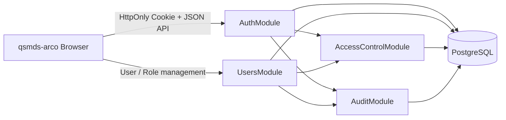
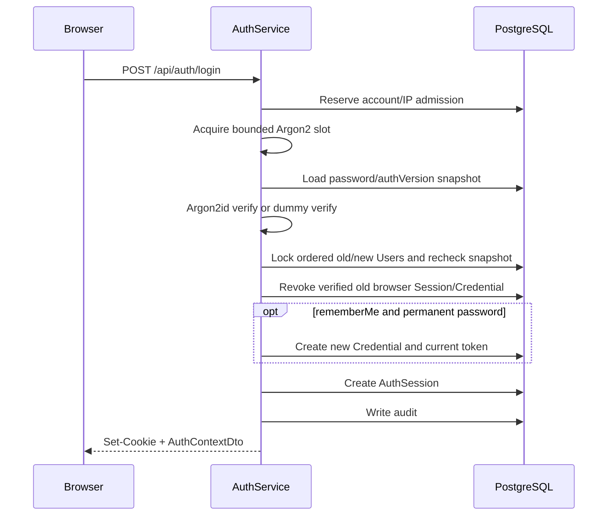
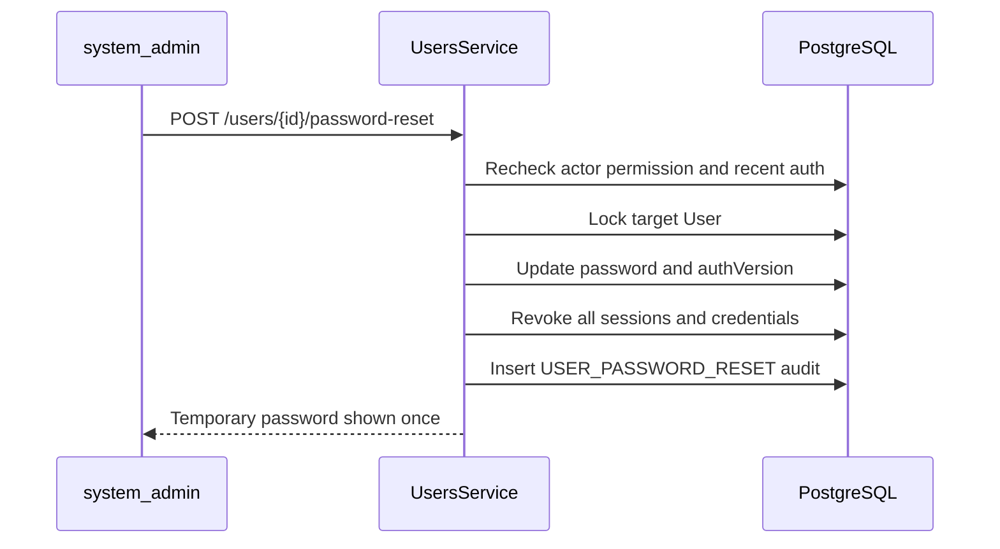

# 千树 DMS 用户认证与权限体系设计

## 文档信息

| 项目 | 内容 |
| --- | --- |
| 状态 | 安全审查修订完成，待实施确认 |
| 版本 | `1.1` |
| 日期 | 2026-07-17 |
| 现状核查基线 | `7b475b48ae4f0581666b56c4594776de907a78d1` |
| 适用范围 | `server/`、`web/apps/qsmds-arco/`、PostgreSQL、OpenAPI |
| 接口形态 | 第一方同源 Web + HTTP API |
| 会话真相源 | PostgreSQL |

本文是用户、密码登录、会话、持久登录、RBAC、设备管理、强制改密和超级管理员重置密码的统一设计真相源。本文描述目标方案，不表示相关数据库表、公共 API 或页面已经实现。版本 1.1 已吸收 2026-07-16 的安全与一致性审查结论，重点收口二次认证竞态、Remember 唯一继任、管理员恢复、前端身份边界、契约和发布链路。

任何实施动作都会新增数据库 Schema 和公共 API，必须在本设计确认后另行取得实施授权，并按照 TDD、OpenAPI 同步、数据库 migration 和小步 Git 提交要求执行。

## 1. 目标与边界

### 1.1 目标

本方案需要建立以下完整闭环：

1. 管理员创建用户并安全交付临时密码。
2. 用户通过 `username + password` 登录。
3. 服务端通过短期 `AuthSession` 鉴别请求身份。
4. 用户显式选择后，通过设备级 `RememberCredential` 无感恢复登录。
5. 服务端通过 RBAC 判断操作权限，前端只负责权限体验。
6. 用户能够修改密码、退出当前设备、退出全部设备和管理已记住设备。
7. `system_admin` 能够执行受保护的用户管理和密码重置操作。
8. 所有高风险状态变化均可审计、可撤销、可测试。
9. 首期不依赖 Redis，PostgreSQL 是唯一认证状态真相源。
10. 正常在线管理操作不得把可操作 `system_admin` 降为零；系统同时具备受审计的离线恢复路径，处理数据库无法判断的忘记密码事故。
11. 认证配置、密码策略资产和 OpenAPI 契约必须进入现有构建、归档与 smoke 真相链路。

### 1.2 首期范围

- 用户创建、查询、编辑、启用和禁用。
- 密码登录、当前用户、当前退出、全部退出和修改密码。
- 普通 Session、持久登录、设备查看与单设备撤销。
- 用户、角色、权限及用户角色、角色权限关系。
- 静态前端路由按权限码过滤。
- `system_admin` 近期二次认证和重置用户密码。
- PostgreSQL 限流、审计、Token 轮换和重放检测。
- 同源 Cookie 认证的 CSRF 防护。
- production 认证浏览器必须支持同源 Web Locks；不支持时失败关闭，不承诺无锁多标签 Cookie mutation。

### 1.3 明确不做

- 公开注册。
- 邮件、短信或安全问题自助找回密码。
- JWT、OAuth 2.0、OpenID Connect、SSO。
- MFA、Passkey、WebAuthn。
- Redis Session、Redis 限流或进程内 Session。
- 后端动态菜单。
- 用户级直接权限授权。
- 显式 Deny 权限。
- 通用数据范围 DSL 或自动行级过滤。
- 多账号 Token 槽位。
- 跨域携带 Cookie。
- Service Worker/PWA 离线认证或离线业务 Shell；首期认证页不得受 Service Worker 控制。
- 用户和角色的硬删除，以及审计记录的业务硬删除 API；后台保留期清理不属于业务硬删除。

上述能力需要真实业务或合规需求后另行设计，不在首期预留伪实现。

## 2. 当前工程事实

### 2.1 后端

- Server 已使用 Node.js 24、NestJS 11、Prisma 7、`@prisma/adapter-pg`、`pg` 和 PostgreSQL。
- `server/src/http.modules.ts` 当前只注册 `HealthModule`。
- `server/prisma/schema.prisma` 当前没有 model 或 enum。
- 当前唯一正式 HTTP 能力是 `GET /api/health`。
- 全局已经具备 `/api` 前缀、Server-generated `X-Request-Id`、严格 DTO 校验、HTTP `422` 和统一 `ApiError`。
- OpenAPI 的 Controller、DTO 和 decorators 是接口真相源，正式快照是 `server/openapi/openapi.json`。
- `ApiApplicationContract` 当前覆盖 `401/403/404/409/422/500`，尚未覆盖认证限流/容量需要的 `429/503`。
- 当前依赖中没有生产密码 Hash、Cookie 解析、Session 或认证框架。

### 2.2 前端

- 正式业务应用是 `web/apps/qsmds-arco/`，使用 Vue、Pinia、Vue Router、Axios、Fantastic Admin 和 Arco Design Vue。
- 当前登录、权限和修改密码 API 全部是 `fake: true`。
- 当前“记住我”只保存 `login_account`，不是持久认证凭证。
- 当前 Token、账号、头像和多账号 Token 均进入 `localStorage`。
- 当前 `isLogin` 只检查本地 Token 字符串，不执行 `/auth/me` 服务端恢复。
- 当前任意 `401` 都直接触发本地登出，没有 Session 无感续期。
- 当前登录页仍包含扫码登录、公开注册、忘记密码和演示账号，与首期范围冲突。
- 当前前端权限码、路由 `meta.auth`、菜单过滤和 `AppAuth` 可继续作为体验层使用。
- 当前同源 `/api` 或反向代理部署前提适合 HttpOnly Cookie。
- 当前 `web/` 没有 Service Worker/PWA 注册代码；首期保持该边界，避免缓存层伪造认证新鲜度。

### 2.3 必须替换的旧链路

目标实现必须删除以下认证真相：

```text
localStorage Token
  -> custom Token Header
  -> fake login
  -> frontend-only isLogin
  -> any 401 means logout
```

替换为：

```text
HttpOnly Cookie
  -> PostgreSQL AuthSession
  -> /auth/me bootstrap
  -> explicit Session recovery
  -> backend RBAC guard
```

## 3. 已确认决策

### 3.1 登录身份

- 首期只支持 `username + password`。
- 用户由授权管理员创建，不开放注册。
- `username` 是稳定技术标识；`displayName` 是可编辑展示名称。
- 登录错误不得泄露账号是否存在、禁用或临时密码是否过期。

### 3.2 时效矩阵

| 凭证 | 空闲过期 | 绝对过期 | 作用 |
| --- | ---: | ---: | --- |
| `AuthSession` | 24 小时 | 7 天 | 访问业务 API |
| 普通用户 `RememberCredential` | 7 天 | 14 天 | 换取新 Session |
| `system_admin` 的 `RememberCredential` | 不单独设置 | 7 天 | 换取新 Session |
| 近期二次认证 | 不适用 | 5 分钟 | 高风险操作 |
| 临时密码 | 不适用 | 24 小时 | 首次登录或管理员重置后改密 |

所有期限都由服务端使用 PostgreSQL 时间判断。达到边界时按失效处理，即 `now >= expiresAt` 时拒绝。

### 3.3 新 Session 的期限封顶

`RememberCredential` 不能突破密码认证的最终期限。由持久凭证换取的新 Session 必须使用：

```text
session.absoluteExpiresAt =
  min(databaseNow + 7 days, rememberCredential.absoluteExpiresAt)

session.idleExpiresAt =
  min(databaseNow + 24 hours, session.absoluteExpiresAt)
```

临时密码建立的受限 Session 还必须使用：

```text
temporarySession.absoluteExpiresAt =
  min(databaseNow + 7 days, user.temporaryPasswordExpiresAt)

temporarySession.idleExpiresAt =
  min(databaseNow + 24 hours, temporarySession.absoluteExpiresAt)
```

`AuthenticationGuard` 在 `databaseNow >= temporaryPasswordExpiresAt` 时必须拒绝已有的 `TEMPORARY_PASSWORD` Session，不能让临时密码在到期前建立一个继续存活数天的改密入口。

由此保证：

- 普通用户最长 14 天必须重新输入密码。
- `system_admin` 最长 7 天必须重新输入密码。
- `system_admin` 的持久凭证只解决 7 天内浏览器关闭或 Session 空闲失效后的恢复。

普通用户持久凭证的“空闲”定义为该设备没有有效认证活动，而不是 Token 本身没有被兑换。登录时创建的初始 Session 必须关联 `rememberCredentialId`。每次有效活动使用数据库时间原子执行：

```text
session.lastActivityAt = databaseNow
session.idleExpiresAt =
  min(databaseNow + 24 hours, session.absoluteExpiresAt)

standardCredential.lastUsedAt = databaseNow
standardCredential.idleExpiresAt =
  min(databaseNow + 7 days, standardCredential.absoluteExpiresAt)
```

`SYSTEM_ADMIN` Credential 的 `idleExpiresAt` 始终为空。已撤销、自然过期或 superseded 的请求不得刷新任何活动字段。首期为保证精确 24 小时与 7 天语义，每个通过 Guard 的有效业务请求都执行数据库 touch；唯一例外是 `/api/auth/me` 携带单一精确 `X-Qianshu-Auth-Probe: passive` 的前台失效探测，它必须完成全部 Session/Credential/authVersion/权限验证但不得更新 `lastActivityAt`、`lastUsedAt` 或任何 idle 期限，也不得自动 renew。服务端只有真正进入该分支时才在响应中返回单一精确 `X-Qianshu-Auth-Probe-Applied: passive`；普通 `/me` 和其他 operation 禁止返回。客户端必须把该回执作为运行时契约确认，不能仅凭自己发送过请求 Header 就假设代理未剥离。该 opt-out 只是不延长会话，不能放宽鉴权或用于其他 operation。不得只更新 `lastActivityAt`/`lastUsedAt` 而留下旧 `idleExpiresAt`，也不得用进程内时间缓存制造第二真相源。

### 3.4 超级管理员重置密码

- 权限码为 `users:reset-password`。
- 该权限是 `systemOnly`，首期只允许内置 `system_admin` 持有。
- 操作者必须在 5 分钟内完成当前密码二次认证。
- 管理入口禁止重置本人密码。
- 允许重置另一名 `system_admin`，但必须二次认证并完整审计。
- 禁用用户不能通过重置密码被隐式启用。
- 服务端生成临时密码，明文只返回一次，24 小时过期。
- 重置成功后撤销目标全部 Session 和全部持久凭证。
- 用户必须修改临时密码后才能进入业务系统。

## 4. EARS 需求基线

### 4.1 登录与 Session

1. 当用户提交账号和密码时，系统必须使用统一响应防止账号枚举，并只在凭据、用户状态和限流状态全部有效时创建 Session。
2. 当用户未选择“在此设备保持登录”时，系统必须只签发非持久的普通 Session Cookie。
3. 当用户选择“在此设备保持登录”且密码不是临时密码时，系统必须同时创建普通 Session 和设备级持久凭证。
4. 当 Session 连续 24 小时没有有效活动时，系统必须在服务端拒绝该 Session。
5. 当 Session 创建达到 7 天时，无论是否活跃，系统必须拒绝该 Session。
6. 当普通 bootstrap、lifecycle revalidation 或业务请求发现 Session 不存在/自然过期且持久凭证有效时，系统必须轮换持久 Token、创建受凭证剩余期限封顶的新 Session，并只重试原请求一次；第 14 条的 passive foreground probe 是不触发 renew 的明确例外。
7. 当 Session 被安全事件撤销时，客户端不得自动使用持久凭证恢复。
8. 当登录、二次认证或当前密码修改即将执行昂贵密码 verify 时，系统必须先原子占用账号/用户与来源地址的短时 admission 配额，并受进程级 Argon2 并发上限保护；所有 Argon2 hash 同样受该资源上限保护。
9. 当有效请求刷新 Session 空闲期限时，系统必须在同一数据库操作中更新活动时间和受绝对期限封顶的 `idleExpiresAt`。
10. 当旧 Session 已被新 Session 取代时，系统必须返回独立的 `SESSION_SUPERSEDED`，客户端不得把它当作自然过期直接续期。
11. 当退出请求没有收到服务端 `204` 时，客户端不得宣称退出成功或渲染普通登录页。
12. 当密码登录成功且浏览器还携带可验证的旧 Session 或 Remember Cookie 时，系统必须在创建新身份前原子撤销旧浏览器认证状态；密码失败或随机错误 secret 不得注销原用户。
13. 当创建 Session 会超过单用户 50 个 active Session 时，系统必须在 User 锁内确定性撤销最旧 active Session并审计，再创建新 Session。
14. 当已认证且可执行 JavaScript 的前台标签连续最多 75 秒没有获得新的服务端认证结果时，系统必须先隐藏业务 DOM，再执行一次失效兜底探测；该探测必须完整验证服务端身份但不得 touch Session/Credential、不得自动续期，并由受限响应 Header 证明服务端实际采用 passive 分支。探测失败、回执缺失/非法或返回无效身份时不得恢复旧 DOM。
15. 当浏览器冻结、操作系统休眠或系统时钟跳变使单调计时与墙钟/调度进度不一致时，系统必须把异常只作为保守的“立即遮罩并复验”触发器；它不得据此延长 freshness、Session 或 Credential。

### 4.2 持久登录与设备

1. 当普通用户的设备连续 7 天没有有效认证活动时，系统必须拒绝该持久凭证。
2. 当普通用户持久凭证签发达到 14 天时，系统必须拒绝该凭证。
3. 当 `system_admin` 持久凭证签发达到 7 天时，系统必须拒绝该凭证。
4. 当持久凭证成功换取 Session 时，系统必须原子轮换 Token，旧 Token 不得继续创建 Session。
5. 当已消费 Token 在并发宽限期外再次出现时，系统必须撤销对应凭证族和派生 Session，并写入重放审计。
6. 当用户撤销某个设备时，系统必须撤销该设备凭证及其派生 Session。
7. 当用户退出当前设备时，系统必须同时撤销当前 Session 和当前设备持久凭证，避免立即自动登录。
8. 当持久凭证创建继任 Session 时，系统必须先 supersede 该凭证之前的当前 Session，使每个 Credential 至多有一个当前 Session。
9. 当已有可验证的 Remember Cookie 再次选择保持登录时，系统必须原子替换原 Credential family，而不是留下仍可使用的旧凭证。
10. 当用户撤销设备对象时，系统必须在事务内验证该 Credential 属于当前用户；不属于当前用户时按不存在处理。
11. 当新设备签发会超过单用户 20 个 active RememberCredential 时，系统必须在创建任何新认证状态前拒绝本次保持登录，不得静默降级或自动撤销其他设备。

### 4.3 密码与强制改密

1. 当管理员创建用户或重置密码时，系统必须生成高熵临时密码，只保存 Argon2id Hash，并设置 24 小时强制改密期限。
2. 当用户使用临时密码登录时，系统必须创建受限 Session，且不得签发持久凭证。
3. 当用户处于强制改密状态时，系统只能允许 `GET /api/auth/me`、`POST /api/auth/password/change`、`POST /api/auth/logout` 和只会减少认证状态的 `POST /api/auth/logout-all`。
4. 当临时密码过期、再次重置或完成改密时，旧临时密码必须失效。
5. 当密码修改成功时，系统必须撤销旧 Session 和全部持久凭证，并创建新的密码认证 Session。
6. 当二次认证的密码 Hash 已在事务外验证时，系统必须在创建继任 Session 前锁定 User 与当前 Session，并复查密码 Hash、`authVersion`、用户状态和 Session 状态均未变化。
7. 当新密码进入创建、修改、重置、bootstrap 或 recovery 管线时，系统必须先执行 NFC，再按 Unicode code point 校验 15–128 长度，最后执行上下文与 blocklist 检查；登录、当前密码和 reauth 只按相同 NFC 规则规范化并执行最大长度防护后验证既有 Hash，不因 blocklist 后续更新拒绝原本正确的密码。
8. 当修改密码的当前密码已验证时，系统必须在提交前按全局顺序锁定 User、相关 Credential 与当前 Session，复查密码和认证快照；若设备撤销或其他安全操作先提交，改密不得创建新 Session 复活该设备。

### 4.4 RBAC

1. 当请求访问受保护 API 时，系统必须先验证 Session，再验证强制改密状态，最后验证权限。
2. 当用户拥有多个角色时，系统必须使用角色权限并集。
3. 当没有任何明确允许权限时，系统必须默认拒绝。
4. 当前端隐藏按钮或路由时，后端仍必须独立执行相同权限判断。
5. 当角色或权限关系变化时，系统必须从下一次请求开始使用 PostgreSQL 当前值。
6. 当授予或移除 `system_admin` 时，系统必须要求操作者近期二次认证，并撤销目标全部 Session 和持久凭证。
7. 当在线管理操作会导致没有可操作 `system_admin` 时，系统必须拒绝操作。
8. 当普通角色或权限关系变化时，系统必须递增 PostgreSQL 全局 `AuthorizationRevision`，使前端在下一次认证响应后刷新权限体验而不撤销认证凭证。
9. 当操作可能改变 `system_admin` 可操作人数时，系统必须以 `ACTIVE + system_admin + mustChangePassword=false + temporaryPasswordExpiresAt IS NULL` 作为唯一计数定义。
10. 当高风险事务依赖操作者的管理员身份时，系统必须在统一锁顺序下锁定共享 `system_admin` Role、操作者安全状态和目标状态，并在同一事务中重新授权。

### 4.5 超级管理员重置密码

1. 当操作者没有 `users:reset-password` 时，系统必须返回 `403` 且不改变目标状态。
2. 当操作者没有 5 分钟内的二次认证时，系统必须返回 `REAUTHENTICATION_REQUIRED`。
3. 当目标是操作者本人时，系统必须返回 `SELF_PASSWORD_RESET_NOT_ALLOWED`。
4. 当目标用户禁用时，系统必须返回 `USER_DISABLED`，且不得隐式启用。
5. 当重置成功时，系统必须原子更新密码、强制改密状态、认证版本、Session、持久凭证和审计事件。
6. 当响应临时密码时，系统必须设置禁止缓存 Header，且密码不得进入日志、审计、URL 或前端持久化状态。
7. 当目标是 `system_admin` 时，系统必须额外验证 `roles:manage-system`，并拒绝任何会使可操作管理员数量变为零的重置。
8. 当唯一管理员无法认证时，系统必须提供非 HTTP、仅交互式 TTY、强制撤销旧认证状态并完整审计的 break-glass 恢复命令。

### 4.6 前端身份生命周期

1. 当退出、`SESSION_REVOKED`、跨标签退出或认证用户 ID 变化时，前端必须在渲染新身份页面前清除所有身份域 Store、查询缓存、KeepAlive、iframe、临时表单和在途请求。
2. 当旧的 bootstrap、renew、reauth 或业务请求晚于身份边界事件返回时，前端必须通过单调 `authEpoch` 丢弃该结果。
3. 当响应中的 `X-Qianshu-Authorization-Revision` 与内存 revision 不一致时，前端必须共享执行一次 `/api/auth/me`，重建权限路由并清理无权访问的缓存页面。
4. 当标签页从 BFCache 或长时间隐藏状态恢复时，前端必须重新验证服务端认证状态后再显示敏感内容。
5. 当 login、renew、reauth、改密、logout、logout-all 或设备撤销可能设置或清除认证 Cookie 时，前端必须使用同一跨标签 Cookie mutation 锁串行化从发请求到处理响应的完整区间，保证 logout 的清 Cookie 响应不会被更早操作的晚到响应覆盖。
6. 当 Cookie mutation 发生客户端超时时，前端必须取消并等待底层 transport settled 后才释放跨标签锁，不得让仅 JavaScript Promise 超时的请求在锁外继续接收 Cookie 响应。
7. 当身份域清理任一步失败时，前端必须保持 `identity_cleaning`/`unavailable` 全屏阻断，不得先进入 anonymous 或允许下一账号登录。
8. 当 Web Lock 正常被其他标签持有时，前端必须排队或安全超时且不发送请求；只有能力缺失/异常可以判定浏览器不支持，任何情况都不得无锁降级。

### 4.7 运行与发布

1. 当应用以 production 模式启动时，系统必须验证 HTTPS origin、HMAC Key、Remember feature flags 和显式代理模式，缺失时失败关闭。
2. 当构建 Server 归档时，系统必须包含并校验密码 blocklist 及其版本信息，归档 smoke 必须实际加载密码策略。
3. 当返回认证、身份、设备、权限或审计数据时，系统必须设置 `Cache-Control: no-store`；所有设置、轮换或清除 Cookie 的响应同样适用。
4. 当清理认证与审计数据时，系统必须由非 TTY Cron 启动，并由覆盖整轮多批次的单实例协调锁按明确保留期和外键顺序执行；成功批次和失败运行都必须留下可关联证据，不得依赖人工临时 SQL。
5. 当 production 浏览器不支持或无法使用 Web Locks 时，前端必须在任何认证 Cookie mutation 前失败关闭并给出支持说明，不得退化为无互斥的多标签登录。

## 5. 总体架构



### 5.1 模块边界

建议后端模块：

```text
server/src/modules/auth/
server/src/modules/users/
server/src/modules/access-control/
server/src/modules/audit/
```

继续遵循当前：

```text
Controller -> Service -> PrismaService -> PostgreSQL
```

不为认证预建 Repository、UseCase 或 Domain Entity。只有 Token 生成、密码 Hash、Cookie 构造、权限 decorator 等稳定基础能力拆为小型可测试 provider。

### 5.2 Guard 顺序

```text
Request
  -> CsrfProtectionGuard / middleware
  -> AuthenticationGuard
  -> PasswordChangeRequiredGuard
  -> PermissionGuard
  -> RecentAuthenticationGuard
  -> Controller
```

- `@Public()`：登录、健康检查等真正公开操作。
- `@AllowPasswordChangeRequired()`：只标注强制改密状态允许的四个 operation：`GET /api/auth/me`、`POST /api/auth/password/change`、`POST /api/auth/logout`、`POST /api/auth/logout-all`；Guard 不得另设隐式白名单。
- `@RequirePermissions(...)`：声明权限码。
- `@RequireRecentAuthentication(300)`：声明 5 分钟二次认证。

高风险 Service 必须在业务事务内再次检查用户状态、权限和 `reauthenticatedAt`，不能只依赖事务外 Guard。

### 5.3 事务线性化与全局锁顺序

高风险操作的授权线性化点位于业务事务内重新授权完成之时。所有认证、用户与 RBAC 事务只允许按以下总序取得它实际需要的锁；不得取得后序资源后再回头取得前序资源：

```text
transaction advisory lock
  -> AuthorizationRevision(id = 1)
  -> Role ordered by id
  -> User ordered by id
  -> AuthRateLimit transactional bucket ordered by (scope, subjectKeyHash)
  -> Permission ordered by id
  -> UserRole ordered by (userId, roleId)
  -> RolePermission ordered by (roleId, permissionId)
  -> RememberCredential ordered by id
  -> RememberCredentialToken ordered by id
  -> AuthSession ordered by id
  -> AuditEvent insert
```

- 上述 `transaction advisory lock` 只用于 bootstrap、break-glass 等单事务全局操作；普通业务事务跳过。cleanup 是唯一例外：它按 7.10 在事务外用独立 key 和专用连接持有 session-level advisory lock 覆盖整轮，各批次事务不再获取 transaction advisory lock，并从自身实际需要的后续资源开始遵循本顺序。两类 advisory key 必须由代码常量分离。所有修改授权关系或需要在高风险事务内线性化授权读取的操作先锁定 `AuthorizationRevision(id=1)`；普通认证与只读 Guard 不为此串行化。
- 涉及 `system_admin` 时必须先锁定该 Role；actor、target 和其他 User 必须先收集完整 ID 集合再排序锁定。
- 允许先做无锁 selector lookup 以确定锁对象，但无锁结果不能用于授权或生命周期判断；取得全部规定锁后必须复验关联、secret Hash、版本、状态、权限和期限。
- 登录/reauth/password-change 的 `AuthRateLimit` admission 使用独立短事务，不得持有 RateLimit 锁进入 Argon2，也不得与上述业务事务交叉持锁。只有“成功 renew 次数”桶进入轮换业务事务，并严格位于 User 与 Credential 锁之间；其他业务事务跳过该资源。
- 纯读取 Guard 不持有长事务锁；普通在途请求可按 8.7 的既定语义完成。高风险事务必须使用上述锁和事务内重查形成唯一线性化顺序。

## 6. 安全与信任边界

### 6.1 Cookie

生产 Cookie：

| Cookie | 属性 | 说明 |
| --- | --- | --- |
| `__Host-qianshu_session` | `Secure; HttpOnly; SameSite=Strict; Path=/` | 非持久 Session Cookie，不设置 `Domain` 和 `Max-Age` |
| `__Host-qianshu_remember` | `Secure; HttpOnly; SameSite=Strict; Path=/` | 显式保持登录时设置 `Max-Age`，服务端期限仍为最终真相 |

本地开发可以使用不带 `__Host-` 前缀的开发 Cookie，但只允许 localhost；`production` 必须拒绝非 Secure 配置。Cookie 不使用签名，因为高熵 secret 已在服务端按 Hash 验证。

生产 `APP_ORIGIN` 必须使用 HTTPS。明文 HTTP 不承载登录页面或认证 API；可信边缘使用永久跳转到精确 HTTPS origin，应用只在已配置的可信代理下接受 forwarded protocol。安全 Header 采用以下单一所有权，值进入版本化部署配置和自动 smoke，边缘不得覆盖 Server 的 `Set-Cookie`/`Cache-Control`：

| Header / 控制 | production 值 | 真相源与所有者 |
| --- | --- | --- |
| HTTP → HTTPS | `308` 到同 host/path/query 的 HTTPS | 边缘配置 |
| `Strict-Transport-Security` | 验证全部子域后 `max-age=31536000; includeSubDomains`；首期不提交 preload | 边缘配置 |
| `Content-Security-Policy` | `default-src 'self'; base-uri 'none'; object-src 'none'; frame-ancestors 'none'; form-action 'self'; script-src 'self'; connect-src 'self'; img-src 'self' data: blob:; font-src 'self' data:; style-src 'self' 'unsafe-inline'; frame-src 'self'; worker-src 'self' blob:` | Web HTML 静态托管配置；禁止 `unsafe-eval`、通配源和 inline script。`unsafe-inline` 仅限现有组件 style 兼容残余，后续 nonce 化单独推进 |
| `X-Content-Type-Options` | `nosniff` | 边缘统一注入 |
| `Referrer-Policy` | `no-referrer` | 边缘统一注入 |
| `X-Frame-Options` | `DENY`，与 CSP `frame-ancestors` 双覆盖 | 边缘统一注入 |
| `Permissions-Policy` | `camera=(), microphone=(), geolocation=()` | 边缘统一注入 |
| 认证/用户/权限响应缓存 | `Cache-Control: no-store`；一次性密码另有 `Pragma: no-cache` | NestJS middleware/interceptor 与 OpenAPI |

CSP 先在测试环境收集 violation 并消除依赖，production 上线前必须切为 enforcing；不能长期只用 Report-Only。部署 smoke 分别请求 HTML、静态资源和 API，断言唯一值、无冲突重复 Header、HTTPS 跳转与 HSTS；应用单元测试不能替代真实边缘验收。

### 6.2 CSRF

当前架构只支持同源部署，不启用通配 CORS。使用无额外 CSRF Session 状态的组合防护：

1. 所有状态修改只允许 `POST/PUT/PATCH/DELETE`。
2. 请求只接受 `application/json`，拒绝跨站表单可发送的简单内容类型。
3. 前端所有不安全方法携带固定 `X-Qianshu-CSRF: 1` Header。
4. 服务端严格比较 `Origin` 与受信任配置 `APP_ORIGIN`。
5. 拒绝 `Origin: null`、不匹配 Origin 和 `Sec-Fetch-Site: cross-site`。
6. 登录、续期、退出、改密和密码重置同样执行检查，防止 Login CSRF。
7. 不信任客户端 `Host`、任意 `X-Forwarded-*` 或未配置代理提供的 Origin。

`POST /api/auth/logout`、`POST /api/auth/logout-all` 和 `DELETE /api/auth/devices/{credentialId}` 必须实际发送 JSON 对象 `{}`，OpenAPI request body 标记 required；服务端不接受 `undefined` body，也不为这些操作放宽内容类型检查。

如果未来改为跨域 Cookie 或第三方登录，必须重新设计 CORS 和 CSRF，不能只修改 base URL。

### 6.3 Token

- Session secret 和 Remember secret 均使用至少 256-bit CSPRNG 随机值。
- Cookie 使用 `selector.secret` 形式，selector 只用于定位数据库行。
- 数据库只保存 secret 的 `SHA-256` Hash。
- 高熵随机 Token 可以使用快速 Hash；用户密码不能使用快速 Hash。
- Token、Cookie、Hash、密码和完整认证请求体不得进入日志、审计、错误响应或 OpenAPI example。

### 6.4 密码

- 单因素密码最少 15 个 Unicode code point。
- 最大长度 128 个 code point，至少满足 64 字符长口令要求。
- 接受空格和 Unicode，密码绝不 trim。新密码在 Hash 前执行 Unicode NFC、code point 15–128 长度、账号上下文和 blocklist 检查；登录、当前密码与 reauth 输入执行同样 NFC 和 128 code point 硬上限后直接验证既有 Hash。
- 不强制大小写、数字、符号组合。
- 不要求无风险的周期性改密。
- 只有新密码与本地弱密码 blocklist、账号名及项目高概率词比较；blocklist 更新不在登录/reauth 时追溯性禁用既有密码，风险密码应通过受控强制重置流程处理。
- 允许密码管理器、自动填充、粘贴和显示密码。
- 密码使用 Argon2id PHC 字符串保存。
- 参数不得低于 `m=19456 KiB, t=2, p=1`，并在生产规格上压测后只允许向更强方向调整。
- Server 使用维护中的 `argon2` package 并在 `server/pnpm-lock.yaml` 固定解析版本，首期不依赖 Node.js experimental Argon2 API。
- 临时密码使用至少 20 个无歧义随机字符，明文不落库。

弱密码列表作为版本化 UTF-8 资产放在 `server/src/modules/auth/security/data/password-blocklist.txt`，同目录 README 记录来源、许可、版本和更新日期；运行时不依赖外网。Nest build 必须通过 `compilerOptions.assets` 把该目录复制到稳定的 `dist` 路径，Server 发布树必须把 blocklist、README 和校验和视为必需运行资产。应用 production 启动与归档 smoke 都必须实际加载并校验非空版本；缺失时失败关闭，不允许为了可用性静默跳过。更新必须通过密码策略测试，日志不得输出命中的原始密码。

### 6.5 来源地址与运行配置

- Server 直连时只使用 socket remote address。
- 反向代理部署时，Server 端口只允许受信任代理访问，并通过明确 hop 数或 CIDR 配置 `trust proxy`；禁止配置为无条件 `true`。
- 统一把 IPv4-mapped IPv6 规范成 IPv4，把 IPv6 按 `/64` 前缀用于限流和脱敏展示；原始地址不得进入应用日志。
- `APP_ORIGIN` 必须是单一精确 origin，不允许通配符、路径或动态回显请求 Origin；production 必须是 HTTPS。

生产启动必须校验以下认证配置，缺失或强度不足时失败关闭：

```text
APP_ORIGIN
AUTH_RATE_LIMIT_HMAC_KEY
AUTH_AUDIT_IP_HMAC_KEY
REMEMBER_ISSUE_ENABLED
REMEMBER_RENEW_ENABLED
AUTH_ARGON2_MAX_CONCURRENCY
AUTH_ARGON2_MAX_QUEUE
TRUST_PROXY_HOPS or TRUST_PROXY_CIDRS
```

直连 production 必须显式设置 `TRUST_PROXY_HOPS=0`；反向代理部署使用正整数 hop 或 CIDR，三者不能同时生效。Release smoke 使用 loopback HTTPS origin、现场生成且不落盘的临时 HMAC Key、显式 Remember flags、受限 Argon2 并发以及 `TRUST_PROXY_HOPS=0`，这些 smoke 值不得进入归档、manifest 或日志。

Remember flags 只允许 `(issue=false, renew=false)`、`(false, true)` 和 `(true, true)`；`issue=true, renew=false` 会签发不可使用的凭证，production 必须拒绝启动。flag 在进程启动时读取不可变配置，不允许请求处理中热变更；所有副本必须通过部署 preflight 使用同一组合，flag 变化采用协调重启，不能长期混跑不同语义。

首期 active 资源上限是进入代码、OpenAPI 描述和测试的版本化常量，不开放任意环境覆盖：`MAX_ACTIVE_AUTH_SESSIONS_PER_USER=50`、`MAX_ACTIVE_REMEMBER_CREDENTIALS_PER_USER=20`。调整上限会改变事务规模、设备 UI 和错误语义，必须按公共契约变更重新评审，不能由单实例环境变量造成行为不一致。

两个 HMAC Key 至少 256 bit，彼此隔离且不得复用 Token、密码或数据库材料。`.env.example` 只声明空模板；真实值由部署密钥管理能力注入。首期不支持无停机 Key 轮换，轮换必须进入维护窗口：先停止认证写流量，清理限流桶，记录审计 Hash 关联中断点，再整体切换。

## 7. 数据模型

以下是逻辑模型；实施时由 Prisma Schema 和不可变 migration 落地。

### 7.1 User

| 字段 | 说明 |
| --- | --- |
| `id` | UUID 主键 |
| `username` | 原始技术账号 |
| `usernameNormalized` | trim 后 ASCII 小写规范值，唯一 |
| `displayName` | 用户展示名称 |
| `passwordHash` | Argon2id PHC 字符串，禁止进入 DTO |
| `status` | `ACTIVE` 或 `DISABLED` |
| `mustChangePassword` | 是否强制改密 |
| `temporaryPasswordExpiresAt` | 临时密码绝对过期时间 |
| `passwordChangedAt` | 最近密码变更时间 |
| `authVersion` | 密码、禁用或高权限变化时递增 |
| `version` | 非负 32-bit integer；用户资料、状态、密码或角色集合管理写入时递增，用于乐观并发 |
| `lastLoginAt` | 最近成功密码登录时间 |
| `createdByUserId` | 创建者，可为空表示系统初始化 |
| `disabledAt` / `disabledByUserId` | 禁用审计字段 |
| `createdAt` / `updatedAt` | 生命周期时间 |

约束：

- 技术账号限制为 3–64 个 ASCII 字符，规范值匹配 `[a-z0-9][a-z0-9._-]{2,63}`；`usernameNormalized` 唯一，不依赖数据库默认大小写行为。中文和其他 Unicode 只进入 `displayName`。
- `displayName` 为 1–100 个 Unicode code point；DTO 与数据库同时限制字符数和 UTF-8 byte 数。
- 用户不硬删除；离职或停用使用 `DISABLED`。
- `status != ACTIVE`、临时密码过期或 `mustChangePassword` 状态由所有认证路径统一检查。
- 登录昂贵 Hash 校验后，创建 Session 的事务必须重新检查 `authVersion`，解决登录与密码重置并发。

### 7.2 Role

| 字段 | 说明 |
| --- | --- |
| `id` | UUID 主键 |
| `code` | 稳定英文权限角色码，唯一 |
| `name` | 中文展示名 |
| `description` | 说明 |
| `isSystem` | 是否系统内置 |
| `isEnabled` | 是否可用于授权 |
| `version` | 非负 32-bit integer；普通角色资料或权限集合每次修改时递增，用于乐观并发 |
| `createdAt` / `updatedAt` | 生命周期时间 |

`system_admin` 是不可删除、不可改码、不可禁用的系统角色。其他角色停用后不再提供权限，但保留历史关系和审计。

### 7.3 Permission

| 字段 | 说明 |
| --- | --- |
| `id` | UUID 主键 |
| `code` | `resource:action` 稳定权限码，唯一 |
| `name` | 中文展示名 |
| `description` | 权限边界 |
| `systemOnly` | 是否只允许系统角色持有 |
| `createdAt` / `updatedAt` | 生命周期时间 |

Permission 是代码管理的目录，由 migration 或幂等 seed 同步；管理 UI 不能任意创建权限码。

### 7.4 UserRole、RolePermission 与 AuthorizationRevision

- `UserRole(userId, roleId)` 使用复合唯一键。
- `RolePermission(roleId, permissionId)` 使用复合唯一键。
- 不建立用户直接权限表。
- 多角色权限取并集。
- `systemOnly` 权限不得授权给非系统角色。
- CI 必须检查 `system_admin` 拥有全部预期权限。
- `AuthorizationRevision` 是固定 `id = 1` 的 PostgreSQL 单行，包含递增 `bigint revision` 与 `updatedAt`；任何 UserRole、普通 Role 启停或 RolePermission 变化都必须在同一事务锁定并递增它。
- `system_admin` 变化同时递增 `authVersion` 和 `AuthorizationRevision`；普通权限变化只递增 revision，不撤销 Session 或 Credential。
- revision 通过 API 输出十进制字符串，禁止直接映射为 JavaScript `number`。`/auth/me` 的权限集合与 revision 必须来自同一 SQL statement 或只读 `REPEATABLE READ` transaction 的一致性快照；不能在默认多 statement `READ COMMITTED` 中先查权限、后查新 revision。Authentication/Permission Guard 链把本次身份或授权判断使用的 revision 附到 request context，响应 interceptor 直接输出该捕获值，不在 Controller 完成后重新读取造成错配；RBAC mutation 成功时 Service 用本事务已提交的新 revision 覆盖该值，使 mutation 响应本身即可推动前端刷新。
- 替换用户角色和替换角色权限的请求都携带各自资源的 `expectedVersion`；不匹配返回 `409 RESOURCE_VERSION_CONFLICT`，防止并发管理静默覆盖。`authVersion` 只表示认证代次，不能复用为管理写版本。

### 7.5 AuthSession

| 字段 | 说明 |
| --- | --- |
| `id` | Cookie selector 与 UUID 主键 |
| `userId` | 用户 |
| `tokenHash` | Session secret Hash，唯一 |
| `authVersion` | 创建时用户认证版本 |
| `authMethod` | `PASSWORD`、`TEMPORARY_PASSWORD` 或 `REMEMBER_CREDENTIAL` |
| `rememberCredentialId` | 可为空；关联设备凭证 |
| `createdAt` | 创建时间 |
| `lastActivityAt` | 最近有效请求时间 |
| `idleExpiresAt` | 空闲过期 |
| `absoluteExpiresAt` | 绝对过期 |
| `reauthenticatedAt` | 最近密码二次认证时间 |
| `supersededAt` | 被新 Session 取代的时间，可空 |
| `predecessorSessionId` | 本 Session 取代的 predecessor，可空且唯一 |
| `sourceRememberTokenId` | 创建本 Session 的已消费 Remember Token，可空且唯一 |
| `revokedAt` / `revokedReason` | 撤销信息 |

规则：

- `idleExpiresAt <= absoluteExpiresAt`。
- 除精确 passive auth probe 外，每个有效请求必须先使用同一个 `databaseNow` 验证旧 `idleExpiresAt` 与 `absoluteExpiresAt`，再按 3.3 公式原子更新活动时间和新 idle；达到等号边界的请求不得通过先延期后验证复活 Session。passive probe 使用同一个 `databaseNow` 验证边界但执行只读路径，不能复活或延期。
- 如果关联持久凭证，必须在同一认证 touch 事务验证它仍有效：STANDARD 按公式更新 `lastUsedAt/idleExpiresAt`，SYSTEM_ADMIN 只更新 `lastUsedAt`。Credential touch 条件失败时整个 touch 回滚并拒绝请求，绝不只延长 Session。
- Session 在登录时全新签发；改密递增 `authVersion` 并安全撤销所有旧 Session，再签发新 Session。
- 二次认证通过时创建新 Session 行，禁止更新主键。事务先使用条件更新把旧行标记 `supersededAt`，再插入携带唯一 `predecessorSessionId` 的继任行；同一 predecessor 的并发 reauth 只有一个成功，其他返回 `409 SESSION_ROTATION_IN_PROGRESS`。新行指向旧行，避免“旧行先引用尚不存在新行”的即时 FK 冲突。
- Guard 执行前已经 superseded 的请求始终返回 `401 SESSION_SUPERSEDED`；只有在 supersede 事务提交前已经通过 Guard 的普通在途请求可以完成，且绝不获得新 Session 的 `reauthenticatedAt`、不得更新活动期限或写 Cookie。
- 首期不做周期性轮换，避免为普通请求引入额外 Cookie 交付协议。
- 通过持久凭证创建的 Session 设置 `authMethod = REMEMBER_CREDENTIAL`、`reauthenticatedAt = null`。
- reauth 继任 Session 使用 `authMethod = PASSWORD`。若请求同时提供与当前 Session 关联且仍有效的 Remember Cookie，本次密码证明在同一事务撤销旧 family、按当前角色签发新 family，并让继任 Session 关联新 Credential；若没有可验证的 Remember Cookie，则撤销旧 family 并创建不关联 Credential 的普通 Session。这样既不凭数据库残留静默恢复“保持登录”，也不会让新 7 天 Session 依赖即将到期的旧 Credential。
- 对非空 `rememberCredentialId` 建立 partial unique current-session 约束：`revokedAt IS NULL AND supersededAt IS NULL` 时每个 Credential 至多一个 Session。自然过期行在创建继任者前也必须标记 superseded。
- `predecessorSessionId` 与 `sourceRememberTokenId` 分别建立 nullable unique 约束，使一个 predecessor 和一个已消费 Remember Token 都至多产生一个继任 Session；应用锁与数据库约束共同保证唯一继任。
- 每个用户最多 50 个“未撤销、未 supersede、未过 idle/absolute 且 authVersion 当前”的 active Session。所有 Session 创建都先锁 User 并重新计数；达到上限时在同一事务优先从 `rememberCredentialId IS NULL` 中按 `lastActivityAt, createdAt, id` 确定性撤销最旧 Session。若数据异常导致只能选择关联 Credential 的 Session，则必须同时撤销其 parent Credential 及派生 Session，不能留下会在 `SESSION_REVOKED` 后恢复的有效 Remember。写 `AUTH_SESSION_LIMIT_EVICTED` 后才插入新行，避免 logout-all/password-change 的锁集合无界。历史行仍按 7.10 保留，不计入 active 上限。
- 权限不存入 Session，Guard 每次读取 PostgreSQL 当前关系。
- `AuthenticationGuard` 每次必须比较 `AuthSession.authVersion === User.authVersion`。不一致时把 Session 标记为安全撤销并返回 `401 SESSION_REVOKED`；服务端续期同样拒绝已撤销凭证，不能只依赖前端不调用 renew。
- Session Cookie selector 不存在或 secret Hash 不匹配时统一返回未认证，并原子计入 `SESSION_INVALID_IP` 限流，不得撤销任何真实 Session；两种情况的状态码、错误体、响应时间分布和限流行为不得暴露 selector 是否存在，避免枚举与随机 Token 造成注销型 DoS。

### 7.6 RememberCredential

`RememberCredential` 表示一个浏览器配置文件上的设备级授权，不是强密码学设备绑定。

| 字段 | 说明 |
| --- | --- |
| `id` | 凭证族 UUID |
| `userId` | 用户 |
| `authVersion` | 签发时用户认证版本 |
| `policyClass` | `STANDARD` 或 `SYSTEM_ADMIN` |
| `deviceLabel` | 浏览器和系统摘要 |
| `userAgentSummary` | 截断后的 UA 摘要 |
| `lastIpPrefix` | 脱敏展示信息，不作为硬绑定 |
| `createdAt` | 首次签发 |
| `lastUsedAt` | 设备最近认证活动 |
| `idleExpiresAt` | 普通用户有值；管理员为空 |
| `absoluteExpiresAt` | 不可滑动 |
| `revokedAt` / `revokedReason` | 撤销信息 |
| `version` | 设备状态变化时递增，用于条件更新与列表刷新 |

`policyClass` 在签发时根据当前角色确定，但每次续期仍读取用户当前角色并要求 Credential `authVersion` 等于 User 当前值。用户被授予或移除 `system_admin` 时直接撤销全部 Session 和持久凭证，不能让旧普通凭证继承 14 天期限。STANDARD Credential 的活动必须同时更新 `lastUsedAt` 与受 absolute 封顶的 `idleExpiresAt`；SYSTEM_ADMIN 只更新 `lastUsedAt` 且 idle 始终为空。

每个用户最多 20 个 active RememberCredential；active 精确定义为 `revokedAt IS NULL`、`credential.authVersion = user.authVersion`、`databaseNow < absoluteExpiresAt`，且 STANDARD 还要求 `databaseNow < idleExpiresAt`。替换当前浏览器已验证 family 不增加数量；新设备签发在 User 锁内重新统计，达到上限则整个带 `rememberMe=true` 的登录返回 `409 REMEMBER_DEVICE_LIMIT_REACHED`，同一事务中对旧浏览器 Session/family 的拟撤销和任何新 Session/Credential 创建全部回滚，不得留下部分状态。用户只能撤销旧设备或明确改为不保持登录；服务端不得静默降级，也不得自动踢掉其他 remembered device。设备响应因此最多返回 20 行。

### 7.7 RememberCredentialToken

该表保留轮换历史，支持可靠重放检测：

| 字段 | 说明 |
| --- | --- |
| `id` | Cookie selector |
| `credentialId` | 所属凭证族 |
| `tokenHash` | secret Hash |
| `generation` | 递增代次 |
| `issuedAt` | 签发时间 |
| `consumedAt` | 成功兑换时间；为空表示当前 Token |

通过 PostgreSQL partial unique index 保证每个凭证族至多一个 `consumedAt IS NULL` 的当前 Token，并使用 `UNIQUE(credentialId, generation)` 保证代次唯一。这样避免 Credential 与 Token 之间的循环必填 FK；Token 对 Credential 使用受控级联删除，Credential 只有在整个保留期结束后才允许清理。已消费历史至少保留至凭证绝对过期后 7 天，再由小批量清理删除。

### 7.8 AuthRateLimit

| 字段 | 说明 |
| --- | --- |
| `scope` | 登录账号/IP、二次认证、修改密码、无效 Session/续期成功或失败、重置操作者或目标 |
| `subjectKeyHash` | HMAC 后的不可逆主体键 |
| `bucketStartedAt` | 时间桶 |
| `attemptCount` | 尝试次数 |
| `blockedUntil` | 阻断截止时间 |
| `updatedAt` | 最近更新 |

`(scope, subjectKeyHash)` 唯一，使用 PostgreSQL 原子 upsert。认证限流不是先读取计数、密码失败后再增加：所有需要 Argon2 verify 的请求必须先在独立短事务中按 `(scope, subjectKeyHash)` 排序原子占用账号/用户和 IP 的短时 admission，再取得有界进程级 Argon2 semaphore；任一步失败都返回 `429` 且不得开始真实或 dummy Hash。进程 semaphore 只保护 CPU/内存，不保存身份或授权状态，因此不是第二认证真相源。禁止通过永久账号锁定响应攻击。

`subjectKeyHash` 使用独立的 `AUTH_RATE_LIMIT_HMAC_KEY` 计算。该密钥至少 256 bit，由部署环境的密钥管理能力注入；代码、migration、日志和已提交的 `.env.example` 均不得包含真实值。轮换该密钥会自然切换到新限流桶，因此必须作为受控运维操作执行并记录。

首期默认值：

| 场景 | 限制 |
| --- | --- |
| 登录 admission 账号 | 1 分钟内 10 次总尝试 |
| 登录 admission IP | 1 分钟内 60 次总尝试 |
| 登录账号 | 15 分钟内 5 次失败，阻断 15 分钟 |
| 登录 IP | 15 分钟内 30 次失败，阻断 15 分钟 |
| 二次认证 admission 用户 | 1 分钟内 10 次总尝试 |
| 二次认证 admission IP | 1 分钟内 60 次总尝试 |
| 二次认证用户 | 15 分钟内 5 次失败，阻断 15 分钟 |
| 二次认证 IP | 15 分钟内 30 次失败，阻断 15 分钟 |
| 二次认证 Session | 15 分钟内 5 次失败，作为辅助维度 |
| 修改密码 admission 用户 | 1 分钟内 10 次总尝试 |
| 修改密码 admission IP | 1 分钟内 60 次总尝试 |
| 修改密码用户 | 15 分钟内 5 次当前密码失败，阻断 15 分钟 |
| 修改密码 IP | 15 分钟内 30 次当前密码失败，阻断 15 分钟 |
| 修改密码 Session | 15 分钟内 5 次当前密码失败，作为辅助维度 |
| 重置操作者 | 1 小时内 10 次请求 |
| 重置目标 | 1 小时内 3 次请求 |
| 有效续期 Credential | 1 小时内 10 次成功轮换 |
| 无效续期 IP | 15 分钟内 30 次 |
| 无效 Session Cookie IP | 15 分钟内 30 次 |

除无效 Session Cookie 专用失败桶外，认证 operation 的限流统一返回 `429 AUTH_RATE_LIMITED` 和 `Retry-After`；无效 Session Cookie 桶使用可安全分流的 `429 SESSION_VALIDATION_RATE_LIMITED`。账号 admission key 必须使用与查询完全相同的 `usernameNormalized`，大小写和首尾空白变体不能绕过；不存在账号在取得 admission 与 semaphore 后仍执行固定 dummy Argon2id 校验。semaphore 队列满时保守保留 admission 计数。

二次认证必须同时检查 `REAUTH_USER + userId`、`REAUTH_IP + sourceIpHash` 和 `REAUTH_SESSION + sessionId`；新建 Session 不得清除用户或 IP 维度失败计数。密码成功只能清理或衰减用户/Session 失败桶，纯 IP 聚合桶和 admission 桶只按时间衰减，防止一个合法账号替同 IP 的攻击流量重置防线。

Session Cookie 语法可解析但无法验证时，使用可信代理规则解析并规范化来源 IP，再以 `SESSION_INVALID_IP + HMAC(normalizedSourceIp)` 作为主体键；selector 不存在与 secret 错误共用同一桶。服务端先做有界 selector lookup 与快速 constant-time secret 验证：有效 Session 不读取或受该失败桶阻断；只有验证失败才在独立短事务原子计数，窗口内前 30 次返回统一 `401`，第 31 次起返回 `429 SESSION_VALIDATION_RATE_LIMITED` 与整数秒 `Retry-After`。这样共享 NAT 下的无效流量不能阻断已持有有效 Session 的用户。计数不持有 Session 行锁，过期窗口只按时间衰减；语法完全无效的超长 Cookie 在进入数据库前按同一 IP 维度受 Web 层大小限制与限流保护。

该无效 Session 桶适用于 `/auth/me` 及所有要求 Session 的业务/管理 operation，因此这些 operation 都必须声明 `429 SESSION_VALIDATION_RATE_LIMITED`。login 不经过 Session Guard，只使用自身账号/IP限流；幂等 logout/logout-all 明确豁免无效 Session 桶，始终先清本地 Cookie，只有可验证证明才执行数据库撤销，避免用户被无效 Cookie 与 IP 桶锁在系统外。稳定专用 code 使前端能够把“无效 Session proof 的入口阻断”与“有效 Session 下 reauth/password-change/reset 的本操作限流”安全分流，不能依赖 URL、message 或当前页面猜测。

Remember selector 不存在与 secret 错误同样共用 `RENEW_INVALID_IP + HMAC(normalizedSourceIp)`；有效 current/历史 Token 先通过快速 constant-time secret 验证且不受该失败桶阻断，只有验证失败才计数。窗口内前 30 次统一返回 `401 REMEMBER_CREDENTIAL_INVALID`，第 31 次起返回 `429 AUTH_RATE_LIMITED`；响应与计时不得暴露 selector 是否存在。真实已消费 Token 是否属于并发宽限或重放，只能在 secret 验证成功并取得规定锁后判断。

成功 renew 的 1 小时 10 次限制不能在独立 admission 中预占，也不能在提交后补记。轮换事务按 5.3 先锁 `RENEW_SUCCESS + HMAC(credentialId)` 桶，再锁 Credential/Token/Session；确认确实需要轮换后，在消费 Token 与创建继任 Session的同一事务检查窗口和递增计数。达到 10 次时第 11 次在消费前返回 `429`；事务失败时计数随之回滚，直接返回已有有效 Session 不计次。

所有 Argon2 verify 和 hash 都使用同一个有界资源 provider：公开/当前密码 verify 还必须先通过对应数据库 admission；CreateUser、管理员 reset、bootstrap、recovery 和新密码 change 的 hash 虽不使用登录失败桶，也必须取得 semaphore slot，防止授权或运维路径绕过内存上限。

### 7.9 AuditEvent

| 字段 | 说明 |
| --- | --- |
| `id` | UUID |
| `eventType` | 稳定英文事件码 |
| `outcome` | `SUCCEEDED` 或 `FAILED` |
| `occurredAt` | PostgreSQL 时间 |
| `actorType` | `ANONYMOUS`、`USER`、`SYSTEM` 或 `MAINTENANCE` |
| `actorUserId` | 用户操作者；非 `USER` 时为空 |
| `authSource` | `NONE`、`SESSION`、`PASSWORD`、`REMEMBER_CREDENTIAL`、`SYSTEM` 或 `MAINTENANCE` |
| `targetType` / `targetId` | 目标 |
| `requestId` | HTTP 时对应 `X-Request-Id`；CLI/任务可空 |
| `correlationId` | 必填；HTTP request、CLI run 或维护批次的稳定关联 ID |
| `reasonCode` | 安全原因码 |
| `sourceIpHash` | 脱敏来源；非 HTTP 可空 |
| `userAgentSummary` | 截断摘要；非 HTTP 可空 |
| `metadata` | 有 schema 和大小限制的安全 JSON |

禁止进入审计：

- 密码和临时密码。
- Session、Remember Token、Cookie 和 Token Hash。
- 完整认证请求体。
- 数据库连接串、SQL 参数、原始异常和堆栈。

数据库 `CHECK` 强制 `actorType = USER` 当且仅当 `actorUserId IS NOT NULL`，并约束来源组合：无任何已验证证明的匿名请求使用 `ANONYMOUS/NONE`，成功密码证明可用 `USER/PASSWORD`，有效 Session 用 `USER/SESSION`，有效 Remember proof 用 `USER/REMEMBER_CREDENTIAL`，系统/维护任务使用同名来源。actor 取本请求失败前已经成功验证的证明，而不是按最终 outcome 机械归匿名：登录失败、无 Session 的 Remember secret 错误为 `ANONYMOUS/NONE`；有效 Session 下 reauth 或修改当前密码失败仍为 `USER/SESSION`。尚未验证的 username 只能作为 HMAC target hint，不能先填 actorUserId。关键安全状态修改与成功审计必须处于同一事务；审计失败时状态修改回滚。登录失败等失败事件使用独立事务记录。维护清理每个删除批次只写一条带实体类型、删除计数和截止时间的原子审计，避免逐行放大；运行级汇总只进入指标或另写一条非替代性的完成事件。

`sourceIpHash` 使用独立的 `AUTH_AUDIT_IP_HMAC_KEY`，不得与限流 HMAC Key 或任何认证 Token 材料复用。

### 7.10 PostgreSQL 物理约束与保留期

- 所有时间字段使用 `timestamptz`，所有 256-bit Token Hash 使用严格 32-byte `bytea`，Hash 比较使用 constant-time API。
- 数据库 `CHECK` 强制 `idleExpiresAt <= absoluteExpiresAt`、非负 AuthorizationRevision/authVersion/generation/attempt count/User/Role/Credential version、`predecessorSessionId != id`、撤销时间与原因同时为空或同时有值，以及 `mustChangePassword = (temporaryPasswordExpiresAt IS NOT NULL)`。首期所有强制改密都来自临时密码；未来若增加其他原因，必须先引入显式 reason 字段再调整组合约束。
- 为 Session 和 Credential 建立 `(userId, revokedAt, absoluteExpiresAt)`、`idleExpiresAt` 清理索引；为 Token 建立 `(credentialId, generation)` unique 与 `consumedAt IS NULL` partial unique index；为非空 Credential 建立 current Session partial unique index；为 `predecessorSessionId` 与 `sourceRememberTokenId` 建立 nullable unique index。
- 为 Audit 建立 `occurredAt`、`actorUserId + occurredAt`、`targetType + targetId + occurredAt` 索引；为 RateLimit 建立 `blockedUntil`、`updatedAt` 清理索引。
- Prisma Schema 无法完整表达的 partial index 和 `CHECK` 必须写入生成后的不可变 migration SQL，并由 PostgreSQL 集成测试验证，不能只停留在应用校验。

逻辑字段必须同时具有 DTO code-point/byte 限制和数据库 `varchar`/`CHECK octet_length`，字符上限不能误当成同数值 byte 上限：

| 字段类别 | 字符限制 | UTF-8 byte 限制 |
| --- | ---: | ---: |
| username / Role code | ASCII 64 | 64 |
| Permission code | ASCII 128 | 128 |
| displayName / Role/Permission name | 100 code points | 400 |
| description / 运维 reason | 1000 code points | 4000 |
| deviceLabel | 128 code points | 512 |
| User-Agent 摘要 | 256 code points | 1024 |
| event/scope/reasonCode/authSource | ASCII 64 | 64 |
| requestId / correlationId | ASCII 128 | 128 |
| 密码输入 | 128 code points | 512；不落库 |
| Argon2id PHC passwordHash | ASCII | 512 |
| Audit metadata | 不适用 | JSON 序列化后 16 KiB |

超限统一返回 `422`，不能让 PostgreSQL unique/index 错误外泄为 `500`。浏览器/系统摘要还必须拒绝控制字符；密码只按 6.4 处理，不能因为 byte 检查而 trim 或改变规范化后的值。

`AuthSession.predecessorSessionId` 与 `sourceRememberTokenId` 使用 `ON DELETE SET NULL`；`AuthSession.rememberCredentialId` 使用 `RESTRICT`。Token 对 Credential 只在整个 family 满足保留条件后受控级联；User、Role 和关系表使用 `RESTRICT`，Audit 的多态 target 保持逻辑引用而不建 FK。migration 集成测试必须查询 PostgreSQL 实际约束，并真实执行 supersede、继任插入和删除，不能只断言 Prisma Schema。

默认在线保留期采用数据库时间计算：Session 的实际结束时间取撤销、supersede、idle 到期和 absolute 到期中的最早非空值，结束 30 天后才可删除；Credential 的实际结束时间取撤销、idle 到期和 absolute 到期中的最早非空值。`credentialFamilyPurgeAfter = greatest(credentialEndedAt + 30 days, absoluteExpiresAt + 7 days, 所有关联 Session 的 purgeAfter)`；达到该时间且不存在受 `RESTRICT` 保护的 Session 后，删除 Credential 并受控级联其 Token。这样 Token 历史至少保留到凭证原 absolute 到期后 7 天，也不会早于 Session 证据。RateLimit 行在最后更新 7 天后且已解除阻断时清理；安全 Audit 在线保留 365 天，之后由保留任务硬删除。这里的删除是内部保留期策略，不提供业务硬删除 API；若未来要求不可变归档，必须单独设计归档期限和删除授权。

提供幂等 `pnpm -C server auth:cleanup` 命令，由部署系统的外部 Cron 每日以非 TTY 方式触发。命令必须独占一条专用 PostgreSQL 连接，并用 `pg_try_advisory_lock` 获取 cleanup 专用 session-level advisory lock；未取到锁时安全退出且不执行删除。该锁从固定本轮各类 cutoff 前一直持有到所有独立批次完成，`finally` 中显式 `pg_advisory_unlock` 并断开专用连接；不能使用首批提交后即释放的 transaction-level advisory lock。Session、Credential family、RateLimit 和 Audit 分别使用独立批次事务，严格先完成并提交全部 Session 批次，再开始 Credential family；Credential 删除事务先锁 Credential，再由 FK 级联 Token，绝不先锁 Session 后回头锁 Credential。每事务最多 500 行，使用 `FOR UPDATE SKIP LOCKED`、受限 statement timeout、失败重试，并在同一事务写一条只含实体类型、cutoff 和数量的 `AUTH_RETENTION_PURGED` 审计；审计失败则该批次回滚。超过重试预算的运行使用新的独立 best-effort 事务写 `AUTH_RETENTION_FAILED`，只含同一 correlationId、失败阶段和 allowlist `reasonCode`；数据库完全不可写时由脱敏结构化日志与高优先级告警兜底，不能伪造审计成功。API 实例不得各自启动内置定时器；多个执行者可以竞争，但只有持有整轮 session-level lock 的进程执行本轮任务。

## 8. 核心流程

### 8.1 密码登录



登录成功事务提交后才设置 Cookie。未知账号、密码错误、禁用账号和不可用临时密码统一返回 `401 INVALID_CREDENTIALS`。普通密码登录和临时密码登录都设置 `reauthenticatedAt = null`；首期“近期认证”专指显式 `/auth/reauth`，不能把刚登录隐式当成二次认证。

任何成功密码登录都必须检查浏览器携带的旧 Session 与 Remember Cookie。目标密码验证成功后才定位可验证旧身份，收集旧/新 User ID 并按 5.3 排序锁定：撤销旧 Session；旧 Session 或 Remember 指向 Credential 时撤销其 family 与派生 Session。`rememberMe=false` 清除 Remember Cookie并创建独立 Session；`rememberMe=true` 创建新 family/current Token，防止旧 Token 副本继续有效和设备列表出现幽灵项。旧身份属于另一用户时同样先撤销并由前端执行身份域清理；selector 存在但 secret 错误、或目标密码失败时不得撤销数据库中的真实 Session/Credential，避免注销型 DoS。

当 `rememberMe=true` 但 `REMEMBER_ISSUE_ENABLED=false` 时，服务端在执行密码 Hash 和创建任何认证状态前返回 `409 REMEMBER_ISSUANCE_DISABLED`；不得静默改成普通登录。用户明确取消勾选后可以重新提交。

### 8.2 冷启动与无感恢复

```text
GET /api/auth/me
  -> 200: hydrate authenticated state
  -> 401 AUTHENTICATION_REQUIRED or SESSION_EXPIRED
       -> recoverSession()
            -> 200: hydrate new AuthContext
            -> 401 REMEMBER_CREDENTIAL_INVALID: old identity -> identity_cleaning; otherwise anonymous
            -> 409 REMEMBER_ROTATION_IN_PROGRESS: bounded coordination
            -> network/5xx: unavailable
  -> 401 SESSION_SUPERSEDED: probe current Cookie once, never renew directly
  -> 401 SESSION_REVOKED: identity_cleaning -> anonymous, no renew
  -> network/5xx: unavailable, do not pretend logout
```

业务请求只在明确 `AUTHENTICATION_REQUIRED` 或自然 `SESSION_EXPIRED` 时进入恢复。`recoverSession()` 捕获当前 `authEpoch`，同标签共用 `renewPromise`；取得跨标签 Cookie mutation Web Lock 后先再次比较 epoch，再使用 `authRecovery: never` 调用一次 `/auth/me`，只有仍为可恢复 401 才 renew，并持锁到响应处理与广播完成。回写 Store 前 epoch 必须仍未变化。全局 Guard 必须在 Controller 业务副作用之前拒绝，保证原请求最多一次重放是安全的。

`SESSION_SUPERSEDED` 只允许使用浏览器此刻的 Session Cookie重新 `/auth/me` 一次：`200` 使用继任 Context 恢复；确定的 `401` 进入 `identity_cleaning` 且禁用 Remember 自动恢复，本地 sanitation 后仍按 11.2 排空 Cookie mutation lock 并以最终 `/me` 确认 anonymous；Network/5xx 进入 `unavailable`，不能伪装成登出。若来自 `SESSION_ROTATION_IN_PROGRESS`，coordinator 必须先等待 Cookie mutation 锁/成功广播或受限短超时后再 probe，不能在 winner 的 `Set-Cookie` 到达前立即误判。

### 8.3 Remember Token 轮换

续期事务固定步骤：

1. 首先检查 `REMEMBER_RENEW_ENABLED`；为 false 时在任何 selector lookup、Token 消费或重放判断前清除 Remember Cookie并返回 `409 REMEMBER_RENEWAL_DISABLED`，数据库 family 保持不变，客户端转到密码登录。
2. 解析 `tokenId.secret`。
3. 非锁定读取 Token selector，只用于得到 `userId` 与 `credentialId`；随后按固定顺序锁定 User、`RENEW_SUCCESS` RateLimit bucket、Credential、目标 Token 和关联 current Session，并复验全部关联。
4. 验证 secret Hash、`authVersion`、用户状态、强制改密、当前角色和期限。
5. 如果请求同时携带同一 Credential 的有效当前 Session，直接返回当前 AuthContext，不轮换 Token、不创建 Session。
6. 当前 Token 匹配且确实需要轮换时，先在同一事务检查/递增成功 renew 窗口；未超限才把 Token 标记 consumed 并生成下一代 Token。
7. 条件更新并 supersede 该 Credential 之前的 current Session，再创建受凭证剩余期限封顶的唯一继任 Session；新行写唯一 `predecessorSessionId` 和唯一 `sourceRememberTokenId`，数据库拒绝同一旧 Session 或同一已消费 Token 派生第二个 Session。
8. 写轮换和 Session 审计。
9. 提交后设置两个新 Cookie；Remember Cookie 的 `Max-Age` 必须等于绝对期限剩余秒数，轮换不能重新写完整 14 天或 7 天。

并发与重放：

- 已消费真实 Token 的 age `< 10 seconds` 时返回 `409 REMEMBER_ROTATION_IN_PROGRESS`，不创建 Session，也不撤销凭证。
- 前端收到 `409` 后只等待其他标签的成功通知并再次调用 `/auth/me`，不得直接盲目重发 renew，整个等待必须小于 10 秒宽限。
- age `>= 10 seconds` 时按重放处理，撤销整个凭证族及其派生 Session，记录 `AUTH_REMEMBER_REPLAY_DETECTED`。
- selector 不存在或随机错误 secret 统一返回无效并计入 `RENEW_INVALID_IP`；错误 secret 即使带有效 selector 也不能撤销真实设备，避免枚举与注销型 DoS。
- 最终 `401 REMEMBER_CREDENTIAL_INVALID`（包括已完成重放撤销）必须在当前 Cookie mutation 锁内用原签发属性清除 Session 与 Remember Cookie，避免每次 bootstrap 重复提交死 Cookie；它不能因错误 secret 撤销 selector 对应的真实 family。`409 REMEMBER_ROTATION_IN_PROGRESS` 与 `429 AUTH_RATE_LIMITED` 不清 Cookie，防止并发 winner 或共享 IP 限流破坏仍可能有效的凭证。
- renew 发出后的 Network/5xx/超时具有“事务可能已提交、`Set-Cookie` 可能已应用”的歧义。客户端不得重发旧 Token，必须进入 `unavailable`；网络恢复后取得 Cookie mutation lock，以 `authRecovery: never` 调用 `/me`：`200` 表示新 Cookie 已落地并收敛，确定的 `401` 才调用幂等 logout 清理死 Cookie并要求重新输入密码，Network/5xx 继续阻断。服务端不能重新返回未保存的 successor 明文 secret，客户端也不得跨过宽限期继续提交旧 Token。
- 每个 Credential 的成功 renew 受 1 小时 10 次限制；超出返回 `429`，不旋转 Token。

本流程遵循 5.3 的唯一全局锁顺序；锁前 selector lookup 只用于定位，进入锁后必须复验。

### 8.4 修改密码

1. 保存当前 `passwordHash`、`authVersion`、Session ID、Session secret 与关联 Credential ID 的 expected snapshot。
2. 先占用用户/IP admission 并取得一个 Argon2 slot，在事务外验证当前密码或临时密码；失败计入用户、IP 与 Session 维度。
3. 验证成功后继续持有同一个 slot，新密码依次执行 NFC、Unicode code point 长度、账号上下文和 blocklist 校验并生成新 Hash，最后在 `finally` 释放；不能在 verify 后释放再竞争第二个 slot，避免密码已验证却以容量 503 留下歧义。首次取得 slot 失败仍按认证 admission 返回 `429`。
4. 事务内按 5.3 锁定 User、该用户 active Credential 和 active Session；重新要求 User ACTIVE，`passwordHash`、`authVersion` 与 snapshot 相同，expected Session secret 匹配且未撤销、未 supersede、未过期。撤销 family 只需锁并标记 Credential，历史 Token 继续保留且因父 Credential 无效而不可兑换，不得为撤销全量锁 Token 历史。
5. 如果设备撤销、重放、logout-all、禁用、重置或其他安全事务先线性化，当前 Session 复查失败并返回认证状态错误，不能继续改密。
6. 更新 Hash，递增 `authVersion` 与 User `version`，清除强制改密与临时密码期限。
7. 撤销全部持久凭证和全部旧 Session，创建不关联 Remember Credential 的新密码认证 Session。
8. 写 `USER_PASSWORD_CHANGED` 审计，提交后才设置新 Session Cookie并清除 Remember Cookie。

当前密码 verify 不匹配返回 `422 CURRENT_PASSWORD_INVALID`，保持原 Session 有效并清空客户端全部密码字段；达到用户/IP/Session 失败阈值后返回 `429 AUTH_RATE_LIMITED`。两者都不得触发 Session recovery 或自动 logout。

新 Session 不自动签发持久凭证；用户下次密码登录时重新选择是否保持登录。

### 8.5 二次认证

`POST /api/auth/reauth` 使用“快照验证、事务复验、唯一继任”流程：

1. 读取当前 `User.passwordHash`、`User.authVersion`、AuthSession ID/secret、关联 Credential ID，并识别请求中的 Remember Cookie，形成 expected snapshot。
2. 取得用户/IP admission 与 Argon2 semaphore，在事务外验证密码。
3. 按 5.3 顺序锁定 User、关联 Credential/Token 与 expected Session；锁前查询只用于收集 ID，取得锁后重新验证关联。
4. 重新要求 User 为 ACTIVE，`passwordHash` 与 `authVersion` 等于 snapshot；Session secret、userId、authVersion 匹配，且未撤销、未 supersede、未到 idle/absolute 边界。
5. 使用 `WHERE supersededAt IS NULL AND revokedAt IS NULL` 条件把旧 Session 标记 `supersededAt`，更新数量必须为 1。若同一 Credential 的 Remember Cookie 仍可验证且 `REMEMBER_ISSUE_ENABLED=true`，则撤销旧 family、按当前角色创建新 family/current Token；若 Cookie 不可验证或 issuance 已关闭，则撤销旧 family 且不创建持久凭证。
6. 插入带唯一 `predecessorSessionId` 的新 Session，使用 `authMethod=PASSWORD`、新的 24 小时 idle/7 天 absolute，并只在第 5 步重新签发成功时关联新 Credential。
7. 写 `AUTH_REAUTH_SUCCEEDED`，提交后才设置新 Session Cookie；有新 family 时同时设置新 Remember Cookie，否则清除旧 Remember Cookie，并返回 `200 AuthContextDto`。

并发 reauth 中只有一个请求能成为继任者；其他返回 `409 SESSION_ROTATION_IN_PROGRESS`，不得设置 Cookie。密码重置、修改、禁用、logout-all 或高权限变化只要先于第 5 步线性化完成，reauth 就必须失败，不能使用旧密码复活认证。

成功 Session 只持久化：

```text
reauthenticatedAt = databaseNow
```

`recentAuthenticationExpiresAt` 不是第二个数据库字段；`AuthContextDto` 只在当前 Session 有非空 `reauthenticatedAt` 时派生为 `reauthenticatedAt + 5 minutes`。持久登录创建 Session、普通页面活动和 Token 轮换都不得更新 `reauthenticatedAt`。高风险事务必须验证：

```text
databaseNow < reauthenticatedAt + interval '5 minutes'
```

二次认证失败同时计入用户、来源 IP 和 Session 三个限流维度；换新 Session 不能重置用户/IP 维度。成功后只清理用户与 predecessor Session 的失败桶，不清空纯 IP 或 admission 桶。

### 8.6 超级管理员重置密码



请求携带目标 `expectedVersion`；先占用操作者/目标重置限流并读取目标 `expectedAuthVersion`，再取得有界 Argon2 slot，生成临时密码并立即在事务外 Hash，不能让明文在 semaphore 队列中等待。事务内按 5.3 顺序锁定 Revision、共享 `system_admin` Role、actor/target User、授权关系以及 target active Credential/Session 后，必须同时比较管理版本和认证版本。历史 Token 不逐行锁定，父 Credential 撤销与 `authVersion` 共同使其失效。认证安全操作先比较 `authVersion`：变化返回 `409 AUTH_STATE_CHANGED`；认证版本仍相同但管理版本变化才返回 `409 RESOURCE_VERSION_CONFLICT`。同一并发批次只允许一个重置成功，任何失败路径立即丢弃所有临时明文引用，且不得把它写入错误或重试对象。

事务内继续重新检查：

- 操作者 Session 仍有效。
- 操作者仍为 `system_admin` 且拥有 `users:reset-password`。
- `databaseNow < reauthenticatedAt + interval '5 minutes'`。
- 目标存在、未禁用且不是操作者本人。
- 目标当前为 `system_admin` 时，操作者还拥有 `roles:manage-system`，且把目标置为强制改密后仍至少保留一名可操作管理员。
- actor、target、权限关系与 `AuthorizationRevision` 均仍是本事务重新授权所见的当前值。

成功响应：

```http
Cache-Control: no-store
Pragma: no-cache
```

临时密码“只显示一次”不等于“只能成功登录一次”。在 24 小时内，它可以再次建立受限 Session；这样用户关闭改密页后仍能恢复。完成改密、再次重置或过期后立即失效。

### 8.7 启用、禁用与角色变化

“可操作 `system_admin`”的唯一判定式为：

```text
User.status = ACTIVE
AND has system_admin role
AND mustChangePassword = false
AND temporaryPasswordExpiresAt IS NULL
```

处于强制改密状态的管理员虽然可能通过临时密码恢复，但当前不能执行管理操作，因此不能用于最后管理员在线不变量计数。

“可恢复 `system_admin`”用于运维观察，不替代上述安全不变量：用户为 ACTIVE、持有该角色、`mustChangePassword=true` 且临时密码尚未过期。忘记永久密码无法从数据库字段推断，因此 break-glass 是否执行来自外部运维授权、TTY 确认和审计，而不是可操作人数 SQL 自动判断。

- 禁用用户、密码变化和授予或移除 `system_admin` 时递增 `authVersion`；所有用户管理写入同时递增 User `version`。
- 禁用用户和高权限角色变化在同一事务撤销全部 Session、持久凭证并写审计。
- 普通角色、Role 启停和 RolePermission 变化不撤销 Session；事务递增 `AuthorizationRevision`，后端下一请求读取当前权限，前端下一次认证响应刷新体验。
- 已经通过 Guard 的普通在途请求可能完成；高风险写操作在业务事务内再次检查权限。
- 禁止任何在线操作使可操作管理员数量变为零，包括禁用、移除角色和管理员密码重置。单纯撤销 Session/Credential 不改变可操作判定字段，因此不改变该计数，但仍执行目标敏感性授权和审计。
- 所有授予、移除、禁用、重置、bootstrap 或恢复 `system_admin` 的事务必须遵循 5.3，先锁 Revision 与同一 Role 行，再锁排序后的参与 User，按预期变化重新统计并修改。
- 角色替换必须先计算 old/new diff。`users:assign-roles` 只能管理普通角色；diff 涉及 `system_admin` 时额外要求 `roles:manage-system`、近期认证，并在事务内复查权限。
- `POST /api/users` 不允许携带任何角色；需要角色时先创建无角色用户，再通过上述受控角色事务授予。
- 授予 `system_admin` 的目标必须已经使用永久密码完成强制改密，不能把 `mustChangePassword=true` 的用户计入管理员。
- 当目标当前是 `system_admin` 时，启用、禁用、认证撤销、角色变更和密码重置都额外要求 `roles:manage-system` 与近期认证。基础权限和最后管理员保护不能替代该目标敏感性检查。

### 8.8 撤销与恢复矩阵

| 操作或原因 | 撤销范围 | `authVersion` | 是否允许 Remember 恢复 |
| --- | --- | ---: | --- |
| Session 自然空闲/绝对过期 | 当前 Session | 不变 | 是，凭证仍有效时 |
| Session 被继任 Session 取代 | 旧 Session superseded | 不变 | 否；只探测浏览器当前 Cookie |
| active Session 上限淘汰 | 最旧 standalone Session；异常关联时连同 Credential family | 不变 | 否 |
| 当前设备退出 | 当前 Session、当前 Credential 及派生 Session | 不变 | 否 |
| 退出全部设备 | 全部 Session、全部 Credential | 递增 | 否 |
| 管理员撤销用户认证 | 全部 Session、全部 Credential | 递增 | 否 |
| 密码修改或重置 | 全部旧 Session、全部 Credential | 递增 | 否 |
| 禁用或 `system_admin` 变化 | 全部 Session、全部 Credential | 递增 | 否 |
| Remember 重放 | 该 Credential 及派生 Session | 不变 | 其他有效设备仍可恢复 |

`SESSION_EXPIRED` 只表示自然过期，可由普通 bootstrap、lifecycle revalidation 或业务恢复进入 renew；“可恢复”不要求每一种探测都自动续期，11.11 的 passive foreground probe 为避免心跳自身维持认证活动而明确禁用 Remember recovery。`SESSION_SUPERSEDED` 只表示存在继任 Session，只允许探测当前 Cookie而不自动 renew；`SESSION_REVOKED` 只用于显式或安全撤销，相关 Credential 必须已撤销或被 `authVersion` 阻断。`/api/auth/session/renew` 自身必须在服务端验证这些条件，客户端错误分支只是体验控制，不是安全边界。

### 8.9 客户端退出语义

- 所有可能设置或清除认证 Cookie 的 login、renew、reauth、password change、logout、logout-all 与任意设备 DELETE 共用 Web Lock `qianshu-auth-cookie-mutation-v1`，从真正发送请求前一直持有到响应拦截、Store 决策与广播完成。设备列表可能陈旧，因此即使 UI 认为目标不是当前 Credential 也不能跳过锁。
- `logout` 和 `logout-all` 一旦发出就使用 `authRecovery: never`，不得由拦截器自动续期或重放。
- 点击退出时先递增 `authEpoch`、进入 `logging_out`、阻止业务交互并取消在途业务请求；然后等待更早的 Cookie mutation 持锁操作处理完成，再持同一锁使用浏览器最新 Cookie 发 logout。排队中的旧 mutation 在取得锁后必须重新比较 epoch，变化时取消发送。
- 只有收到服务端 `204` 后才进入 `identity_cleaning`。浏览器处理完清 Cookie Header 后、仍持有 Cookie mutation lock 时，coordinator 必须先 enqueue 纯提示 `AUTH_INVALIDATED`，再派发 `LOGOUT_204` 执行本地清理；这条提示只要求其他标签收到后立即阻断并向服务端收敛，不代表当前标签已经进入 anonymous。当前标签仍只有在本地 sanitation 完成、复用当前 lease 的最终 `/me` 确认无身份后才能提交 anonymous 和导航登录页，清理或重验失败必须进入 `unavailable(IDENTITY_CLEANUP_FAILED)`；enqueue 尝试不能被 owner cleanup 失败跳过。不能先渲染登录页再异步清理旧身份状态。
- logout-all 以及返回 `X-Qianshu-Authentication-Cleared: true` 的 current device DELETE 使用完全相同的“响应 Cookie 已处理 → 锁内发布 `AUTH_INVALIDATED` → owner identity cleanup”顺序。`publishAuthHint` 必须在 `BroadcastChannel` 构造或 `postMessage()` 抛错时立即尝试 11.11 的 storage-event fallback；两者都失败不能回滚已经提交的服务端撤销，也不能让 owner 假装 anonymous，而是记录高优先级脱敏指标并继续本地 cleanup。其他前台标签即使没有收到通知或产生后续业务请求，也必须由 11.11 的 passive foreground probe 在 75 秒最大窗口内阻断并向服务端收敛。
- logout/logout-all 的锁能力失败、锁等待超时、Network/5xx 或 transport 超时统一触发 `LOGOUT_COORDINATION_FAILED`/`LOGOUT_NETWORK_ERROR` 并进入 `logout_failed`，明确显示“退出未完成，请重试”；Cookie 仍可能有效，不得伪装成 anonymous，也不得自动走其他 mutation 的 `/me` 收敛。重试重新进入 `logging_out` 并再次调用对应幂等退出；“返回系统”必须先进入阻断 bootstrap，只有最终锁内 `/me` 返回 `200` 才恢复认证态，确定无效时也必须完成 identity sanitation、排空 mutation lock 并由最终 `/me` 确认后才进入 anonymous，Network/5xx 继续阻断。
- 如果服务端首次提交成功但响应丢失，重复 logout 必须仍返回 `204` 并再次发送完全相同属性的清 Cookie Header。
- 较早启动的 bootstrap 或业务请求即使晚到成功，也必须因 epoch 不匹配而丢弃；较早的 Cookie mutation 会先完成，logout 清 Cookie 响应保证最后到达，不能被旧 `Set-Cookie` 覆盖。认证请求禁止使用 `keepalive` 或 `sendBeacon`；客户端超时必须由接入 Axios transport adapter 的 `AbortController` 取消，且只有完整响应已处理，或取消后的底层 transport 已 settled、不会再接收响应 Header 时才能结束锁回调。禁止用普通 `Promise.race` 超时后直接释放锁。
- `authEpoch` 只能阻止 JavaScript 写 Store，不能阻止浏览器应用晚到 `Set-Cookie`。首期 production 因此把 Web Locks 作为认证浏览器能力门槛：启动时缺少 `navigator.locks` 或发生能力类异常时进入 `unavailable(COOKIE_MUTATION_LOCK_UNSUPPORTED)`；正常 contention 只按 11.3 排队/超时，不能误报不支持。能力失败时不允许发送任何会设置或清除认证 Cookie 的 login/renew/reauth/password-change/logout 请求，只提供关闭其他标签、升级受支持浏览器或清除站点数据的本地说明。不能用 Broadcast/localStorage best-effort lease 冒充互斥保证；若未来要支持无 Web Locks 浏览器，必须另行设计带服务端 fencing 的协调协议。

## 9. RBAC 设计

### 9.1 权限语义

- 权限码格式：`resource:action`。
- 权限纯允许、默认拒绝。
- 多角色权限取并集。
- 角色用于组织权限，不作为 Controller 内的业务判断字符串。
- 后端 Permission Guard 是安全真相源。
- 前端 `meta.auth`、菜单过滤、`AppAuth` 和按钮隐藏只改善体验。
- `v-auth` 仅修改显示，敏感操作优先条件渲染，但两者都不能替代后端。

### 9.2 首期权限目录

| 权限码 | 说明 | systemOnly |
| --- | --- | --- |
| `users:read` | 查询用户 | 否 |
| `users:create` | 创建用户 | 否 |
| `users:update` | 编辑基础信息 | 否 |
| `users:enable` | 启用用户 | 否 |
| `users:disable` | 禁用用户 | 否 |
| `users:assign-roles` | 分配普通角色 | 否 |
| `users:revoke-authentication` | 撤销用户全部认证状态 | 否 |
| `users:reset-password` | 管理员重置密码 | 是 |
| `roles:read` | 查询角色与权限目录 | 否 |
| `roles:create` | 创建普通角色 | 否 |
| `roles:update` | 编辑或停用普通角色 | 否 |
| `roles:assign-permissions` | 分配非 systemOnly 权限 | 否 |
| `roles:manage-system` | 授予或移除 `system_admin` | 是 |
| `audit:read` | 查询安全审计 | 是 |

`system_admin` 通过受控 seed 显式拥有全部权限；Guard 不按用户 ID 或隐藏账号绕过权限。

### 9.3 数据范围

首期 RBAC 只回答“能否执行某类操作”。业务数据归属、组织范围和字段可见性必须由未来领域模块在查询和事务中显式实现，不能由通用 Guard 自动拼接 Prisma 条件。

## 10. API 契约草案

以下 API 是设计目标，实施时必须使用 NestJS DTO、`ApiApplicationContract`、`ApiContractResponse` 和 OpenAPI snapshot 正式落地。

### 10.1 Auth API

| Method | Path | Success | 说明 |
| --- | --- | --- | --- |
| `POST` | `/api/auth/login` | `200 AuthContextDto` | 密码登录 |
| `GET` | `/api/auth/me` | `200 AuthContextDto` | 当前认证上下文；可选 passive request/response Header 握手 |
| `POST` | `/api/auth/session/renew` | `200 AuthContextDto` | 持久凭证换取 Session |
| `POST` | `/api/auth/reauth` | `200 AuthContextDto` | 当前密码二次认证并轮换 Session |
| `POST` | `/api/auth/password/change` | `200 AuthContextDto` | 修改密码并创建新 Session |
| `POST` | `/api/auth/logout` | `204` | 请求体 `{}`；退出当前设备 |
| `POST` | `/api/auth/logout-all` | `204` | 请求体 `{}`；退出全部设备 |
| `GET` | `/api/auth/devices` | `200 AuthenticationDevicesDto` | 当前会话与已记住设备 |
| `DELETE` | `/api/auth/devices/{credentialId}` | `204` | 请求体 `{}`；撤销当前用户的一个设备 |

`AuthContextDto` 只包含：

```ts
interface AuthContextDto {
  user: {
    id: string
    username: string
    displayName: string
    status: 'ACTIVE'
  }
  roles: string[]
  permissions: string[]
  authorizationRevision: string
  passwordChangeRequired: boolean
  session: {
    authMethod: 'PASSWORD' | 'TEMPORARY_PASSWORD' | 'REMEMBER_CREDENTIAL'
    idleExpiresAt: string
    absoluteExpiresAt: string
    recentAuthenticationExpiresAt: string | null
  }
}
```

设备响应明确区分普通 Session 与 Credential：

```ts
interface AuthenticationDevicesDto {
  currentSession: {
    authMethod: 'PASSWORD' | 'TEMPORARY_PASSWORD' | 'REMEMBER_CREDENTIAL'
    isRemembered: boolean
    rememberCredentialId: string | null
    createdAt: string
    lastActivityAt: string
    idleExpiresAt: string
    absoluteExpiresAt: string
    browser: string
    os: string
  }
  rememberedDevices: Array<{
    credentialId: string
    isCurrent: boolean
    browser: string
    os: string
    createdAt: string
    lastUsedAt: string
    idleExpiresAt: string | null
    absoluteExpiresAt: string
  }>
}
```

`rememberedDevices` 默认只返回当前有效且未撤销的 Credential；`isCurrent=true` 当且仅当 `currentSession.rememberCredentialId === credentialId`。`currentSession.isRemembered` 还要求请求携带的 Remember Cookie 能验证为该有效 Credential，不能只看数据库残留关系。响应不得包含 Session Token、Remember Token、Token Hash、原始 IP、完整 User-Agent 或 Cookie 值。`authorizationRevision` 与响应 Header `X-Qianshu-Authorization-Revision` 必须相同，并对应本次权限判断使用的 PostgreSQL 一致性快照。

`POST /api/auth/logout` 是 CSRF 保护的幂等终止操作，不参与自动续期。即使 Session 已过期，也必须清除两个 Cookie，并在 Cookie 中的 selector/secret 仍可验证时撤销当前 Session、当前 `RememberCredential` 及其派生 Session；重复调用仍返回 `204`。

`POST /api/auth/logout-all` 同样始终清除两个 Cookie并返回 `204`。只有有效当前 Session，或仍有效且 secret 匹配的 current Remember Token，才可以定位 user 并递增 `authVersion`、撤销该用户全部 Session/Credential；仅有已过期、已撤销或错误 secret 时只完成本地 Cookie 清理，不能用旧 bearer 对用户制造全设备注销 DoS。响应 Header `X-Qianshu-Logout-All-Applied: true|false` 明确是否完成服务端全设备撤销；前端为 `false` 时只能提示“本设备已退出，无法确认其他设备”，不得声称全部设备已退出。

`DELETE /api/auth/devices/{credentialId}` 必须在事务内使用 `(credentialId, currentUser.id)` 定位；跨用户 ID 与不存在统一返回 `404 AUTHENTICATION_DEVICE_NOT_FOUND`，不得泄露对象是否存在。若目标是当前 Session 关联的 Credential，`204` 必须返回两个独立且属性与 logout 完全相同的清 Cookie `Set-Cookie` Header，并返回可被同源 JavaScript 读取的 `X-Qianshu-Authentication-Cleared: true`；前端据此触发 `CURRENT_DEVICE_REVOKED`，进入与 logout 相同的 `identity_cleaning`，API/代理测试必须证明多个 `Set-Cookie` 未被逗号合并。若目标不是当前 Credential，`204` 不得发送任何认证 `Set-Cookie` 或修改当前 Session，并返回 `X-Qianshu-Authentication-Cleared: false`。该 Header 缺失或不是精确 `true|false` 时，前端必须阻断并调用 `revalidateAuthContext('device-delete-ambiguous', false)`，不能依据陈旧设备列表继续渲染。浏览器 JavaScript 不得尝试读取 forbidden response header `Set-Cookie`。当前 Session 未关联 Credential 时只能使用 logout，不能伪造“当前设备”删除。

所有 `/api/auth/**` 成功与错误响应，以及用户、角色、权限和审计响应，统一设置 `Cache-Control: no-store`。`/api/auth/me` 客户端请求也显式禁止 HTTP cache，且认证 API 不得被 Service Worker cache/intercept 为离线身份真相；创建用户和密码重置的一次性密码响应额外设置 `Pragma: no-cache`。

### 10.2 User API

| Method | Path | Permission | 说明 |
| --- | --- | --- | --- |
| `GET` | `/api/users` | `users:read` | 分页查询 |
| `POST` | `/api/users` | `users:create` | `201 CreateUserResultDto`；创建用户并一次性返回临时密码 |
| `GET` | `/api/users/{userId}` | `users:read` | 用户详情 |
| `PATCH` | `/api/users/{userId}` | `users:update` | `expectedVersion`；只编辑基础资料 |
| `POST` | `/api/users/{userId}/enable` | `users:enable` | `expectedVersion`；启用 |
| `POST` | `/api/users/{userId}/disable` | `users:disable` | `expectedVersion`；禁用并撤销认证状态 |
| `PUT` | `/api/users/{userId}/roles` | `users:assign-roles` | `expectedVersion`；替换角色集合，涉及 `system_admin` 时附加高风险控制 |
| `POST` | `/api/users/{userId}/authentication/revoke` | `users:revoke-authentication` | `expectedVersion`；递增 `authVersion` 并撤销全部认证状态 |
| `POST` | `/api/users/{userId}/password-reset` | `users:reset-password` | `expectedVersion`；`200 PasswordResetResultDto` |

通用 `PATCH` 只允许修改 `displayName` 等明确基础资料，不允许修改稳定 `username`、密码、状态或角色，防止标识漂移或绕过专用事务和审计。

- User list/detail/create/reset 等显式 User DTO 必须返回当前 `version: number`，但绝不返回 `authVersion`、passwordHash 或内部撤销字段；所有管理写 request 的 `expectedVersion` 为 required 非负 integer，成功 DTO 返回递增后的新 version。
- CreateUser 的临时密码生成与 Argon2 hash 使用与认证相同的有界资源 provider；取得 slot 失败返回受控 `503`/`Retry-After`，不能绕过上限直接 Hash，也不能把明文排队写入持久状态。
- `POST /api/users` 首期不接受任何 roles 字段，用户创建后没有角色；普通角色也必须通过受 `users:assign-roles` 保护的专用 PUT 分配，不能让 `users:create` 绕过角色权限。一次性响应 DTO 只包含显式 `user` 摘要、`temporaryPassword` 和 `temporaryPasswordExpiresAt`，并设置 `Location`、`Cache-Control: no-store` 和 `Pragma: no-cache`。
- `PUT /api/users/{userId}/roles` 的基础权限是 `users:assign-roles`；当新旧集合差异包含 `system_admin` 时，还必须同时拥有 `roles:manage-system`、通过 5 分钟近期认证，并在事务内执行最后管理员保护、`authVersion` 更新、认证状态撤销和审计。客户端不能通过只声明基础权限绕过这些条件。

### 10.3 Role API

| Method | Path | Permission | 说明 |
| --- | --- | --- | --- |
| `GET` | `/api/roles` | `roles:read` | 角色列表 |
| `POST` | `/api/roles` | `roles:create` | 创建普通角色 |
| `GET` | `/api/roles/{roleId}` | `roles:read` | 角色详情 |
| `PATCH` | `/api/roles/{roleId}` | `roles:update` | `expectedVersion`；编辑或停用普通角色 |
| `PUT` | `/api/roles/{roleId}/permissions` | `roles:assign-permissions` | `expectedVersion`；替换权限集合 |
| `GET` | `/api/permissions` | `roles:read` | 代码管理的权限目录 |
| `GET` | `/api/audit-events` | `audit:read` | 安全审计查询 |

首期不提供用户、角色、权限和审计业务硬删除 API；审计仅由 7.10 的内部保留任务按期限清理。

Role list/detail/create/update DTO 必须返回当前 `version: number`；Role 管理写使用 required 非负 `expectedVersion` 并返回新 version。Role `code` 创建后不可修改，PATCH 只允许 `name`、`description` 和普通角色 `isEnabled`。全局 authorization revision 仍按十进制 string 输出，不能与资源 version 混用。

`POST /api/roles` 只创建没有权限关系的普通角色，不接受 permission codes/IDs；权限必须通过受 `roles:assign-permissions` 保护的专用 PUT 分配，防止 `roles:create` 绕过授权边界。

`system_admin` 角色本身以及它的权限集合不能通过通用 Role API 修改；通用接口只能管理普通角色和非 `systemOnly` 权限。所有针对 `system_admin` 用户目标的安全状态操作还要执行 8.7 的条件授权。

### 10.4 错误码

| HTTP | code | 场景 |
| ---: | --- | --- |
| `401` | `INVALID_CREDENTIALS` | 登录信息不可用，统一外显 |
| `401` | `AUTHENTICATION_REQUIRED` | 没有 Session，可尝试持久恢复 |
| `401` | `SESSION_EXPIRED` | Session 过期，可尝试持久恢复 |
| `401` | `SESSION_SUPERSEDED` | Session 已被继任，只探测当前 Cookie，不得 renew |
| `401` | `SESSION_REVOKED` | 安全撤销，不得自动恢复 |
| `401` | `REMEMBER_CREDENTIAL_INVALID` | 持久凭证不可用 |
| `401` | `REAUTHENTICATION_FAILED` | 二次认证失败 |
| `403` | `FORBIDDEN` | 权限不足 |
| `403` | `PASSWORD_CHANGE_REQUIRED` | 需要先改密 |
| `403` | `REAUTHENTICATION_REQUIRED` | 缺少近期认证 |
| `403` | `CSRF_REJECTED` | CSRF 组合检查失败 |
| `404` | `USER_NOT_FOUND` | 已授权管理端目标不存在 |
| `404` | `ROLE_NOT_FOUND` | 已授权管理端角色不存在 |
| `404` | `AUTHENTICATION_DEVICE_NOT_FOUND` | 当前用户的设备不存在；跨用户 ID 同码 |
| `409` | `USER_DISABLED` | 禁用用户不允许该操作 |
| `409` | `SELF_PASSWORD_RESET_NOT_ALLOWED` | 禁止管理入口自重置 |
| `409` | `REMEMBER_DEVICE_LIMIT_REACHED` | 已达到 20 个 active remembered device |
| `409` | `REMEMBER_ISSUANCE_DISABLED` | 当前不接受新持久登录签发 |
| `409` | `REMEMBER_RENEWAL_DISABLED` | 当前不接受持久凭证续期，需密码登录 |
| `409` | `REMEMBER_ROTATION_IN_PROGRESS` | 合法并发宽限 |
| `409` | `SESSION_ROTATION_IN_PROGRESS` | 同一 Session 正在创建唯一继任者 |
| `409` | `AUTH_STATE_CHANGED` | 并发期间认证版本变化 |
| `409` | `RESOURCE_VERSION_CONFLICT` | 管理写入的乐观版本不匹配 |
| `409` | `LAST_SYSTEM_ADMIN_REQUIRED` | 最后管理员保护 |
| `409` | `USERNAME_ALREADY_EXISTS` | 授权管理端创建了已存在的规范化 username |
| `409` | `ROLE_CODE_ALREADY_EXISTS` | 授权管理端创建了已存在的 Role code |
| `422` | `CURRENT_PASSWORD_INVALID` | 修改密码时当前密码不正确；Session 保持有效 |
| `422` | `PASSWORD_POLICY_VIOLATION` | 新密码策略不满足 |
| `429` | `AUTH_RATE_LIMITED` | 认证相关限流 |
| `429` | `SESSION_VALIDATION_RATE_LIMITED` | 无效 Session Cookie IP 失败桶达到阈值；有效 Session 不受该桶阻断 |
| `503` | `AUTH_CAPACITY_UNAVAILABLE` | CreateUser/password-reset 的 Argon hash 资源暂不可用 |

所有错误继续使用：

```ts
interface ApiError {
  code: string
  message: string
  fieldErrors?: Record<string, string[]>
  requestId: string
}
```

`ApiError.requestId` 必须与 `X-Request-Id` 相同。`429/503` 必须补入 OpenAPI response、`Retry-After` Header、前端 Header 读取和契约测试。

### 10.5 Operation 级契约

所有 operation 在编码前必须确定 request DTO、成功 DTO/status/Header、Cookie security、CSRF Header、权限和完整错误集合。通用错误不能只出现在全局表中而不挂到具体 operation。下表“管理认证/权限错误”是文档简写，固定展开为 `AUTHENTICATION_REQUIRED`、`SESSION_EXPIRED`、`SESSION_SUPERSEDED`、`SESSION_REVOKED`、`SESSION_VALIDATION_RATE_LIMITED`、`PASSWORD_CHANGE_REQUIRED`、`FORBIDDEN`；生成的 OpenAPI 不得使用该简写：

| Operation 组 | 必须声明的主要控制错误 |
| --- | --- |
| login | `INVALID_CREDENTIALS`、`REMEMBER_DEVICE_LIMIT_REACHED`、`REMEMBER_ISSUANCE_DISABLED`、`AUTH_RATE_LIMITED`、`CSRF_REJECTED`、校验错误 |
| me | `AUTHENTICATION_REQUIRED`、`SESSION_EXPIRED`、`SESSION_SUPERSEDED`、`SESSION_REVOKED`、`SESSION_VALIDATION_RATE_LIMITED` |
| renew | `REMEMBER_CREDENTIAL_INVALID`、`REMEMBER_RENEWAL_DISABLED`、`REMEMBER_ROTATION_IN_PROGRESS`、`AUTH_RATE_LIMITED`、`CSRF_REJECTED` |
| reauth | `AUTHENTICATION_REQUIRED`、`SESSION_EXPIRED`、`SESSION_SUPERSEDED`、`SESSION_REVOKED`、`SESSION_VALIDATION_RATE_LIMITED`、`PASSWORD_CHANGE_REQUIRED`、`REAUTHENTICATION_FAILED`、`SESSION_ROTATION_IN_PROGRESS`、`AUTH_STATE_CHANGED`、`AUTH_RATE_LIMITED`、`CSRF_REJECTED` |
| password change | `AUTHENTICATION_REQUIRED`、`SESSION_EXPIRED`、`SESSION_SUPERSEDED`、`SESSION_REVOKED`、`SESSION_VALIDATION_RATE_LIMITED`、`CURRENT_PASSWORD_INVALID`、`PASSWORD_POLICY_VIOLATION`、`AUTH_STATE_CHANGED`、`AUTH_RATE_LIMITED`、`CSRF_REJECTED` 和字段校验错误 |
| logout | 仅 CSRF、校验和服务错误；认证状态无论缺失或过期都幂等 `204` |
| logout-all | 仅 CSRF、校验和服务错误；始终 `204`，并用受限 Header 声明全设备撤销是否执行 |
| device GET | `AUTHENTICATION_REQUIRED`、`SESSION_EXPIRED`、`SESSION_SUPERSEDED`、`SESSION_REVOKED`、`SESSION_VALIDATION_RATE_LIMITED`、`PASSWORD_CHANGE_REQUIRED` |
| device DELETE | `AUTHENTICATION_REQUIRED`、`SESSION_EXPIRED`、`SESSION_SUPERSEDED`、`SESSION_REVOKED`、`SESSION_VALIDATION_RATE_LIMITED`、`PASSWORD_CHANGE_REQUIRED`、`AUTHENTICATION_DEVICE_NOT_FOUND`、`CSRF_REJECTED` |
| User list/detail | `AUTHENTICATION_REQUIRED`、Session 三态错误、`SESSION_VALIDATION_RATE_LIMITED`、`PASSWORD_CHANGE_REQUIRED`、`FORBIDDEN`；detail 另有 `USER_NOT_FOUND`，list 另有分页校验错误 |
| CreateUser | 上述管理认证/权限错误、`CSRF_REJECTED`、`USERNAME_ALREADY_EXISTS`、`AUTH_CAPACITY_UNAVAILABLE` 和字段校验错误；不声明角色管理错误 |
| User 基础 PATCH/enable | 上述管理认证/权限错误、`CSRF_REJECTED`、`USER_NOT_FOUND`、`RESOURCE_VERSION_CONFLICT` 和字段校验错误 |
| User disable/authentication revoke/roles PUT | 上述管理认证/权限错误、`CSRF_REJECTED`、`USER_NOT_FOUND`、`RESOURCE_VERSION_CONFLICT`、`AUTH_STATE_CHANGED`；roles PUT 请求含任一不存在 Role ID 时另有 `ROLE_NOT_FOUND`，整个替换事务不得部分写入；涉及 `system_admin` 时另有 `REAUTHENTICATION_REQUIRED`、`FORBIDDEN`、`LAST_SYSTEM_ADMIN_REQUIRED` |
| password-reset | 上述管理认证/权限错误、`CSRF_REJECTED`、`USER_NOT_FOUND`、`USER_DISABLED`、`SELF_PASSWORD_RESET_NOT_ALLOWED`、`REAUTHENTICATION_REQUIRED`、`AUTH_STATE_CHANGED`、`RESOURCE_VERSION_CONFLICT`、`LAST_SYSTEM_ADMIN_REQUIRED`、`AUTH_RATE_LIMITED`、`AUTH_CAPACITY_UNAVAILABLE` 和字段校验错误 |
| Role list/detail 与 Permission list | `AUTHENTICATION_REQUIRED`、Session 三态错误、`SESSION_VALIDATION_RATE_LIMITED`、`PASSWORD_CHANGE_REQUIRED`、`FORBIDDEN`；Role detail 另有 `ROLE_NOT_FOUND` |
| Role create | 上述管理认证/权限错误、`CSRF_REJECTED`、`ROLE_CODE_ALREADY_EXISTS` 和字段校验错误；不声明 `AUTH_CAPACITY_UNAVAILABLE` |
| Role PATCH/permissions PUT | 上述管理认证/权限错误、`CSRF_REJECTED`、`ROLE_NOT_FOUND`、`RESOURCE_VERSION_CONFLICT` 和字段校验错误；`system_admin`/`systemOnly` 目标统一 `FORBIDDEN` |
| Audit list | `AUTHENTICATION_REQUIRED`、Session 三态错误、`SESSION_VALIDATION_RATE_LIMITED`、`PASSWORD_CHANGE_REQUIRED`、`FORBIDDEN` 和分页/过滤校验错误 |

表中的“Session 三态错误”在每个 OpenAPI operation 中必须展开为 `SESSION_EXPIRED`、`SESSION_SUPERSEDED`、`SESSION_REVOKED`，不能以文档别名代替 response 声明；“上述管理认证/权限错误”同样必须逐项展开。分页查询统一使用显式 `PageQueryDto` 与 `PageDto<T>`，限制 `pageSize <= 100`；`CreateUserResultDto` 与 `PasswordResetResultDto` 只包含目标摘要、一次性临时密码和期限。所有管理写 request DTO 的 `expectedVersion` 必须进入 OpenAPI。

### 10.6 OpenAPI

实施需要：

- `DocumentBuilder` 分别注册 `sessionCookie` 与 `rememberCookie` security scheme；所有需要普通 Session 的 operation 使用 `ApiCookieAuth`/OpenAPI `security`，Session renew 只声明 `rememberCookie`，登录显式无 Cookie security。幂等 logout 与 logout-all 的可选 Cookie 组合和 no-op 语义分别在 operation 说明和契约测试中覆盖。
- 在 `components.parameters` 定义 required `CsrfHeader`：`X-Qianshu-CSRF`、`in: header`、值只允许 `1`。它是 operation parameter，不是 security scheme；所有 unsafe operation 必须引用并声明 `application/json`。
- logout、logout-all 和设备撤销使用 required empty-object request body `{}`，schema 禁止附加属性；不能只依赖 Axios 为 undefined body 推断 Content-Type。
- 定义 `CacheControlNoStoreHeader`、`PragmaNoCacheHeader`、`AuthorizationRevisionHeader`、`LogoutAllAppliedHeader`、`AuthenticationClearedHeader`、`AuthProbeAppliedHeader` 与 `RetryAfterHeader`；所有认证敏感响应声明 no-store，已认证响应声明 revision，logout-all 204 与 device DELETE 204 分别声明精确 `true|false` 的受限 Header，轮换 409、限流 429 与容量 503 声明受限 `Retry-After`。
- 为 `GET /api/auth/me` 定义 optional `AuthProbeHeader`：`X-Qianshu-Auth-Probe` 的 OpenAPI enum 只有字面值 `passive`；服务端只在该 operation 收到单一精确值时启用只读路径。缺失、重复或其他值，以及其他 operation 出现该 Header 时，都不得启用 touch opt-out，必须按原 operation 的普通验证/touch 语义执行；契约与 E2E 必须证明客户端不能借此绕过活动、状态或权限检查。
- `AuthProbeAppliedHeader` 的 wire name 是 `X-Qianshu-Auth-Probe-Applied`，enum 只有 `passive`。服务端识别 passive request 后必须让成功和结构化错误响应都携带该单一精确回执；识别前的基础设施失败可以没有，但客户端仍失败关闭。普通 `/me`、重复/非法 request Header 与其他 operation 禁止返回该 Header。它必须进入响应 Header allowlist、OpenAPI、真实反向代理和浏览器 E2E；代理剥离 request 或 response Header 都必须被检测，不能静默把每分钟 probe 变成 Session touch。
- 扩展或显式声明 `429/503 ApiError`。当前 `ApiException`/Filter 需要增加严格 allowlist 的安全响应 Header 能力，或使用专用异常；只允许输出 `Retry-After` 等已批准 Header，禁止透传任意异常 Header。
- `429/503` 的 `ApiContractResponse` 必须显式描述 `Retry-After` integer Header。
- 每个 operation 使用稳定 `operationId`。
- Cookie 和密码不得出现在 example。
- 从根运行 `node --run contract:sync`，禁止手工修改 snapshot。
- 契约测试同时断言 components security scheme、operation-level `security`、CSRF request parameter、公开端点无 Session security、逐 operation 错误和响应 Header；只存在 scheme 定义不算完成。OpenAPI 无法可靠表达多个真实 `Set-Cookie` 时，由 API/E2E 直接断言 Cookie 数量和属性。

## 11. 前端设计

### 11.1 DESIGN SPECIFICATION

| 项目 | 设计 |
| --- | --- |
| Purpose Statement | 为日常数据管理用户提供稳定的长会话体验，同时让高风险管理操作保持清晰、可验证和可撤销。认证界面必须降低误操作，不隐藏安全状态。 |
| Aesthetic Direction | Industrial / utilitarian，延续现有 Fantastic Admin 与 Arco 管理台语言 |
| Color Palette | `#18181B` foreground、`#3F3F46` secondary、`#D4D4D8` border、`#F4F4F5` surface、`#DC2626` destructive；业务主色继续使用现有 `--primary` Token |
| Typography | 中文使用 `PingFang SC` / `Microsoft YaHei`，技术标识使用 `JetBrains Mono`；不为认证功能新增 Web Font |
| Layout Strategy | 保留现有登录页分栏能力；管理页桌面采用高密度表格，窄屏改用纵向信息卡和抽屉，不横向压缩危险操作 |

本方案不重新设计产品主题，light/dark 均继续使用当前 zinc 基础色与 CSS variables。

### 11.2 Account Store 状态机

```text
unknown
bootstrapping
identity_cleaning
anonymous
authenticated
password_change_required
unavailable
logging_out
logout_failed
```

`renewing`、`reauthenticating` 和 `authorization_refreshing` 是共享协调过程，不作为可以覆盖稳定状态的独立认证真相。Store 只持有内存态：

- `authContext`
- `authState`
- `lastStableState`
- 单调 `authEpoch`
- `bootstrapPromise`、`renewPromise`、`reauthPromise`、`authorizationRefreshPromise`、`foregroundProbePromise`、`logoutPromise`
- `logoutError`
- `cleanupBarrierActive`、`cleanupIntent`、`revalidationPending`
- `lastServerValidationMonotonicAt`、`foregroundProbeDeadlineMonotonicAt`；认证 freshness 只由 `performance.now()` 语义的单调时间推进且不持久化
- `suspensionSentinel`：内存保存上次 `performance.now()`、`Date.now()`、timer 的 planned monotonic/wall deadline 与 hidden 双时钟快照；墙钟只可保守触发复验，绝不能推进 freshness
- `unavailableReason`：只允许 `NETWORK`、`AUTH_RATE_LIMITED`（仅 Session recovery 的 renew 限流分支）、`SESSION_VALIDATION_RATE_LIMITED`、`AUTH_PROBE_CONTRACT_MISMATCH`、`AUTH_SERVICE_WORKER_CONTROLLED`、`LEGACY_AUTH_STORAGE_PURGE_FAILED`、`COOKIE_MUTATION_LOCK_UNSUPPORTED`、`COOKIE_MUTATION_LOCK_TIMEOUT`、`COOKIE_MUTATION_CONTEXT_INACTIVE`、`AUTHORIZATION_REFRESH_FAILED`、`IDENTITY_CLEANUP_FAILED`

不得持久化 Token、Cookie、Session ID、权限或临时密码。

`cleanupIntent` 只允许 `{ mode: 'REVALIDATE', allowRememberRecovery: boolean, reasonCode: CleanupReasonCode }`，其中 `CleanupReasonCode` 是不含用户标识的固定枚举；表中的 `REVALIDATE_ALLOW_REMEMBER` 与 `REVALIDATE_NO_REMEMBER` 分别是 boolean 为 true/false 的简写。它和 `revalidationPending` 只存在内存，不是可直接挂载的目标状态或认证 Context。每个新身份边界初始化 `revalidationPending=false`；cleanup failure/retry 原值继承，`IDENTITY_CLEANUP_SUCCEEDED` 原子提交时必须清零。

状态转移必须由事件表驱动：

| 事件 | 前置状态 | 目标状态 |
| --- | --- | --- |
| `APP_START` | unknown | bootstrapping；最小入口先安装并双检不可逆 Service Worker latch，再执行 pre-store legacy auth purge；两项均通过后才做 Web Lock capability probe，不得提前请求 `/me` 或 hydrate 身份状态 |
| `LEGACY_AUTH_STORAGE_PURGE_FAILED` | bootstrapping | unavailable，原因 `LEGACY_AUTH_STORAGE_PURGE_FAILED`；不得创建 Pinia/Router 或继续 capability probe |
| `AUTH_SERVICE_WORKER_CONTROLLED` | 任意状态，包括 identity_cleaning/unavailable/logging_out/logout_failed | 不可恢复的环境 kill-switch：同步遮罩并呈现 unavailable，原因 `AUTH_SERVICE_WORKER_CONTROLLED`；本页不得再发请求或提交任何结果，只能在 controller 消失后整页 reload 重新从 pre-store gate 启动 |
| `STARTUP_CAPABILITY_READY` | bootstrapping | identity_cleaning，`cleanupIntent=REVALIDATE_ALLOW_REMEMBER`；每次 capability 通过后都必须先完成幂等身份域净化再请求 `/me` |
| `BOOTSTRAP_200` | bootstrapping/unavailable | 无旧身份或同一 user 时为响应对应状态；user 变化时丢弃本次候选 Context，进入 identity_cleaning，`cleanupIntent=REVALIDATE_NO_REMEMBER` |
| `BOOTSTRAP_INVALID` | bootstrapping/unavailable | 无旧身份时 anonymous；有旧身份时 identity_cleaning，`cleanupIntent=REVALIDATE_NO_REMEMBER` |
| `BOOTSTRAP_NETWORK_ERROR` | bootstrapping/unavailable | unavailable |
| `BOOTSTRAP_RETRY` | unavailable 且原因不是 `IDENTITY_CLEANUP_FAILED` | bootstrapping |
| `LOGIN_200` | anonymous | authenticated 或 password_change_required |
| `RECOVERY_BEGIN` | bootstrapping/authenticated/password_change_required | 保持当前启动或稳定状态并启用业务请求屏障 |
| `RECOVERY_200` | bootstrapping/认证态/unavailable | 同一 user 时为响应对应状态；user 变化时丢弃本次候选 Context，进入 identity_cleaning，`cleanupIntent=REVALIDATE_NO_REMEMBER` |
| `RECOVERY_INVALID` | bootstrapping/认证态/unavailable | identity_cleaning，`cleanupIntent=REVALIDATE_NO_REMEMBER` |
| `RECOVERY_NETWORK_ERROR` | bootstrapping/认证态/unavailable | unavailable |
| `SESSION_SUPERSEDED_PROBE_200` | bootstrapping/认证态/unavailable | 同一 user 时为响应对应状态；user 变化时丢弃本次候选 Context，进入 identity_cleaning，`cleanupIntent=REVALIDATE_NO_REMEMBER` |
| `SESSION_SUPERSEDED_PROBE_INVALID` | bootstrapping/认证态/unavailable | identity_cleaning，`cleanupIntent=REVALIDATE_NO_REMEMBER` |
| `SESSION_SUPERSEDED_PROBE_NETWORK_ERROR` | bootstrapping/认证态/unavailable | unavailable |
| `SESSION_REVOKED` | bootstrapping/任意认证态/unavailable | identity_cleaning，`cleanupIntent=REVALIDATE_NO_REMEMBER` |
| `CURRENT_DEVICE_REVOKED` | 任意认证态 | identity_cleaning，`cleanupIntent=REVALIDATE_NO_REMEMBER`；来源只能是 current device DELETE 的 `204 + X-Qianshu-Authentication-Cleared: true`，且锁内 `AUTH_INVALIDATED` enqueue 尝试已先完成 |
| `REMEMBER_RENEWAL_DISABLED` | bootstrapping/任意认证态/unavailable | identity_cleaning，`cleanupIntent=REVALIDATE_NO_REMEMBER`；服务端已清除 Remember Cookie |
| `PASSWORD_CHANGE_REQUIRED` | authenticated | password_change_required |
| `PASSWORD_CHANGE_200` | authenticated/password_change_required | authenticated |
| `REAUTH_200` | authenticated | authenticated，并原子替换 Context |
| `REAUTH_FAILED_OR_CANCELLED` | authenticated | authenticated，错误留在唯一 Modal |
| `LOGOUT_BEGIN` | 认证态/unavailable | logging_out |
| `LOGOUT_204` | logging_out/logout_failed | identity_cleaning，`cleanupIntent=REVALIDATE_NO_REMEMBER`；响应 Cookie 处理完成且锁内 `AUTH_INVALIDATED` enqueue 尝试已先完成 |
| `LOGOUT_NETWORK_ERROR` | logging_out | logout_failed |
| `LOGOUT_RETRY` | logout_failed | logging_out |
| `LOGOUT_RETURN` | logout_failed | bootstrapping；必须重新 `/me` |
| `COOKIE_MUTATION_LOCK_UNSUPPORTED` | unknown/bootstrapping/anonymous/认证态/unavailable | unavailable，原因 `COOKIE_MUTATION_LOCK_UNSUPPORTED`；不得发送 mutation |
| `COOKIE_MUTATION_LOCK_TIMEOUT` | bootstrapping/anonymous/认证态/unavailable | unavailable，原因 `COOKIE_MUTATION_LOCK_TIMEOUT`；尚未发送 mutation |
| `COOKIE_MUTATION_CONTEXT_INACTIVE` | bootstrapping/anonymous/认证态/unavailable | unavailable，原因 `COOKIE_MUTATION_CONTEXT_INACTIVE`；尚未发送 mutation，等待 pageshow 复验 |
| `COOKIE_MUTATION_RESULT_UNKNOWN` | bootstrapping/anonymous/任意认证态/unavailable | unavailable，原因 `NETWORK`；按操作专属规则收敛 |
| `LOGOUT_COORDINATION_FAILED` | logging_out | logout_failed；详情限定为 lock unsupported、lock timeout 或 Document context inactive，均尚未发送请求 |
| `RECOVERY_RATE_LIMITED` | bootstrapping/任意认证态/unavailable | unavailable，原因 `AUTH_RATE_LIMITED`；只由 Session recovery 中 renew 的 `AUTH_RATE_LIMITED` 派发并保持业务屏障，其他 operation 不派发该全局事件 |
| `SESSION_VALIDATION_RATE_LIMITED` | bootstrapping/任意认证态/unavailable | unavailable，原因 `SESSION_VALIDATION_RATE_LIMITED`；不自动重放，可等待或幂等 logout 清 Cookie |
| `SUSPENSION_SUSPECTED` | authenticated/password_change_required，且 `serviceWorkerControlledLatch` 与 `cleanupBarrierActive` 均未生效 | 保持当前认证真相，同步启用全屏业务渲染屏障并共用 `allowRememberRecovery=true` 的 lifecycle revalidation；wall clock 只触发复验，绝不推进 freshness。若更高优先级 latch/barrier 已生效，则只服从对应守卫，不派发本事件或发送请求 |
| `FOREGROUND_PASSIVE_PROBE_DUE` | authenticated/password_change_required | 同步启用全屏业务渲染屏障并共用 `foregroundProbePromise`；使用 passive `/me`，禁止 Remember recovery |
| `FOREGROUND_PASSIVE_PROBE_200` | 认证态且 probe owner/epoch 仍有效 | 同一 user 时原子应用新 Context、更新时间基线并恢复响应对应认证态；user 变化时丢弃候选 Context，进入 identity_cleaning，`cleanupIntent=REVALIDATE_NO_REMEMBER` |
| `FOREGROUND_PASSIVE_PROBE_INVALID` | 认证态且 probe owner/epoch 仍有效 | 丢弃旧 Context并进入 identity_cleaning，`cleanupIntent=REVALIDATE_NO_REMEMBER`；不得 renew |
| `FOREGROUND_PASSIVE_PROBE_NETWORK_ERROR` | 认证态且 probe owner/epoch 仍有效 | unavailable，原因 `NETWORK`；保持业务 DOM 隐藏 |
| `FOREGROUND_PASSIVE_PROBE_CONTRACT_MISMATCH` | 认证态且 probe owner/epoch 仍有效 | unavailable，原因 `AUTH_PROBE_CONTRACT_MISMATCH`；回执缺失、重复、非法或 cache 契约不满足，停止 timer 且保持业务 DOM 隐藏 |
| `REMOTE_AUTH_INVALIDATED` | bootstrapping/anonymous/任意认证态/unavailable | 阻断并 `/me` 收敛；无效时进入 identity_cleaning，`cleanupIntent=REVALIDATE_NO_REMEMBER` |
| `REMOTE_CONTEXT_CHANGED` | bootstrapping/anonymous/任意认证态/unavailable | 保持阻断并共享 `/me`；用户变化时先清理身份域 |
| `AUTHORIZATION_REVISION_CHANGED` | 认证态 | 保持稳定真相但阻断业务 DOM并共享刷新权限 |
| `AUTHORIZATION_REFRESH_200` | 认证态 | 同一 user 时原子替换权限 Context/路由；user 变化时丢弃本次候选 Context，进入 identity_cleaning，`cleanupIntent=REVALIDATE_NO_REMEMBER` |
| `AUTHORIZATION_REFRESH_NETWORK_ERROR` | 认证态 | unavailable |
| `IDENTITY_CLEANUP_SUCCEEDED` | identity_cleaning | 仅在 sanitation、mutation lock 排空和最终 `/me`/可选 renew 全部完成后派发；携带刚取得的 `AuthContext | null`，原子进入响应对应认证态或 anonymous，清除 barrier/intent并设置 `revalidationPending=false` |
| `IDENTITY_CLEANUP_FAILED` | identity_cleaning | unavailable，原因 `IDENTITY_CLEANUP_FAILED` |
| `IDENTITY_CLEANUP_RETRY` | unavailable 且原因是 `IDENTITY_CLEANUP_FAILED` | identity_cleaning；复用原 `nextEpoch` 与不含身份数据的 `cleanupIntent` |

守卫优先级固定为 `tripServiceWorkerLatchIfControlled() → cleanupBarrierActive → 事件表/任何 coordinator 副作用`。函数返回 true 等价于 latch 已置位；latch 是唯一高于 cleanup barrier 的环境 kill-switch，一旦置位永不在本页清除，不能被合并成 `revalidationPending`。其余情况下，`cleanupBarrierActive` 从进入 `identity_cleaning` 持续到“Cookie mutation 排空 + 服务端重验 + 状态原子提交”完成：`identity_cleaning` 只接受本次 coordinator 的 `IDENTITY_CLEANUP_SUCCEEDED/FAILED`，`unavailable(IDENTITY_CLEANUP_FAILED)` 只接受 `IDENTITY_CLEANUP_RETRY`，retry 回到 `identity_cleaning` 后守卫继续生效。Broadcast、BFCache/visibility、passive timer、普通 bootstrap/recovery、权限刷新、外部 Cookie mutation、logout、其他状态事件和所有迟到结果不得发送新请求、推进 epoch、替换 `cleanupIntent` 或改变状态；唯一网络例外是该同步函数刚确认未受控制时，当前 `cleanupBoundary` owner 按 11.2 协议在已持有/新取得的 lease 内发送最终 `/me`，以及仅当 intent 允许时由同一 owner 发送不重新申请锁的 lease-aware renew。任何其他调用方都不能借用此例外。Broadcast/lifecycle/passive due 和任何可能携带 `Set-Cookie` 的 login/renew/reauth/password change/logout/logout-all/device DELETE 迟到结果都合并为不含身份数据的 `revalidationPending=true`，只有确定不可能改变 Cookie 的普通迟到响应才直接丢弃。该 bit 只用于证明事件已合并和可观测性，不能决定是否重验：每一次 cleanup 成功都必须重新读取服务端真相。cleanup barrier 期间不能以 logout 创建新身份边界，界面只提供复用原 `nextEpoch` 的清理重试和浏览器级清除站点数据说明。

身份边界的最终提交采用唯一线性化协议：先完成幂等本地 sanitation，再复用当前 coordinator 已持有的 `qianshu-auth-cookie-mutation-v1` lease；若当前没有 lease，则按 11.3 的同一 acquisition timeout 取得该锁，从而等待所有更早 login/renew/reauth/password change/logout/device DELETE transport 完整 settled。随后仍在锁内调用 `revalidateAuthContext('post-cleanup', cleanupIntent.allowRememberRecovery, { owner: 'cleanupBoundary' })`；该 owner 模式只返回最终 `AuthContext | null`，不能自行派发普通 bootstrap/recovery 事件或写 Store，允许 Remember 恢复时 renew 必须复用当前 lease，禁止嵌套请求同名 Web Lock。只有 `/me`/可选 renew 得到确定结果后，coordinator 才派发一次 `IDENTITY_CLEANUP_SUCCEEDED`，原子提交新的 Context 或 anonymous并清除 `cleanupBarrierActive`。候选 Context 和 cleanup 前的 anonymous 假设从不直接提交；锁等待超时、Document inactive、Network/5xx 或重验不确定都按 `IDENTITY_CLEANUP_FAILED` 保持全屏屏障和同 epoch retry。这样即使旧 mutation 响应恰好晚于本地 sanitation，浏览器也会先应用其 Cookie并释放旧 lease，最终锁内 `/me` 仍读取到真实身份。

Web Lock lease 属于单次 cleanup attempt，不属于 `cleanupBarrierActive`：无论成功还是失败，lock callback 都必须在本次 transport 完整响应或取消 settled 后通过 `finally` 返回并释放 lease；sanitation 在取得锁前失败时则根本不申请。失败状态只保留 `nextEpoch`、`cleanupIntent` 和 boolean `revalidationPending`，绝不保存 lease、Promise callback 或 AbortController。retry 必须重新申请同名锁，不能复用已结束 callback或嵌套申请；这样 owner cleanup/final `/me` 失败不会永久阻塞其他标签，其他标签在 lease 释放后仍可排队，当前标签也能在同一 barrier/epoch 下安全重试。

应用不得依赖 `sessionStorage`、`localStorage` 或其他 durable marker 判断上次 cleanup 是否完成，因为写入失败、崩溃、关闭标签和新开标签都可能丢失这种证明。最小入口只能静态导入无副作用的 boot-safety 与 legacy purge 模块；在 `createApp`、Pinia、Router、storage proxy 和任何业务模块 import/初始化前，boot-safety 先对 `navigator.serviceWorker.controller` 做一次快照，安装永久 `controllerchange` listener，再立即复查 controller。两次启动检查和 listener 都调用唯一 `tripServiceWorkerLatchIfControlled()`：它先读当前 latch，再同步读取 `navigator.serviceWorker.controller`，任一非空就原子置位模块级 `serviceWorkerControlledLatch` 并执行同一 kill-switch；不能让 listener 只写 boolean。这样 takeover 发生在“首次检查—listener 安装”窗口时会被第二次检查捕获，发生在之后则由 listener 或任一关键同步 gate 捕获。latch 一旦置位，本页不可清除；最小入口仍尝试删除 legacy 凭据，但随后只渲染不依赖 Store/Router 的静态失败页。只有 legacy purge 成功，并在 `dynamic import` 前最后一次调用该函数仍返回 false 时，才导入 bootstrap。

`purgeLegacyAuthStorage()` 必须操作 storage proxy 安装前的原生 Storage。当前源码的 persisted Store raw key 是 `appAccount`，不是字段路径 `appAccount.multipleAccounts`：版本化清单固定 `LEGACY_AUTH_LOGICAL_KEYS=['token','account','avatar','login_account','appAccount']`，当前仓库历史前缀至少固定 `LEGACY_STORAGE_PREFIXES=['','qsdms_dev','qsdms_pro','qianshu-dms']`，raw key 一律按 `${prefix}${logicalKey}` 无分隔拼接。因此必须删除 `appAccount`、`qsdms_devappAccount`、`qsdms_proappAccount`、`qianshu-dmsappAccount` 及每个前缀下的其余四键；禁止写成 dotted key。任何真实部署曾使用的额外前缀都必须先加入同一受审查清单再发布，构建测试要把 `.env.*.example` 与 `web-safety` identity 前缀和该清单对账，不能用宽泛 `startsWith('qsdms')` 猜测。11.11 的固定 fallback 通知 raw key `qianshu_auth_hint_v1` 也作为单独 exact key 删除。

最小入口必须在 `src/utils/storage.ts` 替换 `window.localStorage` 前捕获原生对象，并只向认证模块导出 `setAuthHintExact/removeAuthHintExact` 等窄接口；接口内部使用 `Storage.prototype.setItem.call(capturedNativeLocalStorage, 'qianshu_auth_hint_v1', value)` 与 `Storage.prototype.removeItem.call(capturedNativeLocalStorage, 'qianshu_auth_hint_v1')` 操作固定 raw key，不导出原生 Storage 对象。运行期 fallback 禁止直接调用已被 Proxy 包装的 `window.localStorage`，否则 `VITE_APP_STORAGE_PREFIX` 会把 wire key 改成 `qsdms_devqianshu_auth_hint_v1` 等值，导致 receiver 与下次启动清理不一致。receiver 只接受浏览器原始 `StorageEvent.key === 'qianshu_auth_hint_v1'`；任何带部署前缀或其他 key 的事件都忽略。

清理器对上述 raw exact key 只调用原生 Storage `removeItem`，绝不解析、复制或记录 value；允许用 `getItem(key) === null` 仅验证精确键已不存在，返回值不得保存或进入日志，不能使用 `clear()` 误删主题等无身份偏好。任一 local/session Storage 的 `removeItem()` 或存在性验证抛出 `SecurityError`，或者删除后键仍存在时，pre-store boot coordinator 进入概念事件 `LEGACY_AUTH_STORAGE_PURGE_FAILED` 并直接渲染静态全屏失败页，只提供调用同一清理器的重试或浏览器级清除站点数据说明；不得创建 Store、继续 capability probe、hydrate 或请求 `/me`。事件表在这里描述外部可观察状态，不意味着失败前已经实例化 Pinia。

boot-safety 的 Service Worker check-listen-recheck、legacy purge 都通过后，`APP_START` 才执行 Web Lock capability probe；不支持时失败关闭且不得请求 `/me`，通过后无条件派发 `STARTUP_CAPABILITY_READY` 并执行幂等 startup identity sanitation：从初始 epoch 只分配一次 `nextEpoch`，清空或隔离未绑定身份的 Store/cache/请求/路由/KeepAlive/iframe/tab/Modal 状态，删除旧的未分区认证残留，并禁止在最终 `/me` 返回前 hydrate 任一 user-keyed 分区；已有 user-keyed 持久偏好可以保留为不可见分区，但只能在服务端确认相同 `user.id` 后打开。净化不发送网络请求、不依赖 Cookie 或任何 Storage 写入；成功后按统一协议取得 mutation lock并请求 `/me`，失败则进入同一最高优先级守卫。reload、renderer crash 和关闭标签后新开都会重新走“boot-safety check-listen-recheck → legacy purge → capability probe → 无条件 sanitation → 锁内 `/me`”，不能通过缺失 marker 或不支持 Web Locks 跳过敏感键清理。

每个异步认证操作开始时捕获 epoch。每个身份边界只能由当前 coordinator 推进一次 epoch：logout 在首次 `LOGOUT_BEGIN`、`SESSION_REVOKED`、跨标签失效或用户 ID 变化在接受事件时计算并原子提交唯一 `nextEpoch`；同一次退出的 `LOGOUT_RETRY` 复用该 epoch，只有 return-bootstrap 恢复后再次发起的新退出才形成新边界。后续 `resetIdentityScopedState(nextEpoch, reason)` 只能消费该值，不能再次递增。改密和成功 Session 轮换同样由对应 Cookie mutation coordinator 推进一次。普通 Promise 完成时 epoch 不一致则禁止写 Store、路由和 UI；成功 Cookie mutation 的 coordinator 是唯一可推进 epoch 的 owner，它必须在一个同步 Store transaction 中先确认 captured epoch 仍相同，再计算 `nextEpoch`、写入新 AuthContext/状态并提交该 epoch，不能先自增后把自己的结果当成 stale。其他仍持旧 epoch 的结果随后全部丢弃。`identity_cleaning` 与 `unavailable` 都使用不挂载业务 Shell 的全屏阻断页；coordinator 只保留原 `nextEpoch`、不含身份数据的 `cleanupIntent={ allowRememberRecovery, reasonCode }` 和 boolean `revalidationPending`，不得跨 cleanup 保存候选 AuthContext、user ID、authorization 或 Web Lock lease。cleanup 失败时专用 retry 复用同一 epoch/intent，普通 bootstrap retry不得覆盖；`unavailable` 可以暂存旧 Context 仅用于判断需要清理的旧身份域，但不能继续暴露业务 DOM或在 cleanup 后直接恢复它。

### 11.3 API Client

- 删除 `getToken` Hook 和自定义 `Token` Header。
- 保持同源 `/api`；Axios 明确启用 Cookie 请求语义。
- 全局 Axios/API transport 在“真正发送前”和“解释 response/error 或提交任何 Store/cache、epoch、路由、权限或 Cookie mutation 结果前”都调用 `tripServiceWorkerLatchIfControlled()`，不能只读取旧 latch；Web Lock acquisition、cleanup final `/me` 发送及其 Context 提交同样执行。同步读取发现 controller 非空时，前者零发送、后者丢弃结果；这用于关闭 client active worker 已更新而 `controllerchange` DOM task 尚未派发的窗口。boot-safety 的永久 listener 也调用同一函数；首次 trip 在同一同步调用中先挂载不含业务内容的原生 DOM 遮罩，再中止全局业务与认证 transport registry、取消尚未 granted 的 Web Lock acquisition，并派发高于 cleanup barrier 的终止事件。已 granted 的 lock callback 通过其 transport `AbortController` 取消并等待底层 settled，随后只在 `finally` 释放 lease；任何迟到 Header 即使已被浏览器应用也不得写前端状态、广播或继续 cleanup final `/me`。原 `authEpoch`、`cleanupIntent` 与 barrier 只作为待 reload 的诊断内存保留，不允许本页重试；controller 消失后也必须整页 reload，重新执行双检查、legacy purge、capability probe、sanitation 和锁内 `/me`。
- 只有 Account coordinator 的前台失效定时器可以给 `GET /api/auth/me` 添加 `X-Qianshu-Auth-Probe: passive`；其他 `/me`、bootstrap、recovery、权限刷新和业务请求不得携带。该调用同时在 request cache policy/Header 上明确 `no-store`，固定 `authRecovery: never`，不得触发 Remember renew。coordinator 必须先从原始响应 Header 验证唯一精确 `X-Qianshu-Auth-Probe-Applied: passive` 和响应 `Cache-Control` 包含 `no-store`，再解释 `200/401/429/5xx`；缺失、重复或非法时派发 contract mismatch、停止周期探测并保持全屏阻断，不能把 body 当作普通 `/me` 接受或自动重试。正确拓扑还必须以响应前后的数据库快照证明没有 touch Session/Credential。
- 不安全方法自动附加 `X-Qianshu-CSRF: 1` 与 `Content-Type: application/json`；logout、logout-all 和设备撤销实际发送空对象 `{}`。
- 只有 `AUTHENTICATION_REQUIRED` 和 `SESSION_EXPIRED` 触发恢复。
- `SESSION_SUPERSEDED` 只探测当前 Cookie 一次；`SESSION_REVOKED`、登录、`/me` probe、续期、二次认证和退出自己的错误不得递归恢复。
- 普通业务请求默认 `authRecovery: once`；`login/me probe/renew/reauth/logout/logout-all` 显式使用 `authRecovery: never`。原请求只有 `authReplayCount=0` 时可以重放一次。
- 页面内并发恢复共用 `renewPromise`，并发高风险操作共用 `reauthPromise` 和唯一密码 Modal；reauth 成功取得新 AuthContext 后，各等待调用方才各自最多重放一次。
- 所有 Cookie mutation 使用固定 Web Lock `qianshu-auth-cookie-mutation-v1`；请求在锁内发送并持锁到响应处理和广播完成。renew 取得锁后先 `/me`，确认仍过期才发送；排队操作发送前复查 `authEpoch`。`navigator.locks` 缺失，或 `locks.request()` 因 `SecurityError`/`NotSupportedError` 使固定合法调用不可用，才属于能力/配置失败：bootstrap/非退出 mutation 触发 `COOKIE_MUTATION_LOCK_UNSUPPORTED`，已进入 `logging_out` 的 logout/logout-all 触发 `LOGOUT_COORDINATION_FAILED`。`InvalidStateError` 表示 Document 不再 fully active，本次请求不得发送；非退出 mutation 触发 `COOKIE_MUTATION_CONTEXT_INACTIVE` 并在 pageshow 复验，退出操作触发 `LOGOUT_COORDINATION_FAILED`，不能误报浏览器不支持。正常锁竞争必须排队；单独 capability probe 使用 `ifAvailable` 得到 `null` 只表示 contention，禁止误判为不支持。
- 正常 mutation acquisition 固定使用 `{ signal }`，不组合规范禁止的 `ifAvailable` 或 `steal`。独立的 lock-acquisition `AbortController` 与代码常量 `AUTH_COOKIE_LOCK_ACQUIRE_TIMEOUT_MS = 30_000` 只取消尚未 granted 的等待；其 `AbortError` 映射等待超时，锁一旦 granted 后该 signal 被忽略，不能用它取消已持锁 callback。非 logout/logout-all mutation 触发 `COOKIE_MUTATION_LOCK_TIMEOUT` 并进入 `unavailable`；logout/logout-all 触发 `LOGOUT_COORDINATION_FAILED` 并进入 `logout_failed`，只允许重试或显式 return-bootstrap。两者都提示用户重试或关闭其他同源标签，不得降级为无锁请求。持锁标签被冻结时，其他标签超时后同样不得发送；冻结标签恢复后仍必须使用另一个 transport `AbortController` 走取消与 settled 规则才能释放锁。
- Cookie mutation 的 HTTP 超时必须通过传入 Axios adapter 的 `AbortController` 取消底层 transport；锁回调只能在完整响应及 `Set-Cookie` 已处理，或取消已 settled 且不会再接收响应 Header 后返回。禁止普通 `Promise.race` 提前结束锁回调，禁止认证请求使用 `keepalive` 或 `sendBeacon`。
- login、renew、reauth、password change 或 device DELETE 发出后的 Network/5xx/超时视为提交结果未知。transport settled 后先比较 captured epoch：若已被 logout 等新边界推进，只释放锁且不得再 probe/写 Store；否则触发 `COOKIE_MUTATION_RESULT_UNKNOWN` 进入 `unavailable`，并在仍持同一锁时以 `authRecovery: never` 调用 `/me` 收敛。login 不自动重发密码；`/me=200` 按 user identity 分支采用 Context，确定 `401` 才清空密码并经必要身份清理回登录页，服务端可能已创建但浏览器无法持有 secret 的资源由 7.6 上限与 13.2 到期清理约束。reauth 不自动重放密码；`/me=200` 后由用户重新确认原高风险动作，确定 `401` 要求重新登录。password change 无论 `/me` 结果都清空当前/新/确认密码且绝不自动重发；若确定 `401`，明确提示优先使用新密码重新登录，不能假设旧密码仍有效。device DELETE 根据 `/me` 的当前身份决定清理或重新拉取列表。logout/logout-all 的 lock 或 transport 失败不走该自动收敛分支，而按 8.9 进入 `logout_failed`；只有这两个幂等退出操作可以由用户重试原请求。
- `BroadcastChannel` 只发送 11.11 的三类提示事件，不传播 Token、AuthContext 或身份字段；接收方必须由 `/me` 收敛。
- 原请求最多重放一次；当前通用网络重试仍不得自动重放非幂等 `POST`。
- CreateUser/password-reset 的 Network/5xx/timeout 不是认证 Cookie ambiguity，但同样属于业务提交结果未知：绝不自动重发，也不能声称失败。CreateUser 调用方拥有 `users:read` 时先按 `usernameNormalized` 重新查询；若用户已存在则说明一次性密码不可恢复，并只向有 `users:reset-password` 的操作者提供显式 reset；调用方无读取权限时保留 requestId 并提示由 `system_admin` 核查，不能为恢复偷偷扩大权限。password-reset 先重新读取目标 User/version，清空任何密码展示并要求管理员重新确认后才能执行一次新的重置；旧响应中的临时密码不能被服务端找回。
- bootstrap、Session recover/superseded probe、权限 revision 刷新和页面生命周期复验的 Network/`5xx` 都使认证状态进入 `unavailable`，显示重试且不伪装成登出；普通业务请求失败时保持 `authenticated`，交给业务错误层处理。
- 每个已认证响应读取 `X-Qianshu-Authorization-Revision`；与 Store 不一致时共用 `authorizationRefreshPromise` 获取 `/auth/me`，再原子重建权限路由。该 owner 请求必须携带 `authorizationRefreshOwner: true`，响应拦截器只记录其 Header，不得等待自己持有的 Promise；owner 先应用完整 Context/revision/路由再 resolve。Network/5xx 进入 `unavailable`，不能继续显示旧权限 DOM。`403 FORBIDDEN` 在 Toast 前先完成该检查。
- 取消请求不触发 renew、Toast 或登出；任何认证结果写入前都比较 `authEpoch`。

只有 Account coordinator 可以调用认证探测。`revalidateAuthContext(reason, allowRememberRecovery, options?)` 必须先启用业务渲染屏障，以 `authRecovery: never` 调用 `/api/auth/me`；`200` 先比较现有与响应 `user.id`，无旧身份或同一 user 才能原子应用 Context。user 变化时只用候选响应识别身份边界，随后立即丢弃该 Context、推进一次 epoch、进入 `identity_cleaning` 并保存不含身份数据的 `cleanupIntent=REVALIDATE_NO_REMEMBER`；本地 sanitation 完成且 Cookie mutation lock 排空后必须在锁内重新 `/me`，不能挂载第一次响应。Network/5xx 进入 `unavailable`，确定的 `SESSION_REVOKED` 等不可恢复错误进入同一 cleanup/revalidate 协议。仅当 `allowRememberRecovery=true` 且错误是自然 `AUTHENTICATION_REQUIRED` 或 `SESSION_EXPIRED` 时，才允许转入 8.2 的单次 Remember 恢复；`options.authProbe='passive'` 必须强制 `allowRememberRecovery=false`、携带专用 request Header，并在任何状态分支前完成 applied/no-store 响应契约确认，任何返回分支都不能 renew。页面组件、Router 与 Broadcast handler 禁止直接发送裸 `/me` 或各自决定 renew。首次 `bootstrap()`、BFCache/长时间 hidden 恢复和三类 Broadcast 事件均委托该入口并传 `allowRememberRecovery=true`；前台失效定时器单独传 `false` 与 passive option。延迟 logout 广播不会直接授权或直接登出，最终仍由当前 Cookie、Credential 撤销状态和服务端错误码收敛。

认证控制错误必须先于通用 Toast 分发：

| code | 前端归属 |
| --- | --- |
| `PASSWORD_CHANGE_REQUIRED` | Account Store 与 Router 进入强制改密流程 |
| `REAUTHENTICATION_REQUIRED` | 返回原调用方，由高风险操作弹出二次认证 |
| `SESSION_SUPERSEDED` | 只用当前 Cookie `/me` 一次，不调用 renew |
| `SESSION_REVOKED` | 递增 epoch、进入 identity_cleaning，sanitation 后排空 mutation lock，并由禁用 Remember 的最终 `/me` 决定 Context 或 anonymous |
| `REMEMBER_ISSUANCE_DISABLED` / `REMEMBER_DEVICE_LIMIT_REACHED` | 登录表单内联提示，不写认证态；用户明确取消保持登录后重试 |
| `REMEMBER_RENEWAL_DISABLED` | 服务端已清 Remember Cookie；触发同名状态事件进入 identity_cleaning，sanitation 后由禁用 Remember 的最终锁内 `/me` 收敛，确定无身份时提示密码登录 |
| `REMEMBER_ROTATION_IN_PROGRESS` | renew coordinator 等待通知后 `/me`，不盲目重发旧 Token |
| `SESSION_ROTATION_IN_PROGRESS` | reauth coordinator 等待 Cookie mutation 完成提示或短超时后再 `/me`，不重复弹窗；Network/5xx 不误判登出 |
| `INVALID_CREDENTIALS` / `REAUTHENTICATION_FAILED` | 登录或二次认证表单内联错误 |
| `CURRENT_PASSWORD_INVALID` | 修改密码表单的当前密码字段内联错误；保留认证态但清空全部密码输入 |
| `AUTH_RATE_LIMITED` | 按发起 operation 归属：login/reauth/password-change/reset 在表单或 Modal 显示本操作倒计时，保留对应 anonymous 或有效稳定认证态且不自动重放，也不派发全局状态事件；Session recovery 中 renew 收到该 code 时派发 `RECOVERY_RATE_LIMITED`，进入全屏 `unavailable(AUTH_RATE_LIMITED)` 并按 `Retry-After` 等待，不清 Cookie、不盲目重发旧 Token，可由用户发起幂等 logout |
| `SESSION_VALIDATION_RATE_LIMITED` | 无效 Session proof 桶的专用入口阻断；进入同名 `unavailable`、隐藏业务 DOM且不自动重放，并允许用户在同一 Cookie lock 下调用豁免该桶的幂等 logout 清理本设备 Cookie |
| `AUTH_CAPACITY_UNAVAILABLE` | 保持当前认证状态；解析 delta-seconds 或 HTTP-date 形式的 `Retry-After`，缺失/非法时使用 30 秒 fallback，并显示上限 5 分钟的倒计时；CreateUser/reset 不自动重放、不保留任何密码或临时密码引用，只可保留账号、姓名等非敏感输入。重试 reset 前必须重新获取目标 User `version`，不得复用旧 `expectedVersion`；不得触发 renew 或登出 |
| `FORBIDDEN` | 才显示通用“没有权限执行此操作”提示 |
| `CSRF_REJECTED` | 停止请求并显示安全错误，不自动续期 |

### 11.4 路由

- 应用首次导航无论目标是否 public，都等待唯一 `bootstrap()`；登录页只在最终状态为 `anonymous` 时渲染，避免有效 Cookie 用户看到登录页闪烁或重复登录。
- 访问登录页时，`authenticated` 跳转到经过校验的站内 `redirect` 或首页，`password_change_required` 跳转强制改密页，`unavailable` 显示恢复重试状态。
- `logging_out`、`logout_failed` 和 `unavailable` 使用不挂载业务 Shell 的全屏阻断页；其中 `logout_failed` 只能重试退出或返回原认证态，不能先显示普通登录页。
- `password_change_required` 只能进入强制改密页。
- 强制改密页不是 public route，使用独立 route meta。
- 登录 `redirect` 只接受单个 `/` 开头的站内相对路径；先拒绝协议、`//`、反斜杠、控制字符和重复 percent-decoding，再使用 `router.resolve()` 解析。目标不得是登录、退出、错误或强制改密页，并且必须通过当前权限判断；失败统一回首页。
- 首次权限与 `authorizationRevision` 随 `AuthContextDto` 一次返回，后续由已认证响应 Header 驱动共享 `/me` 刷新，避免当前单独 permission 请求与路由生成竞态。revision 变化时先构造完整新路由，再原子替换动态路由；已失权页面、KeepAlive 和标签在切换完成前不可继续显示。
- `pageshow.persisted=true` 时先进入阻断恢复并调用唯一 `revalidateAuthContext('bfcache', true)`；页面从 hidden 恢复且隐藏超过 60 秒时调用 `revalidateAuthContext('long-hidden', true)`，验证完成前不得重绘缓存的敏感内容。
- 删除认证路径中的空 `catch {}`，按 401、403、network 和 5xx 分类。

### 11.5 登录页

首期只保留：

- 账号。
- 密码。
- “在此设备保持登录”复选框，默认不勾选。
- 提示“仅在个人或受管设备使用”。
- 登录按钮和安全错误提示。

移除或仅开发环境保留：

- 二维码登录。
- 公开注册。
- 自助忘记密码。
- admin/test 演示账号和硬编码 `123456`。

账号使用 `autocomplete=username`，密码使用 `autocomplete=current-password`。复选框不再保存账号。

收到 `REMEMBER_DEVICE_LIMIT_REACHED` 时不得伪装登录成功或自动取消保持登录；页面说明已达到 20 台设备。收到 `REMEMBER_ISSUANCE_DISABLED` 时说明当前只能进行普通登录。两种情况都清空密码，让用户明确取消勾选并重新登录；登录后可进入设备管理撤销旧 Credential，再在下一次密码登录选择保持登录。

### 11.6 强制改密页

- 隐藏业务导航。
- 输入当前临时密码、新密码和确认密码。
- 可以复用现有 `FaPasswordStrength` 的展示能力，但必须传入定制规则，禁止沿用其默认“8 字符加大小写、数字和符号组合”规则。
- 前端只校验 Unicode code point 长度 15–128、两次输入一致和通用提示；不得直接使用按 UTF-16 code unit 计数的 `z.string().min()` 代替 code point 校验。弱密码 blocklist 以服务端 `422 fieldErrors` 为准。
- 当前密码或临时密码使用 `autocomplete=current-password`，新密码和确认密码使用 `autocomplete=new-password`。
- 只提供“保存新密码”和“退出”。
- 改密成功后进入新的密码认证 Session。

### 11.7 设备管理

桌面使用 `FaTable`，窄屏使用纵向 `FaCard`，分成“当前会话”和“已记住设备”两个区域；后者最多 20 行，不能把没有 Remember Credential 的普通 Session 伪装成可撤销的设备。显示：

- 当前设备标记。
- 浏览器和系统摘要。
- 创建时间。
- 最近活动。
- 空闲与绝对到期时间。

- 当前 Session 未关联 Credential 时只提供“退出当前会话”；已关联时可以撤销当前 Credential。成功 `204` 且 `X-Qianshu-Authentication-Cleared: true` 时，在响应 Cookie 已处理且仍持 mutation lock 时先广播 `AUTH_INVALIDATED`，再触发 `CURRENT_DEVICE_REVOKED` 进入 `identity_cleaning`；owner 清理失败不能阻止其他标签失效收敛。前端不读取不可见的 `Set-Cookie`。
- 撤销其他 Credential 成功 `204` 且 `X-Qianshu-Authentication-Cleared: false` 时重新请求设备列表。Header 缺失/非法时先阻断并以不允许 Remember 恢复的 `/me` 收敛；Network/5xx 作为 mutation 结果未知进入 `unavailable` 并按 11.3 `/me` 收敛，`200` 后重新拉取列表，确定 `401` 经 identity cleaning 退出。任何分支都不做乐观移除。
- 支持退出全部设备；成功后同样进入 logout 成功流程。
- 服务端只返回由受控 UA parser 生成、去控制字符、归一化并截断的浏览器/系统纯文本摘要；DTO 不预先做 HTML entity 转义，前端必须使用 Vue 文本插值且禁止 `v-html`，避免双重转义或注入。原始 IP、完整 User-Agent、selector 和内部 ID 不进入展示。IP 和 User-Agent 只用于风险信号，不宣称密码学设备绑定。

### 11.8 超级管理员重置密码

用户行操作只在拥有 `users:reset-password` 时渲染。所有需要 `@RequireRecentAuthentication` 的高风险操作共用一个 reauth coordinator 和唯一密码 Modal，不能为密码重置单独实现一套认证状态：

1. `FaModal` 展示目标账号、姓名和状态并二次确认。
2. 后端返回 `REAUTHENTICATION_REQUIRED` 时，弹出当前管理员密码验证。
3. `POST /api/auth/reauth` 成功返回 `200 AuthContextDto` 并轮换 Session；coordinator 只有在 `authEpoch` 未变化时原子写入新 Context。
4. 各等待中的高风险调用在 reauth 成功后分别最多重试原操作一次；`AUTH_STATE_CHANGED`、`RESOURCE_VERSION_CONFLICT` 或第二次 `REAUTHENTICATION_REQUIRED` 必须返回调用方重新确认，不能循环。
5. Modal 每次关闭、失败或成功后立即清空密码字段；密码不进入 Store、日志或错误遥测。
6. 重置成功后显示一次性临时密码、24 小时期限和复制按钮。
7. 不自动复制，不进入 Pinia、Storage、URL、埋点或日志。
8. Modal 销毁时清空内存，关闭后无法再次查看。

禁用用户和本人操作在 UI 禁用并说明原因，但后端仍执行完整拒绝。

### 11.9 旧功能处理

- `multipleAccounts` 首期保持关闭，删除持久化 Token 的切换逻辑。
- 当前纯前端锁屏不能阻止 HttpOnly Cookie 请求，不是安全边界；首期关闭。
- 当前 `localStorage` 账号、Token、头像和多账号 Token 认证恢复全部移除。
- Shell 用户展示改用 `displayName + username`，无头像字段时使用姓名首字 fallback；首期不在 `AuthContextDto` 中隐式保留旧 `avatar` 字段。
- 标签、收藏等非认证本地偏好可以保留，但必须等待 bootstrap 后以稳定的 `user.id` 作为分区键；旧账号字符串键不自动迁移，避免跨账号错配。
- 当前配置 `mobile: false` 保持不变；窄屏卡片仅覆盖可用的窄桌面或平板窗口，首期不因此开放手机端。
- 删除或停用旧 `AppLoginAgain`、`expiredMode` popup 和 `requestLogout` 恢复链路；它们不能复用为 5 分钟二次认证弹窗。

### 11.10 身份域清理

前端提供唯一的 `resetIdentityScopedState(nextEpoch, reason)`，它是 `identity_cleaning` 状态中的身份切换渲染门禁，不只是清空 Account Store。触发条件包括 logout 成功、`SESSION_REVOKED`、跨标签失效、撤销当前 Credential、logout-all 和认证用户 ID 变化。实现必须：

- 该函数只完成可重入的本地 sanitation 并返回成功/失败，绝不提交 anonymous 或候选 Context；调用它的 Account boundary coordinator 必须继续执行 11.2 的 mutation lock 排空与锁内 `/me`，最终只派发一次 `IDENTITY_CLEANUP_SUCCEEDED/FAILED`。
- 校验调用方传入的 `nextEpoch` 等于 coordinator 已原子提交的当前 epoch；自身不得再次递增 epoch。随后中止并隔离所有在途业务请求，再停止业务路由渲染。
- 清除用户、权限、菜单、标签、收藏分区、查询缓存、业务 Pinia Store、KeepAlive、iframe、上传任务、临时表单、Modal、动态路由和仅对旧用户有效的内存偏好。
- 不清除无身份含义的主题、语言等全局偏好；新的用户分区只能在新 bootstrap 完成后建立。
- 同一用户的正常 renew、reauth 和权限 revision 刷新不执行全量身份清理；revision 刷新只清理已失权资源并保留仍有权访问的业务状态。
- 任一清理步骤失败都触发 `IDENTITY_CLEANUP_FAILED`，保持全屏阻断并记录脱敏错误，不允许进入 anonymous、渲染登录页或带着旧身份状态继续工作；用户重试清理复用同一 `nextEpoch`，不能再次推进 epoch。

### 11.11 多标签与页面生命周期

- production 在 pre-store legacy purge 与 boot-safety 的 Service Worker check-listen-recheck 成功后的 bootstrap 第一项检查 Web Locks：仅 `navigator.locks` 缺失或 `locks.request()` 返回能力类异常时，以 `unavailable` 原因 `COOKIE_MUTATION_LOCK_UNSUPPORTED` 阻断认证 UI；不得用 `ifAvailable` 未取到锁判定能力失败。正常 contention 遵循 11.3 的排队与 `COOKIE_MUTATION_LOCK_TIMEOUT` 规则。应用不得注册 Service Worker；永久 listener、不可逆 latch、全 transport 双重检查和 cleanup-barrier 之前的 kill-switch 严格按 11.2/11.3 执行，不能由 Account Store 延迟安装或以普通事件合并。HTTPS secure context、无 Service Worker controller、支持浏览器清单与自动化能力测试都是发布门禁。
- 固定使用 Web Lock `qianshu-auth-cookie-mutation-v1` 串行化全部 Cookie mutation，并使用 BroadcastChannel `qianshu-auth-v1` 传播状态变化提示；不按用户 ID、Session ID 或 Token 动态拼接名字。
- 只允许广播 `AUTH_INVALIDATED`、`AUTH_CONTEXT_CHANGED`、`AUTHORIZATION_CHANGED`，消息包含随机 `eventId`、`reason` 和发送时间，不包含 Cookie、Token、AuthContext、权限列表、用户名或用户 ID。
- `publishAuthHint` 先尝试构造/复用 BroadcastChannel 并调用 `postMessage()`；构造或发送抛错时必须立即尝试 storage-event fallback。两种发送都失败时记录高优先级脱敏指标 `AUTH_BROADCAST_DELIVERY_UNAVAILABLE{reasonClass}`，其中 `reasonClass` 只能是固定枚举，不能包含异常文本、用户或凭据；服务端已提交的撤销和 owner cleanup 继续执行。`BroadcastChannel.postMessage()` 成功只证明消息已 enqueue，不提供跨标签 delivery ACK；设计只要求清 Cookie 响应处理后、owner sanitation 前在 mutation lock 内完成 enqueue 尝试。前台活动 receiver 的自动化测试使用 5 秒有界等待验证最终投递，收到后必须同步遮罩并开始共享 revalidation；冻结、崩溃或未打开的标签不计为已知 receiver，恢复时由生命周期复验兜底。若未来要求“所有标签确认后才 cleanup”，必须另行设计带成员发现、ACK、超时和冻结标签语义的协议，不能把 `postMessage()` 当作确认。
- 收到任何消息的标签都先阻断业务并把它视为重新验证提示：三类事件统一调用 `revalidateAuthContext('broadcast', true)`；只有服务端确定返回不可恢复错误才执行身份域清理，用户 ID 变化时先清旧身份再挂载新身份。这样延迟或乱序的旧失效消息不会直接注销后来登录的新用户，广播消息本身也从不授权。
- BroadcastChannel 不支持、构造失败或 `postMessage()` 抛错时，storage-event fallback 只能经 11.2 的 pre-proxy 原生窄接口操作固定 raw key `qianshu_auth_hint_v1`，消息只含一次性随机 nonce 和三类事件类型；`setItem` 后在 `finally` 中立即 `removeItem`。receiver 只接受原始 `StorageEvent.key` 精确相等且 `newValue` 为合法最小 envelope 的事件，按 nonce 去重并忽略删除产生的 `newValue=null`，不能把 key/value 当作认证证明。它只替代通知，不替代 Web Lock，也不得存储认证数据。`setItem` 失败表示 fallback 发送失败；`removeItem` 失败单独告警并由下次启动的版本化清理器删除同一 unprefixed exact key，但已经成功触发的通知仍算已发送。禁止通过当前全局 Storage Proxy 写入带 `VITE_APP_STORAGE_PREFIX` 的同名逻辑键。
- 在 `authenticated` 或 `password_change_required` 且 Document visible/fully active 时，Account coordinator 维护独立于通知通道的 passive foreground probe。只有直接网络取得、带有效 `Cache-Control: no-store` 的成功认证 Context 响应可以推进 freshness：普通/权限刷新/lifecycle `GET /api/auth/me`，以及 login、renew、reauth、password change 的 `AuthContextDto`；passive `/me` 还必须先验证 applied 回执。普通业务响应、缓存命中、Service Worker 响应、revision Header 单独出现或任意非 allowlist endpoint 都绝不能推进时钟。每个 allowlist 请求捕获 `requestStartedMonotonicAt`，成功后以 `max(现值, requestStartedMonotonicAt)` 更新 `lastServerValidationMonotonicAt`，使用请求开始而非响应完成时间作为保守验证下界，并为当前标签选取 `60s + [0s,15s]` 的有界抖动 deadline；若慢响应到达时 deadline 已过，必须立即按 due 处理，不能因响应刚完成而重新获得完整窗口。timer callback 必须在发请求和下一帧业务渲染前同步挂载全屏隐私遮罩，派发 `FOREGROUND_PASSIVE_PROBE_DUE`，再共用唯一 `foregroundProbePromise` 调用 `revalidateAuthContext('foreground-passive', false, { authProbe: 'passive' })`。同一 user 的 `200` 只有在响应契约有效时才原子更新 Context并移除遮罩；user 变化、确定无效、`429`、Network/5xx 或 contract mismatch 均按事件表阻断，不能恢复旧 DOM或自动 renew。其他 auth revalidation 正在进行时先保持遮罩并等待其 settled；若它已产生当前 epoch、allowlist/no-store 且 deadline 未过的完整成功认证结果则重排 deadline，否则再发 passive probe，禁止并发裸 `/me`。
- passive timer 只在上述两个稳定认证态运行，进入 hidden、anonymous、bootstrapping、identity_cleaning、unavailable、logging_out 或 logout_failed 时取消；hidden 不计算为“可执行前台”窗口。固定代码常量 `AUTH_SUSPENSION_CLOCK_SKEW_MS=5_000`、`AUTH_SUSPENSION_TIMER_LATE_MS=5_000`；`suspensionSentinel` 在每个 checkpoint 比较相邻的 monotonic delta、wall-clock delta 与 timer 的 planned monotonic/wall deadline。只要任一 delta 非有限数/为负、`Math.abs(wallDelta - monotonicDelta) > AUTH_SUSPENSION_CLOCK_SKEW_MS`、timer callback 的 monotonic 时刻早于 planned monotonic deadline 超过该 skew 阈值，或 callback 晚于 planned wall deadline 加 `AUTH_SUSPENSION_TIMER_LATE_MS`，就只能触发 `SUSPENSION_SUSPECTED`。双向差值捕获墙钟相对单调时间前跳或回拨；“已到期 timer 却处于过早 monotonic 时刻”用于捕获操作系统休眠时 monotonic clock 冻结且墙钟回拨抵消睡眠的组合。触发时在该 checkpoint 的同步阶段先遮罩，再执行允许自然过期 Remember recovery 的 lifecycle revalidation；wall clock 绝不写入 `lastServerValidationMonotonicAt` 或重排 deadline，因手工调钟产生的假阳性只降低可用性而不能延长认证。
- sentinel checkpoint 不得只依赖 overdue timer：在 authenticated/password_change_required 期间，capture-phase `focus`、`pointerdown`、`keydown`、`beforeinput`、`click`、`submit` listener，Router navigation/业务 route commit、API request 发起与 response/error 解释、任何身份或 user-keyed Store/cache commit、业务 action 执行、业务 Shell render 入口，以及 visible 页面每帧的 `requestAnimationFrame` watchdog 都必须先执行同一纯同步检查。可能触及上述敏感副作用的 timer、Promise continuation、Worker/BroadcastChannel/MessagePort/Window `message` callback 必须由统一 `runThroughAuthFreshnessGate` wrapper 进入，禁止业务模块自行绕开。发现 suspect 时先挂载原生 DOM 遮罩；可取消的输入调用 `preventDefault()`/`stopImmediatePropagation()`，Router/API/commit/action/render 本次动作取消，所有入口共用一次 lifecycle revalidation。只有其 allowlist/no-store 网络结果成功提交后才恢复交互；若 cleanup barrier 或 SW latch 已生效则服从更高优先级守卫，不另发请求。这样 timer 之前到达的直接 click/submit、在途响应、Promise/message callback 或首个渲染帧也不能操作旧 DOM或提交旧身份数据。
- `visibilitychange`/`pageshow`/浏览器恢复同样先运行 sentinel：BFCache、任一 suspension suspect，或 hidden 的 monotonic/wall 任一测得时长达到 60 秒时走 lifecycle revalidation，并让 passive timer 只复用其成功的 allowlist/no-store 网络结果；其余恢复若 monotonic deadline 已过则立即走 passive probe。浏览器或操作系统暂停 JavaScript 时无法承诺暂停期间执行定时器，但恢复后的第一段应用代码必须先遮罩后复验，不能先回显缓存业务 DOM。
- `pagehide.persisted=true` 时先覆盖不含业务内容的隐私遮罩，防止敏感 DOM 快照直接回显；`pageshow` BFCache 恢复和长时间 hidden 恢复遵循 11.4 的阻断复验，Network/5xx 保持遮罩并进入 `unavailable`。页面可能错过广播，因此 lifecycle revalidation 与 passive foreground probe 都不能依赖消息；旧异步结果继续受 `authEpoch` 约束。

## 12. 审计与可观测性

稳定审计事件码至少包括：

```text
AUTH_LOGIN_SUCCEEDED
AUTH_LOGIN_FAILED
AUTH_LOGIN_RATE_LIMITED
AUTH_SESSION_CREATED
AUTH_SESSION_ROTATED
AUTH_SESSION_SUPERSEDED
AUTH_SESSION_LIMIT_EVICTED
AUTH_SESSION_EXPIRED
AUTH_SESSION_REVOKED
AUTH_LOGOUT_CURRENT
AUTH_LOGOUT_ALL
AUTH_REMEMBER_ISSUED
AUTH_REMEMBER_ROTATED
AUTH_REMEMBER_REVOKED
AUTH_REMEMBER_REPLAY_DETECTED
AUTH_REAUTH_SUCCEEDED
AUTH_REAUTH_FAILED
AUTH_REAUTH_RATE_LIMITED
AUTH_CSRF_REJECTED
AUTHORIZATION_DENIED
AUTHORIZATION_REVISION_CHANGED
AUTH_RETENTION_PURGED
AUTH_RETENTION_FAILED
USER_CREATED
USER_STATUS_CHANGED
USER_PASSWORD_CHANGED
USER_PASSWORD_RESET
USER_ROLE_ASSIGNED
USER_ROLE_REMOVED
ROLE_CREATED
ROLE_UPDATED
ROLE_PERMISSION_CHANGED
LAST_SYSTEM_ADMIN_PROTECTED
SYSTEM_BOOTSTRAP
SYSTEM_ADMIN_RECOVERED
SYSTEM_ADMIN_RECOVERY_FAILED
```

审计 actor 只能来自服务端已验证的证明，不能信任 request body：登录成功使用密码证明，renew 或无 Session 的 logout-all 使用有效 Remember proof，普通已认证请求使用 Session；没有任何已验证证明的失败保持 `ANONYMOUS/NONE`，但有效 Session 下 reauth/改密的附加密码证明失败必须记为 `USER/SESSION`。bootstrap 使用 `SYSTEM`，break-glass 和保留任务使用 `MAINTENANCE`。针对 `systemOnly`、用户安全状态和高风险写操作的拒绝必须写 `AUTHORIZATION_DENIED` 或 `LAST_SYSTEM_ADMIN_PROTECTED`；普通页面 403 只做无高基数维度的计数并按受控采样写审计，避免攻击者放大 Audit 表。每条 `AUTH_RETENTION_PURGED` 只记录本批次实体类型、cutoff 和删除数量，不记录被删除对象明细；`AUTH_RETENTION_FAILED` 只记录 correlationId、阶段和有限 reasonCode，不能包含 SQL、参数或异常对象。

运行指标只统计数量和延迟：

- 登录、reauth 的 admission 接受/拒绝、失败阻断和成功计数，按有限 scope 分类。
- Argon2id P50/P95/P99、活跃槽位、排队深度、排队拒绝和内存预算。
- Session 验证与原子 touch 延迟、自然过期、supersede、显式撤销和失败关闭计数。
- Remember 签发、成功轮换、并发冲突、重放、每 Credential 续期限流和响应丢失恢复计数。
- PostgreSQL 连接池等待、行锁等待、死锁、事务回滚、unique/check 约束冲突和维护批次延迟。
- 权限拒绝、`AuthorizationRevision` 变化、前端 revision 刷新成功/失败和最后管理员保护计数。
- CSRF 拒绝、管理员密码重置、break-glass 调用与清理删除/失败计数。
- 跨标签提示按 channel/fallback 的有限成功/失败计数、`AUTH_BROADCAST_DELIVERY_UNAVAILABLE`，以及 passive foreground probe 的 due、成功、无效、限流、Network/5xx、`AUTH_PROBE_CONTRACT_MISMATCH` 和 `AUTH_SERVICE_WORKER_CONTROLLED` 计数。

指标 Label 禁止使用 userId、username、Session/Credential ID、IP 或 requestId 等高基数/身份值。日志只使用 `requestId`、稳定事件码、有限 reason 和不可逆脱敏标识，不记录原始请求体、密码策略命中值、Cookie 或异常对象。

以下情况必须告警：Remember 重放；审计事务失败；break-glass 成功或失败；可操作管理员保护触发；Argon 队列持续饱和；Session touch/数据库锁等待超过容量基线；清理任务错过两个周期或连续失败；权限 revision 刷新持续失败；跨标签两种通知通道同时不可用；passive request/applied/no-store 运行时契约不匹配；页面启动或运行中受 Service Worker 控制。告警载荷同样不得包含凭据。

## 13. 无 Redis 的一致性设计

PostgreSQL 是唯一认证真相源：

- 不使用进程内 Session、权限或限流状态。
- 不要求负载均衡 sticky session。
- 所有时效使用数据库时间。
- 状态修改使用事务、行锁、唯一约束和条件更新。
- 权限从数据库实时读取。
- 清理由部署系统每日以非 TTY 调用 `auth:cleanup`，专用连接的固定 session-level advisory lock 选出整轮唯一协调者，再按 7.10 小批量处理；API 实例不运行定时器。
- Argon2 semaphore 只限制单进程资源消耗，不能参与身份判断；数据库 admission 才提供跨实例总量约束。

关键竞态：

| 竞态 | 处理 |
| --- | --- |
| 登录 Hash 与密码重置/禁用 | Hash 在事务外；登录事务锁 User 后重查 `passwordHash`、`authVersion`、状态与临时期限，旧快照不能创建 Session |
| reauth 与改密/重置/禁用/logout-all | reauth 锁 User 和 predecessor Session 后复查完整快照；任一安全状态先线性化都使 reauth 失败 |
| 两次并发 reauth | predecessor 条件更新和唯一继任关系保证只有一个 `200`，其余 `409 SESSION_ROTATION_IN_PROGRESS` |
| Remember 续期与设备撤销 | 都按全局顺序锁 User、同一 Credential、Token 和 Session；撤销先提交时续期不能复活凭证 |
| 多个并发续期 | Token current partial unique、Credential current-session partial unique 和 10 秒宽限保证一个继任；其他等待通知后只 `/me` |
| 再次密码登录与旧 Remember | 可验证旧 family 在签发新 family 的同一事务撤销；并发请求由 Credential/User 锁与版本复查串行化 |
| 两次并发密码重置 | Hash 前保存 `expectedAuthVersion`；事务先比较 authVersion，一次 `200`、其余 `409 AUTH_STATE_CHANGED`，失败请求的明文立即销毁 |
| 两个管理员同时改变最后管理员 | 都先锁共享 `system_admin` Role，再锁排序后的 actor/target User，按统一可操作定义重新统计 |
| RBAC 并发覆盖 | User/Role `expectedVersion` 防止静默覆盖；关系变化与全局 `AuthorizationRevision` 在同一事务提交 |
| 多标签页续期/退出 | Web Lock 内先 `/me` 再决定 renew；logout 递增 epoch，旧成功响应不得覆盖退出状态 |
| 审计写入失败 | 关键状态事务整体回滚 |
| 多个清理执行者 | 专用连接跨批次持有 session-level advisory lock，只允许一个整轮运行；批次 `SKIP LOCKED`、截止时间固定且任务幂等 |

首期明确不引入 Redis。生产放量前必须先记录预估认证峰值、单用户预期最大同时可见标签数与前台标签总量，并在与生产同规格的 PostgreSQL/Server 上持续至少 30 分钟执行两倍峰值压测，覆盖 Session touch、权限读取、登录 Hash、renew、撤销、清理并发，以及所有可见但无业务流量标签按 60 至 75 秒周期产生的 passive `/me` 只读负载。验收要求是：没有双 Session/双 current Token/最后管理员破坏，没有死锁或未处理约束错误，服务延迟与连接池/锁等待满足项目批准的容量 SLO，Argon 排队拒绝符合 admission 设计。容量 SLO、标签假设和负载参数必须随测试报告归档，不能只写“压测通过”。

只有在索引、SQL、连接池、批处理和访问模式优化后，连续容量证据仍显示 PostgreSQL 无法满足已批准 SLO，才可以启动 Redis 重新设计。任何未来 Redis 方案必须单独评审数据库真相、失效协议、故障降级和数据恢复；本方案不得临时把 Session、权限或撤销状态迁入缓存形成双真相源。

## 14. 威胁模型

| 威胁 | 控制 | 剩余风险 |
| --- | --- | --- |
| 撞库和暴力破解 | Argon2id、账号/IP 双限流、blocklist、统一错误、dummy Hash | 分布式低速攻击依赖监控 |
| Hash 资源耗尽 | Hash 前 admission、进程级有界 Argon semaphore、队列拒绝和容量告警 | 大规模多源攻击仍可能降低登录可用性 |
| 有效凭据制造状态放大 | 每用户 50 active Session/20 active Credential、成功 renew 限流、User 锁内原子上限和保留清理 | 已验证账号仍可制造历史行，依赖 admission、容量监控和保留期 |
| 用户枚举 | 统一 `INVALID_CREDENTIALS` 和接近一致的 Hash 路径 | 仍需时序压测 |
| Session 固定 | 登录时全新签发，二次认证和改密后轮换 ID | 首期不做周期性轮换，依赖 7 天绝对期限 |
| Cookie 被盗 | TLS、Secure、HttpOnly、SameSite、Hash、期限和撤销 | XSS 仍可借当前浏览器执行操作 |
| CSRF/Login CSRF | 精确 Origin、JSON-only、自定义 Header、Fetch Metadata、无 CORS | 同源 XSS 不受 CSRF 控制 |
| Remember 重放 | 每次轮换、消费历史、超宽限撤销凭证族 | 10 秒宽限是明确残余窗口 |
| 随机 Token 注销 DoS | 只有匹配真实历史 Token 才触发重放撤销 | 持有真实旧 Token 仍可触发安全撤销 |
| 权限提升或陈旧权限 UI | 默认拒绝、实时 DB 权限、systemOnly、乐观版本、全局 revision 与高风险事务内重授权 | 首期没有 MFA；普通在途请求采用 8.7 语义 |
| 管理员接管同行账号 | 5 分钟二次认证、禁止自重置、审计 | 没有双人审批 |
| 唯一管理员失去密码 | 仅本机 TTY break-glass、数据库锁、永久密码策略、全撤销、审计与告警 | 具备主机和数据库权限的维护人员本身是高信任主体 |
| 跨账号前端状态泄漏 | `authEpoch`、统一身份域清理、用户分区、路由/KeepAlive/iframe 清理 | 第三方组件仍需专项检查全局单例 |
| 迟到 Cookie 响应覆盖退出 | 同源 Web Lock、transport abort/settled 后释放、logout 最后写 Cookie | 不支持 Web Locks 的浏览器首期失败关闭；冻结标签可能造成安全阻断而非无锁降级 |
| 身份清理部分失败 | 显式 `identity_cleaning`、候选 Context 立即丢弃、失败全屏阻断、同 epoch 重试与 cleanup 后锁内 `/me` | 极端第三方组件清理失败会牺牲可用性，需刷新/支持介入 |
| 跨标签通知未送达 | BroadcastChannel→storage fallback、生命周期复验、可见前台 60 至 75 秒 passive probe | 浏览器/操作系统冻结期间无法执行 JavaScript，恢复时以先遮罩后复验控制回显 |
| 代理剥离 passive Header | request/response 双向握手、客户端回执失败关闭、真实边缘门禁 | 首次被误处理为普通 `/me` 的请求可能 touch 一次，检测后停止 timer 并阻断而不持续延长 |
| 开放重定向与缓存页面回显 | 严格站内 redirect、BFCache/hidden 阻断复验、no-store | 浏览器扩展和本机恶意软件不在 Web 控制边界内 |
| 密码 blocklist 未进入发布包 | 构建资产复制、校验和、production 启动与 archive smoke 失败关闭 | 资产版本质量仍依赖受控更新流程 |
| 数据库泄漏 | 密码 Argon2id、Token 仅 Hash、DTO 显式选择 | 应用与数据库同时失陷仍属高危 |
| 日志泄密 | 不记录凭据、Cookie、请求体和原始异常 | DevTools 可看到一次性密码响应 |
| 长 Session | 24 小时 idle、7 天 absolute、敏感操作重认证 | 未锁定的受信设备仍有风险 |
| 设备伪装 | UA/IP 只作风险信号，不硬绑定 | 被盗 Remember Cookie 可异地首次使用 |

若未来需要高保证设备绑定或 AAL2 类能力，应引入 WebAuthn、Passkey、DBSC 或受管设备证书，而不是继续延长 Bearer Credential。

## 15. system_admin 初始化与 break-glass 恢复

不提供公开 bootstrap API，不在 migration、seed、`.env` 或代码中放置默认密码。

### 15.1 首次初始化

提供一次性 TTY 命令：

```bash
pnpm -C server auth:bootstrap-admin
```

规则：

- 只接受交互式 TTY。
- 用户名、展示名和密码通过提示输入；密码隐藏输入并二次确认。
- 密码不进入命令参数、shell history、日志或环境变量。
- 应用完整密码策略。
- 只要存在任何 UserRole 指向 `system_admin`，无论用户是否禁用或是否可操作，都拒绝 bootstrap，并提示使用 recovery；bootstrap 不能借异常状态创建第二个隐藏管理员。
- 密码是永久密码，创建 `ACTIVE`、`mustChangePassword=false` 的首个用户。
- 事务开始时获取固定 PostgreSQL transaction advisory lock，再按 5.3 锁定 Revision 与 `system_admin` Role 后复查并创建；并发 CLI 只能有一个进入临界区。
- 创建后以 `actorType=SYSTEM` 写 `SYSTEM_BOOTSTRAP` 审计；审计失败则创建回滚。

### 15.2 忘记密码恢复

提供独立的非 HTTP 命令：

```bash
pnpm -C server auth:recover-admin
```

它不是日常密码重置入口，也不根据“可操作管理员数量”自动开放。具备主机执行权和数据库凭据的维护人员本来就是高信任主体；命令通过最小能力、强确认、撤销、审计和告警约束这条既有信任边界：

- 只接受本机交互式 TTY；拒绝 pipe、CI、HTTP、命令行密码、环境变量密码和非交互调用。
- 交互输入既有 `system_admin` username、变更单/事故 `reason`、固定确认短语和新永久密码；密码隐藏输入并二次确认，执行完整 NFC、长度、上下文、blocklist 与 Argon2id 策略。
- 目标必须已经关联 `system_admin`；命令不能创建用户、授予角色或切换目标。即使数据库公式仍把目标计为可操作，也允许在有效外部授权下恢复，因为系统无法判断人是否忘记密码。
- 目标为 DISABLED 时默认拒绝；只有再次显示风险并输入包含 username 的精确确认短语后，才在同一事务显式启用。
- 新密码直接作为永久密码，设置 `mustChangePassword=false`、`temporaryPasswordExpiresAt=null`，从而恢复后立即满足可操作不变量。它不同于管理员代他人重置的 24 小时临时密码；恢复完成后操作者应使用正常改密流程立即轮换。
- Hash 在事务外的有界 Argon2 slot 中生成。事务取得 recovery 专用 advisory lock，再按 5.3 锁 Revision、`system_admin` Role、目标 User、active Credential/Session，复查目标关系和版本；历史 Token 不逐行锁定，Credential 撤销和新 `authVersion` 已阻止兑换。
- 更新密码与必要状态，递增 `authVersion` 和 User `version`，撤销目标全部 Session/Credential，写 `SYSTEM_ADMIN_RECOVERED`；审计失败则整个恢复回滚。连接数据库后的失败尽力写不含密码的 `SYSTEM_ADMIN_RECOVERY_FAILED`。
- 提交后发高优先级安全告警并只向 TTY 输出成功摘要、correlationId 和后续改密提示，不回显密码。告警发送失败不回滚已提交密码，但命令返回非零并以审计为恢复真相。
- 命令应在受控维护窗口运行，并必须使用与当前数据库 Schema 完全匹配的 Server 归档；旧版本 CLI 禁止连接新 Schema。

## 16. 测试策略

所有实现按 TDD 推进，先建立失败测试。

### 16.1 后端单元测试

- Session/Credential idle touch 公式、databaseNow、绝对期限封顶与等号边界。
- 普通用户 `7d/14d`、`system_admin` 无 idle/`7d`、renew Session 剩余期限封顶，以及 reauth 替换 family 的分支。
- `recentAuthenticationExpiresAt` 只由 `reauthenticatedAt + 5 minutes` 派生，普通登录/renew 不产生近期认证。
- username ASCII 规范、displayName code point/byte 上限，以及新密码 NFC → code point 长度 → 上下文 → blocklist → Argon2id、既有密码 NFC → 最大长度 → verify 的两条固定管线。
- Token 生成/Hash/constant-time compare、Cookie 完整属性、完全相同属性的清 Cookie，以及受限响应 Header allowlist。
- 权限并集、default-deny、`systemOnly`、可操作/可恢复管理员判定和预期版本错误优先级。
- 审计 actor 组合约束、metadata allowlist/大小限制和凭据过滤。
- Auth Store 状态事件与错误码到公开中文文案的映射，技术码保持英文稳定。

### 16.2 PostgreSQL 集成测试

- migration 后查询真实 PostgreSQL catalog，断言 CHECK、FK action、partial unique、nullable unique 和索引；真实执行 predecessor supersede/insert，证明不存在即时 FK 冲突。
- 同一 predecessor 或同一 consumed Remember Token 插入第二个继任 Session 必须被数据库拒绝；每个 Credential 至多一个 current Session/current Token。
- 51 个并发 Session 创建在 User 锁下始终最多 50 个 active，最旧者被确定性撤销并审计；21 个并发新设备签发最多 20 个 active Credential，超限请求不创建 Session/Credential。
- Session 与 STANDARD Credential touch 使用同一 databaseNow 原子提交；Credential 条件失败时 Session 延期回滚，等号边界不能复活。
- 登录与密码重置/禁用竞态，密码修改与设备撤销/logout-all/重置竞态；先完成的安全状态必须让旧 Hash/Session 快照失败。
- 同一 Session 的并发 reauth 只有一个 `200`，其余 `409 SESSION_ROTATION_IN_PROGRESS`；reauth 与重置、禁用、logout-all、设备撤销均按线性化顺序收敛。
- 10 至 100 个并发 renew 只有一个 Token/Session 继任者，其余在宽限内不误撤销；10 秒后真实旧 Token 重放撤销 family，随机错误 secret 不撤销真实凭证。
- renew success bucket 前 10 次真实轮换成功，第 11 次必须在 Token 消费前返回 `429`；已有有效 current Session 的直接返回、并发 `409` 和回滚事务不占成功额度。注入 Session/审计 insert 失败时，计数、Token 消费、继任 Session 和审计必须同事务回滚。
- 再次 `rememberMe=true` 的密码登录原子替换旧 family；`false` 撤销可验证旧 family，错误 secret 不产生注销型 DoS。
- issuance flag 关闭时 remember login 不执行 Hash/不产生部分状态，reauth 降级为独立 Session并撤销旧 family；renew flag 关闭时在 selector lookup/消费前返回且 Token/family 不变。
- 两次并发密码重置断言一次 `200`、其余 `409 AUTH_STATE_CHANGED`，失败请求的临时密码立即销毁，成功密码保持有效。
- User/Role `expectedVersion` 防止并发覆盖；UserRole/RolePermission 变化与 `AuthorizationRevision` 同事务递增，失败事务两者都不变。roles PUT 含任一不存在 Role ID 时稳定返回 `404 ROLE_NOT_FOUND`，角色集合、User version、revision 和审计成功事件均不得部分写入。
- 并发创建相同 `usernameNormalized` 或 Role code 只有一个成功，数据库 unique violation 被安全映射为 `USERNAME_ALREADY_EXISTS`/`ROLE_CODE_ALREADY_EXISTS`，不得泄漏约束名或变成 `500`。
- 两个管理员并发禁用、移除角色或重置时，统一锁序和可操作判定保证至少一人；保护拒绝写审计且不改变目标。
- 100 个并发登录/reauth/password-change admission 只允许阈值内请求进入真实或 dummy Argon，跨实例共享计数且进程重启不丢状态。
- Session Cookie selector 不存在与 secret 错误使用同一 `SESSION_INVALID_IP` 桶和统一 `401`；第 31 次无效请求返回 `429 SESSION_VALIDATION_RATE_LIMITED`/整数 `Retry-After`，计数不撤销任何真实 Session，且同一 IP 的有效 Session/Remember proof 在失败桶饱和时仍可通过，窗口过后无效请求恢复。
- Remember selector 不存在与错误 secret 使用同一 `RENEW_INVALID_IP` 桶、完全相同的 `401 REMEMBER_CREDENTIAL_INVALID` 错误体和 Cookie 副作用；前 30 次统一 `401`，第 31 次 `429 AUTH_RATE_LIMITED`，窗口过后恢复。同一 IP 的有效 current/历史 Token 必须先完成 proof 验证且不受饱和失败桶阻断；错误 secret 不得撤销 selector 对应的真实 Credential family。
- 在隔离的同规格环境预热后，对 Session 和 Remember 各自的“不存在 selector”与“存在 selector + 错误 secret”路径分别采集至少 2,000 个服务端处理时长样本；状态码、响应字节长度和限流副作用必须一致，时序验收同时要求 p95 相对差不超过 10% 且 `|Cliff's delta| < 0.147`。原始样本、环境噪声说明和统计脚本进入安全测试报告，任一阈值失败即阻断发布，不能以单次延迟相近代替分布验收。
- cleanup 的 Session → Credential family 独立批次、purgeAfter 公式、专用连接跨批次持有 session-level advisory lock、每批次审计回滚，以及 cleanup 与 renew/device revoke 并发无死锁；注入中途失败时释放锁，数据库可写时生成 `AUTH_RETENTION_FAILED`，完全不可写时触发告警。
- bootstrap/recovery 的 advisory lock、existing-role 拒绝、版本复查、全撤销、审计失败回滚和并发 CLI 单成功。
- 关键状态写入的 Audit insert 失败时事务整体回滚；真实生产者分别写出合法的 `ANONYMOUS/NONE`、`USER/PASSWORD`、`USER/SESSION`、`USER/REMEMBER_CREDENTIAL`、`SYSTEM/SYSTEM`、`MAINTENANCE/MAINTENANCE`，其中 reauth/改密失败验证为 `USER/SESSION`；User 强制改密组合和所有 FK 删除策略不能被绕过。

### 16.3 API/E2E

- 登录不泄露账号状态。
- `rememberMe=false` 不签发持久 Cookie，并撤销旧设备凭证。
- 三种合法 Remember flag 组合行为正确，`issue=true/renew=false` production 启动失败；disabled 错误、Cookie 清理和 OpenAPI 契约一致。
- renew 最终 `REMEMBER_CREDENTIAL_INVALID` 清除两个死 Cookie但不因错误 secret 撤销真实 family；`REMEMBER_ROTATION_IN_PROGRESS` 与 `AUTH_RATE_LIMITED` 不清 Cookie。
- Session `24h/7d` 与 Remember `7d/14d`、管理员 `7d`。
- Session 期限受 Remember 最终期限封顶；reauth 返回 `200 AuthContextDto`，替换有效 family 或清除不可验证旧 Remember，并正确派生近期认证期限。
- `SESSION_EXPIRED`、`SESSION_SUPERSEDED`、`SESSION_REVOKED` 分支不混用；superseded 只 probe，撤销不 renew。
- `/auth/me` 只有单一精确 `X-Qianshu-Auth-Probe: passive` 走只读验证：在固定数据库时间完整检查 Session/Credential/authVersion/临时密码状态与权限 Context，但响应前后 Session `lastActivityAt/idleExpiresAt`、Credential `lastUsedAt/idleExpiresAt` 完全不变，也不调用 renew；成功与结构化 `401/429/5xx` 都携带单一精确 `X-Qianshu-Auth-Probe-Applied: passive` 和 no-store。Header 缺失、重复、值不同或加到其他受保护 operation 时按普通 touch 执行且禁止返回 applied Header；自然过期、撤销、限流和权限变化仍返回与普通 `/me` 相同的真相。
- 密码修改、重置、禁用、设备撤销和退出全部设备撤销矩阵；logout 重复调用仍 `204` 并再次清 Cookie。
- logout-all 对有效 Session/Remember 返回 `X-Qianshu-Logout-All-Applied: true`，无可验证身份时为 `false` 且不撤销他人设备。
- 设备列表区分 current Session 与有效 remembered Credential；跨用户 ID 和不存在统一 `404`。撤销 current Credential 返回两个未合并且属性正确的清 Cookie Header及可读 `X-Qianshu-Authentication-Cleared: true`，non-current 返回 `false` 且绝不返回认证 `Set-Cookie`，no-Remember Session 不能伪造设备撤销。
- 设备列表永不超过 20 行；超限保持登录返回 `REMEMBER_DEVICE_LIMIT_REACHED` 且没有部分 Session/Cookie，取消勾选后可正常登录。
- 强制改密 API 白名单。
- password change 当前密码错误稳定返回 `422 CURRENT_PASSWORD_INVALID`，不触发 Session recover 或登出；CSRF、密码策略、状态竞态与限流错误均和 operation-level OpenAPI 一致。
- CSRF 覆盖登录、续期、退出、改密、重置和设备撤销；logout/logout-all/DELETE 必须发送 required `{}`，缺 body、错误 Content-Type、Origin 或 Fetch Metadata 均被拒绝。
- 所有 auth/user/role/permission/audit 成功和错误响应具有 `Cache-Control: no-store`；一次性密码还有 `Pragma: no-cache`，409/429/503 Header 值受 allowlist。
- CreateUser 与 password-reset 在 Argon semaphore/队列饱和时返回 `503 AUTH_CAPACITY_UNAVAILABLE` 和整数秒 `Retry-After`，且不创建或修改 User、Session、Credential、Audit 成功事件，不保留任何临时密码引用；password-reset 的操作者/目标限流返回 operation 级 `429` 契约。
- `ApiError.requestId` 与 Header 一致。
- 无效 Session IP 桶达到阈值后，`/me`、device 与代表性 User/Role/Audit operation 返回 operation 级 `429 SESSION_VALIDATION_RATE_LIMITED`；同一路径持有效 Session 时不受该桶阻断。login 仍只走自身 `AUTH_RATE_LIMITED`，valid Session 下 reauth/password-change/reset 的 operation 限流也保持 `AUTH_RATE_LIMITED` 和本地倒计时；同一 endpoint 的两类 `429` 必须由 code 分流，logout/logout-all 豁免无效 Session 桶并继续清 Cookie/返回 `204`。
- 每个已认证响应的 revision Header 与 Context 一致；权限变化后下一请求使用新权限并推动前端刷新。
- OpenAPI 在每个 operation 仅声明 10.5 适用的 `401/403/404/409/422/429/500/503` 分支并完整列出稳定 code；同时包含两个 Cookie scheme、可选 logout Cookie、只挂在 `/auth/me` 的 optional `AuthProbeHeader` 与 passive responses 的 `AuthProbeAppliedHeader`、required CSRF parameter/空对象 body、no-store/revision/logout-all/retry Header。

建议文件：

```text
server/test/auth.e2e-spec.ts
server/test/remember-credential.e2e-spec.ts
server/test/rbac.e2e-spec.ts
server/test/password-reset.e2e-spec.ts
```

### 16.4 前端

在 `web/` 依赖域新增 Vitest、Vue Test Utils 与 `happy-dom`，提供 `test:unit` 脚本，并让现有 `check` 聚合该脚本。API 契约测试继续使用当前 Node/tsx 入口；Store、Router、API Client 与 Vue 交互测试进入 Vitest。单元测试中的 Web Locks、`BroadcastChannel` 和 Cookie 使用可控替身且不保存真实凭证；这类替身只验证分支和不变量，不能替代真实浏览器发布门禁。

另建 Playwright 真实浏览器套件。首期生产支持矩阵明确为 Google Chrome stable 与 Microsoft Edge stable；Firefox、Safari 和其他浏览器首期不声明支持，即使偶然具备 `navigator.locks` 也不能跳过支持清单。唯一机器真相源为 `web/e2e/browser-support.json`，只记录 browser project、vendor channel 和支持状态，不固定会快速过期的版本号；每次发布把实际执行的浏览器完整版本写入无敏感信息的测试报告。`web/playwright.config.ts` 必须导入该文件生成 projects，禁止在配置、CI 和文档中分别手抄矩阵；矩阵为空、存在未执行的 supported project 或报告版本与本次运行不一致时失败关闭。

Playwright 及浏览器依赖只安装在 `web/`。`pnpm -C web test:browser:auth` 使用本地隔离 HTTPS fixture 验证真实 Web Locks、Broadcast 和 HttpOnly Cookie 生命周期，并纳入 `pnpm -C web check`；fixture 不伪装业务授权真相。根目录新增无第三方依赖的 `node --run ci:browser-auth-e2e` 编排器，启动临时 PostgreSQL、Server、Web 和 release-like TLS reverse proxy，再以 full-stack mode 调用同一套 `web` Playwright projects。`node --run check`、CI 必过检查和 release exit gate 都必须执行该根命令；发布门禁只接受同一 commit、同一支持矩阵且完整通过的结果，不能复用旧报告或只运行单元替身。根编排器只执行命令和生命周期管理，不让 Web/Server 产生跨目录依赖。

建议落点：

```text
web/e2e/browser-support.json
web/playwright.config.ts
web/e2e/auth-cookie-coordination.spec.ts
web/e2e/fixtures/https-auth-fixture.ts
web/apps/qsmds-arco/src/account/boot-safety.ts
web/apps/qsmds-arco/src/account/legacy-auth-storage-keys.ts
web/apps/qsmds-arco/src/account/purge-legacy-auth-storage.ts
web/apps/qsmds-arco/src/account/auth-hint-exact-storage.ts
scripts/ci-browser-auth-e2e.mjs
```

- 11.2 事件表的全部合法转移和非法转移拒绝；冷启动、恢复、退出失败、权限刷新失败均不渲染错误身份的业务 DOM。`LOGOUT_204` 必须先进入 `identity_cleaning`，sanitation 后复用当前 lease 执行最终 `/me`，确定无身份才进入 anonymous；任一步失败进入 `unavailable(IDENTITY_CLEANUP_FAILED)`，每个边界只推进一次 epoch。
- cleanup failure 后注入 Broadcast、BFCache/long-hidden、passive timer、late `/me=200`、迟到 Cookie mutation response、logout 和普通 bootstrap retry，均不得覆盖状态、原 `nextEpoch` 或 `cleanupIntent`，业务 DOM 始终不挂载；Broadcast/lifecycle、passive due 与 mutation 迟到结果必须合并 `revalidationPending=true`，普通无 Cookie 副作用的迟到响应才可丢弃。断言每个新身份边界把该 bit 初始化为 `false`，cleanup failure/retry 原值继承，只有 `IDENTITY_CLEANUP_SUCCEEDED` 的原子提交清回 `false`。无论该 bit 是否为 true，cleanup retry 成功后都必须排空同名 Web Lock并用锁内 `/me` 证明最终 Context 与浏览器实际 Cookie 身份一致；覆盖无 Broadcast 的外部禁用、自然过期和发送标签崩溃。另构造旧 renew/reauth 响应恰好晚于 sanitation 完成的竞态，断言 barrier 保持到旧 lease settled 且最终 `/me` 已提交。
- 覆盖正常 reload、renderer crash、关闭标签后新开及 Storage `SecurityError`。pre-store fixture 直接向原生 local/session Storage 写入 `token/account/avatar/login_account` 与含 synthetic bearer 的真实 persisted JSON `{"multipleAccounts":[{"token":"fixture-secret","account":"alice","avatar":""}]}`；对 `''`、`qsdms_dev`、`qsdms_pro`、`qianshu-dms` 四个前缀逐一使用无分隔 raw key（特别是 `appAccount`/`qsdms_devappAccount` 等），断言全部删除而主题等非认证 key 保留，dotted `appAccount.multipleAccounts` 不得作为唯一 fixture。另写入 unprefixed `qianshu_auth_hint_v1` 并断言下次启动删除。清单测试把所有 `.env.*.example`、`web-safety` 前缀与部署历史 manifest 对账。purge 失败时除已安装的 boot-safety listener/latch 外，capability probe、Pinia、Router、storage proxy、业务 module import、hydrate 和 `/me` 均为零调用；purge 成功且 latch 未置位后才继续 capability → sanitation → 锁内 `/me`。不支持 Web Locks 时不得请求 `/me`；任何分支都不能读取 cleanup marker 决定是否跳过，再次 cleanup 失败仍只能走专用 retry。
- 注入 sanitation 或最终 `/me` 失败，断言本次 lock callback 在 transport settled 后 `finally` 释放 lease、`navigator.locks.query()` 不再显示该 attempt 持锁，另一标签能够随后取得同名锁；当前标签专用 retry 重新申请而非嵌套/复用旧 lease，并以同一 epoch/intent 收敛。
- 显式覆盖 bootstrap renew response loss 从 bootstrapping 触发 `COOKIE_MUTATION_RESULT_UNKNOWN`、anonymous 标签收到另一标签登录广播触发 `REMOTE_CONTEXT_CHANGED`、logout lock acquisition 遇到 `InvalidStateError` 触发带 context-inactive 详情的 `LOGOUT_COORDINATION_FAILED`，以及 current device DELETE/`REMEMBER_RENEWAL_DISABLED` 分别触发对应清理事件；这些路径不得绕过事件表直接写状态。
- 并发 401 只触发一次 recover；原请求最多重放一次，renew/reauth/logout 自身不递归恢复。
- logout Network/5xx 进入 `logout_failed`；retry 重新调用，return 必须 bootstrap，只有 `204 + identity sanitation success + 最终锁内 /me 确认无身份` 才进入 anonymous。
- 使用可控 Cookie/Web Lock/transport 替身模拟 renew/reauth 请求超时后服务端迟到响应；`AbortController` 必须先让 transport settled 才释放锁，禁止 `Promise.race`、`keepalive` 或 `sendBeacon` 使迟到 `Set-Cookie` 越过 logout。统一 mutation 锁必须使 logout 清 Cookie 最后到达，排队旧请求因 epoch 变化取消。
- 分别覆盖 Web Locks 缺失、`SecurityError`/合法调用的 `NotSupportedError`、`InvalidStateError`、正常 contention、acquisition `AbortError` 和持锁标签冻结：只有缺失或能力/配置异常属于 unsupported，`InvalidStateError` 在非退出 mutation 映射 `COOKIE_MUTATION_CONTEXT_INACTIVE` 并等待 pageshow、在退出时映射 `logout_failed`；contention 必须排队，acquisition timeout 不得发请求。验证 `{signal}` 不与 `ifAvailable`/`steal` 组合且 granted 后改用独立 transport controller；非退出 mutation 的 unsupported/timeout 进入对应 `unavailable`，logout/logout-all 进入 `logout_failed`，任何分支都不得无锁降级。
- 真实浏览器双标签验证同源 Web Lock 串行化、锁持有与等待超时、Broadcast 通知、HttpOnly Cookie 实际应用顺序、winner/loser renew、reauth 与 logout 清 Cookie 最后到达；JavaScript 必须不可读取 `Set-Cookie`，但随后 `/me` 的身份结果必须证明浏览器已应用多个 Cookie Header。套件同时在生产 CSP、Permissions-Policy、TLS/secure context 和反向代理 Header 配置下运行；能力门禁失败时不得发送 Cookie mutation。
- 注入 logout/logout-all/current device DELETE 的服务端 `204` 已提交而 owner identity cleanup 失败：断言锁内 `AUTH_INVALIDATED` 的 enqueue 调用先于 owner sanitation 开始且不会因后续失败跳过；不要求 receiver 在 owner cleanup 前 ACK。另一个前台活动标签在 enqueue 后 5 秒测试上限内收到提示，收到后立即隐藏业务 DOM并以 `/me` 收敛；冻结/后台标签仍由恢复生命周期复验。反向断言广播本身不能让 owner 假装 anonymous，通知失败告警也不能回滚服务端撤销。单元替身分别令 BroadcastChannel constructor 与 `postMessage()` 抛错，断言立即经 pre-proxy 原生窄接口写入并删除 storage fallback；再令原生 `setItem` 失败，断言只产生一次有限 Label 的 `AUTH_BROADCAST_DELIVERY_UNAVAILABLE`、不记录异常内容且 owner cleanup 继续。真实双标签在空前缀和 `qsdms_dev` 等非空 `VITE_APP_STORAGE_PREFIX` 下都断言 receiver 得到的 `StorageEvent.key` 精确为 `qianshu_auth_hint_v1`，不存在 prefixed 同名 raw key；模拟原生 `removeItem` 失败留下 exact key后，下一次 pre-proxy 启动清理必须删除它。
- 真实浏览器双标签再禁用发送方 Broadcast 和 storage fallback，令另一标签保持 fully active、无业务请求且不发生 visibility 变化；服务端撤销后，receiver 必须在 75 秒上限内由 passive foreground probe 先隐藏业务 DOM再发现无效身份，期间不得发送 renew。验证 visible timer 的 60 至 75 秒边界、同一 epoch 只共享一个 Promise、只有 allowlist/no-store 的新鲜认证 Context 响应会按 request-start 重排 deadline、hidden 时暂停、恢复时先遮罩再按 long-hidden/lifecycle 或 overdue-passive 单一路径复验，Network/5xx 保持遮罩。代表性可缓存业务 GET、缓存命中、Service Worker 替身和单独 revision Header 均不得推进时钟。冻结 `performance.now()` 同时推进 wall clock、让 callback 超过计划点、Date 正向/负向跳变、`monotonicDelta=60s/wallDelta=10s` 的回拨，以及 timer 已到期但 monotonic 冻结且 wall 回拨部分或完全抵消休眠时，都必须由 suspension sentinel 先遮罩后走 lifecycle revalidation；把 direct `beforeinput/click/submit`、Router、API response/error、Store commit、Promise/timer/message callback 与首个 rAF 排在 overdue timer 前，断言 capture/gate 消费动作、旧 DOM 不可交互、旧数据不可提交且这些入口绝不能写 freshness。passive 请求必须携带唯一精确 request Header并在解释 `200/401/429/5xx` 前验证唯一精确 applied Header/no-store，后端快照证明 Session/Credential 没有 touch；普通 `/me`、重复/非法 request Header 和伪造在其他 operation 的 Header仍按原规则 touch且不返回 applied Header。
- release-like proxy 分别剥离 passive request Header、applied response Header，或合并/篡改 applied 值：前端必须在第一次响应时进入 `unavailable(AUTH_PROBE_CONTRACT_MISMATCH)`、保持遮罩、停止 timer且不自动重试/renew；剥离 request Header导致的单次普通 touch 必须在快照中可见，但不得继续每 60 至 75 秒静默延长。正常代理必须完整保留双向握手；认证 API 不得由 Service Worker 离线响应。
- boot-safety 单元测试用可控 controller 模拟“首次快照后、listener 安装前 takeover”，断言第二次检查置位不可逆 latch；真实浏览器在首次加载前注入控制当前 scope 的 Service Worker，断言 legacy purge 仍执行，但任何 Store/module/auth request 前显示 `AUTH_SERVICE_WORKER_CONTROLLED` 静态失败页。另模拟 client active worker/controller 属性已经非空但故意延迟派发 `controllerchange` DOM task，在事件到达前分别进入 dynamic import、Web Lock acquisition、API send、response/error 解释、Store/cache/epoch/route commit 和 cleanup final `/me` send/commit；每个 `tripServiceWorkerLatchIfControlled()` gate 都必须自行置位并实现零导入、零发送或零提交。再分别从 anonymous login、authenticated 普通请求、identity sanitation、Web Lock 排队、cleanup 最终 `/me` 发送前/在途、logging_out 和 unavailable 触发 listener：kill-switch 必须先于 cleanup barrier 同步遮罩，所有 acquisition/transport 被取消并等待 settled，零新增请求、迟到 Context 不提交、不得只设 `revalidationPending` 后继续 final `/me`，held lease 最终由 `finally` 释放。controller 消失也不能清 latch，只能整页 reload。正常发布断言没有 registration/controller，源码与构建产物不包含注册入口。
- 两标签 renew 和 reauth 的 409 先于 winner `Set-Cookie` 时等待协调后 `/me`，不误登出；Broadcast 乱序/重复、BFCache 和 long-hidden 都只调用统一 `revalidateAuthContext(..., true)`，仅自然过期允许 Remember 恢复，不直接 hydrate 或发送裸 `/me`。
- authorization revision mismatch 只启动一个 refresh；owner `/me` 不等待自身，成功原子切路由，Network/5xx 进入 `unavailable` 且不显示旧权限页面。
- A 用户退出后 B 用户登录前完成 Store、query cache、AbortController、KeepAlive、iframe、tabbar、菜单、动态路由、Modal 和临时表单清理；清理任一步失败时 B 登录页不可见，旧 A 响应不能写回。标签错过 Broadcast 或从 BFCache 恢复后，A Context 收到 B 的 `/me=200` 也必须先走同一 cleanup，失败可用原 `nextEpoch` 重试。
- `pagehide/pageshow` BFCache 遮罩、BFCache 期间另一标签 logout/reauth/权限变化、hidden 任一时钟超过 60 秒，以及 OS sleep 导致 monotonic clock 冻结但 wall/scheduler 前进的复验。
- 站内 redirect 拒绝协议、`//`、反斜杠、控制字符、重复编码、认证页目标和无权限目标。
- 强制改密路由封锁。
- 保持登录默认未选且不保存账号。
- no-Remember current Session、current remembered Credential、其他设备三种 UI/撤销路径；前端只读取 `X-Qianshu-Authentication-Cleared`，`true` 进入 identity cleaning、`false` 刷新列表、缺失/非法阻断 `/me` 收敛，且从不尝试读取 `Set-Cookie`；Network/5xx 不乐观移除。
- 二次认证唯一 Modal、密码销毁、成功后各高风险调用最多重试一次，第二次 challenge/版本冲突停止循环。
- API Client 对 logout/logout-all/device DELETE 实际发送 `{}` 与 JSON Header。
- login、reauth、password change 三类 response loss 分别验证：不自动重放密码；password change 清空全部密码并提示优先使用新密码登录；确定 `401` 前不能猜测提交结果。
- `AUTH_CAPACITY_UNAVAILABLE` 同时解析 delta-seconds/HTTP-date `Retry-After`，非法值 fallback 30 秒且倒计时最多 5 分钟；CreateUser/reset 不自动重放、不保留密码，reset 重试前重新获取 `expectedVersion`。
- `AUTH_RATE_LIMITED` 与 `SESSION_VALIDATION_RATE_LIMITED` 由稳定 code 分流且都不自动重放：前者在 valid Session 的 reauth/password-change/reset 保留认证态并显示本操作倒计时；从 authenticated、password_change_required 或 bootstrapping 发起的 Session recovery 若 renew 限流，则派发 `RECOVERY_RATE_LIMITED`、隐藏业务 DOM并进入可重试屏障。后者在 `/me`/受保护请求隐藏业务 DOM，并可通过不受该桶阻断的幂等 logout 清理 Cookie。同一 endpoint 两条分支都要覆盖，不能依赖 message 或 URL 猜测。
- `CURRENT_PASSWORD_INVALID` 只进入当前密码字段错误、清空全部密码输入并保持认证态，不触发通用 `401` 恢复。
- CreateUser/password-reset response loss 不自动重放：前者仅在已有 `users:read` 时按规范化 username 查询，否则保留 requestId 交由管理员核查；已创建时只向有权限者引导显式 reset。后者重新获取 User/version、清空展示并要求再次确认；不可恢复的一次性密码不残留在 Store。
- `REMEMBER_ISSUANCE_DISABLED` 与 `REMEMBER_DEVICE_LIMIT_REACHED` 均保持 anonymous、清空密码且必须由用户取消勾选后重试；`REMEMBER_RENEWAL_DISABLED` 清 Cookie、停止 renew loop 并经 identity cleanup 收敛；reauth issuance disabled 撤销旧 family 后同步刷新 `isRemembered` 与设备列表。
- 临时密码关闭即销毁且不进入任何持久化位置。

### 16.5 安全与容量

- 在生产同规格上测量 Argon2id 延迟、并发内存、semaphore 队列与拒绝；登录洪泛不能绕过 admission 开始额外 Hash。
- 按 13 章记录的两倍预估峰值持续至少 30 分钟，覆盖 Session activity 写放大、权限读取、renew、撤销、清理、热点行锁与所有预期可见标签的 60 至 75 秒 passive `/me` 只读流量，归档标签数量假设、负载参数、SLO 和原始结果。
- XSS、CSRF、Session 固定、重放、IDOR 专项测试。
- 通过真实 TLS 边缘验证 HTTP→HTTPS、HSTS、CSP、Origin、可信 proxy、无 Service Worker controller、passive request/applied Header 双向保留和所有响应安全 Header 所有权。
- production 配置缺失/非法必须启动失败；blocklist、README、版本和校验和必须进入 Server archive，archive smoke 实际加载密码策略。
- bootstrap/recovery 的非 TTY 调用必须拒绝；cleanup 必须支持外部 Cron 的非 TTY 调用，并验证错误 Schema 拒绝、专用连接整轮 session-level lock 单协调、失败审计/告警和恢复演练。
- 日志、Audit、指标 Label、OpenAPI、Server/Web 构建产物和浏览器 Storage 的敏感信息扫描。

## 17. 分阶段上线

每个阶段都必须有独立可回滚提交和 exit gate：migration/约束验证、该阶段 Server/Web 测试、OpenAPI sync/check、Server archive package/smoke、关键指标/告警可见、回滚演练全部通过后才能进入下一阶段。功能开关只能控制已设计的能力，不能绕过 Cookie、CSRF、审计或权限检查。

### 阶段一：基础数据层

- 增量创建 User、RBAC、`AuthorizationRevision`、Session、Remember、限流和审计表，落地所有 CHECK、FK、partial/nullable unique 与索引。
- 创建系统角色/权限种子并验证 `system_admin` 权限全集。
- 上线并演练 `auth:bootstrap-admin`、`auth:recover-admin` 和 `auth:cleanup`；部署系统配置每日外部 Cron，API 实例不启动定时器。
- 把 password blocklist、README、版本、校验和、production auth env 校验纳入 build、Server archive 与 archive smoke。
- 暂不开放认证 API。

### 阶段二：密码登录与普通 Session

- 上线登录、`/auth/me`、改密、reauth、当前退出和全部退出；Remember 签发/renew 开关保持关闭。
- 上线 admission/Argon semaphore、Cookie、CSRF、no-store、安全 Header、全局 Guard 和认证错误码。
- 前端一次性切换到 Account Store 状态机、统一 Cookie mutation lock、`authEpoch`、身份域清理和服务端 bootstrap，同时移除 `localStorage Token + Token Header`、fake 登录和旧恢复链路，禁止双协议过渡。
- `GET /api/health` 显式保持 `@Public()`。

### 阶段三：RBAC 与用户管理

- 上线用户、角色和权限管理，但密码重置入口继续关闭。
- 上线 `expectedVersion`、全局 authorization revision、动态路由原子刷新、default-deny、实时权限、事务内重授权和最后管理员保护。
- 因阶段二已经具备 reauth，涉及 `system_admin` 的授予、移除、禁用等高风险操作才允许开放；没有近期认证基础时必须保持禁用。
- 后端 Guard 先成为真相源，再开放前端入口。

### 阶段四：持久登录与设备管理

- 在测试环境验证轮换、宽限、重放和多标签页。
- 所有实例先以 `(false,false)` 同步部署并证明配置快照一致，再切换 `(false,true)` 验证现有凭证续期，最后按批准窗口切换 `(true,true)` 开放新签发；production 的 `(true,false)` 必须启动失败，禁止实例间混用快照。
- `REMEMBER_ISSUE_ENABLED=false` 只停止新 family：remember login 在 Hash/写状态前返回 `REMEMBER_ISSUANCE_DISABLED`，reauth 撤销旧 family 并创建 standalone Session；`REMEMBER_RENEW_ENABLED=false` 在 selector lookup/消费前清 Remember Cookie并返回 `REMEMBER_RENEWAL_DISABLED`。安全事件下先关闭两者，再批量撤销全部 Credential 并写审计。

### 阶段五：密码重置开放

- 复用阶段二已验证的 5 分钟近期认证与唯一 reauth coordinator，开放 `users:reset-password` 和一次性临时密码展示。
- 验证自重置、禁用目标、system_admin 目标附加权限、最后管理员、版本竞态、响应禁止缓存和临时密码内存销毁。
- 监控管理员重置、二次认证失败、最后管理员保护和异常调用事件。

### 阶段六：安全收口

- 复核正式环境不存在 fake 登录、演示账号、旧 Header、纯前端锁屏和 Token 多账号残留；这些旧路径应已在阶段二删除，阶段六不是延迟删除窗口。
- 完成两倍峰值容量、并发竞态、TLS/安全 Header、备份恢复、break-glass、cleanup、BFCache/多标签和敏感信息扫描。
- 完成 OpenAPI、归档 smoke、告警和值班手册验收；本阶段只验证和修复，不临时引入 Redis 或新的认证真相源。

## 18. 回滚与故障处理

- 所有 migration 使用 expand/contract，首期只新增，不破坏旧结构；执行前完成可恢复备份并在隔离环境验证恢复。应用回滚时保留新增表，不执行生产破坏性降级。
- 回滚目标必须理解当前数据库中的 Session predecessor/source Token 字段、`AuthorizationRevision`、新增错误码和响应 Header；不兼容时 Web 与 Server 必须回滚到同一已验证版本，不能只回滚一端。
- 阶段二的 Cookie 认证切换要求 Web 与 Server 协调发布、协调回滚，不支持单端回滚；旧 HTML 必须失效，静态资源使用内容 Hash，避免旧 Web 携带 `Token Header` 连接只接受 Cookie 的新 Server。
- 首期不设计旧 Header 与新 Cookie 双协议窗口；若协调回滚不可满足，必须另行安全设计并重新评审，不能临时恢复 localStorage Token。
- 持久登录回滚先关闭 `REMEMBER_ISSUE_ENABLED`，再关闭 `REMEMBER_RENEW_ENABLED`，观察在途 Cookie mutation 归零后决定是否批量撤销全部 Credential并写审计，退回纯 Session 模式；不能在轮换事务中途替换版本。
- 回滚或事故响应清 Cookie 时必须使用与签发时完全相同的 name、Path、Secure、SameSite 与 Domain 属性；无法识别的旧 Cookie 由幂等 logout 清除，不能通过放宽认证接受它。
- cleanup Cron 在回滚前必须确认与目标 Schema/保留公式兼容，不兼容则先停 Cron；bootstrap/recovery/cleanup 只能从当前部署的同版本归档执行，禁止拿旧 CLI 连接新 Schema。
- blocklist 或 production auth 配置缺失时保持启动失败；正确处置是回滚到包含完整资产的已验证 archive，不能用环境开关跳过密码策略或 TLS/CSRF 检查。
- HMAC Key 轮换是独立维护操作。应用 rollback 不得自动恢复旧 Key，也不得把旧新 Key 同时写入日志；需要跨 Key 迁移时另行设计。
- 认证异常时可撤销特定用户、设备或全体持久凭证，不需要重启应用。
- 数据库不可用时认证请求失败关闭，不降级为前端本地登录。
- Network/5xx 不清除客户端仍可能有效的 Cookie；非退出 mutation 进入 `unavailable`，logout/logout-all 进入 `logout_failed`。只有服务端 `204`、身份域 sanitation 成功且最终锁内 `/me` 确认无身份后才宣称退出并渲染 anonymous。
- 权限 revision 刷新失败时阻断旧权限 UI；恢复后通过 `/auth/me` 原子重建，不能用旧前端权限快照临时放行。
- 任何 Token 重放、管理员异常重置或审计写入失败必须进入安全告警。

## 19. 实施验证命令

实际实施阶段至少运行：

```bash
pnpm -C server check
node --run ci:server-e2e
node --run contract:sync
node --run contract:check
pnpm -C web test:api
pnpm -C web test:unit
pnpm -C web test:browser:auth
pnpm -C web check
pnpm -C web build
node --run test:root
node --run ci:browser-auth-e2e
node --run check
release_tag="v<release-version>"
release_dir="<temporary-output-dir>"
node --run release:package:server -- --tag "$release_tag" --output "$release_dir"
node --run release:smoke:server -- --tag "$release_tag" --archive "$release_dir/qsmds-server-${release_tag}-linux-x64.tar.gz"
git diff --check
```

`pnpm -C web test:browser:auth` 必须被 `pnpm -C web check` 聚合，`node --run ci:browser-auth-e2e` 必须被根 `node --run check` 聚合；上表仍单列子命令，便于失败定位，不能据此在 CI 或发布中只运行聚合命令的其他子项。浏览器报告必须记录 commit、`browser-support.json` 校验和、project、vendor channel 和实际版本；CI 与 release exit gate 校验这些字段与当前待发布源码完全一致。

`release_tag` 必须替换为与待验证源码一致的真实稳定版本，`release_dir` 必须是任务专用临时目录。数据库 E2E 与 release smoke 使用仓库既有隔离 PostgreSQL 流程，不能连接共享开发库或生产库；归档 smoke 必须针对刚生成的 archive，而不是工作区 `dist`。

## 20. 安全参考

- [OWASP Authentication Cheat Sheet](https://cheatsheetseries.owasp.org/cheatsheets/Authentication_Cheat_Sheet.html)
- [OWASP Authorization Cheat Sheet](https://cheatsheetseries.owasp.org/cheatsheets/Authorization_Cheat_Sheet.html)
- [OWASP Session Management Cheat Sheet](https://cheatsheetseries.owasp.org/cheatsheets/Session_Management_Cheat_Sheet.html)
- [OWASP Password Storage Cheat Sheet](https://cheatsheetseries.owasp.org/cheatsheets/Password_Storage_Cheat_Sheet.html)
- [OWASP CSRF Prevention Cheat Sheet](https://cheatsheetseries.owasp.org/cheatsheets/Cross-Site_Request_Forgery_Prevention_Cheat_Sheet.html)
- [OWASP Logging Cheat Sheet](https://cheatsheetseries.owasp.org/cheatsheets/Logging_Cheat_Sheet.html)
- [OWASP REST Security Cheat Sheet](https://cheatsheetseries.owasp.org/cheatsheets/REST_Security_Cheat_Sheet.html)
- [OWASP Transport Layer Security Cheat Sheet](https://cheatsheetseries.owasp.org/cheatsheets/Transport_Layer_Security_Cheat_Sheet.html)
- [OWASP HTTP Headers Cheat Sheet](https://cheatsheetseries.owasp.org/cheatsheets/HTTP_Headers_Cheat_Sheet.html)
- [OWASP Content Security Policy Cheat Sheet](https://cheatsheetseries.owasp.org/cheatsheets/Content_Security_Policy_Cheat_Sheet.html)
- [NIST SP 800-63B Password Authenticators](https://pages.nist.gov/800-63-4/sp800-63b/authenticators/)
- [NIST SP 800-63B Session Bindings](https://pages.nist.gov/800-63-4/sp800-63b.html#session-bindings)
- [RFC 9700 Section 4.14: Refresh Token Protection](https://www.rfc-editor.org/rfc/rfc9700.html#section-4.14)
- [WHATWG Fetch Standard: forbidden response-header name](https://fetch.spec.whatwg.org/#forbidden-response-header-name)
- [WHATWG HTML Standard: broadcasting to other browsing contexts](https://html.spec.whatwg.org/multipage/web-messaging.html#broadcasting-to-other-browsing-contexts)
- [W3C Web Locks API](https://w3c.github.io/web-locks/)
- [W3C High Resolution Time](https://w3c.github.io/hr-time/)
- [W3C Service Workers: ServiceWorkerContainer controller](https://w3c.github.io/ServiceWorker/#service-worker-container-controller)
- [W3C Service Workers: Notify Controller Change](https://w3c.github.io/ServiceWorker/#notify-controller-change)

RFC 9700 面向 OAuth；本文仅类比采用其 Token 轮换、重放检测和凭证族撤销性质，不声称千树 DMS 是 OAuth 实现。

## 21. 最终验收

设计实施完成后必须同时满足：

- 浏览器 Storage、前端 Store、URL、日志和遥测中不存在认证 Token、Cookie、Session ID 或临时密码；旧 fake/localStorage Token 与 `Token` Header 路径已删除。pre-store 测试以 `appAccount` 及 `qsdms_devappAccount`/`qsdms_proappAccount`/`qianshu-dmsappAccount` 等真实无分隔 raw key 证明多账号 Token JSON 已清除，不能用不存在的 dotted key 代替；storage fallback 在任意部署前缀下都只经原生窄接口使用 unprefixed `qianshu_auth_hint_v1`，receiver wire key 与下次启动清理一致。
- 未勾选保持登录时不创建持久凭证并撤销可验证旧 family；普通用户最多 14 天、`system_admin` 最多 7 天必须重新输入密码。
- 任意 Session 最多 24 小时空闲、7 天绝对有效；Session/Credential touch 在等号边界失败且事务原子。
- 一个 Credential 只有一个 current Token/current Session，一个 predecessor 或 consumed Token 只有一个继任 Session，真实 PostgreSQL 约束测试通过。
- 每用户 active Session 不超过 50、active RememberCredential 不超过 20；超限并发没有部分状态，Remember flag 三种合法组合及关闭语义通过测试。
- Remember 多标签轮换不误撤销；response loss 不重发旧 Token，恢复后先 `/me` 收敛，超宽限真实重放撤销 family。
- reauth 返回新 AuthContext，近期认证只持续 5 分钟；与改密、重置、禁用、logout-all、设备撤销的并发不会复活旧认证状态。
- 所有 Cookie mutation 由 `qianshu-auth-cookie-mutation-v1` 串行化，transport 完整响应或取消 settled 后才释放锁，logout 清 Cookie 响应最后到达；Web Locks 缺失/能力失败与 contention/等待超时被正确区分，任何 production 分支都不无锁降级。
- logout `204` 只进入 `identity_cleaning`，sanitation 后复用当前 Cookie mutation lease 执行最终 `/me`，确定无身份后才显示 anonymous；Network/5xx、清理、锁排空或重验失败都保持阻断，retry 与 return-bootstrap 均通过测试。logout-all 明确区分全设备撤销和仅本地清理。
- 身份变化前完成身份域 Store、cache、请求、KeepAlive、iframe、tab、菜单、路由和临时 UI 清理；每个边界只推进一次 `authEpoch`，A 用户晚到响应不能污染 B 用户。cleanup 失败时最高优先级守卫拒绝 Broadcast、lifecycle、迟到结果和其他认证事件；每次 `APP_START` 必须先安装永久 Service Worker listener并 check-listen-recheck，再清理 legacy raw key，latch 未置位后才做 Web Lock capability与无条件 identity sanitation/锁内 `/me`。运行期 dynamic import、lock acquisition、API send/response 与 Store/cache/epoch/route/final Context commit 都必须同步复读当前 controller并 trip 不可逆 latch，不能等待 `controllerchange` task；该 kill-switch 优先于 cleanup barrier，必须同步遮罩、取消并 settle transport、安全释放 lease、拒绝 final `/me` 和迟到提交，只能整页 reload；任一前置失败都关闭。
- BFCache/长时间 hidden 恢复先遮罩并验证服务端；跨标签消息不直接授权，乱序最终由 `/me` 收敛。passive freshness 只由 allowlist/no-store 的新鲜 AuthContext 网络响应推进，普通业务缓存、Service Worker 和非 allowlist 响应不能延后 75 秒探测。monotonic clock 冻结、wall-clock 双向跳变或调度迟到只可由 suspension sentinel 保守触发遮罩复验；capture input、Router、API request/response、Store/cache commit、敏感 Promise/timer/message callback、render 与首个 rAF 都在旧 DOM 可交互或旧数据提交前执行统一 gate，墙钟永不延长 freshness。
- 强制改密只能访问白名单；设备 API 区分 current Session 和 remembered Credential，跨用户 ID 不能探测或撤销，current/non-current 撤销用可读 `X-Qianshu-Authentication-Cleared` 收敛且真实 `Set-Cookie` 由 API/E2E 验证。
- 后端是权限真相源；User/Role optimistic version 与全局 `AuthorizationRevision` 防止静默覆盖，revision 刷新失败不显示旧权限 DOM。
- `users:reset-password` 只属于 `system_admin`，要求 5 分钟二次认证、禁止自重置/禁用目标绕过，并保护最后可操作管理员。
- bootstrap 不能在已有任何 system_admin 关系时创建第二个管理员；break-glass 仅 TTY、只恢复既有管理员、全撤销、同事务审计并告警，恢复演练通过。
- admission 在昂贵 Hash 前生效，Argon semaphore 不成为认证真相；两倍峰值 30 分钟容量报告满足已批准 SLO，PostgreSQL 单独支撑 Session、权限、轮换、限流、审计和清理，不存在 Redis 双真相源。
- cleanup 支持非 TTY Cron，按固定 cutoff、保留公式和独立批次运行，专用连接以 session-level advisory lock 覆盖整轮；成功批次原子审计、失败运行 best-effort 审计，两个周期未运行或失败能够告警。
- `429/503`、两个 Cookie security scheme、只属于 `/auth/me` 的 optional `AuthProbeHeader`、passive response 的 `AuthProbeAppliedHeader`、逐 operation security/error、required CSRF/`{}` body、no-store/revision/logout-all/authentication-cleared/retry Header 全部进入 OpenAPI 和契约测试；`SESSION_VALIDATION_RATE_LIMITED` 与 operation 级 `AUTH_RATE_LIMITED` 可稳定分流，无效 Session 限流覆盖全部受保护 operation 且退出豁免，CreateUser/reset 的 Argon 容量拒绝无部分状态或临时密码残留。passive `/me` 完整鉴权但不 touch、不 renew；客户端在解释成功或错误前验证 applied/no-store，缺失/非法失败关闭；request Header 不能让其他 operation 跳过活动更新。
- 生产支持矩阵中的真实浏览器双标签测试证明 Web Locks、Broadcast、原生 exact-key storage fallback（含非空 `VITE_APP_STORAGE_PREFIX`）、HttpOnly Cookie、多个 `Set-Cookie` 应用顺序和 logout 最后写入；服务端退出已提交而 owner cleanup 失败时，失效提示 enqueue 不得被跳过，通知通道成功时前台活动标签须在有界等待内收到后立即阻断。两种通知都失败时，持续 fully active 的前台标签也必须在 75 秒内由 passive probe 先阻断再收敛；冻结/后台页面恢复时先遮罩再复验。单元替身或单一浏览器 engine 不能替代该发布门禁。
- TLS、HSTS、CSP、proxy、Origin 和安全 Header 在真实边缘验收；passive request/applied Header 任一方向被剥离或篡改时测试必须失败且客户端阻断，production 配置缺失失败关闭。
- blocklist 及版本/校验和进入 Server archive；archive smoke 从归档实际启动并加载策略，工作区 build 通过不能替代该门禁。
- 日志、审计、错误、指标 Label、OpenAPI、Storage 和双端构建产物不含密码、Token、Cookie、连接串或完整敏感请求体。
