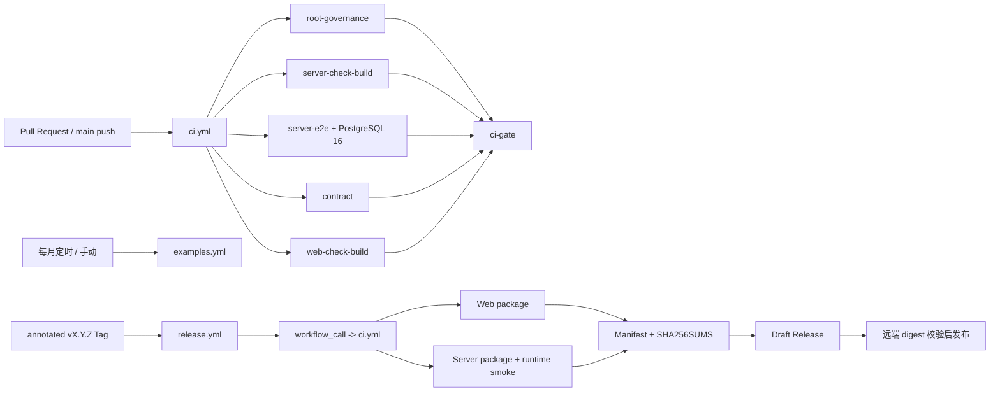

# 阶段五 CI 与发布设计

## 1. 文档定位

本文记录千树 DMS 阶段五“CI 与发布”的已确认需求、技术设计、边界和验收规则，是实施与后续演进的设计真相源。具体任务、验证命令和证据边界见[阶段五 CI 与发布实施计划](./阶段五CI与发布实施计划.md)。

阶段五代码与本地验证已实施：仓库已包含三份 Workflow、Release Manifest schema、双端归档、Server runtime smoke 与 GitHub Draft Release 协调逻辑。GitHub 平台验证以 Task 14 记录为准；在取得真实 Actions run 和管理员外部设置证据前，不得声称 GitHub CI、平台保护或正式 Release 已通过验收。

本设计建立在以下已实施事实之上：

- 根目录是无第三方依赖的命令门面，不是 pnpm workspace。
- `server/` 与 `web/` 是两个独立依赖域，分别维护 `package.json`、`pnpm-workspace.yaml` 和 `pnpm-lock.yaml`。
- Web 与 Server 只通过 HTTP 和 OpenAPI 快照协作。
- `server/openapi/openapi.json` 与 `web/openapi/openapi.json` 已由根 `contract:sync` 同步，并由 `contract:check` 只读验证。
- Server 是单一 NestJS 应用，使用 Prisma、PostgreSQL 16 和追加式 migration。
- `web/apps/qsmds-arco/` 是唯一正式 Web 应用；三个 `web/examples/*` 只作为基座备份和参考。
- 根目录继续无第三方依赖；Server 与 Web 的 frozen install、cache、构建和归档始终使用各自 lockfile。
- 正式 Release 总是从同一个 Tag Commit 重新构建 Web 与 Server，且不自动部署或连接生产数据库。

## 2. 已确认决策

阶段五采用以下已经逐项确认的决策：

1. 只实现 CI、版本校验、Release Manifest 和 GitHub Release 构建产物，不实现 Docker、GHCR 或自动部署。
2. 正式发布由开发者人工创建并推送 `vX.Y.Z` annotated Tag 触发；Workflow 不创建 Tag、不修改版本源码。
3. 每个产品 Tag 都从同一个 Commit 重新构建 Web 与 Server，不复用上一 Release 的旧组件产物。本决策已经覆盖并替换[项目工程组织方案](./项目工程组织方案.md)第 13.2 节原有的“未变化组件沿用旧 digest”模型。
4. CI 采用三工作流并行模型：
   - `ci.yml`：Root、Server、Server E2E、Contract、Web 与统一 `ci-gate`。
   - `examples.yml`：每月定时和手动验证参考应用。
   - `release.yml`：Tag 触发、完整复验、打包和 GitHub Release。
5. 初版 CI 不按路径跳过 Required Job；等真实运行成本出现后再评估增量触发。
6. Web 发布为静态 tar.gz；Server 发布为通过 `pnpm deploy --prod` 构造的 Ubuntu 24.04/glibc x64 运行包，附件名保留 `linux-x64` 平台标识，但不声称兼容 Alpine/musl 或所有 Linux 发行版。
7. 产品版本在根、Server 和正式 Web app 中保持三个物理镜像；`web/package.json` 的 `6.3.0` 仍只是 Fantastic Admin 基座版本。
8. GitHub Release 先创建 Draft，附件上传和远端摘要校验全部通过后再发布。
9. 已发布 Release、Tag 和用户附件永不由 Workflow 自动覆盖、移动或删除。

## 3. 当前实现与平台缺口

### 3.1 当前已实施入口

根目录已有以下入口：

```text
node --run test:root
node --run ci:server-e2e
node --run ci:contract
node --run contract:check
node --run check
node --run build
node --run release:check
node --run release:package:web
node --run release:package:server
node --run release:smoke:server
node --run release:manifest
node --run release:publish
```

Server 已有：

```text
pnpm -C server install --frozen-lockfile
pnpm -C server check
pnpm -C server build
pnpm -C server db:migrate:deploy
pnpm -C server exec prisma migrate status
pnpm -C server test:e2e
```

Web 已有：

```text
pnpm -C web install --frozen-lockfile
pnpm -C web api:generate
pnpm -C web check
pnpm -C web build
pnpm -C web check:examples
pnpm -C web build:examples
```

### 3.2 尚待 Task 14 验收的外部状态

- `ci.yml`、`examples.yml` 与 `release.yml` 已通过本地结构、单元和语义验证，但尚未用真实 GitHub Actions run 证明平台行为。
- `main` 的 `ci-gate` Required Check、`v*.*.*` Tag ruleset、Release immutability 与 Actions 默认 token 权限需要仓库管理员在 GitHub 手工配置并留存证据。
- Ubuntu 24.04/glibc x64 的正式 Server production archive、runtime smoke 与 Manifest runtime metadata 必须由 GitHub-hosted Runner 验收；macOS 不伪造 Runner metadata。
- 当前没有已授权的正式产品 Tag 或 GitHub Release；首个 Release 的 Tag、四附件、checksum、Manifest 与 Draft/Publish 行为仍需单独授权验证。
- 自动部署、生产 migration、环境晋级与流量切换是明确非目标，不属于待补缺口。

## 4. 范围与非目标

### 4.1 本阶段范围

- 建立 `ci.yml`、`examples.yml` 与 `release.yml`。
- 为 Server/Web 分别执行 frozen install 和基于各自 lockfile 的 pnpm store cache。
- 在受控 Docker 生命周期中启动 PostgreSQL 16，先完成凭据 mask，再执行两次 migration deploy、migration status 和 Server E2E。
- 为 PR、`main` push 和 Release Tag 提取 OpenAPI operationId 基线。
- 建立严格的产品版本、Tag、OpenAPI version 和 `main` 可达性检查。
- 删除 Web 基座 `bumpp` 发布入口及其未再使用的依赖，避免与统一产品版本冲突。
- 建立 Web 静态归档与 `linux-x64` Server 可移植归档。
- 建立 Release Manifest schema、生成、摘要和验证逻辑。
- 建立 Server 发布包真实启动与 health smoke。
- 建立可恢复但不覆盖外部状态的 Draft Release 发布流程。
- 补充中文发布操作文档，并更新项目工程组织事实。

### 4.2 明确非目标

- 不实现自动部署、环境晋级、流量切换或在线回滚。
- 不通过 Workflow 或 GitHub API 修改 Branch Protection、Actions 权限或 Release immutability 等仓库设置；发布操作文档只提供管理员手工配置清单。
- 不创建 Dockerfile、OCI image 或 GHCR 发布。
- 不连接开发、预发布或生产数据库。
- 不执行生产 migration，也不提供数据库向下回滚。
- 不引入 Changesets、semantic-release、Release Please 或新的版本管理依赖。
- 不支持 `rc`、`beta`、`alpha` 或 SemVer build metadata。
- 不支持 Windows、macOS、Linux ARM 或多架构 Server 产物。
- 不实现按目录跳过 Required Job。
- 不把三个参考应用加入正式发布产物或 Required Gate。
- 不建立完整 OpenAPI schema breaking-change 工具链；阶段五继续使用已实现的 operationId 基线和结构规则。
- 不创建根 pnpm workspace、根 lockfile、根 `node_modules/` 或根第三方依赖。
- 不自动创建、删除、移动或强制更新 Git Tag。

## 5. EARS 需求

### 5.1 CI 边界

#### REQ-001 根目录无依赖

当 CI 验证根治理时，系统应只运行 Node.js 标准库入口，不得在仓库根执行 pnpm install，也不得生成根 lockfile 或 `node_modules/`。

#### REQ-002 独立安装

当 CI 验证 Server 或 Web 时，系统应分别使用 `server/pnpm-lock.yaml` 或 `web/pnpm-lock.yaml` 执行 `--frozen-lockfile` 安装，不得合并两个依赖域。

#### REQ-003 稳定 Gate

当任一 Required Job 失败、取消或未成功完成时，`ci-gate` 应失败；只有全部 Required Job 成功时，`ci-gate` 才应成功。

#### REQ-004 不按路径跳过

当 PR 或 `main` push 触发初版 CI 时，系统应运行全部 Required Job，不得因 path filter 跳过 Server、Contract 或 Web。

#### REQ-005 参考应用隔离

当 `examples.yml` 失败时，系统应保留可见失败结果，但不得阻断 `ci-gate` 或正式 Release。

### 5.2 PostgreSQL 与契约

#### REQ-010 PostgreSQL 16

当 Server E2E Job 启动时，系统应在普通 Ubuntu step 内使用固定 digest 的 PostgreSQL 16 image 创建本次 run 专属容器，并等待健康检查成功后再执行数据库命令。

#### REQ-011 隔离凭据

当 CI 构造数据库凭据时，系统应使用 Node.js `crypto.randomBytes()` 生成本次容器专属随机密码，在执行 `docker run` 前先 mask 密码，再通过权限受限的临时 env file 注入容器。容器启动并取得动态 host port 后，系统才构造完整 `DATABASE_URL`，并在传入任何子进程或可能产生日志的边界前立即 mask 完整 URL。系统不得使用仓库 Secret、命令行明文密码或固定共享凭据。

#### REQ-012 migration 完整验证

当 Server E2E Job 验证数据库历史时，系统应按顺序执行第一次 `migrate deploy`、第二次幂等 `migrate deploy`、`migrate status` 和 `test:e2e`；任一步失败都应立即停止。

#### REQ-013 PR 契约基线

当 CI 由 PR 触发时，系统应从 PR 目标分支 Commit 的固定 `server/openapi/openapi.json` 路径提取基线。

#### REQ-014 push 契约基线

当 CI 由 `main` push 触发时，系统应从本次 push 前的 Commit 提取基线；当事件没有有效前置 Commit 时，应明确进入无历史基线模式。

#### REQ-015 Release 契约基线

当 CI 由 Release Workflow 调用时，系统应选择当前 Commit 可达、严格符合 `vX.Y.Z` 且版本低于当前 Tag 的最高稳定 Tag 作为基线；首次 Release 没有历史 Tag 时，应只验证当前快照。

#### REQ-016 只读契约验证

当 Contract Job 运行时，系统应只调用 `contract:check`，不得调用 `contract:sync`；基线文件只写入 `$RUNNER_TEMP`。

### 5.3 版本

#### REQ-020 单一产品版本

系统应要求根 `package.json.version`、`server/package.json.version`、`web/apps/qsmds-arco/package.json.version` 和两份 OpenAPI `info.version` 完全一致。

#### REQ-021 基座版本隔离

系统不得把 `web/package.json.version` 的 Fantastic Admin 基座版本当作千树 DMS 产品版本。

#### REQ-022 Tag 格式

当 Release Workflow 收到 Tag 时，系统应只接受严格 `vX.Y.Z`，并拒绝前导零、预发布后缀、build metadata 和其他格式。

#### REQ-023 Tag 身份

当 Release Workflow 验证源码身份时，系统应要求当前 ref 是 annotated Tag、Tag Commit 位于 `origin/main` 历史中，并且版本高于此前可达的最高稳定产品 Tag。系统应同时记录 annotated Tag object SHA 与 peeled Commit SHA。

#### REQ-024 Workflow 只校验

Release Workflow 不得自动修改 package version、OpenAPI snapshot、Commit 或 Tag。

#### REQ-025 远端 Tag 稳定性

当 Release Workflow 即将创建 Draft 或发布 Draft 时，系统应重新读取 GitHub 远端 Tag ref、annotated Tag object 和 peeled Commit，要求三者与前置验证记录完全一致，并重新检查版本单调性。全部产品 Release 使用同一个全局并发组串行化。

### 5.4 产物与 Manifest

#### REQ-030 Web 产物

当 Release Workflow 构建 Web 时，系统应从正式 app 的 production `dist/` 创建 `qsmds-web-vX.Y.Z.tar.gz`，并确认归档包含非空 `index.html` 且不包含真实环境文件或越界 symlink。

#### REQ-031 Server 产物

当 Release Workflow 构建 Server 时，系统应在 `server/pnpm-workspace.yaml` 启用 `injectWorkspacePackages: true`，通过现代 `pnpm deploy --prod` 路径生成含 `dist/`、生产 `node_modules/`、dedicated lockfile、`package.json`、Prisma schema 和 migrations 的 `linux-x64` 目录；不得使用 `--legacy`。

#### REQ-032 Server 运行 smoke

当 Server 产物生成后，系统应从全新解压目录执行 `node dist/main.js`，连接隔离 PostgreSQL 16，并验证 `GET /api/health` 成功。

#### REQ-033 安全归档

当系统归档目录时，应固定文件排序、owner、group、mtime 和 gzip header；Web 不得包含 symlink，Server 仅允许解析目标仍位于部署目录内的 pnpm 内部 symlink。

#### REQ-034 Manifest schema

当系统生成 `release-manifest.json` 时，应通过受版本控制的 `release/manifest.schema.json` 验证，所有对象都应拒绝未声明字段。

#### REQ-035 摘要

Manifest 应记录两端归档的 SHA-256、OpenAPI 原始快照 SHA-256、Prisma schema SHA-256、migration head 和 migrations 集合 SHA-256。

#### REQ-036 Checksum 文件

`SHA256SUMS` 应使用标准十六进制格式记录 Web archive、Server archive 和 `release-manifest.json`，不得把自身加入摘要列表。

### 5.5 GitHub Release

#### REQ-040 外部写入延后

当 Release Workflow 运行时，系统应在全部 CI、构建、解压、smoke、Manifest 和本地 checksum 验证通过前不创建任何 GitHub Release。

#### REQ-041 Draft 发布

当全部本地验证成功时，系统应先创建 Draft Release，上传四个固定附件，验证远端名称、数量、大小与 digest 后再发布。

#### REQ-042 已发布冲突

当相同 Tag 已存在已发布 Release 时，系统应失败，且不得覆盖、编辑或删除该 Release。

#### REQ-043 Draft 续传

当相同 Tag 已存在 Draft 时，只有 Draft author、受控标记、Tag、Commit、原始 workflow run、final bundle artifact ID 与 artifact digest 完全一致，系统才可检查续传。已存在的预期附件只有在 uploader、名称、大小和 digest 都与该原始 bundle 中的本地文件一致时才可原样复用；缺失附件可以上传，任何不一致或未知附件都应失败。系统不得覆盖或删除任何已存在附件。

#### REQ-044 发布后不可变

当 Release 已发布时，Workflow 不得再修改其 Tag 或附件；修复应使用新的 Patch 版本。

#### REQ-045 发布前远端复验

当 Draft 的四个附件完成远端摘要验证后，系统应再次验证远端 Tag object SHA、peeled Commit、最高稳定版本与 Draft target Commit，全部一致后才可发布。

### 5.6 安全与可审计性

#### REQ-050 最小权限

所有 Workflow 默认只授予 `contents: read`；只有最终发布 Job 可使用 `contents: write`。

#### REQ-051 固定外部引用

所有外部 Action 应固定完整 Commit SHA，PostgreSQL image 应固定完整 image digest，并在同一行注释人类可读版本。

#### REQ-052 不可信输入

系统不得使用 `eval` 或拼接 shell 命令处理 Tag、Commit、路径或 GitHub context；所有输入应先校验并作为独立 argv 传递。

#### REQ-053 PR 安全

CI 不得使用 `pull_request_target`，PR Job 不得读取环境 Secret，checkout 默认应设置 `persist-credentials: false`。

#### REQ-054 敏感信息

日志、错误、Manifest、Release Notes 和附件不得包含 token、Cookie、真实数据库凭据、完整连接字符串、真实 `.env` 或敏感请求体。

## 6. 总体架构



三份 Workflow 只负责编排。可测试的版本判断、Git 基线、数据库命令顺序、归档、摘要、Manifest 和 GitHub Draft 协调逻辑放在无第三方依赖的根 Node.js 脚本中，避免把不可测试的复杂 shell 嵌入 YAML。

## 7. `ci.yml` 设计

### 7.1 触发与并发

`ci.yml` 支持：

- 面向 `main` 的 `pull_request`。
- `main` 的 `push`。
- 供 `release.yml` 调用的 `workflow_call`。

直接 PR 或 branch push 的并发组按事件和 PR/ref 固定；新提交取消同一 PR/ref 的旧 CI。可复用调用使用以 `ci-` 开头且不与 `release.yml` 相同的并发组，避免 called workflow 取消 caller。

### 7.2 运行环境

- Runner：`ubuntu-24.04`。
- Node：读取根 `.node-version`，并由 manifest engine 约束继续校验。
- pnpm：`11.9.0`。
- 外部 Action 固定完整 SHA。
- 每个 Job 设置与风险匹配的 `timeout-minutes`。
- pnpm store cache 使用当前 Job 对应的 lockfile hash；不缓存 `node_modules`、`dist/` 或 generated source。

### 7.3 Required Job

| Job | 安装 | 验证 |
| --- | --- | --- |
| `root-governance` | 不安装 | `node --run test:root`；确认根 lockfile 和 `node_modules/` 不存在 |
| `server-check-build` | Server frozen install | `server check`、`server build`、`dist/main.js` regular file |
| `server-e2e` | Server frozen install | PostgreSQL 16、两次 deploy、status、E2E |
| `contract` | Server/Web 各自 frozen install | 提取基线并运行 `contract:check` |
| `web-check-build` | Web frozen install | `api:generate`、`check`、`build`、`dist/index.html` |
| `ci-gate` | 不安装 | 以 `if: always()` 汇总前五个 Job |

`ci-gate` 对 `success` 以外的 `failure`、`cancelled` 或 `skipped` 都返回失败。初版没有条件 Job，因此 Required Job 不应正常进入 `skipped`。

代码推送到 GitHub 后，由仓库管理员手工将稳定的 `ci-gate` check 配置为 `main` 的 Required Check。阶段五仓库代码不自行修改 Branch Protection。

每个验证 Job 结束时检查受版本控制文件没有被命令修改。允许生成或重建已被 Git 忽略的 Server `dist/`、Prisma Client、Web generated types 和 Web `dist/`。

## 8. `examples.yml` 设计

`examples.yml` 只支持：

- `workflow_dispatch`。
- 每月 1 日 `02:17 UTC` 的 `schedule`，cron 为 `17 2 1 * *`。

运行：

```text
pnpm -C web install --frozen-lockfile
pnpm -C web check:examples
pnpm -C web build:examples
```

该 Workflow 不设置 `continue-on-error`，失败时应清晰显示为失败；但它不被 `ci-gate`、`release.yml` 或 Branch Protection 依赖，因此不阻断正式产品。

## 9. Contract 基线设计

`scripts/ci-contract-baseline.mjs` 接收明确的事件数据，而不是直接信任任意 GitHub context。脚本只允许完整 Commit SHA 和严格 SemVer Tag，并通过参数数组调用 Git。

基线选择：

| 场景 | 基线 |
| --- | --- |
| PR | `github.event.pull_request.base.sha` 对应的 Server snapshot |
| `main` push | `github.event.before` 对应的 Server snapshot |
| Release call | 当前 Commit 可达、低于当前版本的最高稳定 Tag snapshot |
| 首次引入/首次 Release | 无历史 baseline；只检查当前快照 |

输出文件使用调用者提供的 `$RUNNER_TEMP` 子目录，路径在 canonicalize 后必须位于该临时根内。脚本不写仓库目录，不读取 Web snapshot 作为历史真相源，也不将 snapshot 内容写入日志。

Contract Job 随后执行：

```text
node ./scripts/contract-check.mjs --baseline <temporary-baseline>
```

无历史基线时执行无参数 `contract:check`。任何 Git 读取异常、非法 ref 或历史 snapshot 非 regular file 都应失败；只有固定路径在合法历史 Commit 中确实不存在时，才进入无历史基线模式。

Contract Job 对整个生成命令设置 `DOTENV_CONFIG_PATH=/dev/null`，不注入 `DATABASE_URL`，并确保 `DEBUG` 与 `PRISMA_USER_CONSENT_FOR_DANGEROUS_AI_ACTION` 未设置；OpenAPI preview 生成不得读取仓库或宿主环境文件。

## 10. PostgreSQL E2E 设计

### 10.1 受控 Docker 生命周期

`server-e2e` 不使用 GitHub `services:`。Service container 会在任何 step 前启动，无法保证随机密码先进入 GitHub mask；因此 `scripts/ci-postgres.mjs` 在普通 Ubuntu step 内负责完整生命周期：

1. 启用 `umask 077`，创建 session 唯一临时目录、container name、label 和 `cidfile`。
2. 使用 Node.js `crypto.randomBytes()` 生成随机密码。
3. 在任何 Docker 命令前对随机密码发出 `::add-mask::`。
4. 将 `POSTGRES_USER`、`POSTGRES_PASSWORD` 和 `POSTGRES_DB` 写入权限受限的临时 env file，不把密码放入 argv。
5. 使用固定 digest 的 PostgreSQL 16 image，绑定 `127.0.0.1::5432/tcp` 动态 host port，不复用固定端口或 volume。
6. 通过精确 container ID 在容器内运行 `pg_isready`，再读取映射端口并构造 `DATABASE_URL`；在把 URL 传给受控子进程或任何可能产生日志的函数前，立即发出完整 URL 的 `::add-mask::`。
7. 无论成功、失败、`SIGINT` 或 `SIGTERM`，都只删除 `cidfile` 记录的本次容器、匿名 volume、env file 和临时目录，并保留原始退出码。

数据库用户名和数据库名是固定的非敏感 CI 标识；随机密码和完整 URL 不写入仓库、Workflow YAML、命令行、Manifest 或普通日志。

### 10.2 E2E 编排

`scripts/ci-server-e2e.mjs` 由 `ci-postgres.mjs` 在隔离数据库环境中调用，并负责：

1. 验证 `DATABASE_URL` 存在、协议为 PostgreSQL、含非空密码、host 为 `localhost` 或 `127.0.0.1`，database 为约定 CI 数据库。
2. 强制 `NODE_ENV=test` 与 `DOTENV_CONFIG_PATH=/dev/null`。
3. 从子进程环境移除 `DEBUG` 和 `PRISMA_USER_CONSENT_FOR_DANGEROUS_AI_ACTION`。
4. 串行执行：

```text
pnpm -C server db:migrate:deploy
pnpm -C server db:migrate:deploy
pnpm -C server exec prisma migrate status
pnpm -C server test:e2e
```

5. 保留第一处真实非零退出码，但固定顶层错误文本，不输出命令环境。

`package-server` 的归档运行 smoke 复用同一 `ci-postgres.mjs` 生命周期，不重新实现凭据、端口或容器清理。

## 11. 产品版本设计

### 11.1 三个物理镜像

| 文件 | 语义 |
| --- | --- |
| 根 `package.json.version` | 单 Git 仓库的产品版本 |
| `server/package.json.version` | 独立 Server 版本和 OpenAPI `info.version` |
| `web/apps/qsmds-arco/package.json.version` | 独立 Web 正式 app 版本 |

阶段五已经补齐根与正式 Web app 的 `0.0.0`，与 Server/OpenAPI `0.0.0` 对齐。`web/package.json.version = 6.3.0` 明确保留为基座版本，不参与校验。

Web Vite system info 已显式包含正式 app 的 `pkg.version`，类型声明与实际注入保持一致。

原 `web/package.json` 的 `release: bumpp`、对应 `bumpp` devDependency 和 workspace catalog entry 已删除，并已按 Web 独立依赖域更新 `web/pnpm-lock.yaml`。统一产品版本准备只能按本节流程执行，不保留会修改基座 `6.3.0` 的第二发布入口。

### 11.2 Release 前置流程

正式发布前由开发者：

1. 在获得公共 OpenAPI 元数据修改确认后，将三个产品 version 改为相同 `X.Y.Z`。
2. 执行 `node --run contract:sync`，更新两份 OpenAPI `info.version`。
3. 提交版本准备 Commit。
4. 运行完整 CI。
5. 创建 annotated `vX.Y.Z` Tag 并推送。

`scripts/release-version.mjs` 只做校验，不自动准备版本。它验证严格 SemVer、三个 package version、两份 OpenAPI version、双快照字节一致、annotated Tag、Tag object SHA、peeled Commit、`origin/main` 可达性和版本单调递增。

## 12. Release 产物设计

### 12.1 Web archive

产物名：

```text
qsmds-web-vX.Y.Z.tar.gz
```

归档顶层目录为 `qsmds-web-vX.Y.Z/`，其内部是 `web/apps/qsmds-arco/dist/` 的完整内容。发布前验证：

- `index.html` 是非空 regular file。
- 目录不包含 symlink、socket、device、FIFO 或越界路径。
- 不包含 `.env`、`.env.*`、日志、`node_modules` 或源代码目录。
- 所有文件均位于 canonical dist root。

### 12.2 Server archive

`server/pnpm-workspace.yaml` 增加：

```yaml
injectWorkspacePackages: true
```

构造命令语义：

```text
pnpm -C server --filter @qianshu-dms/server --prod deploy <temporary-deploy-directory>
```

Server `package.json` 使用 `files` 白名单，只发布：

- `dist/`。
- `prisma/schema.prisma`。
- `prisma/migrations/`。
- package manager 自动包含的 `package.json`。

`pnpm deploy` 在目标目录创建独立生产 `node_modules` 和 dedicated `pnpm-lock.yaml`。本设计已在 pnpm 11.9.0 上验证现代 `injectWorkspacePackages` 路径能够生成生产依赖；`--legacy` 路径不得使用。归档顶层目录为 `qsmds-server-vX.Y.Z-linux-x64/`。

发布前验证：

- `dist/main.js` 是非空 regular file。
- `node_modules/` 非空，且没有顶层 `node_modules/prisma` 或 `node_modules/.bin/prisma`。
- dedicated `pnpm-lock.yaml` 是非空 regular file。
- `package.json.version` 与产品版本一致。
- Prisma schema、migration lock 和至少一个 migration 目录存在。
- 不包含 devDependencies 安装结果、真实 `.env`、日志或测试文件。
- pnpm 内部 symlink 解析后仍位于部署目录；任何逃逸或断裂 symlink 都失败。

该产物的兼容目标限定为 Ubuntu 24.04/glibc x64 与 Node 24，不声称兼容 Alpine/musl、其他 CPU 架构或任意 Linux 发行版。Prisma CLI 仍是 devDependency，发布校验拒绝顶层 Prisma CLI 链接；归档中的 schema/migrations 是审计与未来部署输入，不代表该运行包可以自行执行 `prisma migrate deploy`。

### 12.3 运行 smoke

Server package Job 从归档解压到新的临时目录，使用隔离 PostgreSQL 16 和固定测试端口执行：

```text
node dist/main.js
GET /api/health
```

验收：

- 进程从归档目录启动，不访问原 checkout 的 `server/node_modules`。
- health 返回 HTTP `200` 与 Server-generated `X-Request-Id`。
- 失败日志不包含数据库 URL 或密码。
- 无论成功或失败都终止 Server 进程树并清理临时目录。

## 13. Release Manifest

### 13.1 Schema

`release/manifest.schema.json` 是 Manifest 数据结构真相源，使用 JSON Schema 描述精确字段，并在所有 object 上设置 `additionalProperties: false`。

生成的 `release-manifest.json` 不提交 Git，只作为 GitHub Release 附件。

根目录不增加 JSON Schema 第三方依赖。`release-manifest.mjs` 只实现本 schema 实际使用的确定性子集，并在加载时拒绝未知 schema keyword；测试必须对每类字段、`required`、`pattern`、`enum`、array 和 `additionalProperties` 建立 mutation，防止 schema 与运行时校验漂移。

### 13.2 结构

```json
{
  "schemaVersion": 1,
  "release": {
    "version": "1.2.3",
    "tag": "v1.2.3",
    "tagObjectSha": "89abcdef0123456789abcdef0123456789abcdef",
    "sourceCommit": "0123456789abcdef0123456789abcdef01234567"
  },
  "build": {
    "repository": "SilnoGM/QIANSHU-DMS",
    "workflow": "release.yml",
    "runId": "123456789",
    "runAttempt": 1,
    "createdAt": "2026-07-12T12:00:00.000Z"
  },
  "runtime": {
    "node": "24.15.0",
    "pnpm": "11.9.0",
    "runnerImage": "ubuntu-24.04",
    "os": "linux",
    "arch": "x64",
    "libc": "glibc",
    "libcVersion": "2.39"
  },
  "components": {
    "web": {
      "artifact": "qsmds-web-v1.2.3.tar.gz",
      "sha256": "sha256:aaaaaaaaaaaaaaaaaaaaaaaaaaaaaaaaaaaaaaaaaaaaaaaaaaaaaaaaaaaaaaaa"
    },
    "server": {
      "artifact": "qsmds-server-v1.2.3-linux-x64.tar.gz",
      "sha256": "sha256:bbbbbbbbbbbbbbbbbbbbbbbbbbbbbbbbbbbbbbbbbbbbbbbbbbbbbbbbbbbbbbbb",
      "platform": "linux",
      "arch": "x64"
    }
  },
  "contract": {
    "version": "1.2.3",
    "openapiSha256": "sha256:cccccccccccccccccccccccccccccccccccccccccccccccccccccccccccccccc"
  },
  "database": {
    "migrationHead": "20260710152144_init",
    "schemaSha256": "sha256:dddddddddddddddddddddddddddddddddddddddddddddddddddddddddddddddd",
    "migrationsSha256": "sha256:eeeeeeeeeeeeeeeeeeeeeeeeeeeeeeeeeeeeeeeeeeeeeeeeeeeeeeeeeeeeeeee"
  }
}
```

字段语义：

- `release.tagObjectSha` 是 annotated Tag object 的完整 40 位 SHA；`release.sourceCommit` 是该对象 peel 后指向的完整 40 位 Commit SHA。
- `build.createdAt` 是实际 UTC 生成时间；Manifest 是审计记录，不承诺跨 run 字节一致。
- `runtime` 记录构建 Runner 的 Node、pnpm、固定 runner image、OS、CPU、libc 类型和实际 libc 版本，不只复制声明值。
- 两个 component 都从同一 Tag Commit 重建，因此不记录上一组件版本或 promotion lineage。
- `contract.openapiSha256` 对已确认字节一致的 Server snapshot 原始 bytes 计算。
- `database.schemaSha256` 对 `schema.prisma` 原始 bytes 计算。
- migrations 集合先生成按相对路径排序的 `path + fileSha256` 清单，再对 canonical JSON 加单一末尾换行计算聚合 SHA-256。
- `migrationHead` 是排序后的最高 migration 目录；当前仓库要求至少存在一个 migration。

### 13.3 `SHA256SUMS`

`SHA256SUMS` 记录：

```text
<hex>  qsmds-web-vX.Y.Z.tar.gz
<hex>  qsmds-server-vX.Y.Z-linux-x64.tar.gz
<hex>  release-manifest.json
```

文件名必须是固定 basename，不允许路径分隔符。生成后立即从磁盘重读三个文件并重新验证摘要。

## 14. `release.yml` 设计

### 14.1 触发与权限

`release.yml` 监听 `v*.*.*` Tag push，再由 `release-version.mjs` 执行严格格式验证。Workflow 不提供可绕过 Tag 的 `workflow_dispatch` 发布入口。若 `publish` 在创建部分 Draft 后失败，唯一自动续传方式是只重跑失败的 `publish` Job，并复用同一 workflow run 已成功生成的 final bundle artifact。

Workflow 默认 `contents: read`。只有最终 GitHub Release Job 使用 `contents: write`。全部产品 Tag 共用固定全局 Release 并发组，`cancel-in-progress: false`，避免不同版本并行写入 Release；若 GitHub 因同组只保留一个 pending run 而取消更早的 pending 版本，该版本保持未发布并需人工重新触发。

### 14.2 Job 顺序

1. `verify`：以 `workflow_call` 调用完整 `ci.yml`。
2. `package-web`：重新 frozen install、production build、归档和本地内容验证。
3. `package-server`：重新 frozen install、build、现代 `pnpm deploy --prod`、归档、解压和 health smoke。
4. `manifest`：下载两个精确 workflow artifacts，计算摘要，生成并验证 Manifest 与 `SHA256SUMS`。
5. `publish`：下载最终四附件 bundle，重验 checksum，协调 Draft、上传、远端 digest 校验并发布。

发布 Job 不直接复用 PR CI 的 `dist/`，确保 Release 附件由 Tag Workflow 在受控 Job 中重新产生。包含四个最终文件的 final bundle workflow artifact 使用 7 天保留期，并记录 artifact ID 与 GitHub 返回的 artifact digest；只重跑 `publish` 时必须下载同一 ID/digest。正式 GitHub Release assets 不依赖 workflow artifact 的保留期。

## 15. Draft Release 协调

`scripts/release-github.mjs` 使用 Node.js 24 内置 `fetch`、`GITHUB_API_URL` 和 `GITHUB_TOKEN` 调用 GitHub REST API，不依赖预装 GitHub CLI 或第三方 Release Action。HTTP client、clock 与等待函数必须可注入，单元测试不访问网络。

### 15.1 外部写入前

在创建 Draft 前必须完成：

- Tag 与版本检查。
- 完整 CI。
- 两端打包。
- Server archive runtime smoke。
- Manifest schema 验证。
- 本地 `SHA256SUMS` 重验。
- 固定附件名称、数量、regular file、大小和摘要检查。
- 通过 GitHub Git refs/tags API 重新验证远端 Tag object SHA、peeled Commit、`main` 可达性和版本单调性。

### 15.2 Draft 所有权

Workflow 创建的 Draft body 含机器可读标记，至少绑定：

- schema version。
- Release Tag。
- source Commit。
- repository。
- 原始 workflow run ID 与生成 bundle 的 run attempt。
- final bundle artifact ID 与 artifact digest。

新建 Draft 后必须重读 Release，确认 author 为 `github-actions[bot]`。续传时同时要求相同 author、相同标记、相同 target Commit 和相同 final bundle identity。只重跑失败的 `publish` Job 时，当前 `github.run_attempt` 可以增加，但 Draft 标记和附件仍绑定原始 bundle 的生成 attempt，不重新构建或重新生成 Manifest。

### 15.3 冲突规则

- 无 Release：创建 Draft。
- 已发布 Release：失败，不编辑。
- 外部或无法证明所有权的 Draft：失败，不编辑。
- 同源 Draft 缺少某个预期附件：只上传缺失附件。
- 同源 Draft 已有预期附件：只有 uploader 为 `github-actions[bot]`，且 asset name、size 与 GitHub API `digest` 全部等于本地值时才原样复用。
- 任一同名附件的 uploader、size 或 digest 不一致：失败，不覆盖、不删除。
- Draft 含未知附件：失败，不删除。
- 上传后远端附件集合不精确等于四个文件：失败并保留 Draft。
- 远端 digest 暂未可见时按 `1s/2s/4s/8s` 有界重试；耗尽后仍不可见或与本地不一致时失败并保留 Draft。

全部附件验证通过后，再次读取远端 Tag ref 与 annotated Tag object，确认 tag object SHA、peeled Commit、版本单调性和 Draft target Commit 未变化，随后才发布 Draft 并使用自动生成的 Release Notes。

完整重跑 package/manifest Job 可能因 Web build time、Manifest `createdAt` 或工具输出产生不同 digest，因此不属于自动续传路径。若原 final bundle 已过期或管理员选择完整重跑，新的 `publish` 遇到旧 Draft 必须安全失败；管理员人工核对 Draft 来源后删除未发布 Draft，再从同一 Tag 重新运行完整 Workflow。Workflow 自身不执行该删除。

仓库管理员在首次正式发布前必须：

1. 为 `v*.*.*` 建立 Tag ruleset，限制创建者并禁止更新和删除。
2. 启用 Release immutability。

Workflow 采用 Draft -> 完整附件 -> 远端 Tag 复验 -> 发布的顺序与这些设置兼容，但不自行更改仓库设置。

## 16. 失败、重试与回滚

| 失败位置 | 外部状态 | 处理 |
| --- | --- | --- |
| CI / version / baseline | 无 | 失败退出，修复源码后重新提交；不得移动已有 Tag 掩盖失败 |
| Web/Server build | 无 | 失败退出；中间文件仅在 Runner |
| Server archive smoke | 无 | 终止进程树，保留非敏感诊断，失败退出 |
| Manifest/checksum | 无 | 失败退出，不创建 Draft |
| Draft 创建/上传 | 可能存在同源 Draft | 只重跑失败的 `publish` 并复用原 final bundle；只补缺失附件，绝不 clobber |
| 远端 digest | 同源 Draft | 不发布、不删除附件，失败退出 |
| 已发布后发现问题 | 不可变 Release | 创建新的 Patch 版本 |

本阶段不改变任何运行环境，因此没有自动化环境回滚。人工需要旧产物时，应选择旧 GitHub Release、下载四附件并先验证 `SHA256SUMS`。

数据库 migration 继续执行向前修复，不自动向下回滚，不修改已发布 migration。

## 17. 安全设计

### 17.1 GitHub Actions

- 外部 Action 固定完整 Commit SHA，并用注释记录对应版本。
- PostgreSQL image 固定 multi-arch manifest digest。
- 不使用 floating `main`、`master` 或仅 major tag。
- checkout 默认 `persist-credentials: false`。
- 只有 Contract/Release 需要完整 Git 历史，其他 Job 使用最小 fetch。
- 不使用 `pull_request_target`。
- PR 不读取 repository、environment 或 organization Secret。
- 每个 Job 使用显式 `permissions` 和 timeout。
- 全部 Release 使用全局并发组；创建 Draft 与发布前都通过 GitHub API 复验远端 Tag object 和 peeled Commit。
- 正式发布前由管理员启用 `v*.*.*` Tag ruleset 与 Release immutability。

### 17.2 输入与文件系统

- Tag、Commit、repository、run id、artifact basename 和临时根都执行格式与 canonical path 校验。
- 子进程一律使用 executable + argv array，不通过 shell 拼接不可信输入。
- 归档输入必须位于预期根；拒绝路径穿越、special file、逃逸 symlink 和不精确文件集合。
- 临时目录使用 `mkdtemp`，权限受 `umask 077` 约束。
- Workflow 只复用来源和摘要完全一致的已有附件并上传缺失附件，不覆盖或删除任何已有附件。

### 17.3 敏感信息

- CI 数据库凭据只在隔离 Job 生命周期存在。
- `DATABASE_URL` 在日志产生前注册 mask。
- 不启用 `set -x`。
- 固定错误消息不回显环境、CLI stderr 中的连接串或完整 GitHub API body。
- Release Manifest 不记录 Secret、token、Cookie、数据库 URL、完整环境变量或用户数据。

## 18. 测试策略

阶段五复杂逻辑采用 TDD。每个 Node.js 模块暴露可注入 runner、filesystem、clock、wait 或 `fetch` 边界，单元测试不访问网络、不创建真实 Release。

### 18.1 根脚本测试

| 模块 | 重点测试 |
| --- | --- |
| `ci-contract-baseline` | PR/push/Tag/首次 Release、SemVer 排序、非法 ref、缺失 snapshot、Git 失败、临时根边界 |
| `ci-postgres` | 密码 mask 先于 Docker、动态端口读取后 URL mask 先于子进程、随机 env file、health、精确 container ownership、signal/失败清理、脱敏 |
| `ci-server-e2e` | URL guard、命令顺序、第二次 deploy、status、失败短路、退出码、环境清理、脱敏 |
| `release-version` | Tag grammar、annotated Tag object、peeled Commit、main 可达性、版本单调、三 package 与双 OpenAPI 一致 |
| `release-package` | exact tree、archive metadata、special file、Web symlink、Server escaping symlink、解压后校验 |
| `release-manifest` | exact schema、hash、migration head、集合摘要、非法字段、basename、重读验证 |
| `release-github` | 远端 Tag TOCTOU、全局顺序、新 Draft、bundle artifact identity、只重跑 publish、完整重跑摘要冲突、author/uploader、缺失附件续传、同名不覆盖、foreign Draft、published conflict、unknown asset、digest 延迟/不一致、publish gate |
| `ci-workflows` | 触发器、权限、并发、Job、Action SHA、image digest、禁止 root install 与 `pull_request_target` |

`ci-workflows.test.mjs` 是无依赖的严格源码结构检查，不冒充完整 YAML parser 或 GitHub 平台执行。实施交付时应在临时工具目录使用固定版本和已核验摘要的 `actionlint` 做本地语义检查；在未获得 push 授权、没有真实 Actions run 前，只能报告“本地 workflow 验证通过”，不得声称 GitHub CI 已实际运行。

### 18.2 集成验证

- 从 clean checkout 执行 Server/Web frozen install。
- 执行全部根测试。
- 执行 Server check/build。
- 在全新 PostgreSQL 16 中执行两次 deploy、status 和 E2E。
- 执行带历史 baseline 的 Contract check。
- 执行 Web generate/check/build。
- 执行 Examples check/build。
- 用测试版本元数据在临时目录生成 Web/Server archives、Manifest 和 `SHA256SUMS`。
- 从 Server archive 启动 production entrypoint 并完成 health smoke。
- 检查 Git tracked 文件没有被验证命令修改。

GitHub Draft/Publish 的真实外部写入只由 Tag Workflow 验证；本地与 PR 测试使用可注入假 CLI，不创建远程 Release。

## 19. 实施文件边界

阶段五已新增：

```text
.github/workflows/
├── ci.yml
├── examples.yml
└── release.yml

release/
└── manifest.schema.json

scripts/
├── ci-contract-baseline.mjs
├── ci-contract-baseline.test.mjs
├── ci-postgres.mjs
├── ci-postgres.test.mjs
├── ci-server-e2e.mjs
├── ci-server-e2e.test.mjs
├── ci-workflows.test.mjs
├── release-version.mjs
├── release-version.test.mjs
├── release-package.mjs
├── release-package.test.mjs
├── release-manifest.mjs
├── release-manifest.test.mjs
├── release-github.mjs
└── release-github.test.mjs
```

阶段五已按确认范围修改：

- 根 `package.json`：补 `version: 0.0.0` 和无依赖 CI/Release scripts。
- `scripts/root-governance.test.mjs`：纳管新的根命令与发布边界。
- `server/package.json`：补发布 `files` 白名单。
- `server/pnpm-workspace.yaml`：启用 `injectWorkspacePackages: true`，使用现代 deploy 路径。
- `server/pnpm-lock.yaml`：只同步 `settings.injectWorkspacePackages` 所必需的配置元数据，不改变 importer、依赖解析或版本。
- `web/package.json` 与 `web/pnpm-workspace.yaml`：删除 `release: bumpp`、`bumpp` devDependency 和 catalog entry。
- `web/pnpm-lock.yaml`：只同步上述已确认的 `bumpp` 移除，不混入其他依赖升级。
- `web/apps/qsmds-arco/package.json`：补 `version: 0.0.0`。
- `web/apps/qsmds-arco/vite.config.ts`：注入 app version。
- Web 对应工程测试：验证 version 注入。
- `docs/全局文档/项目工程组织方案.md`：已将阶段五从目标更新为代码与本地验证实施事实，并单列 Task 14 平台边界。
- `docs/全局文档/发布与版本管理.md`：提供版本准备、Tag、Release、校验和旧版本取用步骤。
- `docs/文档索引.md`、根 README 与必要 AGENTS：同步真实入口和边界。

不修改：

- `server/prisma/schema.prisma`。
- `server/prisma/migrations/`。
- 公共业务 API、DTO 或数据库数据结构。
- `web/examples/*` 源码。
- `server/pnpm-lock.yaml` 中 importer、package snapshot、依赖解析和版本；只允许 `injectWorkspacePackages` 配置同步所需的精确 metadata 变化。
- `web/pnpm-lock.yaml` 除删除 `bumpp` 所必需的精确变化外的其他内容。

## 20. 验收标准

阶段五仓库代码与本地验证完成必须同时满足：

1. 三份 Workflow 通过结构测试，外部 Action 与 image 全部固定 SHA/digest。
2. PR 和 `main` push 的五个 Required Job 可并行运行，`ci-gate` 精确汇总。
3. Root、Server 与 Web 依赖边界保持不变，没有根 lockfile、根 `node_modules/` 或跨目录依赖。
4. PostgreSQL 16 在随机密码完成 mask 后才启动；动态端口确定后，完整 URL 在传入子进程前完成 mask；E2E 实际执行两次 migration deploy、status 和全部 E2E，并按精确 container ID 清理。
5. PR、push 与 Tag 契约基线选择具有自动化测试，Contract Job 不修改 tracked snapshot。
6. 三个产品 version、Tag 和双 OpenAPI version 可被同一入口严格校验。
7. Web archive 内容可部署为静态站点。
8. Server archive 在全新解压目录、没有原 checkout 依赖的情况下可启动并通过 health smoke。
9. Manifest 通过 schema，记录 Tag object SHA、peeled Commit、构建 OS/libc，并保证所有摘要、migration head 和 runtime metadata 来自实际构建。
10. `SHA256SUMS` 能重验三个附件。
11. Draft Release 只有在全部验证通过后创建；自动续传只复用同一 workflow run 的原 final bundle，已发布或外部 Draft 不会被覆盖，已有同名附件也绝不被删除或 clobber。
12. 没有真实 `.env`、密钥、连接字符串、日志、生成目录或构建产物进入 Git。
13. 中文发布文档能让开发者从版本准备、Tag 到附件校验完整复现流程。
14. 未推送时交付说明明确区分本地验证与 GitHub Actions 真实运行；推送后首次真实 CI/Release dry path 结果才能作为平台验收证据。

前述仓库实现条件已由 Task 0–13 收口；GitHub-hosted Ubuntu 24.04 的 Release production path、真实 Workflow run 与管理员外部设置仍由 Task 14 验收。两类状态不得合并表述。

## 21. 后续演进条件

只有出现以下真实需求时，才扩展本设计：

- CI 成本或等待时间形成可测瓶颈：引入安全的变更范围分析与条件 Job，同时保留稳定 Gate。
- 确定真实部署平台：增加平台专属部署与环境 Deployment Record。
- 引入 OCI Registry：将 Server/Web image digest 纳入 Manifest，并重新评估选择性组件提升。
- 需要 ARM 或桌面 Server 运行：增加明确的多平台构建矩阵。
- 需要预发布渠道：另行设计 prerelease Tag、兼容性和保留策略。
- API 稳定后需要完整 breaking-change 检测：引入专门 OpenAPI diff 工具链。
- 需要供应链证明：增加 GitHub artifact attestation 或 SLSA provenance。

## 22. 参考资料

- [GitHub Actions：Node.js 构建与 pnpm cache](https://docs.github.com/en/actions/tutorials/build-and-test-code/nodejs)
- [GitHub Actions：复用 Workflow](https://docs.github.com/en/actions/concepts/workflows-and-actions/reusing-workflow-configurations)
- [GitHub：Immutable releases](https://docs.github.com/en/code-security/concepts/supply-chain-security/immutable-releases)
- [GitHub：Release 与附件](https://docs.github.com/en/repositories/releasing-projects-on-github/about-releases)
- [GitHub REST：Git refs](https://docs.github.com/en/rest/git/refs)
- [GitHub REST：Git tags](https://docs.github.com/en/rest/git/tags)
- [GitHub REST：Release assets](https://docs.github.com/en/rest/releases/assets)
- [Docker：`docker container run`](https://docs.docker.com/reference/cli/docker/container/run/)
- [pnpm 11：pnpm deploy](https://pnpm.io/cli/deploy)
- [项目工程组织方案](./项目工程组织方案.md)
- [阶段四接口契约设计](./阶段四接口契约设计.md)
- [数据库迁移规范](../后端文档/数据库迁移规范.md)
