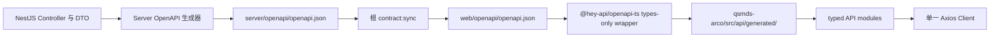

# 阶段四接口契约设计

## 1. 文档定位

本文记录千树 DMS 阶段四“接口契约”的已确认需求、技术设计、边界和验收规则，是后续实施计划与代码实现的设计真相源。

本文只描述已经确认的目标，不声称相关能力已经落地。阶段四代码实施完成前，仓库仍只有 `GET /api/health` 一个真实 Server 路由，Web 仍以 Fantastic Admin 的 fake API 维持基座功能。

本设计形成于以下已确认决策：

- 阶段四采用“契约基础设施”范围，不新增用户、认证或其他业务模块。
- 不修改 Prisma schema，不创建业务 migration，不新增公共业务 API。
- 生产代码实现横切契约能力；响应场景矩阵通过测试专用 Controller 验证，不发布示例接口。
- health 保留 Terminus 原始成功与 `503` body，但所有响应都增加 `X-Request-Id`。
- Request ID 始终由 Server 生成，不接受客户端传入值。
- Web fake 路由保留，但其响应从旧 envelope 迁移为新契约，避免保留两套 Axios 语义。

## 2. 当前事实与问题

### 2.1 Server 当前事实

- Server 是独立 NestJS 11 package，路由前缀为 `/api`。
- 当前唯一真实路由是 `GET /api/health`。
- 全局 `ValidationPipe` 已启用 `whitelist`、`forbidNonWhitelisted`、`transform`，DTO 校验失败使用 HTTP `422`。
- 当前没有 `@nestjs/swagger`、OpenAPI 生成脚本、快照、Request ID 中间件或统一 Exception Filter。
- Prisma schema 没有业务 model；首条 migration 为空。
- health 的 `200` 与 `503` 都使用 Terminus 接口专属结构，不能改造成通用业务响应。

### 2.2 Web 当前事实

- `web/` 是独立 pnpm workspace，正式业务应用是 `web/apps/qsmds-arco/`。
- 当前 12 个应用 API 调用全部使用 `fake: true`，没有真实业务接口接入 Server。
- Axios 成功拦截器运行时返回 response body，但 TypeScript 仍按 `AxiosResponse<T>` 声明，运行时与类型不一致。
- fake 路由返回旧 `{ status, error, data }` envelope；Store 则按 `res.data` 读取业务结果。
- 当前没有 `web/openapi/openapi.json`、`api:generate`、OpenAPI 生成类型、`ApiClientError` 或 `isApiError()`。
- 当前重试逻辑不限制 HTTP method 和 status，不能作为正式契约继续使用。

### 2.3 需要解决的问题

阶段四必须同时解决以下工程问题：

1. Server 如何用代码生成可提交、可重建的 OpenAPI 快照。
2. Web 如何在独立依赖域内持有快照并生成 TypeScript 类型。
3. 如何保证两份快照一致、生成结果未过期且契约结构符合项目规则。
4. 如何在不引入全局成功 envelope 的前提下统一错误结构。
5. 如何让成功响应、HTTP 错误、无法解析的 HTTP 错误和网络错误在 Web 中保持明确类型。
6. 如何完整验证 `200`、分页、`201`、`202`、`204`、binary 与错误矩阵，而不为测试发布虚假生产 API。
7. 如何迁移现有 fake API，同时保证登录、菜单、通知和偏好设置等基座功能不回归。

## 3. 范围与非目标

### 3.1 本阶段范围

- Server Request ID 生成、响应头写入与错误日志关联。
- 统一 `ApiError` DTO、DTO 校验错误转换与全局 Exception Filter。
- health 对统一错误体的明确豁免。
- NestJS OpenAPI metadata、离线文档生成与 Server 快照。
- 根级 OpenAPI 同步和只读检查脚本。
- Web 快照、`@hey-api/openapi-ts` types-only 生成和 typed health API module。
- Axios 成功、错误、Blob 和重试契约重构。
- 现有 fake 成功响应改为裸 DTO，fake `401` 改为 `ApiError`。
- Server、根脚本、Web 和真实运行时验证。
- 后端接口契约规范、前端接口接入规范与文档索引更新。

### 3.2 明确非目标

- 不新增 User、Account、Role、Permission、Authentication 或其他业务模块。
- 不修改 Prisma schema，不创建业务 migration，不访问或迁移业务数据。
- 不新增 `/api/users`、`/api/auth/*` 或 `/api/contract-examples/*`。
- 不引入 JWT、Passport、密码哈希、授权 Guard 或 OpenAPI security scheme。
- 不切换 Web 路由来源，不删除 fake 文件，不把 fake API 视为 Server 契约。
- 不修改当前自定义 `Token` Header；正式认证 Header 留给认证阶段设计。
- 不修改 CORS、代理或部署拓扑；阶段四运行与验收限定为同源 `/api` 或反向代理模式。
- 不开放 Swagger UI、OpenAPI JSON HTTP endpoint 或其他文档路由。
- 不生成完整运行时 HTTP Client，不引入第二个 Axios Client。
- 不建立阶段五 CI workflow、发布 Manifest 或完整 breaking-change 工具链。
- 不修改 `web/examples/*` 中的三个参考应用。

## 4. EARS 需求

以下需求使用 EARS 句式表达。`系统` 指本仓库阶段四完成后的 Server、Web 与根编排能力。

### 4.1 工程边界

#### REQ-001 独立依赖域

系统应保持根目录无第三方依赖，Server 的 OpenAPI 依赖只安装在 `server/`，Web 的类型生成依赖只安装在 `web/`。

#### REQ-002 无跨域源码依赖

系统应通过提交的 OpenAPI 快照连接 Server 与 Web，不得通过 `file:`、`link:`、跨目录 `workspace:*` 或源码 import 连接两个依赖域。

#### REQ-003 无业务扩张

在阶段四实施期间，系统不得新增业务 API、业务 Prisma model 或业务 migration。

### 4.2 Request ID 与错误响应

#### REQ-010 Server 生成 Request ID

当任意 HTTP 请求进入 Server 时，系统应使用 Node.js `crypto.randomUUID()` 生成 `req_<UUID v4>`，且不得采用客户端传入的 `X-Request-Id`。

#### REQ-011 所有响应携带 Header

当 Server 返回任意成功或失败响应时，系统应在响应头写入 `X-Request-Id`，包括 health、404、DTO 校验错误和未预期异常。

#### REQ-012 统一应用错误体

当 Server 返回应用级 JSON 错误时，系统应返回顶层 `ApiError`：`code`、`message` 和 `requestId` 为必填 string，`fieldErrors` 为可选 `Record<string, string[]>`。系统不得使用成功 envelope、HTTP `200 + error code` 或 NestJS 默认错误结构。

#### REQ-013 字段校验错误

当 DTO 校验失败时，系统应返回 HTTP `422`、`code: VALIDATION_FAILED`、中文 `message` 和按字段组织的中文 `fieldErrors`。

#### REQ-014 嵌套字段路径

当嵌套 DTO 或数组元素校验失败时，系统应使用点路径表示字段，例如 `items.0.name`。

#### REQ-015 未预期异常脱敏

当 Server 遇到未预期异常时，系统应返回 HTTP `500` 和固定的 `INTERNAL_ERROR`，不得在响应或日志中输出 token、密码、连接字符串、Cookie、SQL、完整敏感请求体或原始异常详情。

#### REQ-016 health 响应豁免

当 `GET /api/health` 成功或数据库探测失败时，系统应保留 Terminus 的原始 `200` 或 `503` body，仅增加 `X-Request-Id`，不得转换为 `ApiError`。

### 4.3 OpenAPI 产物

#### REQ-020 定义真相源

系统应以 NestJS Controller、DTO 和 OpenAPI decorators 作为 HTTP 契约定义真相源。

#### REQ-021 离线快照

当开发者执行 OpenAPI 生成命令时，系统应生成 OpenAPI `3.0.3` JSON 快照，不得监听端口、连接 PostgreSQL 或开放 Swagger 路由。

#### REQ-022 双快照

当开发者执行 `node --run contract:sync` 时，系统应生成 `server/openapi/openapi.json`、同步 `web/openapi/openapi.json`，并保证两份文件字节和 SHA-256 一致。

#### REQ-023 稳定操作标识

当公开 Controller 操作进入 OpenAPI 时，系统应要求显式、唯一且稳定的 `operationId`；自动生成的 sentinel operationId 必须导致检查失败，health 使用 `health_get`。

#### REQ-024 成功响应结构

当操作返回 JSON 成功响应时，OpenAPI 应引用接口专属 schema，不得生成全局 `{ code, message, data }` envelope。

#### REQ-025 无 body 与 binary

当操作返回 `204` 时，OpenAPI 不得声明 `content`；当操作返回文件时，OpenAPI 应声明真实 media type 和 `type: string`、`format: binary`。

#### REQ-026 错误与 Header

OpenAPI components 应始终包含完整 `ApiError` schema，即使当前没有业务操作引用它。当公开业务操作声明错误响应时，OpenAPI 应引用 `ApiError`；所有已声明响应都应声明 `X-Request-Id`。health `503` 应明确使用 Terminus schema，而不是 `ApiError`。

#### REQ-027 只读检查

当开发者执行 `node --run contract:check` 时，系统应在临时目录重新生成并完成校验，不得修改受 Git 管理的文件。

#### REQ-028 operationId 基线

当 `contract:check` 收到 `--baseline <file>` 时，系统应检测 operationId 删除或改名；阶段四本地默认检查唯一性，阶段五 CI 再提供目标分支基线。

#### REQ-029 必要错误矩阵

当公开操作进入 OpenAPI 时，系统应通过 `x-qianshu-contract` metadata 声明操作种类，以及是否需要认证、权限、资源定位、冲突和输入校验。`contract:check` 应据此断言必要的 `400/401/403/404/409/422/500` response 完整存在；遗漏任一必要 status 必须失败。

### 4.4 Web 类型与运行时

#### REQ-030 独立类型生成

当开发者在独立 `web/` 工作区执行 `api:generate`、`test:api`、`typecheck`、`check`、`build`，或直接执行业务 app 的 `lint`、`typecheck`、`build`、`build:test` 时，系统应只依赖 `web/openapi/openapi.json` 先生成 TypeScript 类型，不要求存在 Server 源码或依赖。

#### REQ-031 生成物边界

系统应将生成类型写入 `web/apps/qsmds-arco/src/api/generated/`，该目录可重建、保持 ignored 且不得提交 Git。

#### REQ-032 完整 AxiosResponse

当 Axios 请求成功时，系统应返回完整 `AxiosResponse<T>`；调用方应通过 `response.data` 读取接口专属 DTO。

#### REQ-033 HTTP 错误解析

当 Axios 收到可识别的 JSON `ApiError` 时，系统应转换为 `kind: http`；当 HTTP body 无法识别时，应转换为 `kind: http-unparseable`，不得向用户展示原始 HTML、Blob 或堆栈。

#### REQ-034 网络错误

当 Axios 错误没有 HTTP response 且不是请求取消时，系统应转换为 `kind: network`，不得伪造 HTTP status。

#### REQ-035 Blob 错误

当 Blob 下载失败时，系统仅应在 body 确为 Blob、响应 `Content-Type` 为 `application/json` 或 `application/*+json`、body 不超过 1 MiB 且解析结果通过 `isApiError()` 后，将其转换为服务端错误。

#### REQ-036 认证状态副作用

当响应状态为 `401` 时，系统应请求退出登录；当响应状态为 `403` 时，系统应提示权限不足但不得清除登录状态。

#### REQ-037 受限自动重试

当请求显式设置 `retry: true`、method 为 `GET`、`HEAD`、`OPTIONS` 或 `PUT`，且失败为网络错误或 HTTP `502`、`503`、`504` 时，系统才可自动重试。

#### REQ-038 禁止重试

当 method 为 `POST`、`PATCH` 或 `DELETE`，或状态为 `429` 时，系统不得自动重试。

#### REQ-039 退避规则

当允许重试时，网络错误、`502` 和 `504` 应使用 `500ms`、`1000ms`、`2000ms` 的受限退避；`503` 应优先解析 `Retry-After` 秒数或 HTTP 日期，单次等待上限为 5 秒，缺失或无效时使用同一退避；初始请求后最多重试 3 次。

#### REQ-040 fake 迁移

当 Web fake 路由返回成功结果时，系统应直接返回裸 DTO；当 fake 登录失效时，应返回 HTTP `401` 和 `ApiError`，不得继续返回旧 `{ status, error, data }`。

#### REQ-041 请求取消

当 Axios 请求已取消或等待重试期间 `AbortSignal` 变为 aborted 时，系统应停止等待和后续请求，原样拒绝 Axios `CanceledError`，不得重试、转换为 `ApiClientError`、显示 toast 或触发登出。

### 4.5 验证与安全

#### REQ-050 测试专用契约场景

当测试需要验证尚不存在的业务响应场景时，系统应只在测试模块中装配契约 Controller，不得把测试路由加入生产模块或正式快照。

#### REQ-051 响应矩阵

系统应通过自动化测试覆盖 `200` 裸 DTO、分页、`201 + Location`、`202`、`204`、binary、`400`、`401`、`403`、`404`、`409`、`422`、`500`、网络错误和重试边界。

#### REQ-052 真实运行时验证

在阶段四完成前，系统应通过真实生产 Server 验证 health、404 与 Request ID，通过测试专用 E2E app 验证 422 和 500，并通过真实 Web 运行验证 fake 登录和基座页面未回归。

#### REQ-053 Git 安全

提交阶段四变更时，系统不得提交真实 `.env`、密钥、生成类型、构建产物、日志或系统文件。

## 5. 总体架构



依赖和职责保持单向：

```text
Server Controller/DTO -> Server OpenAPI snapshot
Server snapshot -> root copy orchestration -> Web snapshot
Web snapshot -> generated TypeScript types -> API modules -> Axios
```

根脚本只使用 Node.js 标准库和 package manager 命令，不声明第三方依赖。Web 与 Server 都可以脱离根目录独立安装、检查和构建。

## 6. Server 设计

### 6.1 Request ID

Request ID 使用 Node.js 内置 `crypto.randomUUID()`，格式为：

```text
req_550e8400-e29b-41d4-a716-446655440000
```

规则：

- `configureApplication()` 在应用初始化和 body parser 生效前通过 `app.use()` 注册 Request ID middleware，使 malformed JSON 也能进入同一追踪边界。
- 请求进入应用的最前端后立即生成。
- 忽略客户端发送的 `X-Request-Id`，不复用、不校验也不回显。
- Request ID 关联到当前 request 对象，并在响应开始前写入 Header。
- Exception Filter 从 request 上读取同一值，不重复生成。
- 404、ValidationPipe 异常、health 和成功响应都共享同一流程。
- 阶段四不引入 `AsyncLocalStorage` 或分布式 tracing；Filter 的固定错误日志直接携带 Request ID，满足当前单体应用需求。

### 6.2 `ApiError`

公共错误结构固定为：

```ts
interface ApiError {
  code: string
  message: string
  fieldErrors?: Record<string, string[]>
  requestId: string
}
```

不增加 `status`、`timestamp`、`path` 或成功数据字段。`fieldErrors` 没有内容时直接省略；客户端运行时守卫允许忽略未来增加的未知字段，但必须验证上述必填字段和 `fieldErrors` 值类型。

基础映射：

| HTTP status | `code` | 默认 `message` |
| --- | --- | --- |
| `400` | `BAD_REQUEST` | 请求格式错误 |
| `401` | `UNAUTHORIZED` | 未登录或登录已失效 |
| `403` | `FORBIDDEN` | 没有权限执行此操作 |
| `404` | `NOT_FOUND` | 请求的资源不存在 |
| `409` | `CONFLICT` | 请求与当前资源状态冲突 |
| `422` | `VALIDATION_FAILED` | 请求参数校验失败 |
| `500` | `INTERNAL_ERROR` | 服务器内部错误 |

未来业务接口遇到 `409` 时必须提供接口专属稳定 code；通用 `CONFLICT` 只作为横切层 fallback。

未列入表格的 `4xx` 保留原 HTTP status，但使用 `REQUEST_REJECTED` 和固定消息“请求无法处理”；未列入表格的 `5xx` 保留原 HTTP status，但统一使用 `INTERNAL_ERROR` 和固定消息“服务器内部错误”。内部可控的应用异常可以提供更具体的稳定 code，但不得直接透传不可信异常文本。

DTO validation decorators 应提供中文 message。`ValidationPipe` 使用自定义 `exceptionFactory` 接收原始 `ValidationError[]`，在默认异常丢失树结构前递归扁平化为点路径，并创建内部 validation exception；Filter 只负责补充 Request ID 和输出统一结构。白名单、多余字段和无法安全翻译的底层 validation 文本由转换层映射为固定中文消息，不把 class-validator 默认英文或原始异常直接返回给用户。

### 6.3 Exception Filter

全局 Filter 按以下顺序处理：

1. 同时确认 HTTP method 为 `GET`、路由为 `/api/health`、status 为 `503` 且 body 符合完整 Terminus failure 结构后原样返回。
2. 识别内部可控的应用异常，保留其 status、code、中文 message 和可选 fieldErrors。
3. 将 NestJS 标准 `HttpException` 映射为上述基础结构。
4. 将未预期异常映射为 `500 INTERNAL_ERROR`。

未预期异常日志只记录固定说明与 Request ID。阶段四不记录原始 error message、stack、request body、headers 或数据库异常，避免泄露敏感信息；后续如引入经过脱敏的结构化 observability，需单独设计。

### 6.4 health 豁免

health 继续遵守以下专属契约：

- `200`：Terminus 完整 success body。
- `503`：Terminus 脱敏 failure body。
- 两种响应都增加 `X-Request-Id`。
- OpenAPI 分别声明真实 schema，不引用 `ApiError`。
- 同时校验 method、规范化路由、HTTP status 和完整 Terminus failure 结构；非 health 路由即使构造相似 body 也必须转换为 `ApiError`。

### 6.5 OpenAPI 生成应用

正式运行 AppModule 与 OpenAPI 生成应用共享同一份 HTTP module 清单。Nest preview mode 不执行构造器和生命周期 Hook，但仍要求依赖图完整，因此 OpenApiModule 明确导入：

```ts
@Module({
  imports: [
    ConfigModule.forRoot({
      isGlobal: true,
      ignoreEnvFile: true,
      ignoreEnvVars: true,
    }),
    PrismaModule,
    ...HTTP_MODULES,
  ],
})
export class OpenApiModule {}
```

该 ConfigModule 只提供依赖 token，不执行生产环境校验，也不读取 `.env` 或宿主环境变量；preview mode 保证 `PrismaService` 不被实例化，因此不会创建 `pg.Pool` 或连接 PostgreSQL。测试必须证明依赖图可以创建，同时数据库 Provider、连接池与 lifecycle hooks 均未运行。

运行应用和生成器复用唯一 `API_PREFIX = 'api'` 常量。生成器在 `createDocument()` 前显式调用 `setGlobalPrefix(API_PREFIX)`，防止正式运行路径与快照路径漂移。

OpenAPI 基线：

- spec version：`3.0.3`。
- title：`Qianshu DMS API`。
- version：读取 `server/package.json`，当前为 `0.0.0`。
- health tag：`health`。
- health operationId：`health_get`。
- `ApiError` 通过 extra model 进入 components。
- `operationIdFactory` 为未显式声明的操作生成 `__missing_operation_id__*` sentinel；文档检查拒绝任何 sentinel，避免把 Nest 自动默认值误认为显式契约。
- 每个操作通过 `x-qianshu-contract` 声明 contract metadata；该 extension 只用于契约检查，不进入 HTTP request 或 response body。
- 不调用 `SwaggerModule.setup()`，因此不提供 UI、JSON 或 YAML HTTP route。

TypeScript 生成入口编译后由 Node.js 执行，不新增 `tsx`、`ts-node` 或其他 Server script runner 依赖。

## 7. OpenAPI 产物与根脚本

### 7.1 正式产物

```text
server/openapi/openapi.json   # Server 生成快照，提交 Git
web/openapi/openapi.json      # Web 同步副本，提交 Git
web/apps/qsmds-arco/src/api/generated/types.gen.ts
                               # Web 可重建类型，ignored，不提交
```

JSON 使用稳定的两空格缩进和末尾换行。同步时先在临时目录完成生成与校验，再替换目标文件，避免失败留下单边或半写入状态。

### 7.2 `contract:sync`

```text
node --run contract:sync
  1. 编译并在临时目录生成 Server OpenAPI
  2. 校验文档结构
  3. 写入 Server 快照
  4. 原样复制到 Web 快照
  5. 在 Web 依赖域生成 TypeScript types
```

该命令是显式写命令，允许更新两个受版本控制的快照和 ignored 类型文件。

### 7.3 `contract:check`

```text
node --run contract:check
  1. 在临时目录重新生成 Server OpenAPI
  2. 比较生成结果与 Server 快照
  3. 比较 Server 与 Web 快照的字节和 SHA-256
  4. 校验结构规则与 operationId 唯一性
  5. 可选比较 --baseline 指定的 operationId
  6. 在临时目录验证 Web 类型可重新生成
```

结构检查包括：

- OpenAPI version 为 `3.0.3`。
- 正式路径包含 `/api/health` 且不包含 `/health`。
- operationId 显式存在、唯一且不带 `__missing_operation_id__` sentinel。
- 已声明的成功 status、media type 和 schema 完整。
- 所有已声明响应包含 `X-Request-Id`。
- 业务 JSON 错误引用 `ApiError`；health `503` 使用明确豁免。
- `ApiError` component 的必填和可选字段与公共结构一致。
- 每个操作都存在 `x-qianshu-contract`；业务操作根据 metadata 和请求结构声明必要错误矩阵。
- `204` 没有 `content`。
- binary schema 使用 `type: string`、`format: binary`。
- 成功 JSON 不使用全局 envelope。

`x-qianshu-contract` 使用以下稳定 metadata：

```yaml
x-qianshu-contract:
  kind: application
  authentication: false
  authorization: false
  resourceLocator: false
  conflict: false
  validation: true
```

检查器按确定性规则计算必要响应：

- `kind: application` 始终要求 `500`。
- JSON request body 或可解析的 Path/Query 参数要求 `400`。
- `authentication` 要求 `401`。
- `authorization` 要求 `401` 和 `403`，且不允许在 `authentication: false` 时单独启用。
- `resourceLocator` 要求 `404`。
- `conflict` 要求 `409`。
- `validation` 要求 `422`。
- `kind: health` 使用 health 专属 `503` schema，不套用业务错误矩阵。

Server 提供组合 decorator 同时写入 metadata 和对应 response decorators，降低人工漏写概率；Contract fixture 仍会逐项删除 response，证明检查器能独立发现缺失，而不是只相信 decorator。

阶段四默认检查无法凭空取得目标分支，因此只验证当前快照和 operationId 唯一性；脚本提供 `--baseline <file>` 能力并由自动化测试覆盖，阶段五 CI 再负责提供目标分支或上一发布快照。

根 `check` 应按 root tests、Server check、Contract check、Web check 的顺序串行执行，并保留首个非零退出状态。Contract 生成和任何包含 `prisma generate` 的 Server 命令不得在同一 checkout 中并发运行。

## 8. Web 设计

### 8.1 类型生成

Web 在自己的 package 与 lockfile 中精确安装 `@hey-api/openapi-ts`。项目 wrapper 使用其 Node.js API，并且只启用 `@hey-api/typescript` plugin：

```ts
await createClient({
  input,
  output: {
    path: outputDirectory,
    clean: true,
    tsConfigPath: applicationTsconfig,
  },
  plugins: [
    {
      name: '@hey-api/typescript',
      enums: false,
    },
  ],
})
```

该配置只生成 TypeScript types，不启用默认 SDK、HTTP client、schema runtime 或其他 plugin。`api:generate` wrapper 稳定接受可选 `--input <absolute-path>` 与 `--output <absolute-directory>`；缺省值分别为 Web snapshot 和业务应用 generated 目录。根脚本只调用该 package script，不感知底层生成器。默认输出为：

```text
apps/qsmds-arco/src/api/generated/types.gen.ts
```

Web 根 `api:generate` 委托业务 app 执行生成；`test:api` 也通过 lifecycle 先生成类型。业务 app 的 `lint`、`typecheck`、`build` 与 `build:test` 通过对应 `pre*` lifecycle 先运行同一个生成命令，因此 `pnpm -C web test:api`、`typecheck`、`check`、`build` 和从 app 目录直接执行的入口都能在 fresh clone 中工作。生成命令只读取 Web snapshot，使独立复制出的 `web/` 不依赖 Server 源码。

生成目录保持 ignored；正式契约审查以提交的 Web snapshot 为准。脚本回归测试必须锁定这些 lifecycle 入口，防止后续重构绕过类型生成。

真实 health API module 从生成的 `HealthGetResponses[200]` 提取响应 DTO，并继续复用唯一 Axios Client。

### 8.2 Axios 成功路径

成功 interceptor 原样返回 `AxiosResponse<T>`，不再解包 response body，也不识别 `{ status, error, data }`。调用方统一使用：

```ts
const response = await api.get<HealthResponse>('/health')
const health = response.data
```

请求 Client 被拆成可测试的纯 factory 和 qsmds-arco 运行时装配层。factory 通过注入 hook 处理语言、登录状态、toast、登出、`sleep(ms, signal)` 和 `now()`；测试通过 Axios adapter 驱动真实 interceptor，并用虚拟 sleep/clock 精确断言等待序列，不引入第二个 Client 或额外 mock library。

### 8.3 客户端错误类型

```ts
type ApiClientError =
  | {
      kind: 'http'
      status: number
      body: ApiError
    }
  | {
      kind: 'http-unparseable'
      status: number
      requestId?: string
      message: string
    }
  | {
      kind: 'network'
      code: 'NETWORK_ERROR'
      message: string
    }
```

转换顺序：

1. 先使用 `axios.isCancel()` 或 `ERR_CANCELED` 识别取消；取消错误原样拒绝，不进入重试、规范化或全局副作用。
2. 在其他错误的重试资格判断和重试次数耗尽后再规范化最终错误。
3. JSON body 通过 `isApiError()` 后转换为 `http`。
4. Blob 必须以响应 `Content-Type` 为准：去除参数并转为小写后，仅接受 `application/json` 或 `application/*+json`，且 body 不超过 1 MiB。Header 缺失或冲突、`Blob.text()` 失败、JSON parse 失败或守卫失败都转换为 `http-unparseable`，不得仅凭 `Blob.type` 猜测。
5. 有 response 但 body 不可信时转换为 `http-unparseable`，优先保留响应头 Request ID。
6. 没有 response 且不是取消时转换为 `network`。

原始 HTML、Blob 内容、stack 或未知对象不得进入用户 toast。`401` 调用退出登录 hook；`403` 只显示权限提示。

### 8.4 自动重试

只有请求显式设置 `retry: true` 才评估重试：

| 条件 | 行为 |
| --- | --- |
| `GET`、`HEAD`、`OPTIONS`、`PUT` + 网络错误或 `502/503/504` | 允许 |
| `POST`、`PATCH`、`DELETE` | 禁止 |
| `429` | 禁止 |
| 其他 `4xx/5xx` | 禁止 |

网络错误、`502` 与 `504` 的重试等待为 `500ms`、`1000ms`、`2000ms`。`503` 优先解析标准 `Retry-After` 秒数或 HTTP 日期，HTTP 日期通过注入的 `now()` 计算，负值按 0 处理，单次最多等待 5 秒；缺失或无效时使用同一退避。初始请求之后最多重试 3 次。

`sleep()` 接收当前请求的 AbortSignal；等待开始前、等待期间或下一次发送前发现 aborted 时，必须立即停止后续重试并原样拒绝取消错误。

### 8.5 fake 迁移

现有 fake 路由和 `fake: true` 配置继续保留，但响应结构同步迁移：

- 成功路由直接返回原 `data` 内的 DTO。
- fake `401` 返回 `ApiError`，使用 faker 生成符合 `req_<UUID v4>` 格式的非空 `requestId`，不再返回 `status: 0`。
- Store 已经使用 `res.data`，无需引入兼容解包层。
- 自定义 `Token` Header 暂时保留，只服务当前基座 fake 权限逻辑。
- 不把 fake DTO 加入 Server OpenAPI，也不据此设计未来业务 API。

### 8.6 Header 可见性与部署前提

阶段四 Web 运行以同源 `/api` 或反向代理为前提，因此浏览器可以读取 `X-Request-Id` 和 `Retry-After`。本阶段按已确认边界不修改 CORS。

未来若 Web 与 Server 采用浏览器跨域直连，Server 或网关必须通过 `Access-Control-Expose-Headers` 暴露 `X-Request-Id, Retry-After`；在此之前不得声称跨域模式能完整读取这两个 Header。

## 9. 测试策略

### 9.1 TDD 顺序

每个代码切片遵循：

1. 先写能证明缺失能力的失败测试。
2. 运行目标测试并记录预期失败。
3. 实现满足测试的最小代码。
4. 再运行目标测试、相关 package check 和必要构建。
5. 只有绿色状态才形成 Git commit。

不提交仅包含失败测试、导致分支长期为红的中间 commit。

### 9.2 Server 测试

- Request ID 格式、始终覆盖客户端 Header、响应头与错误体一致。
- malformed JSON 在 body parser 拒绝前已经取得 Request ID，`400` body 与 Header 使用同一值。
- `400/401/403/404/409/422/500` 映射。
- 未列入表格的 `4xx/5xx` 使用固定 fallback code 和中文消息。
- 多余字段、嵌套 DTO、数组元素与中文 fieldErrors。
- 未预期异常的响应和日志脱敏。
- health `200/503` body 不变并包含 Header。
- 非 health 测试路由返回相似 `503` body 时仍转换为 `ApiError`。
- OpenAPI preview 依赖图完整，但不监听端口、不实例化数据库 Provider、不创建连接池。
- 正式快照包含 `/api/health`、不包含 `/health`，且显式 operationId 检查有效。
- 正式快照只包含真实 health route。

### 9.3 测试专用契约 Controller

仅在测试 Module 中创建契约场景，覆盖：

- `200` 裸 DTO。
- 分页 `{ items, page, pageSize, total }`。
- `201` DTO 与 `Location`。
- `202` 任务 DTO。
- `204` 无 body。
- binary media type。
- 所有错误 status 与 `X-Request-Id`。

测试同时验证运行时 response 和由测试 Module 生成的 OpenAPI；这些 Controller 不进入 AppModule、OpenApiModule 或提交快照。

### 9.4 根脚本测试

根 Node.js tests 使用临时目录和合成 OpenAPI fixture 验证：

- stale Server snapshot。
- Server/Web 内容不一致。
- duplicate 或缺失 operationId。
- 自动 sentinel operationId 未被显式覆盖。
- baseline operationId 删除或改名。
- 缺失 Request ID Header。
- 错误 schema 不引用 `ApiError`。
- 缺失 `x-qianshu-contract` 或 metadata 要求的任一错误 status。
- `204` 错误声明 content。
- binary schema 或 media type 错误。
- 成功 envelope 违规。
- 子进程失败码保留和临时目录清理。

### 9.5 Web 测试

Web 复用现有 `tsx` 与 Node.js test runner，增加 `test:api` 并纳入现有 `test:scripts`；同时更新 `workspace-scripts.test.mjs` 对命令链的回归断言。测试使用可注入 Axios adapter、虚拟 sleep/clock 与副作用 hooks 验证：

- 成功路径返回完整 `AxiosResponse<T>`。
- JSON ApiError、不可解析 HTTP body、网络错误和 Blob 错误。
- JSON media type 参数、`application/*+json`、缺失 Header、超限 Blob 与解析失败。
- body/header Request ID 提取。
- `401` 与 `403` 副作用差异。
- method/status 重试白名单。
- 三次退避、`Retry-After` 秒数、HTTP 日期、无效值和 5 秒上限。
- 请求发送前取消、重试等待期间取消，以及取消无 toast/登出副作用。
- fake 裸 DTO 与 fake `401`。
- Web 根和业务 app 直接执行 lint、typecheck 与 build 时都先生成类型。

### 9.6 真实运行时验证

完成自动化验证后还必须启动真实进程：

- 启动前使用 `lsof` 与 `ps` 核对目标端口 PID 和 cwd。
- 使用真实 PostgreSQL 验证 `/api/health` 成功路径。
- 验证未知路由返回 `ApiError` 和 `X-Request-Id`。
- 通过测试专用 E2E app 验证 `422` 与 `500`。
- 启动真实 qsmds-arco，完成 fake 登录并确认基座页面、菜单和通知仍可使用。
- 停止进程后确认没有残留 listener 或子进程。

## 10. 依赖与文件边界

### 10.1 新增依赖

Server：

```text
@nestjs/swagger
```

Web：

```text
@hey-api/openapi-ts
```

版本在实施时使用与当前依赖兼容的精确版本并写入各自 lockfile。设计确认时查得 `@nestjs/swagger 11.4.5` 支持 NestJS 11；Web 当前是 TypeScript 6.0.3，而 `openapi-typescript 7.13.0` 的 peer 仍限制为 TypeScript `^5.x`，官方 TypeScript 6 支持 issue 尚未关闭，因此不采用 peer override。用户已确认改用 `@hey-api/openapi-ts 0.99.0`；其 peer 明确接受 TypeScript 6，且只启用 types plugin。实施安装前仍应重新读取 registry metadata，避免把可能变化的版本判断当作永久事实。

### 10.2 不新增依赖

- 根目录任何第三方依赖。
- Server 的 `tsx`、`ts-node`、`ulid` 或 OpenAPI runtime validator。
- Web 的 Vitest、Axios mock adapter 或运行时 OpenAPI Client。
- JWT、Passport、authorization 或业务依赖。

### 10.3 预期文件区域

具体文件名由实施计划细化，但职责保持以下边界：

```text
server/src/infrastructure/http/   # Request ID、ApiError、Filter
server/src/openapi/               # OpenAPI root module、document factory、generator
server/openapi/                   # committed Server snapshot
server/test/                      # E2E 与测试专用契约 fixture

scripts/                          # 无依赖 contract sync/check 与 Node tests

web/openapi/                      # committed Web snapshot
web/apps/qsmds-arco/src/api/      # Axios、错误类型、typed modules
web/apps/qsmds-arco/src/api/generated/
                                  # ignored generated types
```

## 11. 验收命令

阶段四完成时至少执行：

```bash
node --run contract:sync
node --run contract:check
pnpm -C server check
pnpm -C server test:e2e
pnpm -C server build
pnpm -C web check
pnpm -C web build
pnpm -C web check:examples
pnpm -C web build:examples
node --run check
node --run build
```

`server test:e2e` 使用隔离 PostgreSQL，并通过进程环境注入测试 `DATABASE_URL`。同一 checkout 中涉及 `prisma generate`、Server check、E2E 和 build 的命令必须串行执行，避免并发改写生成目录。

验收还包括：

- `git status --short` 只包含预期文件，最终提交后为空。
- 两份 OpenAPI snapshot SHA-256 一致。
- generated types、`dist/`、`.env`、日志和测试数据库信息未进入 Git。
- 真实 Server 与 Web 运行时检查通过并完成进程清理。

## 12. 实施分段与提交策略

阶段四按绿色、小步、可回滚的切片实施：

1. 设计文档与实施计划。
2. Server Request ID 与统一错误契约。
3. Server OpenAPI 生成与正式快照。
4. 根级同步、检查与失败回归测试。
5. Web 类型生成与 typed health module。
6. Axios 错误、Blob 和受限重试契约。
7. fake 响应迁移与基座运行时验证。
8. 接口规范、验证记录与阶段状态收口。

建议提交序列：

```text
docs: 添加阶段四接口契约设计
docs: 添加阶段四接口契约实施计划
feat(server): 建立请求追踪与统一错误契约
feat(server): 建立 OpenAPI 生成与快照
feat: 建立 OpenAPI 同步与检查流程
feat(web): 接入 OpenAPI 类型与请求契约
refactor(web): 迁移 fake 响应结构
docs: 补充接口契约规范与验证记录
```

TDD 的失败与修复顺序必须保留在工作过程和验证记录中，但每个 Git commit 都应处于绿色状态。

## 13. 风险与控制

| 风险 | 控制措施 |
| --- | --- |
| 全局 Filter 改写 health `503` | Terminus 结构守卫、health 专项 E2E 和 OpenAPI 豁免 |
| OpenAPI 生成依赖图缺失或触发数据库连接 | OpenApiModule 导入无环境校验的 ConfigModule 与 PrismaModule，结合共享 HTTP module 清单和 Nest preview mode |
| AppModule 与 OpenAPI 模块路由漂移 | 两者只消费同一 HTTP module 清单，禁止各自维护重复列表 |
| Axios 改造破坏 fake 登录 | 先写运行时测试，迁移 fake 为裸 DTO，再执行真实浏览器 smoke test |
| Blob 或未知 body 泄露内容 | 严格 media type、Blob 与 ApiError 守卫，用户消息使用固定文本 |
| 取消请求被误判为网络错误 | 在重试和规范化前识别 CanceledError，等待期间监听 AbortSignal |
| 自动重试重复写操作 | `POST/PATCH/DELETE` 硬性禁止，只有显式 `retry: true` 才启用 |
| `Retry-After` 导致无限等待 | 单次上限 5 秒、总重试上限 3 次 |
| 快照同步失败留下半成品 | 临时目录先生成和校验，再替换正式文件 |
| contract check 隐式修改源码 | 所有检查输出进入临时目录；写入只允许 `contract:sync` |
| 同 checkout Prisma 生成竞态 | Server 相关验证始终串行执行 |
| 跨域模式无法读取追踪或重试 Header | 阶段四限定同源或反向代理；跨域部署前显式暴露 Header |
| 阶段四扩张为业务开发 | 不新增业务 API、Schema、认证与页面，任何扩张重新确认 |

## 14. 参考资料

- NestJS OpenAPI：<https://docs.nestjs.com/openapi/introduction>
- NestJS OpenAPI Operations：<https://docs.nestjs.com/openapi/operations>
- NestJS Preview Mode：<https://docs.nestjs.com/devtools/ci-cd-integration>
- Hey API TypeScript Plugin：<https://heyapi.dev/docs/openapi/typescript/plugins/typescript>
- openapi-typescript TypeScript 6 支持状态：<https://github.com/openapi-ts/openapi-typescript/issues/2726>
- Axios Response Schema：<https://axios-http.com/docs/res_schema>
- OpenAPI Specification：<https://spec.openapis.org/oas/v3.0.3.html>
