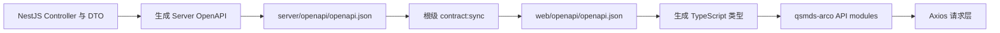

# 千树 DMS 项目工程组织方案

## 文档信息

| 项目 | 内容 |
| --- | --- |
| 状态 | 已确认 |
| 日期 | 2026-07-12 |
| 适用仓库 | `QIANSHU-DMS` |
| 远程地址 | `git@github.com:SilnoGM/QIANSHU-DMS.git` |
| 包管理器 | `pnpm@11.9.0` |
| 推荐 Node.js 主版本 | `24` |
| Prisma ORM 基线 | `7.x` |

## 1. 目标

本方案用于明确千树 DMS 在同一个 Git 仓库内开发前端与后端时的工程边界、目录职责、依赖管理、接口契约、验证流程和发布模型。

项目采用以下总体策略：

- 整个项目使用一个 Git 仓库。
- 根目录不建立 pnpm workspace，只承担治理、文档、开发编排和发布关联。
- `server/` 是独立的单一 NestJS 应用，使用 Prisma 和 PostgreSQL。
- `web/` 保持独立 pnpm workspace，可单独复制、安装、构建和发布。
- 前后端不共享本地源码包，只通过 HTTP 和 OpenAPI 契约连接。
- 前后端可以独立构建、独立部署，但正式产品版本通过 Release Manifest 关联。

## 2. 当前工程事实

截至 2026-07-12，当前目录具有以下事实：

- 根目录不是 pnpm workspace，不存在根 `pnpm-workspace.yaml`、`pnpm-lock.yaml` 或 `node_modules/`。
- Server 已初始化为独立 NestJS 11 CommonJS 单一 package，提交 `server/package.json` 与 `server/pnpm-lock.yaml`。
- `server/pnpm-workspace.yaml` 仅承载 pnpm 11 的 `allowBuilds` 安全审批，不声明 `packages`，不会形成多 package dependency graph。
- Server 已配置 Prisma ORM 7.8、`PrismaPg` 与外部 PostgreSQL Pool 生命周期；Prisma Client 使用 CommonJS `cjs` 输出。
- 当前 `schema.prisma` 没有业务 model；`20260710152144_init` 是不创建业务表的空初始化 migration。
- 当前唯一 HTTP 能力是 `GET /api/health`，使用 Terminus 专属响应体验证数据库可用性。
- Server 已为任意响应生成 `X-Request-Id`；health 保留 Terminus body，其他应用级 JSON 错误统一为 `ApiError`。
- Server 离线生成 `server/openapi/openapi.json`，Web 持有字节一致的 `web/openapi/openapi.json`；正式运行时不开放 Swagger route。
- `web/` 已整理为独立 pnpm workspace，唯一正式业务应用是 `web/apps/qsmds-arco/`。
- 三个参考应用分别位于 `web/examples/core/`、`web/examples/core-arco-design-vue/` 与 `web/examples/example/`，不再占用正式 `apps/` 边界。
- Web 的真实 `.env` 与 `.env.*` 已被忽略，各应用的 `.env.*.example` 环境变量模板已经纳入 Git。
- Web 从自身 snapshot 生成 types-only 到 ignored `apps/qsmds-arco/src/api/generated/`，目录精确只含非空 `types.gen.ts`。
- Web Axios 成功路径保留完整 `AxiosResponse<T>`；错误、Blob、`401/403`、取消与受限重试已按接口契约实现，12 个 fake 成功 route 已返回裸 DTO。
- 根编排脚本已经可以安装、开发、检查和构建两端；当前 `check` 串行执行 root tests、Server check、`contract:check` 和 Web check。
- 根 `contract:sync` 是快照唯一显式写同步入口，`contract:check` 只读验证生成快照、两端 snapshot 与 Web types。

## 3. 已确认的核心决策

### 3.1 采用组合式仓库

采用“一个 Git 仓库、两个独立依赖域、根目录统一编排”的组合式仓库结构。

根目录不创建 `pnpm-workspace.yaml`。因此，根目录、Server 和 Web 之间不会形成一个统一的 pnpm package graph。

### 3.2 Web 保持独立 workspace

`web/` 保留自己的：

- `package.json`
- `pnpm-workspace.yaml`
- `pnpm-lock.yaml`
- `packageManager`
- Node.js 版本声明
- 构建、检查和发布脚本

将整个 `web/` 复制到其他位置后，仍能独立安装、开发和构建。

### 3.3 Server 采用单一应用

`server/` 是一个独立的单一 NestJS package，不建立 `server/apps/*` 或多 package 后端 workspace。Prisma ORM 以 `7.x` 为实现基线，并使用 PostgreSQL driver adapter。

pnpm 11 将所有项目级配置统一放在 `pnpm-workspace.yaml`，并要求通过 `allowBuilds` 明确审批依赖的 lifecycle scripts。因此 `server/pnpm-workspace.yaml` 仅作为单 package 项目安全配置存在：不声明 `packages`，不引入第二个 importer，只允许当前 Prisma 运行所需的 `prisma` 与 `@prisma/engines` 执行 build scripts。pnpm 术语上 Server 是单 package workspace root，但工程上不形成多 package graph，也没有被根 workspace 嵌套，因为根目录本身仍不是 workspace。

只有出现第二个真实部署单元，例如 Worker、Scheduler 或独立服务时，才重新评估多 package 后端 workspace。

### 3.4 OpenAPI 作为接口契约真相源

NestJS Controller、DTO 和 OpenAPI decorators 是接口定义真相源。Server 离线生成正式 snapshot，根同步脚本以事务方式发布字节一致的 Server/Web snapshots 和 Web TypeScript types；Web 只读自身 snapshot，因此独立移植不需要 Server 源码或依赖目录。

### 3.5 发布采用协调模型

前后端分别构建、部署和回滚。正式发布使用统一产品版本，并通过 Release Manifest 记录 Web、Server、OpenAPI 和数据库 migration 的实际组合。

## 4. 目标目录结构

以下结构同时包含当前目录和后续阶段目标。`openapi/` 与 contract scripts 已实施；`.github/workflows/` 和发布文件仍属于阶段五目标，不能据此声称已经实施。

```text
qianshu-dms/
├── .github/
│   └── workflows/
│       ├── ci-server.yml
│       ├── ci-web.yml
│       ├── ci-contract.yml
│       ├── ci-examples.yml
│       └── release.yml
├── AGENTS.md
├── README.md
├── package.json
├── .node-version
├── .editorconfig
├── .gitignore
│
├── scripts/
│   ├── bootstrap.mjs
│   ├── dev.mjs
│   ├── check.mjs
│   ├── contract-sync.mjs
│   └── contract-check.mjs
│
├── docs/
│   ├── 文档索引.md
│   ├── 全局文档/
│   │   ├── 项目工程组织方案.md
│   │   ├── 开发工作流.md
│   │   └── 发布与版本管理.md
│   ├── 后端文档/
│   │   ├── 后端架构.md
│   │   ├── 数据库迁移规范.md
│   │   └── 接口契约规范.md
│   └── 前端文档/
│       ├── 前端架构.md
│       ├── 应用边界规范.md
│       └── 接口接入规范.md
│
├── server/
│   ├── package.json
│   ├── pnpm-lock.yaml
│   ├── pnpm-workspace.yaml           # 仅 allowBuilds，不声明 packages
│   ├── nest-cli.json
│   ├── tsconfig.json
│   ├── tsconfig.build.json
│   ├── eslint.config.mjs
│   ├── prisma.config.ts
│   ├── .env.example
│   ├── openapi/
│   │   └── openapi.json
│   ├── prisma/
│   │   ├── schema.prisma
│   │   └── migrations/
│   ├── src/
│   │   ├── openapi/
│   │   │   └── generate-openapi.ts
│   │   └── ...
│   └── test/
│
└── web/
    ├── package.json
    ├── pnpm-workspace.yaml
    ├── pnpm-lock.yaml
    ├── AGENTS.md
    ├── openapi/
    │   └── openapi.json
    ├── apps/
    │   └── qsmds-arco/
    ├── examples/
    │   ├── core/
    │   ├── core-arco-design-vue/
    │   └── example/
    ├── packages/
    ├── scripts/
    └── skills/
```

根目录明确不设置：

```text
pnpm-workspace.yaml
pnpm-lock.yaml
node_modules/
```

## 5. 目录职责与依赖边界

| 区域 | 职责 | 依赖管理 |
| --- | --- | --- |
| 根目录 | Git、文档、统一命令、CI、发布关联 | 不安装第三方依赖 |
| `server/` | NestJS API、业务规则、Prisma、migration | 独立 `package.json` 和 lockfile |
| `web/` | Web workspace、业务应用、参考应用、前端共享包 | 独立 workspace 和 lockfile |
| `docs/` | 全项目中文文档 | 无运行时依赖 |

必须遵守以下边界：

- Server 不使用 `file:`、`link:` 或 `workspace:*` 依赖 Web 文件。
- Web 不使用 `file:`、`link:` 或 `workspace:*` 依赖 Server 文件。
- 根目录不成为 Server 或 Web 的运行时依赖。
- Web 的 `workspace:*` 仅用于 `web/` 内部 package。
- 前后端通过 HTTP/OpenAPI 通信。
- 构建 Web 不要求本地存在 `server/`。
- 构建 Server 不要求本地存在 `web/`。

## 6. 根级命令门面

根 `package.json` 是普通私有 package，不是 workspace 根。它只提供统一命令入口和版本声明，不声明 dependencies 或 devDependencies。

当前结构：

```json
{
  "name": "qianshu-dms",
  "private": true,
  "packageManager": "pnpm@11.9.0",
  "engines": {
    "node": "^24.15.0"
  },
  "scripts": {
    "bootstrap": "node ./scripts/bootstrap.mjs",
    "dev": "node ./scripts/dev.mjs",
    "dev:server": "node ./scripts/dev.mjs server",
    "dev:web": "node ./scripts/dev.mjs web",
    "contract:sync": "node ./scripts/contract-sync.mjs",
    "contract:check": "node ./scripts/contract-check.mjs",
    "test:root": "node --test ./scripts/*.test.mjs",
    "check": "node ./scripts/check.mjs",
    "check:server": "pnpm -C server check",
    "check:web": "pnpm -C web check",
    "build": "pnpm -C server build && pnpm -C web build",
    "build:server": "pnpm -C server build",
    "build:web": "pnpm -C web build"
  }
}
```

`contract:sync` 与 `contract:check` 已由真实脚本实现；根 manifest 不声明不可执行的占位命令，也不因此增加第三方依赖。

根 package scripts 统一使用 `node --run <script>` 调用。pnpm 11 的 `verifyDepsBeforeRun` 默认行为会在执行 package script 前尝试 install，并在无依赖根 package 中生成 `pnpm-lock.yaml` 和 `node_modules/` 状态文件；这与根目录不保留依赖状态的边界冲突。因此根目录不通过 pnpm 执行 package scripts，只有 Server 和 Web 独立依赖域继续使用 `pnpm -C`。

### 6.1 `bootstrap.mjs`

本地开发依次执行：

```text
pnpm -C server install
pnpm -C web install
```

CI 分别使用：

```text
pnpm -C server install --frozen-lockfile
pnpm -C web install --frozen-lockfile
```

任一步失败都必须返回非零退出码。

### 6.2 `dev.mjs`

同时启动：

```text
pnpm -C server dev
pnpm -C web dev
```

脚本使用 Node.js `child_process.spawn`，同时支持前后端并行模式与 `server`、`web` 单端模式，并满足：

- 不依赖 `concurrently`。
- 在 macOS/Linux 为每一端创建独立进程组，信号覆盖 pnpm、shell、Nest/Vite 和完整后代树；Windows 保留标准 `ChildProcess` 信号语义。
- 正确转发 `SIGHUP`、`SIGINT` 和 `SIGTERM`，分别保留 `129`、`130` 和 `143` 退出语义。
- 监控外层 `node --run` 父进程；父进程提前退出时主动终止受控进程组，避免孤儿 watcher 和端口残留。
- 任意子进程异常退出时终止另一个子进程。
- 保留原始非零退出码，不隐藏错误。
- 不读取、复制或输出环境变量。
- 不硬编码端口、密钥或数据库连接信息。
- 使用详细中文代码注释说明进程生命周期。

POSIX 根编排采用 detached 进程组以保证完整清理，因此不承诺 Nest/Vite 的终端键盘快捷操作可用。需要交互式快捷操作时，开发者直接执行 `pnpm -C server dev` 或 `pnpm -C web dev`；这不会改变 Server 与 Web 的独立依赖边界。

### 6.3 `check.mjs`

当前 `scripts/check.mjs` 依次执行 root tests、Server check、只读 Contract check 和 Web check，并在第一处失败时短路，保留真实非零退出状态。检查命令不得修改受版本控制的源码或配置；允许 Web lifecycle 重建被 `.gitignore` 排除的生成文件。所有自动修复必须通过显式 `lint:fix` 命令执行。

## 7. Web workspace 设计

### 7.1 应用分区

```text
web/
├── apps/
│   └── qsmds-arco/                 # 唯一正式业务应用
├── examples/
│   ├── core/                       # 基础参考
│   ├── core-arco-design-vue/       # Arco 基座参考
│   └── example/                    # 完整功能参考
└── packages/                       # 框架级共享包
```

Web workspace 配置：

```yaml
packages:
  - apps/*
  - examples/*
  - packages/*
```

删除不存在的 `web/docs` workspace 入口。项目文档统一位于根 `docs/`。

### 7.2 默认脚本

Web 根命令默认只面向 `qsmds-arco` 和它依赖的共享包：

```json
{
  "scripts": {
    "api:generate": "pnpm --filter qsmds-arco run api:generate",
    "dev": "pnpm --filter qsmds-arco run dev",
    "build": "pnpm --filter qsmds-arco run build",
    "serve": "pnpm --filter qsmds-arco run serve",
    "typecheck": "run-s typecheck:scripts typecheck:app",
    "lint": "run-s lint:eslint lint:stylelint",
    "lint:fix": "run-s lint:eslint:fix lint:stylelint:fix",
    "test:api": "tsx --test apps/qsmds-arco/test/api/*.test.ts",
    "check": "run-s test:scripts typecheck lint",
    "check:examples": "pnpm --filter @fantastic-admin/core --filter @fantastic-admin/core-arco-design-vue --filter @fantastic-admin/example -r run lint",
    "build:examples": "pnpm --filter @fantastic-admin/core --filter @fantastic-admin/core-arco-design-vue --filter @fantastic-admin/example -r run build"
  }
}
```

`api:generate` 已实施为 types-only 生成：只读 `web/openapi/openapi.json`，重建 ignored `apps/qsmds-arco/src/api/generated/`。app 的 `lint`、`typecheck`、`build`、`build:test` 和 Web `test:api` 均通过 lifecycle 先生成。

现有交互式 CLI 可保留为 `dev:select`、`build:select`、`serve:select`，但必须明确区分 `business` 与 `example`。

参考应用仍是 workspace 成员，因此会进入 Web lockfile 和依赖安装。这是保持其可随时运行所接受的成本。

三个参考应用当前已有的 `lint` 脚本实际执行 `vue-tsc -b`，因此 `check:examples` 直接复用该脚本，不假设它们已经提供不存在的 `check` 命令。参考应用的验证脚本将来如需统一，必须在对应 manifest 完成迁移后再调整根命令。

### 7.3 Web 依赖方向

```text
apps/qsmds-arco  ──────>  packages/*
examples/*       ──────>  packages/*
```

禁止以下方向：

```text
packages/*       ─X─>  apps/*
packages/*       ─X─>  examples/*
apps/*           ─X─>  examples/*
examples/*       ─X─>  apps/*
```

规则：

- 业务页面、业务组件、业务 API 和业务 Store 留在 `apps/qsmds-arco/src/`。
- `packages/*` 只保存稳定的跨应用框架能力。
- 不因为未来可能复用而提前创建 package。
- 至少存在两个真实消费者且边界稳定后，才考虑提取公共 package。
- Fantastic Admin 原始公共包暂时保留 `@fantastic-admin/*` 技术标识。
- 参考应用原则上只读，不承载业务代码，也不与业务应用双向同步。
- 默认一次只运行一个 Web 应用；需要并行时使用显式不同端口。

## 8. Server 单体模块化设计

### 8.1 目录结构

```text
server/
├── package.json
├── pnpm-lock.yaml
├── pnpm-workspace.yaml               # pnpm 11 单 package 安全配置，不声明 packages
├── nest-cli.json
├── tsconfig.json
├── tsconfig.build.json
├── eslint.config.mjs
├── prisma.config.ts
├── .env.example
├── prisma/
│   ├── schema.prisma
│   └── migrations/
│       ├── migration_lock.toml
│       └── 20260710152144_init/
│           └── migration.sql
├── src/
│   ├── main.ts
│   ├── app.module.ts
│   ├── app.setup.ts
│   ├── config/
│   │   ├── app.config.ts
│   │   └── env.validation.ts
│   ├── infrastructure/
│   │   └── database/
│   │       ├── prisma.module.ts
│   │       └── prisma.service.ts
│   ├── generated/
│   │   └── prisma/                    # 生成物，不提交
│   └── modules/
│       └── health/
└── test/
    ├── app.e2e-spec.ts
    └── jest-e2e.json
```

阶段三不创建示例业务模块、空 `common/` 目录或 OpenAPI 占位文件。后续目录只在出现真实实现时增加。

### 8.2 模块职责

```text
Controller -> Service -> PrismaService -> PostgreSQL
```

- Controller 负责 HTTP、参数校验与 OpenAPI 契约描述；公开 operation 必须声明稳定 `operationId`、成功 response 和适用的错误矩阵。
- Service 负责业务规则、事务边界和数据编排。
- PrismaService 负责数据库连接能力。
- 不提前创建 Repository、UseCase 或 Domain Entity 抽象层。
- Prisma model 不直接作为公开 API DTO。
- Nest module 不直接访问其他模块的内部文件，只使用公开导出。
- `common/` 只放真正跨模块能力，不作为杂物目录。
- 只有存在明确转换逻辑时才创建 mapper。

### 8.3 Prisma 规则

初期使用单一 `prisma/schema.prisma`。模型明显增多后，再按业务域拆分多文件。实现以 Prisma ORM `7.x` 为基线，Server 必须显式安装 `@prisma/adapter-pg` 和 `pg`。

```prisma
generator client {
  provider     = "prisma-client"
  output       = "../src/generated/prisma"
  moduleFormat = "cjs"
}

datasource db {
  provider = "postgresql"
}
```

规则：

- `src/generated/prisma/` 自动生成，不手工修改，不提交。
- `PrismaService` 使用 `PrismaPg` 和 `pg.Pool` 创建 driver adapter，并通过 `new PrismaClient({ adapter })` 初始化。
- 应用关闭时同时释放 Prisma Client 和 PostgreSQL Pool，避免开发热重载或测试残留连接。
- Prisma Client 的 `moduleFormat` 必须与 Server `tsconfig` 的模块系统一致，不混用 ESM 与 CommonJS 导入规则。
- 开发、构建、类型检查、单元测试和端到端测试入口都必须先执行 `prisma generate`。
- `DATABASE_URL` 通过运行环境注入。
- `.env` 永不提交。
- `schema.prisma` 和完整 migrations 提交 Git。
- 已应用 migration 不修改、不删除。
- 开发环境使用 `prisma migrate dev`。
- 测试和生产使用 `prisma migrate deploy`。
- `prisma db push` 仅用于可丢弃的本地原型数据库。

### 8.4 Server 脚本

```json
{
  "name": "@qianshu-dms/server",
  "private": true,
  "scripts": {
    "dev": "pnpm prisma:generate && nest start --watch",
    "build": "pnpm prisma:generate && nest build",
    "openapi:generate": "pnpm build && node dist/openapi/generate-openapi.js",
    "start": "pnpm prisma:generate && nest start",
    "start:prod": "node dist/main.js",
    "typecheck": "pnpm prisma:generate && tsc --noEmit",
    "lint": "pnpm prisma:generate && eslint \"{src,test}/**/*.ts\" \"*.ts\"",
    "lint:fix": "pnpm prisma:generate && eslint \"{src,test}/**/*.ts\" \"*.ts\" --fix",
    "test": "pnpm prisma:generate && jest",
    "test:e2e": "pnpm prisma:generate && jest --config test/jest-e2e.json --runInBand",
    "check": "pnpm prisma:validate && pnpm typecheck && pnpm lint && pnpm test",
    "prisma:generate": "prisma generate",
    "prisma:validate": "prisma validate",
    "db:migrate:dev": "prisma migrate dev",
    "db:migrate:deploy": "prisma migrate deploy"
  }
}
```

`check` 不包含数据库 E2E；OpenAPI 由独立 `openapi:generate` 入口通过 preview application 离线生成，并由根 Contract check 编排验证。

### 8.5 测试边界

- 单元测试与源码同目录，使用 `*.spec.ts`。
- 当前 HTTP 端到端测试位于 `server/test/app.e2e-spec.ts`，配置位于 `server/test/jest-e2e.json`。
- 后续若出现独立数据库 integration suite，应在 `server/test/` 下使用语义明确的文件或目录，并同步脚本；不预建空目录。
- 集成和端到端测试使用独立 PostgreSQL 测试实例。
- Prisma migration 至少在空 PostgreSQL 数据库上完整验证一次。
- CI 不连接开发或生产数据库。

## 9. 当前 OpenAPI 契约流程

阶段四已经建立 Server 离线生成、根级同步与检查、Web types-only 生成链路。正式 snapshot 提交 Git，generated types 保持 ignored；当前正式契约只包含 `GET /api/health`。



规则：

- NestJS Controller、DTO 和 OpenAPI decorators 是定义真相源。
- `server/openapi/openapi.json` 是正式生成快照。
- `web/openapi/openapi.json` 是同步副本，保证 Web 可移植。
- 两份 OpenAPI JSON 提交 Git，禁止手工修改。
- 当前 Contract check 校验两份文件字节与 SHA-256 一致；阶段五 CI 将复用该入口。
- Web 生成类型到 `apps/qsmds-arco/src/api/generated/`。
- 生成的 TypeScript 类型不提交，由 `api:generate` 及 lint、typecheck、build、build:test、test:api lifecycle 重建。
- 初期只生成 TypeScript 类型，不生成完整运行时 HTTP Client。
- Web 的唯一生产 Axios 实例由 factory 装配，成功拦截器保留完整 `AxiosResponse<T>`，错误拦截器按 HTTP status 和 `ApiError` 解析。
- 每个公开操作按实际需要描述 Path、Query、Header、Request DTO，并声明成功 status；存在响应体时再声明对应 media type 和 schema。
- `204` 响应不得声明 content；下载接口按真实 binary media type 描述，不包装 JSON。
- 每个公开操作显式声明 `operationId`，采用 `users_list`、`accounts_update` 这类稳定命名；不能仅依赖 Controller 或 method 名自动推导。
- 当前检查验证 `operationId` 唯一，并可通过 `--baseline` 与指定 snapshot 比较；删除或改名必须按 breaking change 处理并获得确认。
- 统一 `ApiError`、第 10.4 节错误状态矩阵要求的非 `2xx` response schema 和 `X-Request-Id` 响应头必须进入 OpenAPI，不能只存在于 Exception Filter 运行时代码中。
- Contract checker 根据操作是否需要认证、权限、资源定位、写入冲突和请求校验，断言其声明第 10.4 节规定的错误响应，并验证 `X-Request-Id` header 定义存在；阶段五 CI 将直接复用该检查入口。

正式命令为 `node --run contract:sync`、`node --run contract:check` 和 Web 独立生成入口 `pnpm -C web api:generate`。

根命令：

```text
node --run contract:sync
  1. 生成 Server OpenAPI 快照
  2. 校验契约与 types-only 产品
  3. 事务式发布 Server/Web snapshots 和 Web TypeScript 类型

node --run contract:check
  1. 在临时目录重新生成 OpenAPI
  2. 校验 Server 快照未过期
  3. 校验 Web 快照与 Server 一致
  4. 校验 Web 类型能够重新生成
  5. 校验 operationId 唯一，并在传入 --baseline 时保护既有 operationId
  6. 按错误状态矩阵校验 ApiError schema 与 X-Request-Id 响应头已写入 OpenAPI
  7. 校验 204 无 content，下载接口使用 binary schema
  8. 校验有响应体的成功响应使用接口专属 schema，不生成全局成功 envelope
```

## 10. 当前 HTTP 请求与响应契约

以下规则是当前基础设施已经执行、后续业务 API 必须复用的契约。当前只有 `GET /api/health`：它保留 Terminus 专属 body；所有响应都携带 Server-generated `X-Request-Id`，除严格限定的 Terminus health failure 外，应用级 JSON 错误统一为 `ApiError`。

### 10.1 API 路径

当前只有一个同仓库 Web 客户端，API 使用统一前缀 `/api`。具体路径由资源路由决定，例如：

```text
/api/users
```

暂不引入 `/api/v1`。只有未来需要并行维护不兼容 API 时，才增加 `/api/v2`。

### 10.2 请求结构

请求不使用全局 envelope。每个接口根据 HTTP 语义独立定义：

- Path 参数用于资源标识。
- Query 参数用于筛选、排序和分页。
- Header 用于认证、语言、幂等键和追踪信息。
- JSON body 使用接口专属 Request DTO。
- 文件上传使用 `multipart/form-data`，不将文件编码进 JSON。
- OpenAPI 必须分别描述上述参数位置、必填性、格式与校验规则。

例如，创建资源的请求体直接表达输入字段：

```json
{
  "name": "示例"
}
```

### 10.3 成功响应

成功响应按资源或操作结果建模，不添加全局 `{ code, message, data }` 包装。HTTP `2xx` 已表达成功，因此不再返回通用 `code: 0` 或 `message: "success"`。

| 场景 | HTTP status | 响应内容 |
| --- | --- | --- |
| 查询或更新单个资源 | `200` | 对应 Response DTO |
| 创建资源 | `201` | Response DTO，并在适用时返回 `Location` Header |
| 接受异步任务 | `202` | 接口专属任务状态 DTO |
| 操作成功且没有表示可返回 | `204` | 无响应体 |
| 文件下载 | `200` | binary content |

单资源响应直接返回 DTO：

```json
{
  "id": "123",
  "name": "示例"
}
```

分页使用明确结构：

```json
{
  "items": [],
  "page": 1,
  "pageSize": 20,
  "total": 0
}
```

分页对象是集合资源的专属表示，不是全局 envelope。

通用成功提示由 Web 决定。确实存在需要展示或继续处理的业务结果时，使用接口专属 DTO，例如：

```json
{
  "imported": 96,
  "skipped": 4,
  "warnings": []
}
```

文件下载和流式响应使用真实 media type，不转为 Base64，也不包装进 JSON。

### 10.4 错误响应

所有 JSON 错误使用统一 `ApiError`：

```json
{
  "code": "VALIDATION_FAILED",
  "message": "请求参数校验失败",
  "fieldErrors": {
    "account": [
      "账号不能为空"
    ]
  },
  "requestId": "req_550e8400-e29b-41d4-a716-446655440000"
}
```

错误 status 与 OpenAPI 声明遵循确定性映射：

| HTTP status | 典型 `code` | 语义 | OpenAPI 声明规则 |
| --- | --- | --- | --- |
| `400` | `BAD_REQUEST` | JSON 语法、协议格式或基础类型无法解析 | 接收 JSON body 或存在可解析 Path、Query 参数的操作声明 |
| `401` | `UNAUTHORIZED` | 未认证、凭证缺失或凭证失效 | 每个要求认证的操作声明 |
| `403` | `FORBIDDEN` | 已认证但没有所需权限 | 每个受权限策略保护的操作声明 |
| `404` | `NOT_FOUND` | 目标资源不存在 | 每个按资源标识读取、更新或删除的操作声明 |
| `409` | 接口专属冲突码 | 唯一性、资源状态或并发版本冲突 | 每个可能产生对应冲突的写操作声明 |
| `422` | `VALIDATION_FAILED` | 请求可解析，但 DTO 或业务字段校验失败 | 每个具有字段或业务输入校验的操作声明 |
| `500` | `INTERNAL_ERROR` | 未预期的服务端错误 | 每个公开操作声明 |

规则：

- HTTP status 表达错误类别。
- JSON 错误使用 `application/json`，响应体顶层直接是 `ApiError`。
- `code` 使用稳定英文机器码。
- `message` 使用可展示的中文信息。
- `fieldErrors` 仅在字段校验失败时返回。
- NestJS 全局 `ValidationPipe` 将 DTO 校验失败配置为 `errorHttpStatusCode: HttpStatus.UNPROCESSABLE_ENTITY`；JSON 语法和 Path、Query 基础类型解析失败仍使用 `400`。
- `requestId` 同时写入 `X-Request-Id` 响应头。
- 错误使用真实 `4xx/5xx`，禁止使用 `HTTP 200 + 业务失败 code`。
- `401` 才触发 Web 退出登录。
- `403` 表示已登录但无权限，不清除登录状态。
- `500` 不返回堆栈、SQL、数据库地址或内部实现细节。
- Server 日志通过 `requestId` 关联技术错误。
- 同一 status 可以存在多个稳定业务 `code`；新增业务码不改变 status 语义，也不能借此省略 OpenAPI 中的 HTTP response 声明。

初始阶段不采用 RFC 9457 `application/problem+json`。未来 API 对外开放或出现多个异构客户端时，再评估是否将 `ApiError` 升级为 Problem Details；在此之前不同时维护两套错误结构。

### 10.5 Web Axios 返回契约

为保持运行时与 TypeScript 声明一致，并兼容现有调用方的 `res.data` 使用方式：

- Axios 成功拦截器返回完整 `AxiosResponse<T>`，不返回 `response.data`。
- API module 使用 `api.get<UserDto>()`、`api.post<CreateResultDto>()` 等明确泛型。
- 调用方继续通过 `res.data` 获取成功 DTO。
- `204` 接口使用 `api.delete<void>()` 等 `void` 响应类型，调用方不读取 body。
- 下载接口显式使用 `api.get<Blob>(url, { responseType: 'blob' })`，不能只设置 `responseType` 而省略 `Blob` 泛型，也不依赖全局 JSON 配置。
- JSON 请求失败时，通过 `axios.isAxiosError<ApiError>(error)` 缩小类型，并使用运行时 `isApiError` 守卫校验 `error.response.data` 后再转换。
- Blob 下载失败时，只有 body 是不超过 1 MiB 的真实 Blob、HTTP `Content-Type` 明确为 `application/json` 或 `application/*+json` 且解析结果通过 `isApiError` 守卫时，才转换为服务端错误；实现不读取或要求 `Blob.type`。
- 网络错误没有 `error.response`，必须映射为独立的客户端网络错误，不能伪造 HTTP status。
- 仅 `401` 调用退出登录；`403` 只展示权限错误。

客户端失败结果使用可判别联合类型，HTTP 错误与本地网络错误保持物理区分：

```ts
type ApiClientError =
  | {
      kind: 'http'
      status: number
      body: ApiError
    }
  | {
      kind: 'http-unparseable'
      status: number
      requestId?: string
      message: string
    }
  | {
      kind: 'network'
      code: 'NETWORK_ERROR'
      message: string
    }
```

泛型只提供编译期提示，不能替代对未知错误体的运行时校验。服务端返回了无法识别为 `ApiError` 的错误体时，客户端转换为 `http-unparseable`，记录响应头中可用的 `requestId` 和必要诊断信息，但不得向用户展示原始 HTML、堆栈或 Blob 内容。

当前 Client 的运行时与 TypeScript 都保留完整 `AxiosResponse<T>`；新契约不保留 `{ status, error, data }` 双格式兼容层。

### 10.6 重试规则

- 仅当请求显式设置 `retry: true`、method 是 `GET`、`HEAD`、`OPTIONS`、`PUT`，且失败原因为网络错误或 `502`、`503`、`504` 时，才允许自动重试。
- 最多重试 3 次，默认退避为 `500/1000/2000 ms`；`POST`、`PATCH`、`DELETE` 默认不自动重试，除非另行设计幂等键。
- `503` 返回有效 `Retry-After` 时，客户端在 5000 ms 上限内尊重整数秒或 RFC 9110 HTTP-date；`502`、`504` 和无效 Header 使用受限退避策略。
- 取消在发送前、等待中和重试间隙都优先终止流程，保留 Axios `CanceledError`，不 toast、不登出、不转换为客户端领域错误。
- 初始阶段不自动重试 `429`；如需速率限制与退避契约，另行设计并确认。

该契约替换现有 `{ status, error, data }` 响应结构，并明确不引入全局成功 envelope。此公共 API 变更已在方案讨论阶段获得确认。

## 11. 环境变量与安全规则

- 不硬编码密钥。
- 不提交任何真实 `.env` 文件。
- 只提交不含真实密钥的 `.env.example` 或 `.env.*.example`。
- Web 各应用的 `.env.development.example`、`.env.production.example`、`.env.test.example` 环境变量模板已经纳入 Git；对应真实 `.env` 与 `.env.*` 保持 ignored。
- Server、Web 和 CI 各自从运行环境读取配置。
- 根编排脚本不读取、复制或打印环境变量。
- 日志不输出 token、密码、连接字符串、Cookie 或完整敏感请求体。
- CI 密钥只保存在平台 Secret Store。

## 12. 阶段五 CI 设计（尚未实施）

以下为阶段五目标，当前仓库尚未创建 `.github/workflows/` 中的 Server、Web、Contract 或 Examples workflow。

### 12.1 Server CI

`server/**` 变化时执行：

```text
pnpm -C server install --frozen-lockfile
pnpm -C server prisma:generate
pnpm -C server db:migrate:deploy
pnpm -C server typecheck
pnpm -C server lint
pnpm -C server test
pnpm -C server test:e2e
pnpm -C server build
```

测试使用临时 PostgreSQL 实例。`db:migrate:deploy` 必须在空数据库上实际执行完整 migration，成功后才运行集成和端到端测试，任务结束后销毁数据库实例。

### 12.2 Web CI

`web/**` 或 Web OpenAPI 快照变化时执行：

```text
pnpm -C web install --frozen-lockfile
pnpm -C web api:generate
pnpm -C web check
pnpm -C web build
```

默认只验证 `apps/qsmds-arco` 和 `packages/*`。

### 12.3 参考应用 CI

参考应用通过手动或每月低频任务执行：

```text
pnpm -C web check:examples
pnpm -C web build:examples
```

参考应用失败不阻断业务应用发布，但必须形成可见报告。

### 12.4 Contract CI

Contract CI 同时安装 Server 与 Web 依赖后再执行根检查：

```text
pnpm -C server install --frozen-lockfile
pnpm -C web install --frozen-lockfile
node --run contract:check
```

独立验证：

- Server OpenAPI 快照未过期。
- Server 与 Web OpenAPI 完全一致。
- Web 类型能够重新生成。
- `operationId` 唯一，并与目标分支或上一发布基线保持兼容。
- 每个公开接口声明实际存在的请求参数或 Request DTO、成功 status，以及存在响应体时的 media type 和 schema。
- 每个公开接口按第 10.4 节错误状态矩阵声明 `ApiError` 和 `X-Request-Id` 响应头。
- `204` 不声明 content，下载接口声明 binary media type。
- 业务 JSON 接口不生成全局成功 envelope schema。
- OpenAPI 变化已随代码提交。

初始阶段先实现 `operationId` 基线比较。对 schema、参数和响应的完整 breaking-change 检测在 API 稳定后引入，不在初始阶段增加额外工具链。

## 13. 构建、部署与 Release Manifest

### 13.1 发布模型

正式产品使用统一 tag，例如：

```text
v1.3.0
```

Web 与 Server 分别生成不可变产物：

```text
qsmds-web:v1.3.0
qsmds-web:sha-abc123

qsmds-server:v1.3.0
qsmds-server:sha-abc123
```

### 13.2 Release Manifest

Release Manifest 在产物构建后由 CI 生成，附加到 Git Release 或发布系统，不提交源码仓库。

顶层 `sourceCommit` 表示触发本次产品发布流程的仓库 commit；`components.*.commit` 分别表示实际部署组件的源码 commit。只发布 Web 时，Server 可以继续引用上一产品版本的 commit 和不可变 digest，二者不要求相同。

```json
{
  "releaseVersion": "v1.3.1",
  "createdAt": "2026-07-10T12:00:00Z",
  "sourceCommit": "abc123",
  "components": {
    "web": {
      "version": "v1.3.1",
      "commit": "abc123",
      "artifact": "qsmds-web:v1.3.1",
      "digest": "sha256:aaaaaaaaaaaaaaaaaaaaaaaaaaaaaaaaaaaaaaaaaaaaaaaaaaaaaaaaaaaaaaaa"
    },
    "server": {
      "version": "v1.3.0",
      "commit": "def456",
      "artifact": "qsmds-server:v1.3.0",
      "digest": "sha256:bbbbbbbbbbbbbbbbbbbbbbbbbbbbbbbbbbbbbbbbbbbbbbbbbbbbbbbbbbbbbbbb"
    }
  },
  "contract": {
    "openapiSha256": "sha256:cccccccccccccccccccccccccccccccccccccccccccccccccccccccccccccccc"
  },
  "database": {
    "migrationHead": "20260710113000_add_example"
  }
}
```

Manifest 必须记录真实部署组合，而不是强制未变化的组件重新构建或改版本。

### 13.3 数据库发布顺序

```text
兼容性 migration
-> Server
-> Web
-> 后续版本清理旧字段
```

数据库变更采用 expand/contract：

1. 先增加兼容字段、表或结构。
2. 发布同时兼容新旧结构的 Server。
3. 发布使用新接口或字段的 Web。
4. 确认旧版本不再运行后，在后续 migration 删除旧结构。

生产 migration 使用 `prisma migrate deploy`。数据库 migration 不自动向下回滚，失败时停止发布或向前修复。

## 14. 文档规范

### 14.1 命名

- `docs/` 下的目录和 Markdown 文件使用中文名。
- 文档正文整体使用中文。
- 代码、命令、路径、包名、API、字段、错误码和日志保留英文。
- 根 `README.md` 保留标准名称，正文使用中文。
- `AGENTS.md`、`package.json`、`openapi.json` 等工具识别文件保留标准英文名。

### 14.2 索引

`docs/文档索引.md` 是项目文档唯一索引。新增正式文档时必须同步更新索引。

### 14.3 协作规则分层

```text
AGENTS.md          # 全仓库语言、安全、Git 和工作流规则
server/AGENTS.md   # NestJS、Prisma、测试和 migration 规则
web/AGENTS.md      # Vue、Fantastic Admin、应用和共享包规则
```

当前 `web/AGENTS.md` 已记录实际技术栈、唯一业务应用、参考应用写入边界和默认命令。

## 15. Git 纳管规则

整个项目使用根目录唯一 Git 仓库，远程 `origin` 为：

```text
git@github.com:SilnoGM/QIANSHU-DMS.git
```

必须提交：

- Server 与 Web 的 `pnpm-lock.yaml`
- Prisma schema 和完整 migrations
- 阶段四实施后生成的 Server 与 Web OpenAPI 快照
- `.env.example`、`.env.*.example`
- 源码、工程配置和正式文档

禁止提交：

```gitignore
**/node_modules/
**/dist*/
**/coverage/
**/.env
**/.env.*
!**/.env.example
!**/.env.*.example
**/.DS_Store
**/*.log
server/src/generated/prisma/
web/apps/qsmds-arco/src/api/generated/
```

Commit Message 使用英文类型和中文描述，例如：

```text
docs: 添加项目工程组织设计
chore: 初始化根级工程治理配置
refactor(web): 隔离业务应用与参考应用
feat(server): 初始化 NestJS 与 Prisma 基础工程
```

## 16. 分阶段实施顺序

### 阶段 1：根级治理（已实施）

- 初始化根 Git 和远程地址。
- 创建根 `README.md`、`AGENTS.md`、`.gitignore`、`.editorconfig`。
- 建立中文文档目录和索引。
- 创建根命令门面和无依赖编排脚本。

### 阶段 2：Web 边界整理（已实施）

- 将三个参考应用移动到 `web/examples/`。
- 更新 `pnpm-workspace.yaml`。
- 调整默认 `dev`、`check`、`build` 脚本。
- 将检查命令与 `lint:fix` 分离。
- 更新 `web/AGENTS.md` 和失效的编辑器配置。
- 验证业务应用和参考应用仍可分别运行与构建。

### 阶段 3：Server 初始化（已实施）

- 初始化 NestJS 单一应用。
- 配置 Prisma 和 PostgreSQL。
- 建立环境变量校验、健康检查和测试基线。
- 创建第一条 migration。

### 阶段 4：接口契约（已实施并完成验收）

- 已建立 OpenAPI 离线生成、事务式同步和只读检查流程。
- 已定义统一 `ApiError`、中文 validation 和 Server-generated `X-Request-Id`。
- 已调整 Web Axios Client，使成功路径保留 `AxiosResponse<T>`，并实现错误、Blob、`401/403`、取消与受限重试。
- 已从 Web 自身 snapshot 生成 types-only，并使用 `HealthGetResponses[200]` 约束 health module。
- 已将 12 个 fake 成功 route 迁移为裸 DTO，失效登录迁移为 HTTP `401 ApiError`。
- 已通过隔离 PostgreSQL migration/E2E、真实 Server/Web smoke、浏览器回归、端口清理与 Git 安全审计。

### 阶段 5：CI 与发布（待实施）

- 建立 Server、Web、Contract 和 Examples CI。
- 建立独立构建产物。
- 建立 Release Manifest。
- 建立数据库 expand/contract 发布流程。

每个阶段必须小步提交，并在提交前运行对应验证。不得将全部迁移压缩为一个大提交。

## 17. 建议提交序列

```text
docs: 添加项目工程组织设计
chore: 初始化根级工程治理配置
refactor(web): 隔离业务应用与参考应用
chore(web): 调整默认开发和验证脚本
feat(server): 初始化 NestJS 与 Prisma 基础工程
feat(server): 建立 OpenAPI 和统一错误契约
feat(web): 接入 OpenAPI 类型和新响应契约
ci: 添加前后端独立验证流程
ci: 添加统一发布清单
```

数据库 schema、删除文件、新增或修改公共 API 时，仍需在对应实施阶段单独获得确认。

## 18. 验证矩阵

| 范围 | 本地命令 | CI 要求 |
| --- | --- | --- |
| 根编排 | `node --run check` | 必须返回两端真实退出码 |
| Server 依赖 | `pnpm -C server install` | `--frozen-lockfile` |
| Server 检查 | `pnpm -C server check` | 必须通过 |
| Server migration | `pnpm -C server db:migrate:deploy` | 在空 PostgreSQL 上完整执行 |
| Server E2E | `pnpm -C server test:e2e` | 临时 PostgreSQL |
| Server 构建 | `pnpm -C server build` | 必须通过 |
| Web 依赖 | `pnpm -C web install` | `--frozen-lockfile` |
| Web 检查 | `pnpm -C web check` | 业务应用与共享包必须通过 |
| Web 构建 | `pnpm -C web build` | 必须通过 |
| 参考应用 | `pnpm -C web check:examples` | 手动或低频任务 |
| 契约 | `node --run contract:check` | 双方依赖已安装，请求、成功、错误、204、binary、生成类型和 operationId 基线一致 |

## 19. 完成标准

本方案完成落地时，应满足：

- 根目录不存在 `pnpm-workspace.yaml`、`pnpm-lock.yaml` 和 `node_modules/`。
- `server/` 与 `web/` 可分别安装、检查和构建。
- 根 `node --run dev` 可以同时启动前后端并正确清理进程。
- `apps/qsmds-arco` 是唯一默认业务应用。
- 三个参考应用可按需显式运行，但不阻断日常 CI。
- Web 独立复制后不依赖仓库外部相对路径。
- OpenAPI 快照、Web 类型和 Server 实现保持同步。
- 请求使用接口专属 DTO，成功响应按资源或操作结果建模，不使用全局成功 envelope。
- HTTP 错误使用标准 status 和统一错误体。
- Prisma migrations 可在空 PostgreSQL 数据库完整执行。
- 前后端具有独立构建产物和可追踪 Release Manifest。
- `.env`、密钥和敏感日志未进入 Git。
- 所有正式项目文档使用中文目录名和中文文件名。

## 20. 非目标与升级触发条件

本阶段不做：

- 根级 pnpm workspace。
- 微服务拆分。
- 后端多应用 workspace。
- 前后端本地共享 TypeScript package。
- 完整运行时 OpenAPI Client 自动生成。
- 提前建立复杂领域层或 Repository 抽象。
- 为尚未实现的功能创建大量空目录和空文档。

满足以下条件时重新评估根 workspace 或多 package 后端 workspace：

- 出现第二个真实后端部署单元。
- 出现需要共同构建和发布的根级 packages。
- 前后端必须共享已发布且稳定的 npm package。
- 单纯脚本编排已经无法表达跨项目任务关系。

## 21. 官方参考

- pnpm Workspace：<https://pnpm.io/workspaces>
- pnpm 11 项目配置：<https://pnpm.io/settings>
- pnpm 11 package.json 配置变化：<https://pnpm.io/package_json>
- pnpm Catalogs：<https://pnpm.io/catalogs>
- HTTP Semantics RFC 9110：<https://www.rfc-editor.org/rfc/rfc9110.html>
- OpenAPI Specification：<https://spec.openapis.org/oas/latest.html>
- RFC 9457 Problem Details：<https://www.rfc-editor.org/rfc/rfc9457.html>
- NestJS OpenAPI：<https://docs.nestjs.com/openapi/introduction>
- Prisma Client 生成：<https://docs.prisma.io/docs/orm/v6/prisma-client/setup-and-configuration/generating-prisma-client>
- Prisma ORM 7 PostgreSQL adapter：<https://www.prisma.io/docs/orm/prisma-client/setup-and-configuration/introduction>
- Prisma Migrate：<https://docs.prisma.io/docs/orm/prisma-migrate>
- Prisma migration history：<https://www.prisma.io/docs/orm/prisma-migrate/understanding-prisma-migrate/migration-histories>
