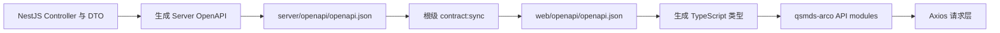

# 千树 DMS 项目工程组织方案

## 文档信息

| 项目 | 内容 |
| --- | --- |
| 状态 | 工程组织基线已完成；用户认证与权限体系功能分支本地验收完成 |
| 基线完成日期 | 2026-07-14 |
| 当前事实更新日期 | 2026-10-08 |
| 当前产品版本 | `v0.4.0` |
| 当前正式版本 Source Commit | `dab103fe3e9987a0fa2981ae6127184e12b450a3` |
| 适用仓库 | `QIANSHU-DMS` |
| 远程地址 | `git@github.com:SilnoGM/QIANSHU-DMS.git` |
| 包管理器 | `pnpm@11.9.0` |
| 推荐 Node.js 主版本 | `24` |
| Prisma ORM 基线 | `7.x` |

上表的 Source Commit 是 `v0.4.0` 不可变发布来源，不表示本文档变更合并后的 `main` HEAD；每个版本的 Tag、Commit 与平台验收记录以[发布与版本管理](./发布与版本管理.md)第 1 节的平台证据表为准。

## 1. 目标

本方案用于明确千树 DMS 在同一个 Git 仓库内开发前端与后端时的工程边界、目录职责、依赖管理、接口契约、验证流程和发布模型。

项目采用以下总体策略：

- 整个项目使用一个 Git 仓库。
- 根目录不建立 pnpm workspace，只承担治理、文档、开发编排和发布关联。
- `server/` 是独立的单一 NestJS 应用，使用 Prisma 和 PostgreSQL。
- `web/` 保持独立 pnpm workspace，可单独复制、安装、构建和发布。
- 前后端不共享本地源码包，只通过 HTTP 和 OpenAPI 契约连接。
- 前后端可以独立构建、独立部署，但正式产品版本通过 Release Manifest 关联。

## 2. 当前工程事实

截至 2026-07-20，当前分支的工程基线和实施代码具有以下事实：

- 根目录不是 pnpm workspace，Git 基线不包含根 `pnpm-workspace.yaml`、`pnpm-lock.yaml`、`node_modules/` 或 `.pnpm-store/`；本地若误生成这些依赖域产物，必须先清理再通过根治理门禁。
- Server 已初始化为独立 NestJS 11 CommonJS 单一 package，提交 `server/package.json` 与 `server/pnpm-lock.yaml`。
- `server/pnpm-workspace.yaml` 同时配置 pnpm 11 的 `allowBuilds` 安全审批与 `injectWorkspacePackages: true`；`injectWorkspacePackages` 只服务正式 Server 归档的现代 production deploy，不声明 `packages`，不会形成多 package dependency graph。
- Server 已配置 Prisma ORM 7.8、`PrismaPg` 与外部 PostgreSQL Pool 生命周期；Prisma Client 使用 CommonJS `cjs` 输出。
- `schema.prisma` 已实现 `User`、`UserProfile`、`Role`、`Permission`、`UserRole`、`RolePermission`、`AuthSession`、`AuthRateLimit` 和 `AuditEvent` 九个 model；`20260717090000_user_auth_rbac` 建立认证权限基线，`20260720090000_user_profiles` 建立一对一用户资料及历史用户回填。
- Server 已挂载 `HealthModule`、`AuthModule`、`ProfileModule`、`UsersModule`、`RolesModule`、`PermissionsModule` 和 `AuditModule`，提供 `GET /api/health` 健康检查、Cookie Session 认证、本人资料、用户管理、RBAC 与审计查询能力。
- Server 已为任意响应生成 `X-Request-Id`；health 保留 Terminus body，其他应用级 JSON 错误统一为 `ApiError`。
- Server 离线生成 `server/openapi/openapi.json`，Web 持有字节一致的 `web/openapi/openapi.json`；正式运行时不开放 Swagger route。
- `web/` 已整理为独立 pnpm workspace，唯一正式业务应用是 `web/apps/qsmds-arco/`。
- 三个参考应用分别位于 `web/examples/core/`、`web/examples/core-arco-design-vue/` 与 `web/examples/example/`，不再占用正式 `apps/` 边界。
- Web 的真实 `.env` 与 `.env.*` 已被忽略，各应用的 `.env.*.example` 环境变量模板已经纳入 Git。
- Web 从自身 snapshot 生成 types-only 到 ignored `apps/qsmds-arco/src/api/generated/`，目录精确只含非空 `types.gen.ts`。
- Web Axios 成功路径保留完整 `AxiosResponse<T>`；错误、Blob、`401/403`、取消与受限重试已按接口契约实现，9 个 `fake: true` 成功 route 已返回裸 DTO。
- 根编排脚本已经可以安装、开发、检查和构建两端；当前 `check` 串行执行 root tests、Server check、`contract:check`、Web check 和隔离的 Browser Auth E2E。
- 根 `contract:sync` 是快照唯一显式写同步入口，`contract:check` 只读验证生成快照、两端 snapshot 与 Web types。
- `.github/workflows/ci.yml`、`.github/workflows/examples.yml` 与 `.github/workflows/release.yml` 已实施；当前主 CI 包含 `root-governance`、`server-check-build`、`server-e2e`、`contract`、`web-check-build`、`browser-auth-e2e`、`browser-dictionaries-e2e` 和 `browser-business-e2e` 八个正式验证 Job，`ci-gate` 要求八者全部成功。
- `release/manifest.schema.json`、双端归档、Server runtime smoke、Release Manifest、checksum 与 GitHub Draft Release 协调逻辑已实施。
- 正式产品 Release 从同一个 Tag Commit 重新构建 Web 与 Server，不沿用上一 Release 的组件产物或 digest。
- `v0.1.2` 已完成当时的 GitHub 平台验收，不可变发布来源为 Source Commit `ec418b8a7dca9c0da51770f6559813f3c7059077`。
- Main CI Run `29317624359` 证明的是 `v0.1.2` 当时的五个正式验证 Job；Examples Run `29240879781` 与 Release Run `29317866199` attempt `2` 也均成功。后续新增的 `browser-auth-e2e` 与 `browser-dictionaries-e2e` 已由后续正式版本的真实 Run 覆盖（`v0.4.0` 的 `verify` 已包含这两个 Job），该历史 Run 不得用作它们的成功证据。
- Job ID `ci-gate` 对应的 Required Check context `CI gate` 已设为 `main` 必需检查；`v*.*.*` Tag ruleset、Actions 默认 `contents: read` 与 Release immutability 已核验。
- Server release archive packaging 已在真实 GitHub Actions 通过；根因与修复证据见[服务器发布打包故障修复](../工程归档/服务器发布打包故障修复/归档说明.md)。

## 3. 已确认的核心决策

### 3.1 采用组合式仓库

采用“一个 Git 仓库、两个独立依赖域、根目录统一编排”的组合式仓库结构。

根目录不创建 `pnpm-workspace.yaml`。因此，根目录、Server 和 Web 之间不会形成一个统一的 pnpm package graph。

### 3.2 Web 保持独立 workspace

`web/` 保留自己的：

- `package.json`
- `pnpm-workspace.yaml`
- `pnpm-lock.yaml`
- `packageManager`
- Node.js 版本声明
- 构建、检查和发布脚本

将整个 `web/` 复制到其他位置后，仍能独立安装、开发和构建。

### 3.3 Server 采用单一应用

`server/` 是一个独立的单一 NestJS package，不建立 `server/apps/*` 或多 package 后端 workspace。Prisma ORM 以 `7.x` 为实现基线，并使用 PostgreSQL driver adapter。

pnpm 11 将项目级配置统一放在 `pnpm-workspace.yaml`。`server/pnpm-workspace.yaml` 通过 `allowBuilds` 审批依赖 lifecycle scripts，并设置 `injectWorkspacePackages: true` 以支持正式归档使用现代 `pnpm deploy --prod` 生成独立 production 依赖。该配置不声明 `packages`、不引入第二个 importer，也不授权 Server 使用跨目录 `workspace:*`；不得使用 `--legacy`。pnpm 术语上 Server 是单 package workspace root，但工程上不形成多 package graph，也没有被根 workspace 嵌套，因为根目录本身仍不是 workspace。

只有出现第二个真实部署单元，例如 Worker、Scheduler 或独立服务时，才重新评估多 package 后端 workspace。

### 3.4 OpenAPI 作为接口契约真相源

NestJS Controller、DTO 和 OpenAPI decorators 是接口定义真相源。Server 离线生成正式 snapshot，根同步脚本以事务方式发布字节一致的 Server/Web snapshots 和 Web TypeScript types；Web 只读自身 snapshot，因此独立移植不需要 Server 源码或依赖目录。

### 3.5 发布采用协调模型

前后端分别构建、部署和回滚。正式发布使用统一产品版本，并通过 Release Manifest 记录 Web、Server、OpenAPI 和数据库 migration 的实际组合。

## 4. 目标目录结构

以下结构反映当前仓库目录；五个工程阶段与 GitHub 平台验收已于 2026-07-14 完成，文档体系收口和归档日期按各归档说明记录。

```text
qianshu-dms/
├── .github/
│   └── workflows/
│       ├── ci.yml
│       ├── examples.yml
│       └── release.yml
├── AGENTS.md
├── README.md
├── package.json
├── .node-version
├── .editorconfig
├── .gitignore
│
├── scripts/
│   ├── bootstrap.mjs
│   ├── dev.mjs
│   ├── check.mjs
│   ├── ci-contract-baseline.mjs
│   ├── ci-postgres.mjs
│   ├── ci-server-e2e.mjs
│   ├── ci-browser-auth-e2e.mjs
│   ├── contract-sync.mjs
│   ├── contract-check.mjs
│   ├── release-version.mjs
│   ├── release-package.mjs
│   ├── release-manifest.mjs
│   └── release-github.mjs
│
├── release/
│   └── manifest.schema.json
│
├── docs/
│   ├── 文档索引.md
│   ├── 全局文档/
│   │   ├── 项目工程组织方案.md
│   │   ├── 开发工作流.md
│   │   ├── 发布与版本管理.md
│   │   ├── 生产部署与Gate OPS检查清单.md
│   │   └── 用户认证与权限体系设计.md
│   ├── 后端文档/
│   │   ├── 后端架构.md
│   │   ├── 数据库迁移规范.md
│   │   └── 接口契约规范.md
│   ├── 前端文档/
│   │   ├── 前端架构.md
│   │   ├── 应用边界规范.md
│   │   └── 接口接入规范.md
│   └── 工程归档/
│       ├── 归档索引.md
│       ├── 项目工程组织方案分阶段落地/
│       ├── 服务器发布打包故障修复/
│       └── 文档体系收口与归档整理/
│
├── server/
│   ├── package.json
│   ├── pnpm-lock.yaml
│   ├── pnpm-workspace.yaml           # allowBuilds + production deploy 注入；不声明 packages
│   ├── nest-cli.json
│   ├── tsconfig.json
│   ├── tsconfig.build.json
│   ├── eslint.config.mjs
│   ├── prisma.config.ts
│   ├── .env.example
│   ├── openapi/
│   │   └── openapi.json
│   ├── prisma/
│   │   ├── schema.prisma
│   │   └── migrations/
│   ├── src/
│   │   ├── openapi/
│   │   │   └── generate-openapi.ts
│   │   └── ...
│   └── test/
│
└── web/
    ├── package.json
    ├── pnpm-workspace.yaml
    ├── pnpm-lock.yaml
    ├── AGENTS.md
    ├── openapi/
    │   └── openapi.json
    ├── apps/
    │   └── qsmds-arco/
    ├── examples/
    │   ├── core/
    │   ├── core-arco-design-vue/
    │   └── example/
    ├── packages/
    ├── scripts/
    └── skills/
```

根目录明确不设置：

```text
pnpm-workspace.yaml
pnpm-lock.yaml
node_modules/
.pnpm-store/
```

## 5. 目录职责与依赖边界

| 区域 | 职责 | 依赖管理 |
| --- | --- | --- |
| 根目录 | Git、文档、统一命令、CI、发布关联 | 不安装第三方依赖 |
| `server/` | NestJS API、业务规则、Prisma、migration | 独立 `package.json` 和 lockfile |
| `web/` | Web workspace、业务应用、参考应用、前端共享包 | 独立 workspace 和 lockfile |
| `docs/` | 全项目中文文档 | 无运行时依赖 |

必须遵守以下边界：

- Server 不使用 `file:`、`link:` 或 `workspace:*` 依赖 Web 文件。
- Web 不使用 `file:`、`link:` 或 `workspace:*` 依赖 Server 文件。
- 根目录不成为 Server 或 Web 的运行时依赖。
- Web 的 `workspace:*` 仅用于 `web/` 内部 package。
- 前后端通过 HTTP/OpenAPI 通信。
- 构建 Web 不要求本地存在 `server/`。
- 构建 Server 不要求本地存在 `web/`。

## 6. 根级命令门面

根 `package.json` 是普通私有 package，不是 workspace 根。它只提供统一命令入口和版本声明，不声明 dependencies 或 devDependencies。

当前结构：

```json
{
  "name": "qianshu-dms",
  "version": "0.1.2",
  "private": true,
  "packageManager": "pnpm@11.9.0",
  "engines": {
    "node": "^24.15.0"
  },
  "scripts": {
    "bootstrap": "node ./scripts/bootstrap.mjs",
    "dev": "node ./scripts/dev.mjs",
    "dev:server": "node ./scripts/dev.mjs server",
    "dev:web": "node ./scripts/dev.mjs web",
    "contract:sync": "node ./scripts/contract-sync.mjs",
    "contract:check": "node ./scripts/contract-check.mjs",
    "ci:server-e2e": "node ./scripts/ci-postgres.mjs -- node ./scripts/ci-server-e2e.mjs",
    "ci:browser-auth-e2e": "node ./scripts/ci-postgres.mjs -- node ./scripts/ci-browser-auth-e2e.mjs",
    "ci:contract": "node ./scripts/ci-contract-baseline.mjs",
    "release:check": "node ./scripts/release-version.mjs",
    "release:package:web": "node ./scripts/release-package.mjs web",
    "release:package:server": "node ./scripts/release-package.mjs server",
    "release:smoke:server": "node ./scripts/ci-postgres.mjs -- node ./scripts/release-package.mjs smoke-server",
    "release:manifest": "node ./scripts/release-manifest.mjs",
    "release:publish": "node ./scripts/release-github.mjs",
    "test:root": "node --test ./scripts/*.test.mjs",
    "check": "node ./scripts/check.mjs",
    "check:server": "pnpm -C server check",
    "check:web": "pnpm -C web check",
    "build": "pnpm -C server build && pnpm -C web build",
    "build:server": "pnpm -C server build",
    "build:web": "pnpm -C web build"
  }
}
```

`contract:*`、`ci:*` 与 `release:*` 都由真实的无第三方依赖 Node.js 脚本实现；根 manifest 不声明不可执行的占位命令，也不因此增加第三方依赖。`release:publish` 只有在受控 GitHub Actions `publish` Job 中才具备外部写权限，本地文档列出该入口不等于授权创建 Release。

根 package scripts 统一使用 `node --run <script>` 调用。pnpm 11 的 `verifyDepsBeforeRun` 默认行为会在执行 package script 前尝试 install，并在无依赖根 package 中生成 `pnpm-lock.yaml` 和 `node_modules/` 状态文件；这与根目录不保留依赖状态的边界冲突。因此根目录不通过 pnpm 执行 package scripts，只有 Server 和 Web 独立依赖域继续使用 `pnpm -C`。

### 6.1 `bootstrap.mjs`

本地开发依次执行：

```text
pnpm -C server install
pnpm -C web install
```

CI 分别使用：

```text
pnpm -C server install --frozen-lockfile
pnpm -C web install --frozen-lockfile
```

任一步失败都必须返回非零退出码。

### 6.2 `dev.mjs`

同时启动：

```text
pnpm -C server dev
pnpm -C web dev
```

脚本使用 Node.js `child_process.spawn`，同时支持前后端并行模式与 `server`、`web` 单端模式，并满足：

- 不依赖 `concurrently`。
- 在 macOS/Linux 为每一端创建独立进程组，信号覆盖 pnpm、shell、Nest/Vite 和完整后代树；Windows 保留标准 `ChildProcess` 信号语义。
- 正确转发 `SIGHUP`、`SIGINT` 和 `SIGTERM`，分别保留 `129`、`130` 和 `143` 退出语义。
- 监控外层 `node --run` 父进程；父进程提前退出时主动终止受控进程组，避免孤儿 watcher 和端口残留。
- 任意子进程异常退出时终止另一个子进程。
- 保留原始非零退出码，不隐藏错误。
- 根编排脚本不解析、持久化或回显敏感环境变量；为启动 Server/Web 子进程，会按操作系统进程模型受控继承当前环境。
- 不硬编码端口、密钥或数据库连接信息。
- 使用详细中文代码注释说明进程生命周期。

POSIX 根编排采用 detached 进程组以保证完整清理，因此不承诺 Nest/Vite 的终端键盘快捷操作可用。需要交互式快捷操作时，开发者直接执行 `pnpm -C server dev` 或 `pnpm -C web dev`；这不会改变 Server 与 Web 的独立依赖边界。

### 6.3 `check.mjs`

当前 `scripts/check.mjs` 依次执行 root tests、Server check、只读 Contract check、Web check 和 `ci:browser-auth-e2e`，并在第一处失败时短路，保留真实非零退出状态。Browser Auth E2E 在静态检查后临时启动 PostgreSQL、Server、Web 和系统 Chrome，覆盖真实 Cookie、浏览器重启恢复和多标签同步。检查命令不得修改受版本控制的源码或配置；允许 Web lifecycle 重建被 `.gitignore` 排除的生成文件。所有自动修复必须通过显式 `lint:fix` 命令执行。

## 7. Web workspace 设计

### 7.1 应用分区

```text
web/
├── apps/
│   └── qsmds-arco/                 # 唯一正式业务应用
├── examples/
│   ├── core/                       # 基础参考
│   ├── core-arco-design-vue/       # Arco 基座参考
│   └── example/                    # 完整功能参考
└── packages/                       # 框架级共享包
```

Web workspace 配置：

```yaml
packages:
  - apps/*
  - examples/*
  - packages/*
```

删除不存在的 `web/docs` workspace 入口。项目文档统一位于根 `docs/`。

### 7.2 默认脚本

Web 根命令默认只面向 `qsmds-arco` 和它依赖的共享包：

```json
{
  "scripts": {
    "api:generate": "pnpm --filter qsmds-arco run api:generate",
    "dev": "pnpm --filter qsmds-arco run dev",
    "build": "pnpm --filter qsmds-arco run build",
    "serve": "pnpm --filter qsmds-arco run serve",
    "typecheck": "run-s typecheck:scripts typecheck:app",
    "lint": "run-s lint:eslint lint:stylelint",
    "lint:fix": "run-s lint:eslint:fix lint:stylelint:fix",
    "test:api": "tsx --test apps/qsmds-arco/test/api/*.test.ts",
    "check": "run-s test:scripts typecheck lint",
    "check:examples": "pnpm --filter @fantastic-admin/core --filter @fantastic-admin/core-arco-design-vue --filter @fantastic-admin/example -r run lint",
    "build:examples": "pnpm --filter @fantastic-admin/core --filter @fantastic-admin/core-arco-design-vue --filter @fantastic-admin/example -r run build"
  }
}
```

`api:generate` 已实施为 types-only 生成：只读 `web/openapi/openapi.json`，重建 ignored `apps/qsmds-arco/src/api/generated/`。app 的 `lint`、`typecheck`、`build`、`build:test` 和 Web `test:api` 均通过 lifecycle 先生成。

现有交互式 CLI 可保留为 `dev:select`、`build:select`、`serve:select`，但必须明确区分 `business` 与 `example`。

参考应用仍是 workspace 成员，因此会进入 Web lockfile 和依赖安装。这是保持其可随时运行所接受的成本。

三个参考应用当前已有的 `lint` 脚本实际执行 `vue-tsc -b`，因此 `check:examples` 直接复用该脚本，不假设它们已经提供不存在的 `check` 命令。参考应用的验证脚本将来如需统一，必须在对应 manifest 完成迁移后再调整根命令。

### 7.3 Web 依赖方向

```text
apps/qsmds-arco  ──────>  packages/*
examples/*       ──────>  packages/*
```

禁止以下方向：

```text
packages/*       ─X─>  apps/*
packages/*       ─X─>  examples/*
apps/*           ─X─>  examples/*
examples/*       ─X─>  apps/*
```

规则：

- 业务页面、业务组件、业务 API 和业务 Store 留在 `apps/qsmds-arco/src/`。
- `packages/*` 只保存稳定的跨应用框架能力。
- 不因为未来可能复用而提前创建 package。
- 至少存在两个真实消费者且边界稳定后，才考虑提取公共 package。
- Fantastic Admin 原始公共包暂时保留 `@fantastic-admin/*` 技术标识。
- 参考应用原则上只读，不承载业务代码，也不与业务应用双向同步。
- 默认一次只运行一个 Web 应用；需要并行时使用显式不同端口。

## 8. Server 单体模块化设计

### 8.1 目录结构

```text
server/
├── package.json
├── pnpm-lock.yaml
├── pnpm-workspace.yaml               # pnpm 11 单 package 安全配置，不声明 packages
├── nest-cli.json
├── tsconfig.json
├── tsconfig.build.json
├── eslint.config.mjs
├── prisma.config.ts
├── .env.example
├── prisma/
│   ├── schema.prisma
│   └── migrations/
│       ├── migration_lock.toml
│       ├── 20260710152144_init/
│       ├── 20260717090000_user_auth_rbac/
│       └── 20260720090000_user_profiles/
├── src/
│   ├── main.ts
│   ├── app.module.ts
│   ├── app.setup.ts
│   ├── http.modules.ts
│   ├── cli/
│   │   └── auth-admin/                    # system_admin 本机初始化与离线恢复
│   ├── config/
│   │   ├── app.config.ts
│   │   ├── auth.config.ts
│   │   └── env.validation.ts
│   ├── infrastructure/
│   │   ├── database/
│   │   ├── http/
│   │   └── observability/
│   ├── generated/
│   │   └── prisma/                    # 生成物，不提交
│   └── modules/
│       ├── access-control/
│       ├── audit/
│       ├── auth/
│       ├── health/
│       ├── permissions/
│       ├── roles/
│       └── users/
└── test/
    ├── app.e2e-spec.ts
    ├── auth-*.e2e-spec.ts
    ├── management-api.e2e-spec.ts
    └── jest-e2e.json
```

当前目录仅为已实现能力建立模块，不创建示例业务模块、空 `common/` 目录或 OpenAPI 占位文件。

### 8.2 模块职责

```text
Controller -> Service -> PrismaService -> PostgreSQL
```

- Controller 负责 HTTP、参数校验与 OpenAPI 契约描述；公开 operation 必须声明稳定 `operationId`、成功 response 和适用的错误矩阵。
- Service 负责业务规则、事务边界和数据编排。
- PrismaService 负责数据库连接能力。
- 全局 Guard 按 CSRF、认证、强制改密和权限顺序执行；私有响应由 interceptor 统一设置 `Cache-Control: no-store`。
- `AuthSession` 使用数据库服务端 Session，空闲过期 48 小时、绝对过期 30 天；不使用 RememberCredential 或设备级凭证。
- 不提前创建 Repository、UseCase 或 Domain Entity 抽象层。
- Prisma model 不直接作为公开 API DTO。
- Nest module 不直接访问其他模块的内部文件，只使用公开导出。
- `common/` 只放真正跨模块能力，不作为杂物目录。
- 只有存在明确转换逻辑时才创建 mapper。

### 8.3 Prisma 规则

当前使用单一 `prisma/schema.prisma`，包含 `User`、`Role`、`Permission`、`UserRole`、`RolePermission`、`AuthSession`、`AuthRateLimit` 和 `AuditEvent` 八个 model。模型明显增多后，再按业务域拆分多文件。实现以 Prisma ORM `7.x` 为基线，Server 必须显式安装 `@prisma/adapter-pg` 和 `pg`。

```prisma
generator client {
  provider     = "prisma-client"
  output       = "../src/generated/prisma"
  moduleFormat = "cjs"
}

datasource db {
  provider = "postgresql"
}
```

规则：

- `src/generated/prisma/` 自动生成，不手工修改，不提交。
- `PrismaService` 使用 `PrismaPg` 和 `pg.Pool` 创建 driver adapter，并通过 `new PrismaClient({ adapter })` 初始化。
- 应用关闭时同时释放 Prisma Client 和 PostgreSQL Pool，避免开发热重载或测试残留连接。
- Prisma Client 的 `moduleFormat` 必须与 Server `tsconfig` 的模块系统一致，不混用 ESM 与 CommonJS 导入规则。
- 开发、构建、类型检查、单元测试和端到端测试入口都必须先执行 `prisma generate`。
- `DATABASE_URL` 通过运行环境注入。
- `.env` 永不提交。
- `schema.prisma` 和完整 migrations 提交 Git。
- 已应用 migration 不修改、不删除。
- 开发环境使用 `prisma migrate dev`。
- 测试和生产使用 `prisma migrate deploy`。
- `prisma db push` 仅用于可丢弃的本地原型数据库。

### 8.4 Server 脚本

```json
{
  "name": "@qianshu-dms/server",
  "private": true,
  "scripts": {
    "dev": "pnpm prisma:generate && nest start --watch",
    "build": "pnpm prisma:generate && nest build",
    "openapi:generate": "pnpm build && node dist/openapi/generate-openapi.js",
    "start": "pnpm prisma:generate && nest start",
    "start:prod": "node dist/main.js",
    "typecheck": "pnpm prisma:generate && tsc --noEmit",
    "lint": "pnpm prisma:generate && eslint \"{src,test}/**/*.ts\" \"*.ts\"",
    "lint:fix": "pnpm prisma:generate && eslint \"{src,test}/**/*.ts\" \"*.ts\" --fix",
    "test": "pnpm prisma:generate && jest",
    "test:e2e": "pnpm prisma:generate && jest --config test/jest-e2e.json --runInBand",
    "check": "pnpm prisma:validate && pnpm typecheck && pnpm lint && pnpm test",
    "prisma:generate": "prisma generate",
    "prisma:validate": "prisma validate",
    "db:migrate:dev": "prisma migrate dev",
    "db:migrate:deploy": "prisma migrate deploy"
  }
}
```

`check` 不包含数据库 E2E；OpenAPI 由独立 `openapi:generate` 入口通过 preview application 离线生成，并由根 Contract check 编排验证。

### 8.5 测试边界

- 单元测试与源码同目录，使用 `*.spec.ts`。
- 当前 HTTP 端到端测试位于 `server/test/app.e2e-spec.ts`、`server/test/auth-*.e2e-spec.ts`、`server/test/contract.e2e-spec.ts` 和 `server/test/management-api.e2e-spec.ts`，配置位于 `server/test/jest-e2e.json`。
- 后续若出现独立数据库 integration suite，应在 `server/test/` 下使用语义明确的文件或目录，并同步脚本；不预建空目录。
- 集成和端到端测试使用独立 PostgreSQL 测试实例。
- Prisma migration 至少在空 PostgreSQL 数据库上完整验证一次。
- CI 不连接开发或生产数据库。

## 9. 当前 OpenAPI 契约流程

阶段四已经建立 Server 离线生成、根级同步与检查、Web types-only 生成链路。正式 snapshot 提交 Git，generated types 保持 ignored；当前正式契约已包含 health、auth、users、roles、permissions 和 audit-events 路由。



规则：

- NestJS Controller、DTO 和 OpenAPI decorators 是定义真相源。
- `server/openapi/openapi.json` 是正式生成快照。
- `web/openapi/openapi.json` 是同步副本，保证 Web 可移植。
- 两份 OpenAPI JSON 提交 Git，禁止手工修改。
- 当前 Contract check 校验两份文件字节与 SHA-256 一致；`ci.yml` 的 Contract Job 已复用该入口。
- Web 生成类型到 `apps/qsmds-arco/src/api/generated/`。
- 生成的 TypeScript 类型不提交，由 `api:generate` 及 lint、typecheck、build、build:test、test:api lifecycle 重建。
- 初期只生成 TypeScript 类型，不生成完整运行时 HTTP Client。
- Web 的唯一生产 Axios 实例由 factory 装配，成功拦截器保留完整 `AxiosResponse<T>`，错误拦截器按 HTTP status 和 `ApiError` 解析。
- 每个公开操作按实际需要描述 Path、Query、Header、Request DTO，并声明成功 status；存在响应体时再声明对应 media type 和 schema。
- `204` 响应不得声明 content；下载接口按真实 binary media type 描述，不包装 JSON。
- 每个公开操作显式声明 `operationId`，采用 `users_list`、`accounts_update` 这类稳定命名；不能仅依赖 Controller 或 method 名自动推导。
- 当前检查验证 `operationId` 唯一，并可通过 `--baseline` 与指定 snapshot 比较；删除或改名必须按 breaking change 处理并获得确认。
- 统一 `ApiError`、第 10.4 节错误状态矩阵要求的非 `2xx` response schema 和 `X-Request-Id` 响应头必须进入 OpenAPI，不能只存在于 Exception Filter 运行时代码中。
- Contract checker 根据操作是否需要认证、权限、资源定位、写入冲突和请求校验，断言其声明第 10.4 节规定的错误响应，并验证 `X-Request-Id` header 定义存在；`ci.yml` 的 Contract Job 已直接复用该检查入口。

正式命令为 `node --run contract:sync`、`node --run contract:check` 和 Web 独立生成入口 `pnpm -C web api:generate`。

根命令：

```text
node --run contract:sync
  1. 生成 Server OpenAPI 快照
  2. 校验契约与 types-only 产品
  3. 事务式发布 Server/Web snapshots 和 Web TypeScript 类型

node --run contract:check
  1. 在临时目录重新生成 OpenAPI
  2. 校验 Server 快照未过期
  3. 校验 Web 快照与 Server 一致
  4. 校验 Web 类型能够重新生成
  5. 校验 operationId 唯一，并在传入 --baseline 时保护既有 operationId
  6. 按错误状态矩阵校验 ApiError schema 与 X-Request-Id 响应头已写入 OpenAPI
  7. 校验 204 无 content，下载接口使用 binary schema
  8. 校验有响应体的成功响应使用接口专属 schema，不生成全局成功 envelope
```

## 10. 当前 HTTP 请求与响应契约

以下规则是当前基础设施和认证、用户、RBAC、审计 API 已经执行的契约。`GET /api/health` 保留 Terminus 专属 body；其他路由使用接口专属 DTO 和标准 HTTP status。所有响应都携带 Server-generated `X-Request-Id`，除严格限定的 Terminus health failure 外，应用级 JSON 错误统一为 `ApiError`。

### 10.1 API 路径

当前只有一个同仓库 Web 客户端，API 使用统一前缀 `/api`。具体路径由资源路由决定，例如：

```text
/api/users
```

暂不引入 `/api/v1`。只有未来需要并行维护不兼容 API 时，才增加 `/api/v2`。

### 10.2 请求结构

请求不使用全局 envelope。每个接口根据 HTTP 语义独立定义：

- Path 参数用于资源标识。
- Query 参数用于筛选、排序和分页。
- Header 用于认证、语言、幂等键和追踪信息。
- JSON body 使用接口专属 Request DTO。
- 文件上传使用 `multipart/form-data`，不将文件编码进 JSON。
- OpenAPI 必须分别描述上述参数位置、必填性、格式与校验规则。

例如，创建资源的请求体直接表达输入字段：

```json
{
  "name": "示例"
}
```

### 10.3 成功响应

成功响应按资源或操作结果建模，不添加全局 `{ code, message, data }` 包装。HTTP `2xx` 已表达成功，因此不再返回通用 `code: 0` 或 `message: "success"`。

| 场景 | HTTP status | 响应内容 |
| --- | --- | --- |
| 查询或更新单个资源 | `200` | 对应 Response DTO |
| 创建资源 | `201` | Response DTO，并在适用时返回 `Location` Header |
| 接受异步任务 | `202` | 接口专属任务状态 DTO |
| 操作成功且没有表示可返回 | `204` | 无响应体 |
| 文件下载 | `200` | binary content |

单资源响应直接返回 DTO：

```json
{
  "id": "123",
  "name": "示例"
}
```

分页使用明确结构：

```json
{
  "items": [],
  "page": 1,
  "pageSize": 20,
  "total": 0
}
```

分页对象是集合资源的专属表示，不是全局 envelope。

通用成功提示由 Web 决定。确实存在需要展示或继续处理的业务结果时，使用接口专属 DTO，例如：

```json
{
  "imported": 96,
  "skipped": 4,
  "warnings": []
}
```

文件下载和流式响应使用真实 media type，不转为 Base64，也不包装进 JSON。

### 10.4 错误响应

所有 JSON 错误使用统一 `ApiError`：

```json
{
  "code": "VALIDATION_FAILED",
  "message": "请求参数校验失败",
  "fieldErrors": {
    "account": [
      "账号不能为空"
    ]
  },
  "requestId": "req_550e8400-e29b-41d4-a716-446655440000"
}
```

错误 status 与 OpenAPI 声明遵循确定性映射：

| HTTP status | 典型 `code` | 语义 | OpenAPI 声明规则 |
| --- | --- | --- | --- |
| `400` | `BAD_REQUEST` | JSON 语法、协议格式或基础类型无法解析 | 接收 JSON body 或存在可解析 Path、Query 参数的操作声明 |
| `401` | `UNAUTHORIZED` | 未认证、凭证缺失或凭证失效 | 每个要求认证的操作声明 |
| `403` | `FORBIDDEN` | 已认证但没有所需权限 | 每个受权限策略保护的操作声明 |
| `404` | `NOT_FOUND` | 目标资源不存在 | 每个按资源标识读取、更新或删除的操作声明 |
| `409` | 接口专属冲突码 | 唯一性、资源状态或并发版本冲突 | 每个可能产生对应冲突的写操作声明 |
| `422` | `VALIDATION_FAILED` | 请求可解析，但 DTO 或业务字段校验失败 | 每个具有字段或业务输入校验的操作声明 |
| `500` | `INTERNAL_ERROR` | 未预期的服务端错误 | 每个公开操作声明 |

规则：

- HTTP status 表达错误类别。
- JSON 错误使用 `application/json`，响应体顶层直接是 `ApiError`。
- `code` 使用稳定英文机器码。
- `message` 使用可展示的中文信息。
- `fieldErrors` 仅在字段校验失败时返回。
- NestJS 全局 `ValidationPipe` 将 DTO 校验失败配置为 `errorHttpStatusCode: HttpStatus.UNPROCESSABLE_ENTITY`；JSON 语法和 Path、Query 基础类型解析失败仍使用 `400`。
- `requestId` 同时写入 `X-Request-Id` 响应头。
- 错误使用真实 `4xx/5xx`，禁止使用 `HTTP 200 + 业务失败 code`。
- `401` 才触发 Web 退出登录。
- `403` 表示已登录但无权限，不清除登录状态。
- `500` 不返回堆栈、SQL、数据库地址或内部实现细节。
- Server 日志通过 `requestId` 关联技术错误。
- 同一 status 可以存在多个稳定业务 `code`；新增业务码不改变 status 语义，也不能借此省略 OpenAPI 中的 HTTP response 声明。

初始阶段不采用 RFC 9457 `application/problem+json`。未来 API 对外开放或出现多个异构客户端时，再评估是否将 `ApiError` 升级为 Problem Details；在此之前不同时维护两套错误结构。

### 10.5 Web Axios 返回契约

为保持运行时与 TypeScript 声明一致，并兼容现有调用方的 `res.data` 使用方式：

- Axios 成功拦截器返回完整 `AxiosResponse<T>`，不返回 `response.data`。
- API module 使用 `api.get<UserDto>()`、`api.post<CreateResultDto>()` 等明确泛型。
- 调用方继续通过 `res.data` 获取成功 DTO。
- `204` 接口使用 `api.delete<void>()` 等 `void` 响应类型，调用方不读取 body。
- 下载接口显式使用 `api.get<Blob>(url, { responseType: 'blob' })`，不能只设置 `responseType` 而省略 `Blob` 泛型，也不依赖全局 JSON 配置。
- JSON 请求失败时，通过 `axios.isAxiosError<ApiError>(error)` 缩小类型，并使用运行时 `isApiError` 守卫校验 `error.response.data` 后再转换。
- Blob 下载失败时，只有 body 是不超过 1 MiB 的真实 Blob、HTTP `Content-Type` 明确为 `application/json` 或 `application/*+json` 且解析结果通过 `isApiError` 守卫时，才转换为服务端错误；实现不读取或要求 `Blob.type`。
- 网络错误没有 `error.response`，必须映射为独立的客户端网络错误，不能伪造 HTTP status。
- 仅 `401` 调用退出登录；`403` 只展示权限错误。

客户端失败结果使用可判别联合类型，HTTP 错误与本地网络错误保持物理区分：

```ts
type ApiClientError =
  | {
      kind: 'http'
      status: number
      body: ApiError
    }
  | {
      kind: 'http-unparseable'
      status: number
      requestId?: string
      message: string
    }
  | {
      kind: 'network'
      code: 'NETWORK_ERROR'
      message: string
    }
```

泛型只提供编译期提示，不能替代对未知错误体的运行时校验。服务端返回了无法识别为 `ApiError` 的错误体时，客户端转换为 `http-unparseable`，记录响应头中可用的 `requestId` 和必要诊断信息，但不得向用户展示原始 HTML、堆栈或 Blob 内容。

当前 Client 的运行时与 TypeScript 都保留完整 `AxiosResponse<T>`；新契约不保留 `{ status, error, data }` 双格式兼容层。

### 10.6 重试规则

- 仅当请求显式设置 `retry: true`、method 是 `GET`、`HEAD`、`OPTIONS`、`PUT`，且失败原因为网络错误或 `502`、`503`、`504` 时，才允许自动重试。
- 最多重试 3 次，默认退避为 `500/1000/2000 ms`；`POST`、`PATCH`、`DELETE` 默认不自动重试，除非另行设计幂等键。
- `503` 返回有效 `Retry-After` 时，客户端在 5000 ms 上限内尊重整数秒或 RFC 9110 HTTP-date；`502`、`504` 和无效 Header 使用受限退避策略。
- 取消在发送前、等待中和重试间隙都优先终止流程，保留 Axios `CanceledError`，不 toast、不登出、不转换为客户端领域错误。
- 初始阶段不自动重试 `429`；如需速率限制与退避契约，另行设计并确认。

该契约替换现有 `{ status, error, data }` 响应结构，并明确不引入全局成功 envelope。此公共 API 变更已在方案讨论阶段获得确认。

## 11. 环境变量与安全规则

- 不硬编码密钥。
- 不提交任何真实 `.env` 文件。
- 只提交不含真实密钥的 `.env.example` 或 `.env.*.example`。
- Web 各应用的 `.env.development.example`、`.env.production.example`、`.env.test.example` 环境变量模板已经纳入 Git；对应真实 `.env` 与 `.env.*` 保持 ignored。
- Server、Web 和 CI 各自从运行环境读取配置。
- 根编排脚本不解析、持久化或回显敏感环境变量；为启动 Server/Web 子进程，会按操作系统进程模型受控继承当前环境。
- 日志不输出 token、密码、连接字符串、Cookie 或完整敏感请求体。
- CI 密钥只保存在平台 Secret Store。

## 12. 当前 CI 与发布流程

仓库当前使用三份 Workflow。YAML 只负责权限、Runner、缓存、Job 依赖和命令编排；事件基线、数据库生命周期、归档、Manifest 与 GitHub Release 状态机由根目录无第三方依赖的 Node.js 脚本实现。

`v0.1.2` 已完成当时的平台验收：Main CI Run `29317624359`、Examples Run `29240879781` 和 Release Run `29317866199` attempt `2` 均成功。其中 Main CI Run 仅覆盖当时的五个正式验证 Job，不是后续新增 `browser-auth-e2e` 与 `browser-dictionaries-e2e` 的平台成功证据；这两个 Job 的真实平台结果由后续正式版本（含 `v0.4.0`）的 Run 提供，当前版本证据见[发布与版本管理](./发布与版本管理.md)第 1 节。Actions 默认权限为 `contents: read`，仅 Release 的 `publish` Job 按任务需要取得最小 `contents: write`。

### 12.1 主 CI：`ci.yml`

`.github/workflows/ci.yml` 面向 `main` 的 pull request、`main` push，并通过 `workflow_call` 被 `release.yml` 复用。它并行执行 `root-governance`、`server-check-build`、`server-e2e`、`contract`、`web-check-build`、`browser-auth-e2e`、`browser-dictionaries-e2e` 和 `browser-business-e2e` 八个正式验证 Job，最后由稳定 Job ID `ci-gate` 统一汇总；`ci-gate` 显式检查八个依赖结果全部为 `success`。Server E2E 与 Browser auth E2E 各使用两片 matrix，Browser business E2E 使用 numbering、regions、fund-accounts 三个 matrix leg。

主 CI 不按路径跳过任何 Required Job，避免 required check 因 path filter 消失。Job ID `ci-gate` 对应的平台 Required Check context `CI gate` 已配置为 `main` 必需检查。Main CI Run `29317624359` 仅证明 `v0.1.2` 时五 Job 版本的门禁成功；当前八 Job 版本（含新增分片与 Browser business E2E）需以合并后的真实 Run 为准，不能复用该历史 Run 或更早版本 Run 作为证据。

Server E2E 以两片 matrix 各自在临时 PostgreSQL 16 中执行两次 `prisma migrate deploy`、migration status 与 Jest `--shard`，首片再执行媒体服务、HTTP 与 cutover 专属验收，并按精确 container ID 清理。Contract Job 使用安全选取的 Git 历史基线验证 snapshot、结构规则和 `operationId` 兼容性。各依赖域分别 frozen-install，不存在根 install。

### 12.2 参考应用：`examples.yml`

`.github/workflows/examples.yml` 只允许每月低频 schedule 与手动 `workflow_dispatch`，执行：

```text
pnpm -C web check:examples
pnpm -C web build:examples
```

三个参考应用的失败结果保持可见，但不进入 `ci-gate`、不阻断正式产品，也不进入 Release 附件。

Examples Run `29240879781` 已成功验证三个参考应用；该结果保持非阻断，不进入当前八个正式验证 Job 的门禁边界。

### 12.3 产品发布：`release.yml`

`.github/workflows/release.yml` 只监听 `v*.*.*` Tag push；触发 glob 不等于严格 SemVer 校验，`release:check` 会继续验证 annotated Tag、产品版本、OpenAPI、`origin/main` 可达性和版本单调性。

Release 依次调用完整 `ci.yml`，重新构建 Web 与 Server，生成并复验四个最终附件，再由唯一拥有最小写权限的 `publish` Job 协调 Draft Release。Actions 默认 `contents: read`，仅 `publish` 使用最小 `contents: write`；Workflow 不创建或移动 Tag、不连接生产数据库、不执行 production migration，也不自动部署。

`v0.1.2` 的 Source Commit 为 `ec418b8a7dca9c0da51770f6559813f3c7059077`，annotated Tag object 为 `a767e1f6264b729a7bdc74b53131381c3fc813bc`。Release Run `29317866199` attempt `2` 通过既有 Draft 的自然恢复路径发布四个固定附件，正式页面为 <https://github.com/SilnoGM/QIANSHU-DMS/releases/tag/v0.1.2>。`v*.*.*` Tag ruleset 与 Release immutability 均已核验生效；Server release archive packaging 已纳入当前发布模型，故障闭环见[服务器发布打包故障修复](../工程归档/服务器发布打包故障修复/归档说明.md)。

## 13. 构建、部署与 Release Manifest

### 13.1 发布模型

正式产品使用统一、严格递增的 `vX.Y.Z` annotated Tag。每个正式 Release 都从同一 Tag Commit 重新构建 Web 与 Server；独立依赖、构建、部署和回滚能力不代表可以在产品 Release 中沿用上一版本组件。当前 `v0.4.0` 的不可变发布来源是 Source Commit `dab103fe3e9987a0fa2981ae6127184e12b450a3`，不是本文档后续变更所在的 `main` HEAD；每个版本的 Tag 与 Commit 对应关系以[发布与版本管理](./发布与版本管理.md)第 1 节为准。

Web 生成 production 静态归档；Server 使用 `injectWorkspacePackages: true` 与现代 `pnpm deploy --prod` 生成 Ubuntu 24.04/glibc x64/Node 24 运行包，不得使用 `--legacy`。

### 13.2 Release Manifest

Release Manifest 在双端归档完成后生成并通过 `release/manifest.schema.json` 验证，只作为 GitHub Release 附件，不提交源码仓库。双端归档成功后由 `package-images` Job 以两个归档为唯一输入构建两个 `linux/amd64` 镜像（`qsmds-server:vX.Y.Z` 与 `qsmds-web:vX.Y.Z`，镜像内不执行依赖安装与构建），`docker save` 结果一起进入附件。每个 Release 恰好包含：

1. `qsmds-web-vX.Y.Z.tar.gz`
2. `qsmds-server-vX.Y.Z-linux-x64.tar.gz`
3. `qsmds-web-image-vX.Y.Z-linux-x64.tar.gz`
4. `qsmds-server-image-vX.Y.Z-linux-x64.tar.gz`
5. `release-manifest.json`
6. `SHA256SUMS`

`release-manifest.json` 记录 annotated Tag object、peeled source Commit、Workflow run、真实 Node/pnpm/Runner/libc、双端 archive digest、双端镜像 reference 与 digest、OpenAPI digest、Prisma schema digest、migration head 与 migration 集合摘要。`SHA256SUMS` 只记录前五个附件的 SHA-256，不包含自身。

历史上 `v0.1.2` 的 annotated Tag object `a767e1f6264b729a7bdc74b53131381c3fc813bc` 精确 peel 到 Source Commit `ec418b8a7dca9c0da51770f6559813f3c7059077`。Release Run `29317866199` attempt `2` 已发布 `qsmds-web-v0.1.2.tar.gz`、`qsmds-server-v0.1.2-linux-x64.tar.gz`、`release-manifest.json` 和 `SHA256SUMS`（该版本为四附件模型，镜像附件从后续版本开始随 Release 发布），Release immutability 防止发布后修改附件与 Tag 身份。

双端中间 Workflow artifacts 保留 1 天，final bundle artifact 保留 7 天用于同一 run 的 publish-only 恢复；正式 GitHub Release assets 不受该临时保留期影响。新的完整 run 遇到旧 Draft 时安全失败，必须由管理员人工核对并处理未发布 Draft；已发布 Release 不可修改，修复使用新的 Patch 版本。

### 13.3 数据库发布顺序

```text
兼容性 migration
-> Server
-> Web
-> 后续版本清理旧字段
```

数据库变更采用 expand/contract：

1. 先增加兼容字段、表或结构。
2. 发布同时兼容新旧结构的 Server。
3. 发布使用新接口或字段的 Web。
4. 确认旧版本不再运行后，在后续 migration 删除旧结构。

生产 migration 使用 `prisma migrate deploy`。数据库 migration 不自动向下回滚，失败时停止发布或向前修复。

## 14. 文档规范

### 14.1 命名

- `docs/` 下的目录和 Markdown 文件使用中文名。
- 文档正文整体使用中文。
- 代码、命令、路径、包名、API、字段、错误码和日志保留英文。
- 根 `README.md` 保留标准名称，正文使用中文。
- `AGENTS.md`、`package.json`、`openapi.json` 等工具识别文件保留标准英文名。

### 14.2 索引

`docs/文档索引.md` 是项目文档唯一索引。新增正式文档时必须同步更新索引。

### 14.3 协作规则分层

```text
AGENTS.md          # 全仓库语言、安全、Git 和工作流规则
server/AGENTS.md   # NestJS、Prisma、测试和 migration 规则
web/AGENTS.md      # Vue、Fantastic Admin、应用和共享包规则
```

当前 `web/AGENTS.md` 已记录实际技术栈、唯一业务应用、参考应用写入边界和默认命令。

## 15. Git 纳管规则

整个项目使用根目录唯一 Git 仓库，远程 `origin` 为：

```text
git@github.com:SilnoGM/QIANSHU-DMS.git
```

必须提交：

- Server 与 Web 的 `pnpm-lock.yaml`
- Prisma schema 和完整 migrations
- 阶段四实施后生成的 Server 与 Web OpenAPI 快照
- `.env.example`、`.env.*.example`
- 源码、工程配置和正式文档

禁止提交：

```gitignore
**/node_modules/
**/dist*/
**/coverage/
**/.env
**/.env.*
!**/.env.example
!**/.env.*.example
**/.DS_Store
**/*.log
server/src/generated/prisma/
web/apps/qsmds-arco/src/api/generated/
```

Commit Message 使用英文类型和中文描述，例如：

```text
docs: 添加项目工程组织设计
chore: 初始化根级工程治理配置
refactor(web): 隔离业务应用与参考应用
feat(server): 初始化 NestJS 与 Prisma 基础工程
```

## 16. 实施结果与历史归档

- 阶段一：已完成根级治理、中文文档入口、无依赖命令门面和双依赖域编排。
- 阶段二：已完成 Web workspace 边界整理，正式业务应用与三个 examples 分区并可独立验证。
- 阶段三：已完成独立 NestJS Server、Prisma PostgreSQL 生命周期、空初始化 migration、健康检查和测试基线。
- 阶段四：已完成 Request ID、`ApiError`、OpenAPI snapshot 与 Web Axios 契约，包含离线生成、事务式同步、类型生成和错误矩阵验证。
- 阶段五：已完成三份 Workflow、隔离 PostgreSQL E2E、Release Manifest、四附件发布、Server packaging 与平台保护验收。

五阶段时间线、原路径、首次 Commit 与平台证据统一见[项目工程组织方案分阶段落地](../工程归档/项目工程组织方案分阶段落地/归档说明.md)。历史设计与实施计划仅用于追溯，不作为当前执行依据；日常开发使用当前工程方案、开发工作流和发布与版本管理入口。

数据库 schema、删除文件、新增或修改公共 API 时，仍需单独获得确认。

## 17. 验证矩阵

| 范围 | 本地命令 | CI 要求 |
| --- | --- | --- |
| 根编排 | `node --run check` | 必须返回两端真实退出码 |
| Server 依赖 | `pnpm -C server install` | `--frozen-lockfile` |
| Server 检查 | `pnpm -C server check` | 必须通过 |
| Server migration | `pnpm -C server db:migrate:deploy` | 在空 PostgreSQL 上完整执行 |
| Server E2E | `pnpm -C server test:e2e` | 临时 PostgreSQL |
| Server 构建 | `pnpm -C server build` | 必须通过 |
| Web 依赖 | `pnpm -C web install` | `--frozen-lockfile` |
| Web 检查 | `pnpm -C web check` | 业务应用与共享包必须通过 |
| Web 构建 | `pnpm -C web build` | 必须通过 |
| 参考应用 | `pnpm -C web check:examples` | 手动或低频任务 |
| 契约 | `node --run contract:check` | 双方依赖已安装，请求、成功、错误、204、binary、生成类型和 operationId 基线一致 |
| 隔离 Server E2E | `node --run ci:server-e2e` | 两片 matrix 各自使用 PostgreSQL 16、两次 deploy、status、Jest `--shard` 和精确清理；首片执行媒体专属验收 |
| Browser Auth E2E | `node --run ci:browser-auth-e2e` | 两片 matrix 各自使用隔离 PostgreSQL、正式构建的 Server/Web、真实 Cookie、浏览器重启恢复和多标签同步 |
| Browser Business E2E | `node --run ci:browser-numbering-e2e`、`node --run ci:browser-regions-e2e`、`node --run ci:browser-fund-accounts-e2e` | matrix 覆盖编号、地区与资金账户浏览器验收 |
| Release 治理 | `node --run release:check` 及对应 `release:*` 单元测试 | 严格 Tag、归档、Manifest、checksum 与 Draft 状态机 |
| Workflow | 固定版本 `actionlint` 与 `scripts/ci-workflows.test.mjs` | 本地结构、安全与权限测试通过；历史 Run `29317624359` 只证明当时的五 Job 版本，当前八 Job 版本（含新增分片与 Browser business E2E）需以合并后的真实 Run 为准 |

## 18. 完成标准

本方案已经完成落地，当前事实包括：

- 根目录不存在 `pnpm-workspace.yaml`、`pnpm-lock.yaml`、`node_modules/` 和 `.pnpm-store/`。
- `server/` 与 `web/` 可分别安装、开发、检查、构建并独立移植。
- 根 `node --run dev` 可以同时启动前后端并正确清理进程。
- `apps/qsmds-arco` 是唯一默认业务应用。
- 三个参考应用可按需显式运行，但不阻断日常 CI。
- Web 独立复制后不依赖仓库外部相对路径。
- OpenAPI 快照、Web 类型与 Server 实现保持同步，HTTP 使用接口专属 DTO、标准 status、统一 `ApiError` 和 Request ID 契约。
- Prisma migrations 可在空 PostgreSQL 16 数据库完整执行，CI 与 Release 不连接生产数据库。
- 三份 Workflow、八个正式验证 Job、隔离 PostgreSQL E2E（两片）、Browser Auth E2E（两片）、Browser Dictionaries E2E、Browser Business E2E、双端归档、Release Manifest 与 Draft 状态机均已落地。
- `v0.1.2` 统一版本、annotated Tag、Release 四附件、当时的五 Job Required Check、Tag ruleset、Actions 默认只读与 Release immutability 已完成平台验证；新增 Browser Job 不得复用该历史 Run 作为成功证据，其真实平台结果由后续正式版本（含 `v0.4.0`）的 Run 提供。
- 当前文档入口与按任务组织的工程归档边界已经建立，历史资料不作为当前执行依据。
- 自动部署、production migration、环境晋级与流量切换仍是明确非目标。
- `.env`、密钥和敏感日志未进入 Git。
- 所有正式项目文档使用中文目录名和中文文件名。

## 19. 非目标与升级触发条件

本阶段不做：

- 根级 pnpm workspace。
- 微服务拆分。
- 后端多应用 workspace。
- 前后端本地共享 TypeScript package。
- 完整运行时 OpenAPI Client 自动生成。
- 提前建立复杂领域层或 Repository 抽象。
- 为尚未实现的功能创建大量空目录和空文档。
- 自动部署 Web 或 Server。
- 由 CI/Release 执行 production migration。
- 环境晋级、流量切换或在线回滚。

满足以下条件时重新评估根 workspace 或多 package 后端 workspace：

- 出现第二个真实后端部署单元。
- 出现需要共同构建和发布的根级 packages。
- 前后端必须共享已发布且稳定的 npm package。
- 单纯脚本编排已经无法表达跨项目任务关系。

## 20. 官方参考

- pnpm Workspace：<https://pnpm.io/workspaces>
- pnpm 11 项目配置：<https://pnpm.io/settings>
- pnpm 11 package.json 配置变化：<https://pnpm.io/package_json>
- pnpm Catalogs：<https://pnpm.io/catalogs>
- HTTP Semantics RFC 9110：<https://www.rfc-editor.org/rfc/rfc9110.html>
- OpenAPI Specification：<https://spec.openapis.org/oas/latest.html>
- RFC 9457 Problem Details：<https://www.rfc-editor.org/rfc/rfc9457.html>
- NestJS OpenAPI：<https://docs.nestjs.com/openapi/introduction>
- Prisma Client 生成：<https://docs.prisma.io/docs/orm/v6/prisma-client/setup-and-configuration/generating-prisma-client>
- Prisma ORM 7 PostgreSQL adapter：<https://www.prisma.io/docs/orm/prisma-client/setup-and-configuration/introduction>
- Prisma Migrate：<https://docs.prisma.io/docs/orm/prisma-migrate>
- Prisma migration history：<https://www.prisma.io/docs/orm/prisma-migrate/understanding-prisma-migrate/migration-histories>
