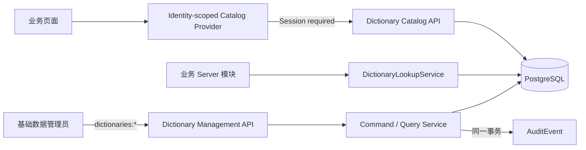

# 系统字典管理技术设计

## 1. 文档状态

- 状态：Phase 2 与 Gate B 精确边界已确认，Task 5 至 Task 13 已完成，Task 14 未开始
- 技术设计确认日期：2026-08-02
- 本次固化日期：2026-08-03
- Gate B 确认日期：2026-08-03
- 需求文档：`specs/dictionary-management/requirements.md`
- 实施起点：`9832d0a5e9415a9ef814776d00958c865c870da4`
- 实施分支：`feat/dictionary-management`

本文第 5 至 12 节包含已确认的精确 Prisma、SQL、API、权限、Audit 和内部服务契约。Gate B 已于 2026-08-03 单独确认；实施仍按 `tasks.md` 的任务边界逐项推进，后续任务内容不会因 Gate B 确认而提前落地。

## 2. Task 1 冻结时的仓库真相源

Task 1 执行前已重新核对当时的 checkout，不沿用更早审计中已经变化的状态。以下条目用于记录设计冻结时的实施起点；Task 2 的完成状态与验证证据以 `tasks.md` 为准：

- 正式 Web 应用是 `web/apps/qsmds-arco`。
- 字典路由位于 `web/apps/qsmds-arco/src/router/modules/basic.data.ts`，当前尚无 `meta.auth`。
- 字典页面 `web/apps/qsmds-arco/src/views/system/basic-data/dictionaries/index.vue` 当前仍为 `<div />`。
- `server/src/http.modules.ts` 当前已包含 Currency、Region 和 Numbering 模块，但没有 `DictionaryModule`。
- `server/prisma/schema.prisma` 当前没有 Dictionary model 或 tone enum。
- `server/openapi/openapi.json` 与 `web/openapi/openapi.json` 当前没有字典接口。
- 当前最后一条 migration 是 `20260802090000_numbering_management_schema_and_permissions`；权限稳定 ID 已连续使用到 `...000132`。
- 所有非健康检查响应由全局 Interceptor 设置 `Cache-Control: private, no-store`。

## 3. 总体架构



管理 API 与消费 Catalog API 使用不同 Controller 和准入规则；Server 内部业务模块使用导出的 Lookup Service，不通过 HTTP 调用自身。Web Catalog 负责身份隔离、运行时响应校验和短期内存缓存，业务组件不持有管理能力。

## 4. 核心设计决策

1. 系统字典是全局、平铺、两级的小型选项目录，不是通用配置中心。
2. `DictionaryType.code` 和 `DictionaryItem.value` 是永久稳定身份；业务表只保存规范化 `value`。
3. 类型和条目均创建为停用；不提供删除、恢复、移动或修改稳定身份能力。
4. `effectiveEnabled` 在查询层派生，不持久化。
5. 类型启用时至少保留一个自身启用条目；停用类型不改写条目状态。
6. 管理 Mutation 使用 `expectedVersion`；no-op 不增版、不写 Audit。
7. 管理 API、消费 API 和内部 Lookup 是三个不同边界。
8. Catalog 返回全部条目以支持历史解析，新建业务在调用方筛选 `effectiveEnabled`。
9. Server 继续使用 PostgreSQL 作为实时真相源；V1 不引入 Redis、ETag 或 CDN 缓存。
10. V1 不保存 aggregate revision；Web 通过精确失效和固定 TTL 管理一致性。

## 5. Prisma Schema 草案

### 5.1 DictionaryTone

```prisma
enum DictionaryTone {
  DEFAULT
  PRIMARY
  SUCCESS
  WARNING
  DANGER
  INFO

  @@map("dictionary_tone")
}
```

Tone 仅表达当前 UI 语义，不允许任意颜色、CSS、HTML、图标或脚本。

### 5.2 DictionaryType

```prisma
model DictionaryType {
  id          String   @id @default(dbgenerated("gen_random_uuid()")) @db.Uuid
  code        String   @unique(map: "dictionary_types_code_key") @db.VarChar(64)
  name        String   @db.VarChar(128)
  description String?  @db.VarChar(500)
  enabled     Boolean  @default(false)
  sortOrder   Int      @default(0) @map("sort_order")
  version     Int      @default(1)
  createdAt   DateTime @default(now()) @map("created_at") @db.Timestamptz(6)
  updatedAt   DateTime @default(now()) @updatedAt @map("updated_at") @db.Timestamptz(6)

  items DictionaryItem[]

  @@index([sortOrder, code, id], map: "dictionary_types_sort_order_code_id_idx")
  @@index([enabled, sortOrder, code, id], map: "dictionary_types_enabled_sort_order_code_id_idx")
  @@map("dictionary_types")
}
```

### 5.3 DictionaryItem

```prisma
model DictionaryItem {
  id               String         @id @default(dbgenerated("gen_random_uuid()")) @db.Uuid
  dictionaryTypeId String         @map("dictionary_type_id") @db.Uuid
  value            String         @db.VarChar(64)
  label            String         @db.VarChar(128)
  description      String?        @db.VarChar(500)
  tone             DictionaryTone @default(DEFAULT)
  enabled          Boolean        @default(false)
  sortOrder        Int            @default(0) @map("sort_order")
  version          Int            @default(1)
  createdAt        DateTime       @default(now()) @map("created_at") @db.Timestamptz(6)
  updatedAt        DateTime       @default(now()) @updatedAt @map("updated_at") @db.Timestamptz(6)

  dictionaryType DictionaryType @relation(
    fields: [dictionaryTypeId],
    references: [id],
    onDelete: Restrict,
    onUpdate: Restrict
  )

  @@unique([dictionaryTypeId, value], map: "dictionary_items_dictionary_type_id_value_key")
  @@index([dictionaryTypeId, sortOrder, value, id], map: "dictionary_items_type_id_sort_order_value_id_idx")
  @@index([dictionaryTypeId, enabled, sortOrder, value, id], map: "dictionary_items_type_id_enabled_sort_order_value_id_idx")
  @@map("dictionary_items")
}
```

字段明确不包含 `tenantId`、`parentId`、`deletedAt`、`isSystem`、`isDefault`、normalized 展示字段或任意 JSON 扩展。

## 6. 规范化与数据库约束

### 6.1 输入规范化

- Type code：执行 NFC 与 Unicode trim 后，剩余字符只允许 ASCII 字母、数字、下划线和点；再执行 `toLowerCase()`，最终匹配 `^[a-z][a-z0-9_]*(?:\.[a-z][a-z0-9_]*)+$`，总长 `3..64`，并且至少包含一个命名空间点。
- Item value：执行 NFC 与 Unicode trim 后，剩余字符只允许 ASCII 字母、数字、点、下划线和连字符；再执行 `toUpperCase()`，最终匹配 `^[A-Z0-9][A-Z0-9._-]{0,63}$`。
- Name/Label：执行 NFC、Unicode 空白折叠、trim，按 Unicode code point 限制 `1..128`。
- Description：执行同样规范化，空白转 `null`，非空最多 500 Unicode code points。
- Query：执行 NFC、空白折叠和 trim，最多 128 Unicode code points。
- 所有大小写转换前先限制 ASCII，避免 Unicode 展开伪装为合法技术标识。

Create 接口可以接受可规范化的大小写和首尾空白，响应只返回规范化值。业务 Catalog 和数据库始终使用规范化身份。

### 6.2 CHECK 与 FK

计划新增以下具名约束：

```text
dictionary_types_pkey
dictionary_types_code_format_check
dictionary_types_name_nonblank_check
dictionary_types_description_nonblank_check
dictionary_types_sort_order_nonnegative_check
dictionary_types_version_positive_check

dictionary_items_pkey
dictionary_items_value_format_check
dictionary_items_label_nonblank_check
dictionary_items_description_nonblank_check
dictionary_items_sort_order_nonnegative_check
dictionary_items_version_positive_check
dictionary_items_dictionary_type_id_fkey
```

`sort_order` 限制为 `0..2147483647`，`version >= 1`。FK 使用 `ON DELETE RESTRICT ON UPDATE RESTRICT`。

### 6.3 Index

```text
dictionary_types_code_key
dictionary_types_sort_order_code_id_idx
dictionary_types_enabled_sort_order_code_id_idx
dictionary_items_dictionary_type_id_value_key
dictionary_items_type_id_sort_order_value_id_idx
dictionary_items_type_id_enabled_sort_order_value_id_idx
```

索引名控制在 PostgreSQL 63 字节限制以内。Label 不唯一；稳定身份只由 `(dictionary_type_id, value)` 确定。

### 6.4 Function、Trigger 与稳定约束名

```text
enforce_dictionary_type_invariants()
dictionary_types_invariants_trigger

enforce_dictionary_item_invariants()
dictionary_items_invariants_trigger
```

Type Trigger：

- `DELETE` 抛出 `23514 / dictionary_types_delete_check`。
- 更新 `id/code` 抛出 `23514 / dictionary_types_identity_immutable_check`。
- `INSERT enabled=true` 或 `false -> true` 时，在已经持有 Type 行锁的前提下用普通 `EXISTS` 检查至少一个 `items.enabled=true`；失败抛出 `23514 / dictionary_types_enabled_item_required_check`。
- Type enable 不锁子行。所有 Item 状态写先锁父 Type，因此普通 `EXISTS` 足以看到稳定的已提交状态，同时避免 parent/child 反向锁序。

Item Trigger：

- `DELETE` 抛出 `23514 / dictionary_items_delete_check`。
- 更新 `id/dictionary_type_id/value` 抛出 `23514 / dictionary_items_identity_immutable_check`。
- `INSERT` 以及 identity/enabled 相关 UPDATE 先对所属 Type 执行 `FOR UPDATE`。
- 当所属 Type 已启用时，停用最后一个自身启用条目抛出 `23514 / dictionary_items_last_enabled_check`。

应用层仍必须显式遵守 Type -> Item 锁序；Trigger 只是直接 SQL 和实现遗漏的最终防线。

## 7. Forward Migration 草案

计划目录：

```text
server/prisma/migrations/20260803090000_dictionary_management_schema_and_permissions/
└── migration.sql
```

单一严格事务顺序：

1. `BEGIN`。
2. 向 `audit_event_type` 追加八个值，但事务内不 cast 或插入这些新值。
3. 创建 `dictionary_tone`。
4. 创建两张表、13 个具名 PK/FK/CHECK constraint 和 6 个业务 index，其中 2 个是唯一身份 index。
5. 创建两个 function 与两个 Trigger。
6. 插入五项权限并显式授予稳定 `system_admin` role。
7. 使用 `DO $$` 精确自检 2 张表、13 个 PK/FK/CHECK constraint、6 个业务 index、2 个 function、2 个 Trigger、6 个 `dictionary_tone` label、5 个 permission ID/code、5 个管理员授权和 8 个 Audit enum label。
8. 自检 `dictionary_types = 0` 且 `dictionary_items = 0`。
9. `COMMIT`。

禁止使用 `IF NOT EXISTS`、`ADD VALUE IF NOT EXISTS` 和 `ON CONFLICT DO NOTHING`。权限和管理员授权属于治理数据，不是业务字典 seed。

### 7.1 Permission stable IDs

| ID | Code | Name | system_only |
| --- | --- | --- | --- |
| `00000000-0000-4000-8000-000000000133` | `dictionaries:read` | 查询系统字典 | `false` |
| `00000000-0000-4000-8000-000000000134` | `dictionaries:create` | 创建系统字典 | `false` |
| `00000000-0000-4000-8000-000000000135` | `dictionaries:update` | 编辑系统字典 | `false` |
| `00000000-0000-4000-8000-000000000136` | `dictionaries:enable` | 启用系统字典 | `false` |
| `00000000-0000-4000-8000-000000000137` | `dictionaries:disable` | 停用系统字典 | `false` |

每项权限同时作用于 Type 和 Item 对应动作。授权目标固定为现有内置 Role：`id=00000000-0000-4000-8000-000000000001`、`code=system_admin`，migration 必须同时按稳定 ID 与 code 自检，不能仅凭可变显示名定位。当前 migration 历史已使用 `...101` 至 `...132`，上述 ID 是下一段连续且尚未占用的稳定范围；实施前仍需再次扫描冲突。

### 7.2 AuditEventType

```text
DICTIONARY_TYPE_CREATED
DICTIONARY_TYPE_UPDATED
DICTIONARY_TYPE_ENABLED
DICTIONARY_TYPE_DISABLED
DICTIONARY_ITEM_CREATED
DICTIONARY_ITEM_UPDATED
DICTIONARY_ITEM_ENABLED
DICTIONARY_ITEM_DISABLED
```

Audit `targetType` 固定为 `DictionaryType` 或 `DictionaryItem`，`targetId` 为内部 UUID。metadata 只允许：

```text
dictionaryCode
itemValue
changedFields
previousVersion
version
```

`changedFields` 使用排序后的逗号字符串，避免超过现有 Audit scalar 边界；不记录 Label、Description、完整 DTO 或任意嵌套 JSON。

逐事件 metadata 固定如下；表中未列出的 key 必须省略，不用 `null` 占位：

| Event | Required metadata | `changedFields` rule |
| --- | --- | --- |
| `DICTIONARY_TYPE_CREATED` | `dictionaryCode`, `changedFields`, `version=1` | `code,enabled,name,sortOrder`，请求显式包含 `description` 时加入后排序 |
| `DICTIONARY_TYPE_UPDATED` | `dictionaryCode`, `changedFields`, `previousVersion`, `version` | 仅实际变化的 `description/name/sortOrder`，字典序排序 |
| `DICTIONARY_TYPE_ENABLED` | `dictionaryCode`, `changedFields=enabled`, `previousVersion`, `version` | 固定 `enabled` |
| `DICTIONARY_TYPE_DISABLED` | `dictionaryCode`, `changedFields=enabled`, `previousVersion`, `version` | 固定 `enabled` |
| `DICTIONARY_ITEM_CREATED` | `dictionaryCode`, `itemValue`, `changedFields`, `version=1` | `dictionaryTypeId,enabled,label,sortOrder,tone,value`，请求显式包含 `description` 时加入后排序 |
| `DICTIONARY_ITEM_UPDATED` | `dictionaryCode`, `itemValue`, `changedFields`, `previousVersion`, `version` | 仅实际变化的 `description/label/sortOrder/tone`，字典序排序 |
| `DICTIONARY_ITEM_ENABLED` | `dictionaryCode`, `itemValue`, `changedFields=enabled`, `previousVersion`, `version` | 固定 `enabled` |
| `DICTIONARY_ITEM_DISABLED` | `dictionaryCode`, `itemValue`, `changedFields=enabled`, `previousVersion`, `version` | 固定 `enabled` |

Create 事件不含 `previousVersion`；no-op 不产生事件。`dictionaryCode` 与 `itemValue` 使用规范化稳定身份，metadata 不包含任何 UUID。

## 8. 事务、并发与错误映射

### 8.1 写事务

```text
applyTransactionTimeouts
-> DictionaryType FOR UPDATE
-> DictionaryItem FOR UPDATE（仅 Item update/status）
-> expectedVersion / domain validation
-> business write
-> AuditService.record(same TransactionClient)
-> read response in same transaction
```

- `lock_timeout = 2s`、`statement_timeout = 5s`，设置 timeout 必须是事务第一条 SQL。
- Create Type 没有既有 Type 行可锁，由唯一约束保护 code。
- Create Item 先锁父 Type，再插入 Item。
- Item update/status 先锁父 Type，再锁 Item，禁止反向顺序。
- `P2034 / 40001 / 40P01 / 55P03` 按当前操作上下文映射到对应 `*_STATE_CHANGED`。
- 即使目标状态已相同，也必须先校验 `expectedVersion`；版本正确时按 no-op 返回。

### 8.2 稳定业务错误

| HTTP | Code | 语义 |
| ---: | --- | --- |
| 404 | `DICTIONARY_TYPE_NOT_FOUND` | 类型不存在或不可按当前资源定位访问 |
| 404 | `DICTIONARY_ITEM_NOT_FOUND` | 条目不存在或不属于路径 Type |
| 409 | `DICTIONARY_TYPE_CODE_ALREADY_EXISTS` | 规范化 Type code 已存在 |
| 409 | `DICTIONARY_ITEM_VALUE_ALREADY_EXISTS` | 同一 Type 下规范化 value 已存在 |
| 409 | `DICTIONARY_TYPE_STATE_CHANGED` | Type version、锁或事务状态冲突 |
| 409 | `DICTIONARY_ITEM_STATE_CHANGED` | Item version、锁或事务状态冲突 |
| 422 | `DICTIONARY_TYPE_ENABLED_ITEM_REQUIRED` | 启用 Type 或停用最后有效 Item 会破坏不变量 |
| 422 | `VALIDATION_FAILED` | DTO、格式、范围或空 Patch 校验失败 |

未知数据库错误只返回 `500 INTERNAL_ERROR`。嵌套 Item path 中 Type/Item 不匹配统一返回 `DICTIONARY_ITEM_NOT_FOUND`，避免泄露另一 Type 的资源存在性。

## 9. Server 模块结构

```text
server/src/modules/dictionaries/
├── dictionary.module.ts
├── dictionaries.controller.ts
├── dictionary-catalog.controller.ts
├── dictionary-query.service.ts
├── dictionary-command.service.ts
├── dictionary-command.persistence.ts
├── dictionary-lookup.service.ts
├── dictionary.normalizer.ts
├── dictionary.errors.ts
├── dictionary.persistence-error.mapper.ts
└── dto/
    ├── dictionary-command.dto.ts
    ├── dictionary-management.dto.ts
    └── dictionary-response.dto.ts
```

`DictionaryModule` 导入 `PrismaModule` 与 `AuthModule`，注册管理和 Catalog Controller，只导出 `DictionaryLookupService`。正式运行和 OpenAPI preview 均通过唯一 `HTTP_MODULES` 注册该模块。

## 10. DTO 精确契约

### 10.1 Management request

```ts
interface CreateDictionaryTypeRequestDto {
  code: string
  name: string
  description?: string | null
  sortOrder: number
}

interface UpdateDictionaryTypeRequestDto {
  name?: string
  description?: string | null
  sortOrder?: number
  expectedVersion: number
}

interface CreateDictionaryItemRequestDto {
  value: string
  label: string
  description?: string | null
  tone?: DictionaryTone
  sortOrder: number
}

interface UpdateDictionaryItemRequestDto {
  label?: string
  description?: string | null
  tone?: DictionaryTone
  sortOrder?: number
  expectedVersion: number
}

interface ChangeDictionaryStatusRequestDto {
  expectedVersion: number
}
```

Create 不接受 `enabled/version/id`。Update 至少出现一个可变字段，且不接受稳定身份字段。

### 10.2 Management list query

Type：

```ts
interface DictionaryTypeListQueryDto {
  query?: string
  status?: 'ENABLED' | 'DISABLED'
  page?: number        // default 1
  pageSize?: number    // default 20, max 100
  sortBy?: 'sortOrder' | 'code' | 'name' | 'updatedAt' // default sortOrder
  sortOrder?: 'asc' | 'desc' // default asc
}
```

Item：

```ts
interface DictionaryItemListQueryDto {
  query?: string
  status?: 'ENABLED' | 'DISABLED'
  page?: number        // default 1
  pageSize?: number    // default 20, max 100
  sortBy?: 'sortOrder' | 'value' | 'label' | 'updatedAt' // default sortOrder
  sortOrder?: 'asc' | 'desc' // default asc
}
```

默认排序分别为 `sortOrder ASC, code/value ASC, id ASC`。显式排序始终追加稳定 tie-breaker；搜索 Type 的 `code/name/description`，搜索 Item 的 `value/label/description`，V1 不引入 `pg_trgm`。

### 10.3 Management response

```ts
interface DictionaryTypeDto {
  id: string
  code: string
  name: string
  description: string | null
  enabled: boolean
  sortOrder: number
  itemCount: number
  enabledItemCount: number
  version: number
  createdAt: string
  updatedAt: string
}

interface DictionaryItemDto {
  id: string
  dictionaryTypeId: string
  value: string
  label: string
  description: string | null
  tone: DictionaryTone
  enabled: boolean
  effectiveEnabled: boolean
  sortOrder: number
  version: number
  createdAt: string
  updatedAt: string
}

interface DictionaryTypePageDto {
  items: DictionaryTypeDto[]
  page: number
  pageSize: number
  total: number
}

interface DictionaryItemPageDto {
  items: DictionaryItemDto[]
  page: number
  pageSize: number
  total: number
}
```

### 10.4 Catalog request/response

```ts
interface DictionaryCatalogItemDto {
  value: string
  label: string
  tone: DictionaryTone
  enabled: boolean
  effectiveEnabled: boolean
  sortOrder: number
}

interface DictionaryCatalogDto {
  code: string
  name: string
  enabled: boolean
  items: DictionaryCatalogItemDto[]
}

interface DictionaryCatalogBatchQueryDto {
  codes: string[] // repeated query parameter, unique 1..20
}

interface DictionaryCatalogBatchDto {
  dictionaries: DictionaryCatalogDto[]
  missingCodes: string[]
}
```

Catalog 不包含内部 UUID、Description、管理 version、timestamp、itemCount 或 aggregate revision。Batch 的两个数组均按规范化后的首次请求顺序返回；重复 code 在校验阶段拒绝而不是静默吞并。

## 11. HTTP API 与 OpenAPI 审批矩阵

所有路径均位于全局 `/api` 前缀下。下表固定使用 `/dictionary-types`，不会改成 `/dictionaries`。

### 11.1 Management API

| Method | Path | operationId | Request | Permission | Success | Domain errors |
| --- | --- | --- | --- | --- | --- | --- |
| GET | `/dictionary-types` | `dictionary_types_list` | `DictionaryTypeListQueryDto` | `dictionaries:read` | `200 DictionaryTypePageDto` | 无 endpoint-specific error |
| POST | `/dictionary-types` | `dictionary_types_create` | `CreateDictionaryTypeRequestDto` | `dictionaries:create` | `201 DictionaryTypeDto` | `409 DICTIONARY_TYPE_CODE_ALREADY_EXISTS`, `409 DICTIONARY_TYPE_STATE_CHANGED` |
| GET | `/dictionary-types/{typeId}` | `dictionary_types_get_by_id` | `typeId` | `dictionaries:read` | `200 DictionaryTypeDto` | `404 DICTIONARY_TYPE_NOT_FOUND` |
| PATCH | `/dictionary-types/{typeId}` | `dictionary_types_update` | `typeId + UpdateDictionaryTypeRequestDto` | `dictionaries:update` | `200 DictionaryTypeDto` | `404 DICTIONARY_TYPE_NOT_FOUND`, `409 DICTIONARY_TYPE_STATE_CHANGED` |
| POST | `/dictionary-types/{typeId}/enable` | `dictionary_types_enable` | `typeId + ChangeDictionaryStatusRequestDto` | `dictionaries:enable` | `200 DictionaryTypeDto` | `404 DICTIONARY_TYPE_NOT_FOUND`, `409 DICTIONARY_TYPE_STATE_CHANGED`, `422 DICTIONARY_TYPE_ENABLED_ITEM_REQUIRED` |
| POST | `/dictionary-types/{typeId}/disable` | `dictionary_types_disable` | `typeId + ChangeDictionaryStatusRequestDto` | `dictionaries:disable` | `200 DictionaryTypeDto` | `404 DICTIONARY_TYPE_NOT_FOUND`, `409 DICTIONARY_TYPE_STATE_CHANGED` |
| GET | `/dictionary-types/{typeId}/items` | `dictionary_items_list` | `typeId + DictionaryItemListQueryDto` | `dictionaries:read` | `200 DictionaryItemPageDto` | `404 DICTIONARY_TYPE_NOT_FOUND` |
| POST | `/dictionary-types/{typeId}/items` | `dictionary_items_create` | `typeId + CreateDictionaryItemRequestDto` | `dictionaries:create` | `201 DictionaryItemDto` | `404 DICTIONARY_TYPE_NOT_FOUND`, `409 DICTIONARY_ITEM_VALUE_ALREADY_EXISTS`, `409 DICTIONARY_TYPE_STATE_CHANGED` |
| GET | `/dictionary-types/{typeId}/items/{itemId}` | `dictionary_items_get_by_id` | `typeId + itemId` | `dictionaries:read` | `200 DictionaryItemDto` | `404 DICTIONARY_ITEM_NOT_FOUND` |
| PATCH | `/dictionary-types/{typeId}/items/{itemId}` | `dictionary_items_update` | `typeId + itemId + UpdateDictionaryItemRequestDto` | `dictionaries:update` | `200 DictionaryItemDto` | `404 DICTIONARY_ITEM_NOT_FOUND`, `409 DICTIONARY_ITEM_STATE_CHANGED` |
| POST | `/dictionary-types/{typeId}/items/{itemId}/enable` | `dictionary_items_enable` | `typeId + itemId + ChangeDictionaryStatusRequestDto` | `dictionaries:enable` | `200 DictionaryItemDto` | `404 DICTIONARY_ITEM_NOT_FOUND`, `409 DICTIONARY_ITEM_STATE_CHANGED` |
| POST | `/dictionary-types/{typeId}/items/{itemId}/disable` | `dictionary_items_disable` | `typeId + itemId + ChangeDictionaryStatusRequestDto` | `dictionaries:disable` | `200 DictionaryItemDto` | `404 DICTIONARY_ITEM_NOT_FOUND`, `409 DICTIONARY_ITEM_STATE_CHANGED`, `422 DICTIONARY_TYPE_ENABLED_ITEM_REQUIRED` |

所有管理 endpoint 均声明 `400 BAD_REQUEST`、`401 UNAUTHORIZED`、`403 FORBIDDEN`、`403 PASSWORD_CHANGE_REQUIRED`、`422 VALIDATION_FAILED`、`500 INTERNAL_ERROR` 和 `privateNoStore=true`。Mutation 额外声明 `403 CSRF_REJECTED`、`csrf=true`、`conflict=true`；有 path resource 的 endpoint 额外声明 `resourceLocator=true`。上表只列各 endpoint 在公共错误集之外的稳定领域错误，OpenAPI 必须逐项展开，不得使用缩写。

### 11.2 Consumer API

| Method | Path | operationId | Request | Admission | Success | Domain errors |
| --- | --- | --- | --- | --- | --- | --- |
| GET | `/dictionary-catalog/{code}` | `dictionary_catalog_get_by_code` | `code` | Session only | `200 DictionaryCatalogDto` | `404 DICTIONARY_TYPE_NOT_FOUND` |
| GET | `/dictionary-catalog` | `dictionary_catalog_batch_list` | `DictionaryCatalogBatchQueryDto` | Session only | `200 DictionaryCatalogBatchDto` | 无 endpoint-specific error |

Batch 的线协议示例是 `/api/dictionary-catalog?codes=a.b&codes=c.d`，但 OpenAPI path 固定为 `/dictionary-catalog`，`codes` 只作为 repeated query parameter 声明。消费接口统一声明 `400 BAD_REQUEST`、`401 UNAUTHORIZED`、`403 PASSWORD_CHANGE_REQUIRED`、`422 VALIDATION_FAILED`、`500 INTERNAL_ERROR`、`session=required`、`authorization=false` 和 `privateNoStore=true`，不要求 CSRF。所有应用接口通过公共 decorator 返回 `X-Request-Id` response header。

## 12. DictionaryLookupService 精确契约

```ts
import type { Prisma } from '../../generated/prisma/client'
import type {
  DictionaryTone as DictionaryToneValue,
} from '../../generated/prisma/enums'

export type DictionaryValueUnavailableReason =
  | 'DICTIONARY_TYPE_NOT_FOUND'
  | 'DICTIONARY_TYPE_DISABLED'
  | 'DICTIONARY_ITEM_NOT_FOUND'
  | 'DICTIONARY_ITEM_DISABLED'

export type DictionaryLookupValidationField =
  | 'dictionaryCode'
  | 'value'

export interface DictionaryLookupInput {
  readonly dictionaryCode: string
  readonly value: string
}

export interface EffectiveDictionaryValue {
  readonly dictionaryCode: string
  readonly value: string
  readonly label: string
  readonly tone: DictionaryToneValue
}

export interface KnownStoredDictionaryValue {
  readonly known: true
  readonly dictionaryCode: string
  readonly value: string
  readonly label: string
  readonly tone: DictionaryToneValue
  readonly typeEnabled: boolean
  readonly itemEnabled: boolean
  readonly effectiveEnabled: boolean
}

export interface UnknownStoredDictionaryValue {
  readonly known: false
  readonly dictionaryCode: string
  readonly value: string
}

export type StoredDictionaryValueResolution =
  | KnownStoredDictionaryValue
  | UnknownStoredDictionaryValue

export class DictionaryValueUnavailableError extends Error {
  readonly code = 'DICTIONARY_VALUE_NOT_EFFECTIVE'

  constructor(readonly reason: DictionaryValueUnavailableReason) {
    super('Dictionary value is not effective')
    this.name = 'DictionaryValueUnavailableError'
  }
}

export class DictionaryLookupValidationError extends Error {
  readonly code = 'DICTIONARY_LOOKUP_INPUT_INVALID'

  constructor(readonly field: DictionaryLookupValidationField) {
    super('Dictionary lookup input is invalid')
    this.name = 'DictionaryLookupValidationError'
  }
}

export class DictionaryLookupService {
  requireEffectiveValue(
    transaction: Prisma.TransactionClient,
    input: DictionaryLookupInput,
  ): Promise<EffectiveDictionaryValue>

  resolveStoredValue(
    input: DictionaryLookupInput,
  ): Promise<StoredDictionaryValueResolution>
}
```

`requireEffectiveValue` 的调用方拥有业务事务，并且必须已经把 transaction timeout 作为该事务第一条 SQL 设置完成。方法规范化 code/value，按 Type `FOR SHARE` -> Item `FOR SHARE` 读取，并返回调用方必须持久化的规范化 `descriptor.value`。code/value 不满足第 6.1 节规则时抛出 `DictionaryLookupValidationError`；目录缺失或停用时抛出 `DictionaryValueUnavailableError`。两种内部异常都不直接等同公共 HTTP 错误，业务模块负责映射为自身字段错误。

`resolveStoredValue` 只规范化 dictionary code，对历史 `value` 做原样精确匹配；非法 code 或运行时非字符串 value 抛出 `DictionaryLookupValidationError`。任意字符串 value 都不做 trim、大小写转换或长度规范化，未精确命中时返回 `{ known: false, dictionaryCode, value: rawValue }`，不得把原值自动改成大写后误认。已知结果无论当前是否有效都返回完整状态。该方法使用普通只读查询，不承担业务写事务的有效性保证。

## 13. Web API 与 Catalog Provider

### 13.1 文件结构

```text
web/apps/qsmds-arco/src/
├── api/modules/dictionaries.ts
└── dictionary-catalog/
    ├── types.ts
    ├── validation.ts
    ├── provider.ts
    ├── injection.ts
    ├── default-provider.ts
    ├── use-dictionary-catalog.ts
    └── options.ts
```

API Module 只引用 OpenAPI generated DTO、Request 和 operation query 类型，保留完整 `AxiosResponse<T>`，调用方显式读取 `response.data`。所有读请求携带 `signal` 与 `errorPresentation:'local'`，所有 Mutation 使用 `retry:false`；path 中的 ID/code 统一使用 `encodeURIComponent`。Batch 的 `codes` 显式序列化为重复参数 `codes=a&codes=b`，不得依赖 Axios 默认的 `codes[]`。

Catalog domain 类型不导入 API、Store 或 generated DTO；Provider 对不可信响应做字段白名单复制、重复 value、tone、布尔关系和 batch 完整性校验，并冻结返回值。

Catalog domain 固定为独立只读类型，不复制管理实体 `id`、`description`、`version`、timestamp 或未知字段：

```ts
interface DictionaryCatalogItem {
  readonly value: string
  readonly label: string
  readonly tone:
    | 'DEFAULT'
    | 'PRIMARY'
    | 'SUCCESS'
    | 'WARNING'
    | 'DANGER'
    | 'INFO'
  readonly enabled: boolean
  readonly effectiveEnabled: boolean
  readonly sortOrder: number
}

interface DictionaryCatalog {
  readonly code: string
  readonly name: string
  readonly enabled: boolean
  readonly items: readonly DictionaryCatalogItem[]
}
```

### 13.2 Provider contract

```ts
interface DictionaryCatalogIdentity {
  readonly authEpoch: number
  readonly userId: string | null
}

interface DictionaryCatalogIdentitySource {
  getSnapshot(): DictionaryCatalogIdentity
  subscribe(
    listener: (identity: DictionaryCatalogIdentity) => void,
  ): () => void
}

interface DictionaryCatalogLoader {
  get(input: {
    readonly code: string
    readonly signal: AbortSignal
  }): Promise<unknown>

  batch(input: {
    readonly codes: readonly string[]
    readonly signal: AbortSignal
  }): Promise<unknown>
}

interface DictionaryCatalogProvider {
  get(input: {
    readonly code: string
    readonly signal: AbortSignal
  }): Promise<DictionaryCatalog | null>

  prefetch(input: {
    readonly codes: readonly string[]
    readonly signal: AbortSignal
  }): Promise<void>

  subscribeInvalidation(
    listener: (event: { readonly code: string | null }) => void,
  ): () => void
}

interface DictionaryCatalogProviderController {
  readonly provider: DictionaryCatalogProvider
  readonly invalidate: (input: {
    readonly code: string
    readonly broadcast: boolean
  }) => void
  readonly dispose: () => void
}

interface CreateDictionaryCatalogProviderInput {
  readonly identitySource: DictionaryCatalogIdentitySource
  readonly loader: DictionaryCatalogLoader
  readonly now?: () => number
  readonly createBroadcastChannel?: (name: string) => BroadcastChannel
}

class DictionaryCatalogIdentityRequiredError extends Error {
  readonly code = 'DICTIONARY_CATALOG_IDENTITY_REQUIRED'

  constructor() {
    super('Dictionary catalog identity is required')
    this.name = 'DictionaryCatalogIdentityRequiredError'
  }
}

declare function createDictionaryCatalogProviderController(
  input: CreateDictionaryCatalogProviderInput,
): DictionaryCatalogProviderController
```

`identitySource` 是 Provider 与 Auth Store 的唯一边界，测试通过 fake source 驱动身份变化，Provider 不直接导入 Store。`userId=null` 时 `get/prefetch` 不调用 loader，而是 reject `DictionaryCatalogIdentityRequiredError`。身份 snapshot 变化时清空全部缓存和 in-flight ownership，向本地订阅者发送 `{ code: null }`。

缓存 Key 固定为 `JSON.stringify([authEpoch,userId,code])`；TTL 固定 `300_000ms`。每个 code 有独立 cache、generation 和 in-flight entry。单消费者取消不影响其他消费者，全部取消才中止底层请求。网络错误和畸形响应不缓存；单查稳定 `404 DICTIONARY_TYPE_NOT_FOUND` 映射的 `null` 与 batch 明确返回的 `missingCodes` 都按相同 TTL 负缓存，并由同一个 code 失效规则清除。

`get` 只把单 Catalog API 的稳定 `404 DICTIONARY_TYPE_NOT_FOUND` 映射为 `null`，其他 HTTP、网络或校验错误继续 reject。`subscribeInvalidation` 的 `code` 为具体字符串时表示精确失效；`code=null` 只表示身份/AuthSignal 变化导致的全量本地清空。

`prefetch` 对 code 去重但保持首次出现顺序，空数组为 no-op，最多接受 20 个唯一 code。批量响应必须满足 `dictionaries.code ∪ missingCodes` 与请求集合完全相等，并且两个集合内部无重复、互相无交集、没有未请求 code。运行时校验同时验证 tone 白名单、Item value 唯一，以及 `effectiveEnabled === catalog.enabled && item.enabled`。返回对象一律白名单复制并 deep-freeze。

默认实例在 `main.ts` 中于 Pinia 和 Router 安装后同步注入，底层 API 通过动态 import 延迟加载；不在登录时预取，不写持久化存储。身份或 AuthSignal 变化清空全部缓存；精确失效通过 per-code generation 阻止迟到响应重新污染缓存。共享批量请求中某个 code 失效时，其他未失效 code 仍可安全写入各自缓存。

### 13.3 Cross-tab invalidation

```ts
const DICTIONARY_CATALOG_CHANNEL = 'qianshu-dictionary-catalog-v1'

interface DictionaryCatalogChangedMessage {
  readonly type: 'DICTIONARY_CATALOG_CHANGED'
  readonly code: string
}
```

消息必须是 plain object 且恰好包含 `type/code` 两个 key，code 必须通过相同规范化校验。管理写成功后先本地失效，再 best-effort 广播受影响 code；Type 与其 Item 的写操作都失效所属 Type code。接收方只本地失效并通知订阅者，不再次广播。

其他浏览器或设备可能在 TTL 内读取旧 Catalog，但所有业务 Mutation 仍由 Server 的 `requireEffectiveValue` 实时校验，因此旧缓存不能写入已经失效的新值。

### 13.4 Consumer adapter

`useDictionaryCatalog(code)` 提供 loading、error、retry、完整 Catalog、`selectableItems` 和 `resolve(value)`：

```text
ACTIVE   -> 命中且 effectiveEnabled=true
DISABLED -> 命中但 effectiveEnabled=false
UNKNOWN  -> 未命中，保留原始 value
```

新选择只包含 `effectiveEnabled=true`；当前停用值保留并显示“（已停用）”；已知字典中不存在的旧值保留并显示“（未知值）”；字典自身不存在使用独立 `missing` 状态。任何情况都不得自动清空、选择默认值或替换原始值。

首期不创建 `QsDictionarySelect`。真实业务调用方使用现有 Fa/Arco Field 组合 composable，待至少两个稳定调用方出现后再评估公共组件。

## 14. 管理页面设计

### 14.1 文件结构

```text
web/apps/qsmds-arco/src/views/system/basic-data/dictionaries/
├── index.vue
├── dictionary-management.logic.ts
├── dictionary-type-list.vue
├── dictionary-type-form-modal.vue
├── dictionary-type-form.logic.ts
├── dictionary-item-form-modal.vue
├── dictionary-item-form.logic.ts
├── dictionary-status.logic.ts
└── dictionary-status-change-modal.vue
```

页面 API、副作用、权限和选中 Type 由 `index.vue` 及应用级 logic 管理；Qs 公共组件保持业务中立。

### 14.2 Design Specification

- Purpose：安全维护全局字典类型和选项，同时明确不可变身份、有效状态和历史值风险。
- Aesthetic Direction：Industrial/utilitarian。
- Palette：复用现有 `background/foreground/muted/border/primary/destructive` token；`#FFFFFF/#09090B/#F4F4F5/#E4E4E7/#15803D` 只作为设计锚点，不在业务组件硬编码。
- Typography：`Noto Sans SC`；code/value 使用 `Noto Sans Mono`。
- Layout：一个 `FaPageHeader + FaPageMain`；桌面使用 `18rem minmax(0,1fr)` 非对称主从布局，移动端把 Type 列表放入底部 `QsGenericDrawer`。
- Components：条目列表使用 `QsGenericTable`；创建/编辑和启停使用领域 `QsGenericModal`；图标沿用项目 Lucide/FaIcon，不使用 Emoji。
- Motion：只保留必要的状态过渡，遵守 Reduced Motion；不添加持续 pulse、装饰性渐变或堆叠统计卡。

### 14.3 页面状态与交互

- Type 列表和 Item 列表各自维护 request version、AbortController、loading、error、empty 和 retry。
- 切换 Type 时立即取消旧 Item 请求，迟到响应必须同时匹配 authEpoch、request version 和选中 Type。
- 页面状态机固定为 `access: forbidden | active`、`query: idle | loading | ready | refreshing | empty | error`、`selection: none | selected` 和 `mutation: closed | editing | submitting | reconciling | error`。
- 无选中 Type 时右侧展示引导空态；搜索无结果与系统零数据使用不同文案。
- Type/Item create 后默认停用，成功后更新当前列表并失效受影响 Catalog code。
- `409` 重新读取目标并用最新 `expectedVersion` 保持 Modal 可修正；网络未知结果进入 `reconciling`，只查询最终状态，不自动重放 Mutation。
- 动态撤销 read 权限时，中止请求、清空数据、关闭所有领域 Modal/Drawer 并进入统一权限状态。
- Type 切换只更新本地 `ref`。当前 Layout 使用 `route.fullPath` 作为 Component key，V1 不写 `?code=`。

### 14.4 Responsive 与 Accessibility

- Desktop：左侧 Type 搜索/筛选/列表，右侧 Type 摘要、Item table 和操作。
- Mobile：Header 保留主要创建入口；Type 选择通过底部 Drawer；Item 使用 QsGenericTable 移动卡片。
- Modal/Drawer 关闭后恢复触发器焦点，Escape 可关闭非提交状态界面。
- 提交中禁止重复提交和意外关闭；必须先解除 submitting 再关闭。
- 状态同时有文字与语义色；错误区使用 `role=alert`，加载区维护适用的 `aria-busy`。
- 行操作和 Footer 触控高度至少 44px，考虑 safe area，`document.scrollWidth <= viewportWidth`。
- 必须验证 light/dark、键盘导航、Reduced Motion、无 console error/page error。

## 15. 路由与权限

字典叶子路由固定增加：

```ts
meta: {
  title: '字典管理',
  icon: 'i-lucide:book-open',
  auth: 'dictionaries:read',
}
```

基础数据父路由继续权限中立。菜单递归过滤后若没有可见叶子，父菜单自然消失。当前“无基础数据权限仍保留字典”的测试必须反向更新；直接访问由现有 Route/Auth 机制进入统一 `403`。

页面动作矩阵：

| Capability | Required permission |
| --- | --- |
| 页面、Type/Item 列表和详情 | `dictionaries:read` |
| 创建 Type 或 Item | `dictionaries:create` |
| 编辑 Type 或 Item | `dictionaries:update` |
| 启用 Type 或 Item | `dictionaries:enable` |
| 停用 Type 或 Item | `dictionaries:disable` |

权限控制 UI 可见性只改善体验，Server Guard 始终是最终准入边界。

## 16. 测试策略

### 16.1 Server

- `server/src/infrastructure/database/dictionary-schema.spec.ts`：Prisma、migration、权限、Audit、零种子和禁止漂移语句。
- `server/test/dictionary-schema.e2e-spec.ts`：随机 schema replay、constraint、Trigger、direct SQL 和二次 deploy。
- `server/src/modules/dictionaries/**/*.spec.ts`：DTO、Normalizer、Query、Command、Lookup、Controller、Module 和错误映射。
- `server/test/dictionary-management-api.e2e-spec.ts`：真实 Session、CSRF、权限矩阵、生命周期、Audit、rollback、Cache-Control。
- `server/test/dictionary-catalog-api.e2e-spec.ts`：Session-only 准入、单查、批量部分缺失、顺序、全部条目、Lookup 有效值锁定和历史精确解析。
- 并发 E2E：同版本 `[200,409]`、Type enable/last Item disable、两个最后候选 Item 并发停用。

### 16.2 Web

- `web/apps/qsmds-arco/test/api/dictionaries.test.ts`。
- `web/apps/qsmds-arco/test/api/basic-data-routes.test.ts`。
- `web/apps/qsmds-arco/test/views/dictionary-catalog-validation.test.ts`。
- `web/apps/qsmds-arco/test/views/dictionary-catalog-provider.test.ts`。
- `web/apps/qsmds-arco/test/views/dictionary-catalog-integration.test.ts`。
- `web/apps/qsmds-arco/test/views/dictionary-management.logic.test.ts`。
- `web/apps/qsmds-arco/test/views/dictionary-type-form.logic.test.ts`。
- `web/apps/qsmds-arco/test/views/dictionary-item-form.logic.test.ts`。
- `web/apps/qsmds-arco/test/views/dictionary-status-change-modal.test.ts`。
- `web/apps/qsmds-arco/test/views/dictionary-management.test.ts`。

### 16.3 Browser 与 CI

- Browser helper：`web/apps/qsmds-arco/test/browser/dictionaries.browser.helpers.test.mjs`。
- Browser：`web/apps/qsmds-arco/test/browser/dictionaries.browser.test.mjs`。
- Web script：`test:browser:dictionaries`。
- Root runner：`scripts/ci-browser-dictionaries-e2e.mjs` 及 unit test。
- Root entry：`ci:browser-dictionaries-e2e`。
- GitHub Job：`browser-dictionaries-e2e`，加入 `ci-gate.needs`，结果数量从 6 变为 7。
- 同步更新 `scripts/ci-workflows.test.mjs` 与 `scripts/root-governance.test.mjs`。

### 16.4 既有回归面

- 五项权限加入后，Access Control、Auth、Management 与 Schema tests 中当前权限总数从 32 变为 37；断言必须按真实目录同步，不能放宽为模糊下限。
- 管理 Browser 权限抽屉需展示字典资源的五项动作；权限目录需要新增稳定中文资源名。
- `basic-data-routes.test.ts` 当前把字典叶子当成无权限 fallback，实施后必须改为 `dictionaries:read` 并覆盖空父菜单。
- Regions Browser 当前“零基础数据权限”场景会因字典 fallback 消失而进入统一 `403`；需更新预期而不是绕过路由权限。
- 当前 `scripts/check.mjs` 只包含既有 Browser 边界。字典 Browser Job 独立接入 CI gate；除非同步修改 check 的治理测试，不扩大本地根 `check`。

## 17. 部署与回滚

发布顺序固定为 migration -> Server -> Web。新增结构对旧应用是纯扩展，旧 Server 会忽略新表和 enum。

- migration 失败：依靠单事务回滚，停止发布并在隔离数据库复现；未共享的 migration 可修正后重新验证。
- migration 已成功但应用未发布：保留结构，旧应用继续运行。
- 新应用需要回退：回退 Server/Web，保留字典表、权限和 Audit enum；必要时通过权限和路由关闭入口。
- 已存在字典或 Audit 数据后，不允许 drop table、删除权限或删除 enum value；使用新的 forward migration 修复。
- 生产 migration 不属于 GitHub Release 自动流程，必须独立审批和记录。

## 18. Gate B 精确审批清单

用户已于 2026-08-03 整体确认以下 Gate B 包；Task 2 可以实施，后续运行时代码仍按 `tasks.md` 的依赖和任务边界逐项推进：

1. 第 5 节的两个 Prisma model 和一个 enum。
2. 第 6 至 7 节的字段、规范化、13 个 PK/FK/CHECK constraint、6 个业务 index（含 2 个唯一身份 index）、2 个 function、2 个 Trigger、migration 和零种子。
3. `...133` 至 `...137` 五项权限、八项 Audit enum 和 system_admin 授权。
4. 第 8.2 节的稳定错误码。
5. 第 10 至 11 节的 DTO、14 个 endpoint、operationId、状态码和错误矩阵。
6. 第 12 节的 `DictionaryLookupService`、descriptor 和内部异常契约。

Gate B 不授权 Gate C 范围；若后续需要修改公共 Qs 组件、引入依赖、Pinia、全局路由 key 或公共 Dictionary Select，仍须暂停并单独确认。
