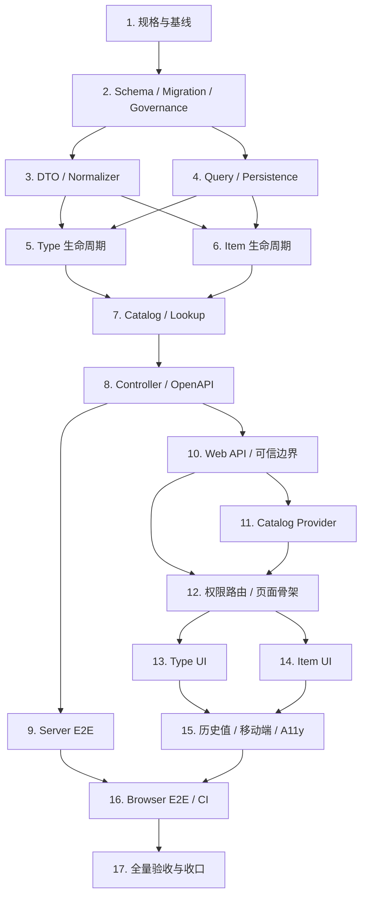

# 系统字典管理实施任务

## 1. 文档状态

- 状态：Phase 3 与 Task 1 已完成；Gate B 待单独确认
- 计划确认日期：2026-08-03
- 实施分支：`feat/dictionary-management`
- 基线分支：`main`
- 基线 SHA：`9832d0a5e9415a9ef814776d00958c865c870da4`
- Requirements：`specs/dictionary-management/requirements.md`
- Design：`specs/dictionary-management/design.md`

本文件把系统字典拆为 17 个可独立验证、可独立提交的任务。除 Task 1 外，任何运行时代码、Schema、migration、公共 API、权限或 Audit 实施都必须等 Gate B 明确通过。

## 2. 执行纪律

每个功能任务使用相同闭环：

```text
确认当前任务边界
-> 写因能力缺失而失败的测试
-> 记录预期失败原因
-> 最小实现
-> 重构并补齐异常路径
-> 运行任务级验证
-> 检查 diff / secrets / generated 边界
-> 创建绿色小步提交
```

规则：

1. 不提交只有红测、无法独立构建或契约未同步的中间状态。
2. OpenAPI snapshot 与 Web generated types 只通过根 `node --run contract:sync` 生成，不手工编辑。
3. PostgreSQL E2E 使用隔离数据库；不对开发库或生产库做 migration/write。
4. 每次提交前执行 `git diff --check`、检查暂存文件和敏感信息；不提交 `.env`、构建产物、日志或根依赖违规产物。
5. Commit Message 的类型使用英文、描述使用中文。
6. 命令失败必须停止相应完成声明，记录真实输出并先处理根因。

## 3. 阶段门禁

### Gate A - 分支与工作区

- [x] 用户确认进入 Phase 4 的 Task 1。
- [x] 从已同步且干净的 `main` 基线建立 `feat/dictionary-management`。
- [x] Task 1 只允许三份规格文档和只读审计。
- 持续规则：若工作区出现非本任务修改，先确认归属并停止覆盖。

### Gate B - 公共边界

开始 Task 2 前，用户必须整体确认 Design 第 5 至 12 节：

- [ ] 两个 Prisma model、一个 enum、13 个 PK/FK/CHECK 约束、6 个业务索引（含 2 个唯一身份索引）、2 个函数、2 个 Trigger。
- [ ] 单事务 forward migration、零业务 seed、5 项权限和 system_admin 授权。
- [ ] 8 个 Audit event、metadata 白名单和事务回滚语义。
- [ ] 14 个 endpoint、DTO、operationId、status/error matrix 和无 DELETE 边界。
- [ ] `DictionaryLookupService`、内部异常与 transaction ownership。

Gate B 未确认时，Task 2 至 Task 17 均保持未开始。

### Gate C - 范围扩展

以下任何变化都必须暂停并重新确认，不得被 Gate B 默认为授权：

- 修改公共 Qs/Fa 组件 API 或把字典能力提取到 `packages/*`。
- 新增第三方依赖、Pinia Store、持久化缓存或 Redis。
- 修改全局路由 Component key、增加 `?code=` 深链或改变 Tab 合并语义。
- 创建公共 `QsDictionarySelect` 或其他跨业务公共选择器。
- 引入租户、层级、多语言、默认项、有效期、导入导出、审批或删除能力。
- 生产数据库 migration、push、merge、PR、发布或分支删除。

## 4. 依赖关系



## 5. 17 项实施任务

### Task 1 - 固化规格、审计与基线

状态：已完成；在 Gate B 确认前暂停。

目标：把已确认的需求、设计和任务拆解落盘，并形成可单独审批的 Gate B 包，不修改运行时代码。

交付：

- `specs/dictionary-management/requirements.md`
- `specs/dictionary-management/design.md`
- `specs/dictionary-management/tasks.md`

步骤：

- [x] 同步并验证 `main == origin/main`，记录基线 SHA。
- [x] 创建并切换 `feat/dictionary-management`。
- [x] 只读复核 Prisma、migration、OpenAPI、权限、Audit、Web、缓存与 CI 真相源。
- [x] 固化 Requirements、Design 和本任务计划。
- [x] 运行第 7 节完整基线验证并记录结果。
- [x] 仅把三份规格文档纳入 `docs: 固化系统字典实施规格` 提交。
- [x] 形成 Gate B 精确审批包，交付后暂停。

### Task 2 - Schema、Migration、权限与 Audit

状态：未开始，受 Gate B 阻塞。

需求覆盖：R1、R2、R3、R7、R8、R11。

TDD：先新增 `dictionary-schema.spec.ts` 和隔离 PostgreSQL `dictionary-schema.e2e-spec.ts`，证明缺少 model/migration、权限、Audit enum、Trigger 和零种子检查；再实施 Design 冻结的 Prisma 与单事务 migration。

验收：完整 migration replay 与二次 deploy 通过；两表、13 个 PK/FK/CHECK 约束、6 个业务索引（含 2 个唯一身份索引）、2 个函数、2 个 Trigger、6 个 Tone label、5 个权限 ID/code、5 个 system_admin grant、8 个 Audit label 精确匹配；两张业务表为空；direct SQL 无法删除或修改稳定身份。

提交：`feat: 添加系统字典数据结构与治理迁移`。

### Task 3 - DTO、Normalizer 与稳定错误

状态：未开始。

需求覆盖：R2、R3、R4、R8、R12。

TDD：先覆盖 code/value ASCII 边界、NFC/空白、大小写规范化、Unicode code point 长度、空 Patch、分页/排序、重复 batch code 和错误响应安全；再实现 request/query/response DTO、Normalizer 及领域错误定义。

验收：只接受 Design 白名单字段；Create 不接受状态/版本/ID；Update 不接受稳定身份；所有规范化结果和错误码可预测且不泄露底层异常。

提交：`feat: 添加系统字典 DTO 与规范化边界`。

### Task 4 - Query 与 Persistence 基础层

状态：未开始。

需求覆盖：R4、R5、R6、R8。

TDD：先覆盖稳定分页、搜索、统计、同事务读取、Type -> Item 锁序、timeout 首 SQL、constraint/driver error 映射；再实现 Query Service、Persistence helper 和 error mapper。

验收：排序始终有稳定 tie-breaker；Item path 不泄露其他 Type 资源；已知数据库错误映射为稳定领域错误，未知错误映射 `INTERNAL_ERROR`。

提交：`feat: 添加系统字典查询与持久化基础层`。

### Task 5 - DictionaryType 生命周期

状态：未开始。

需求覆盖：R2、R4、R7、R8。

TDD：先覆盖创建默认停用、编辑白名单、启用前至少一个自身启用 Item、停用不改写 Item、expectedVersion、no-op、Audit rollback 和同版本并发 `[200,409]`；再实现 Type Command。

验收：业务写与 Audit 同事务；版本冲突不覆盖；no-op 不增版、不写 Audit；无 DELETE 路径。

提交：`feat: 实现系统字典类型生命周期`。

### Task 6 - DictionaryItem 生命周期

状态：未开始。

需求覆盖：R3、R4、R7、R8。

TDD：先覆盖创建默认停用、类型内 value 唯一、编辑白名单、启停、最后自身启用 Item 不变量、父子锁序、expectedVersion、no-op、Audit rollback 和并发最终状态；再实现 Item Command。

验收：Item 不可移动或改 value；类型停用时保留自身状态；类型启用时无法停用最后自身启用 Item；并发无死锁或部分写入。

提交：`feat: 实现系统字典条目生命周期`。

### Task 7 - Consumer Catalog 与 DictionaryLookupService

状态：未开始。

需求覆盖：R5、R6、R8。

TDD：先覆盖单查、最多 20 个 code 批量查询、部分 missing、全部 Item、有效状态派生、内部事务锁定新值、停用/未知历史解析和原值精确匹配；再实现 Catalog Query 与 Lookup。

验收：Catalog 只要求 Session 且不暴露管理字段；`requireEffectiveValue` 使用调用方事务和 Type -> Item `FOR SHARE`；`resolveStoredValue` 不把历史 raw value 自动规范化为其他身份。

提交：`feat: 添加系统字典消费目录与内部查询服务`。

### Task 8 - Controller、权限与 OpenAPI 契约

状态：未开始。

需求覆盖：R4、R5、R7、R8、R12。

TDD：先为 14 个 endpoint 编写 Controller/contract tests，覆盖 Guard、CSRF、operationId、status/error declarations、Cache-Control、无 DELETE 和 HTTP module registration；再实现 Controller 并注册 `DictionaryModule`。

验收：管理 12 个 endpoint 与消费 2 个 endpoint 完全匹配 Design；运行 `node --run contract:sync` 生成 Server/Web 契约，生成后 `node --run contract:check` 通过。

提交：`feat: 添加系统字典 HTTP 与 OpenAPI 契约`。

### Task 9 - Server PostgreSQL 与 API E2E

状态：未开始。

需求覆盖：R2、R3、R4、R5、R6、R7、R8、R11、R12。

TDD：补齐真实 Session/CSRF/角色矩阵、完整生命周期、版本冲突、Audit rollback、Trigger、`private, no-store`、无 DELETE、Catalog 与 Lookup 的隔离 PostgreSQL E2E。

验收：同版本写、Type enable/last Item disable、两个最后候选 Item 并发停用都得到确定且守约的最终状态；完整 `node --run ci:server-e2e` 通过。

提交：`test: 补齐系统字典服务端端到端覆盖`。

### Task 10 - Web API Adapter 与运行时可信边界

状态：未开始。

需求覆盖：R5、R8、R9、R12。

TDD：先用 API Recorder 覆盖 generated DTO 使用、path encode、repeated `codes` 参数、AbortSignal、local error presentation、Mutation `retry:false`；再实现 API Adapter。先写畸形 Catalog/batch 响应测试，再实现白名单复制、关系校验和 deep-freeze。

验收：不手写管理传输镜像；Catalog domain 不依赖 Axios、API、Store 或 generated DTO；未知字段不进入运行时领域对象。

提交：`feat: 添加系统字典 Web API 与可信边界`。

### Task 11 - Identity-scoped Catalog Provider

状态：未开始。

需求覆盖：R5、R9。

TDD：先覆盖 JSON tuple cache key、5 分钟 TTL、lazy load、同 Key 合并、独立 Abort、最后消费者取消、单查 404 与 batch missing 负缓存、authEpoch 隔离、generation、共享 batch 的局部失效和 BroadcastChannel 严格消息；再实现 Provider。

验收：无 Pinia、持久化和登录全量预取；网络/校验错误不缓存；管理写成功精确失效所属 code，跨标签无广播回路。

提交：`feat: 添加身份隔离的字典目录缓存`。

### Task 12 - 权限路由与管理页面骨架

状态：未开始。

需求覆盖：R7、R10。

TDD：先反向更新基础数据路由测试，覆盖 `dictionaries:read`、空父菜单和直接访问 `403`；再为 access/query/selection/mutation 状态机、Abort 和迟到响应写 logic tests，最后实现单一页面骨架。

验收：父路由保持权限中立；页面只使用 `FaPageHeader + FaPageMain`；不写 `?code=`；动态撤权会中止请求、清空数据并关闭 Modal/Drawer。

提交：`feat: 添加系统字典权限路由与页面骨架`。

### Task 13 - DictionaryType 管理 UI

状态：未开始。

需求覆盖：R2、R4、R7、R10。

TDD：先覆盖 Type 搜索、状态筛选、分页、选择、创建/编辑表单、不可变 code、权限动作、启停确认、409 刷新 version 和未知结果 reconciliation；再实现 Type 列表及领域 Modal。

验收：首次列表成功选择首个可见 Type；搜索零结果与系统零数据可区分；创建后默认停用；成功 Mutation 会刷新管理数据并精确失效 Catalog。

提交：`feat: 实现系统字典类型管理界面`。

### Task 14 - DictionaryItem 管理 UI

状态：未开始。

需求覆盖：R3、R4、R7、R10。

TDD：先覆盖 Item 搜索/筛选/分页、`QsGenericTable` 状态、创建/编辑、只读 value、自身/有效状态、Tone、权限动作、启停不变量和 Type 切换 Abort；再实现 Item 区域。

验收：切换 Type 立即重置 Item 分页并拒绝旧响应；启停只经领域确认 Modal，不使用直接 Switch；桌面表格和移动卡片共享同一数据语义。

提交：`feat: 实现系统字典条目管理界面`。

### Task 15 - 历史值、移动端与 Accessibility

状态：未开始。

需求覆盖：R5、R9、R10。

TDD：先覆盖 ACTIVE/DISABLED/UNKNOWN/missing、新选择过滤、raw value 保留、无默认值；再覆盖 `390x844`、Drawer、44px、焦点恢复、Escape、aria、Reduced Motion、亮暗主题和横向溢出。

验收：停用历史值和未知原值可见且不被改写；移动端 Type 列表位于 bottom Drawer；状态不只依赖颜色；无 console error/page error。

提交：`feat: 完善字典历史值与响应式无障碍体验`。

### Task 16 - Browser E2E 与 CI Gate

状态：未开始。

需求覆盖：R7、R9、R10、R12。

TDD：先为 root runner、workflow governance 和 Browser helper 写失败测试；再增加 Web `test:browser:dictionaries`、根 `ci:browser-dictionaries-e2e`、runner 和 `browser-dictionaries-e2e` Job。

验收：桌面、移动、亮暗主题、权限、跨标签失效、焦点、44px 和无横向溢出通过；`ci-gate.needs` 从当前 6 个 Job 精确变为 7 个；同步更新 workflow/root governance tests。字典 Browser 保持独立，不加入当前本地 `scripts/check.mjs`，除非另行更新其治理测试和边界。

提交：`ci: 将系统字典浏览器测试接入门禁`。

### Task 17 - 全量验收、文档与 Git 收口

状态：未开始。

需求覆盖：R1 至 R12。

步骤：

- 运行第 7 节所有静态、单元、契约、PostgreSQL 和 Browser 验证。
- 检查 OpenAPI generated 差异、migration 历史、路由权限、缓存安全和零业务 seed。
- 检查所有提交范围、工作区卫生、敏感信息和文档状态。
- 更新 migration 文档中的精确 migration/model 数量及功能交付记录。
- 仅在用户另行授权时执行 push、PR、merge、发布或分支删除。

验收：本地所有适用检查通过；若推送，则只有精确 HEAD SHA 的全部适用 GitHub Actions Job 和 `CI gate` 成功后才能报告 CI 通过。

提交：`docs: 完成系统字典交付收口`。

## 6. Requirement Traceability

| Requirement | Primary tasks |
| --- | --- |
| R1 适用范围与结构 | 1, 2, 17 |
| R2 Type 身份与生命周期 | 2, 3, 5, 9, 13 |
| R3 Item 身份与生命周期 | 2, 3, 6, 9, 14 |
| R4 管理查询、写入与并发 | 3, 4, 5, 6, 8, 9, 13, 14 |
| R5 Catalog 与历史值 | 7, 8, 9, 10, 11, 15 |
| R6 Server 业务字段校验 | 4, 7, 9 |
| R7 权限、路由与菜单 | 2, 5, 6, 8, 9, 12, 13, 14, 16 |
| R8 Audit、安全与错误 | 2, 3, 4, 5, 6, 8, 9, 10 |
| R9 Web 缓存与失效 | 10, 11, 15, 16 |
| R10 管理页面体验 | 12, 13, 14, 15, 16 |
| R11 Migration 与回滚 | 2, 9, 17 |
| R12 测试、OpenAPI 与门禁 | 1, 3, 8, 9, 10, 16, 17 |

## 7. 验证矩阵

### Task 1 基线

```bash
node --run test:root
pnpm -C server check
pnpm -C server build
node --run contract:check
pnpm -C web check
pnpm -C web build
git diff --check
git status --short --branch
```

### 实施阶段任务级

```bash
pnpm -C server exec jest --runInBand <target-specs>
pnpm -C server exec jest --config test/jest-e2e.json --runInBand <target-specs>
pnpm -C web exec node --import tsx --test <target-specs>
node --run contract:check
git diff --check
```

受限环境若出现 `tsx` 的 `listen EPERM ...*.pipe`，应使用 `node --import tsx --test ...` 运行目标测试，并在具备 IPC 权限的环境重跑完整 `pnpm -C web check`；不得把环境错误伪报为测试通过或代码失败。

### Task 17 全量

```bash
node --run test:root
pnpm -C server check
pnpm -C server build
node --run contract:check
pnpm -C web check
pnpm -C web build
node --run ci:server-e2e
node --run ci:browser-auth-e2e
node --run ci:browser-numbering-e2e
node --run ci:browser-regions-e2e
node --run ci:browser-dictionaries-e2e
git diff --check
git status --short --branch
```

## 8. 暂停条件

遇到以下任一情况立即暂停相应实施并报告：

1. Gate B 尚未确认或实现需要改变已确认的公共边界。
2. 需要触发 Gate C 的共享组件、依赖、Store、全局路由或公共选择器变化。
3. 权限稳定 ID、migration timestamp、Audit enum 或现有 endpoint 出现冲突。
4. 工作区出现来源不明或与本任务重叠的用户修改。
5. 需要对非隔离数据库执行 migration/write，或需要生产变更授权。
6. 测试、构建、contract sync/check 或 Browser E2E 失败且根因未解决。
7. 需要 push、PR、merge、发布、删除文件、破坏性 Git 或分支清理但尚无明确授权。

## 9. Task 1 验证记录

验证日期：2026-08-03。

| Command | Result |
| --- | --- |
| `node --run test:root` | 受限环境首次因测试创建真实 Unix socket 被拒绝而失败；在非受限环境原命令重跑退出 `0`，`633/633` 通过 |
| `pnpm -C server check` | 退出 `0`；`123/123` suites、`1125/1125` tests 通过，Prisma validate、typecheck、lint 均通过 |
| `pnpm -C server build` | 退出 `0` |
| `node --run contract:check` | 退出 `0`；使用临时产物验证，未改动公开 snapshot/generated tree |
| `pnpm -C web check` | 受限环境首次在 Node tests 通过后因 `tsx` 创建 IPC pipe 报 `listen EPERM`；在非受限环境原命令重跑退出 `0` |
| `pnpm -C web build` | 退出 `0`；Noto 与 zero-residue 校验通过；仅有既有 Rolldown pure annotation 和 chunk-size 非阻断 warning |
| Specs structure check | 3 个文件 code fence 成对、无尾随空白；17 个 Task、14 个 endpoint、5 个权限、8 个 Audit event 精确匹配 |
| `git diff --check` | 通过 |
| `git status --short --branch` | 提交前除 `specs/dictionary-management/` 三个新文档外无变化；`main...HEAD = 0/0` |

以上两次受限环境失败均保留真实结论，并通过相同命令在具备所需 IPC/socket 权限的环境复核为绿色；未把环境错误当作代码通过。Task 2 仍受 Gate B 阻塞。
