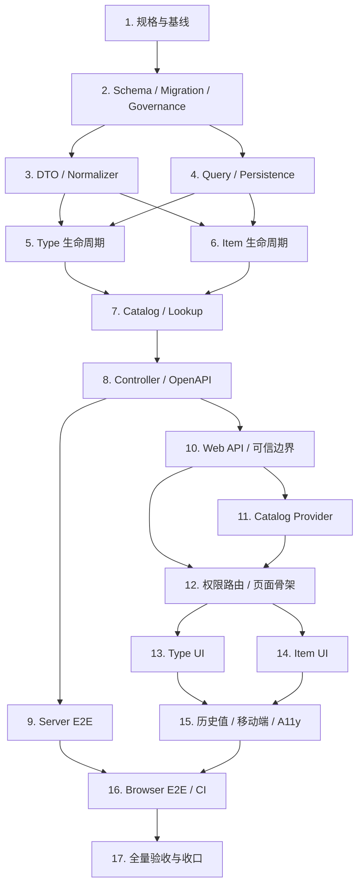

# 系统字典管理实施任务

## 1. 文档状态

- 状态：Task 12 已完成；Task 13 未开始
- 计划确认日期：2026-08-03
- 实施分支：`feat/dictionary-management`
- 基线分支：`main`
- 基线 SHA：`9832d0a5e9415a9ef814776d00958c865c870da4`
- Requirements：`specs/dictionary-management/requirements.md`
- Design：`specs/dictionary-management/design.md`

本文件把系统字典拆为 17 个可独立验证、可独立提交的任务。除 Task 1 外，任何运行时代码、Schema、migration、公共 API、权限或 Audit 实施都必须等 Gate B 明确通过。

## 2. 执行纪律

每个功能任务使用相同闭环：

```text
确认当前任务边界
-> 写因能力缺失而失败的测试
-> 记录预期失败原因
-> 最小实现
-> 重构并补齐异常路径
-> 运行任务级验证
-> 检查 diff / secrets / generated 边界
-> 创建绿色小步提交
```

规则：

1. 不提交只有红测、无法独立构建或契约未同步的中间状态。
2. OpenAPI snapshot 与 Web generated types 只通过根 `node --run contract:sync` 生成，不手工编辑。
3. PostgreSQL E2E 使用隔离数据库；不对开发库或生产库做 migration/write。
4. 每次提交前执行 `git diff --check`、检查暂存文件和敏感信息；不提交 `.env`、构建产物、日志或根依赖违规产物。
5. Commit Message 的类型使用英文、描述使用中文。
6. 命令失败必须停止相应完成声明，记录真实输出并先处理根因。

## 3. 阶段门禁

### Gate A - 分支与工作区

- [x] 用户确认进入 Phase 4 的 Task 1。
- [x] 从已同步且干净的 `main` 基线建立 `feat/dictionary-management`。
- [x] Task 1 只允许三份规格文档和只读审计。
- 持续规则：若工作区出现非本任务修改，先确认归属并停止覆盖。

### Gate B - 公共边界

开始 Task 2 前，用户必须整体确认 Design 第 5 至 12 节：

- [x] 两个 Prisma model、一个 enum、13 个 PK/FK/CHECK 约束、6 个业务索引（含 2 个唯一身份索引）、2 个函数、2 个 Trigger。
- [x] 单事务 forward migration、零业务 seed、5 项权限和 system_admin 授权。
- [x] 8 个 Audit event、metadata 白名单和事务回滚语义。
- [x] 14 个 endpoint、DTO、operationId、status/error matrix 和无 DELETE 边界。
- [x] `DictionaryLookupService`、内部异常与 transaction ownership。

Gate B 未确认时，Task 2 至 Task 17 均保持未开始。

### Gate C - 范围扩展

以下任何变化都必须暂停并重新确认，不得被 Gate B 默认为授权：

- 修改公共 Qs/Fa 组件 API 或把字典能力提取到 `packages/*`。
- 新增第三方依赖、Pinia Store、持久化缓存或 Redis。
- 修改全局路由 Component key、增加 `?code=` 深链或改变 Tab 合并语义。
- 创建公共 `QsDictionarySelect` 或其他跨业务公共选择器。
- 引入租户、层级、多语言、默认项、有效期、导入导出、审批或删除能力。
- 生产数据库 migration、push、merge、PR、发布或分支删除。

## 4. 依赖关系



## 5. 17 项实施任务

### Task 1 - 固化规格、审计与基线

状态：已完成。

目标：把已确认的需求、设计和任务拆解落盘，并形成可单独审批的 Gate B 包，不修改运行时代码。

交付：

- `specs/dictionary-management/requirements.md`
- `specs/dictionary-management/design.md`
- `specs/dictionary-management/tasks.md`

步骤：

- [x] 同步并验证 `main == origin/main`，记录基线 SHA。
- [x] 创建并切换 `feat/dictionary-management`。
- [x] 只读复核 Prisma、migration、OpenAPI、权限、Audit、Web、缓存与 CI 真相源。
- [x] 固化 Requirements、Design 和本任务计划。
- [x] 运行第 7 节完整基线验证并记录结果。
- [x] 仅把三份规格文档纳入 `docs: 固化系统字典实施规格` 提交。
- [x] 形成 Gate B 精确审批包，交付后暂停。

### Task 2 - Schema、Migration、权限与 Audit

状态：已完成；Gate B 已于 2026-08-03 确认。

需求覆盖：R1、R2、R3、R7、R8、R11。

TDD：先新增 `dictionary-schema.spec.ts` 和隔离 PostgreSQL `dictionary-schema.e2e-spec.ts`，证明缺少 model/migration、权限、Audit enum、Trigger 和零种子检查；再实施 Design 冻结的 Prisma 与单事务 migration。

验收：完整 migration replay 与二次 deploy 通过；两表、13 个 PK/FK/CHECK 约束、6 个业务索引（含 2 个唯一身份索引）、2 个函数、2 个 Trigger、6 个 Tone label、5 个权限 ID/code、5 个 system_admin grant、8 个 Audit label 精确匹配；两张业务表为空；direct SQL 无法删除或修改稳定身份。

提交：`feat: 添加系统字典数据结构与治理迁移`。

### Task 3 - DTO、Normalizer 与稳定错误

状态：已完成；已于 2026-08-03 确认。

需求覆盖：R2、R3、R4、R8、R12。

TDD：先覆盖 code/value ASCII 边界、NFC/空白、大小写规范化、Unicode code point 长度、空 Patch、分页/排序、重复 batch code 和错误响应安全；再实现 request/query/response DTO、Normalizer 及领域错误定义。

验收：只接受 Design 白名单字段；Create 不接受状态/版本/ID；Update 不接受稳定身份；所有规范化结果和错误码可预测且不泄露底层异常。

提交：`feat: 添加系统字典 DTO 与规范化边界`。

### Task 4 - Query 与 Persistence 基础层

状态：已完成；已于 2026-08-03 确认。

需求覆盖：R4、R5、R6、R8。

TDD：先覆盖稳定分页、搜索、统计、同事务读取、Type -> Item 锁序、timeout 首 SQL、constraint/driver error 映射；再实现 Query Service、Persistence helper 和 error mapper。

验收：排序始终有稳定 tie-breaker；Item path 不泄露其他 Type 资源；已知数据库错误映射为稳定领域错误，未知错误映射 `INTERNAL_ERROR`。

提交：`feat: 添加系统字典查询与持久化基础层`。

### Task 5 - DictionaryType 生命周期

状态：已完成；已于 2026-08-03 确认。

需求覆盖：R2、R4、R7、R8。

TDD：先覆盖创建默认停用、编辑白名单、启用前至少一个自身启用 Item、停用不改写 Item、expectedVersion、no-op、Audit rollback 和同版本并发 `[200,409]`；再实现 Type Command。

验收：业务写与 Audit 同事务；版本冲突不覆盖；no-op 不增版、不写 Audit；无 DELETE 路径。

提交：`feat: 实现系统字典类型生命周期`。

### Task 6 - DictionaryItem 生命周期

状态：已完成；已于 2026-08-03 确认并交付。

需求覆盖：R3、R4、R7、R8。

TDD：先覆盖创建默认停用、类型内 value 唯一、编辑白名单、启停、最后自身启用 Item 不变量、父子锁序、expectedVersion、no-op、Audit rollback 和并发最终状态；再实现 Item Command。

验收：Item 不可移动或改 value；类型停用时保留自身状态；类型启用时无法停用最后自身启用 Item；并发无死锁或部分写入。

提交：`feat: 实现系统字典条目生命周期`。

### Task 7 - Consumer Catalog 与 DictionaryLookupService

状态：已完成；已于 2026-08-03 确认并交付。

需求覆盖：R5、R6、R8。

TDD：先覆盖单查、最多 20 个 code 批量查询、部分 missing、全部 Item、有效状态派生、内部事务锁定新值、停用/未知历史解析和原值精确匹配；再实现 Catalog Query 与 Lookup。

验收：Catalog 只要求 Session 且不暴露管理字段；`requireEffectiveValue` 使用调用方事务和 Type -> Item `FOR SHARE`；`resolveStoredValue` 不把历史 raw value 自动规范化为其他身份。

提交：`feat: 添加系统字典消费目录与内部查询服务`。

### Task 8 - Controller、权限与 OpenAPI 契约

状态：已完成；已于 2026-08-03 确认并交付。

需求覆盖：R4、R5、R7、R8、R12。

TDD：先为 14 个 endpoint 编写 Controller/contract tests，覆盖 Guard、CSRF、operationId、status/error declarations、Cache-Control、无 DELETE 和 HTTP module registration；再实现 Controller 并注册 `DictionaryModule`。

验收：管理 12 个 endpoint 与消费 2 个 endpoint 完全匹配 Design；运行 `node --run contract:sync` 生成 Server/Web 契约，生成后 `node --run contract:check` 通过。

提交：`feat: 添加系统字典 HTTP 与 OpenAPI 契约`。

### Task 9 - Server PostgreSQL 与 API E2E

状态：已完成；已于 2026-08-03 确认并交付。

需求覆盖：R2、R3、R4、R5、R6、R7、R8、R11、R12。

TDD：补齐真实 Session/CSRF/角色矩阵、完整生命周期、版本冲突、Audit rollback、Trigger、`private, no-store`、无 DELETE、Catalog 与 Lookup 的隔离 PostgreSQL E2E。

验收：同版本写、Type enable/last Item disable、两个最后候选 Item 并发停用都得到确定且守约的最终状态；完整 `node --run ci:server-e2e` 通过。

提交：`test: 补齐系统字典服务端端到端覆盖`。

### Task 10 - Web API Adapter 与运行时可信边界

状态：已完成；已于 2026-08-03 确认并交付。

需求覆盖：R5、R8、R9、R12。

TDD：先用 API Recorder 覆盖 generated DTO 使用、path encode、repeated `codes` 参数、AbortSignal、local error presentation、Mutation `retry:false`；再实现 API Adapter。先写畸形 Catalog/batch 响应测试，再实现白名单复制、关系校验和 deep-freeze。

验收：不手写管理传输镜像；Catalog domain 不依赖 Axios、API、Store 或 generated DTO；未知字段不进入运行时领域对象。

提交：`feat: 添加系统字典 Web API 与可信边界`。

### Task 11 - Identity-scoped Catalog Provider

状态：已完成；已于 2026-08-03 确认并交付。

需求覆盖：R5、R9。

TDD：先覆盖 JSON tuple cache key、5 分钟 TTL、lazy load、同 Key 合并、独立 Abort、最后消费者取消、单查 404 与 batch missing 负缓存、authEpoch 隔离、generation、共享 batch 的局部失效和 BroadcastChannel 严格消息；再实现 Provider。

验收：无 Pinia、持久化和登录全量预取；网络/校验错误不缓存；管理写成功精确失效所属 code，跨标签无广播回路。

提交：`feat: 添加身份隔离的字典目录缓存`。

### Task 12 - 权限路由与管理页面骨架

状态：已完成；已于 2026-08-03 确认并交付。

需求覆盖：R7、R10。

TDD：先反向更新基础数据路由测试，覆盖 `dictionaries:read`、空父菜单和直接访问 `403`；再为 access/query/selection/mutation 状态机、Abort 和迟到响应写 logic tests，最后实现单一页面骨架。

验收：父路由保持权限中立；页面只使用 `FaPageHeader + FaPageMain`；不写 `?code=`；动态撤权会中止请求、清空数据并关闭 Modal/Drawer。

提交：`feat: 添加系统字典权限路由与页面骨架`。

### Task 13 - DictionaryType 管理 UI

状态：未开始。

需求覆盖：R2、R4、R7、R10。

TDD：先覆盖 Type 搜索、状态筛选、分页、选择、创建/编辑表单、不可变 code、权限动作、启停确认、409 刷新 version 和未知结果 reconciliation；再实现 Type 列表及领域 Modal。

验收：首次列表成功选择首个可见 Type；搜索零结果与系统零数据可区分；创建后默认停用；成功 Mutation 会刷新管理数据并精确失效 Catalog。

提交：`feat: 实现系统字典类型管理界面`。

### Task 14 - DictionaryItem 管理 UI

状态：未开始。

需求覆盖：R3、R4、R7、R10。

TDD：先覆盖 Item 搜索/筛选/分页、`QsGenericTable` 状态、创建/编辑、只读 value、自身/有效状态、Tone、权限动作、启停不变量和 Type 切换 Abort；再实现 Item 区域。

验收：切换 Type 立即重置 Item 分页并拒绝旧响应；启停只经领域确认 Modal，不使用直接 Switch；桌面表格和移动卡片共享同一数据语义。

提交：`feat: 实现系统字典条目管理界面`。

### Task 15 - 历史值、移动端与 Accessibility

状态：未开始。

需求覆盖：R5、R9、R10。

TDD：先覆盖 ACTIVE/DISABLED/UNKNOWN/missing、新选择过滤、raw value 保留、无默认值；再覆盖 `390x844`、Drawer、44px、焦点恢复、Escape、aria、Reduced Motion、亮暗主题和横向溢出。

验收：停用历史值和未知原值可见且不被改写；移动端 Type 列表位于 bottom Drawer；状态不只依赖颜色；无 console error/page error。

提交：`feat: 完善字典历史值与响应式无障碍体验`。

### Task 16 - Browser E2E 与 CI Gate

状态：未开始。

需求覆盖：R7、R9、R10、R12。

TDD：先为 root runner、workflow governance 和 Browser helper 写失败测试；再增加 Web `test:browser:dictionaries`、根 `ci:browser-dictionaries-e2e`、runner 和 `browser-dictionaries-e2e` Job。

验收：桌面、移动、亮暗主题、权限、跨标签失效、焦点、44px 和无横向溢出通过；`ci-gate.needs` 从当前 6 个 Job 精确变为 7 个；同步更新 workflow/root governance tests。字典 Browser 保持独立，不加入当前本地 `scripts/check.mjs`，除非另行更新其治理测试和边界。

提交：`ci: 将系统字典浏览器测试接入门禁`。

### Task 17 - 全量验收、文档与 Git 收口

状态：未开始。

需求覆盖：R1 至 R12。

步骤：

- 运行第 7 节所有静态、单元、契约、PostgreSQL 和 Browser 验证。
- 检查 OpenAPI generated 差异、migration 历史、路由权限、缓存安全和零业务 seed。
- 检查所有提交范围、工作区卫生、敏感信息和文档状态。
- 更新 migration 文档中的精确 migration/model 数量及功能交付记录。
- 仅在用户另行授权时执行 push、PR、merge、发布或分支删除。

验收：本地所有适用检查通过；若推送，则只有精确 HEAD SHA 的全部适用 GitHub Actions Job 和 `CI gate` 成功后才能报告 CI 通过。

提交：`docs: 完成系统字典交付收口`。

## 6. Requirement Traceability

| Requirement | Primary tasks |
| --- | --- |
| R1 适用范围与结构 | 1, 2, 17 |
| R2 Type 身份与生命周期 | 2, 3, 5, 9, 13 |
| R3 Item 身份与生命周期 | 2, 3, 6, 9, 14 |
| R4 管理查询、写入与并发 | 3, 4, 5, 6, 8, 9, 13, 14 |
| R5 Catalog 与历史值 | 7, 8, 9, 10, 11, 15 |
| R6 Server 业务字段校验 | 4, 7, 9 |
| R7 权限、路由与菜单 | 2, 5, 6, 8, 9, 12, 13, 14, 16 |
| R8 Audit、安全与错误 | 2, 3, 4, 5, 6, 8, 9, 10 |
| R9 Web 缓存与失效 | 10, 11, 15, 16 |
| R10 管理页面体验 | 12, 13, 14, 15, 16 |
| R11 Migration 与回滚 | 2, 9, 17 |
| R12 测试、OpenAPI 与门禁 | 1, 3, 8, 9, 10, 16, 17 |

## 7. 验证矩阵

### Task 1 基线

```bash
node --run test:root
pnpm -C server check
pnpm -C server build
node --run contract:check
pnpm -C web check
pnpm -C web build
git diff --check
git status --short --branch
```

### 实施阶段任务级

```bash
pnpm -C server exec jest --runInBand <target-specs>
pnpm -C server exec jest --config test/jest-e2e.json --runInBand <target-specs>
pnpm -C web exec node --import tsx --test <target-specs>
node --run contract:check
git diff --check
```

受限环境若出现 `tsx` 的 `listen EPERM ...*.pipe`，应使用 `node --import tsx --test ...` 运行目标测试，并在具备 IPC 权限的环境重跑完整 `pnpm -C web check`；不得把环境错误伪报为测试通过或代码失败。

### Task 17 全量

```bash
node --run test:root
pnpm -C server check
pnpm -C server build
node --run contract:check
pnpm -C web check
pnpm -C web build
node --run ci:server-e2e
node --run ci:browser-auth-e2e
node --run ci:browser-numbering-e2e
node --run ci:browser-regions-e2e
node --run ci:browser-dictionaries-e2e
git diff --check
git status --short --branch
```

## 8. 暂停条件

遇到以下任一情况立即暂停相应实施并报告：

1. Gate B 尚未确认或实现需要改变已确认的公共边界。
2. 需要触发 Gate C 的共享组件、依赖、Store、全局路由或公共选择器变化。
3. 权限稳定 ID、migration timestamp、Audit enum 或现有 endpoint 出现冲突。
4. 工作区出现来源不明或与本任务重叠的用户修改。
5. 需要对非隔离数据库执行 migration/write，或需要生产变更授权。
6. 测试、构建、contract sync/check 或 Browser E2E 失败且根因未解决。
7. 需要 push、PR、merge、发布、删除文件、破坏性 Git 或分支清理但尚无明确授权。

## 9. Task 1 验证记录

验证日期：2026-08-03。

| Command | Result |
| --- | --- |
| `node --run test:root` | 受限环境首次因测试创建真实 Unix socket 被拒绝而失败；在非受限环境原命令重跑退出 `0`，`633/633` 通过 |
| `pnpm -C server check` | 退出 `0`；`123/123` suites、`1125/1125` tests 通过，Prisma validate、typecheck、lint 均通过 |
| `pnpm -C server build` | 退出 `0` |
| `node --run contract:check` | 退出 `0`；使用临时产物验证，未改动公开 snapshot/generated tree |
| `pnpm -C web check` | 受限环境首次在 Node tests 通过后因 `tsx` 创建 IPC pipe 报 `listen EPERM`；在非受限环境原命令重跑退出 `0` |
| `pnpm -C web build` | 退出 `0`；Noto 与 zero-residue 校验通过；仅有既有 Rolldown pure annotation 和 chunk-size 非阻断 warning |
| Specs structure check | 3 个文件 code fence 成对、无尾随空白；17 个 Task、14 个 endpoint、5 个权限、8 个 Audit event 精确匹配 |
| `git diff --check` | 通过 |
| `git status --short --branch` | 提交前除 `specs/dictionary-management/` 三个新文档外无变化；`main...HEAD = 0/0` |

以上两次受限环境失败均保留真实结论，并通过相同命令在具备所需 IPC/socket 权限的环境复核为绿色；未把环境错误当作代码通过。该段记录的是 Task 1 交付时状态；Gate B 后于 2026-08-03 单独确认。

## 10. Task 2 验证记录

验证日期：2026-08-03。

| Command / Check | Result |
| --- | --- |
| Static schema test RED | 新增静态测试首次运行 `6/6` 失败，原因精确为缺少 Dictionary models、migration、权限与 Audit enum |
| Static schema test GREEN | `server/src/infrastructure/database/dictionary-schema.spec.ts` 退出 `0`，`6/6` 通过 |
| Web compatibility RED | 目标测试首次运行 `47` tests 中 `3` 个失败，原因精确为缺少 8 个 Audit action/中文 label 与字典权限资源文案 |
| Web compatibility GREEN | 目标测试退出 `0`，`47/47` 通过；权限管理回归另行确认 `43/43` 通过 |
| `pnpm -C server exec prisma validate` | 退出 `0` |
| `pnpm -C server prisma:generate` | 退出 `0` |
| Dictionary PostgreSQL E2E | 隔离 PostgreSQL 16 中目标 suite 退出 `0`；覆盖 9 条 migration replay、表/约束/索引/函数/Trigger、权限/Audit、零业务 seed、稳定身份与并发最后启用 Item 不变量 |
| `node --run ci:server-e2e` | 退出 `0`；9 条 migration 首次 deploy 与二次无待处理 migration 均通过，`21/21` suites、`103/103` tests 通过 |
| `pnpm -C server check` | 退出 `0`；`124/124` suites、`1131/1131` tests 通过，Prisma validate、typecheck、lint 均通过 |
| `pnpm -C server build` | 退出 `0` |
| `node --run contract:sync` | 退出 `0`；只同步 Server/Web OpenAPI 中既有 Audit enum，未新增字典 endpoint 或 Web generated DTO |
| `node --run contract:check` | 退出 `0` |
| `pnpm -C web check` | 受限环境在 Node tests 通过后因 `tsx` IPC pipe 报 `listen EPERM`；在具备 IPC 权限的环境原命令重跑退出 `0`，`156` 个 Node tests、`49` 个 TS script tests、`549` 个 API/View tests 及 typecheck、ESLint、Stylelint 全部通过 |
| `pnpm -C web build` | 退出 `0`；Noto 与 zero-residue 校验通过；仅有既有 Rolldown pure annotation、chunk-size 与 plugin timing 非阻断 warning |
| `node --run ci:browser-auth-e2e` | 退出 `0`；隔离 PostgreSQL 应用 9 条 migration，真实 Chrome `2/2` 通过，覆盖认证边界及管理员用户、角色、`25` 项可分配权限和 `40` 项 Audit UI |
| `node --run test:root` | 受限环境首次因真实 process/socket fixture 权限失败；在具备所需权限的环境串行重跑退出 `0`，`633/633` 通过 |

Task 2 仅交付 Schema、单事务 forward migration、数据库治理、5 项权限、8 项 Audit event 及既有 Web 治理清单兼容；两张字典业务表保持零数据。未新增 Dictionary Controller、endpoint、DTO、Module、页面实现、API adapter、业务 seed、第三方依赖或公共组件变更。该段记录 Task 2 交付时状态；当时 Task 3 及后续任务尚未开始。

## 11. Task 3 验证记录

验证日期：2026-08-03。

| Command / Check | Result |
| --- | --- |
| Normalizer RED | 首次目标测试因缺少 `dictionary.normalizer.ts` 报 `TS2307`；实现后 `44/44` 通过 |
| DTO RED | 首次目标测试因缺少 3 个 DTO module 报 `TS2307`；实现后 `10/10` 通过 |
| Stable errors RED | 首次目标测试因缺少 `dictionary.errors.ts` 报 `TS2307`；实现后 `11/11` 通过 |
| Cross-review RED | 新增完整 Unicode `White_Space` 与 OpenAPI 空 Patch 约束后，Normalizer 有 `2` 个预期失败，DTO 因缺少两个 request-body schema export 报 `TS2305`；该次合计 `2` failed、`42` passed |
| Cross-review implementation check | 首次实现误从 `@nestjs/swagger` 根导入未导出的 `SchemaObject`，目标测试报 `TS2305`；移除该显式类型并保留 TypeScript 推断后转绿 |
| Target GREEN | `pnpm -C server exec jest --runInBand --runTestsByPath src/modules/dictionaries/dictionary.normalizer.spec.ts src/modules/dictionaries/dto/dictionary-dtos.spec.ts src/modules/dictionaries/dictionary.errors.spec.ts` 退出 `0`，`3/3` suites、`68/68` tests 通过 |
| Target lint | `pnpm -C server exec eslint src/modules/dictionaries --max-warnings=0` 退出 `0` |
| Formatting attempt | `pnpm -C server exec prettier --write ...` 因 Server 未安装 Prettier 退出 `1`；未新增依赖，改用项目既有 ESLint `--fix`，随后目标 lint 与全量 lint 均通过 |
| `pnpm -C server check` | 退出 `0`；Prisma validate、typecheck、lint 通过，`127/127` suites、`1199/1199` tests 通过 |
| `pnpm -C server build` | 退出 `0` |
| `node --run contract:check` | 退出 `0`；只使用临时产物验证，未同步或改动公开 snapshot/generated tree |
| `node --run test:root` | 在具备所需 process/socket 权限的环境退出 `0`，`633/633` 通过 |
| `git diff --check` | 通过 |

Task 3 只交付 request/query/response DTO、Normalizer、稳定领域错误、相应单元与 OpenAPI schema 测试，以及本验证记录。未新增 Controller、Module、endpoint、HTTP module registration、Query/Persistence/Command/Lookup、Schema、migration、权限、Audit、seed、Web 代码、第三方依赖或公共组件；未运行 `contract:sync`。该段记录 Task 3 交付时状态；当时 Task 4 与 Task 8 均未开始。由于本任务不修改数据库、HTTP 注册或 Web，未运行 PostgreSQL、Server API 或 Browser E2E。

## 12. Task 4 验证记录

验证日期：2026-08-03。

| Command / Check | Result |
| --- | --- |
| Query RED / initial GREEN | 首次目标测试因缺少 `dictionary-query.service.ts` 报 `TS2307`，`0` tests；最小实现后 `20/20` 通过 |
| Persistence RED / initial GREEN | 首次目标测试因缺少 `dictionary-command.persistence.ts` 报 `TS2307`，`0` tests；最小实现后 `12/12` 通过 |
| Error mapper RED / initial GREEN | 首次目标测试因缺少 `dictionary.persistence-error.mapper.ts` 报 `TS2307`，`0` tests；最小实现后 `10/10` 通过 |
| Initial combined GREEN | 三组目标测试 `3/3` suites、`42/42` tests 通过 |
| Cross-review RED | 针对运行时输入字段污染、Item parent 覆盖、错误 context 误映射与 UUID 显式 cast 新增回归断言后，`5` failed、`39` passed、`44` total，证明修复前确实存在缺口 |
| Cross-review GREEN | 写入数据改为逐字段白名单、唯一约束映射改为 context 与 target 精确匹配、统计 SQL 增加 UUID 显式 cast 后，`44/44` 通过 |
| Final target GREEN | `pnpm -C server exec jest --runInBand --runTestsByPath src/modules/dictionaries/dictionary-query.service.spec.ts src/modules/dictionaries/dictionary-command.persistence.spec.ts src/modules/dictionaries/dictionary.persistence-error.mapper.spec.ts` 退出 `0`，`3/3` suites、`52/52` tests 通过 |
| Target lint | `pnpm -C server exec eslint src/modules/dictionaries --max-warnings=0` 退出 `0` |
| Cross-review | 最终复核未发现 P0-P2；确认 Type -> Item 锁序、timeout 首 SQL、稳定排序、同事务统计、路径隔离、错误 fail-closed 与输入白名单边界 |
| `pnpm -C server check` | 退出 `0`；Prisma validate、typecheck、lint 通过，`130/130` suites、`1251/1251` tests 通过 |
| `pnpm -C server build` | 退出 `0` |
| `node --run contract:check` | 退出 `0`；只使用临时产物验证，公开 snapshot/generated tree 无漂移 |
| `node --run test:root` | 在具备所需 process/socket 权限的环境退出 `0`，`633/633` 通过 |
| Optional local read-only SQL probe | 通用 UUID cast/CTE 探针通过；直接查询 `dictionary_items` 因本地开发库尚未部署 Task 2 migration 报 Prisma `P2010` / PostgreSQL `42P01`。探针未写库，不作为 Task 4 验收条件；隔离 PostgreSQL E2E 由 Task 9 负责 |
| `git diff --check` | 通过 |

Task 4 只交付 Query Service、Command Persistence helper、Persistence Error Mapper、对应单元测试及本验证记录。未新增 Command 生命周期业务规则、Catalog/Lookup、Controller、Module、endpoint、HTTP/OpenAPI snapshot、Schema、migration、权限、Audit、seed、Web 代码、第三方依赖或公共组件；未运行 `contract:sync`。该段记录 Task 4 交付时状态；当时 Task 5 与 Task 8 均未开始。由于本任务不注册 HTTP 或修改 Web，未运行 Server API 或 Browser E2E；数据库集成验收继续由 Task 9 在隔离 PostgreSQL 中完成。

## 13. Task 5 验证记录

验证日期：2026-08-03。

| Command / Check | Result |
| --- | --- |
| Type Command RED | 首次目标测试因缺少 `dictionary-command.service.ts` 报 `TS2307`，退出 `1`，`0` tests |
| First implementation attempt | 实现后首次运行 `19` 个测试，其中 `18` 个通过；唯一失败是测试把全角空格规范化后的 `销售 渠道` 错当成无空格的 `销售渠道`，修正测试夹具后 `19/19` 通过 |
| Initial combined GREEN | Service、Persistence、Error Mapper 三组目标测试 `3/3` suites、`47/47` tests 通过 |
| Initial target lint | 首次目录 ESLint 因新测试 partial mock 缺少类型、两处多余断言及三个无 `await` 的 async mock 报 `7` errors；修正测试实现后退出 `0` |
| Cross-review coverage | 两组只读审查未发现生产 P0-P2；测试审查发现 description 实际更新与 enable/disable not-found 两项 P2 覆盖缺口，补测并明确并发证据为 service-level 后复核关闭 |
| Final target GREEN | `pnpm -C server exec jest --runInBand --runTestsByPath src/modules/dictionaries/dictionary-command.service.spec.ts src/modules/dictionaries/dictionary-command.persistence.spec.ts src/modules/dictionaries/dictionary.persistence-error.mapper.spec.ts` 退出 `0`，`3/3` suites、`50/50` tests 通过；其中 Type Command `22/22` |
| Target lint | `pnpm -C server exec eslint src/modules/dictionaries --max-warnings=0` 退出 `0` |
| `pnpm -C server typecheck` | 退出 `0` |
| `pnpm -C server check` | 退出 `0`；Prisma validate、typecheck、lint 通过，`131/131` suites、`1273/1273` tests 通过 |
| `pnpm -C server build` | 退出 `0` |
| `node --run contract:check` | 退出 `0`；只使用临时产物验证，公开 snapshot/generated tree 无漂移 |
| `node --run test:root` | 受限环境首次 `631/633`，真实进程树 fixture 超时且 Unix socket 报 `EPERM`；在具备 process/socket 权限的环境重跑退出 `0`，`633/633` 通过 |
| `git diff --check` | 通过 |

Task 5 只交付 `DictionaryCommandService` 的 Type create/update/enable/disable、对应单元测试及本验证记录，并复用 Task 4 已有事务、锁、Persistence 与错误映射原语。未实现 Item 生命周期、Catalog/Lookup、Controller、Module、endpoint、HTTP/OpenAPI snapshot、Schema、migration、权限、Audit enum、seed、Web 代码、第三方依赖或公共组件；未运行 `contract:sync`。该段记录 Task 5 交付时状态；当时 Task 6 与 Task 8 均未开始。当前并发测试只证明 serializing transaction fixture 下的 Service 版本语义；真实 PostgreSQL `[200,409]`、Trigger 与 Audit rollback 继续由 Task 9 在隔离数据库中验证，本任务未对开发数据库执行 migration/write，也未运行 Server API 或 Browser E2E。

## 14. Task 6 验证记录

验证日期：2026-08-03。

| Command / Check | Result |
| --- | --- |
| Item Command RED | 新增 Item 生命周期测试首次运行因 `DictionaryCommandService` 缺少 `createItem/updateItem/enableItem/disableItem` 报 `TS2551`；修正一处 `it.each` 测试参数顺序后，失败只指向四个缺失能力 |
| Error-context RED | Persistence runner 与 mapper 测试首次分别因缺少第 4、3 个冲突 context 参数报 `TS2554`，证明 Create Item 尚不能同时区分 Item 唯一冲突与 Type 父锁事务冲突 |
| Initial target GREEN | Item/Type Service、Persistence、Error Mapper 四组目标测试退出 `0`，`4/4` suites、`77/77` tests 通过 |
| Cross-review RED | 只读审查发现 ValidationPipe 转换后的 optional DTO class field 即使未提交也为 own property；改用真实 Type/Item DTO instance 后 `2` 个 Audit `changedFields` 断言按预期失败、`45` 个通过，证明 plain-object 测试曾误绿 |
| Cross-review GREEN | Type 与 Item Create 改按 `description !== undefined` 判断显式提交；真实 DTO 回归及全部目标测试恢复 `77/77` 通过，复核未发现剩余 P0-P2 |
| Target lint | `pnpm -C server exec eslint src/modules/dictionaries` 退出 `0` |
| `pnpm -C server typecheck` | 退出 `0` |
| `pnpm -C server check` | 修复后首次复跑与只读审查中的 Prisma generate 重叠，`openapi.module.spec.ts` 因 generated `internal/class.ts` 瞬时缺失失败，其余 `131` suites 通过；审查结束后串行原命令重跑退出 `0`，Prisma validate、typecheck、lint 通过，`132/132` suites、`1300/1300` tests 通过 |
| `pnpm -C server build` | 退出 `0` |
| `node --run contract:check` | 退出 `0`；只使用临时产物验证，公开 snapshot/generated tree 无漂移 |
| `node --run test:root` | 受限环境首次 `631/633`，真实进程树 fixture 超时且 Unix socket 报 `EPERM`；在具备 process/socket 权限的环境原命令重跑退出 `0`，`633/633` 通过 |
| `git diff --check` | 通过 |

Task 6 只交付既有 `DictionaryCommandService` 的 Item create/update/enable/disable、Create Item 双错误 context、对应单元测试及本验证记录；交叉审查同时修正 Type/Item Create 在真实 DTO 上判断 description 是否显式提交的同源 Audit 缺陷。未实现 Catalog/Lookup、Controller、Module、endpoint、HTTP/OpenAPI snapshot、Schema、migration、权限、Audit enum、seed、Web 代码、第三方依赖或公共组件；未运行 `contract:sync`。该段记录 Task 6 交付时状态；当时 Task 7 与 Task 8 均未开始。当前并发与 Audit 失败测试只证明 serializing transaction fixture 下的 Service 版本语义和安全错误收敛；真实 PostgreSQL `[200,409]`、两个最后候选 Item 并发停用、Trigger、无死锁与 Audit rollback 继续由 Task 9 在隔离数据库中验证，本任务未对开发数据库执行 migration/write，也未运行 Server API 或 Browser E2E。

## 15. Task 7 验证记录

验证日期：2026-08-03。

| Command / Check | Result |
| --- | --- |
| Catalog / Lookup RED | 首次目标测试因 `DictionaryQueryService` 缺少 `getCatalogByCode/listCatalogs` 报 `TS2339`，且缺少 `dictionary-lookup.service.ts` 报 `TS2307`；退出 `1`，`2/2` suites 失败、`0` tests |
| Initial target GREEN | Catalog、Lookup、Query、Normalizer 与 DTO 五组目标测试退出 `0`，`5/5` suites、`104/104` tests 通过 |
| Initial target lint | 首次目录 ESLint 因 Lookup 的多余类型断言报 `1` error；移除断言与无用 interface 后退出 `0` |
| Cross-review coverage | 三组只读审查未发现生产实现 P0-P2 或越界；测试审查发现 Catalog `effectiveEnabled`、历史 known resolution 布尔矩阵与批量 missing code 规范化回显的误绿缺口，补测后复核全部关闭 |
| Final target GREEN | `pnpm -C server exec jest --runInBand --runTestsByPath src/modules/dictionaries/dictionary-catalog-query.service.spec.ts src/modules/dictionaries/dictionary-lookup.service.spec.ts src/modules/dictionaries/dictionary-query.service.spec.ts src/modules/dictionaries/dictionary.normalizer.spec.ts src/modules/dictionaries/dto/dictionary-dtos.spec.ts` 退出 `0`，`5/5` suites、`106/106` tests 通过 |
| Target lint | `pnpm -C server exec eslint src/modules/dictionaries --max-warnings=0` 退出 `0` |
| `pnpm -C server check` | 退出 `0`；Prisma validate、typecheck、lint 通过，`134/134` suites、`1325/1325` tests 通过 |
| `pnpm -C server build` | 退出 `0` |
| `node --run contract:check` | 退出 `0`；只使用临时产物验证，公开 snapshot/generated tree 无漂移 |
| `node --run test:root` | 受限环境首次 `631/633`，真实进程树 fixture 超时且 Unix socket 报 `EPERM`；在具备 process/socket 权限的环境原命令重跑退出 `0`，`633/633` 通过 |
| `git diff --check` | 通过 |

Task 7 只交付 `DictionaryQueryService` 的单个/批量 Consumer Catalog 核心、`DictionaryLookupService`、对应单元测试及本验证记录。Catalog 返回全部状态的 Type/Item 并严格白名单映射；`requireEffectiveValue` 复用调用方事务并按 Type -> Item `FOR SHARE` 锁序校验；`resolveStoredValue` 只规范化 code，不改写历史 raw value。未新增 Controller、Module、endpoint、Session/Guard 运行时注册、HTTP/OpenAPI snapshot、Schema、migration、权限、Audit、seed、Web、cache、第三方依赖或公共组件；未运行 `contract:sync`。该段记录 Task 7 交付时状态；当时 Catalog 的 Session HTTP 保护尚待 Task 8 注册，该保护现已由 Task 8 完成。真实 PostgreSQL 事务阻塞与锁语义仍待 Task 9 在隔离数据库验证；Task 7 未对开发数据库执行 migration/write，也未运行 Server API 或 Browser E2E。

## 16. Task 8 验证记录

验证日期：2026-08-03。

| Command / Check | Result |
| --- | --- |
| Controller / Module RED | Management Controller、Catalog Controller 与 Module 三组测试首次均因目标文件不存在报 `TS2307`；管理测试 fixture 补齐时另暴露一次缺少 `sortBy/sortOrder` 的 `TS2345`，修正测试输入后继续进入实现 |
| Query read-error RED | 管理读取注入 Prisma `P2034` 时预期 `500 INTERNAL_ERROR`、实际得到 `409`；目标测试退出 `1`，`1` failed、`23` passed，证明读取与 Mutation 冲突口径尚未分离 |
| Initial target GREEN | Controller、Module、Query 与既有 Dictionary 目标回归退出 `0`，`8/8` suites、`116/116` tests 通过 |
| Cross-review coverage | 三组并行只读审查发现并补齐 14 个 operation 精确集合、全部 HTTP method、管理 path/query 绑定、Type/Item 独立 `sortBy` enum、Catalog repeated `codes` 的 `form + explode=true`、六个读取入口 `P2034 -> 500` 以及 Update DTO component 引用测试；最终复核无剩余 P0-P2、无 DELETE、无范围越界 |
| Final target GREEN | 八组 Dictionary Controller、Module、Query、Command 与 DTO 目标测试退出 `0`，`8/8` suites、`123/123` tests 通过 |
| Target lint / typecheck | Dictionary 目录 ESLint 与 `pnpm -C server typecheck` 均退出 `0`；过程中先后发现 Catalog spec `1` 个、Update component 测试 `2` 个 `no-unsafe-assignment`，均修正后复跑通过 |
| Contract RED / first sync | 实施前 `node --run contract:check` 按预期因公开契约陈旧退出 `1`；首次 `node --run contract:sync` 又因 Update DTO local `$ref` 未注册而以 `Unresolved local $ref` 失败，原子发布保证三份公开产物未变化 |
| Contract GREEN | 先以失败测试冻结两个 Update DTO component，再通过 `ApiExtraModels` 注册；第二次 `node --run contract:sync` 与随后 `node --run contract:check` 均退出 `0` |
| Snapshot audit | Server/Web OpenAPI snapshot 字节与 SHA-256 一致；精确包含管理 `12` 个、Catalog `2` 个字典 operation，`0` 个 DELETE。相对基线只新增 `10` 个 Dictionary path 与 `12` 个 Dictionary schema；Web generated types 已重生成且 Git 字节无变化 |
| `pnpm -C server check` | 退出 `0`；Prisma validate、typecheck、lint 通过，`137/137` suites、`1355/1355` tests 通过 |
| `pnpm -C web check` | 受限环境中 Node scripts 已 `156/156` 通过，随后 `tsx` 因 Unix socket `EPERM` 退出 `1`；在具备 IPC 权限的环境以原命令复跑退出 `0`，scripts、API、typecheck、ESLint 与 Stylelint 全部通过 |
| `pnpm -C server build` | 退出 `0` |
| `pnpm -C web build` | 退出 `0`；字体快照与物理零残留校验通过，仅输出既有第三方 pure annotation 与 chunk size 警告 |
| `node --run test:root` | 受限环境首次 `631/633`，真实进程树 fixture 超时且 Unix socket 报 `EPERM`；在具备 process/socket 权限的环境以原命令复跑退出 `0`，`633/633` 通过 |
| `git diff --check` | 通过 |

Task 8 只交付管理 12 个与 Catalog 2 个 Controller endpoint、`DictionaryModule`/HTTP 注册、权限与 Session/CSRF/OpenAPI 元数据、三份生成契约，以及读取异常口径所需的 Query 修正与测试。管理读取保留领域 `404/422`，数据库与事务异常统一收敛为 `500 INTERNAL_ERROR`；Mutation 的既有 `409` 映射未改变。未修改 Schema、migration、权限数据、Audit enum、DTO 字段、第三方依赖、公共组件、Web API adapter、Catalog Provider、cache 或页面；未执行开发数据库 write。该段记录 Task 8 交付时状态；当时尚未运行的真实 API 与 PostgreSQL 验证现已由 Task 9 完成，Browser E2E 仍由后续任务负责。

## 17. Task 9 验证记录

验证日期：2026-08-03。

| Command / Check | Result |
| --- | --- |
| API E2E RED | 冻结目标命令首次运行因 `dictionary-management-api.e2e-spec.ts` 与 `dictionary-catalog-api.e2e-spec.ts` 尚不存在而以 `ENOENT` 失败，`2/2` suites 失败、`0` tests，证明本任务能力缺失 |
| Isolated PostgreSQL baseline | Docker Desktop 初始未运行，Docker socket 不存在；启动后受限环境仍无 socket 权限，转入已授权环境运行。既有 `dictionary-schema.e2e-spec.ts` 在一次性 PostgreSQL 16 中 `1/1` 通过 |
| Isolation helper review | 确认冻结目标 wrapper 只提供空 PostgreSQL、不会自动部署 migration；新增仅限 E2E 的 helper，严格接受 `qianshu_ci` loopback URL，为每个 suite 创建随机 schema、顺序重放 9 条正式 migration，并在成功或失败后幂等回收 schema、Prisma adapter 与连接池 |
| Catalog first run / GREEN | 首次真实运行有 `2` 个 fixture 因测试密码超过 20 个 Unicode code point 失败；修正为合规夹具后定向 suite `4/4` 通过，覆盖 Session、must-change-password、Catalog 单/批量、全部 missing、无效输入、Lookup 四类不可用原因、历史 raw value 及真实 Type -> Item `FOR SHARE` 持锁顺序 |
| Management first run | 双 suite 首次组合运行中 Catalog 通过，Management 首个权限测试因提前构造未执行的 SuperTest 请求导致临时 HTTP server 端口关闭，得到 `ECONNREFUSED`；结果为 `9/10` 通过。单独复跑 Management 仍为 `5/6`，确认问题可重复且不属于 PostgreSQL |
| Management fix / GREEN | 将 8 条缺失 CSRF Mutation 改为逐条创建并立即等待的 request factory，消除临时 HTTP server 生命周期竞争；Management 定向 suite `6/6` 通过 |
| Final frozen target | `node ./scripts/ci-postgres.mjs -- pnpm -C server exec jest --config test/jest-e2e.json --runInBand --runTestsByPath test/dictionary-management-api.e2e-spec.ts test/dictionary-catalog-api.e2e-spec.ts` 退出 `0`，`2/2` suites、`10/10` tests 通过 |
| Runtime coverage | 真实 Session、五项独立权限、八个 Mutation 的 CSRF、完整 Type/Item 生命周期、no-op/stale version、Audit metadata/request ID/rollback、无 DELETE、稳定身份 Trigger、`private, no-store`、Catalog/Lookup 与三类 PostgreSQL 并发竞争均已覆盖；并发结果及数据库最终态同时断言 |
| Cross-review | 最终只读复核为 P0=`0`、P1=`0`；按审查意见把 Audit `500` 响应收紧为仅 `code/message/requestId`，并使用无 Item 的独立 Type 验证 delete Trigger，排除外键 `RESTRICT` 误绿 |
| Target lint / typecheck | 三个 E2E 文件的 ESLint、`pnpm -C server typecheck` 均退出 `0` |
| `node --run ci:server-e2e` | 退出 `0`；9 条 migration 首次 deploy、二次无待处理 migration 与 schema status 均通过，`23/23` suites、`113/113` tests 通过 |
| `pnpm -C server check` | 退出 `0`；Prisma validate、typecheck、lint 通过，`137/137` suites、`1355/1355` tests 通过 |
| `pnpm -C server build` | 退出 `0` |
| `node --run contract:check` | 退出 `0`；只使用临时产物验证，公开 OpenAPI snapshot 与 Web generated tree 无漂移 |
| `node --run test:root` | 受限环境首次 `631/633`，真实进程树 fixture 超时且 Unix socket 报 `listen EPERM`；在具备 process/socket 权限的环境以原命令复跑退出 `0`，`633/633` 通过 |
| `git diff --check` | 通过 |

Task 9 只交付三个 Server E2E 文件与本验证记录，不修改生产代码、公共 API、DTO、Schema、migration、权限、Audit enum、依赖、Web 或公共组件。所有数据库写入仅发生在一次性 `qianshu_ci` PostgreSQL 容器的随机 schema 中；未连接或写入开发、测试共享或生产数据库。Task 10 与后续任务保持未开始，未运行 Browser E2E，未执行 push、PR、merge、发布或分支删除。

## 18. Task 10 验证记录

验证日期：2026-08-03。

| Command / Check | Result |
| --- | --- |
| TDD RED 环境辨析 | 首次目标命令通过 `tsx` CLI 启动时因受限环境禁止创建 IPC pipe 报 `listen EPERM`，该次不作为功能 RED；改用同一运行时的 `node --import tsx --test` 后退出 `1`，两个测试文件分别因缺少 `src/api/modules/dictionaries` 与 `src/dictionary-catalog/validation` 报 `ERR_MODULE_NOT_FOUND`，`0` tests 通过 |
| API Adapter initial GREEN | API Recorder 目标测试退出 `0`，`3/3` 通过；覆盖 Catalog `2` 个、Type `6` 个、Item `6` 个 operation，逐段 path encode、repeated `codes`、六个读取的 AbortSignal/local error presentation、八个 Mutation 的 `retry:false` 及完整 `AxiosResponse` 身份 |
| Catalog boundary initial GREEN | Catalog 领域目标测试 `33/33` 通过；首次 ESLint 因两处 `regexp/prefer-w` 报 `2` errors，等价修正正则后目标 ESLint 与 `vue-tsc` 均退出 `0` |
| Cross-review hardening | 两层只读审查最终确认 P0=`0`、P1=`0`；补齐精确有效上界与越界、非法标识字符、NFC 漂移、稀疏数组、已知 getter、Proxy trap、非枚举 `cause`、双向 `effectiveEnabled` 关系、Batch 输入边界、14 个响应身份及更强的 DTO 镜像/Domain 依赖静态守卫 |
| Final target GREEN | `pnpm -C web exec node --import tsx --test apps/qsmds-arco/test/api/dictionaries.test.ts apps/qsmds-arco/test/api/dictionary-catalog-validation.test.ts` 退出 `0`，`47/47` 通过 |
| Target lint | 五个 Task 10 实现/测试文件的 ESLint `--max-warnings=0` 退出 `0` |
| `pnpm -C web check` | P2 补测前，受限环境先在 `156/156` Node tests 后因 `tsx` IPC pipe 报 `listen EPERM`；在具备 IPC 权限的环境原命令重跑退出 `0`，`156` 个 Node tests、`49` 个 TS script tests、`585` 个 API/View tests 及 typecheck、ESLint、Stylelint 全部通过 |
| Final sandbox-safe Web regression | P2 仅增加测试后，再次请求 IPC 权限因审批服务连接中断而未执行；首次沙箱兼容全量 API/View 命令因 shell 在错误工作目录展开 glob 报 `no matches found`，修正工作目录后退出 `0`，`596/596` 通过；随后 `pnpm -C web typecheck` 与 `pnpm -C web lint` 均退出 `0` |
| `pnpm -C web build` | 退出 `0`；生产构建、Noto 字体快照和 zero-residue 校验通过，仅有既有第三方 pure annotation、chunk-size 与 plugin timing 非阻断 warning |
| `node --run contract:check` | 退出 `0`；只使用临时产物验证，公开 OpenAPI snapshot 与 Web generated tree 无漂移 |
| `node --run test:root` | 受限环境首次 `631/633`，真实进程树 fixture 超时且 Unix socket 报 `listen EPERM`；在具备 process/socket 权限的环境原命令重跑退出 `0`，`633/633` 通过 |
| Generated / scope audit | Git 只包含三个 Web 实现文件、两个目标测试与三份规格文档；Server、Schema、migration、权限、Audit、OpenAPI snapshot、Web generated tree、依赖、公共组件、页面和路由均无漂移 |
| `git diff --check` | 通过 |

Task 10 只交付 Web Dictionary API Adapter、独立 Catalog domain、运行时白名单校验与 deep-freeze、对应测试及本验证记录。未实现 Identity-scoped Provider、cache、TTL、inflight 合并、Pinia、BroadcastChannel、注入、管理页面、路由或 Browser E2E；未修改 Server、公共 API/DTO、Schema、migration、权限、Audit、OpenAPI snapshot、generated tree、依赖或公共组件，未运行 `contract:sync`，未执行 push、PR、merge、发布或分支删除。Task 11 与后续任务保持未开始。

## 19. Task 11 验证记录

验证日期：2026-08-03。

| Command / Check | Result |
| --- | --- |
| Provider / Integration RED | 首次目标命令退出 `1`；两个测试文件分别因缺少 `src/dictionary-catalog/provider` 与 `default-provider` 报 `ERR_MODULE_NOT_FOUND`，`0` tests 通过，证明 Identity-scoped Provider 与应用组装能力尚未存在 |
| Initial target GREEN | Provider 与应用组装的初始目标测试退出 `0`，`23/23` 通过；覆盖身份拒绝、JSON tuple cache key、5 分钟正负缓存、single/batch、独立 Abort、generation、精确失效、BroadcastChannel、默认实例与 `main.ts` 注入 |
| Typecheck convergence | 首轮 `vue-tsc` 如实发现 default Provider type import、loader 参数及 listener 的 `7` 个类型错误；修正后第二轮发现 union in-flight 的 `1` 个推导错误，按 single/batch 分支收窄后 `pnpm -C web --filter qsmds-arco run typecheck` 退出 `0` |
| Cross-review RED | 两路只读审查先发现 event identity 未被使用；新增单测后目标 `0/1` 失败。继续补齐 invalid snapshot、同步 reload、稳定 404 body、batch joined get 与 exact own-key 后，定向输出 `12` tests 中 `8` 个失败结果，逐项证明旧缓存、迟到 ownership 和宽松消息/错误守卫缺口 |
| Cross-review GREEN | Provider 增加 event/snapshot pending guard、invalid identity fail-closed、完整稳定 404 最小结构、`Reflect.ownKeys`、batch code consumer 中止与迟到 reject 证明；默认实例补齐创建失败保留旧实例，`main.ts` 静态 API/preload/sync watch 门禁收紧。最终复核 P0=`0`、P1=`0`、P2=`0` |
| Final target GREEN | `pnpm -C web exec node --import tsx --test apps/qsmds-arco/test/views/dictionary-catalog-provider.test.ts apps/qsmds-arco/test/views/dictionary-catalog-integration.test.ts` 退出 `0`，`30/30` 通过 |
| Target lint | Task 11 的 Provider、types、default、injection、`main.ts` 与两份测试执行 ESLint `--max-warnings=0`，退出 `0` |
| `pnpm -C web check` | 受限环境先在 `156/156` Node tests 后因 `tsx` IPC pipe 报 `listen EPERM`；在具备 IPC 权限的环境以原命令复跑退出 `0`，`156` 个 Node tests、`49` 个 TS script tests、`626` 个 API/View tests、typecheck、ESLint 与 Stylelint 全部通过 |
| `pnpm -C web build` | 退出 `0`；生产构建、Noto 字体快照与 zero-residue 校验通过，仅有既有第三方 pure annotation、chunk-size 与 plugin timing 非阻断 warning |
| `node --run contract:check` | 退出 `0`；只使用临时产物验证，公开 OpenAPI snapshot 与 Web generated tree 无漂移 |
| `node --run test:root` | 受限环境首次 `631/633`，真实进程树 fixture 超时且 Unix socket 报 `listen EPERM`；在具备 process/socket 权限的环境以原命令复跑退出 `0`，`633/633` 通过 |
| Generated / scope audit | Git 只包含三份规格文档、Dictionary Catalog Provider 的三个新增实现文件、`types.ts`、`main.ts` 与两份目标测试；Server、公共 API/DTO、OpenAPI snapshot、generated tree、Schema、migration、权限、Audit、依赖、Store、路由、页面与公共组件均无漂移 |
| `git diff --check` | 通过 |

Task 11 只交付 Web 内部 Dictionary Catalog Provider 契约、身份隔离内存缓存、single/batch ownership、正负 TTL、精确失效、跨标签广播、默认实例、Vue InjectionKey、`main.ts` 生命周期组装、对应测试及本验证记录。未新增 Pinia Store 或持久化，不在登录时预取，不实现 `useDictionaryCatalog`、options/resolve 历史值语义、管理 Mutation 失效接线、页面、路由、UI 或公共组件；未修改 Server、公共 API/DTO、OpenAPI snapshot、generated tree、Schema、migration、权限、Audit 或依赖，未运行 `contract:sync`，未执行 push、PR、merge、发布或分支删除。该段记录 Task 11 交付时状态；当时 Task 12 与后续任务尚未开始。

## 20. Task 12 验证记录

验证日期：2026-08-03。

| Command / Check | Result |
| --- | --- |
| Initial target RED | 首次目标命令退出 `1`，`16` tests 中 `6` 通过、`10` 失败；路由断言证明字典叶子尚无 `dictionaries:read`、零权限时仍错误保留空父菜单且页面仍为空骨架，logic tests 则因缺少 `dictionary-management.logic.ts` 报 `ERR_MODULE_NOT_FOUND` |
| Initial target GREEN | 路由、状态机与页面骨架三组目标测试退出 `0`，`27/27` 通过 |
| Cross-review RED / GREEN | 两路只读对抗审查发现结果未知 Mutation 可从 `error` 重新 `submit`，以及桌面 Type 按钮的 `role=listitem` 覆盖原生按钮语义；分别新增失败测试并得到 `10/11`、`5/6` 的 RED，再收紧 `editing -> submitting` 唯一路径并改为 `ul > li > button`，单组复跑分别 `11/11`、`6/6` 通过；另补齐非空 target 不一致守卫断言 |
| Final target GREEN | 路由、状态机与页面骨架三组目标测试退出 `0`，`27/27` 通过 |
| Target lint / typecheck | a11y 修正后首次目标 ESLint 如实发现 `regexp/no-contradiction-with-assertion` 的 `1` 个 error 与 `unocss/order` 的 `1` 个 warning；修正正则并机械排序 utility 后，目标 ESLint `--max-warnings=0` 与 `pnpm -C web --filter qsmds-arco run typecheck` 均退出 `0` |
| `pnpm -C web check` | 受限环境中 Node tests 已 `156/156` 通过，随后 `tsx` 因 Unix socket `EPERM` 退出 `1`；在具备 IPC 权限的环境以原命令复跑退出 `0`，Node、TS scripts、API/View `644/644`、typecheck、ESLint 与 Stylelint 全部通过 |
| `pnpm -C web build` | 退出 `0`；生产构建、Noto 字体快照与 zero-residue 校验通过，仅输出既有第三方 pure annotation、chunk-size 与 plugin timing 非阻断 warning |
| `node --run ci:browser-regions-e2e` | 受限环境因 Docker socket 权限退出 `1`；在允许连接本机 Docker 的环境以原命令复跑退出 `0`，真实 Chrome `2/2` 通过，并覆盖字典无权限直达保持原地址、统一 `403` 且受保护工作区不挂载 |
| `node --run contract:check` | 退出 `0`；公开 OpenAPI snapshot 与 Web generated tree 无漂移 |
| `node --run test:root` | 受限环境首次 `631/633`，真实进程树 fixture 超时且 Unix socket 报 `EPERM`；在具备 process/socket 权限的环境以原命令复跑退出 `0`，`633/633` 通过 |
| UI / scope audit | 恰好一个 `FaPageHeader` 与一个 `FaPageMain`；桌面为 `18rem minmax(0,1fr)` 非对称主从布局，移动端复用底部 `QsGenericDrawer`；无禁用色族、替代字体、Emoji、`?code=`、Router query、公共选择器、`QsGenericTable` 或后续任务领域表单 |
| Cross-review closeout | 最终只读复核 P0=`0`、P1=`0`、P2=`0`；权限撤销、authEpoch、Type/Item 独立 Abort/version、A-B-A 迟到响应、Mutation target/version 与 Drawer 清理边界均已冻结 |
| `git diff --check` | 通过 |

Task 12 只交付字典叶子 `dictionaries:read` 路由权限、空父菜单与统一 `403` 回归、管理页面 access/query/selection/mutation 状态机、Type/Item 独立请求归属守卫、只读主从页面骨架、移动端底部 Drawer、Regions Browser 反向断言、对应测试及本验证记录。未实现 Task 13 的 Type 搜索、筛选、分页、创建/编辑、启停和首次自动选择，未实现 Task 14 的 Item 管理、`QsGenericTable` 与领域表单，未实现 Task 15 的历史值、完整响应式/可访问性收口，未新增 Task 16 字典专属 Browser/CI；未修改 Server、公共 API/DTO、OpenAPI snapshot、generated tree、Schema、migration、权限数据、Audit、依赖、Store 或公共 Qs/Fa 组件，未运行 `contract:sync`，未执行 push、PR、merge、发布或分支删除。Task 13 与后续任务保持未开始。
