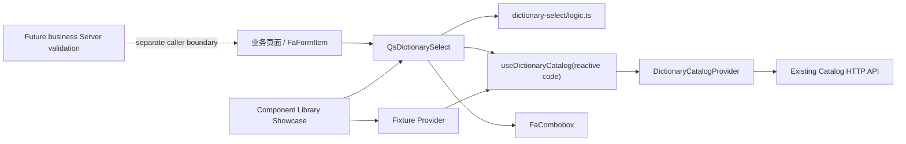
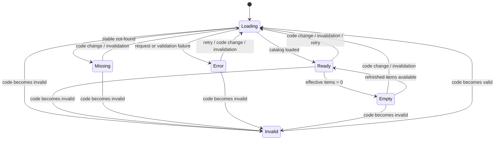

# 通用字典下拉组件技术设计

## 1. 文档状态

- 状态：Phase 2 Gate B 与 Phase 3 已确认，Phase 4 本地验收已完成
- Gate B 确认日期：2026-08-10
- 本地最终验收日期：2026-08-10
- 对应需求：`specs/dictionary-select/requirements.md`
- 适用范围：`web/apps/qsmds-arco` 与满足组件契约所需的最小 `FaCombobox` 加固
- 实施分支：`feat/dictionary-select`
- 明确不涉及：Server、OpenAPI、数据库、权限、字典数据、具体业务页面和部署

## 2. 设计结论

1. 新组件命名为 `QsDictionarySelect`，放在正式应用的 `components/business`，由调用方显式导入。
2. 数据层复用现有 Dictionary Catalog Provider、Consumer、有效条目筛选和历史值解析，不新增 API、Store 或缓存。
3. `useDictionaryCatalog` 扩展为接受响应式 `MaybeRefOrGetter<string>`，统一处理 code 切换、invalid、Abort、失效和迟到响应；组件不得复制请求状态机。
4. 底层选择控件使用 `FaCombobox`。`FaSelect` 缺少搜索、清空和空态，并会在当前值未命中时展示第一项，不满足历史值安全要求。
5. 为满足重复 Label、真实 Form input 和无障碍契约，推荐对共享 `FaCombobox` 做窄幅、向后兼容的公共 API 加固；该部分是 Gate B 的显式确认项。
6. 组件库使用隔离 fixture Provider 覆盖状态与交互；真实 Chrome 验证键盘、表单、主题和窄屏。实际业务页面接入不在本期范围。

## 3. 当前真相源

| 能力 | 真相源 | 本设计使用方式 |
| --- | --- | --- |
| Catalog HTTP | `server/src/modules/dictionaries/dictionary-catalog.controller.ts` | 保持现有单 code 读取，不新增接口 |
| Catalog 类型 | `web/apps/qsmds-arco/src/dictionary-catalog/types.ts` | 只消费 `code/name/enabled/items` 白名单字段 |
| Cache/身份/失效 | `web/apps/qsmds-arco/src/dictionary-catalog/provider.ts` | 复用身份隔离、TTL、请求合并和精确失效 |
| Consumer | `web/apps/qsmds-arco/src/dictionary-catalog/use-dictionary-catalog.ts` | 扩展响应式 code，不改变返回结构 |
| 有效项/历史值 | `web/apps/qsmds-arco/src/dictionary-catalog/options.ts` | 复用 `selectEffectiveDictionaryItems` 与 `resolveDictionaryCatalogValue` |
| 底层控件 | `web/packages/components/src/pro/combobox/index.vue` | 搜索、清空、空态、键盘和虚拟列表基础 |
| Form 属性注入 | `web/packages/components/src/basic/form/FormItem.vue`、`web/packages/components/src/basic/form/form/FormControl.vue` | 把注入属性路由到真实 input 与表单代理 |
| 组件展示 | `web/apps/qsmds-arco/src/views/component_library/` | 新增独立业务组件叶子路由与 fixture Showcase |

## 4. 架构与依赖方向



依赖方向固定如下：

```text
业务页面 / Showcase -> QsDictionarySelect -> Consumer / logic / FaCombobox
Consumer             -> injected DictionaryCatalogProvider
Provider             -> existing API module

QsDictionarySelect   -X-> API module / Account Store / permissions
FaCombobox            -X-> Dictionary Catalog domain
正式组件              -X-> Showcase fixture
```

`QsDictionarySelect` 属于应用级业务组件，因为它理解 Dictionary Catalog 状态；`FaCombobox` 继续保持领域无关。组件不进入 `web/packages/components`，不新增 barrel，也不修改深层组件自动扫描规则。

## 5. 文件边界

### 5.1 新增文件

```text
specs/dictionary-select/requirements.md
specs/dictionary-select/design.md
specs/dictionary-select/tasks.md

web/apps/qsmds-arco/src/components/business/QsDictionarySelect/index.vue
web/apps/qsmds-arco/src/components/business/QsDictionarySelect/logic.ts
web/apps/qsmds-arco/src/components/business/QsDictionarySelect/README.md

web/apps/qsmds-arco/src/views/component_library/business/dictionary-select.vue
web/apps/qsmds-arco/src/views/component_library/business/components/DictionarySelectShowcase.vue
web/apps/qsmds-arco/src/views/component_library/business/fixtures/dictionary-select.fixture.ts

web/apps/qsmds-arco/test/views/dictionary-select.test.ts
web/apps/qsmds-arco/test/views/dictionary-select-showcase.test.ts
web/scripts/fa-combobox-contract.test.mjs
```

### 5.2 修改文件

```text
web/apps/qsmds-arco/src/dictionary-catalog/use-dictionary-catalog.ts
web/apps/qsmds-arco/test/views/dictionary-catalog-consumer.test.ts

web/packages/components/src/pro/combobox/index.vue
web/packages/components/src/pro/combobox/README.md

web/apps/qsmds-arco/src/router/modules/component.library.ts
web/apps/qsmds-arco/test/api/component-library-routes.test.ts
web/apps/qsmds-arco/test/browser/dictionaries.browser.test.mjs

docs/前端文档/组件库建设方案.md
docs/前端文档/前端开发手册/Fantastic-admin内置组件/专业版组件.md
```

`web/package.json` 的 `scripts/*.test.mjs` 与正式应用的 `test/views/*.test.ts` 已使用 glob，新增测试无需修改 script 或 lockfile。

### 5.3 明确不修改

```text
server/**
web/openapi/openapi.json
server/openapi/openapi.json
web/apps/qsmds-arco/src/api/modules/dictionaries.ts
web/apps/qsmds-arco/src/dictionary-catalog/provider.ts
web/apps/qsmds-arco/src/dictionary-catalog/options.ts
web/apps/qsmds-arco/src/dictionary-catalog/types.ts
web/apps/qsmds-arco/src/main.ts
web/apps/qsmds-arco/vite/plugins.ts
web/apps/qsmds-arco/src/types/components.d.ts
**/package.json
**/pnpm-lock.yaml
具体业务页面
```

实现阶段若发现必须越过上述边界，应停止当前任务并重新取得确认。

## 6. `QsDictionarySelect` 公共契约

### 6.1 Props、Emits 与 Expose

```ts
interface QsDictionarySelectProps {
  dictionaryCode: string
  modelValue?: string | null
  placeholder?: string
  clearable?: boolean
  disabled?: boolean
}

interface QsDictionarySelectEmits {
  'update:modelValue': [value: string | null]
  'focus': [event: FocusEvent]
  'blur': [event: FocusEvent]
}

interface QsDictionarySelectExpose {
  focus(): void
  blur(): void
}
```

默认值：

```ts
{
  modelValue: null,
  placeholder: '请选择',
  clearable: false,
  disabled: false,
}
```

组件固定为单选和本地搜索。本期不增加 `multiple`、`searchable`、`provider`、`options`、`valueKey`、`labelKey`、`tone`、slots 或远程查询参数。

### 6.2 Attr 路由

组件使用 `inheritAttrs: false`，按语义拆分 `$attrs`：

| Attr | 落点 | 说明 |
| --- | --- | --- |
| `class/style/data-*` | 组件 root | `data-testid` 等保持在稳定外层 |
| `id/tabindex/aria-*` | 真实 combobox input | 与 Label、错误、required 和键盘焦点关联 |
| `name/form` | 原值提交代理 | 非 null 时提交精确 raw `modelValue`，不提交搜索文本 |
| `required` | 视觉隐藏的原生验证代理 | 只验证 `modelValue` 是否为 null，不把空字符串历史值当成未选择 |
| `aria-required` | 真实 combobox input | 与可见字段的 required 语义保持一致 |
| `disabled` | 声明式 Prop | caller disabled 同时禁用 input、按钮、重试和表单代理 |

搜索 input 永远不接收业务 `name`。组件将显式 `required` 或 `aria-required=true` 统一解析为 `nativeRequired=true`，从而兼容标准属性与 `FaFormItem` 的 auto-bind；`effectiveAriaRequired = nativeRequired ? 'true' : callerAriaRequired`，显式 required 必须胜过调用方冲突的 `aria-required=false`，且该派生值只写入真实 combobox input。由于既有历史解析明确把空字符串视为一个精确 UNKNOWN raw value，而 `null` 表示未选择，表单语义必须拆成两个单一职责代理。

原值提交代理：

```text
render   = name exists && modelValue !== null
type     = hidden
name     = caller name
form     = caller form
value    = exact modelValue, including ''
disabled = caller disabled
```

required 验证代理：

```text
render   = nativeRequired
type     = text
name     = absent
form     = caller form
value    = modelValue === null ? '' : 'present'
required = true
disabled = caller disabled
tabindex = -1
aria-hidden = true
```

提交代理只承担 FormData，因此可以使用 `type="hidden"`；`modelValue=null` 时不渲染，从线协议上与历史空字符串区分。验证代理沿用 `QsRegionSelector` 已验证的绝对定位、`1px`、clip 视觉隐藏模式，不使用 `display:none` 或 `type="hidden"`，因此 required 能参与 constraint validation；其无 name 的 sentinel 永不进入 FormData。目录内部 loading/error/missing/invalid 只禁用选择交互，不得让一个原本启用且非 null 的业务字段从 FormData 中消失。验证代理的 `invalid` 事件阻止浏览器聚焦不可见节点，改为标记本地错误、关联错误文案；真实 combobox input 可用时聚焦该 input，不可用时聚焦状态区或 retry。`FaFormItem` 规则仍可通过 `update:modelValue` 与 `blur` 独立工作。该边界避免用户仅输入搜索文本便错误通过业务值校验。

未列入白名单的 DOM 事件和属性不盲目落到任意内部节点，防止 `input/change` 把搜索文案误当成稳定 value。

`FaFormControl` 会把 `data-slot="form-control"` 放在 Qs root，`FaForm.scrollToField()` 也会优先聚焦该节点。因此 root 固定提供内部 `tabindex="-1"` 和只处理自身程序化 focus 的 forwarding handler：root 获焦后立即调用公开 `focus()` 把焦点转到真实 combobox input；caller 的 `tabindex` 仍只属于真实 input。该转发不额外 emit focus，最终只由真实 input 产生一次 `focus` 事件。input 因 loading/error/missing/invalid 不可用时，转发到相邻状态区或 retry。这样既保留所有 `data-*` 的稳定 root 契约，也不修改全局 FaForm 焦点算法。

### 6.3 Model 适配

`FaCombobox` 的无值为 `undefined`，公共组件的无值固定为 `null`：

```text
props.modelValue === null      -> innerValue = undefined
user selects string value      -> emit update:modelValue(value)
user explicitly clears        -> emit update:modelValue(null)
external model update          -> render only, no emit
load/code/error state changes  -> render only, no emit
```

组件只接受 Catalog 中的字符串 value。任何内部控件产生的非字符串、非 `undefined` 值都属于开发期契约错误，不得被字符串化后写回业务模型。

## 7. 响应式 Dictionary Consumer

### 7.1 签名

```ts
export function useDictionaryCatalog(
  code: MaybeRefOrGetter<string>,
): DictionaryCatalogConsumer
```

`DictionaryCatalogConsumer` 只增加一个只读状态，既有字段保持不变：

```ts
interface DictionaryCatalogConsumer {
  // existing fields unchanged
  readonly invalid: Readonly<Ref<boolean>>
}
```

现有静态字符串调用继续兼容。`invalid=true` 只表示调用方 code 不符合格式契约；`missing=true` 仍只表示合法 code 得到稳定 not-found。

### 7.2 生命周期算法

1. 使用 `toValue(code)` 读取响应式输入，并在 computed 内调用 `normalizeDictionaryCatalogCode()`；合法值返回规范字符串，格式错误返回 `null`，不暴露或记录原始 code。
2. `watch(normalizedCode, ..., { immediate: true, flush: 'sync' })` 负责初始加载和 code 切换；规范化结果相同不触发重载，同步 flush 保证 prop 赋值栈内立即 Abort 旧请求。
3. 每次真正切换先递增 `reloadScheduleVersion`、设置 `reloadScheduled=false`、递增 `requestSequence`、Abort 当前 controller，并清空 `catalog/error/missing`，从而使此前排队的 invalidation microtask 失效。新结果为 `null` 时同时清除 `identityReloadScheduled`，进入 `invalid=true/loading=false` 且不调用 Provider。
4. 新结果合法时，切换逻辑在清除 `identityReloadScheduled` 前先捕获它；若同一 task 已收到 `code=null` 的身份域失效，则新 code 的首次 `executeReload()` 继承一次 identity retry budget，避免身份 snapshot 尚未收敛时把瞬态 Abort 映射为 error。旧 code 的精确失效不提供该预算。
5. `executeReload()` 在开始时捕获 `requestedCode` 与 sequence；写回前同时核对未卸载、sequence、Abort 状态和当前 normalized code。
6. Provider 失效订阅保持单一实例；当前 code 合法且事件 `code=null` 或等于当前 normalized code 时，沿用现有 microtask 合并和身份重试预算。
7. 用户 `retry()` 只读取调用时的当前合法 normalized code，并作废尚未执行的失效调度；invalid 时为无请求的 resolved no-op，UI 不提供 retry。
8. `onBeforeUnmount()` Abort、递增 sequence、取消调度并 unsubscribe。

invalid 是可恢复的本地配置状态：保留 `modelValue` 的 raw 可见性、禁止选择和清空、显示固定“字典编码配置无效”，但不让异常破坏整棵 Vue 树。输入恢复为合法 code 后由同一个 watch 自动加载，无需重挂组件。

### 7.3 竞态不变量

```text
只有同时满足以下条件的结果可以写回：
  !disposed
  && sequence === requestSequence
  && !controller.signal.aborted
  && requestedCode === normalizedCode.value
```

这使以下场景均保持安全：快速 A→B→A 切换、Provider 精确失效、身份切换、旧 Promise 迟到 resolve/reject、重试与失效 microtask 同轮发生。

组件另外使用同一个纯规范化函数建立交互 session key：不同规范 code 或 invalid 状态会重建内部 `FaCombobox`，从而关闭 Popover、清空搜索词并保留外部 `modelValue`；大小写或边缘空白变化后若规范 code 相同，key 不变，当前搜索、Popover 和焦点均保留。迟到请求只更新 Consumer 状态，不能恢复已经销毁的旧交互 session。

## 8. 选项与历史值逻辑

纯函数放在 `QsDictionarySelect/logic.ts`，不依赖 Vue、API 或 DOM，主要职责为：

```ts
interface BuildDictionarySelectOptionsInput {
  readonly currentValue: string | null
  readonly loading: boolean
  readonly catalog: DictionaryCatalog | null
  readonly selectableItems: readonly DictionaryCatalogItem[]
}

interface DictionarySelectOption extends ComboboxOption {
  readonly value: string
}
```

生成顺序：

1. 按 `selectableItems` 原顺序映射全部有效项。
2. 当前值已在有效项中时不追加任何项。
3. 当前值在可信 Catalog 中解析为 `DISABLED` 或 `UNKNOWN` 时，在末尾追加一个 disabled option，Label 使用既有 `displayLabel`。
4. 目录尚未可信加载而当前值非 null 时，在末尾追加 raw value disabled option，不提前添加“已停用”或“未知”结论。
5. 不 trim、不大小写转换、不把 Label 作为身份，也不创建默认项。

本地 filter 对 FaCombobox 已提供的去边缘空白 keyword 做大小写不敏感的包含匹配：

```text
label contains keyword OR value contains keyword
```

不做拼音、分词、模糊距离或远程搜索。重复 Label 通过 value 身份稳定渲染和选择。

## 9. UI 状态机



`Ready` 和 `Empty` 都是可信 Catalog 状态；`Empty` 只表示没有新选择候选，仍可显示并明确清除历史值。组件交互矩阵如下：

| 状态 | 展示 | 新选择 | 清空 | Retry |
| --- | --- | --- | --- | --- |
| `loading` | raw 当前值 + “正在加载字典选项” | 禁止 | 禁止 | 无 |
| `ready` | 有效项或历史项 | 允许有效项 | 由 `clearable` 决定 | 无 |
| `empty` | “暂无可用选项” + 可选历史项 | 无 | 由 `clearable` 决定 | 无 |
| `missing` | “未配置该字典类型” | 禁止 | 禁止 | 无 |
| `error` | 安全错误 + “重试加载” | 禁止 | 禁止 | 允许 |
| `invalid` | “字典编码配置无效” | 禁止 | 禁止 | 无 |
| caller `disabled` | 当前值 + 禁用语义 | 禁止 | 禁止 | 禁止 |

状态区通过稳定 `id` 与 input 的 `aria-describedby` 合并关联。Loading 使用 `role="status"`，Error 与 invalid 使用 `role="alert"`；missing 和 empty 使用普通说明文字，避免不必要的重复播报。组件内部 loading 对 input 设置 `aria-busy=true`，调用方不能用 attrs 覆盖为 false。

## 10. `FaCombobox` 最小公共加固

### 10.1 Gate B 公共 API

在现有 `ComboboxProps` 上只增加以下可选项：

```ts
import type { HTMLAttributes, InputHTMLAttributes } from 'vue'

type ComboboxInputAttrs = Pick<
  InputHTMLAttributes,
  | 'id'
  | 'tabindex'
  | 'aria-label'
  | 'aria-labelledby'
  | 'aria-describedby'
  | 'aria-invalid'
  | 'aria-required'
  | 'aria-errormessage'
  | 'aria-busy'
>

export interface ComboboxProps {
  // existing props unchanged
  inputAttrs?: ComboboxInputAttrs
  contentClass?: HTMLAttributes['class']
  clearAriaLabel?: string
  triggerAriaLabel?: string
}
```

默认 accessible label 使用中文界面文案：

```text
clearAriaLabel   = 清空选择
triggerAriaLabel = 展开或收起选项
```

新增事件和公开方法：

```ts
interface AddedComboboxEmits {
  focus: [event: FocusEvent]
  blur: [event: FocusEvent]
}

interface AddedComboboxExpose {
  focus(): void
  blur(): void
}
```

所有字段均为 additive optional；既有 `v-model`、`change`、`clear`、搜索、虚拟列表和默认尺寸行为保持不变。

`ComboboxInputAttrs` 是 `index.vue` 内部类型，只用于约束公开 `ComboboxProps.inputAttrs` 的结构，不作为新的 named package export。因此无需修改 `pro/combobox/index.ts` 或 `packages/components/src/index.ts`，也避免扩大公共类型数量。

Task 5 实施期间经单独 Gate C 确认，追加可选 `contentClass`。它只合并到
Teleport 的 `ComboboxContent`，不传给 control、真实 input 或按钮，也不新增
`contentAttrs`。该入口让领域组件以唯一 ownership 类局部约束移动端 option、长文本
和 Reduced Motion；未传入时默认 DOM 与样式保持不变。

### 10.2 DOM 与 key 加固

- `inputAttrs` 只绑定到真实 `ComboboxInput`，不得整包接收 `name`、`value`、`onInput` 或任意事件；`aria-expanded`、`aria-controls`、`aria-autocomplete` 和 `aria-activedescendant` 继续由 Reka 拥有，调用方不能覆盖。
- clear Button 增加稳定 `data-slot="combobox-clear"`；clear 与 trigger 获得显式 `aria-label`，保留 Reka 的 `expanded/controls/autocomplete` 语义。
- 真实 input 的原生 focus/blur 同时更新内部状态并向上 emit 原始事件。
- `focus()/blur()` 通过内部 `ComboboxInput` 已公开的 input ref 操作真实 `HTMLInputElement`，不使用全局 querySelector。
- 平铺 option 的 Vue key 从 Label 改为稳定 value 身份。原始 value 为 primitive 时组合类型和值；对象 value 使用组件实例内 WeakMap identity，避免不同对象都退化为 `[object Object]`。字典组件只使用字符串 value，但共享控件不能破坏既有 `AcceptableValue` 类型。
- 分组选项继续以 group Label 标识组、以 item value 标识组内项；测试补充重复 Label 不复用 DOM 身份。

### 10.3 为什么不采用局部 DOM bridge

`QsRegionSelector` 的局部 DOM bridge 解决的是多级复合控件和第三方根节点属性传递；本组件只缺少 `FaCombobox` 自己掌握的 input ref、按钮 accessible name 与 option key。把这些能力继续隐藏后再由应用组件用 MutationObserver 或 DOM 查询修补，会更脆弱，也无法改善其他 `FaCombobox` 调用方。因此本设计优先修正真正拥有 DOM 的共享控件。

如果 Gate B 不批准该公共修改，本任务应暂停并重新设计底层选型，不默认引入 DOM bridge，也不降低已确认的表单与无障碍验收。

## 11. 组件模板结构

```text
div.qs-dictionary-select (root, class/style/data-*)
├── FaCombobox
│   ├── real combobox input (id/tabindex/aria-*)
│   ├── named clear button
│   ├── named trigger button
│   └── popover options / search empty state
├── hidden submission input (optional exact raw value)
├── visually hidden validation input (optional required sentinel, no name)
└── state row
    ├── loading status
    ├── empty/missing description
    └── error alert + retry button
```

组件 root 使用 `min-w-0 w-full`；FaCombobox control class 覆盖为全宽，并在组件局部通过 `[data-slot="combobox"]` 把其现有 `inline-block` root 收敛为 `display:block;width:100%`。Desktop 沿用 `h-9`，窄屏通过 `[data-slot="combobox-clear"]`、`[data-slot="combobox-trigger"]` 和所属 Popover 的局部响应式规则把 control、按钮和 option 的最小高度提升到 `44px`。Popover 继续 Teleport，并只对本组件打开时的内容应用局部触控规则，避免影响所有 Combobox。

加载反馈使用现有 Lucide loader 图标和文字；在 `prefers-reduced-motion: reduce` 下移除旋转。样式只使用 `background/foreground/muted/border/input/ring/primary/destructive` 等项目语义 Token。

## 12. Showcase 与 UI 设计

### 12.1 独立路由

组件库业务分类新增：

```text
path:  dictionary-select
name:  componentLibraryQsDictionarySelect
title: 字典选择器
icon:  i-lucide:list-filter
```

基础组件 5 个、业务组件由 5 个增加到 6 个，组件叶子总数由 10 个增加到 11 个；同步修正文档中遗漏的现有地区选择器条目。

### 12.2 Fixture

`dictionary-select.fixture.ts` 实现最小 `DictionaryCatalogProvider` fixture，不进入正式组件：

- `workflow.status`：有效项、停用项、重复 Label 和稳定排序。
- `workflow.empty`：Catalog 存在但没有有效项。
- `workflow.missing`：Provider 返回 `null`。
- `workflow.retry`：第一次失败，重试成功。
- `workflow.phase`：用于运行时 code 切换和迟到响应。

fixture code、value 和 Label 均为中性测试语义；不扩大根治理的历史文本 allowlist。

### 12.3 Showcase 场景

1. 默认选择与 Label/value 搜索。
2. `clearable` 与外部 model 更新。
3. 停用历史值和未知历史值。
4. 重复 Label 的两个独立 value。
5. empty、missing、invalid、首次错误与 retry。
6. 运行时 dictionaryCode 切换及相同规范 code 保留交互。
7. caller disabled。
8. `<label for>`、`FaFormItem`、name/FormData、required 和 blur。
9. Desktop 与 `390x844`、light/dark、键盘和 Reduced Motion。

### 12.4 Design Specification 落地

- Purpose：在业务表单中安全选择当前有效字典值，并清楚解释历史值与加载失败。
- Aesthetic Direction：Industrial/utilitarian。
- Palette：实现只使用现有语义 Token；`#FFFFFF/#09090B/#F4F4F5/#E4E4E7/#15803D` 仅作为设计锚点。
- Typography：Noto Sans SC；稳定 value 可使用 Noto Sans Mono。
- Layout：原子控件全宽，状态紧邻字段；Desktop 紧凑，Mobile 扩大触控目标。页面级不对称和打破网格规则不适用于单一表单控件。
- Icons：使用 Lucide/FaIcon，不使用 Emoji。
- Motion：只保留必要的 loading 反馈并尊重 Reduced Motion。

## 13. TDD 与验证策略

### 13.1 RED/GREEN 顺序

| 顺序 | RED 证据 | 最小 GREEN 实现 |
| --- | --- | --- |
| 1 | Consumer 不响应 code 切换/invalid，旧请求可迟到 | `MaybeRefOrGetter` + watch/Abort/sequence/invalid |
| 2 | 选项逻辑无法安全组合历史值和重复 Label | `logic.ts` 纯函数 |
| 3 | `FaCombobox` input attrs、按钮名称、focus/blur、key 契约失败 | 最小共享控件加固 |
| 4 | 组件缺少 model、状态、表单和 retry 行为 | `QsDictionarySelect/index.vue` |
| 5 | 组件库路由和 Showcase 场景缺失 | fixture、Showcase、route |
| 6 | Chrome 无法证明键盘、Form、主题和窄屏 | 扩展 dictionaries browser suite |

每个 RED 必须因目标能力尚未存在而失败；不得通过永久跳过、放宽断言或只检查源码字符串制造假绿。

### 13.2 定向测试

```bash
pnpm -C web exec node --import tsx --test \
  apps/qsmds-arco/test/views/dictionary-catalog-consumer.test.ts \
  apps/qsmds-arco/test/views/dictionary-select.test.ts \
  apps/qsmds-arco/test/views/dictionary-select-showcase.test.ts \
  apps/qsmds-arco/test/api/component-library-routes.test.ts

pnpm -C web exec node --test scripts/fa-combobox-contract.test.mjs
```

### 13.3 最终验证

```bash
pnpm -C web test:api
pnpm -C web check
pnpm -C web build
pnpm -C web check:examples
pnpm -C web build:examples
node --run test:root
node --run ci:browser-dictionaries-e2e
git diff --check
git status --short --branch
```

Browser E2E 使用现有一次性 PostgreSQL、双 Server、test build 和真实 Chrome 生命周期，不访问或修改本地开发数据库。Showcase 仍使用 fixture；现有 Dictionary Catalog API 的真实性由既有 Server E2E 和 Provider 测试负责。

### 13.4 关键断言

- code A→B 时 A 的 resolve/reject 均不能写回 B，且交互 session 关闭并清空旧搜索。
- 相同规范 code 不重复请求或重置交互；invalid 不请求且恢复合法 code 后自动加载；卸载后无写回或订阅泄漏。
- exact/global invalidation 与 code switch 同一 task 时只启动正确 code 的有效 reload；global 场景保留一次 identity retry budget，旧 microtask 不得二次加载。
- 选项保持 Server 顺序；搜索同时命中 Label/value。
- 相同 Label 的不同 value 可独立选择并拥有稳定 DOM identity。
- 停用/未知值原样保留，加载和错误不 emit，清空只 emit `null`。
- `id/aria-*` 位于真实 combobox input，显式 required 与 `FaFormItem` 两条路径都派生 `aria-required=true`，search input 无业务 name。
- FormData 分别覆盖 null、空字符串、非空 raw 和 caller disabled：null 省略字段，任意字符串精确提交；原生 required 只拦截 null 并把焦点转回可见 input；FaForm 的 scroll-to-field 焦点也转发到真实 input；禁用字段不提交。
- clear/trigger/retry 都有 accessible name；focus/blur 指向真实 input。
- `390x844` 无横向溢出且交互目标至少 44px。
- light/dark、Reduced Motion 无 console error 或 page error。

### 13.5 最终验证结果

2026-08-10 在生产、测试和 Showcase 源码冻结于 `d67cd4c` 后，严格按第 13.2、13.3 节串行完成本地验证：定向测试 44/44、`FaCombobox` 契约 7/7、Web API/View 738/738、完整 Web 检查 958/958、Root governance 663/663、真实 Chrome Dictionary Browser 6/6；正式应用 production build、三个参考应用 check/build 与 `git diff --check` 均成功。

正式应用构建完成 2893 个模块转换，并通过 Noto 108 个字体资产及零残留校验。构建只出现既有第三方 `@vueuse/core` pure annotation、chunk size 和 plugin timing 非阻断警告。最终文件矩阵为 12 个新增、9 个修改、0 删除、0 重命名；Browser 使用一次性隔离 PostgreSQL，未访问本地开发数据库。

## 14. 安全、性能与兼容性

### 14.1 安全

- 组件不读取或记录 Token、Cookie、账号、连接字符串或完整错误响应。
- UI 只显示固定安全错误文案；Catalog Provider 继续负责不可信响应校验。
- 页面可见选项不是授权或数据完整性边界；未来业务新增或变更字典字段时必须由 Server 调用 `requireEffectiveValue()` 验证，字段未变化时不得强迫改写已经停用的历史值。
- 组件库 fixture 不调用写 API，不包含真实业务数据。

### 14.2 性能

- 保持按需单 code 加载、5 分钟内存 TTL、same-key 请求合并和消费者独立取消。
- 搜索只过滤当前 Catalog；Item 上限和大数据策略继续由字典领域约束，不引入远程分页。
- 不新增 watchEffect 链、全局 MutationObserver 或持久化缓存。
- 组件销毁后立即释放 controller、调度和订阅。

### 14.3 向后兼容

- `useDictionaryCatalog('workflow.status')` 的静态字符串调用继续成立；返回值只 additive 增加只读 `invalid`。
- `FaCombobox` 新 props、emits 和 expose 全部 additive optional；`contentClass` 只影响显式传入它的 Teleport 内容层，既有调用无需修改。
- 不改变 `FaCombobox` 的 model、change/clear 语义、默认尺寸、默认搜索或虚拟列表。
- 不修改现有 Catalog Provider、API response 或 OpenAPI。

## 15. Requirement Traceability

| Requirement | 设计章节 |
| --- | --- |
| R1 组件分层与职责 | 4、5 |
| R2 最小公共契约 | 6 |
| R3 响应式字典加载 | 7 |
| R4 有效选项、顺序与搜索 | 8、10 |
| R5 当前值与历史值 | 6.3、8、9 |
| R6 状态 | 9 |
| R7 表单与无障碍 | 6.2、10、11 |
| R8 视觉与响应式 | 11、12 |
| R9 安全与性能 | 14 |
| R10 Showcase、测试与交付 | 12、13 |

## 16. Gate B 确认项

确认本设计即同时确认以下实施边界：

1. 新增应用级公共组件 `QsDictionarySelect`，其 Props、Emits、Expose 和 Attr 路由以第 6 节为准。
2. 将 `useDictionaryCatalog` 参数从静态 `string` 扩展为向后兼容的 `MaybeRefOrGetter<string>`，并 additive 增加只读 `invalid` 状态。
3. 按第 10 节对共享 `FaCombobox` 新增可选 `inputAttrs`、`contentClass`、两个 accessible label、focus/blur events 与 methods，并修正 value-based key；其中 `contentClass` 为 Task 5 实施期间单独确认的窄幅公共增量。
4. 新增组件库第 11 个组件叶子路由、fixture Showcase 和对应自动化测试。
5. 不新增依赖，不修改 Server/API/OpenAPI/数据库/权限/字典数据，不接入具体业务页面。

Gate B 仅授权随后进入 Phase 3 任务拆解；在 Phase 3 任务计划再次确认前，不实施组件代码、不暂存、不提交、不 push、不创建 PR、不 merge、不部署。
