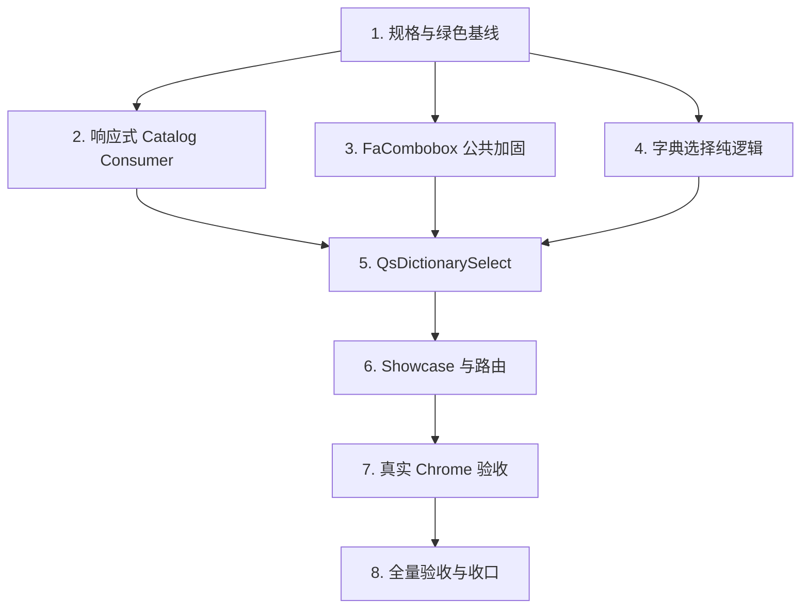

# 通用字典下拉组件实施任务

## 1. 文档状态

- 状态：Phase 4 本地验收已完成
- Gate A 需求确认日期：2026-08-10
- Gate B 设计确认日期：2026-08-10
- 实施分支：`feat/dictionary-select`
- 基线分支：`main`
- 基线 SHA：`2aaf135795177d3e7c14d3e268aed300a7821500`
- Requirements：`specs/dictionary-select/requirements.md`
- Design：`specs/dictionary-select/design.md`

本计划把通用字典下拉组件拆为 8 个可独立验证、保持绿色并形成小步提交的任务。Phase 3 确认前不得开始 Task 1；确认后进入 Phase 4，并在执行期间实时更新本文件状态和 checkbox。

## 2. 执行纪律

每个功能任务遵循同一闭环：

```text
确认任务文件边界
-> 写因目标能力缺失而失败的测试
-> 运行并记录预期 RED 原因
-> 最小实现
-> 重构和补齐异常路径
-> 运行任务级 GREEN 验证
-> 更新 tasks.md 状态
-> 检查 staged diff / secrets / generated 边界
-> 创建绿色小步提交
```

规则：

1. 不提交永久红测、无法独立 typecheck 或无法构建的状态；RED 只作为实施过程证据。
2. 命令失败必须报告真实命令、退出码和原因，未转绿前不得勾选对应任务。
3. 只使用 `apply_patch` 编辑文件；格式化工具只用于已确认范围内的机械整理。
4. 不修改或生成 Server、OpenAPI、数据库、权限和字典数据资产。
5. 不新增依赖、Store、全局自动注册、公共 barrel 或跨应用源码引用。
6. 不手工修改 `components.d.ts`、generated types、OpenAPI snapshot、lockfile 或构建产物。
7. 新增测试 fixture 只使用中性 code 和数据，不扩大根治理历史文本 allowlist。
8. 每次提交前运行 `git diff --check`、核对暂存文件，并扫描 `.env`、密钥、日志、`dist`、`coverage`、根依赖违规产物。
9. Commit Message 类型使用英文、描述使用中文；不使用 amend、rebase、force push 或历史重写。
10. 未经后续明确授权，不执行 push、PR、merge、部署、分支删除或 worktree 清理。
11. Task 1 首次提交三份规格文档；此后每项任务对 `tasks.md` 的进度更新保留在未暂存工作树，直到 Task 8 与 Requirements、Design 一并形成最终文档提交，避免进度记录混入功能提交。

## 3. 阶段门禁

### Gate A - 需求

- [x] 组件职责、公共模型、历史值、状态、表单、无障碍、响应式和 Browser 验收已确认。
- [x] `clearable=false`、固定可搜索、单选和 `string | null` 模型已确认。
- [x] 不接具体业务页面，不新增 Server/API/数据库能力。

### Gate B - 技术与公共边界

- [x] `QsDictionarySelect` 的 Props、Emits、Expose 和 Attr 路由已确认。
- [x] `useDictionaryCatalog(MaybeRefOrGetter<string>)` 与 additive `invalid` 状态已确认。
- [x] `FaCombobox` 的 `inputAttrs`、accessible label、focus/blur、value key 与 clear data-slot 加固已确认。
- [x] Task 5 期间单独确认可选 `contentClass`，且只允许透传给 Teleport 内容层，不增加 `contentAttrs` 或改变默认行为。
- [x] `null`、空字符串历史 raw、非空 raw 和 caller disabled 的双表单代理语义已确认。
- [x] Component Library Showcase、现有 Dictionary Browser suite 和完整验证边界已确认。

### Gate C - 重新确认触发条件

出现以下任一情况必须暂停，不得自行扩大：

- 新增或修改 Server API、OpenAPI、数据库 Schema、migration、权限或字典数据。
- 修改已确认以外的公共 Qs/Fa API、导出新的 package named type 或把组件提取到 `packages/*`。
- 新增第三方依赖、Pinia Store、持久化缓存、全局自动注册或新的 Browser/CI runner。
- 接入具体业务页面、增加领域专用 wrapper、硬编码业务 code 或执行业务 Mutation。
- 增加多选、远程搜索、拼音、分页、树形、分组配置、slots 或 option renderer。
- 删除或重命名任何现有文件。
- 修改 Gate A 验收、降低表单/无障碍/Browser 要求或偏离第 5 节精确文件矩阵。
- 执行 push、PR、merge、部署、分支删除、worktree 清理或 Git 历史重写。

## 4. 依赖顺序



Task 2、Task 3、Task 4 在逻辑上可独立，但共享同一 Git worktree，实际执行保持串行；Task 5 必须等待三项公共基础全部绿色。

## 5. 8 项实施任务

- [x] 1. 固化规格并建立绿色基线
  - [x] 1.1 核对 `git status --short --branch`、`HEAD`、`origin/main` 和 merge-base，确认分支仍精确基于本计划记录的 SHA，且只有三份规格文档属于当前任务。
  - [x] 1.2 核对根目录不存在 `pnpm-workspace.yaml`、`pnpm-lock.yaml`、`node_modules/`、`.pnpm-store/` 等违规产物，且没有真实 `.env`、日志、密钥或生成目录进入变更。
  - [x] 1.3 在修改运行时代码前运行并保存绿色基线：

    ```bash
    pnpm -C web check
    pnpm -C web build
    pnpm -C web check:examples
    pnpm -C web build:examples
    node --run test:root
    node --run ci:browser-dictionaries-e2e
    ```

  - [x] 1.4 若任一基线失败，停止功能修改并报告；未经确认不得把无关基线修复混入本分支。
  - [x] 1.5 把三份规格文档状态更新为“Phase 4 实施中（Task 2）”，只暂存规格文件，检查 staged diff 后创建提交：`docs: 固化通用字典下拉组件规格`。
  - _Requirements: R1-R10_

  Task 1 基线证据（2026-08-10）：`web check` 920/920、正式 Web build 成功、三个参考应用 check/build 成功、Root 663/663、Dictionary Browser 1/1；构建仅保留既有的 `@vueuse/core` pure annotation、chunk size 与 plugin timing 非阻断警告。

- [x] 2. 以 TDD 扩展响应式 Dictionary Catalog Consumer
  - [x] 2.1 先修改 `dictionary-catalog-consumer.test.ts` 并运行 RED，证明当前静态 `code: string` 不支持响应式 code、invalid、同步 Abort 和交互切换所需状态。
  - [x] 2.2 RED 精确覆盖：初始合法加载、合法 A→B、A→B→A、invalid 初始、合法→invalid、invalid→合法、同一规范 code 不重载、卸载清理及旧 resolve/reject 不写回。
  - [x] 2.3 RED 覆盖 exact/global invalidation 与 code switch 同一 task：旧 microtask 作废、只加载当前 code，global 场景保留一次 identity retry budget，exact 场景不继承该预算。
  - [x] 2.4 最小修改 `use-dictionary-catalog.ts`：接受 `MaybeRefOrGetter<string>`，additive 返回只读 `invalid`，使用 `flush:'sync'` watch、sequence、Abort、schedule version 和单一仲裁算法。
  - [x] 2.5 保留既有静态字符串、identity reload、retry、missing、error、selectableItems 和 `resolve()` 行为；invalid 不请求、不 retry、不泄露原始 code，合法恢复自动加载。
  - [x] 2.6 运行 GREEN：

    ```bash
    pnpm -C web exec node --import tsx --test \
      apps/qsmds-arco/test/views/dictionary-catalog-consumer.test.ts
    pnpm -C web typecheck
    pnpm -C web lint
    ```

  - [x] 2.7 更新 Task 2 状态，只暂存 Consumer 与对应测试，创建提交：`feat: 支持响应式字典目录消费`。
  - _Requirements: R3, R6, R9, R10_

  Task 2 证据：初始 RED 为 10 项中新增 5 项因旧实现把 `Ref` 当字符串而失败；终审新增 teardown RED 为 17 项中 1 项失败。最小实现与 `disposed` guard 后定向 17/17、typecheck、lint、diff-check 全绿；提交 `52d6ab1`。

- [x] 3. 以 TDD 加固 `FaCombobox` 公共表单与无障碍能力
  - [x] 3.1 先新增并运行失败的 `web/scripts/fa-combobox-contract.test.mjs`，固定 additive props、emits、expose、DOM slot 和 value-based key，证明当前共享控件缺少目标能力；该文件只承担静态公共契约门禁，不把源码字符串断言冒充真实 DOM 行为证据。
  - [x] 3.2 RED 固定 `inputAttrs` 只接受 `id`、`tabindex` 和安全表单 ARIA；`name/value/onInput` 及 Reka 拥有的展开/候选 ARIA 不进入该入口。
  - [x] 3.3 RED 固定 clear Button 的 `data-slot="combobox-clear"` 与 accessible label、trigger accessible label、真实 input focus/blur event 和公开 `focus()/blur()`。
  - [x] 3.4 RED 固定平铺重复 Label 不作为 Vue key；primitive 使用类型和值，对象使用组件实例内 WeakMap identity，同时不改变现有 `AcceptableValue`、分组或 virtual list 契约。
  - [x] 3.5 最小修改 `web/packages/components/src/pro/combobox/index.vue`；`ComboboxInputAttrs` 保持 SFC 私有结构类型，不增加 package named export、不修改 barrel。
  - [x] 3.6 更新 `FaCombobox` README 和专业版组件手册，只记录实际新增能力、owned ARIA 和兼容边界。
  - [x] 3.7 运行 GREEN：

    ```bash
    pnpm -C web exec node --test scripts/fa-combobox-contract.test.mjs
    pnpm -C web exec node --test scripts/frontend-handbook.test.mjs
    pnpm -C web typecheck
    pnpm -C web lint
    pnpm -C web check:examples
    pnpm -C web build:examples
    ```

  - [x] 3.8 更新 Task 3 状态为“静态契约、编译、手册与参考应用门禁绿色；真实 DOM 行为待 Task 7 Chrome 验收”，只暂存共享控件、契约测试和两份文档，创建提交：`feat: 加固 FaCombobox 表单与无障碍能力`；不得在 Task 7 前声称其运行时验收已经完成。
  - _Requirements: R2, R4, R7, R8, R10_

  Task 3 证据：初始契约 RED 4/4 失败；最小实现与契约补强后静态契约 6/6、手册 70/70、typecheck、lint、参考应用 check/build 全绿，构建仅有既有非阻断警告。真实 DOM 行为保留 Task 7；提交 `b120f44`。

- [x] 4. 以 TDD 建立字典选择纯逻辑
  - [x] 4.1 先新增并运行失败的 `dictionary-select.test.ts`，固定 options、filter、模型适配、Attr 拆分和表单代理纯逻辑，不先创建 Vue 模板。
  - [x] 4.2 RED 固定有效项保持 Server 顺序；停用/未知历史值最多追加一个 disabled 合成项；当前有效值不重复；加载或不可用时只安全展示 raw。
  - [x] 4.3 RED 固定 Label/value 搜索忽略边缘空白且大小写不敏感，相同 Label 的不同 value 保持独立，并区分“Catalog 本身无有效项”与“有有效项但搜索无匹配”；不做拼音、远程搜索或排序。
  - [x] 4.4 RED 固定 `null -> undefined`、用户清空 `-> null`、外部更新不 emit，以及非字符串内部值不得字符串化写回。
  - [x] 4.5 RED 固定 root/input/form Attr 白名单、`nativeRequired`、`effectiveAriaRequired` 和双代理矩阵：null、空字符串、非空 raw、caller disabled。
  - [x] 4.6 新增 `QsDictionarySelect/logic.ts`，只实现已测试的纯函数，不导入 API、Store、权限或 DOM。
  - [x] 4.7 运行 GREEN：

    ```bash
    pnpm -C web exec node --import tsx --test \
      apps/qsmds-arco/test/views/dictionary-select.test.ts
    pnpm -C web typecheck
    pnpm -C web lint
    ```

  - [x] 4.8 更新 Task 4 状态，只暂存 logic 与对应测试，创建提交：`feat: 添加通用字典选择逻辑`。
  - _Requirements: R2, R4, R5, R7, R9, R10_

  Task 4 证据：初始 RED 因 `QsDictionarySelect/logic` 尚不存在而以 `ERR_MODULE_NOT_FOUND` 失败；最小实现及两轮终审补强后，定向测试 9/9、typecheck、lint、diff-check 全绿。options、filter 与 input attrs 已由编译期门禁证明可直接绑定 `FaCombobox`；提交 `e997288`。

- [x] 5. 以 TDD 实现 `QsDictionarySelect`
  - [x] 5.1 先扩展 `dictionary-select.test.ts` 的组件源码/结构契约并运行 RED，固定 Props、Emits、Expose、Consumer、FaCombobox、状态区和双代理接线。
  - [x] 5.2 新增 `index.vue`，使用 `<script setup lang="ts">`、`inheritAttrs:false`、显式中文注释和已确认的最小公共契约。
  - [x] 5.3 以规范 code/invalid 作为交互 session key；不同规范 code 关闭 Popover、清空搜索，规范 code 相同保留交互，任何切换都不 emit 或改写外部模型。
  - [x] 5.4 实现 loading、ready、empty、missing、error、invalid、搜索无匹配和 caller disabled 状态；“暂无可用选项”只用于可信空 Catalog，“无匹配选项”只用于非空 Catalog 的搜索结果为空；loading 使用 `role=status`，error/invalid 使用 `role=alert`，只有 error 提供 retry。
  - [x] 5.5 实现 root `data-*`、真实 input `id/tabindex/ARIA`、派生 required、原值提交代理、无 name 验证代理、native invalid 焦点恢复和 FaForm root focus-forwarding；测试精确覆盖调用方与内部 `aria-describedby` 合并、loading 的 `aria-busy=true` 不可被覆盖，以及 caller/Form/local `aria-invalid` 在状态恢复后的合并结果。
  - [x] 5.6 实现全宽、Desktop `36px`、小于 `640px` 时真实 input/按钮/Popover option 至少 `44px`、dark token、唯一 `contentClass` ownership、长文本换行和 Reduced Motion；不硬编码运行时颜色或使用 Emoji。
  - [x] 5.7 新增组件 README，说明 API、状态、表单、历史值、安全边界、显式导入和调用方 Server 校验责任。
  - [x] 5.8 运行 GREEN：

    ```bash
    pnpm -C web exec node --import tsx --test \
      apps/qsmds-arco/test/views/dictionary-catalog-consumer.test.ts \
      apps/qsmds-arco/test/views/dictionary-select.test.ts
    pnpm -C web typecheck
    pnpm -C web lint
    ```

  - [x] 5.9 更新 Task 5 状态；先以独立提交 `feat: 扩展 FaCombobox 内容样式入口` 落地单独确认的公共增量，再只暂存组件、logic、README 和相关测试，创建提交：`feat: 添加通用字典下拉组件`。
  - _Requirements: R1-R10_

  Task 5 证据：`contentClass` 公共增量先以静态契约 7 项中 2 项失败，分别证明类型与文档缺失；领域样式收紧后定向 30 项中 1 项因尚未接入 ownership 类而失败。最小实现与三轮假绿门禁补强后，Consumer/组件定向 30/30、FaCombobox 7/7、手册 70/70、typecheck、lint、参考应用 check/build、diff-check 全绿；中间一次 lint 因弃用 `word-break: break-word` 与属性顺序失败，删除非必要声明后重跑转绿。公共增量提交 `503fec0`，组件提交 `7965ad6`。

- [x] 6. 以 TDD 接入组件库 Showcase 与独立路由
  - [x] 6.1 先修改路由测试并运行 RED，把组件叶子精确总数从 10 增至 11，固定 `dictionary-select` path、route name、标题、图标和动态 import。
  - [x] 6.2 先新增并运行失败的 `dictionary-select-showcase.test.ts`，固定 fixture Provider、场景集合、真实组件导入和零写 API/零 Store 边界。
  - [x] 6.3 新增中性 fixture codes：`workflow.status`、`workflow.empty`、`workflow.missing`、`workflow.retry`、`workflow.phase`；支持重复 Label、历史值、首错重试和可控迟到响应。
  - [x] 6.4 新增独立 Showcase route/page/component，展示默认、搜索、清空、外部 model、停用、未知、重复 Label、empty、missing、invalid、retry、code switch、disabled 和 Form 场景；同时在开发者 Showcase 中提供一个中性的底层 `FaCombobox` 回归夹具，用两个同 Label 的不同对象 value 验证 WeakMap identity，不把该夹具并入 `QsDictionarySelect` 公共 API。
  - [x] 6.5 更新《组件库建设方案》，把现有地区选择器和新字典选择器纳入真实 11 个组件页面；不得写入示例 fixture 到正式组件。
  - [x] 6.6 运行 GREEN：

    ```bash
    pnpm -C web exec node --import tsx --test \
      apps/qsmds-arco/test/views/dictionary-select-showcase.test.ts \
      apps/qsmds-arco/test/api/component-library-routes.test.ts
    pnpm -C web test:api
    pnpm -C web typecheck
    pnpm -C web lint
    pnpm -C web build
    ```

  - [x] 6.7 更新 Task 6 状态，只暂存 Showcase、fixture、route、测试和组件库文档，创建提交：`feat: 添加字典选择器组件库示例`。
  - _Requirements: R1, R6, R8, R10_

  Task 6 证据：首次定向 RED 以 exit 1 准确暴露第 11 个组件路由、独立页面、动态 import/icon 与 fixture module 均尚不存在。最小实现及静态门禁补强后，定向 13/13、Web API/View 737/737、typecheck、lint、生产 build 与 diff-check 全绿；构建仅保留既有 `@vueuse/core` annotation、chunk size 和 plugin timing 非阻断警告。提交 `aebab15`。

- [x] 7. 补齐真实 Chrome 交互、表单与响应式闭环
  - [x] 7.1 先扩展现有 `dictionaries.browser.test.mjs`，使用 test build 的组件库路由和 fixture，不创建新的 Browser runner、生产后门，也不为新增选择器场景增加数据库写入；现有 Dictionary 生命周期场景仍只写一次性隔离数据库。
  - [x] 7.2 把新增组件场景拆成同文件内独立串行 `test()` 并使用局部 timeout；先执行并记录 Browser RED 及准确原因。若新增验收在既有实现上首次即通过，记录为“已有实现直接满足新增验收”，不得人为制造失败。
  - [x] 7.3 浏览器覆盖鼠标与键盘：输入搜索、方向键、Enter、Escape、Tab、重复 Label 独立选择、clear 只回写 null、外部 model 更新不回发，并分别断言“无匹配选项”与“暂无可用选项”。
  - [x] 7.4 通过中性底层夹具验证 `FaCombobox` 的真实 input attrs、Reka owned ARIA 生命周期、focus/blur、change/clear 和 clear/trigger accessible name；primitive 至少区分 `'1'`、`1`、`1n`、`null`，对象使用结构不同且引用稳定的两个 value，逐项选择并证明 model 类型/引用不混淆。
  - [x] 7.5 底层夹具同时覆盖分组标题、重复 Label、disabled 跳过、原始 value 回写，以及 virtual list 搜索/键盘选择 viewport 外条目；局部捕获并拒绝 `Duplicate keys found` 类 Vue warning，不把既有无关 warning 全局升级为失败。
  - [x] 7.6 覆盖 code A→B、相同规范 code、invalid→合法、旧迟到响应、error retry；确认搜索/Popover reset 与保留规则符合 Design。
  - [x] 7.7 覆盖标准 `<label for>`、显式 required、`FaFormItem` auto-bind、blur、`scrollToField()`/`scrollToError()`、accessible clear/trigger/retry 和焦点恢复。
  - [x] 7.8 用 FormData 覆盖 null、空字符串、非空 raw、caller disabled，证明 search Label/keyword 永不提交。
  - [x] 7.9 覆盖 light/dark、Reduced Motion、Desktop `36px`、`390x844` 至少 `44px` 触控、Popover 可用且 `document.scrollWidth <= viewportWidth`；断言新增组件页面没有未过滤的 console error、page error 或未处理 Promise。
  - [x] 7.10 运行真实隔离 Browser GREEN：

    ```bash
    node --run ci:browser-dictionaries-e2e
    ```

  - [x] 7.11 若 Browser 发现实现缺陷，只在 Design 第 5 节文件边界内最小修复并重跑受影响的定向测试、`pnpm -C web typecheck`、`pnpm -C web lint` 和 Browser；若涉及路由或 Showcase，再重跑 `pnpm -C web build`；若涉及共享 `FaCombobox`，再重跑其契约测试、`pnpm -C web check:examples` 与 `pnpm -C web build:examples`。不得修改生产 runner 注入业务工厂或绕过真实交互。
  - [x] 7.12 更新 Task 7 状态；若只增加 Browser 验收，则只暂存 Browser 测试并创建提交：`test: 补齐字典选择器浏览器验收`；若 Browser 暴露生产缺陷，则把最小生产修复与对应回归测试按真实职责创建 `fix:` 提交，不得把生产修复伪装进 `test:` 提交。
  - _Requirements: R2-R10_

  Task 7 证据：首次扩展后的真实 Chrome RED 为 exit 1，仅 2/6 通过，准确暴露 Showcase 夹具缺口、`FaCombobox` 程序化焦点没有落到真实 input，以及真实鼠标被未移除的 app-loading 外层遮挡；焦点契约随后以 6/7 RED 固定缺陷。最小修复只解析内层组件公开 `$el`，Browser helper 只补真实指针序列和前台 loading 收敛，不修改生产 runner。最终隔离 Browser 6/6、字典选择器与 Showcase 定向 18/18、`FaCombobox` 契约 7/7（合计 25/25）、typecheck、lint、生产 build、三个参考应用 check/build 与 diff-check 全绿；构建仅保留既有 `@vueuse/core` annotation、chunk size 和 plugin timing 非阻断警告。提交 `c4e3e53`、`d67cd4c`。

- [x] 8. 完成全量验收、文档与 Git 收口
  - [x] 8.1 先把 Requirements、Design 和本计划更新为“Phase 4 最终验证中”，只填写已经完成的任务和提交 SHA，不预写尚未运行的验证结果；此后冻结所有生产、测试和 Showcase 源码。
  - [x] 8.2 基于冻结后的全部生产与测试源码，串行运行最终定向与全量验证：

    ```bash
    pnpm -C web exec node --import tsx --test \
      apps/qsmds-arco/test/views/dictionary-catalog-consumer.test.ts \
      apps/qsmds-arco/test/views/dictionary-select.test.ts \
      apps/qsmds-arco/test/views/dictionary-select-showcase.test.ts \
      apps/qsmds-arco/test/api/component-library-routes.test.ts
    pnpm -C web exec node --test scripts/fa-combobox-contract.test.mjs
    pnpm -C web test:api
    pnpm -C web check
    pnpm -C web build
    pnpm -C web check:examples
    pnpm -C web build:examples
    node --run test:root
    node --run ci:browser-dictionaries-e2e
    git diff --check
    ```

  - [x] 8.3 检查最终文件集合精确符合 Design：无 Server/OpenAPI/Schema/权限/字典数据/package/lockfile/generated 修改，无删除或重命名。
  - [x] 8.4 检查新增 tracked 文件不含根治理禁止的领域残留，不新增真实 `.env`、凭据、日志、测试截图、`dist`、`coverage` 或根依赖产物。
  - [x] 8.5 根据第 8.2 节最新输出更新三份规格文档，记录实际验证命令、通过数量、非阻断警告和已经产生的任务提交 SHA；不得把未运行命令写成通过，也不得为记录当前文档提交 SHA 而 amend。此步不得再修改生产、测试或 Showcase 源码。
  - [x] 8.6 在最终文档工作树上重新运行 `node --run test:root` 与 `git diff --check`，证明治理与文档格式仍为绿色；若文档收口意外触发其他门禁，则按真实失败补跑受影响验证，不得沿用旧结果。
  - [x] 8.7 只暂存最终文档收口，创建提交：`docs: 完成通用字典下拉组件验收`。
  - [x] 8.8 核对 `git status --short --branch`、相对 `main` 的提交序列和每个提交 diff，向用户交付本地验收结果后暂停。
  - [x] 8.9 未获得单独授权时，不 push、不创建 PR、不 merge、不部署、不删除分支。
  - _Requirements: R1-R10_

  Task 8 首轮证据：生产、测试与 Showcase 源码冻结于 `d67cd4c` 后，最终定向测试 44/44、`FaCombobox` 契约 7/7、Web API/View 738/738、完整 Web 检查 958/958、Root governance 663/663、真实 Chrome Dictionary Browser 6/6；正式应用 production build、三个参考应用 check/build 与首轮 `git diff --check` 均成功。正式应用 build 转换 2893 个模块，Noto 108 个字体资产和零残留校验通过；仅保留既有 `@vueuse/core` annotation、chunk size 与 plugin timing 非阻断警告。最终矩阵为 12 新增、9 修改、0 删除、0 重命名，无禁止路径、依赖、生成物、敏感文件或领域残留。最终文档提交 SHA 不回写、不 amend；提交后的状态与序列作为交付证据报告。

  后置图标布局回归收口证据：`f58ced6` 文档收口后的手动验收发现 clear/trigger 被 Qs scoped CSS 覆盖为 block 并换行。静态 contract 首次 RED 为 12 pass / 1 fail；真实 Chrome 中 12/12 个 control 均测得 `display:block`、操作按钮越出 control 且未与 input 同行。`fe485a8` 只修改 `QsDictionarySelect`、其静态测试与 Dictionary Browser 测试，恢复 Fa-owned flex control，并同时固定默认 trigger 与有值 clear 的 `controlDisplay=flex`、同行、inline-end 和边界内几何断言。生产、测试和 Showcase 最终冻结于 `fe485a8` 后，定向测试 44/44、`FaCombobox` 契约 7/7、Web API/View 738/738、完整 Web 检查 958/958、Root governance 663/663、真实 Chrome Dictionary Browser 6/6、正式应用 production build、三个参考应用 check/build 与 `git diff --check` 全部成功；正式应用仍转换 2893 个模块并通过 Noto 108 个字体资产与零残留校验，仅保留既有 `@vueuse/core` annotation、chunk size 与 plugin timing 非阻断警告。文件矩阵仍为 12 新增、9 修改、0 删除、0 重命名。

## 6. 精确文件矩阵

### 6.1 新增 12 个文件

```text
specs/dictionary-select/requirements.md
specs/dictionary-select/design.md
specs/dictionary-select/tasks.md
web/apps/qsmds-arco/src/components/business/QsDictionarySelect/index.vue
web/apps/qsmds-arco/src/components/business/QsDictionarySelect/logic.ts
web/apps/qsmds-arco/src/components/business/QsDictionarySelect/README.md
web/apps/qsmds-arco/src/views/component_library/business/dictionary-select.vue
web/apps/qsmds-arco/src/views/component_library/business/components/DictionarySelectShowcase.vue
web/apps/qsmds-arco/src/views/component_library/business/fixtures/dictionary-select.fixture.ts
web/apps/qsmds-arco/test/views/dictionary-select.test.ts
web/apps/qsmds-arco/test/views/dictionary-select-showcase.test.ts
web/scripts/fa-combobox-contract.test.mjs
```

### 6.2 修改 9 个既有文件

```text
web/apps/qsmds-arco/src/dictionary-catalog/use-dictionary-catalog.ts
web/apps/qsmds-arco/test/views/dictionary-catalog-consumer.test.ts
web/packages/components/src/pro/combobox/index.vue
web/packages/components/src/pro/combobox/README.md
web/apps/qsmds-arco/src/router/modules/component.library.ts
web/apps/qsmds-arco/test/api/component-library-routes.test.ts
web/apps/qsmds-arco/test/browser/dictionaries.browser.test.mjs
docs/前端文档/组件库建设方案.md
docs/前端文档/前端开发手册/Fantastic-admin内置组件/专业版组件.md
```

三份新规格文档会在实施期间继续更新，但始终属于新增路径，不重复计入既有文件修改；最终预期为 12 个新增路径、9 个既有路径修改、0 删除、0 重命名。

### 6.3 禁止修改

Design 第 5.3 节全部路径继续生效，尤其包括：

```text
server/**
**/openapi.json
web/apps/qsmds-arco/src/api/modules/dictionaries.ts
web/apps/qsmds-arco/src/dictionary-catalog/provider.ts
web/apps/qsmds-arco/src/dictionary-catalog/options.ts
web/apps/qsmds-arco/src/dictionary-catalog/types.ts
web/apps/qsmds-arco/src/main.ts
web/apps/qsmds-arco/vite/plugins.ts
web/apps/qsmds-arco/src/types/components.d.ts
**/package.json
**/pnpm-lock.yaml
具体业务页面
```

## 7. 最终提交序列

```text
docs: 固化通用字典下拉组件规格
feat: 支持响应式字典目录消费
feat: 加固 FaCombobox 表单与无障碍能力
feat: 添加通用字典选择逻辑
feat: 扩展 FaCombobox 内容样式入口
feat: 添加通用字典下拉组件
feat: 添加字典选择器组件库示例
fix: 修复 FaCombobox 程序化焦点
test: 补齐字典选择器浏览器验收
docs: 完成通用字典下拉组件验收
fix: 修复字典下拉图标布局
docs: 补充字典下拉图标布局修复验收
```

实际实现中只有对应任务全部绿色后才创建该提交。若某任务没有形成独立变更，不创建空提交；若需要跨任务修复，提交仍按真实职责归属，不使用模糊的 `misc` 或 `wip`。

## 8. Phase 4 完成条件

只有同时满足以下条件，才能声明本地实施完成：

1. Task 1 至 Task 8 全部勾选，且每项都有实际 RED/GREEN 或既有能力覆盖说明。
2. `QsDictionarySelect`、响应式 Consumer、`FaCombobox` 加固、Showcase 和 Browser 验收均与 Requirements/Design 一致。
3. 最终文件矩阵为 12 个新增、9 个既有修改、0 删除、0 重命名，或任何偏差已重新确认并记录。
4. 第 8.2 节全部命令基于冻结后的最终生产与测试源码成功；第 8.5 节仅更新验收文档后，第 8.6 节的最终治理与格式门禁再次成功，失败和警告均已如实记录。
5. 最终提交序列可独立 review，没有 `.env`、敏感信息、生成产物或根依赖污染。
6. 本地完成不等于远端 CI、merge 或部署完成；这些动作仍需独立授权与精确 SHA 证据。
