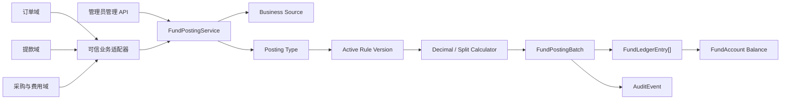

# 资金账户管理技术设计

## 1. 文档状态

- 状态：Phase 2 已确认，Phase 3 已确认，等待 Phase 4 精确 Schema/API 审批
- 编写日期：2026-08-18
- 确认日期：2026-08-18
- Requirements：`specs/fund-account-management/requirements.md`
- Tasks：`specs/fund-account-management/tasks.md`
- 实施分支：`feat/admin-fund-account-management`
- 设计边界：本设计是实施基线，但不替代数据库 Schema、Migration、公共 API 和公共数据结构的单独修改授权

## 2. 当前真相源与审计结论

### 2.1 当前仓库事实

1. `server/prisma/schema.prisma` 当前没有资金账户、业务类型、批次或流水 Model。
2. `server/src/http.modules.ts` 当前没有资金账户模块。
3. 当前唯一资金权限是 `fund-accounts:read`，由 `20260817090000_fund_account_read_permission` 标记为 `systemOnly` 并只授予 `system_admin`。
4. `/admin/fund-accounts/list` 与 `/admin/fund-accounts/transactions` 已存在并受读取权限保护，但两个页面仍是单根空白节点。
5. `AuditService` 支持由调用方传入 Prisma transaction，使审计失败能够回滚业务事务。
6. `applyTransactionTimeouts()` 固定提供 PostgreSQL `2s` lock timeout 和 `5s` statement timeout，并要求作为事务第一条 SQL。
7. `NumberingGeneratorService` 已提供内部服务、幂等哈希、请求指纹、唯一竞争恢复和结构化持久化错误映射的项目先例。
8. Web 已有 `QsGenericTable`、`QsGenericModal`、`MoneyInput`、`AmountDisplay`、`DateTimeDisplay` 等可直接复用组件。
9. OpenAPI Server/Web 双快照和 generated types 必须通过根 `contract:sync` 同步。

### 2.2 历史边界

已有 `20260817090000_fund_account_read_permission` 是不可变历史，不得把业务模型追加到该 migration。所有新类型、表、约束、权限、Audit enum 和初始化数据必须进入新的 forward migration。

### 2.3 设计结论

1. 资金模块以 `FundPostingBatch` 为业务聚合，以不可变 `FundLedgerEntry` 为账务事实，以 `FundAccount.balance` 为实时快照。
2. 业务类型使用受控、可版本化规则；不实现任意表达式、脚本或动态 SQL。
3. 业务域通过同一 NestJS Server 内导出的 `FundPostingService` 调用，不提供远程 HTTP 动账 Controller。
4. 管理员 HTTP API 只服务两个管理页面，与业务域内部动账入口分离。
5. 用户和公司多账户动账、余额、批次、流水及成功审计在同一事务内提交。
6. 批次和流水通过数据库触发器保持不可变；纠错只创建反向冲账批次。
7. 所有金额在边界使用十进制字符串，内部计算使用 Decimal，数据库使用 `DECIMAL(30,4)`。
8. 分类和比例只在新批次读取当前值，并写入不可变快照，保证历史统计准确。

## 3. UI Design Specification

### 3.1 Purpose Statement

资金账户页面服务少量超级管理员，用于核对实时余额、用户与公司承担关系、历史动账和冲账链。界面必须提高数字可比性，并在开户、比例修改、调账和冲账前让操作者清楚看到影响范围和预计余额。

### 3.2 Aesthetic Direction

采用 `Brutally minimal` 金融运营工具风格：克制边框、高信息密度、清晰数据层级、有限状态色。避免营销式大卡片、装饰图片、紫色渐变和无意义动效。

### 3.3 Color Palette

实现使用既有主题语义 Token，下列 Hex 只作为设计基准，不直接散落在业务组件：

- `#09090B`：主要文字和关键金额
- `#71717B`：辅助说明、来源和时间
- `#F4F4F5`：表头、弱背景和悬停参考
- `#FFFFFF`：亮色内容背景
- `#DC2626`：冲账等危险操作参考

负数、正数和冲账状态同时使用符号、文字和图标表达，不能只依赖颜色。深色模式完全使用现有 Token 映射。

### 3.4 Typography

- 普通中文：`Noto Sans SC`
- 金额、比例、批次号、业务单号、账户序号和时间：`Noto Sans Mono`
- 使用现有 `qs-type-data`、`qs-type-data-emphasis`、`qs-type-meta` 等语义排版类

### 3.5 Layout Strategy

目标平台为 Web。桌面采用左侧数据主轴、右侧固定操作轴的非中心布局；筛选和表格保持同一视线流，批次详情从右侧抽屉进入，模态框只处理聚焦写操作。窄屏转换为纵向卡片和底部操作区，操作顺序与桌面一致且触控目标不少于 `44px`。

### 3.6 Icon and Motion

- 图标只使用当前 Lucide 图标体系，不使用 Emoji。
- 动画复用现有页面过渡、Modal 和 Drawer 行为。
- Reduced Motion 下禁止依赖位移动画表达状态。

## 4. 目标架构



### 4.1 Server 模块边界

计划新增 `server/src/modules/fund-accounts/`：

- `fund-accounts.module.ts`：向其他 Server 模块导出 `FundPostingService`。
- `fund-posting.service.ts`：统一动账和冲账应用服务。
- `fund-posting.persistence.ts`：锁、查询、插入和余额更新的窄持久化函数。
- `fund-rule-engine.ts`：规则校验和分录计划纯函数。
- `fund-money.ts`：金额、比例、舍入和守恒纯函数。
- `fund-reversal.ts`：累计部分冲账纯计算。
- `fund-account-command.service.ts`：开户和比例修改。
- `fund-configuration-command.service.ts`：类型、规则版本和来源配置。
- `fund-query.service.ts`：账户、流水、批次和配置查询。
- `fund-accounts.controller.ts`：管理员账户与调账 API。
- `fund-transactions.controller.ts`：流水、批次详情和冲账 API。
- `fund-configuration.controller.ts`：类型、规则和来源管理 API。
- `dto/`、`*.errors.ts`、`*.normalizer.ts`：公共契约和安全输入边界。

业务域只能依赖模块导出的 `FundPostingService` 及输入/结果类型，不得导入 repository、Prisma generated client 或内部计算函数。

## 5. 数据模型

以下是已确认概念模型。Phase 4 Task 1 必须根据最新 Prisma 和 PostgreSQL 约定形成逐字段精确审批包后才能修改 Schema。

### 5.1 `FundAccount`

| 字段 | 方向 |
| --- | --- |
| `id` | UUID 主键 |
| `ownerType` | `USER` 或 `COMPANY` |
| `userId` | 用户账户必填，公司账户为空 |
| `currency` | 固定 `CNY` |
| `balance` | `Decimal(30,4)`，允许负数 |
| `userShareRate` | 用户账户必填，`0–100`；公司账户为空 |
| `nextSequence` | 下一账户流水序号 |
| `version` | 开户/比例和余额并发版本 |
| `shareRateUpdatedAt` | 比例最后修改时间 |
| `createdAt/updatedAt` | 审计时间 |

关键约束：

- `USER` 要求 `userId` 和 `userShareRate` 非空。
- `COMPANY` 要求两者为空。
- `userId` 唯一；公司账户使用 partial unique 保证全局唯一。
- `currency='CNY'`。
- `userShareRate BETWEEN 0 AND 100`。
- 账户身份不可修改，外键使用 `RESTRICT`。

### 5.2 `FundBusinessSource`

保存稳定 `code`、名称、说明、启用状态、版本和允许调用的业务类型边界。编码一旦产生批次即不可修改。首期初始化管理员调账来源，不虚构尚未确认的订单、提款或采购来源编码。

### 5.3 `FundPostingType`

保存稳定编码、名称、业务分类、是否要求用户、金额符号策略、启用状态、当前生效规则版本和并发版本。

分类：

- `REVENUE`
- `COST`
- `NEUTRAL`
- `ADJUSTMENT`

金额符号策略至少覆盖：

- `POSITIVE_ONLY`
- `NON_ZERO_SIGNED`

### 5.4 `FundPostingRuleVersion`

保存业务类型、revision、`DRAFT/ACTIVE/RETIRED` 状态、创建/发布时间和操作者。每个业务类型最多一个 ACTIVE 和一个 DRAFT；发布后不可修改。

### 5.5 `FundPostingRuleLeg`

规则分录只允许受控字段：

- 账户目标：`USER/COMPANY`
- 方向策略：固定 `CREDIT`、固定 `DEBIT`、跟随有符号业务金额
- 金额策略：`FULL_AMOUNT/USER_SHARE/COMPANY_REMAINDER`
- 稳定 position

规则发布前必须验证账户目标不重复、金额守恒、用户要求和符号策略一致。管理员调账是系统保留类型，调账模式在允许的两个分录模板中选择，不允许任意账户集合。

### 5.6 `FundPostingBatch`

保存：

- 类型、分类、来源和规则版本外键及快照。
- 条件性 `userId`。
- `businessAmount` 有符号 Decimal 和固定 `CNY`。
- 用户/公司比例快照。
- `businessId`、`businessNo`、摘要、受限 metadata、业务发生时间。
- `consumerCode`、幂等键 Hash、请求指纹 Hash。
- `adjustmentMode`，只用于管理员调账。
- `reversalOfBatchId` 和冲账原因。
- actor、requestId、correlationId、postedAt。

`FundPostingBatch` 没有可业务修改的 `updatedAt`；数据库 trigger 拒绝 `UPDATE/DELETE`。幂等唯一范围为可信调用方/来源与幂等键 Hash。

### 5.7 `FundLedgerEntry`

保存 `batchId`、lineNo、accountId、方向、账户目标、金额策略、正数金额、动账前后余额、accountSequence 和 postedAt。

关键约束：

- `(batchId, lineNo)` 唯一。
- `(accountId, accountSequence)` 唯一。
- `amount > 0`。
- 数据库 trigger 拒绝 `UPDATE/DELETE`。
- 批次、账户 FK 使用 `RESTRICT`。

### 5.8 初始化数据

新的 forward migration 计划初始化：

1. 一个稳定 UUID 的全局公司账户，余额 `0`。
2. Requirements 第 6 节的九个业务类型。
3. 每个类型首个 ACTIVE 规则版本和受控规则分录。
4. 管理员调账业务来源。
5. 新系统权限和 `system_admin` 精确授权。
6. 资金领域 AuditEventType。

Migration 不创建用户账户，不插入批次/流水，不修改现有用户和余额数据。

## 6. 金额与规则计算

### 6.1 分账

```text
baseAmount = abs(businessAmount)
userAmount = round(baseAmount * userShareRate / 100, 4, ROUND_HALF_UP)
companyAmount = baseAmount - userAmount
```

公司金额承接尾差，保证：

```text
userAmount + companyAmount = baseAmount
```

金额为零的分录不写入流水。

### 6.2 有符号订单结算

- `businessAmount > 0`：用户和公司分录均为 `CREDIT`。
- `businessAmount < 0`：用户和公司分录均为 `DEBIT`。
- `businessAmount = 0`：输入错误。

负数订单结算仍属于 `REVENUE`，作为负收益参与未来统计，而不是重新归类为成本。

### 6.3 固定成本和提款

成本和提款输入保持正数，规则决定固定 `DEBIT`。调用方不得通过传负数反转业务含义；纠错必须冲账。

### 6.4 管理员调账

- `USER_ONLY`：`abs(amount)` 全额作用于用户账户。
- `USER_AND_COMPANY_BY_SHARE`：按用户当前比例和公司尾差拆分。
- 正数生成 `CREDIT`，负数生成 `DEBIT`。
- 批次保存 `adjustmentMode` 和比例快照。

## 7. 统一内部调用契约

### 7.1 业务调用

```ts
interface FundPostingContext {
  readonly consumerCode: string
  readonly sourceCode: string
  readonly requestId: string
  readonly correlationId?: string
}

interface PostBusinessEventInput {
  readonly postingTypeCode: string
  readonly userId?: string
  readonly amount: string
  readonly businessId: string
  readonly businessNo?: string
  readonly summary: string
  readonly metadata?: Readonly<Record<string, string | number | boolean | null>>
  readonly businessOccurredAt?: string
  readonly idempotencyKey: string
}

interface FundPostingResult {
  readonly batchId: string
  readonly postingTypeCode: string
  readonly businessCategory: 'REVENUE' | 'COST' | 'NEUTRAL' | 'ADJUSTMENT'
  readonly businessAmount: string
  readonly userShareRateSnapshot: string | null
  readonly companyShareRateSnapshot: string | null
  readonly entries: readonly FundPostingResultEntry[]
  readonly postedAt: string
  readonly idempotentReplay: boolean
}
```

最终字段、最大长度和错误类型在 Phase 4 Gate B 精确冻结。`sourceCode` 由业务适配器常量绑定，不由普通业务 payload 选择。

### 7.2 调用示例

```ts
await fundPostingService.postBusinessEvent(
  {
    consumerCode: 'ORDER',
    sourceCode: 'ORDER_SYSTEM',
    requestId,
  },
  {
    postingTypeCode: 'ORDER_SETTLEMENT',
    userId,
    amount: '-100.00',
    businessId: settlementId,
    businessNo: orderNo,
    summary: '订单亏损结算',
    idempotencyKey: `order-settlement:${settlementId}`,
  },
)
```

首期不实现 `/api/internal/fund-postings`，也不使用管理员 Session Controller 代替业务域调用。

## 8. 动账事务算法

1. 在事务外规范化固定字段，校验原始幂等键长度，计算幂等 Hash 和规范化请求指纹。
2. 开始 Prisma interactive transaction。
3. 第一条 SQL 调用 `applyTransactionTimeouts()`，随后读取一次数据库时间。
4. 按 `consumer/source + idempotencyKeyHash` 查询现有批次；命中时使用 timing-safe Hash 比较请求指纹并返回重放结果。
5. 锁定并校验业务来源、业务类型和 ACTIVE 规则版本。
6. 根据规则解析用户账户和公司账户；需要用户但未开户时失败关闭。
7. 按账户 UUID 升序执行 `FOR UPDATE`，所有调用路径使用相同锁顺序。
8. 在锁内读取用户当前比例，运行纯规则引擎生成分录计划。
9. 插入不可变批次并保存分类、来源、规则和比例快照。
10. 为每个账户分配 `accountSequence`，计算前后余额，更新账户余额/序号/版本并插入流水。
11. 在同一 transaction 写入成功 AuditEvent。
12. 提交事务并返回批次与分录结果。
13. 若外层捕获幂等唯一竞争，使用第二个只读事务恢复赢家记录；指纹不一致则返回冲突。

PostgreSQL `READ COMMITTED + row-level FOR UPDATE + unique constraints` 足以满足当前账户串行化要求，不增加全局锁或更高隔离级别。

## 9. 部分冲账算法

冲账输入使用正数额度，系统从原流水推导反向方向：

1. 幂等预检。
2. `FOR UPDATE` 锁定原批次。
3. 拒绝冲账批次作为普通原目标。
4. 汇总所有已成功冲账批次，确保累计额度不超过原金额绝对值。
5. 使用原规则、原比例、原账户和原分录快照计算新的累计目标。
6. 本次账户金额等于“新累计目标 - 已累计冲账账户金额”。
7. 最后一次全额冲账时强制各账户金额精确等于原分录金额，消除舍入尾差。
8. 按原账户 UUID 升序加锁，生成相反方向的新批次和新流水。
9. 在同一 transaction 写入冲账 AuditEvent。

原批次的 `NONE/PARTIAL/FULL` 状态由关联冲账批次聚合，不写回原批次。

## 10. 管理 API 设计方向

以下是管理员页面所需方向，最终 path、operationId、DTO、状态码和错误矩阵必须在 Phase 4 Gate B 再确认：

| 能力 | 建议 API |
| --- | --- |
| 账户列表 | `GET /api/fund-accounts` |
| 创建用户账户 | `POST /api/fund-accounts` |
| 修改分成比例 | `PATCH /api/fund-accounts/{accountId}/share-rate` |
| 管理员手动调账 | `POST /api/fund-accounts/{accountId}/manual-adjustments` |
| 流水列表 | `GET /api/fund-transactions` |
| 批次详情 | `GET /api/fund-posting-batches/{batchId}` |
| 批次冲账 | `POST /api/fund-posting-batches/{batchId}/reversals` |
| 类型与规则管理 | `/api/fund-posting-types` 资源集合及 publish/enable/disable 操作 |
| 来源管理 | `/api/fund-business-sources` 资源集合及 enable/disable 操作 |

所有 mutation 使用 CSRF、相应权限、private no-store、稳定 `expectedVersion` 或幂等 Header，并禁止 Axios 自动重试。

## 11. 错误边界

计划稳定错误族：

- 账户：不存在、重复开户、公司账户不可用、状态发生变化。
- 配置：来源不存在/停用、类型不存在/停用、规则不可用、来源未授权类型。
- 输入：金额无效、用户必填、调账模式无效、metadata 超限。
- 幂等：相同键请求冲突。
- 冲账：目标无效、超过剩余额度、并发状态变化。
- 系统：锁超时、死锁、序列化冲突、未知内部错误。

错误映射只读取结构化 Prisma/PostgreSQL code、constraint 和 target；消息不得包含 SQL、连接信息、原始幂等键或完整 payload。

## 12. 权限与审计

### 12.1 管理权限

保留现有 `fund-accounts:read`，计划新增：

- `fund-accounts:create`
- `fund-accounts:update-share-rate`
- `fund-accounts:manual-adjust`
- `fund-transactions:reverse`
- `fund-posting-types:manage`
- `fund-business-sources:manage`

全部 `systemOnly=true`，只授予稳定 `system_admin`。Web `meta.auth` 和按钮权限只负责用户体验，Server `PermissionGuard` 是最终授权边界。

### 12.2 内部业务调用授权

内部业务域不使用上述人工权限。可信 adapter 固定 `consumerCode/sourceCode`，资金模块验证来源启用状态及允许类型。其他模块不得通过依赖注入获取持久化 service 绕过应用服务。

### 12.3 Audit

开户、比例修改、类型/来源/规则变更、管理员调账、业务动账和冲账均需要明确 AuditEventType。成功账务审计与业务写同事务；失败请求进入失败审计或现有可观测性边界，不制造失败资金流水。

## 13. Web 设计

### 13.1 资金账户列表

页面组合：

```text
FaPageHeader
└── 页面动作：创建账户、业务配置
FaPageMain
└── QsGenericTable
    ├── 账户主体与状态
    ├── AmountDisplay 实时余额
    ├── 用户/公司比例
    ├── DateTimeDisplay 时间
    └── actions：修改比例、手动调账、查看流水
```

领域组件：

- `fund-account-create-modal.vue`
- `fund-share-rate-modal.vue`
- `fund-manual-adjustment-modal.vue`
- `fund-configuration-drawer.vue`

调账 Modal 必须显示模式、业务金额、当前比例、用户/公司金额、当前余额和预计余额；提交结果未知时保留同一请求快照和幂等键。

### 13.2 资金账户流水

一行一个 `FundLedgerEntry`。业务列包含批次号、主体、类型/分类、来源、方向、金额、前后余额、比例、业务单号和时间。详情 Drawer 聚合同批次所有分录、业务基本信息、规则快照和冲账链；冲账 Modal 只从详情进入。

### 13.3 状态与竞态

- 页面拥有 API、权限、业务数据和 mutation；共享组件保持业务中立。
- GET 使用独立 `AbortController + requestVersion + authEpoch + permission` 守卫。
- mutation 设置 `retry:false`；网络/5xx 结果未知时只允许人工同请求重放或明确放弃。
- 身份或权限变化立即清除账户、流水、详情、表单快照和幂等上下文。

## 14. 测试策略

### 14.1 纯逻辑

- 严格 Decimal 输入、边界和超限。
- `0%/100%`、四位小数、尾差和总额守恒属性测试。
- 九种初始化类型的合法分录计划。
- 正负订单结算和两种管理员调账模式。
- 累计部分冲账和最终精确闭合。
- 请求规范化、指纹和幂等输入脱敏。

### 14.2 Schema 与 PostgreSQL

- 一用户一账户、单公司账户、固定 CNY、比例范围。
- 批次/流水 immutable trigger。
- 幂等和账户序号唯一约束。
- 空库 migration replay、二次 deploy 和 schema status。
- migration 只 seed 公司账户/配置，不 seed 用户账户或流水。

### 14.3 Service 与并发

- 同账户并发动账无丢失更新。
- 多账户固定锁顺序。
- 幂等唯一竞争恢复和指纹冲突。
- 并发部分冲账不超额。
- 审计失败完整回滚。
- 负余额、配置停用、用户未开户和来源越权。

### 14.4 HTTP/OpenAPI

- Session、强制改密、CSRF、权限和 private no-store。
- DTO 白名单、Decimal string、分页和稳定排序。
- operationId、状态码和稳定错误矩阵。
- Server/Web snapshot 字节一致，不存在远程业务动账 operation。

### 14.5 Web 与 Browser

- Web API adapter、状态机、计算预览和错误呈现。
- 两个页面的桌面、390px 窄屏、light/dark、Reduced Motion、键盘和 44px target。
- 开户、比例修改、两种调账、正负订单批次 fixture、详情、部分冲账和权限撤销。
- 独立一次性 PostgreSQL 和真实 Chrome，不写持久开发数据库。

## 15. 风险与取舍

1. 用户显式开户避免猜测比例，但未开户用户的业务动账会失败关闭。
2. 余额冗余可提供实时查询性能，但必须依赖不可变流水、账户锁和对账检查保证一致性。
3. 受控规则版本不如任意公式灵活，但显著降低资金计算、审计和安全风险。
4. 单全局公司账户是已确认业务约束；未来多公司主体需要新需求和数据迁移。
5. 内部服务适合当前模块化单体；未来拆分服务时必须另行设计机器身份和远程调用，不直接暴露当前接口。
6. 本期只保存分类快照，不提前冻结“收益率”的具体数学定义。

## 16. 明确不实施

- 外币和汇率换算。
- 全部用户批量调账。
- 直接修改余额、批次或流水。
- 删除账户、批次、流水、类型或历史规则版本。
- 任意公式/脚本引擎。
- 完整复式会计、总账、科目和凭证。
- 账户冻结、透支额度和余额不足策略。
- 收益率公式、经营统计看板和自动财务报表。
- 远程 HTTP 业务动账接口及服务间认证。

## 17. 实施门禁

### Gate A - Phase 4 与 Git 范围

开始代码前重新确认目标、范围、真相源、禁止事项、验收标准、验证命令和 Git 要求，并复核当前分支/HEAD/工作区。

### Gate B - 数据库与公共契约

必须先提交并单独确认：

1. 精确 Prisma model、enum 和关系。
2. 完整 forward SQL、约束、索引、trigger、种子和权限 ID。
3. AuditEventType 精确变化。
4. 每个管理 endpoint 的 path、operationId、DTO、状态码和错误矩阵。
5. `FundPostingService` 最终 TypeScript 输入、结果和错误契约。

设计确认、任务确认和普通“继续”均不替代该修改授权。

### Gate C - 持久开发数据库

新 migration 默认只在一次性 PostgreSQL 验证。部署到本地持久数据库前必须展示目标、待执行 migration、SQL 影响和恢复策略并另行确认。

### Gate D - 共享组件

当前设计默认不修改任何公共组件。若实际实现发现公共契约不足，停止对应任务并提交最小增量设计与测试方案。

### Gate E - 外部发布

Push、PR、merge、远程部署、生产 migration、分支删除和 worktree 清理均不在本地实施授权内。
