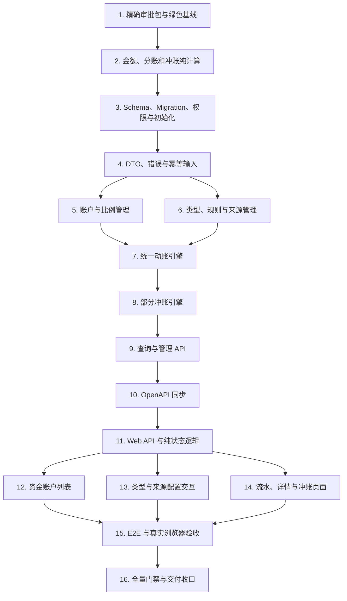

# 资金账户管理实施计划

## 1. 文档状态

- 状态：Phase 4 执行中，Task 1-5 已完成
- 生成日期：2026-08-18
- Requirements：`specs/fund-account-management/requirements.md`
- Design：`specs/fund-account-management/design.md`
- 正式 Web 应用：`web/apps/qsmds-arco`
- Server：`server`
- 实施分支：`feat/admin-fund-account-management`
- Task 3 开始时 HEAD：`2324f36`，工作区干净
- Task 3 开始前已有提交：
  - `8ea2575 feat: 添加资金账户管理空白页面`
  - `8f6f4fa feat: 限制资金账户路由仅超级管理员访问`
  - `b59761c docs: 固化资金账户管理规格`
  - `f174f46 test: 补齐资金账户权限 E2E 预期`
  - `2324f36 feat: 添加资金分账与冲账计算`

用户已确认 Phase 1 需求、Phase 2 技术设计和 Phase 3 任务顺序。该确认允许固化规格，不自动授权修改数据库 Schema、Migration、公共 API、公共数据结构或持久开发数据库。

## 2. 执行规则

1. 新功能严格采用 TDD：先建立目标能力缺失的 RED，确认失败原因，再实现最小 GREEN 并重构。
2. 不提交只有失败测试的中间状态；每个功能提交同时包含相应测试和最小实现。
3. 实施期间实时更新本文件 checkbox；测试、实现、验证和提交未全部完成时不得提前勾选。
4. `requirements.md` 与 `design.md` 是已确认真相源；任何业务语义变化先暂停并重新确认。
5. Server 与 Web 保持独立依赖域，不建立跨目录源码依赖，不在根目录安装依赖。
6. 不手工修改 Prisma generated client、OpenAPI snapshot 或 Web generated types。
7. 不修改任何已有 migration；数据库变化只追加 forward migration。
8. 金额公共边界保持 decimal string，内部使用 Decimal，不经过 JavaScript `number`。
9. 业务域只通过同一 Server 内部 `FundPostingService` 调用，不新增远程 HTTP 动账接口。
10. 页面拥有 API、权限、状态和业务动作；共享 Qs/Fa 组件保持业务中立。
11. 所有人工资金权限保持 `systemOnly` 且只授予 `system_admin`。
12. 批次、流水和历史规则版本不提供 UPDATE/DELETE。
13. 命令失败、预期红测、环境限制和无关基线失败必须区分并如实记录。
14. 每次提交前检查 staged diff、敏感文件和生成资产，Commit Message 使用英文类型和中文描述。
15. 未经明确要求，不 push、不 merge、不创建 PR、不部署、不删除分支或 worktree。

需求编号 `R1` 至 `R15` 对应 `requirements.md` 第 7 节 Requirement 1 至 Requirement 15。

## 3. 硬确认门禁

### Gate A - Phase 4 与绿色基线

开始正式实施前必须重新输出并确认：

- 目标
- 范围
- 真相源
- 禁止事项
- 验收标准
- 验证命令
- Git 要求

并复核当前分支、HEAD、工作区、未跟踪文件和相对 `main` 提交序列。

### Gate B - Schema、Migration、公共 API 与内部公共服务

Task 1 必须根据最新仓库形成精确审批包。执行 Task 3 前单独确认：

1. Prisma models、enums、字段、关系和 `onDelete/onUpdate`。
2. SQL `CHECK`、unique/partial unique、index、FK、trigger、种子和稳定 UUID。
3. 新权限、AuditEventType 与 `system_admin` 授权。
4. 空库和升级路径 migration 行为。

执行 Task 4、7-10 前单独确认：

1. `FundPostingService` 最终对象参数、返回结果和错误类型。
2. 管理 endpoints、operationId、Header、DTO、状态码和错误矩阵。
3. 管理员调账和冲账幂等契约。

### Gate C - 持久开发数据库

Task 3 的 migration 默认只进入代码并在一次性 PostgreSQL 验证。应用到本地持久数据库前必须重新展示目标数据库、migration 状态、完整 SQL 影响和恢复策略并等待确认。

### Gate D - 共享组件

当前计划默认复用 `QsGenericTable`、`QsGenericModal`、`MoneyInput`、`AmountDisplay` 和 `DateTimeDisplay`。若必须修改任一公共组件 API，停止对应任务并提交独立方案。

### Gate E - 外部动作

本地完成后暂停。Push、PR、merge、部署、生产 migration、分支删除和 worktree 清理需要新的明确授权。

## 4. 依赖顺序



不得为了并行开发跨过 Gate B，也不得在 OpenAPI 冻结和生成前手写 Web 平行 DTO。

## 5. 实施任务

- [x] 1. 取得 Phase 4 授权并建立绿色基线
  - [x] 1.1 按 Gate A 确认 Phase 4 范围、目标分支、提交节奏和禁止事项。
  - [x] 1.2 复核当前 Schema、迁移、HTTP modules、权限目录、两个空白页面和 OpenAPI 中仍没有资金业务实现。
  - [x] 1.3 形成 Gate B 精确审批包：Prisma/SQL、权限/Audit、管理 API、错误矩阵和内部服务 TypeScript 契约。
  - [x] 1.4 向用户提交审批包并取得数据库 Schema、Migration、公共 API、公共数据结构和内部公共服务的单独确认。
  - [x] 1.5 检查 `git status --short --branch`、HEAD、worktree 和未提交差异，不覆盖用户已有工作。
  - [x] 1.6 运行并记录绿色基线：

    ```bash
    pnpm -C server check
    pnpm -C server build
    node --run ci:server-e2e
    node --run contract:check
    pnpm -C web check
    pnpm -C web build
    node --run test:root
    ```

  - [x] 1.7 若存在无关基线失败，停止业务修改并如实报告；未经确认不得混入无关修复。
  - _Requirements: R1-R15_

- [x] 2. 以 TDD 实现金额、规则和冲账纯计算
  - [x] 2.1 先为严格 decimal string、最大精度、正负号和非法输入建立失败测试。
  - [x] 2.2 红测固定用户比例 `0–100`、四位小数、`ROUND_HALF_UP` 和公司尾差守恒。
  - [x] 2.3 红测固定 `ORDER_SETTLEMENT` 正数 CREDIT、负数 DEBIT、零金额拒绝。
  - [x] 2.4 红测固定提款、采购付款、房租水电和四个费用类型的正数输入与账户目标。
  - [x] 2.5 红测固定管理员 `USER_ONLY` 与 `USER_AND_COMPANY_BY_SHARE` 两种有符号调账模式。
  - [x] 2.6 红测规则发布合法性：账户目标不重复、金额守恒、用户要求和符号策略匹配。
  - [x] 2.7 红测累计部分冲账、逐次舍入、最后精确闭合和超额拒绝。
  - [x] 2.8 使用纯函数实现最小 GREEN，不提前引入 Prisma 或 HTTP DTO。
  - [x] 2.9 运行定向测试、Server typecheck、ESLint 和 diff-check。
  - [x] 2.10 创建提交：`feat: 添加资金分账与冲账计算`。
  - _Requirements: R2-R3, R6-R10, R14-R15_

- [x] 3. 以 TDD 建立 Schema、forward migration、权限和初始化数据
  - [x] 3.1 确认 Gate B 后先新增 Schema/migration 合约 RED。
  - [x] 3.2 新增 `FundAccount`、`FundBusinessSource`、`FundPostingType`、`FundPostingRuleVersion`、`FundPostingRuleLeg`、`FundBusinessSourcePostingType`、`FundPostingBatch` 和 `FundLedgerEntry`。
  - [x] 3.3 建立一用户一账户、单公司账户、固定 CNY、比例范围、正数流水金额和账户序号唯一约束。
  - [x] 3.4 建立批次幂等唯一、规则 ACTIVE/DRAFT 唯一、稳定编码和所有业务 FK `RESTRICT`。
  - [x] 3.5 建立 trigger，阻止账户主体、已使用稳定编码、批次、流水和已发布规则版本的非法修改或删除。
  - [x] 3.6 追加新 `systemOnly` 权限、AuditEventType 和 `system_admin` 排他授权自检。
  - [x] 3.7 初始化公司账户、九个业务类型、首个 ACTIVE 规则和管理员调账来源；不创建用户账户、批次或流水。
  - [x] 3.8 建立账户、流水、批次、业务标识、冲账关联和配置查询索引。
  - [x] 3.9 在一次性 PostgreSQL 验证空库 replay、第二次 deploy、status、约束、trigger、seed 和权限目录。
  - [x] 3.10 运行 Prisma validate、Schema tests、Server typecheck、lint 和 diff-check。
  - [x] 3.11 创建提交：`feat: 建立资金账户数据模型`。
  - _Requirements: R1-R4, R8-R10, R13-R15_

- [x] 4. 以 TDD 建立 DTO、错误码、幂等和输入安全边界
  - [x] 4.1 确认 Gate B 后为 UUID、分页、排序、金额、比例、业务标识、摘要、时间和 metadata 建立 DTO RED。
  - [x] 4.2 公共金额全部使用 decimal string，拒绝 number、科学计数法、空字符串、零金额和类型不允许的符号。
  - [x] 4.3 规范化可展示字段；原始幂等键按 UTF-8 bytes 校验，不 trim、不转大小写、不做 Unicode 规范化。
  - [x] 4.4 计算固定长度幂等 Hash 和版本化请求指纹；原始 key 不进入数据库、日志、错误和 Audit metadata。
  - [x] 4.5 限制 metadata 键数、键长、标量类型和总大小，拒绝 getter、symbol、嵌套对象和危险键。
  - [x] 4.6 建立账户、配置、幂等、冲账、状态变化和安全内部错误码。
  - [x] 4.7 持久化错误只读取结构化 code/constraint/target，覆盖 unique、check、lock timeout、deadlock 和 serialization failure。
  - [x] 4.8 运行 DTO/normalizer/error 定向测试、typecheck、lint 和 diff-check。
  - [x] 4.9 创建提交：`feat: 建立资金账户服务边界`。
  - _Requirements: R3-R5, R7-R10, R13-R15_

- [x] 5. 以 TDD 实现账户查询、开户和比例管理
  - [x] 5.1 红测账户列表分页、搜索、主体类型和稳定排序。
  - [x] 5.2 红测显式开户：用户存在、用户未开户、比例合法和初始余额为零。
  - [x] 5.3 红测并发重复开户只有一个成功，数据库唯一约束是最终保护。
  - [x] 5.4 红测比例修改的 `expectedVersion`、原因、审计、无变化和过期状态。
  - [x] 5.5 证明比例修改不更新任何历史批次、流水或比例快照。
  - [x] 5.6 每个 mutation transaction 第一条 SQL 调用 `applyTransactionTimeouts()`，Audit 失败完整回滚。
  - [x] 5.7 不实现自动开户、删除账户、修改公司比例或清零余额。
  - [x] 5.8 运行账户 service/persistence 定向测试、typecheck、lint 和 diff-check。
  - [x] 5.9 创建提交：`feat: 实现资金账户与比例管理`。
  - _Requirements: R1-R2, R8-R9, R13-R15_

- [ ] 6. 以 TDD 实现业务类型、规则版本和来源管理
  - [ ] 6.1 红测类型/来源列表、搜索、启用状态、分页和稳定排序。
  - [ ] 6.2 红测创建类型、DRAFT 规则、受控 legs 和来源允许类型范围。
  - [ ] 6.3 红测规则发布：锁定类型、校验完整配置、ACTIVE -> RETIRED、DRAFT -> ACTIVE。
  - [ ] 6.4 红测稳定 code、已发布版本和已使用分类不可原地修改。
  - [ ] 6.5 红测启停对新动账生效但不影响历史查询。
  - [ ] 6.6 红测管理员保留类型只允许两个调账模板，不能配置任意账户集合。
  - [ ] 6.7 所有 mutation 使用 `expectedVersion`、事务超时和同事务 Audit。
  - [ ] 6.8 不实现 DELETE 和任意脚本/公式解析。
  - [ ] 6.9 运行配置 service/persistence 定向测试、typecheck、lint 和 diff-check。
  - [ ] 6.10 创建提交：`feat: 实现资金业务配置管理`。
  - _Requirements: R3-R4, R6-R9, R13-R15_

- [ ] 7. 以 TDD 实现统一内部动账引擎
  - [ ] 7.1 确认 Gate B 的内部契约后，为九种类型建立 service RED。
  - [ ] 7.2 实现 `FundPostingService.postBusinessEvent(context, input)`，只导出业务所需对象契约。
  - [ ] 7.3 事务第一条 SQL 设置超时并读取一次数据库时间。
  - [ ] 7.4 依次执行幂等预检、来源/类型/规则校验、账户解析和按 UUID 升序锁定。
  - [ ] 7.5 在锁内读取比例并调用纯规则引擎；调用方不得指定账户、方向、比例或拆分金额。
  - [ ] 7.6 原子插入批次、快照、流水，更新余额/序号/版本并写成功 Audit。
  - [ ] 7.7 允许负余额，省略零金额 legs，证明分录合计严格守恒。
  - [ ] 7.8 处理幂等唯一竞争：重新读取赢家、timing-safe 指纹比较、相同请求重放、不同请求冲突。
  - [ ] 7.9 证明来源停用、类型停用、未开户、规则无效和 Audit 失败均不生成资金流水。
  - [ ] 7.10 不新增远程 HTTP 动账 Controller，不允许业务模块依赖持久化层。
  - [ ] 7.11 运行纯逻辑、service、persistence、并发定向测试、typecheck、lint 和 diff-check。
  - [ ] 7.12 创建提交：`feat: 实现统一资金动账引擎`。
  - _Requirements: R3-R9, R13-R15_

- [ ] 8. 以 TDD 实现批次级部分冲账
  - [ ] 8.1 为正收益、负收益、成本、提款和两种管理员调账建立部分冲账 RED。
  - [ ] 8.2 实现 `reversePostingBatch(context, input)` 幂等边界和原批次 `FOR UPDATE`。
  - [ ] 8.3 汇总历史冲账，拒绝超额、零额度、无效目标和冲账批次再冲账。
  - [ ] 8.4 使用原类型、分类、规则、比例、模式和分录快照生成相反方向流水。
  - [ ] 8.5 使用累计目标法分配多次部分冲账金额，最终全额冲账与原分录精确闭合。
  - [ ] 8.6 按原账户 UUID 升序加锁，在一个 transaction 写冲账批次、流水、余额和 Audit。
  - [ ] 8.7 并发冲账最多提交合法剩余额度，失败事务不得产生半边账户变化。
  - [ ] 8.8 通过聚合派生 `NONE/PARTIAL/FULL`，不更新原批次状态字段。
  - [ ] 8.9 运行冲账 unit/persistence/concurrency 定向测试、typecheck、lint 和 diff-check。
  - [ ] 8.10 创建提交：`feat: 实现资金流水部分冲账`。
  - _Requirements: R8-R10, R13-R15_

- [ ] 9. 以 TDD 实现查询与管理员管理 API
  - [ ] 9.1 确认 Gate B 后建立 Controller metadata、DTO、operationId 和错误矩阵 RED。
  - [ ] 9.2 实现账户列表、创建账户、修改比例和管理员调账 API。
  - [ ] 9.3 实现流水分页、批次详情和批次冲账 API。
  - [ ] 9.4 实现类型、规则版本、发布/启停和来源管理 API。
  - [ ] 9.5 账户/流水查询使用稳定排序和 UUID tie-breaker；金额只返回 string。
  - [ ] 9.6 流水支持账户、用户、类型、分类、来源、方向、业务单号、时间和冲账状态过滤。
  - [ ] 9.7 所有 mutation 启用 session、password-change、CSRF、permission、private no-store 和局部错误矩阵。
  - [ ] 9.8 注册 `FundAccountsModule` 到 `HTTP_MODULES`，同时向 Server 业务模块导出内部服务。
  - [ ] 9.9 证明 OpenAPI 不包含远程业务动账 operation 和 DELETE operation。
  - [ ] 9.10 运行 Controller/Module/Query tests、Server typecheck、lint、build 和 diff-check。
  - [ ] 9.11 创建提交：`feat: 提供资金账户管理接口`。
  - _Requirements: R1-R4, R7, R10-R15_

- [ ] 10. 同步 OpenAPI 与 Web generated contract
  - [ ] 10.1 先运行 `contract:check`，记录 tracked snapshot 缺少新管理 operations 的预期 RED。
  - [ ] 10.2 串行运行根 `contract:sync`，不得手工修改 snapshot 或 generated types。
  - [ ] 10.3 核对 diff 只包含已确认的资金管理 endpoints、DTO、Header、状态码、权限相关错误和 Audit enum。
  - [ ] 10.4 证明 Server/Web OpenAPI snapshot 字节一致，Web generated types 可重建。
  - [ ] 10.5 运行 `contract:check`、contract baseline、Server build、Web typecheck 和 diff-check。
  - [ ] 10.6 创建提交：`chore: 同步资金账户接口契约`。
  - _Requirements: R5, R7, R10-R15_

- [ ] 11. 以 TDD 实现 Web API adapter 与纯状态逻辑
  - [ ] 11.1 为 generated DTO adapter、查询编码、AbortSignal、mutation config 和错误映射建立 RED。
  - [ ] 11.2 实现账户、流水、批次、类型和来源查询 adapter；所有 GET 显式接收 AbortSignal。
  - [ ] 11.3 实现开户、比例、调账、冲账和配置 mutation adapter，统一 `retry:false`、local error presentation。
  - [ ] 11.4 实现 `requestVersion + authEpoch + permission + Abort` 竞态守卫。
  - [ ] 11.5 实现开户、比例、两种调账、详情和冲账纯状态机。
  - [ ] 11.6 幂等键仅在首次有效提交时生成；network/5xx 保留冻结 key/payload，4xx 清除并解锁编辑。
  - [ ] 11.7 实现分账和预计余额预览，复用与 Server 相同的 decimal 语义但不将前端预览视为账务真相。
  - [ ] 11.8 不创建全局资金 Store，不复制 generated DTO，不把金额转换为 number。
  - [ ] 11.9 运行 Web API/logic 定向测试、typecheck、ESLint 和 diff-check。
  - [ ] 11.10 创建提交：`feat: 建立资金账户前端状态`。
  - _Requirements: R1-R4, R7, R10-R15_

- [ ] 12. 以 TDD 实现资金账户列表页面
  - [ ] 12.1 先建立 View RED，固定 `FaPageHeader + FaPageMain + QsGenericTable`、权限和数据状态。
  - [ ] 12.2 实现账户主体、实时余额、比例、时间和公司账户标识列；不展示内部 version 或技术字段。
  - [ ] 12.3 使用 `AmountDisplay`、`DateTimeDisplay` 和语义数据排版；负余额同时展示负号和文字语义。
  - [ ] 12.4 实现创建账户 Modal，选择未开户用户并输入初始比例。
  - [ ] 12.5 实现比例修改 Modal，展示当前值、未来生效说明、原因和并发版本。
  - [ ] 12.6 实现管理员调账 Modal，支持两种模式、正负金额、原因、比例和预计余额预览。
  - [ ] 12.7 公司账户不显示用户比例修改和用户调账；行操作提供指定账户流水跳转。
  - [ ] 12.8 覆盖窄屏卡片、44px target、键盘、light/dark、Reduced Motion 和无页面级横向溢出。
  - [ ] 12.9 不修改共享组件契约，不实现全部用户批量调账。
  - [ ] 12.10 运行 View/logic/API 定向测试、Web typecheck、lint、build 和 diff-check。
  - [ ] 12.11 创建提交：`feat: 实现资金账户列表页面`。
  - _Requirements: R1-R2, R7, R11, R13-R15_

- [ ] 13. 以 TDD 实现业务类型与来源配置交互
  - [ ] 13.1 先建立配置 Drawer/Modal RED，不新增第三个路由。
  - [ ] 13.2 类型列表展示编码、名称、分类、金额策略、账户目标、生效版本和启用状态。
  - [ ] 13.3 实现类型创建、规则草稿、受控 leg 编辑、发布、启用和停用。
  - [ ] 13.4 实现来源创建、允许类型范围、编辑、启用和停用。
  - [ ] 13.5 已使用编码、已发布版本和历史分类只读；危险状态变化使用明确确认 Modal。
  - [ ] 13.6 结果未知时重新读取配置核对，不自动重复 mutation。
  - [ ] 13.7 覆盖 permission revocation、身份切换、窄屏、键盘和错误恢复。
  - [ ] 13.8 不实现任意公式编辑器、删除或收益率配置。
  - [ ] 13.9 运行配置 View/API/logic 定向测试、Web typecheck、lint、build 和 diff-check。
  - [ ] 13.10 创建提交：`feat: 实现资金业务配置交互`。
  - _Requirements: R3-R4, R11, R13-R15_

- [ ] 14. 以 TDD 实现流水、批次详情和冲账页面
  - [ ] 14.1 先建立 View RED，固定一行一条流水、服务端筛选和稳定查询状态。
  - [ ] 14.2 实现批次、账户主体、类型/分类、来源、方向、金额、前后余额、比例、业务单号和时间列。
  - [ ] 14.3 实现账户、用户、类型、分类、来源、方向、业务单号、时间和冲账状态筛选。
  - [ ] 14.4 实现批次详情 Drawer，展示全部分录、业务基本信息、规则/来源/比例快照和冲账链。
  - [ ] 14.5 实现部分冲账 Modal，展示原金额、已冲、剩余、本次额度、原分账和预计反向金额。
  - [ ] 14.6 冲账原因必填；结果未知时保留相同 key/payload 并冻结表单。
  - [ ] 14.7 页面和详情不提供编辑、删除、直接余额修正或冲账批次再次冲账入口。
  - [ ] 14.8 覆盖正收益、负收益、成本、提款、两种调账、部分/全部冲账展示。
  - [ ] 14.9 覆盖桌面/窄屏、light/dark、Reduced Motion、键盘和权限撤销。
  - [ ] 14.10 运行 View/API/logic 定向测试、Web typecheck、lint、build 和 diff-check。
  - [ ] 14.11 创建提交：`feat: 实现资金账户流水页面`。
  - _Requirements: R6-R10, R12-R15_

- [ ] 15. 完成 PostgreSQL E2E 与真实浏览器验收
  - [ ] 15.1 建立独立资金账户 Server E2E fixture，只使用一次性 PostgreSQL。
  - [ ] 15.2 覆盖一用户一账户、单公司账户、CNY、比例边界、immutable trigger 和无用户账户 seed。
  - [ ] 15.3 覆盖九种类型、正负订单结算、两种调账、负余额、来源授权和规则版本快照。
  - [ ] 15.4 覆盖同 key 重放/冲突、同账户并发、多账户稳定锁顺序、Audit 失败回滚和账户序号连续。
  - [ ] 15.5 覆盖部分冲账、最终闭合、并发不超额、冲账状态聚合和历史分类抵销。
  - [ ] 15.6 验证空库全量 migration、第二次 deploy、status up to date 和不写持久开发数据库。
  - [ ] 15.7 新增独立 `ci:browser-fund-accounts-e2e` 根编排和 Browser 测试，不复用持久数据。
  - [ ] 15.8 Browser 覆盖开户、比例修改、两种正负调账、账户列表、流水筛选、详情和部分冲账。
  - [ ] 15.9 覆盖 system_admin 排他权限、1440x900、390x844、light/dark、Reduced Motion、键盘、44px target 和无横向溢出。
  - [ ] 15.10 若 E2E 暴露生产缺陷，使用独立 `fix:` 提交最小修复；纯验收提交：`test: 补齐资金账户端到端验收`。
  - _Requirements: R1-R15_

- [ ] 16. 完成全量验证、规格状态和 Git 收口
  - [ ] 16.1 冻结生产/测试源码，汇总 Task 2-15 的真实 RED/GREEN、失败、警告和提交 SHA。
  - [ ] 16.2 串行执行第 7 节完整验证矩阵，不使用旧输出声称通过。
  - [ ] 16.3 复核最终文件矩阵：无旧 migration 改写、DELETE、远程业务动账 API、全部用户调账、额外币种、依赖/lockfile、生成目录或敏感文件。
  - [ ] 16.4 明确记录 Gate C 状态；未授权时 migration 只在一次性 PostgreSQL 验证，不部署到持久开发数据库。
  - [ ] 16.5 更新 Requirements、Design 和 Tasks 状态、真实提交证据和最终验证结果。
  - [ ] 16.6 暂存精确文档文件，检查 secrets/staged diff，创建提交：`docs: 完成资金账户管理实施验收`。
  - [ ] 16.7 核对 `git status --short --branch`、相对基线提交序列和每个提交范围，向用户交付本地结果后暂停。
  - [ ] 16.8 不执行 push、PR、merge、deploy、持久数据库 migration 或分支清理。
  - _Requirements: R1-R15_

## 6. 建议提交顺序

在已有 `8ea2575`、`8f6f4fa` 之后按以下顺序小步提交：

1. `docs: 固化资金账户管理规格`
2. `feat: 建立资金账户计算内核`
3. `feat: 建立资金账户数据模型`
4. `feat: 建立资金账户服务边界`
5. `feat: 实现资金账户与比例管理`
6. `feat: 实现资金业务配置管理`
7. `feat: 实现统一资金动账引擎`
8. `feat: 实现资金流水部分冲账`
9. `feat: 提供资金账户管理接口`
10. `chore: 同步资金账户接口契约`
11. `feat: 建立资金账户前端状态`
12. `feat: 实现资金账户列表页面`
13. `feat: 实现资金业务配置交互`
14. `feat: 实现资金账户流水页面`
15. `test: 补齐资金账户端到端验收`
16. `docs: 完成资金账户管理实施验收`

若 Browser/E2E 暴露独立生产缺陷，在对应功能提交之后增加明确的 `fix:` 提交，不隐藏在测试或文档提交中。

## 7. 验证矩阵

### 7.1 Phase 3 文档验证

```bash
node --run test:root
git diff --check
git status --short --branch
```

### 7.2 Server 定向与静态验证

```bash
pnpm -C server prisma:validate
pnpm -C server test -- fund --runInBand
pnpm -C server typecheck
pnpm -C server lint
pnpm -C server build
```

### 7.3 数据库与 Server E2E

```bash
node --run ci:server-e2e
```

该命令必须在一次性 PostgreSQL 中覆盖 migration deploy 两次与 status，不连接持久开发数据库。

### 7.4 OpenAPI

```bash
node --run contract:check
node --run ci:contract
```

`ci:contract` 若依赖 GitHub event 环境而无法本地执行，应如实报告，并运行其本地 baseline 测试，不伪造 CI 参数。

### 7.5 Web

```bash
pnpm -C web test:api
pnpm -C web typecheck
pnpm -C web lint
pnpm -C web build
```

### 7.6 Browser

```bash
node --run ci:browser-fund-accounts-e2e
```

### 7.7 根级收口

```bash
node --run test:root
node --run check
node --run build
git diff --check
git status --short --branch
```

## 8. 当前停止点

Phase 3 文档固化完成后停止。下一步是 Task 1：重新取得 Phase 4 Gate A，并提交 Gate B 精确审批包；在用户单独确认前不得修改 Schema、Migration、公共 API 或业务代码。
