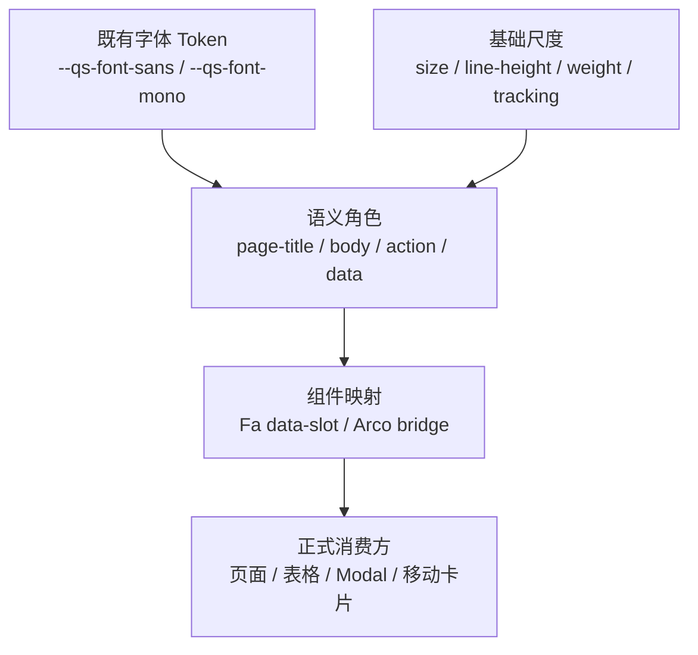

# 全局排版 Token 技术设计

## 1. 文档状态

- 状态：待用户确认
- 需求规格：[全局排版规范需求](./requirements.md)
- 后续实施计划：设计确认后生成 `tasks.md`
- 关联现行规范：
  - [全局字体统一设计](../../docs/前端文档/全局字体统一设计.md)
  - [组件库建设方案](../../docs/前端文档/组件库建设方案.md)
  - [应用边界规范](../../docs/前端文档/应用边界规范.md)

偏离本设计前必须先更新 `requirements.md` 或本文档并重新确认，不能在实施阶段通过局部 CSS 临时扩大范围。

## 2. 设计目标

本设计在不重做页面布局、不改变业务交互、不新增公共组件数据结构的前提下，建立以下能力：

1. 项目自身显式拥有字号、行高、字重和字距真相源。
2. 页面、表单、操作、标签、表格、数据和弹窗通过语义角色消费排版。
3. 正式应用同时桥接 Fa 与仍在使用的 Arco 组件。
4. 桌面表格与移动卡片共享相同的数据语义。
5. 排版颜色继续来自现有亮暗主题 Token。
6. 测试能够检测 Token 缺失、组件映射漂移和历史 utility 回流。

## 3. 当前设计

### 3.1 全局真相源

| 能力 | 当前真相源 | 当前状态 |
| --- | --- | --- |
| Sans/Mono 字体 | `apps/qsmds-arco/src/assets/styles/globals.css` | 已统一为 Noto |
| Uno 字体映射 | `web/uno.config.ts` | `font-sans`、`font-mono` 已指向产品字体 Token |
| 亮暗颜色 | `web/packages/themes/index.ts` | 已有 `foreground`、`muted-foreground` 等语义 Token |
| 根字号 | Arco CSS `body` | 隐式 `14px`，项目未接管 |
| 根行高 | Arco CSS `body` | 运行时约 `21px`，项目未接管 |
| 字号/行高/字重 | Uno utility 与组件局部样式 | 没有全局真相源 |
| 数据排版 | `font-qs-data-mono`、局部 utility、局部 CSS | 角色不完整且存在漂移 |

`globals.css` 的加载顺序晚于 Arco CSS，因此字体家族已经成功覆盖第三方默认值；但它只声明了 `font-family`，没有显式声明 `font-size`、`line-height` 和 `font-weight`。

### 3.2 运行时审计基线

审计环境：

- 登录页桌面：`1280×720`
- 正式应用桌面：`1920×866`
- 移动端：`390×844`
- 主题：亮色运行时；暗色 Token 和 `.dark` 规则源码链路

| 场景 | 当前实际排版 | 设计判断 |
| --- | --- | --- |
| 根正文 | Sans `14/21/400` | 应显式收敛为 `14/20/400` |
| 系统页面标题 | Sans `24/32/400` | 字重提升到 `600`，移动端降为 `20/28` |
| 页面说明 | Sans `14/20/400`，`secondary-foreground/50` | 改为 description + `muted-foreground` |
| 组件目录 Hero | 桌面 `30/37.5/600`，移动 `24/30/600` | 归入 display-title |
| 登录标题 | Sans `36/40/700` | 保留为 auth-display |
| Feature 卡片标题 | Sans `14/20/600` | 归入 compact-title |
| Fa 表单标签 | Sans `14/14/500` | 行高提升到 `20px` |
| Fa Input | 桌面 `14/20/400`，移动 `16/24/400` | 保留响应式策略 |
| FaButton | Sans `14/20/500` | 归入 action |
| Arco Button | Sans `14/约22/400` | 仅普通尺寸桥接到 action |
| FaTag | Sans `12/16/600` | 归入 status-tag |
| FaBadge | Sans `12/16/500` | 归入 tag |
| Arco Tag | Sans `12/22/500` | 需要受控桥接 |
| FaTable 表头 | Sans `14/20/500` | 全局改为 `13/18/600` |
| QsGenericTable 表头 | Sans `13/18/600` | 值保留，改为消费全局 Token |
| 单号 | 桌面 Mono `13/20/600`，移动 Mono `14/20/600` | 统一为 `14/20/500` |
| 数量/百分比 | Sans `14/20/500` | 统一为 Mono `14/20/400` |
| 金额 | Mono `14/20/600` | 降为 `500` |
| 系统日期 | Sans `14/20-21/400` | 统一为 Mono `14/20/400` |
| FaModal 标题 | Sans `18/18/600` | 行高提升到 `24px` |
| 用户移动卡片标签 | Sans `12/16/400` | 统一为 compact-label `500` |
| Qs 移动卡片标签 | Sans `12/16/500` | 已接近目标 |
| 角色/审计移动标签 | 部分 Sans `14/400` | 收敛为 compact-label |

`390px` 下，用户管理和 `QsGenericTable` 均已使用卡片而非桌面表格，未观察到水平溢出；本设计保持该布局策略。

### 3.3 当前 utility 分布

正式应用与共享组件仍大量直接组合：

- `text-*`
- `leading-*`
- `font-*`
- `tracking-*`

源码审计得到相关组合超过 700 处。该数字说明需要语义抽象，但不授权一次性全仓替换。本次只迁移已审计且具有稳定语义的消费方。

### 3.4 两套组件排版并存

当前正式应用同时使用：

1. Fantastic-admin / Fa 基础组件。
2. Arco Design Vue 组件。

Fa 组件主要由 Uno utility 决定排版，Arco 组件主要由锁定版本 CSS 决定排版。全局 Token 必须分别提供：

- Fa 的语义 shortcut 或稳定 `data-slot` 映射。
- Arco 的应用级 bridge。

不得修改 `web/node_modules/@arco-design/web-vue/dist/arco.css`。

## 4. 目标 Token 架构

### 4.1 分层



设计原则：

1. 字体家族继续直接消费既有 `--qs-font-sans` 和 `--qs-font-mono`。
2. 不创建 `--qs-type-*-font-family` 二级字体别名，避免字体守卫和真相源分裂。
3. 基础尺度只表达数值，不表达页面语义。
4. 语义角色组合字体家族、字号、行高、字重、字距和数字特性。
5. 颜色引用现有主题 Token，不进入基础排版尺度。
6. 组件映射负责把语义角色落到 Fa、Arco 和应用组件。

### 4.2 基础 Token

基础 Token 放入 `web/apps/qsmds-arco/src/assets/styles/globals.css`，紧跟现有字体 Token，命名如下：

| Token | 值 |
| --- | --- |
| `--qs-type-size-xs` | `0.75rem` |
| `--qs-type-size-sm` | `0.875rem` |
| `--qs-type-size-md` | `1rem` |
| `--qs-type-size-lg` | `1.125rem` |
| `--qs-type-size-xl` | `1.25rem` |
| `--qs-type-size-2xl` | `1.5rem` |
| `--qs-type-size-3xl` | `1.875rem` |
| `--qs-type-size-4xl` | `2.25rem` |
| `--qs-type-leading-xs` | `1rem` |
| `--qs-type-leading-sm` | `1.25rem` |
| `--qs-type-leading-md` | `1.5rem` |
| `--qs-type-leading-lg` | `1.75rem` |
| `--qs-type-leading-xl` | `2rem` |
| `--qs-type-leading-2xl` | `2.375rem` |
| `--qs-type-leading-3xl` | `2.5rem` |
| `--qs-type-weight-regular` | `400` |
| `--qs-type-weight-medium` | `500` |
| `--qs-type-weight-semibold` | `600` |
| `--qs-type-weight-bold` | `700` |
| `--qs-type-tracking-normal` | `0` |
| `--qs-type-tracking-tight` | `-0.025em` |
| `--qs-type-tracking-wide` | `0.16em` |

`13px` 表头是组件密度需求，不增加到通用字号尺度；由 `table-header` 组件 Token 使用 `0.8125rem`。

### 4.3 语义 Token

语义角色由 `web/uno.config.ts` 的 `qs-type-*` shortcuts 和应用级 CSS 规则共同提供。

| 语义角色 | 字体 | 桌面规格 | 移动规格 | 颜色/特性 |
| --- | --- | --- | --- | --- |
| `display-title` | Sans | `30/38/600` | `24/32/600` | foreground，tight |
| `auth-display` | Sans | `36/40/700` | 同桌面 | foreground |
| `page-title` | Sans | `24/32/600` | `20/28/600` | foreground |
| `section-title` | Sans | `18/28/600` | 同桌面 | foreground |
| `component-title` | Sans | `16/24/600` | 同桌面 | foreground |
| `compact-title` | Sans | `14/20/600` | 同桌面 | foreground |
| `body` | Sans | `14/20/400` | 同桌面 | foreground |
| `body-medium` | Sans | `14/20/500` | 同桌面 | foreground |
| `body-relaxed` | Sans | `14/24/400` | 同桌面 | foreground |
| `description` | Sans | `14/20/400` | 同桌面 | muted |
| `meta` | Sans | `12/16/400` | 同桌面 | muted |
| `compact-label` | Sans | `12/16/500` | 同桌面 | muted |
| `form-label` | Sans | `14/20/500` | 同桌面 | foreground |
| `form-help` | Sans | `12/16/400` | 同桌面 | muted/destructive |
| `form-control` | Sans | `14/20/400` | `16/24/400` | foreground |
| `action` | Sans | `14/20/500` | 同桌面 | 继承按钮语义颜色 |
| `tag` | Sans | `12/16/500` | 同桌面 | 继承标签语义颜色 |
| `status-tag` | Sans | `12/16/600` | 同桌面 | 继承状态颜色 |
| `dialog-title` | Sans | `18/24/600` | 同桌面 | foreground |
| `table-header` | Sans | `13/18/600` | 不适用 | muted，`0.01em` |
| `data` | Mono | `14/20/400` | 同桌面 | foreground，`tabular-nums` |
| `data-emphasis` | Mono/Sans | `14/20/500` | 同桌面 | foreground，数字启用 `tabular-nums` |
| `action-disabled` | Sans | 继承 action | 同桌面 | `opacity: 0.5` |

### 4.4 Shortcut 与 fallback

`web/uno.config.ts` 增加 `qs-type-*` shortcuts，供正式应用模板和共享组件使用。

约束：

1. shortcut 优先引用 `--qs-type-*`。
2. 引用正式应用 CSS 变量时必须带静态 fallback。
3. 共享组件即使在未加载正式应用 `globals.css` 的参考应用中，也应回退到当前可用排版，而不是产生无效声明。
4. shortcut 不包含背景、边框、padding、height、radius 或交互状态。
5. `font-sans`、`font-mono` 继续引用现有字体 Token。

如果 Uno 对带 fallback 的任意值生成存在解析限制，则采用以下次序决策：

1. 共享组件保留现有静态 utility。
2. 正式应用通过稳定 `data-slot` 在后加载的全局 CSS 中覆盖排版。
3. 不为解决 shortcut 解析而把应用级 Token 复制到参考应用。

## 5. 全局级联与组件映射

### 5.1 加载顺序

现有顺序：

```text
Arco CSS
  -> virtual:uno.css
  -> globals.css
```

本设计继续把 Token 和 bridge 放在后加载的应用全局 CSS 中，确保：

- 可以覆盖 Arco 默认字体指标。
- 不修改第三方源码。
- 页面局部明确的 `!important` 仍可作为经过审查的例外。

本次优先直接扩展 `globals.css`，避免为不足 200 行的规则新增第二个全局样式入口。若实施后文件职责明显过大，再在设计更新后拆分 `typography.css`。

### 5.2 根元素

`body` 显式应用：

```text
font-family: var(--qs-font-sans)
font-size: var(--qs-type-size-sm)
font-weight: var(--qs-type-weight-regular)
line-height: var(--qs-type-leading-sm)
```

该规则把运行时从约 `14/21/400` 收敛到 `14/20/400`。

### 5.3 Fa 组件

优先顺序：

1. 组件已有稳定 `data-slot` 时，由应用全局 CSS 映射。
2. 组件语义需要在模板中显式表达时，增加 `qs-type-*` shortcut。
3. 不为了排版复制组件或建立应用级 wrapper。

目标映射：

| 组件/slot | 语义角色 |
| --- | --- |
| `FaPageHeader` title | `page-title` |
| `FaPageHeader` description | `description` |
| `[data-slot="button"]` | `action` |
| `[data-slot="label"]` | `form-label` |
| FormDescription / FormMessage | `form-help` |
| `[data-slot="input"]`、`[data-slot="textarea"]` | `form-control` |
| `[data-slot="tag"]` | `status-tag` |
| `[data-slot="badge"]` | `tag` |
| `[data-slot="table"]`、`[data-slot="table-cell"]` | `body` |
| `[data-slot="table-head"]` | `table-header` |
| `[data-slot="table-footer"]` | `body-medium` |
| `[data-slot="dialog-title"]` | `dialog-title` |
| DialogDescription | `description` |
| `[data-slot="sheet-title"]` | `dialog-title` |
| SheetDescription | `description` |

FaButton 已满足 `14/20/500` 和禁用 `opacity: 0.5`，实施只建立语义消费，不改变高度、padding、variant 或焦点样式。

### 5.4 Arco bridge

bridge 只覆盖正式应用已经使用且审计过的字体指标：

| Arco 选择器 | 目标角色 |
| --- | --- |
| `.arco-btn:not(.arco-btn-size-mini)` | `action` |
| `.arco-btn-size-mini` | 保留 `12px` 尺寸，只统一字体家族与明确字重 |
| `.arco-form-item-label` | `form-label` |
| `.arco-form-item-extra` | `form-help` muted |
| `.arco-form-item-message` | `form-help` destructive |
| `.arco-input`、`.arco-textarea` | `form-control` |
| `.arco-tag` | `tag` 或已知状态标签角色 |
| `.arco-modal-title` | `dialog-title` |
| `.arco-modal-body` | `body` |

bridge 禁止修改：

- 高度、padding、宽度和定位。
- focus、hover、loading、disabled 行为。
- 主题颜色、背景、边框和阴影。
- Arco CSS 文件本身。

### 5.5 页面标题

`FaPageHeader` 标题添加稳定语义 hook，并移除描述上的 `secondary-foreground/50`。

应用级例外：

- 登录页使用 `auth-display`。
- 组件目录 Hero 使用 `display-title`。
- 普通页面统一使用 `page-title`。
- 业务区块使用 `section-title`。

## 6. 数据与表格设计

### 6.1 数据角色

| 数据类型 | 角色 | 示例 |
| --- | --- | --- |
| identifier | `data-emphasis` | 结算单号、角色编码、权限编码、请求标识 |
| numeric | `data` | 数量、百分比、票数 |
| datetime | `data` | 创建时间、最近登录、审计时间 |
| amount | `data-emphasis` | 金额 |
| summary | `data-emphasis` 或 `body-medium` | 数值汇总或文字汇总 |
| ordinary | `body` | 路线、负责人、显示名称 |
| meta | `meta` | 行号、来源、辅助说明 |

Mono 只用于结构化数据，不用于所有右对齐内容，也不用于普通中文值。

### 6.2 DateTimeDisplay

目标：

- `font-qs-data-mono`
- `14/20/400`
- `tabular-nums`
- 移除 `font-medium`
- 移除 `tracking-tight`

本次不修改日期格式、时区、空值或 invalid value 行为。

### 6.3 AmountDisplay

目标：

- `font-qs-data-mono`
- `14/20/500`
- `tabular-nums`
- `font-semibold` 降为 `font-medium`

本次不修改货币格式、精度、符号或颜色输入。

### 6.4 FaTable

正式应用内所有 FaTable：

- 表头自动使用 `table-header`。
- 普通单元格使用 `body`。
- 表尾汇总默认使用 `body-medium`。
- 具体数据语义由 cell slot 或显示组件表达。

### 6.5 QsGenericTable

`QsGenericTable` 当前已经有 `13/14/12` 的局部尺度，但需要改为消费全局角色：

1. 删除局部 `--qs-table-header-font-size`、`--qs-table-body-font-size`、`--qs-table-meta-font-size`。
2. 表头映射 `table-header`。
3. 普通单元格映射 `body`。
4. 默认移动卡片字段名映射 `compact-label`。
5. 行号映射 `meta`，字重从 `500` 降为 `400`。
6. 分页数字继续启用 `tabular-nums`。
7. 删除“所有右对齐单元格自动 `500`”的规则。
8. 固定列、排序、悬停、汇总布局和操作列行为保持不变。

### 6.6 列语义边界

本次不向 `QsGenericTable` column 新增：

```ts
semantic: 'identifier' | 'numeric' | 'datetime' | 'amount'
```

原因：

- 这是公共组件数据结构变化，需要单独确认。
- 当前真实调用方不足以证明一套稳定字段。
- 已有 slot、`cellClass` 和显示组件能够完成首期迁移。

## 7. 移动端设计

### 7.1 保持现有响应式布局

- 桌面使用 table。
- 窄屏使用卡片。
- 操作使用现有 Drawer。
- 不新增横向滚动容器。

### 7.2 字段映射

| 移动卡片内容 | 角色 |
| --- | --- |
| 卡片标题 | `compact-title` |
| 字段名 | `compact-label` |
| 普通值 | `body` |
| 编码/单号 | `data-emphasis` |
| 数量/百分比 | `data` |
| 日期时间 | `data` |
| 重点值 | `data-emphasis` 或 `body-medium` |
| 状态 | `status-tag` |
| 操作 | `action` |

### 7.3 正式迁移页面

只迁移以下已审计页面：

1. `views/system/users/index.vue`
2. `views/system/roles/index.vue`
3. `views/system/permissions/index.vue`
4. `views/system/audit/index.vue`
5. `views/component_library/business/components/GenericTableShowcase.vue`

其他页面通过全局组件规则自然受益，但不在本次逐一替换局部 utility。

## 8. 文件落点

### 8.1 Token 与全局级联

| 文件 | 目标变化 |
| --- | --- |
| `web/apps/qsmds-arco/src/assets/styles/globals.css` | 基础 Token、根排版、Fa slot 映射、Arco bridge |
| `web/uno.config.ts` | `qs-type-*` shortcuts 与安全 fallback |

### 8.2 Fa 基础组件

| 文件 | 目标变化 |
| --- | --- |
| `packages/components/src/basic/page-header/index.vue` | title/description 语义 |
| `packages/components/src/basic/button/button/index.ts` | action 语义 |
| `packages/components/src/basic/form/FormItem.vue` | label/help 行高和语义 |
| `packages/components/src/basic/label/label/Label.vue` | 通用 label 对齐 |
| `packages/components/src/basic/input/input/Input.vue` | form-control |
| `packages/components/src/basic/textarea/textarea/Textarea.vue` | form-control |
| `packages/components/src/basic/select/select/SelectTrigger.vue` | form-control |
| `packages/components/src/basic/tag/tag/index.ts` | status-tag |
| `packages/components/src/basic/table/table/Table.vue` | body |
| `packages/components/src/basic/table/table/TableHead.vue` | table-header |
| `packages/components/src/basic/table/table/TableFooter.vue` | body-medium |
| `packages/components/src/basic/modal/dialog/DialogTitle.vue` | dialog-title |
| `packages/components/src/basic/modal/dialog/DialogDescription.vue` | description |
| `packages/components/src/basic/drawer/sheet/SheetTitle.vue` | dialog-title |
| `packages/components/src/basic/drawer/sheet/SheetDescription.vue` | description |

实施时如果稳定 `data-slot` 已能完成正式应用映射，则不修改对应共享组件；最终差异以最小修改为准。

### 8.3 数据、表格与页面

| 文件 | 目标变化 |
| --- | --- |
| `components/base/DateTimeDisplay/index.vue` | datetime |
| `components/base/AmountDisplay/index.vue` | amount/emphasis |
| `components/business/QsGenericTable/index.vue` | 全局表格角色 |
| `components/business/QsGenericTable/QsTableStackedLine.vue` | meta |
| `views/component_library/business/components/GenericTableShowcase.vue` | 验收样本 |
| `views/system/users/index.vue` | 用户移动卡片 |
| `views/system/roles/index.vue` | 角色移动卡片 |
| `views/system/permissions/index.vue` | 权限移动卡片 |
| `views/system/audit/index.vue` | 审计移动卡片 |

## 9. TDD 与测试设计

### 9.1 已发现的基线冲突

当前已提交测试存在一条矛盾：

- `web/scripts/global-fonts.test.mjs` 要求 `QsGenericTable` 显式声明 `font-family: var(--qs-font-sans)`。
- `web/apps/qsmds-arco/test/views/generic-table.test.ts` 要求组件完全继承全局字体，不得声明 `font-family`。

当前实现和全局字体设计均支持后者。因此代码实施的第 0 步是：

1. 只修正 `global-fonts.test.mjs` 的陈旧断言。
2. 运行对应测试，证明基线恢复为绿色。
3. 不在该提交中修改生产代码。

当前实测基线：

```text
node --test scripts/global-fonts.test.mjs scripts/workspace-scripts.test.mjs
15/16，通过 15，失败 1
```

唯一失败为上述矛盾断言。

### 9.2 Token 红测

新增：

```text
web/scripts/global-typography.test.mjs
```

先断言：

- 基础 Token 完整。
- `body` 显式为 `14/20/400`。
- 语义角色完整。
- 移动输入 `16/24`、桌面 `14/20`。
- 排版颜色只使用语义主题变量。
- Fa slot 和 Arco bridge 范围准确。

### 9.3 消费方红测

新增：

```text
web/apps/qsmds-arco/test/views/typography-consumers.test.ts
```

调整：

- `amount-display.test.ts`
- `date-time-display.test.ts`
- `generic-table.test.ts`
- `system-management.test.ts`

断言语义角色，而不是继续冻结散装 `text-sm`、`font-medium` 等组合。

### 9.4 测试边界

- 源码契约测试用于检测 Token 和消费关系。
- 类型检查与 lint 用于检测 Vue/Uno/TypeScript 集成。
- 构建用于检测 CSS 生成、字体资源和正式产物。
- 浏览器计算样式用于验证最终级联。
- 不把排版断言并入带数据库写操作的 `test:browser:auth`。

## 10. 分阶段落地步骤

### Phase 0 - 恢复测试基线

1. 修正 `global-fonts.test.mjs` 的陈旧断言。
2. 证明全局字体测试恢复绿色。
3. 单独提交测试修复。

建议 Commit：

```text
test: 修正业务表格字体继承断言
```

### Phase 1 - 建立 Token

1. 新增 `global-typography.test.mjs` 红测。
2. 在 `globals.css` 建立基础与语义 Token。
3. 显式接管 `body`。
4. 在 Uno 中建立安全 shortcuts。
5. 建立 Fa slot 和 Arco bridge。
6. 运行脚本测试、stylelint 和浏览器基础探针。

建议 Commit：

```text
feat: 建立全局排版 Token
```

### Phase 2 - 统一基础组件

1. 先增加或调整基础组件消费红测。
2. 统一 PageHeader、Button、Form、Input、Textarea、Select、Tag、Table、Modal、Drawer。
3. 保留控件尺寸、布局和交互。
4. 运行共享组件相关检查。
5. 运行参考应用检查与构建。

建议 Commit：

```text
refactor: 统一基础组件排版
```

### Phase 3 - 统一数据展示与表格

1. 调整 Amount、DateTime 和 GenericTable 红测。
2. 统一 `DateTimeDisplay`、`AmountDisplay`。
3. 让 `QsGenericTable` 消费全局表格 Token。
4. 更新业务组件展示页作为验收样本。
5. 验证桌面表格、固定列、排序、汇总、分页和移动卡片。

建议 Commit：

```text
refactor: 统一数据展示与表格排版
```

### Phase 4 - 统一正式页面与移动端

1. 新增代表页面消费红测。
2. 迁移登录页、组件目录页和四个系统页面。
3. 统一移动卡片 label/value/data/action。
4. 在 `390px` 验证无水平溢出。

建议 Commit：

```text
refactor: 统一页面与移动端排版
```

### Phase 5 - 持久规范与完整验收

1. 生成 `docs/前端文档/全局排版规范.md`。
2. 把现有 `全局字体统一设计.md` 和新规范加入 `docs/文档索引.md`。
3. 执行完整测试、构建、字体守卫和浏览器验收。
4. 只在必要时提交最终修正。

建议 Commit：

```text
docs: 补充全局排版使用规范
```

## 11. 验证矩阵

### 11.1 定向红绿测试

在 `web/` 执行：

```bash
node --test \
  scripts/global-fonts.test.mjs \
  scripts/global-typography.test.mjs

pnpm exec tsx --test \
  apps/qsmds-arco/test/views/typography-consumers.test.ts \
  apps/qsmds-arco/test/views/generic-table.test.ts \
  apps/qsmds-arco/test/views/date-time-display.test.ts \
  apps/qsmds-arco/test/views/amount-display.test.ts
```

### 11.2 阶段检查

```bash
pnpm run test:scripts:node
pnpm run test:api
pnpm run typecheck
pnpm run lint
```

如果 `tsx` 在受限沙箱中出现临时 IPC `listen EPERM`，应保留错误输出并对同一条窄命令申请授权重试，不能把环境失败报告为代码失败。

### 11.3 共享组件回归

```bash
pnpm run check:examples
pnpm run build:examples
```

### 11.4 Web 完整验证

```bash
pnpm run check
pnpm run build
pnpm --filter qsmds-arco run build:test
```

`build` 和 `build:test` 已内置 Noto 资源完整性和字体零残留守卫。

### 11.5 仓库验证

在仓库根执行：

```bash
node --run check
node --test scripts/root-governance.test.mjs
git diff --check
```

### 11.6 浏览器验收

| 页面 | 桌面 | `390×844` | 亮色 | 暗色 | 重点 |
| --- | --- | --- | --- | --- | --- |
| 登录页 | 是 | 是 | 是 | 是 | 标题、说明、输入、按钮 |
| 业务组件页 | 是 | 是 | 是 | 是 | Hero、表格、金额、操作 |
| 用户管理 | 是 | 是 | 是 | 是 | PageHeader、FaTable、Modal、卡片 |
| 角色管理 | 是 | 是 | 是 | 是 | 标题、编码、数量、卡片标签 |
| 权限目录 | 是 | 是 | 是 | 是 | 分组标题、权限编码、说明 |
| 审计日志 | 是 | 是 | 是 | 是 | 事件、请求标识、日期时间 |

浏览器检查内容：

- `font-family`
- `font-size`
- `font-weight`
- `line-height`
- `letter-spacing`
- `font-variant-numeric`
- `color`
- disabled opacity
- `scrollWidth <= innerWidth`
- console warning/error
- 字体网络请求和 `document.fonts.check()`

当前正式 UI 没有启用暗色切换入口。暗色验收使用现有主题 Store 或隔离测试上下文切换并在检查后恢复，不修改产品开关配置。

## 12. 风险与控制

| 风险 | 影响 | 控制 |
| --- | --- | --- |
| `body` 行高从约 21px 降为 20px | Shell、Alert、空状态可能出现节奏变化 | 抽查主布局、导航、Alert 和 Empty |
| 全局表头改为 13/18/600 | 所有 FaTable 表头都会变化 | 覆盖四个系统表格和 Qs 表格 |
| 共享组件消费应用变量 | 参考应用可能出现无效样式 | shortcut 带 fallback，或改用正式应用 `data-slot` bridge |
| Arco bridge 过宽 | mini 控件和复杂组件可能被误改 | 使用尺寸排除和已审计选择器 |
| utility 级联顺序 | 语义规则可能没有成为最终计算样式 | 构建后用浏览器 computed style 验证 |
| scoped CSS 仍覆盖全局角色 | 局部页面产生漂移 | 定向迁移已审计消费方，并增加契约测试 |
| 所有右对齐列被视为数字 | 中文或操作内容错误使用 Mono/500 | 删除右对齐推断，显式使用 slot/class |
| 旧测试冻结历史实现 | 红测无法区分真实回归 | Phase 0 先恢复一致基线 |
| `text-warning` 等颜色缺口 | 状态文字可能不可见 | 本需求不扩展颜色系统，单独记录后续治理 |

## 13. 失败与回退策略

1. 每个 Phase 单独提交，出现视觉回归时只回退对应阶段，不覆盖用户其他工作。
2. Token 与消费方分开提交，便于判断是定义还是映射问题。
3. Arco bridge 发现未知影响时，缩小选择器，不修改第三方 CSS。
4. 共享 shortcut 在参考应用失败时，优先改为应用级 `data-slot` bridge。
5. 浏览器验收失败时，不通过增加全局 `!important` 掩盖；先定位实际级联来源。
6. 任一测试或构建失败必须保留原始错误并明确区分代码失败、环境失败和手动终止。

## 14. 明确边界

- 不修改 `server/`。
- 不修改公共 API、数据结构或数据库 schema。
- 不修改 `web/examples/**`。
- 不修改 `web/node_modules/**`。
- 不新增依赖。
- 不改字体快照、字体加载、Emoji 或字素簇规则。
- 不改页面布局、间距、控件高度、圆角、阴影和动效。
- 不启用暗色切换入口。
- 不新增 QsGenericTable column semantic 字段。
- 不在本任务中补齐 success/warning 颜色 Token。
- 不把已归档规格中的旧字体描述作为当前实现依据。
