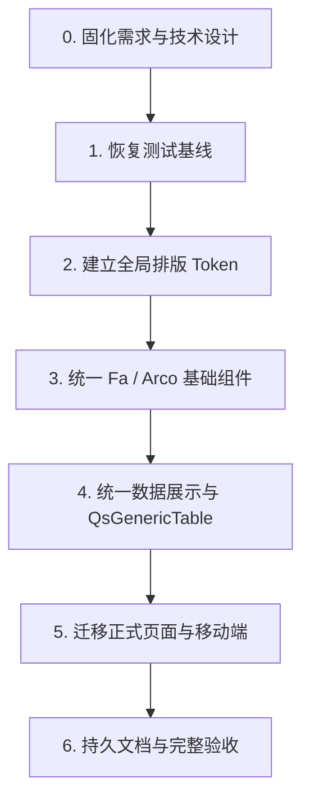

# 全局排版规范实施计划

## 1. 文档状态

- 状态：实施中（Task 2：代码与静态门禁完成，浏览器 Modal 验收随 Task 3 组件回归完成）
- 目标分支：`feat/Typesetting-specification`
- 需求规格：[全局排版规范需求](./requirements.md)
- 技术设计：[全局排版 Token 技术设计](./design.md)
- 正式应用：`web/apps/qsmds-arco`

本清单只有在用户确认后才进入正式代码实施，并从 Task 1 开始。若实施中必须偏离已确认的 `requirements.md` 或 `design.md`，应暂停执行、更新规格并重新确认，不得通过局部 CSS 或扩大测试范围绕过设计边界。

## 2. 执行规则

1. 新增排版能力和复杂迁移严格采用 TDD：
   - 先新增或调整契约测试。
   - 运行定向命令，确认测试因目标能力缺失而失败。
   - 完成最小实现并让定向测试转绿。
   - 重构后运行阶段门禁。
   - 红测只作为过程证据，不提交失败状态；每次 Git 提交必须恢复绿色基线。
2. 实施过程中实时更新本文件的 checkbox；代码、验证和提交未完成时不得提前勾选。
3. 每个阶段独立提交，提交前只暂存该阶段文件并检查完整 staged diff。
4. 不修改 `server/`、公共 API、组件公共数据结构、数据库 schema、字体资产、字体加载链路或 `web/examples/**`。
5. 不新增依赖，不修改第三方源码，不改变页面布局、间距、控件高度、业务交互或暗色主题入口。
6. `QsGenericTable` 的数据语义必须通过现有 slot、`cellClass`、`DateTimeDisplay` 和 `AmountDisplay` 表达；不得新增 column `semantic` 字段，也不得根据列名、文案或右对齐进行猜测。
7. 共享组件优先复用稳定 `data-slot`；只有语义无法由应用级 bridge 表达时，才修改共享组件，并为参考应用保留安全 fallback。
8. 源码契约测试只证明静态映射；最终结果必须通过构建后的浏览器 computed style 验证。
9. 命令失败时保留原始错误并区分代码失败、基线失败与环境限制。若 `tsx` 在受限沙箱出现 `listen EPERM`，对同一条窄命令授权重试。
10. 不执行 `push`，除非用户后续明确要求。

需求编号使用 `R1` 至 `R10`，对应 `requirements.md` 第 6 节的十项 Requirement。

## 3. 依赖顺序



## 4. 实施任务

- [x] 0. 固化需求与技术设计
  - [x] 0.1 完成当前排版审计，明确字体、字号、行高、字重、颜色、数字特性和最终级联来源。
  - [x] 0.2 使用 EARS 固化 `requirements.md`，明确正式应用、参考应用、主题、移动端和工程边界。
  - [x] 0.3 完成 `design.md`，明确 Token 分层、组件映射、文件落点、TDD 策略和回退方案。
  - [x] 0.4 运行 Markdown 链接检查、`git diff --check` 和根治理测试。
  - [x] 0.5 创建提交：`985493d docs: 补充全局排版设计规范`。
  - _Requirements: R1-R10_

- [x] 1. 恢复全局字体测试基线
  - [x] 1.1 运行当前基线并保存预期的唯一失败证据：

    ```bash
    cd web
    node --test scripts/global-fonts.test.mjs scripts/workspace-scripts.test.mjs
    ```

  - [x] 1.2 只修改 `web/scripts/global-fonts.test.mjs` 的陈旧断言，使其与 `generic-table.test.ts`、当前实现及全局继承架构一致：`QsGenericTable` 不得声明局部 `font-family`。
  - [x] 1.3 不修改任何生产代码，重新运行同一命令并证明基线全绿。
  - [x] 1.4 运行 `pnpm run test:scripts:node`，确认测试修正没有削弱 Noto 字体和零残留守卫。
  - [x] 1.5 更新本任务状态，复核 staged diff 后创建提交：`test: 修正业务表格字体继承断言`。
  - _Requirements: R5, R9, R10_

- [ ] 2. 以 TDD 建立全局排版 Token 与应用级 bridge
  - [x] 2.1 新增 `web/scripts/global-typography.test.mjs`，使用小型解析 helper 分别断言基础字号、行高、字重和字距 Token，不使用依赖换行的大型正则。
  - [x] 2.2 增加并运行失败的 Token 契约，固定：
    - `body` 为 Sans `14/20/400`。
    - `display-title`、`auth-display`、`page-title`、标题、正文、表单、操作、标签、弹窗、表格和数据角色完整。
    - 移动 form-control 为 `16/24/400`，`768px` 起恢复 `14/20/400`。
    - 排版颜色只消费现有主题语义变量。
    - Fa slot 映射和 Arco bridge 只覆盖已确认的字体指标。
    - 普通 Tag / Badge 默认使用 `tag`，只有明确状态调用点才显式使用 `status-tag`，不得根据 variant 猜测。
  - [x] 2.3 运行红测并确认失败原因为 Token 和 bridge 尚未实现：

    ```bash
    cd web
    node --test scripts/global-fonts.test.mjs scripts/global-typography.test.mjs
    ```

  - [x] 2.4 在 `web/apps/qsmds-arco/src/assets/styles/globals.css` 增加基础 Token、根排版、语义规则、Fa slot 映射和受控 Arco bridge。
  - [x] 2.5 在 `web/uno.config.ts` 增加 `qs-type-*` shortcuts；引用应用变量时提供静态 fallback，不创建第二套字体家族别名。
  - [x] 2.6 保留 Arco mini 按钮 `12px` 尺寸语义；不得通过 bridge 改动高度、padding、状态、颜色或交互。
  - [x] 2.7 让定向测试转绿，并运行：

    ```bash
    pnpm run test:scripts:node
    pnpm run typecheck
    pnpm run lint:stylelint
    pnpm exec eslint uno.config.ts
    pnpm run build
    ```

  - [x] 2.8 确认正式构建实际生成 `qs-type-*` CSS，并通过 Noto 字体完整性和字体零残留守卫。
  - [ ] 2.9 在浏览器抽查 `body`、FaButton、Arco Button、Fa/Arco Form 和 Modal 的 computed style，确认全局级联生效且无控制台错误。
    - 已完成当前匿名可访问表面：正式应用 `body`、FaButton、Fa Form、桌面/移动 Form Control、Arco Button、Noto 字体加载、水平溢出和控制台检查。
    - 当前不存在无需认证的实际 Modal 路由；Modal 与受保护页面的实测并入 Task 3/5 的代表页面回归，完成前本项保持未勾选。
  - [x] 2.10 更新任务状态，复核 staged diff 后创建提交：`feat: 建立全局排版 Token`。
  - _Requirements: R1-R4, R6, R8-R10_

- [ ] 3. 以 TDD 统一 Fa 与 Arco 基础组件排版
  - [ ] 3.1 先审计下列组件已有 `data-slot` 和最终 class，确定每项使用应用级 bridge 还是显式 `qs-type-*` shortcut；不得同时冻结两种等价实现：
    - `page-header`
    - `button`
    - `form`、`label`
    - `input`、`textarea`、`select`
    - `tag`、`badge`
    - `table`
    - `dialog`、`sheet`
  - [ ] 3.2 先扩展 `global-typography.test.mjs`，固定以下消费关系；已由稳定 slot 满足的关系作为回归断言，缺失 hook 或存在冲突 utility 的关系必须先形成红测：
    - `FaPageHeader`：`page-title`、`description`
    - `FaButton`：`action`
    - 表单：`form-label`、`form-help`、`form-control`
    - `FaTag` / `FaBadge`：默认 `tag`；明确状态调用点显式使用 `status-tag`
    - `FaTable`：`table-header`、`body`、`body-medium`
    - `FaModal` / Drawer：`dialog-title`、`description`
  - [ ] 3.3 只修改无法由稳定 slot 完成映射的最小共享组件文件，候选范围严格限制为 `design.md` 第 8.2 节。
  - [ ] 3.4 移除已审计的冲突 utility，例如 PageHeader 描述的 `secondary-foreground/50`、Label 的 `leading-none`、DialogTitle 的 `18/18`；保留组件布局、尺寸和交互。
  - [ ] 3.5 运行定向测试、共享组件检查和参考应用回归：

    ```bash
    cd web
    node --test scripts/global-typography.test.mjs
    pnpm run typecheck
    pnpm run lint
    pnpm run check:examples
    pnpm run build:examples
    ```

  - [ ] 3.6 在正式应用和至少一个参考应用抽查 PageHeader、Button、Form、Table、Modal，确认 fallback 有效且没有布局变化。
  - [ ] 3.7 更新任务状态，复核 staged diff 后创建提交：`refactor: 统一基础组件排版`。
  - _Requirements: R2-R4, R6, R8-R10_

- [ ] 4. 以 TDD 统一数据展示与 `QsGenericTable`
  - [ ] 4.1 先调整并运行失败的现有契约测试：
    - `amount-display.test.ts`：Mono `14/20/500`、`tabular-nums`，禁止 `font-semibold`。
    - `date-time-display.test.ts`：Mono `14/20/400`、`tabular-nums`，禁止 `font-medium` 和 `tracking-tight`。
    - `generic-table.test.ts`：表头、正文、meta、identifier、numeric、datetime、emphasis 和 action 角色；禁止局部字号 Token 和右对齐推断。
  - [ ] 4.2 运行红测并逐条确认失败原因来自旧排版实现，而不是测试路径或运行环境：

    ```bash
    cd web
    pnpm exec tsx --test \
      apps/qsmds-arco/test/views/generic-table.test.ts \
      apps/qsmds-arco/test/views/date-time-display.test.ts \
      apps/qsmds-arco/test/views/amount-display.test.ts
    ```

  - [ ] 4.3 修改 `DateTimeDisplay` 和 `AmountDisplay` 的排版角色，不改变格式化、时区、精度、符号、颜色参数、空值或错误值行为。
  - [ ] 4.4 让 `QsGenericTable` 和 `QsTableStackedLine` 消费全局角色：
    - 删除局部 `--qs-table-*-font-size`。
    - 表头自动使用 `table-header`。
    - 正文、行号、辅助信息和移动字段名分别使用 `body`、`meta`、`compact-label`。
    - 删除所有右对齐单元格自动 `500` 的规则。
    - 保留操作列、固定列、排序、悬停、汇总、分页和响应式行为。
  - [ ] 4.5 更新 `GenericTableShowcase.vue` 作为真实验收样本，通过现有 slot、`cellClass` 和展示组件显式标注 identifier、numeric、datetime、amount 与 summary。
  - [ ] 4.6 让定向测试转绿，并运行 `pnpm run test:api`、`pnpm run typecheck`、`pnpm run lint`、`pnpm run build`。
  - [ ] 4.7 在浏览器验证业务组件页：
    - 桌面表头、普通值、单号、数字、金额、日期和操作列。
    - 固定列、排序、汇总和分页行为。
    - `390px` 卡片、字段标签、Drawer 操作和无水平溢出。
  - [ ] 4.8 更新任务状态，复核 staged diff 后创建提交：`refactor: 统一数据展示与表格排版`。
  - _Requirements: R4-R10_

- [ ] 5. 以 TDD 迁移正式页面与移动端数据卡片
  - [ ] 5.1 新增 `web/apps/qsmds-arco/test/views/typography-consumers.test.ts`，先固定登录页、组件目录和代表页面的语义角色。
  - [ ] 5.2 扩展 `system-management.test.ts`，先固定用户、角色、权限和审计移动卡片的 `compact-label`、`body`、`data`、`data-emphasis` 和 action 消费关系。
  - [ ] 5.3 运行红测，确认失败来自尚未迁移的旧 utility：

    ```bash
    cd web
    pnpm exec tsx --test \
      apps/qsmds-arco/test/views/typography-consumers.test.ts \
      apps/qsmds-arco/test/views/system-management.test.ts
    ```

  - [ ] 5.4 迁移 `components/AppAccountForm/login.vue` 和 `views/component_library/shared/ComponentCatalogPage.vue`：
    - 登录标题使用 `auth-display`。
    - 组件目录 Hero 使用 `display-title`。
    - 普通页面、区块和组件标题使用对应语义角色。
  - [ ] 5.5 迁移以下正式页面，不扩大到未审计页面：
    - `views/system/users/index.vue`
    - `views/system/roles/index.vue`
    - `views/system/permissions/index.vue`
    - `views/system/audit/index.vue`
  - [ ] 5.6 统一移动卡片字段标签、普通值、编码、数字、日期、重点值、状态和操作；不得改变数据格式化、权限判断、Drawer 生命周期或业务动作。
  - [ ] 5.7 让定向测试转绿，并运行 `pnpm run test:api`、`pnpm run typecheck`、`pnpm run lint`、`pnpm run build`。
  - [ ] 5.8 在浏览器完成代表页面检查：
    - 登录页。
    - 业务组件页。
    - 用户管理页及用户表单 Modal。
    - 角色、权限和审计页面。
    - 桌面与 `390×844`；亮色与受控暗色状态。
    - `scrollWidth <= innerWidth`、无新增 console warning/error。
  - [ ] 5.9 更新任务状态，复核 staged diff 后创建提交：`refactor: 统一页面与移动端排版`。
  - _Requirements: R2-R10_

- [ ] 6. 生成持久规范并完成完整验收
  - [ ] 6.1 新增 `docs/前端文档/全局排版规范.md`，只保留最终 Token、使用规则、组件映射、正确/错误示例和后续页面接入说明，不复制审计过程与任务日志。
  - [ ] 6.2 更新 `docs/文档索引.md`，同时收录现有 `全局字体统一设计.md` 和新 `全局排版规范.md`。
  - [ ] 6.3 运行 Web 完整门禁：

    ```bash
    cd web
    pnpm run check
    pnpm run check:examples
    pnpm run build:examples
    pnpm run build
    pnpm --filter qsmds-arco run build:test
    ```

  - [ ] 6.4 确认正式构建与测试构建内置的 Noto 字体完整性和字体零残留守卫通过；不得以源码扫描替代构建产物验证。
  - [ ] 6.5 运行仓库最终门禁：

    ```bash
    cd ..
    node --run check
    git diff --check
    git status --short
    ```

  - [ ] 6.6 对浏览器最终矩阵逐项记录 computed style：
    - `font-family`
    - `font-size`
    - `font-weight`
    - `line-height`
    - `letter-spacing`
    - `font-variant-numeric`
    - `color`
    - disabled opacity
    - 水平溢出
    - 字体请求和 `document.fonts.check()`
  - [ ] 6.7 如果发现回归，先补失败测试再进行最小修正，每个独立问题使用 `fix: 中文描述` 小提交并重跑受影响门禁。
  - [ ] 6.8 更新本文档全部真实完成项，复核提交历史、未跟踪文件和敏感信息范围。
  - [ ] 6.9 创建持久规范提交：`docs: 补充全局排版使用规范`；若无独立代码修正，不制造空提交。
  - [ ] 6.10 不执行 push，向用户报告提交、验证结果、已知限制和后续可选工作。
  - _Requirements: R1-R10_

## 5. Git 提交计划

| 检查点 | Commit message | 主要内容 |
| --- | --- | --- |
| 已完成 | `985493d docs: 补充全局排版设计规范` | requirements、design |
| 本计划 | `docs: 补充全局排版实施计划` | tasks、规格状态 |
| Task 1 | `test: 修正业务表格字体继承断言` | 只修测试基线，不含生产代码 |
| Task 2 | `feat: 建立全局排版 Token` | Token、shortcut、Fa slot、Arco bridge、契约测试 |
| Task 3 | `refactor: 统一基础组件排版` | 必要的共享组件语义映射与回归测试 |
| Task 4 | `refactor: 统一数据展示与表格排版` | Amount、DateTime、QsGenericTable、Showcase 与测试 |
| Task 5 | `refactor: 统一页面与移动端排版` | 登录、组件目录、四个系统页面与测试 |
| Task 6 | `docs: 补充全局排版使用规范` | 持久规范、文档索引、任务最终状态 |
| 独立修正 | 按实际问题使用 `fix: 中文描述` | 浏览器或完整门禁发现的最小回归修正 |

每次提交前必须：

1. 运行 `git status --short`，确认没有覆盖用户工作。
2. 只暂存当前检查点明确文件。
3. 运行 `git diff --cached --check`。
4. 检查 `git diff --cached --stat` 和完整 staged diff。
5. 确认未包含 `.env`、密钥、日志、构建产物、依赖目录或无关文件。

## 6. 需求覆盖矩阵

| Requirement | 主要任务 |
| --- | --- |
| R1 全局排版基础 | 2, 3, 6 |
| R2 页面标题与正文层级 | 2, 3, 5, 6 |
| R3 表单与操作 | 2, 3, 5, 6 |
| R4 标签与辅助信息 | 2, 3, 4, 5, 6 |
| R5 表格与结构化数据 | 1, 2, 3, 4, 6 |
| R6 弹窗与 Drawer | 2, 3, 5, 6 |
| R7 移动端数据卡片 | 4, 5, 6 |
| R8 主题与颜色 | 2, 3, 4, 5, 6 |
| R9 工程边界与兼容性 | 1-6 |
| R10 测试、文档与交付 | 1-6 |
