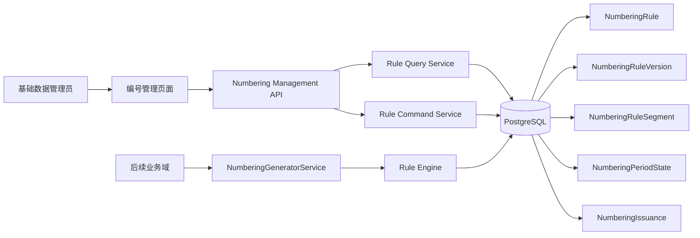
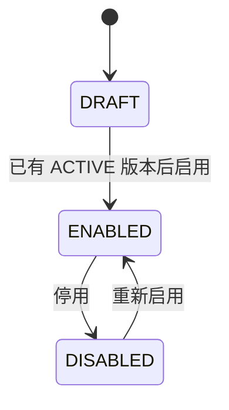
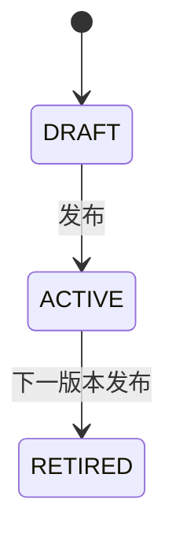
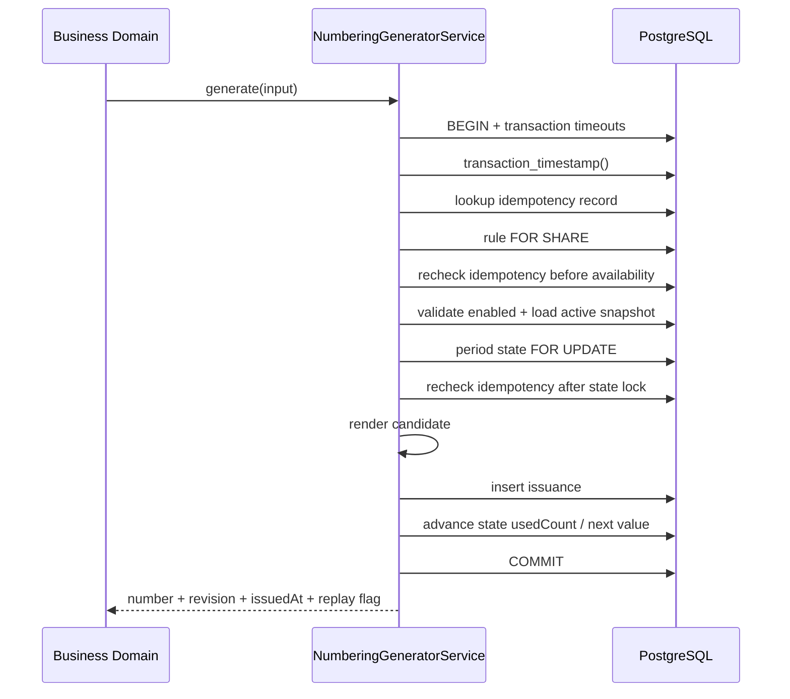

# 编号管理技术设计

## 1. 文档状态

- 状态：已确认
- 确认日期：2026-07-29
- 需求规格：[编号管理需求规格](./requirements.md)
- 固定业务时区：`Asia/Shanghai`
- 目标页面：`/system/basic-data/numbering`

本设计确认了目标结构和实施边界，但不替代仓库对数据库 Schema、公共 API、公共数据结构、权限码和错误码实际修改的单独授权。

## 2. 设计目标、边界与真相源

### 2.1 设计目标

1. 用一套可版本化的片段语法描述编号规则。
2. 在 PostgreSQL 事务和约束下保证规则内唯一、幂等和容量不超发。
3. 让容量、使用量、下一序列和发号记录拥有可解释的数据口径。
4. 只向 Server 内部业务模块暴露正式发号能力。
5. 让管理页面复用现有组件、契约和权限体系。

### 2.2 工程边界

- Server 与 Web 是独立依赖域，只通过 HTTP 和 OpenAPI 协作。
- Server 请求方向保持 `Controller -> Service -> PrismaService -> PostgreSQL`。
- 不预先引入 Repository、UseCase 或 Domain Entity 层。
- 编号计算纯函数与事务编排分离，但仍位于单一 `numbering` 业务模块内。
- 不修改 `QsGenericTable`、`QsGenericDrawer`、`QsGenericModal` 公共 API。
- 不提供公共 HTTP 发号接口。

### 2.3 真相源

| 能力 | 真相源 |
| --- | --- |
| 规则身份和生命周期 | `NumberingRule` |
| 已发布配置 | `NumberingRuleVersion + NumberingRuleSegment` |
| 当前周期下一值和在线使用量 | `NumberingPeriodState` |
| 唯一性、幂等和永久追溯 | `NumberingIssuance` |
| 日期与 period key | PostgreSQL `transaction_timestamp()` 转 `Asia/Shanghai` |
| 管理 HTTP 契约 | Controller、DTO、OpenAPI decorators |
| Web DTO | OpenAPI 生成类型 |
| 页面视觉和交互 | 现有 Fantastic-admin、Arco 与 Qs 组件 |

通用 `AuditEvent` 只记录规则管理动作。它存在 `365` 天清理策略，因此不得作为发号使用量或永久追溯真相源。

## 3. 总体架构



管理 API 只管理规则。正式发号由 Nest 内部业务模块注入 `NumberingGeneratorService` 调用，OpenAPI 中不得出现 generate path。

## 4. 领域模型与核心不变量

### 4.1 规则状态



- `DRAFT`、`ENABLED`、`DISABLED` 是持久化规则状态。
- `EXHAUSTED` 是当前 period 的派生状态，不写入规则状态字段。
- 停用不删除版本、周期状态或发号记录。

### 4.2 版本状态



- 同一规则最多一个 `DRAFT` 和一个 `ACTIVE` 版本。
- `ACTIVE` 与 `RETIRED` 配置不可编辑。
- 首次发布后规则仍可保持 `DRAFT`，管理员显式启用后才允许正式发号。
- 已启用规则编辑时，当前 `ACTIVE` 继续服务，修改写入唯一 `DRAFT`。

### 4.3 不变量

1. `ruleCode` 在 `NumberingRule` 上唯一且创建后不可修改。
2. 同一规则的所有版本共用同一个 `ruleCode`。
3. 同一规则生成的 `generatedNumber` 唯一；不同规则之间不建立文本唯一约束。
4. 每个版本最多一个 `SEQUENCE` 和一个 `RANDOM`。
5. 每个规则至少包含一个 `SEQUENCE` 或 `RANDOM`。
6. 输出最长 `64` 个 ASCII 字符。
7. 首次发号只消费 `ACTIVE` 版本且规则必须为 `ENABLED`；同语义幂等重放优先返回历史结果，不受当前状态影响。
8. `NumberingIssuance` 创建后不可更新或删除。
9. 幂等重放不推进 period state。
10. 首次发号后，不允许改变编号空间结构；只允许扩大序列宽度和修改规则展示元数据。
11. 不提供重启计数器、回绕、回收或复用。

## 5. 规则语法与校验

### 5.1 片段定义

| Type | 字段 | 约束 | 渲染示例 |
| --- | --- | --- | --- |
| `FIXED` | `value` | `^[A-Z0-9]+$`，长度 `1..64`，同时受总长约束 | `SO` |
| `DATE` | `format` | 日期格式白名单 | `20260729` |
| `SEPARATOR` | `value` | `-`、`_`、`.`、`/` | `-` |
| `SEQUENCE` | `width`、`startValue`、`step` | 最多一个；宽度 `1..18` | `000001` |
| `RANDOM` | `letterLength`、`digitLength`、`mode` | 最多一个；总长 `1..32` | `AB12CD34` |

每个 discriminated segment 只接受本类型字段，拒绝额外类型专属字段。

### 5.2 日期格式

首期白名单：

```text
YYYY
YY
MM
DD
YYYYMM
YYYYMMDD
YYMMDD
```

日期渲染和 period key 使用同一数据库事务时间：

```sql
transaction_timestamp() AT TIME ZONE 'Asia/Shanghai'
```

重置策略的区分要求：

| resetPolicy | 输出至少包含 |
| --- | --- |
| `NEVER` | 无额外日期要求 |
| `YEARLY` | 四位年 `YYYY` |
| `MONTHLY` | 四位年 `YYYY` + 月 `MM` |
| `DAILY` | 四位年 `YYYY` + 月 `MM` + 日 `DD` |

年份、月份和日期可以来自一个组合日期片段，也可以来自多个有序日期片段。发布校验必须检查完整输出所提供的日期粒度，不能只检查是否存在任意 `DATE`。`YY` 和 `YYMMDD` 只能用于 `NEVER`，不得用于重置周期。

纯随机规则没有 sequence 作为容量上限，因此同一 period 内的日期输出必须保持不变，才能让 `usedCount` 和随机容量使用同一个编号空间。发布校验额外要求：

| pure random resetPolicy | 允许的日期变化粒度 |
| --- | --- |
| `NEVER` | 不允许 DATE |
| `YEARLY` | 只允许四位年 |
| `MONTHLY` | 只允许四位年 + 月 |
| `DAILY` | 允许四位年 + 月 + 日 |

### 5.3 随机模式

```text
LETTERS_THEN_DIGITS
SHUFFLED
```

- 默认模式为 `SHUFFLED`。
- 字母只使用 `A-Z`，数字只使用 `0-9`。
- `letterLength`、`digitLength` 各为 `0..32`，总长度为 `1..32`。
- 生产随机源使用 `node:crypto`；测试通过窄接口注入确定性随机源。

### 5.4 输出长度

发布前按各片段最大长度计算：

```text
maxOutputLength = sum(segment.maxRenderedLength)
```

必须满足：

```text
1 <= maxOutputLength <= 64
```

全部允许片段只产生 ASCII 输出。长度按 code point 校验，不使用 JavaScript UTF-16 code unit 猜测。

## 6. 数据库设计

### 6.1 枚举

建议新增：

```text
NumberingRuleStatus: DRAFT | ENABLED | DISABLED
NumberingRuleVersionStatus: DRAFT | ACTIVE | RETIRED
NumberingSegmentType: FIXED | DATE | SEPARATOR | SEQUENCE | RANDOM
NumberingResetPolicy: NEVER | YEARLY | MONTHLY | DAILY
NumberingDateFormat: YYYY | YY | MM | DD | YYYYMM | YYYYMMDD | YYMMDD
NumberingRandomMode: LETTERS_THEN_DIGITS | SHUFFLED
```

### 6.2 `NumberingRule`

| 字段 | 类型 | 说明 |
| --- | --- | --- |
| `id` | UUID | 主键 |
| `ruleCode` | `varchar(64)` | 稳定唯一编码，创建后不可修改 |
| `name` | `varchar(128)` | 规则名称 |
| `description` | `varchar(500) nullable` | 说明 |
| `status` | `NumberingRuleStatus` | 生命周期状态 |
| `version` | `int` | optimistic concurrency version |
| `createdAt` | `timestamptz(6)` | 创建时间 |
| `updatedAt` | `timestamptz(6)` | 更新时间 |

约束与索引：

- `ruleCode` 唯一，规范化后匹配 `^[A-Z][A-Z0-9_]{0,63}$`。
- `name` 非空白；nullable description 存在时不得为空白。
- `version >= 1`。
- 列表索引覆盖 `status, updatedAt DESC, id DESC`。
- 所有下游关系 `ON DELETE RESTRICT`。

### 6.3 `NumberingRuleVersion`

| 字段 | 类型 | 说明 |
| --- | --- | --- |
| `id` | UUID | 主键 |
| `ruleId` | UUID | 所属规则 |
| `revision` | `int` | 规则内递增 revision |
| `status` | `NumberingRuleVersionStatus` | DRAFT/ACTIVE/RETIRED |
| `resetPolicy` | `NumberingResetPolicy` | 重置策略 |
| `timezone` | `varchar(64)` | 固定 `Asia/Shanghai` |
| `configFingerprint` | `char(64)` | 规范配置 SHA-256 |
| `createdAt` | `timestamptz(6)` | 创建时间 |
| `publishedAt` | `timestamptz(6) nullable` | 发布时间 |

约束与索引：

- `(ruleId, revision)` 唯一。
- `(id, ruleId)` 复合唯一，为永久发号台账提供规则/版本一致性 FK。
- partial unique：同一 `ruleId` 最多一个 `ACTIVE`。
- partial unique：同一 `ruleId` 最多一个 `DRAFT`。
- `revision >= 1`。
- `timezone = 'Asia/Shanghai'`。
- 非 `DRAFT` 版本的配置字段不可修改，只允许 `ACTIVE -> RETIRED` 状态迁移。

### 6.4 `NumberingRuleSegment`

| 字段组 | 字段 |
| --- | --- |
| 身份 | `id`、`versionId`、`position`、`type` |
| 固定字符 | `fixedValue` |
| 日期 | `dateFormat` |
| 分隔符 | `separatorValue` |
| 序列 | `sequenceWidth`、`sequenceStartValue`、`sequenceStep` |
| 随机 | `randomLetterLength`、`randomDigitLength`、`randomMode` |
| 时间 | `createdAt` |

实现约束：

- `(versionId, position)` 唯一，`position >= 0`。
- `sequenceStartValue`、`sequenceStep` 使用 PostgreSQL `bigint`，应用边界转十进制字符串。
- segment shape 使用命名 CHECK，确保每类只有对应字段非空。
- partial unique：同一版本最多一个 `SEQUENCE`。
- partial unique：同一版本最多一个 `RANDOM`。
- trigger 根据父版本状态拒绝向非 `DRAFT` 版本执行 segment `INSERT`、`UPDATE` 或 `DELETE`。
- position 连续性、总片段数、日期粒度和总输出长度由发布事务进行整体验证。

### 6.5 `NumberingPeriodState`

| 字段 | 类型 | 说明 |
| --- | --- | --- |
| `id` | UUID | 主键 |
| `ruleId` | UUID | 所属规则 |
| `periodKey` | `varchar(16)` | `ALL`、`YYYY`、`YYYYMM` 或 `YYYYMMDD` |
| `nextSequenceValue` | `bigint nullable` | 下一序列值；纯随机为 null |
| `usedCount` | `bigint` | 当前周期已成功占用数量 |
| `createdAt` | `timestamptz(6)` | 创建时间 |
| `updatedAt` | `timestamptz(6)` | 更新时间 |

约束：

- `(ruleId, periodKey)` 唯一，保证版本发布后继续使用同一计数状态。
- `usedCount >= 0`，`nextSequenceValue >= 0`。
- period state 只允许生成事务推进，不提供管理写接口。
- `usedCount` 是在线统计读数；永久 `NumberingIssuance` 是可核对的发号明细，二者必须在同一事务更新。

### 6.6 `NumberingIssuance`

| 字段 | 类型 | 说明 |
| --- | --- | --- |
| `id` | UUID | 主键 |
| `ruleId` | UUID | 规则 |
| `ruleVersionId` | UUID | 实际使用版本 |
| `periodKey` | `varchar(16)` | 实际周期 |
| `generatedNumber` | `varchar(64)` | 已发编号 |
| `sequenceValue` | `bigint nullable` | 实际序列值 |
| `consumerCode` | `varchar(64)` | 调用业务域 |
| `idempotencyKeyHash` | `bytea` | 原始 key 的 SHA-256 |
| `requestFingerprintHash` | `bytea` | 调用语义指纹 |
| `issuedAt` | `timestamptz(6)` | 数据库发号时间 |

约束与索引：

- `(ruleId, generatedNumber)` 唯一。
- 不建立 `generatedNumber` 全局唯一索引。
- `(consumerCode, idempotencyKeyHash)` 唯一。
- 两个 Hash 固定为 `32` bytes。
- `(ruleVersionId, ruleId)` 复合 FK 引用 version 的 `(id, ruleId)`，保证版本属于同一规则。
- `(ruleId, periodKey)` 复合 FK 引用 period state，保证台账属于实际推进的规则周期。
- 历史索引：`ruleId, periodKey, issuedAt DESC, id DESC`。
- 生命周期索引：`ruleId, issuedAt DESC, id DESC`。
- 调用方历史索引：`ruleId, consumerCode, issuedAt DESC, id DESC`。
- 编号前缀查询索引：`ruleId, generatedNumber varchar_pattern_ops`；实现 SQL 必须使用 PostgreSQL 对应 operator class，不能依赖默认 collation 猜测前缀性能。
- 所有 FK 使用 `RESTRICT`。
- trigger 阻止 `UPDATE` 和 `DELETE`，保证台账永久、不可篡改。

### 6.7 Migration

使用新的 forward migration，不修改已有 migration。建议单一 schema migration 完成：

1. 新增枚举和五张表。
2. 新增 CHECK、partial unique、复合 FK、查询索引和不可变 trigger。
3. 新增七项权限并显式授权 `system_admin`。
4. 新增五类编号规则管理审计事件。
5. migration 末尾验证核心约束存在，不插入默认编号规则。

实现前必须再次确认精确 Prisma model、枚举、SQL 约束、trigger、权限和 Audit enum。

## 7. 生命周期、发布与不可变策略

### 7.1 创建

创建事务：

1. 规范化并验证 `ruleCode`、名称和 segments。
2. 创建 `NumberingRule(status=DRAFT, version=1)`。
3. 创建 revision `1` 的 `DRAFT` version。
4. 创建有序 segments。
5. 写 `NUMBERING_RULE_CREATED`。

### 7.2 编辑

- `name` 和 `description` 直接更新 `NumberingRule` metadata，不创建无意义 draft。
- 配置字段只写唯一 `DRAFT`；已有 `ACTIVE` 时，第一次修改配置从 active 快照复制出下一 revision 的 draft。
- metadata 和配置可以在同一事务提交，全部校验同一个 `expectedVersion`。
- 无实际变化不增加 rule version，不写冗余审计。

### 7.3 发布

发布事务对 rule 使用 `FOR UPDATE`：

1. 校验 `expectedVersion`。
2. 加载完整 draft 和 active。
3. 执行与预览相同的整体验证。
4. 若已有发号，执行兼容性校验。
5. 将旧 active 更新为 `RETIRED`。
6. 将 draft 更新为 `ACTIVE` 并写 `publishedAt`。
7. 增加 rule version。
8. 写 `NUMBERING_RULE_VERSION_PUBLISHED`。

版本状态切换和审计必须原子提交。

### 7.4 首次发号后的兼容性

首期采用保守策略，避免新旧版本编号空间重叠后容量不可精确解释：

- 禁止改变 segment 类型、数量和顺序。
- 禁止改变固定字符、日期格式、分隔符、随机长度或随机模式。
- 禁止改变 `resetPolicy`、timezone、序列起始值或步长。
- 序列宽度只允许扩大。
- 规则名称和说明继续允许更新。
- 需要其他变化时，克隆为新的 `ruleCode`。

### 7.5 启停与克隆

- enable 要求存在一个完整 `ACTIVE` version。
- disable 只改变 rule status，不影响版本和历史。
- clone 复制来源 active；如果没有 active，则复制 draft。新规则始终为 `DRAFT`，revision 从 `1` 开始。
- clone 不复制 period state、issuance 或旧 rule version。

## 8. 容量、使用量与下一编号算法

### 8.1 序列容量

设：

```text
M = 10^width - 1
s = startValue
p = step
```

当 `s <= M`：

```text
capacity = floor((M - s) / p) + 1
nextSequenceValue = s + usedCount * p
remainingCount = max(capacity - usedCount, 0)
```

配置校验同时要求 `0 <= s <= M` 和 `1 <= p <= M`。最后一次成功后持久化的耗尽 sentinel 最大为 `M + p <= 2M`；当 `width <= 18` 时小于 PostgreSQL signed `bigint` 上限。对外统计在耗尽后返回 null，不暴露 sentinel 为可用下一值。

当 `nextSequenceValue > M` 时，当前周期耗尽。

所有计算使用 `bigint` 或十进制大整数实现，不经过 JavaScript `number`。

### 8.2 随机容量

设字母长度为 `L`、数字长度为 `D`：

```text
LETTERS_THEN_DIGITS = 26^L * 10^D
SHUFFLED = C(L + D, L) * 26^L * 10^D
```

组合数和幂运算使用大整数。

### 8.3 混合规则

- 固定、日期和分隔符不增加容量。
- `SEQUENCE + RANDOM` 的有效容量取序列容量。
- 首期最多一个随机片段，因此不存在多随机片段乘积歧义。

### 8.4 统计口径

`NumberingRuleStatisticsDto`：

```ts
interface NumberingRuleStatisticsDto {
  statisticsSource: 'ACTIVE' | 'DRAFT'
  periodKey: string
  capacity: string
  usedCount: string
  remainingCount: string
  lifetimeUsedCount: string
  nextSequenceValue: string | null
  nextNumberPreview: string | null
  nextNumberDeterministic: boolean
  periodStatus: 'AVAILABLE' | 'EXHAUSTED'
  asOf: string
}
```

- `asOf`、日期渲染和 period key 来自同一数据库时间点。
- 有 active 时始终基于 active 统计，即使同时存在 draft 或规则已停用。
- 只有 draft、没有 active 时返回 draft 理论统计，`usedCount=0`，且不创建 period state。
- sequence-only 的 `nextNumberPreview` 可确定，但仍不占号。
- sequence + random 返回非保留样例，`nextNumberDeterministic=false`。
- random-only 返回 `nextSequenceValue=null`、`nextNumberPreview=null`。
- sequence 已耗尽时返回 `nextSequenceValue=null`、`nextNumberPreview=null`；数据库 state 可以保存大于 `M` 的耗尽 sentinel。
- 在线 `lifetimeUsedCount` 固定为该规则全部永久 `NumberingPeriodState.usedCount` 之和；周期状态不删除，因此切换周期后仍可稳定累加。
- `COUNT(NumberingIssuance)` 只用于一致性测试、巡检和故障核对，必须与在线 `lifetimeUsedCount` 相等；管理查询不依赖通用 Audit，也不在每次请求上扫描永久台账。

## 9. 发号事务与并发控制

### 9.1 锁顺序

全模块固定锁序：

```text
NumberingRule
  -> NumberingRuleVersion / NumberingRuleSegment
  -> NumberingPeriodState
  -> NumberingIssuance insert
```

- generate 对 rule 使用 `FOR SHARE`。
- publish、enable、disable 对 rule 使用 `FOR UPDATE`。
- active/retired version 和 segments 不可变，生成时只需在 rule shared lock 保护下读取完整快照。
- period state 使用 `FOR UPDATE`，不存在时通过唯一键安全创建后再锁定。

### 9.2 事务超时

每个管理写和生成事务首先应用现有：

```text
lock_timeout = 2s
statement_timeout = 5s
```

复用 `applyTransactionTimeouts()`，不得另建不一致的 timeout 实现。

### 9.3 幂等流程

幂等唯一范围固定为：

```text
consumerCode + SHA-256(idempotencyKey)
```

`requestFingerprintHash` 至少覆盖规范化的 `ruleCode` 和调用契约版本。`consumerCode` 已进入幂等唯一范围，不重复放入指纹也不得削弱其独立校验。

流程：

1. 校验规范 `ruleCode`、`consumerCode` 和不透明 `idempotencyKey`，计算两个 Hash。
2. 在校验规则当前可用性之前查询已存在 issuance。
3. 若 Hash 和请求指纹一致，返回原结果且 `idempotentReplay=true`。
4. 若幂等键已存在但指纹不同，返回 `NUMBERING_IDEMPOTENCY_CONFLICT`。
5. 首次未命中后取得 rule shared lock，并在判断规则可用性前再次查询 issuance。
6. 取得 period state lock 后第三次查询 issuance，覆盖相同幂等键在 state lock 上排队的竞态。
7. 并发竞态最终由唯一索引裁决；失败事务回滚后重新读取已存在结果。

即使规则后来停用或发布新版本，已存在的幂等调用仍返回原结果，不再次消耗容量。

### 9.4 生成流程



规则：

- sequence 候选发生唯一冲突表示状态损坏，返回 `NUMBERING_OUTPUT_CONFLICT` 并回滚。
- pure random 使用 `(ruleId, generatedNumber)` 显式 conflict target 和 `ON CONFLICT DO NOTHING RETURNING`。
- random 最多生成 `32` 个候选；全部冲突时回滚并返回 `NUMBERING_GENERATION_RETRY_EXHAUSTED`。
- 容量预检查和最终 state 推进必须位于同一 row lock 内。
- 首次幂等查询未命中后，获取 rule shared lock 必须立刻再次查询 issuance，且该查询发生在规则状态/活动版本校验之前；这样即使 retry 排在 disable 或 publish 的排他锁之后，仍优先返回已经提交的历史结果。
- 同一规则并发使用相同幂等键时，获取 period state lock 后必须再次查询 issuance；若另一事务已经提交，直接返回原结果，不调用随机源、不推进 state。
- issuance insert 成功后才推进 state；任一异常回滚全部写入。
- idempotent replay 不调用随机源、不推进 state。
- generator 不依赖 `AuditService`。

### 9.5 断号语义

`generate()` 自身提交成功即永久占号。后续业务写入失败不会自动回收，调用方应使用同一幂等键重试并取得原编号。首期不承诺 gapless，也不提供跨业务事务组合 API。

## 10. Server 模块设计

建议目录：

```text
server/src/modules/numbering/
├── dto/
├── numbering.module.ts
├── numbering.controller.ts
├── numbering-query.service.ts
├── numbering-command.service.ts
├── numbering-generator.service.ts
├── numbering.persistence.ts
├── numbering.normalizer.ts
├── numbering.persistence-error.mapper.ts
├── rule-engine.ts
├── capacity.ts
├── period.ts
└── random-source.ts
```

约束：

- `NumberingModule` 精确导入现有 `PrismaModule` 和 `AuthModule`；管理命令所需 `AuditService` 复用 `AuthModule` 已导出的 provider，不导入只提供查询 Controller 的 `AuditModule`。
- 模块只向其他 Server 模块导出 `NumberingGeneratorService`。
- Controller 不引用 generator，也不暴露 generate route。
- 纯计算文件不访问 Prisma、Nest request 或系统时钟。
- `NumberingModule` 加入 `server/src/http.modules.ts`，正式应用和 OpenAPI preview 共用同一清单。

### 10.1 内部服务契约

```ts
interface GenerateNumberRequest {
  ruleCode: string
  consumerCode: string
  idempotencyKey: string
}

interface GenerateNumberResult {
  number: string
  ruleCode: string
  ruleRevision: number
  issuedAt: string
  idempotentReplay: boolean
}

class NumberingGeneratorService {
  generate(input: GenerateNumberRequest): Promise<GenerateNumberResult>
}
```

限制：

- `ruleCode` 必须是管理域既有规范化规则编码；内部服务可以复用同一 canonical validator，不接受不同语义的第二套编码规则。
- `consumerCode` 必须匹配 `^[A-Z][A-Z0-9._-]{0,63}$`；非法值直接拒绝，不得静默 trim、转大写或执行 Unicode 规范化。
- `idempotencyKey` 必须在 UTF-8 编码后为 `1..200` bytes，并按原始 bytes 计算 SHA-256；它是不透明值，不得 trim、大小写转换、Unicode 规范化或写入日志。
- `idempotencyKey` 只在内部 input 存在。
- 日志、异常、Audit metadata、HTTP DTO 和发号历史 DTO 都不得返回原始 key。
- 后续若需要与业务写共享事务，必须重新设计和确认；首期不预先暴露 `Prisma.TransactionClient`。

## 11. 管理 HTTP API 与 OpenAPI

### 11.1 Endpoint

| Method | Path | operationId | Permission |
| --- | --- | --- | --- |
| GET | `/api/numbering-rules` | `numbering_rules_list` | `numbering-rules:read` |
| GET | `/api/numbering-rules/{ruleId}` | `numbering_rules_get` | `numbering-rules:read` |
| POST | `/api/numbering-rules/preview` | `numbering_rules_preview` | `numbering-rules:read` |
| POST | `/api/numbering-rules` | `numbering_rules_create` | `numbering-rules:create` |
| PATCH | `/api/numbering-rules/{ruleId}` | `numbering_rules_update` | `numbering-rules:update` |
| GET | `/api/numbering-rules/{ruleId}/versions` | `numbering_rule_versions_list` | `numbering-rules:read` |
| POST | `/api/numbering-rules/{ruleId}/publish` | `numbering_rules_publish` | `numbering-rules:publish` |
| POST | `/api/numbering-rules/{ruleId}/enable` | `numbering_rules_enable` | `numbering-rules:enable` |
| POST | `/api/numbering-rules/{ruleId}/disable` | `numbering_rules_disable` | `numbering-rules:disable` |
| POST | `/api/numbering-rules/{ruleId}/clone` | `numbering_rules_clone` | `numbering-rules:read` + `numbering-rules:create` |
| GET | `/api/numbering-rules/{ruleId}/issuances` | `numbering_rule_issuances_list` | `numbering-rules:read` + `numbering-rules:read-issuances` |

OpenAPI 必须显式断言不存在：

```text
POST /api/numbering-rules/{ruleId}/generate
POST /api/numbering/generate
```

### 11.2 Segment DTO

```ts
type NumberingRuleSegmentInputDto =
  | {
      type: 'FIXED'
      value: string
    }
  | {
      type: 'DATE'
      format:
        | 'YYYY'
        | 'YY'
        | 'MM'
        | 'DD'
        | 'YYYYMM'
        | 'YYYYMMDD'
        | 'YYMMDD'
    }
  | {
      type: 'SEPARATOR'
      value: '-' | '_' | '.' | '/'
    }
  | {
      type: 'SEQUENCE'
      width: number
      startValue: string
      step: string
    }
  | {
      type: 'RANDOM'
      letterLength: number
      digitLength: number
      mode: 'LETTERS_THEN_DIGITS' | 'SHUFFLED'
    }
```

Swagger 使用明确 discriminated union；DTO 开启白名单和禁止额外字段。

### 11.3 Mutation DTO

```ts
interface NumberingRuleConfigInputDto {
  resetPolicy: 'NEVER' | 'YEARLY' | 'MONTHLY' | 'DAILY'
  segments: NumberingRuleSegmentInputDto[]
}

interface CreateNumberingRuleRequestDto
  extends NumberingRuleConfigInputDto {
  ruleCode: string
  name: string
  description?: string | null
}

interface UpdateNumberingRuleRequestDto {
  name?: string
  description?: string | null
  resetPolicy?: 'NEVER' | 'YEARLY' | 'MONTHLY' | 'DAILY'
  segments?: NumberingRuleSegmentInputDto[]
  expectedVersion: number
}
```

- update 至少包含一个可修改字段和 `expectedVersion`。
- publish 指定 draft revision 和 `expectedVersion`。
- enable/disable 携带 `expectedVersion`。
- clone 携带新的 `ruleCode`、名称和来源 `expectedVersion`。
- timezone 不属于 input DTO。

### 11.4 Preview

Preview 是无状态管理 API：

- 输入未保存的 config。
- 返回规范化模板、最大长度、固定 `5` 个样例和容量。
- 对已存在规则编辑场景可携带 `ruleId`，用于执行发号后兼容性校验。
- 不创建 rule、version、segment、state 或 issuance。
- 纯随机规则的 `nextNumberPreview` 为 null，但 samples 仍可展示随机格式。

### 11.5 Query

- list 支持 keyword、status、分页和白名单排序；首期只展示派生 periodStatus，不提供该字段的服务端筛选。
- detail 返回 rule metadata、active version、draft version、segments 和同一 `asOf` 的统计。
- versions 按 revision DESC、id DESC。
- issuances 按 `issuedAt DESC, id DESC`，支持 periodKey、consumerCode 和编号精确/前缀筛选。
- issuance response 不包含 idempotency Hash 或 request fingerprint。
- 所有管理响应使用 `private, no-store`。

## 12. 权限、审计、错误和安全

### 12.1 权限

```text
numbering-rules:read
numbering-rules:create
numbering-rules:update
numbering-rules:publish
numbering-rules:enable
numbering-rules:disable
numbering-rules:read-issuances
```

迁移显式授权 `system_admin`。现有管理权限精确集合由 `25` 增加为 `32`，相关静态、API 和 E2E 测试必须同步更新。

### 12.2 AuditEventType

建议新增：

```text
NUMBERING_RULE_CREATED
NUMBERING_RULE_UPDATED
NUMBERING_RULE_VERSION_PUBLISHED
NUMBERING_RULE_ENABLED
NUMBERING_RULE_DISABLED
```

clone 复用 `NUMBERING_RULE_CREATED`，metadata 记录 `clonedFromRuleCode`。Audit metadata 只保存公开配置摘要、changed fields、revision 和 version，不保存完整请求、Hash 或内部错误。

### 12.3 错误映射

| Error code | HTTP/内部语义 |
| --- | --- |
| `NUMBERING_RULE_NOT_FOUND` | `404` |
| `NUMBERING_RULE_CODE_ALREADY_EXISTS` | `409` |
| `NUMBERING_RULE_STATE_CHANGED` | `409` |
| `NUMBERING_RULE_UNAVAILABLE` | `409` 或内部不可用 |
| `NUMBERING_CAPACITY_EXHAUSTED` | 内部稳定冲突 |
| `NUMBERING_IDEMPOTENCY_CONFLICT` | 内部稳定冲突 |
| `NUMBERING_OUTPUT_CONFLICT` | 内部完整性冲突 |
| `NUMBERING_RULE_CONFIG_INVALID` | `422` |
| `NUMBERING_GENERATION_RETRY_EXHAUSTED` | 内部暂时失败 |

持久化错误只依据 Prisma code、SQLSTATE 和命名 constraint 映射，不解析数据库 message/detail。至少覆盖：

```text
P2002
23505
P2034
40001
40P01
55P03
57014
```

未知错误固定收口为现有安全 `INTERNAL_ERROR`。

### 12.4 安全

- 所有 mutation 保留现有 Session、permission 和 CSRF 防护。
- response 携带 `X-Request-Id`。
- 不记录原始 idempotency key、连接字符串、SQL、Cookie、token 或完整敏感请求体。
- random 使用密码学安全实现。
- 管理页面不提供正式发号入口。

## 13. Web 架构

### 13.1 目录建议

```text
web/apps/qsmds-arco/src/
├── api/modules/numbering.ts
├── views/system/basic-data/numbering/
│   ├── index.vue
│   ├── numbering.logic.ts
│   ├── numbering-rule-form.logic.ts
│   ├── numbering-rule-editor-drawer.vue
│   ├── numbering-rule-segment-editor.vue
│   ├── numbering-rule-preview.vue
│   ├── numbering-rule-detail-drawer.vue
│   └── numbering-rule-status-modal.vue
└── locales/
```

页面业务代码保留在正式 app 内，不提取到 `packages/*`。

### 13.2 API adapter

- 只导入 OpenAPI generated types，不手写平行 DTO。
- list/detail/versions/issuances 支持 `AbortSignal`。
- 所有 mutation 使用 `retry: false` 和本地错误呈现。
- decimal string 保持字符串，不转换为 `number`。
- preview 旧请求必须 abort，乱序响应不得覆盖最新表单。

### 13.3 页面状态

页面拥有：

- Server 查询参数、AbortController 和 request version。
- `authEpoch` 身份边界。
- Drawer/Modal 上下文。
- mutation 提交锁和未知结果恢复。
- 权限动作矩阵。

不新增全局 Store 或查询库。动态撤销 `numbering-rules:read` 时，中止请求、清空数据并关闭维护上下文。

### 13.4 路由与权限

当前 numbering 路由从权限中立空页变为：

```ts
meta: {
  title: '编号管理',
  icon: 'i-lucide:list-ordered',
  auth: 'numbering-rules:read',
}
```

实施时只调整编号相关空页断言。无任何基础数据读取权限时，父路由回退到仍权限中立的字典页；不得让受保护页面成为零权限回退目标。

## 14. 页面与交互设计

### 14.1 规则列表

使用一个 `FaPageHeader + FaPageMain + QsGenericTable`：

- 名称 / `ruleCode`
- 结构预览
- 生命周期状态与当前周期 `EXHAUSTED` 派生状态
- active revision
- capacity
- usedCount / remainingCount
- nextSequenceValue 或“生成时确定”
- updatedAt
- 操作

容量和使用量完整显示十进制字符串，不使用可能发生精度损失的百分比进度条。

### 14.2 规则编排 Drawer

使用 `QsGenericDrawer size="xl"`：

- 左侧：基本信息、resetPolicy、有序 segment 编辑。
- 右侧：固定 `Asia/Shanghai` 说明、结构预览、样例、最大长度、容量和下一编号提示。
- segment 提供添加、删除、上移和下移。
- 不新增拖拽依赖。
- 本地快速校验通过后节流调用 Server preview；Server 结果为最终真相源。
- 有未保存修改时通过 `beforeClose` 进入确认。
- 提交中阻止关闭和重复提交，成功后先解除 submitting 再关闭。

### 14.3 详情、版本和发号记录

- 使用单一详情 Drawer 的 tabs，或同级独立 Drawer；禁止嵌套 Drawer。
- 版本页展示 revision、状态、配置摘要、发布时间。
- 发号记录只在同时拥有 `read` 与 `read-issuances` 时显示并请求。
- 发号记录展示编号、consumerCode、revision、periodKey、issuedAt，不展示 Hash。

### 14.4 高影响操作

- 发布、启用、停用使用 `QsGenericModal`。
- Modal 明确显示名称、`ruleCode`、当前 revision 和影响。
- 版本冲突时重新读取详情并保留用户上下文，不静默覆盖。
- 网络结果未知时不自动重放 mutation；重新查询当前状态并提示用户核查。

### 14.5 可访问性与响应式

- 桌面表格、移动卡片均由 `QsGenericTable` 提供。
- `390px` 下 Drawer 全宽、footer 可见、页面无横向溢出。
- 上移/下移按钮具有包含序号与类型的 accessible name。
- 动态 preview 使用 `aria-live`，加载容器使用 `aria-busy`。
- 状态同时使用文本和图标，不只依赖颜色。
- 验证 Escape、遮罩、关闭按钮、焦点恢复和 reduced motion。

## 15. TDD 与验证策略

### 15.1 纯逻辑测试

- segment discriminated shape、顺序和最大长度。
- 上海时区的跨日、跨月、跨年 period。
- reset 与日期粒度组合。
- sequence 容量、步长、补零、边界和耗尽。
- random 两种容量公式和格式。
- 超过 `Number.MAX_SAFE_INTEGER` 的精确计算。
- preview 不写状态。

### 15.2 Schema 与 migration

- 静态 schema/migration contract。
- 空 PostgreSQL 全量 replay 和重复 deploy。
- partial unique、CHECK、FK、trigger 和查询索引。
- 七项权限、`system_admin` 精确授权和 Audit enum。
- issuance update/delete 被数据库拒绝。

### 15.3 Service 与 API

- 管理查询、生命周期、expectedVersion、同事务 Audit。
- Audit 失败回滚。
- generator 不写通用 Audit。
- 规则不存在、停用、无 active、容量耗尽。
- sequence、random、mixed 和周期切换。
- 100 个不同幂等键并发生成 100 个唯一编号。
- 100 个相同幂等键并发只生成一个编号。
- 最后一个容量位并发时恰好一个成功。
- publish 与 generate 并发时只观察完整旧版本或完整新版本。
- 同一幂等 retry 初查未命中、排在 disable 排他锁之后时，取得 rule lock 后仍返回已提交原编号。
- 32 次随机碰撞失败不推进 state。
- 在线 `lifetimeUsedCount` 等于永久 period state 的 usedCount 之和，并与 issuance count 一致。
- OpenAPI 明确不存在 generate endpoint。

### 15.4 Web 与 Browser

- API method/path/query/body、取消和 no retry。
- 路由、权限目录和相邻基础数据回退。
- 大整数保持字符串。
- 列表请求取消、乱序、权限撤销。
- builder 顺序、校验、preview 和关闭保护。
- 发布、启停、克隆、版本和发号记录。
- clone 只有 read 或只有 create 均返回 `403`，两项权限同时具备才成功。
- issuance history 只有 read 或只有 read-issuances 均返回 `403`，两项权限同时具备才成功。
- 桌面、`390px`、亮暗主题、键盘、焦点和无控制台错误。

### 15.5 最终命令

```bash
pnpm -C server check
pnpm -C server build
node --run ci:server-e2e
node --run contract:sync
node --run contract:check
pnpm -C web test:api
pnpm -C web check
pnpm -C web build
node --run ci:browser-numbering-e2e
node --run check
git diff --check
```

## 16. 关键取舍与风险

| 取舍/风险 | 处理 |
| --- | --- |
| JSONB 配置灵活但数据库约束弱 | 使用 relational segment table 和命名 CHECK |
| 公共发号 API 易扩大攻击面和重试语义 | 首期仅导出内部 service |
| preview 可能被误认为已保留 | 明确 `nextNumberDeterministic`，preview 永不占号 |
| reset 未进入输出会跨周期重复 | 发布时强制检查日期粒度 |
| 随机碰撞无法完全预判 | rule 内唯一索引、容量预检、crypto 随机和 32 次重试 |
| 版本改变编号空间会让容量口径模糊 | 首次发号后冻结结构，只允许 sequence width 扩大 |
| 发号台账长期增长 | 首期建立查询索引并永久保留；不提前分区 |
| 发号后业务失败造成断号 | 明确不承诺 gapless，依靠幂等重试返回原编号 |
| 大整数在 Web 丢精度 | OpenAPI 使用 decimal string，测试覆盖安全整数上界 |
| 发布与发号竞态 | rule `FOR UPDATE` 与 `FOR SHARE` 互斥 |

## 17. 需求追踪

| Requirement | 设计章节 |
| --- | --- |
| R1 | 4、6、7 |
| R2 | 5、6 |
| R3 | 5、8、9 |
| R4 | 5、8、9 |
| R5 | 5、8、9 |
| R6 | 4、7、9 |
| R7 | 6、8、11 |
| R8 | 6、9、10 |
| R9 | 3、10 |
| R10 | 11、12 |
| R11 | 6、12 |
| R12 | 13、14 |
| R13 | 15 |

## 18. 实施前硬确认

进入 Phase 4 后，以下修改仍必须单独获得用户确认：

1. 精确 Prisma model、枚举、索引、CHECK、trigger 和 migration。
2. 精确管理 endpoint、DTO、response schema、operationId 和错误矩阵。
3. 七项权限、`system_admin` 授权和 AuditEventType。
4. 内部 `NumberingGeneratorService` 公共 TypeScript 契约。
5. 若实现中需要修改任何 Qs 共享组件公共 API。

Phase 4 Task 1 必须先形成可审议的精确审批包，包含完整 Prisma/SQL 草案、所有 request/response schema、成功状态码、逐 endpoint 错误矩阵、权限/Audit 变化和内部服务签名。确认之前可以执行只读基线审查和不触及上述公共边界的任务，不得实施 Schema 或 API。
