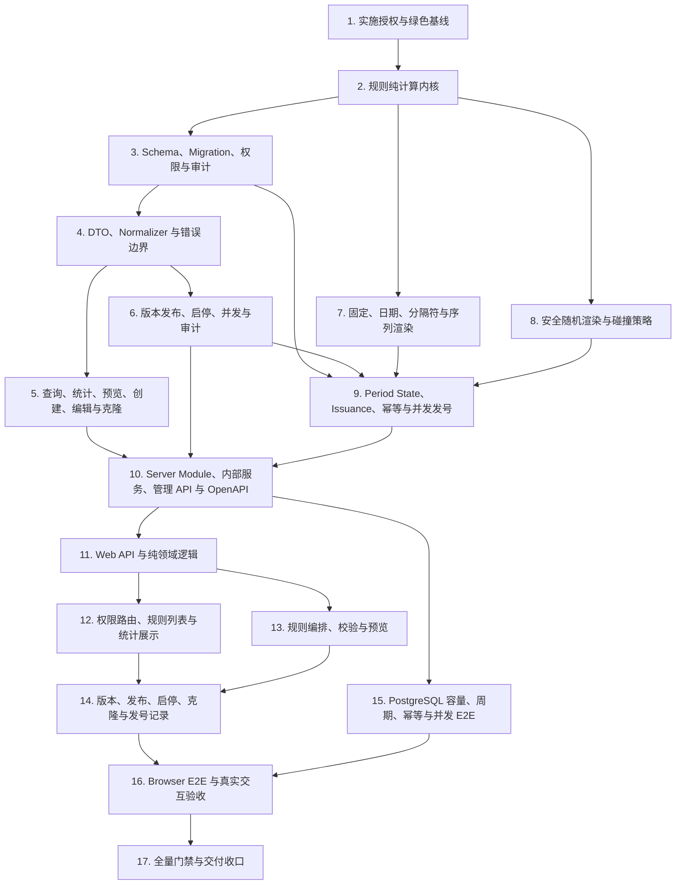

# 编号管理实施计划

## 1. 文档状态

- 状态：Phase 4 实施中（Task 10）
- 生成日期：2026-07-29
- Gate A / Gate B 确认日期：2026-08-02
- 需求规格：[编号管理需求规格](./requirements.md)
- 技术设计：[编号管理技术设计](./design.md)
- 正式 Web 应用：`web/apps/qsmds-arco`
- Server：`server`
- 真实业务入口：`/system/basic-data/numbering`
- 实施分支：`feat/numbering-management`
- 实施起点：`6cf9629740281920906708912a7132497366dcc3`，Gate A 工作区干净

用户已确认 Gate A 与 Gate B，允许按已冻结的数据库 Schema、公共 API、公共数据结构、权限码、错误码和内部公共服务契约进入 Phase 4。任何超出该基线的公共边界变化仍须重新确认。

## 2. 执行规则

1. 新功能严格采用 TDD：
   - 先增加能因目标能力缺失而失败的测试；
   - 运行定向命令并记录真实红测原因；
   - 实现使测试通过的最小代码；
   - 在绿色状态下重构并运行阶段门禁。
2. 不提交只有失败测试的中间状态。每个功能提交必须同时包含对应测试和最小实现，并恢复受影响基线为绿色。
3. 实施时实时更新本文件 checkbox；测试、实现、验证和提交未全部完成时不得提前勾选。
4. `requirements.md` 和 `design.md` 是已确认真相源。若需要改变固定时区、五表模型、API、权限、错误码、幂等范围、容量口径或内部服务契约，立即暂停并重新确认。
5. Server 与 Web 保持独立依赖域，不跨目录引用源码，不在根目录安装依赖。
6. 不手工修改 Prisma generated client、OpenAPI snapshot 或 Web generated types。
7. 不修改已有 migration；所有数据库变化使用新的 forward migration。
8. 不提供 DELETE 或公共 generate endpoint。
9. 大整数跨公共边界保持十进制字符串，不经过 JavaScript `number`。
10. 生产随机源使用 `node:crypto`，测试随机源只通过窄接口注入。
11. 页面 API、权限和副作用归业务页面所有；共享 Qs 组件保持业务中立。
12. 命令失败、预期红测、环境限制和无关基线失败必须区分并如实记录。
13. 每个检查点只暂存明确文件，提交信息类型使用英文、描述使用中文。
14. 未经后续明确要求，不 push、不 merge、不创建 PR、不删除分支或 worktree。

需求编号使用 `R1` 至 `R13`，对应 `requirements.md` 第 6 节。

## 3. 硬确认门禁

### Gate A - Phase 4 与 Git 范围

开始代码实施前必须重新输出并确认：

- 目标
- 范围
- 真相源
- 禁止事项
- 验收标准
- 验证命令
- Git 要求

同时确认目标分支；不得默认直接在 `main` 开发。

### Gate B - 数据库与公共契约

Phase 4 Task 1 必须先根据最新仓库代码形成精确审批包，不得直接把本设计中的概念表当作可执行 Schema/API：

1. 完整 Prisma model、enum 和 forward SQL 草案。
2. 所有 request/response schema、成功状态码和逐 endpoint 错误矩阵。
3. 权限、AuditEventType 和 `system_admin` 精确变化。
4. 内部 `NumberingGeneratorService` 对象参数契约。

执行 Task 3 之前必须单独确认：

1. 五个 Prisma model 和相关 enum。
2. 精确字段、索引、partial unique、CHECK、FK 和 trigger。
3. forward migration、七项权限、`system_admin` 授权和 AuditEventType。

执行 Task 4-6、Task 10 之前必须单独确认：

1. 管理 endpoint、operationId、DTO 和 response schema。
2. 九个稳定错误码及 HTTP/内部分类。
3. 内部 `NumberingGeneratorService` TypeScript 契约。

技术设计确认和任务清单确认均不替代以上实际修改授权。

### Gate C - 共享组件

如果实现中发现必须修改 `QsGenericTable`、`QsGenericDrawer`、`QsGenericModal`、`QsToast` 或其他公共组件契约，应停止对应工作并单独提交封装方案；当前计划默认无需修改。

## 4. 依赖顺序



Task 5-8 中互不依赖的纯逻辑和服务测试可在不冲突文件上并行，但不得跨过 Gate B 或在 OpenAPI 定稿前手写 Web 平行 DTO。

## 5. 实施任务

- [x] 1. 取得实施授权并建立绿色基线
  - [x] 1.1 按 Gate A 确认 Phase 4 范围、目标分支、提交节奏和禁止事项。
  - [x] 1.2 根据最新代码形成 Gate B 精确审批包，包含 Prisma/SQL、完整 OpenAPI DTO/状态码/错误矩阵、权限/Audit 和内部服务对象参数签名。
  - [x] 1.3 向用户提交审批包，并取得 Schema、migration、权限、Audit enum、公共 API、DTO、错误码和内部服务契约的单独确认。
  - [x] 1.4 检查 `git status --short --branch`、HEAD、worktree 和未提交差异，不覆盖用户已有文件。
  - [x] 1.5 确认当前基线事实：
    - `/system/basic-data/numbering` 无 `meta.auth`；
    - 编号页面仍为 `<div />`；
    - `server/src/http.modules.ts` 尚无 `NumberingModule`；
    - Prisma 尚无编号五表；
    - OpenAPI 尚无 numbering path。
  - [x] 1.6 运行并记录绿色基线：

    ```bash
    pnpm -C server check
    pnpm -C server build
    node --run ci:server-e2e
    node --run contract:check
    pnpm -C web check
    pnpm -C web build
    node --run test:root
    ```

  - [x] 1.7 若无关基线失败，停止功能修改并如实报告；未经确认不把无关修复混入编号分支。
  - [x] 1.8 将本文状态改为“实施中（Task 2）”；Task 1 状态随第一个功能绿色提交记录，不制造只改 checkbox 的空提交。
  - _Requirements: R1-R13_

- [x] 2. 以 TDD 实现规则语法、容量、周期和预览纯计算内核
  - [x] 2.1 先在 `server/src/modules/numbering/` 增加纯逻辑失败测试，固定五类 segment discriminated shape、最多 `32` 个片段、最多一个 sequence/random 和至少一个容量片段。
  - [x] 2.2 红测固定 `FIXED` 的 `[A-Z0-9]`、separator 白名单、日期格式白名单、总输出长度 `1..64` 和类型字段互斥。
  - [x] 2.3 红测固定 sequence：
    - `capacity = floor((10^width - 1 - start) / step) + 1`；
    - `next = start + usedCount * step`；
    - start/step 必须落在当前宽度允许范围；
    - 左侧补零、最后一个值、耗尽和不回绕。
  - [x] 2.4 红测固定 random：
    - `LETTERS_THEN_DIGITS = 26^L * 10^D`；
    - `SHUFFLED = C(L+D,L) * 26^L * 10^D`；
    - sequence + random 的有效容量取 sequence。
  - [x] 2.5 使用 `bigint` 和 decimal string 覆盖超过 `Number.MAX_SAFE_INTEGER`、18 位 sequence 和最大 random 容量，不通过浮点数计算。
  - [x] 2.6 将数据库时间作为参数传入 period/date 纯函数，固定 `Asia/Shanghai`，覆盖上海零点、月末和年末。
  - [x] 2.7 红测 reset 与日期粒度：非 NEVER 必须使用四位年且不得包含 `YY`/`YYMMDD`；YEARLY 需要年、MONTHLY 需要年/月、DAILY 需要年/月/日。
  - [x] 2.8 红测 pure random 的日期变化粒度必须与 period 完全一致，保证每个 period 对应一个稳定随机编号空间。
  - [x] 2.9 红测 preview 不推进任何状态；pure random 和已耗尽 sequence 的 `nextSequenceValue`、`nextNumberPreview` 为 null；样例数统一为 `min(5, remainingCount)`，耗尽为空且不重复补位。
  - [x] 2.10 实现最小纯函数并重构；不得提前引入 Repository 或独立 domain package。
  - _Requirements: R2-R7, R13_

- [x] 3. 以 TDD 建立 Prisma Schema、forward migration、权限与审计
  - [x] 3.1 确认 Gate B 后，先新增 `server/src/infrastructure/database/numbering-schema.spec.ts` 和 `server/test/numbering-schema.e2e-spec.ts` 的失败测试。
  - [x] 3.2 新增 `NumberingRule`、`NumberingRuleVersion`、`NumberingRuleSegment`、`NumberingPeriodState` 和 `NumberingIssuance`。
  - [x] 3.3 固定数据库约束：
    - `ruleCode` 唯一且不可修改；
    - 每规则最多一个 ACTIVE 和一个 DRAFT；
    - `(versionId, position)` 唯一；
    - 每版本最多一个 sequence/random；
    - segment shape 命名 CHECK；
    - `(ruleId, periodKey)` 唯一；
    - version `(id, ruleId)` 复合唯一；
    - issuance `(ruleVersionId, ruleId)` 复合 FK；
    - issuance `(ruleId, periodKey)` 复合 FK；
    - `(ruleId, generatedNumber)` 唯一；
    - `(consumerCode, idempotencyKeyHash)` 唯一；
    - Hash 固定 `32` bytes；
    - 所有业务 FK 使用 `RESTRICT`。
  - [x] 3.4 新增 trigger，阻止修改/删除 issuance、修改 ruleCode、非法版本迁移，并阻止对非 DRAFT 父版本的 segment 执行 INSERT/UPDATE/DELETE。
  - [x] 3.5 建立规则列表、版本历史、period 和 issuance 倒序查询索引；issuance 至少覆盖 rule+period、rule+consumer 和 rule+generatedNumber 前缀查询，不建立跨规则 generated number 唯一索引。
  - [x] 3.6 新增七项权限并授权 `system_admin`，将管理权限精确集合测试由 `25` 更新为 `32`。
  - [x] 3.7 新增五类管理 AuditEventType；clone 复用 created 并记录来源。
  - [x] 3.8 migration 不插入默认规则，不使用 `ON CONFLICT DO NOTHING` 掩盖结构漂移。
  - [x] 3.9 验证空库 replay、重复 deploy、Prisma validate、约束、trigger 和权限目录。
  - _Requirements: R1-R8, R11, R13_

- [x] 4. 以 TDD 实现 DTO、normalizer、decimal-string 和持久化错误边界
  - [x] 4.1 确认 Gate B 后，为 rule code、名称、说明、UUID、分页、排序、状态、`expectedVersion` 和空 PATCH 增加失败测试。
  - [x] 4.2 实现 discriminated segment DTO，启用白名单并拒绝额外字段、错误类型字段和非法长度。
  - [x] 4.3 `startValue`、`step`、capacity、usedCount、remainingCount 和 next sequence 在公共 DTO 中全部使用十进制字符串。
  - [x] 4.4 DTO 不接受 timezone；response 固定返回 `Asia/Shanghai`。
  - [x] 4.5 管理 DTO normalizer 处理 Unicode NFC、空白折叠、rule code 大写和 code-point 长度；不得复用于不透明 `idempotencyKey`。
  - [x] 4.6 为内部输入增加失败测试：`consumerCode` 只接受 `^[A-Z][A-Z0-9._-]{0,63}$` 且不静默规范化；`idempotencyKey` 按原始 UTF-8 bytes 校验 `1..200` 并计算 Hash，不 trim、不转大小写、不做 Unicode 规范化。
  - [x] 4.7 原始 idempotency key 只存在于内部 service input；HTTP DTO、日志、错误和 Audit metadata 不得包含。
  - [x] 4.8 持久化错误只读取结构化 code/constraint，覆盖 `P2002/23505`、`P2034/40001/40P01/55P03/57014` 和命名 CHECK。
  - [x] 4.9 固定九个编号错误码；未知错误映射为安全 `INTERNAL_ERROR`。
  - _Requirements: R1-R11, R13_

- [x] 5. 以 TDD 实现规则查询、统计、预览、创建、编辑和克隆
  - [x] 5.1 红测列表 keyword、状态、分页、白名单排序和 UUID tie-breaker；periodStatus 首期只展示、不作为筛选参数。
  - [x] 5.2 红测详情同时返回 active/draft、segments 和同一数据库 `asOf` 的统计；active 优先，只有 draft 时返回不落库的 draft 理论统计。
  - [x] 5.3 红测 capacity、used、remaining、lifetime 和 next 大整数保持字符串；在线 lifetime 固定为永久 period state 的 usedCount 之和并与 issuance count 核对，pure random next 为 null。
  - [x] 5.4 红测版本历史按 revision DESC、id DESC，issuance 按 issuedAt DESC、id DESC。
  - [x] 5.5 红测 issuance response 不包含 idempotency Hash 或 request fingerprint。
  - [x] 5.6 红测无状态 preview 完整校验和渲染，但五张表行数均不变化。
  - [x] 5.7 create 原子创建 DRAFT rule、revision 1 draft、segments 和同事务 Audit。
  - [x] 5.8 update 将 name/description 写 rule metadata，只有配置变化才创建或更新 draft；纯元数据更新不得制造 draft。
  - [x] 5.9 metadata 和配置可在同一事务提交；无实际变化不增加 version、不写 Audit。
  - [x] 5.10 clone 复制配置到新 `ruleCode` 的 DRAFT，不复制 state/issuance，Audit metadata 记录来源。
  - _Requirements: R1-R7, R10-R11, R13_

- [x] 6. 以 TDD 实现版本发布、启停、不可变约束、并发和审计
  - [x] 6.1 publish 对 rule 使用 `FOR UPDATE`，完整校验后原子执行 ACTIVE -> RETIRED、DRAFT -> ACTIVE。
  - [x] 6.2 所有 mutation 校验 `expectedVersion`；过期状态返回 `NUMBERING_RULE_STATE_CHANGED`。
  - [x] 6.3 首次 issuance 后拒绝修改 segment 结构、固定/日期/分隔符/random、reset、start 和 step；sequence width 只允许扩大。
  - [x] 6.4 发布后的 capacity 不得小于已使用量。
  - [x] 6.5 enable 要求存在 active；disable 不删除 state、version 或 issuance。
  - [x] 6.6 每个事务第一条业务 SQL 前调用现有 `applyTransactionTimeouts()`，保持 `2s/5s`。
  - [x] 6.7 锁顺序固定为 rule -> version/segment -> period state。
  - [x] 6.8 管理 Audit 与业务写同事务；Audit 失败时完整回滚。
  - [x] 6.9 不实现 DELETE。
  - _Requirements: R1, R3, R6-R8, R10-R11, R13_

- [x] 7. 以 TDD 实现固定、日期、分隔符和序列渲染
  - [x] 7.1 为片段顺序、ASCII 输出、日期格式和 sequence 补零增加失败测试。
  - [x] 7.2 渲染器只消费已规范化 config、数据库时间和显式 sequence value，不读取系统时钟。
  - [x] 7.3 period key 与日期片段使用同一 `Asia/Shanghai` 时间。
  - [x] 7.4 sequence 检查起始值、步长、宽度、最后一个值和耗尽，不回绕。
  - [x] 7.5 sequence-only preview 返回确定样例但不占号。
  - [x] 7.6 输出长度在运行时再次保护，异常配置返回 `NUMBERING_RULE_CONFIG_INVALID`。
  - _Requirements: R2-R4, R6-R9, R13_

- [x] 8. 以 TDD 实现安全随机渲染、容量和碰撞策略
  - [x] 8.1 用确定性测试随机源固定 letter/digit 精确数量、全大写和两种排列模式。
  - [x] 8.2 生产实现使用 `node:crypto`，源码和测试明确拒绝 `Math.random()`。
  - [x] 8.3 random-only preview 返回 samples，但 next number 为 null。
  - [x] 8.4 sequence + random preview 使用下一 sequence 生成非保留样例并标记非确定。
  - [x] 8.5 将冲突重试上限固定为 `32`，测试第 1..31 次冲突后成功和 32 次全失败。
  - [x] 8.6 随机候选生成失败不得推进 period state。
  - _Requirements: R2, R5-R9, R13_

- [x] 9. 以 TDD 实现 period state、永久 issuance、幂等和并发发号
  - [x] 9.1 生成事务设置既有 timeout 并读取一次 `transaction_timestamp()`，后续日期、period key 和 issuedAt 复用该时间点。
  - [x] 9.2 校验内部输入，计算 `consumerCode + idempotencyKeyHash` 唯一键和 request fingerprint；在规则当前状态校验之前查询幂等记录。
  - [x] 9.3 首次调用未命中后，generate 对 rule 使用 `FOR SHARE`。
  - [x] 9.4 取得 rule shared lock 后、判断 status 和 active version 前立刻再次查询幂等记录，覆盖 retry 排在 disable/publish 排他锁之后的竞态。
  - [x] 9.5 第二次仍未命中时才校验 rule 为 ENABLED 且存在完整 active snapshot，并创建/锁定 `(ruleId, periodKey)` state。
  - [x] 9.6 获取 period state lock 后第三次检查幂等记录；同规则竞态命中不得调用随机源或推进 state。
  - [x] 9.7 同语义幂等命中返回历史结果，即使规则已停用或换版也不再次消耗容量。
  - [x] 9.8 同一幂等键用于不同规则时返回 `NUMBERING_IDEMPOTENCY_CONFLICT`。
  - [x] 9.9 pure random insert 使用 `(ruleId, generatedNumber)` 显式 conflict target 和 `ON CONFLICT DO NOTHING RETURNING`。
  - [x] 9.10 sequence 输出冲突作为状态损坏返回 `NUMBERING_OUTPUT_CONFLICT`。
  - [x] 9.11 issuance insert、usedCount 和 next sequence 在同一事务原子提交。
  - [x] 9.12 任意失败、timeout 或冲突回滚时不留下部分 state/issuance。
  - [x] 9.13 generator 不调用 `AuditService`，发号只写永久 ledger。
  - _Requirements: R3-R9, R11, R13_

- [ ] 10. 以 TDD 发布 `NumberingModule`、内部生成服务、管理 API 与 OpenAPI
  - [x] 10.1 实现并只导出已确认的 `NumberingGeneratorService`：

    ```text
    generate({ ruleCode, consumerCode, idempotencyKey })
      -> number, ruleCode, ruleRevision, issuedAt, idempotentReplay
    ```

  - [x] 10.2 `NumberingModule` 精确导入 `PrismaModule` 与 `AuthModule`，复用后者导出的 `AuditService`，注册 query、command、generator 和 Controller，并加入 `server/src/http.modules.ts`。
  - [x] 10.3 Controller 暴露已确认的 list/detail/preview/create/update/versions/publish/enable/disable/clone/issuances。
  - [x] 10.4 每个 operation 固定 permission、CSRF、`private, no-store`、`X-Request-Id`、成功 response 和精确错误矩阵。
  - [x] 10.5 OpenAPI 测试明确断言不存在 `/generate` 或等价 path。
  - [ ] 10.6 Server E2E 覆盖 create -> preview -> publish -> enable -> internal generate -> disable -> clone。
  - [x] 10.7 只通过正式链路生成 `server/openapi/openapi.json` 并执行根 `contract:sync`；不手工编辑 snapshot。
  - _Requirements: R1-R13_

- [ ] 11. 以 TDD 实现 Web API adapter 与编号领域纯逻辑
  - [ ] 11.1 等待 Task 10 契约同步后新增 `src/api/modules/numbering.ts` 和 `test/api/numbering.test.ts`。
  - [ ] 11.2 只导入 generated types，固定 list/detail/versions/issuances 的 method、path、query、URL 编码和 `AbortSignal`。
  - [ ] 11.3 preview/create/update/clone/publish/enable/disable 全部使用 `retry: false` 和 `errorPresentation: 'local'`。
  - [ ] 11.4 capacity、used、remaining 和 next 保持 decimal string，不经 `Number`。
  - [ ] 11.5 建立页面纯逻辑测试：
    - 查询参数规范化；
    - 生命周期/版本/EXHAUSTED 中文展示；
    - 权限与状态动作矩阵；
    - segment 增删、上移、下移和稳定顺序；
    - 本地快速校验；
    - `expectedVersion` request 构造；
    - 网络未知结果和错误码映射。
  - [ ] 11.6 表单模型不包含可编辑 timezone。
  - _Requirements: R1-R7, R10-R13_

- [ ] 12. 以 TDD 实现权限路由、规则列表和统计展示
  - [ ] 12.1 先修改 `basic-data-routes.test.ts` 失败断言，再为 numbering route 增加 `numbering-rules:read`。
  - [ ] 12.2 将“权限中立空页面”断言缩小到字典页；零基础数据权限时不再回退到受保护 numbering 页。
  - [ ] 12.3 更新地区 Browser E2E 的零权限回退预期和系统管理权限目录。
  - [ ] 12.4 权限目录增加“编号规则”中文资源名及七项权限搜索/分组测试。
  - [ ] 12.5 使用单一 `FaPageHeader + FaPageMain + QsGenericTable` 实现列表。
  - [ ] 12.6 展示名称/code、结构、状态、revision、capacity、used、remaining、next 和 updatedAt。
  - [ ] 12.7 GET 使用 AbortController、request version、`authEpoch` 防止迟到响应和跨身份污染。
  - [ ] 12.8 动态撤销 read 权限时中止请求、清空数据并关闭维护上下文。
  - [ ] 12.9 自定义 `mobile-row` 保持列显隐语义，390px 不横向溢出。
  - [ ] 12.10 不使用有精度风险的百分比进度条，不引入 `FaCard` 堆叠或硬编码颜色。
  - _Requirements: R1, R7, R10-R13_

- [ ] 13. 以 TDD 实现规则编排、服务端预览和关闭保护
  - [ ] 13.1 拆分 editor drawer、segment editor、preview 和 form logic，控制单文件体积。
  - [ ] 13.2 使用 `QsGenericDrawer size="xl"`，窄屏自动全宽。
  - [ ] 13.3 segment 使用有序列表和可访问的上移/下移按钮，不新增拖拽依赖。
  - [ ] 13.4 子组件只维护表单并 emit；页面持有 preview/create/update/clone API。
  - [ ] 13.5 本地校验通过后节流 preview；旧请求 abort，乱序响应不得覆盖最新表单。
  - [ ] 13.6 明确显示固定 `Asia/Shanghai`，不提供 timezone 选择器。
  - [ ] 13.7 使用 Server samples、capacity 和 next 作为最终真相源。
  - [ ] 13.8 提交中阻止重复提交和关闭；成功后先解除 submitting 再关闭。
  - [ ] 13.9 未保存修改通过 `beforeClose` 和 `QsGenericModal` 确认，确认后使用一次性 bypass 关闭。
  - [ ] 13.10 create/edit/clone 模型互相隔离；错误区域使用 `FaAlert role="alert"` 并展示安全 requestId。
  - _Requirements: R2-R7, R10-R13_

- [ ] 14. 以 TDD 实现版本、发布、启停、克隆和发号记录
  - [ ] 14.1 版本和发号记录使用同一详情 Drawer tabs 或同级 Drawer，禁止嵌套 Drawer。
  - [ ] 14.2 只有同时具备 read 与 read-issuances 才显示入口并请求 issuance API；缺少任一权限时隐藏入口且不请求。
  - [ ] 14.3 发布、启用和停用使用 `QsGenericModal`，明确名称、code、revision 和影响。
  - [ ] 14.4 clone 同时要求 read 与 create 权限；publish/enable/disable 使用各自权限。
  - [ ] 14.5 `NUMBERING_RULE_STATE_CHANGED` 时重新读取最新版本，保留上下文并提示，不静默覆盖。
  - [ ] 14.6 mutation 网络结果未知时不自动重放，重新读取列表/详情后要求用户核查。
  - [ ] 14.7 根据最终 AuditEventType 按现有审计页架构增加五个中文事件标签和测试，不引入未被消费的多语言映射，也不顺带重构其他页面。
  - [ ] 14.8 页面始终不提供正式发号按钮。
  - _Requirements: R1, R6-R13_

- [ ] 15. 完成隔离 PostgreSQL 容量、周期、幂等和并发 E2E
  - [ ] 15.1 从空 PostgreSQL 应用全部 migration，验证二次 deploy 无 pending。
  - [ ] 15.2 验证 schema、partial unique、CHECK、trigger、FK、权限和永久 issuance。
  - [ ] 15.3 验证 sequence、pure random、mixed、NEVER/YEARLY/MONTHLY/DAILY、最后容量和耗尽。
  - [ ] 15.4 `100` 个不同幂等键并发得到 `100` 个唯一编号；sequence 值精确连续。
  - [ ] 15.5 `100` 个相同幂等键并发只创建一条 issuance、只消费一次容量。
  - [ ] 15.6 最后一个容量位并发竞争时恰好一个成功，其余返回 `NUMBERING_CAPACITY_EXHAUSTED`。
  - [ ] 15.7 publish 与 generate 并发时，每次生成只观察完整旧版本或完整新版本，period 计数连续。
  - [ ] 15.8 构造同一幂等 retry 初查未命中、随后排在 disable 排他锁之后的竞态，验证其取得 rule lock 后仍返回已提交原编号，而不是 `NUMBERING_RULE_UNAVAILABLE`。
  - [ ] 15.9 固定随机碰撞前 31 次后成功，以及 32 次全部碰撞后完整回滚。
  - [ ] 15.10 验证在线 `lifetimeUsedCount = SUM(period state.usedCount)`，并与 issuance count 一致；通用 Audit 清理不影响发号记录。
  - [ ] 15.11 验证 Server 没有 HTTP generate endpoint。
  - _Requirements: R1-R11, R13_

- [ ] 16. 建立 Browser E2E 并完成真实交互验收
  - [ ] 16.1 新增独立 `numbering.browser.test.mjs` 和根 `ci:browser-numbering-e2e` 编排，不把编号场景塞入地区文件。
  - [ ] 16.2 覆盖 `1280x800` 桌面表格和 `390x844` 移动卡片。
  - [ ] 16.3 覆盖创建五类 segment、顺序调整、preview、保存、编辑、克隆、发布和启停。
  - [ ] 16.4 覆盖 sequence、random、mixed 的 capacity、used 和 next 显示。
  - [ ] 16.5 使用超过 `Number.MAX_SAFE_INTEGER` 的 fixture 验证精确展示。
  - [ ] 16.6 覆盖 preview 取消/乱序、列表失败重试、字段错误、版本冲突和未知 mutation 结果。
  - [ ] 16.7 覆盖七项权限矩阵、动态撤权和相邻 Server API 真实 `403`；clone 分别验证只有 read、只有 create 均为 `403`；issuance history 分别验证只有 read、只有 read-issuances 均为 `403`；对应两项权限同时具备才成功。
  - [ ] 16.8 覆盖 Escape、遮罩、关闭按钮、未保存确认、提交锁和关闭后焦点恢复。
  - [ ] 16.9 验证按钮触控高度、`aria-live`、`aria-busy`、状态非颜色单一表达和 reduced motion。
  - [ ] 16.10 验证 light/dark、无横向溢出、无 console error/page error、无敏感日志。
  - _Requirements: R1-R13_

- [ ] 17. 完成全量门禁与交付收口
  - [ ] 17.1 重新运行 Server 与数据库门禁：

    ```bash
    pnpm -C server prisma:validate
    pnpm -C server check
    pnpm -C server build
    node --run ci:server-e2e
    ```

  - [ ] 17.2 重新生成并验证跨端契约：

    ```bash
    node --run contract:sync
    node --run contract:check
    ```

  - [ ] 17.3 运行 Web、Browser 和根级门禁：

    ```bash
    pnpm -C web test:api
    pnpm -C web check
    pnpm -C web build
    node --run ci:browser-numbering-e2e
    node --run test:root
    node --run check
    git diff --check
    ```

  - [ ] 17.4 复核 OpenAPI 只有管理 endpoint、七项权限逐 operation 生效、没有 DELETE 和 generate。
  - [ ] 17.5 复核固定时区、容量公式、100 并发、幂等、永久 ledger 和 rule 内唯一证据来自最终 HEAD。
  - [ ] 17.6 检查 staged/unstaged/untracked，无 `.env`、密钥、日志、构建产物、Prisma generated client、Web generated types、根依赖产物或无关用户修改。
  - [ ] 17.7 将所有真实完成项勾选，状态改为“已完成”，记录最新验证输出和真实 commit SHA，不伪造证据。
  - [ ] 17.8 检查 Git 历史和工作区；不 push、不 merge、不删除分支，等待后续 Git 生命周期要求。
  - _Requirements: R1-R13_

## 6. Git 提交计划

| 检查点 | Commit message | 主要内容 |
| --- | --- | --- |
| Phase 3 | `docs: 完善编号管理实施任务` | requirements、design、tasks |
| Task 2 | `feat: 添加编号规则计算内核` | segment、capacity、period、preview 纯逻辑与测试 |
| Task 3 | `feat: 建立编号规则数据模型与权限` | Prisma、migration、约束、trigger、权限、Audit |
| Task 4 | `feat: 添加编号规则输入与错误边界` | DTO、normalizer、decimal string、error mapper |
| Task 5 | `feat: 实现编号规则查询与预览` | 查询、统计、preview、create/update/clone |
| Task 6 | `feat: 实现编号规则版本管理` | publish、enable/disable、锁、Audit |
| Task 7-9 | `feat: 实现并发安全编号生成` | renderer、random、state、issuance、idempotency |
| Task 10 | `feat: 发布编号规则管理契约` | module、internal service、controller、OpenAPI |
| Task 11 | `feat: 接入编号管理前端契约` | Web API、领域纯逻辑 |
| Task 12 | `feat: 实现编号规则查询列表` | route、permission、table、statistics |
| Task 13 | `feat: 实现编号规则编排与预览` | drawer、segment editor、preview |
| Task 14 | `feat: 实现编号规则版本和状态管理` | version、publish、status、clone、issuance |
| Task 15-16 | `test: 增加编号管理端到端验收` | PostgreSQL concurrency、Browser E2E |
| Task 17 | `docs: 记录编号管理验收结果` | 最新验证证据和最终状态 |
| 独立缺陷 | `fix: <中文描述>` | 先回归测试，再做最小修复 |

每次提交前：

1. 只暂存当前检查点明确文件。
2. 运行 `git diff --cached --check`。
3. 审查 `git diff --cached --name-status`、`--stat` 和完整 staged diff。
4. 确认没有 `.env`、密钥、日志、构建产物、生成 client、根依赖产物或无关修改。
5. 提交后运行对应定向绿色测试并检查 `git status --short`。

## 7. 需求覆盖矩阵

| Requirement | 主要任务 |
| --- | --- |
| R1 规则身份与生命周期 | 3-6, 10, 12, 14-17 |
| R2 模板片段与配置校验 | 2-5, 7-8, 11, 13, 16-17 |
| R3 日期、时区与周期 | 2-4, 7, 9, 13, 15-17 |
| R4 自增数字 | 2-4, 7, 9, 11, 13, 15-17 |
| R5 随机字符串 | 2-4, 8-9, 11, 13, 15-17 |
| R6 版本、预览与发布 | 3-6, 9-10, 13-17 |
| R7 容量、使用量与下一编号 | 2-5, 7-13, 15-17 |
| R8 唯一、幂等和原子发号 | 3-4, 6-10, 15, 17 |
| R9 后续业务域调用契约 | 4, 7-10, 15, 17 |
| R10 管理 API 与稳定错误 | 4-6, 10-14, 16-17 |
| R11 权限、审计和安全 | 3-6, 9-10, 12, 14-17 |
| R12 编号管理页面 | 11-14, 16-17 |
| R13 测试、可观测性与交付 | 1-17 |

## 8. 暂停与重新确认条件

出现以下任一情况必须暂停，不得自行扩大范围：

1. 需要修改已确认的五表模型、固定 `Asia/Shanghai`、rule 内唯一或幂等范围。
2. 需要新增、删除或改变公共 endpoint、DTO、response、operationId、权限或错误码。
3. 需要提供公共 generate、DELETE、手工 next value、重启计数器、回收或复用编号。
4. 需要允许首次发号后改变 segment 结构、random 配置、reset、start 或 step。
5. 需要修改已有 migration、弱化 FK/CHECK/trigger 或把 issuance 纳入通用 365 天清理。
6. 需要把大整数转为 JavaScript `number` 或引入浮点容量计算。
7. 需要新增依赖、全局 Store、查询库、拖拽库、第二套视觉系统或修改第三方源码。
8. 需要修改 Qs 共享组件公共 API。
9. 100 并发、幂等、最后容量位或 publish/generate 竞态无法在 PostgreSQL 中稳定满足。
10. `QsGenericDrawer` 或 `QsGenericTable` 的真实行为无法满足窄屏、焦点、提交锁或可访问性契约。
11. 发现与当前任务重叠的用户未提交修改，无法安全绕开。
12. 完成需要迁移共享开发/生产数据库、停止非本任务进程、push、merge、创建 PR、删除分支或其他尚未授权的外部状态变更。
