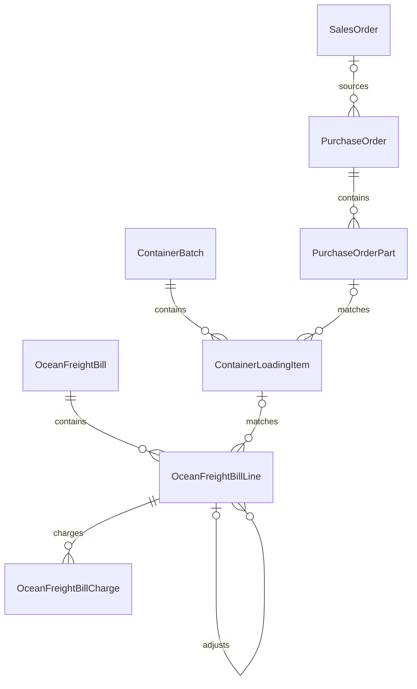
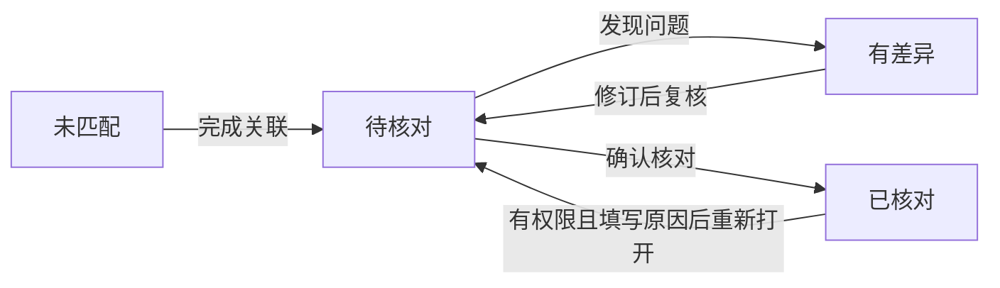

# 柜次管理与海运账单技术设计

| 项目 | 说明 |
| --- | --- |
| 日期 | 2026-09-19 |
| 状态 | 五表结构、基础接口、阶段 2 计算与阶段 3 柜次维护已实现并验收；后续业务流程按阶段推进 |
| 需求依据 | [需求规格](./requirements.md) |
| 实施顺序 | [实施任务](./tasks.md) |

## 1. 设计边界与现有能力

本设计使用现有 NestJS、Prisma、PostgreSQL、HTTP/OpenAPI 与正式前端 `web/apps/qsmds-arco`。仅规划五张业务表，复用现有编号、系统字典、媒体、权限、审计和货件能力，不新建货件或用户账户领域。

| 现有真相源 | 使用方式 |
| --- | --- |
| [Prisma schema](../../server/prisma/schema.prisma) | `PurchaseOrderPart` → `PurchaseOrder` → 可空的 `SalesOrder` 关联 |
| [编号生成服务](../../server/src/modules/numbering/numbering-generator.service.ts) | 通过内部事务派发入口复用规则、锁与幂等能力 |
| [柜次页面](../../web/apps/qsmds-arco/src/views/workbenches/containers/index.vue) | 已接入柜次列表、真实创建和独立详情 |
| [UI 设计规范](../../docs/前端文档/UI设计规范.md) | 页面、表格、表单、主题与响应式约定 |
| [接口契约规范](../../docs/后端文档/接口契约规范.md) | Controller/DTO 定义，统一 OpenAPI 同步流程 |

`CONTAINER_BATCH_NO` 和 `CTN_BILL_NO` 是用户指定的规则代码。本次未查询实际数据库内的启用状态；实施时应通过现有规则能力校验，不假定种子数据中没有代码就代表实际规则不存在。

## 2. 模型关系



- `ContainerLoadingItem.shipmentId` 和 `OceanFreightBillLine.loadingItemId` 在未匹配阶段允许为空；确认核对前必须建立必要的真实关联。
- 装柜明细引用货件主键，账单明细引用装柜明细主键。文本唛头只是候选匹配条件。
- 一个货件可有多条装柜明细，但这些明细必须属于同一柜次。
- 一个装柜明细可被正常账单行和多条后续调整行引用；正常计费需防重复。
- 销售出单人通过 `SalesOrder.issuerUserId` 追溯。本期不创建资金归属或结算快照；未来正式对账单阶段再冻结结算归属。

## 3. 公共字段、单位与精度

### 3.1 装柜与账单明细的同义字段

以下字段在 `ContainerLoadingItem` 和 `OceanFreightBillLine` 中保持同名、同类型、同单位；各表保留各自来源快照。

| 字段 | 业务含义 | 单位或存储规则 |
| --- | --- | --- |
| `warehouseReceiptReference` | 入仓单号原文 | 字符串，可包含多个参考号，不唯一 |
| `oceanShippingMarkText` | 海运唛头 | 保留 `L-010831-01~10` 等原始表达 |
| `goodsName` | 货物品名 | 字符串 |
| `packageCount` | 包装件数 | 正整数；调整行可不提供 |
| `packageUnit` | 包装单位 | 如 `CTN` |
| `grossWeightKg` | 整行总毛重 | 千克，不重复乘件数 |
| `lengthCm` | 单件长度 | 厘米 |
| `widthCm` | 单件宽度 | 厘米 |
| `heightCm` | 单件高度 | 厘米 |
| `volumeCai` | 计算得到的整行材积 | 未向上取整的材积 |
| `chargeableVolumeCai` | 计费材数 | 整行材积向上取整后的整数 |
| `reportedVolumeCai` | 原表材数 | 原始数值快照 |
| `recipientName` | 最终收货人 | 字符串 |
| `recipientPhone` | 收货电话 | 字符串，保留前导零和分隔符 |
| `recipientAddress` | 收货完整地址 | 字符串，原文中的配送说明保留 |
| `codAmountTwd` | 该行代收台币金额 | 装柜方声明值或账单本次有效代收值，不是到账事实 |
| `remark` | 备注 | 保留与该行相关说明 |

若账单收货信息只有一格原文，另用 `recipientInfoRaw` 保留，不强行拆分后丢失信息。因核对而修订的值与原始值通过 `sourceData` 及审计同时保留；无法判断的代收金额不得直接进入已确认合计。

原账单的柜号与装柜日期分别在账单行使用 `containerBatchName`、`loadingDate` 保存来源快照，与柜次主表同名、同义。它们与关联后的柜次值分开展示，不能从关联记录反向覆盖来源值；账单未匹配时也能据此显示和处理跨年冲突。

### 3.2 推荐精度

| 数据 | 推荐类型 |
| --- | --- |
| 金额 | `Decimal(30,2)` |
| 计费单价 | `Decimal(30,6)` |
| 汇率 | `Decimal(30,12)` |
| 尺寸、重量 | `Decimal(18,3)` |
| 材积 | `Decimal(24,8)` |
| 件数、计费材数 | 有范围校验的整数 |
| 日期 | 业务日期，不带用户设备时区偏移 |
| 时间戳 | 遵循现有服务端时间存储规则 |

金额、汇率、尺寸和材积在 API 中使用十进制字符串；前后端计算不得依赖 JavaScript 二进制浮点数。阶段 2 已将货币结果统一使用十进制 `ROUND_HALF_UP`，保留两位小数。原始来源数值如有更高精度，保留在来源快照中。

缺值与零分别表达：未知尺寸、未知代收、未知费用不能一律填零。按重量计费可以没有尺寸；纯补费可以没有件数和重量。按材数计费缺少尺寸或经过明确核对的计费依据时，应阻止确认。

## 4. 五张业务表

各表沿用项目主键、操作者与时间戳惯例。阶段 1 已建立五表 migration，以下为完整设计字段；当前 DTO 只开放基础字段，实际已实现范围见[阶段 1 实施记录](./phase-1.md)。

### 4.1 柜次主表 `ContainerBatch`

| 字段 | 含义或约束 |
| --- | --- |
| `id` | 主键 |
| `containerBatchNo` | 唯一系统柜次编号，由 `CONTAINER_BATCH_NO` 派发 |
| `numberingIssuanceId` | 对应编号派发记录 |
| `containerBatchName` | 柜次名称，例如 `0918-02柜` |
| `loadingDate` | 创建时按年份和名称推断、持久化的装柜日期 |
| `sequenceInDay` | 当日序号，无后缀和 `-01` 均归一为 `1` |
| `warehouseValue` | `mainland.warehouse` 的稳定字典值 |
| `sourceFileId` | 来源 Excel 的现有媒体资源引用，可空 |
| `remark` | 柜次备注 |
| `version` | 并发版本号 |
| `createdById`、`updatedById` | 创建与最后修改人 |
| `createdAt`、`updatedAt` | 创建与更新时间 |

建议以 `warehouseValue + loadingDate + sequenceInDay` 防止同一仓库重复创建同日同序号柜次；柜次名称本身不是跨年的全局唯一键。确认日期及序号后不允许仅改名称造成两者不一致，编辑需一起重新校验。

件数、货件数、总重量和总材积从明细统计，不设置人工可修改的总数。不包含承运商标识及固定发货人字段。

### 4.2 装柜明细 `ContainerLoadingItem`

| 字段 | 含义或约束 |
| --- | --- |
| `id` | 主键 |
| `containerBatchId` | 所属柜次 |
| `shipmentId` | 对应现有 `PurchaseOrderPart.id`；待匹配时可空 |
| `lineNumber` | 柜内展示顺序，柜内唯一 |
| 第 3.1 节公共字段 | 独立的装柜资料快照 |
| `sourceSheetName`、`sourceRowNumber` | 来源工作表和行号，可空 |
| `sourceData` | 必要原始单元格、数值及公式来源信息 |
| `version` | 并发版本号 |
| `createdById`、`updatedById` | 操作人 |
| `createdAt`、`updatedAt` | 时间戳 |

不对 `shipmentId` 单独加唯一约束，否则会错误阻止同一货件多包装。服务端在事务中锁定货件记录，校验已有分配并写入；批量操作按稳定主键顺序加锁，避免并发把同一货件分到两个柜次。

### 4.3 海运账单主表 `OceanFreightBill`

| 字段 | 含义或约束 |
| --- | --- |
| `id` | 主键 |
| `billNo` | 唯一系统账单编号，由 `CTN_BILL_NO` 派发 |
| `numberingIssuanceId` | 编号派发记录 |
| `billName` | 账单名称，可以采用原文件名 |
| `billDate` | 账单日期；来源未给出时可空，不从文件名虚构 |
| `twdPerCny` | 返款汇率，必须大于零，方向 `TWD per CNY` |
| `codTotalAmountTwd` | 本账单有效代收台币合计 |
| `chargeTotalAmountTwd` | 台币有效费用合计 |
| `payableAmountCny` | 应付承运商人民币费用合计 |
| `returnAmountCny` | 台币扣费后折算人民币的返款合计 |
| `netReturnAmountCny` | 扣除人民币费用后的净返款合计 |
| `reportedPayableAmountCny` | 原表人民币应付合计 |
| `reportedReturnAmountCny` | 原表折算后的人民币返款合计 |
| `reportedNetReturnAmountCny` | 原表有明确净额时保存，否则为空 |
| `roundingDifferenceCny` | 逐条换算合计与同口径整单换算的舍入差额 |
| `sourceFileId` | 来源媒体资源引用，可空 |
| `remark`、`version` | 备注及并发版本 |
| `createdById`、`updatedById`、`createdAt`、`updatedAt` | 操作与时间信息 |

全部计算汇总由服务端根据明细产生，不允许前端独立写入。当明细值不完整时显示“待完善”，必要时可返回明确标注的已计算部分金额，不把部分合计伪装为完整总额。进度从明细状态推导，无需维护第二套可人工编辑的主表对账状态。

### 4.4 海运账单明细 `OceanFreightBillLine`

| 字段 | 含义或约束 |
| --- | --- |
| `id`、`billId`、`lineNumber` | 主键、账单及单内顺序 |
| `containerBatchName`、`loadingDate` | 原账单的柜次名称、装柜日期快照；来源未给出时可空，不重新按当前年份推断账单日期 |
| `loadingItemId` | 对应装柜明细；未匹配时可空 |
| `lineType` | `NORMAL` 正常明细；`ADJUSTMENT` 补费或减免 |
| `adjustsBillLineId` | 调整所对应的历史账单行，可空；不是新增货物 |
| `creationRequestKey`、`creationPayloadHash` | 创建行的稳定请求标识及服务端计算的内容指纹，用于正常行和调整行的重试防重 |
| 第 3.1 节公共字段 | 独立的账单资料及本次有效代收快照 |
| `recipientInfoRaw` | 来源合并收货信息，可空 |
| `cargoCategoryCode` | 货类，例如 `4`、`5`；不代表计费方式 |
| `chargeTotalAmountTwd` | 行台币有效费用合计 |
| `payableAmountCny` | 行人民币有效费用合计 |
| `returnAmountCny` | 行台币扣费后折算人民币 |
| `netReturnAmountCny` | 行净返款人民币 |
| `reconciliationStatus` | 未匹配、待核对、有差异或已核对 |
| `reconciliationRemark` | 核对说明及差异处理依据 |
| `reconciledById`、`reconciledAt` | 核对人及时间，未确认时为空 |
| `sourceSheetName`、`sourceRowNumber`、`sourceData` | 原始工作表、行号与必要原文 |
| `version`、`createdAt`、`updatedAt` | 并发与时间信息 |

约束建议：

- 一个装柜明细仅对应一条正常计费明细，跨账单同样防重；数据库部分唯一索引与服务端冲突说明共同保证。
- 同一个装柜明细可有多次调整；调整行不受上述正常行唯一约束限制，但同一导入或请求仍需幂等防重。
- `billId + creationRequestKey` 建立唯一约束。相同键及内容重试返回既有行；同键不同内容返回冲突，不能覆盖已存在行。指纹由服务端对规范化后的业务输入计算，不能信任客户端提供的指纹。
- 引用历史明细时必须验证货物关联一致，禁止自引用或调整链循环。
- 补费行的包装信息可保留为引用快照，但统计货物数量时只按柜次装柜明细去重统计。
- 本次 `codAmountTwd` 与原始代收快照区分：来源可能重复历史代收时，先保留来源并要求核对决定有效金额；任何修改均留痕。

### 4.5 海运费用明细 `OceanFreightBillCharge`

| 字段 | 含义或约束 |
| --- | --- |
| `id`、`billLineId` | 主键与所属账单行 |
| `chargeType` | 费用类别 |
| `currencyCode` | `CNY` 或 `TWD` |
| `amount` | 非负绝对金额，方向由费用性质表达 |
| `chargeNature` | `NORMAL` 正常、`SUPPLEMENT` 补收、`DEDUCTION` 减免 |
| `pricingBasis` | `WEIGHT`、`VOLUME` 或 `FIXED` |
| `chargeableQuantity` | 计费数量；固定金额时可空 |
| `unitPriceAmount` | 对应币种的单价；固定金额时可空 |
| `reportedAmount` | 原表费用值，可空 |
| `remark` | 费用说明，其他费用或调整时应明确填写 |
| `createdById`、`updatedById`、`createdAt`、`updatedAt` | 操作与时间信息 |

推荐费用代码：`FREIGHT` 运费、`COD_HANDLING` 代收手续费、`HEAVY_CARGO` 重货费、`DELIVERY` 派送费、`REMOTE_AREA` 偏远费、`UNLOADING` 卸货费、`STORAGE` 仓储费、`REDELIVERY` 二次派送、`TRANSFER_DELIVERY` 转派、`WAITING` 等待、`OTHER` 其他。

按重量或材数计费时，金额由数量和单价计算；固定金额费用直接维护金额。来源值另存，不能同时独立修改计算金额和公式基础，形成两个真相源。费用随账单行整体事务保存，并共用行版本与核对锁定规则。

## 5. 计算方案

阶段 2 已实现以下公式，采用 `BigInt` 定点整数与有理数运算，金额统一 `ROUND_HALF_UP` 两位，详见[阶段 2 实施记录](./phase-2.md)。装柜明细创建已开放毛重、尺寸与来源材积；账单行创建新增 `codSourceTreatment`，派生金额只由服务端产生。

缺失值保持 `null`，不会以零代替。现阶段没有费用录入完整性标记，数据库中空费用集合视为未录入，明确零费用通过固定金额为零的费用表示。调整行非零代收默认 `UNRESOLVED`；只有明确为本次新增代收才计入，历史参考保留来源但本次有效代收为零。极小材积舍入后为零、存储量程溢出和不合法精度均返回 422，避免数据库约束错误。

### 5.1 材积及运费

```text
singlePieceVolume = lengthCm × widthCm × heightCm ÷ 28317
volumeCai = singlePieceVolume × packageCount
chargeableVolumeCai = ceil(lengthCm × widthCm × heightCm × packageCount ÷ 28317)

WEIGHT：amount = round(grossWeightKg × unitPriceAmount, 2)
VOLUME：amount = round(chargeableVolumeCai × unitPriceAmount, 2)
FIXED：amount = 输入并校验后的固定金额
```

计费材数直接从完整尺寸与数量表达式取整，不以已量化到 `Decimal(24,8)` 的中间材积取整；需要避免接近整数时因中间舍入少收或多收一材。可用定点整数乘积及商余数实现精确向上取整。

货类决定可使用的价格，但不自动推导计费方式。首版不额外建立复杂运价规则引擎，保存本行明确的类别、计费方式和单价即可。

### 5.2 币种内费用汇总

```text
effectiveCharge = amount                     // NORMAL 或 SUPPLEMENT
effectiveCharge = -amount                    // DEDUCTION
chargeTotalAmountTwd = sum(TWD effectiveCharge)
payableAmountCny = sum(CNY effectiveCharge)
```

禁止同时传负金额又选择减免而产生双重反转。来源为负金额时，导入预览明确转换为绝对金额加性质，原数值保留。

### 5.3 单条换算及整单汇总

```text
line.returnAmountCny = round((line.codAmountTwd - line.chargeTotalAmountTwd) / bill.twdPerCny, 2)
line.netReturnAmountCny = line.returnAmountCny - line.payableAmountCny

bill.codTotalAmountTwd = sum(line.codAmountTwd)
bill.chargeTotalAmountTwd = sum(line.chargeTotalAmountTwd)
bill.payableAmountCny = sum(line.payableAmountCny)
bill.returnAmountCny = sum(line.returnAmountCny)
bill.netReturnAmountCny = sum(line.netReturnAmountCny)
```

完整性校验通过后才形成可确认的全部金额。没有销售来源不会阻止纯运费核对，但没有真实装柜货物关联应先完成匹配。

舍入差额定义为逐条计算合计减同一批有效金额的整单换算：

```text
roundingDifferenceCny = bill.returnAmountCny
  - round((bill.codTotalAmountTwd - bill.chargeTotalAmountTwd) / bill.twdPerCny, 2)
```

原表与系统总额还可能因补费归类、代收修订或错误单元格产生业务差异，因此“系统值 − 来源值”单独展示，不能统称为舍入差额。

样表对照：

| 指标 | 整单换算 | 逐条换算后合计 |
| --- | --- | --- |
| 人民币返款 | `389703.96` | `389703.94` |
| 人民币费用 | `87482.50` | `87482.50` |
| 净返款人民币 | `302221.46` | `302221.44` |

此处展示计算口径差异，不代表承运商实际已经返款，也不授权将差额摊入账户。

## 6. Excel 导入与匹配

装柜表流程已明确为：上传来源文件 → 创建柜次并派发编号 → 独立页面解析预览 → 字段校验与货件匹配 → 人工确认 → 事务写入装柜明细。创建柜次只保存柜次与附件，打开解析预览不写入明细；离开预览保留已创建的柜次与来源文件。

柜次详情入口命名为“解析装柜明细表”，直接解析已保存的来源文件。只有末尾“确认导入”写入业务明细；已有同源记录时提示已导入。匹配与防重的实际边界见[阶段 5A](./phase-5a.md)。海运账单导入仍按后续阶段推进。

### 6.1 解析规则

- 首版围绕已提供的两种结构实现明确映射，不构建通用任意 Excel 导入平台。
- 跳过标题、合计、说明及仅有公式的空模板行；处理合并表头。
- 保留文件、工作表、行号、必要单元格原值与公式；手机号保存字符串，来源已丢失前导零时标记数据质量问题，不猜测补齐。
- 只对白名单算式提取有业务意义的汇率和数值，不能执行宏、外链或任意公式代码。
- `=(V58-W58)/4.8` 可提取汇率 `4.8`；公式缺失、含歧义或无法可靠解析时由用户明确填写。
- 数量为 `10`、海运唛头为 `L-010831-01~10` 时仍保留一行。
- `W` 列按备注识别具体费用；一格混合多个费用时拆成该行的多条费用记录，无法确定时留待核对。
- 导入预览区分正常和调整行，特别提示调整行出现的代收金额；不自动继承历史全额代收。

### 6.2 匹配规则

1. 装柜表以 `warehouseReceiptReference`（入倉單號）中的完整标识匹配系统货件；优先货件唛头 `shippingMarkText`，其次物流单号 `trackingNo`，最后货件编号 `shipmentNo`。保留原文，不随意去掉前导零或编号后缀。
2. 柜次仓库约束候选；只有唯一、可用且无矛盾的精确候选才预选。重复物流单号、标识指向不同货件等情况留待人工选择。
3. Excel 的海运唛头 `oceanShippingMarkText` 与供应商贴到货物上的货件唛头是两个字段，不能互相替代。品名及收件信息仅供核对，不凭模糊相似自动确认。
4. 不允许关联已取消或已分配其他柜次的货件；同一货件在同一柜次可有多条包装明细。未匹配行默认阻止导入，用户明确勾选允许后可先保留为未关联明细，后续在详情补充关联。
5. 来源柜次不符、跨年疑点与字段错误在预览展示；不静默纠正。关联成功保存货件主键，不依赖下次再次解析文本。
6. 后续账单导入才使用柜次名称、来源日期、仓库及海运唛头定位已存装柜明细，不与本次货件识别混淆。

### 6.3 防重与失败处理

- 利用现有媒体信息和业务记录查询识别相同来源重复导入；另以正常行装柜关联约束防止改文件名后重复计费。
- 请求带幂等标识；重试不得重复派号、增加正常行或增加同一笔调整费。
- 账单行创建通过行上的请求键、内容指纹和唯一约束持久化幂等身份，不新增第六张业务表。导入为各行提供稳定请求键，同一次确认或重试沿用原键；一笔真实新增的后补费用使用新键。并发唯一冲突后读取已有结果并校验内容，仍须通过单据访问权限检查。
- 确认写入时重新执行校验和权限检查，不能信任过期预览结果。
- 明确的单次保存范围使用事务，失败回滚；不存在“提示失败但一部分账单已经写入”的未说明状态。
- 上传文件走现有类型、大小、权限和媒体引用校验，不另建文件存储体系。

## 7. 对账状态、锁定与审计

### 7.1 推荐状态

| 状态 | 显示 | 含义 |
| --- | --- | --- |
| `UNMATCHED` | 未匹配 | 尚未关联装柜明细或货件 |
| `PENDING` | 待核对 | 关联已建立，等待业务确认 |
| `DISPUTED` | 有差异 | 核对发现需要处理的问题 |
| `CONFIRMED` | 已核对 | 信息、金额及差异说明已确认 |



### 7.2 确认条件

- 具有对账权限，提交的 `expectedVersion` 与当前一致。
- 正常或调整性质明确，装柜明细与货件关联有效。
- 费用、代收、汇率和计费依据完整，非正常来源差异有处理说明。
- 不重复计算正常运费、货件代收或调整金额。
- 原始快照可追溯；确认人及确认时间保存。

### 7.3 确认后的修改

- 已核对行的关联、尺寸、金额、费用和计费依据不可直接改动。
- 纠错需要有权限的人员填写原因，重新打开为待核对，修改后再次确认；通过现有审计记录前后值和操作者。
- 正常后续补费新增调整行，不修改或覆盖已核对的原费用。
- 首条明细确认后冻结该账单汇率。需要改汇率时，先重新打开所有受影响的已核对行，再重算和复核。
- 已被核对账单引用的装柜数据不能静默修改；改变核对基础时必须同步处理受影响核对结果。
- 不通过新增结算表实现上述锁定，复用业务行版本与现有审计能力。

## 8. 页面设计

### 8.1 柜次管理

保留 `/qs-purchase-transport/containers`，使用 `FaPageHeader + FaPageMain + QsGenericTable`。

- 页头：柜次管理；说明沿用“统一管理海运货柜柜次和海快发出情况”。
- 操作：新建柜次；新建弹窗使用 `QsGenericModal`，填写柜次名称、仓库、备注，实时展示推断日期，正式保存后显示派发编号。
- 列表：系统编号、柜次名称、装柜日期、仓库、装柜明细数、货件数、件数、重量、材数、创建人和查看操作。
- 柜次详情使用独立页面，展示基础信息、装柜明细、来源文件及关联账单；支持明细录入、导入、货件关联及现有详情入口。
- 页面保存资料不代表确认实物出运，不自动触发现有货件状态流转。

阶段 3 实现说明：重量和材数在详情完整展示，列表作为可选隐藏列；创建人展示暂未提供，不将用户主键作为姓名显示。Excel 导入入口随阶段 5 实现，阶段 3 只上传并保留来源原件。实际维护和验收记录见[阶段 3 实施记录](./phase-3.md)。

### 8.2 海运账单

用户于 2026-09-19 明确菜单为“千树财务工作台 → 账单对账 → 顺联航海运账单”，详情名为“顺联航海运账单详情”，不显示在侧边栏。

已落地的页面路由如下；柜次详情已接入数据，账单两页仍为骨架：

| 页面 | 路由名 | 路径 | 菜单规则 |
| --- | --- | --- | --- |
| 柜次详情 | `qsPurchaseTransportContainerDetail` | `/qs-purchase-transport/containers/:id` | 隐藏，`activeMenu` 指向柜次管理 |
| 顺联航海运账单 | `qsFinanceShunlianhangOceanBills` | `/qs-finance/bill-reconciliation/shunlianhang-ocean-bills` | 显示在账单对账分组 |
| 顺联航海运账单详情 | `qsFinanceShunlianhangOceanBillDetail` | `/qs-finance/bill-reconciliation/shunlianhang-ocean-bills/:id` | 隐藏，`activeMenu` 指向顺联航海运账单 |

- 列表：账单编号、名称、日期、涉及柜次、明细数量、核对进度、汇率、人民币应付、人民币返款与净返款。
- 详情上方显示关键金额和原表差异，下方用 `QsStatusSwitchToolbar` 切换全部、未匹配、待核对、有差异、已核对。
- 明细展示对应柜次、海运唛头、品名、包装数、费用及对账状态；可查看来源文件和真实货件。
- 单行核对：左列装柜数据，中列账单资料和费用，右列差异、计算结果、核对说明和确认按钮。桌面三列，窄屏纵向；长唛头和地址可读，不造成整页横向溢出。
- 金额、人员使用现有 `AmountDisplay`、`QsPersonDisplay`，反馈用 `useQsToast`，详情和局部编辑沿用 `QsGenericDrawer`、`QsGenericModal`。
- 颜色、间距、字重和图标遵循系统主题及组件契约，不另建视觉规范。
- 本期页面不出现“已到账”“入账”“确认返款”或下游正式对账单生成操作。

## 9. 后端、API 与权限建议

新增 `container-batches`、`ocean-freight-bills` 模块，遵循 Controller → Service → Prisma 的现有依赖方向。计算逻辑拆成可独立验证的纯函数，命令服务负责权限、幂等、锁及事务。

### 9.1 拟定 HTTP 范围

| 方法 | 路径 | 用途 |
| --- | --- | --- |
| `GET / POST` | `/api/container-batches` | 查询、新建柜次 |
| `GET / PATCH` | `/api/container-batches/:id` | 详情、修改基础资料 |
| `GET / POST` | `/api/container-batches/:id/items` | 查询、新增装柜明细 |
| `PATCH` | `/api/container-batches/:id/items/:itemId` | 修改及关联货件 |
| `POST` | `/api/container-batches/import-preview` | 装柜资料解析预览 |
| `GET / POST` | `/api/ocean-freight-bills` | 查询、新建海运账单 |
| `GET / PATCH` | `/api/ocean-freight-bills/:id` | 详情、修改基础资料 |
| `GET / POST` | `/api/ocean-freight-bills/:id/lines` | 查询、新增账单明细 |
| `PATCH` | `/api/ocean-freight-bills/:id/lines/:lineId` | 修改行资料及整组费用 |
| `POST` | `/api/ocean-freight-bills/import-preview` | 账单解析预览 |
| `POST` | `/api/ocean-freight-bills/:id/lines/:lineId/match` | 匹配装柜明细 |
| `POST` | `/api/ocean-freight-bills/:id/lines/:lineId/reconcile` | 确认核对 |
| `POST` | `/api/ocean-freight-bills/:id/lines/:lineId/reopen` | 有原因地重新打开核对 |

以上是完整目标范围。阶段 1 实现两类主表及基础行的创建、列表和详情，共 10 个 operation；阶段 3 增加柜次和装柜明细修改，以及来源文件上传、元数据、下载/HEAD。账单修改、Excel 导入、匹配、核对接口尚未实现。实际契约以 Controller、DTO 与生成的 OpenAPI 为准，见[阶段 1 实施记录](./phase-1.md)与[阶段 3 实施记录](./phase-3.md)。正式导入提交可复用受事务保护的批量创建或维护命令，最终 DTO 中必须明确提交范围及幂等标识；不额外暴露公共编号生成入口。首版不包含物理删除接口，若后续需要删除或作废，另行定义关联和审计规则。

### 9.2 权限建议

阶段 3 柜次列表与详情已切换为 `container-batches:read`，创建/编辑分别检查专属写权限；账单对账分组及顺联航海运账单两页仍为骨架，使用 `purchase-orders:payment`。阶段 1 权限迁移默认仅授予 `system_admin`；账单页面接入业务时再切换对应权限。`reconcile` 当前仅登记权限，尚无核对写入口。

- `container-batches:read/create/update`：柜次查询与维护。
- `ocean-freight-bills:read/create/update/reconcile`：账单查询、维护与核对；重新打开也要求核对权限。
- 建议采运管理员维护柜次，财务人员维护和核对账单；实际角色授予以实施时确认的权限配置为准。
- 访问相关采购、货件、销售详情时继续校验既有权限；入口隐藏不能替代后端鉴权。
- 文件访问与导入也校验对应单据权限，避免通过媒体地址绕过单据访问控制。

### 9.3 一致性与实现约束

1. 编号申请和主表创建在同一事务中完成，使用 `generateScopedInTransaction` 等现有入口；预览不占号，失败重试保持同一幂等语义。
2. 单次行编辑、费用替换和账单汇总重算必须一致提交；并发保存通过版本和必要锁防止丢失更新。
3. 跨柜检查锁定实际货件，不使用只能保护一次查询的前端判断。
4. 账单行确认与汇率修改共同锁定相关主表和行，防止在确认的同时改变换算基础。
5. 装柜修改与对账确认必须协同锁定关联记录，避免确认后来源基础立刻被另一事务改变。
6. 写入仓库字典稳定值，使用现有字典消费者校验有效值，历史读取通过现有历史值解析能力展示。
7. 仅保存必要来源数据，文件和收货信息按现有权限处理，日志不打印整份敏感单据。
8. 本期命令链不调用资金引擎，不写资金流水或销售收款，也不注册新的资金结算来源类型。

## 10. 后续阶段接口边界

当前行主键、真实货件关联、金额快照、汇率和核对版本可作为未来正式对账单的输入。后续阶段需另行处理对账单冻结、归属快照、入账幂等、历史费用重复扣减及代收重复计入等问题。

本期不预建空的结算表或占位账户写入服务。逐条对账与净返款计算完整实现后，再根据用户要求设计正式对账单及资金传导。
