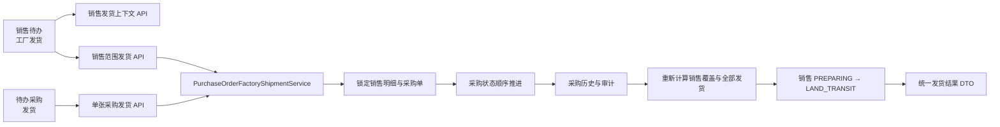
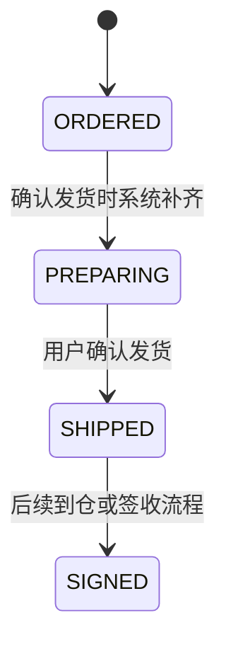

# 销售与采购订单工厂发货技术设计

## 1. 文档状态

- 状态：已确认
- 设计日期：2026-09-04
- 需求规格：[销售与采购订单工厂发货需求规格](./requirements.md)
- 实施边界：本设计包含公共 API 与 DTO 变更方案，但当前阶段不实施代码、契约或数据库变更。

## 2. 设计结论

采用“采购域统一写入、两个入口表达不同意图、销售状态服务端派生”的方案：

- 待办采购入口提交单张采购单发货。
- 销售待办入口提交指定一张、多张或全部剩余关联采购单发货。
- 两个入口最终调用同一个 `PurchaseOrderFactoryShipmentService`。
- 发货状态历史和审计记录始终写在采购订单域。
- 销售订单只有在事务内重新验证采购覆盖和全部有效采购单发货完成后，才自动从 `PREPARING` 进入 `LAND_TRANSIT`。
- 不新增发货表、数据库字段或 migration；操作时间使用状态历史的 `changedAt`，操作人使用 `changedByUserId`，发货说明使用状态历史的 `reason`。

不采用 Web 循环调用现有单张履约接口的方式，因为该方案无法保证多采购单原子性，也无法安全确定销售订单何时进入下一状态。

## 3. 当前实现审计

### 3.1 已有状态与入口

- 销售待办“待发货”使用 `SalesOrder.fulfillmentStatus = PREPARING`，行按钮为“工厂发货”，当前只显示建设中轻提示。
- 采购待办“待发货”由 Server 查询 `PurchaseOrder.fulfillmentStatus IN (ORDERED, PREPARING)`，行按钮为“发货”，当前只显示建设中轻提示。
- 采购状态机严格允许 `ORDERED -> PREPARING -> SHIPPED -> SIGNED`。
- 销售状态机严格允许 `PREPARING -> LAND_TRANSIT`。
- 现有通用采购履约接口一次只接收一个 `toStatus`，无法承载销售入口的批量范围和原子汇总语义。

### 3.2 已有数据能力

- `PurchaseOrder.salesOrderId` 保存销售来源，一张销售订单可关联多张采购订单。
- `PurchaseOrderLine.sourceSalesOrderLineId` 保存销售明细来源，可复用现有采购覆盖计算。
- `PurchaseOrderStatusHistory` 和审计事件能够记录每次采购履约变化。
- `SalesOrderStatusHistory` 和审计事件能够记录销售履约自动推进。
- `PurchaseOrder.version` 与 `SalesOrder.version` 可用于陈旧状态检测。
- 现有列表 DTO 已包含采购单号、供应商、产品摘要、履约状态和版本，可复用大部分 Web 展示模型。

## 4. 总体架构



### 4.1 Server 模块归属

发货事实属于采购域。新增实现放在：

```text
server/src/modules/purchase-orders/factory-shipments/
  purchase-order-factory-shipment.service.ts
  purchase-order-factory-shipment-query.service.ts
  purchase-order-factory-shipment.normalizer.ts
  purchase-order-factory-shipment.controller.ts
  sales-order-factory-shipment.controller.ts
```

两个 Controller 分别使用 `purchase-orders` 和 `sales-orders` 路径，但统一注册到 `PurchaseOrdersModule`。这样可以避免 `SalesOrdersModule` 与 `PurchaseOrdersModule` 互相导入形成循环依赖，同时保持写模型由采购域拥有。

销售状态汇总逻辑扩展现有 `SalesOrderPurchaseCoverageService`，新增“全部采购已发货后推进”方法，继续复用其销售订单锁、采购覆盖函数、状态历史和审计写入规范。

## 5. 公共 API 设计

以下均为新增公共 API，实施前需要用户单独确认 API/DTO/OpenAPI 变更。

### 5.1 查询销售订单发货上下文

```http
GET /api/sales-orders/{salesOrderId}/factory-shipment-context
```

权限：

```text
sales-orders:read AND purchase-orders:read
```

响应：

```ts
interface SalesOrderFactoryShipmentContextDto {
  salesOrder: {
    id: string
    orderNo: string
    customerName: string
    fulfillmentStatus: 'PREPARING'
    version: number
  }
  purchaseOrders: Array<{
    id: string
    orderNo: string
    orderDate: string
    supplier: PurchaseOrderSupplierDto
    fulfillmentStatus: 'ORDERED' | 'PREPARING' | 'SHIPPED' | 'SIGNED'
    version: number
    lineSummary: PurchaseOrderLineSummaryDto
  }>
  pendingShipmentCount: number
  shipmentSatisfiedCount: number
}
```

查询规则：

- 只返回 `purchaseType = SALES_LINKED`、`salesOrderId` 匹配、`orderStatus != CANCELLED` 的采购单。
- `ORDERED/PREPARING` 排在前面，内部按 `orderDate ASC, orderNo ASC, id ASC` 稳定排序。
- `SHIPPED/SIGNED` 排在后面，供用户只读核对。
- 产品图片继续使用采购权限域下的内容 URL；该接口本身要求 `purchase-orders:read`。
- 销售订单不是 `CONFIRMED + PREPARING` 时返回业务错误，不返回可提交上下文。

### 5.2 单张采购订单发货

```http
POST /api/purchase-orders/{purchaseOrderId}/factory-shipments
```

权限：

```text
purchase-orders:update
```

请求：

```ts
interface PurchaseOrderFactoryShipmentRequestDto {
  expectedVersion: number
  reason?: string | null
}
```

`reason` 去除首尾空白并执行 NFKC 规范化；为空时保存 `null`，非空时最多 500 个 Unicode code point。

### 5.3 销售订单关联采购批量发货

```http
POST /api/sales-orders/{salesOrderId}/factory-shipments
```

权限：

```text
sales-orders:update AND purchase-orders:update
```

请求：

```ts
interface SalesOrderFactoryShipmentRequestDto {
  mode: 'SELECTED' | 'ALL_PENDING'
  targets: Array<{
    purchaseOrderId: string
    expectedVersion: number
  }>
  reason?: string | null
}
```

规则：

- `targets` 必须非空、采购单 ID 不得重复，并设置合理的批量上限，例如 100 张。
- `SELECTED` 只处理 `targets` 指定的采购单。
- `ALL_PENDING` 中的 `targets` 表示用户确认时看到的完整待发货集合。服务端在事务内重新读取当前完整集合并比较：
  - 集合一致时继续；
  - 出现新增、取消或关联变化时返回 `409`，要求刷新上下文；
  - 当所有目标已经因同一请求或并发操作达到 `SHIPPED/SIGNED`，且没有新增待发货采购单时，按安全重试返回成功。

这种设计既保证“全部”由服务端验证，又避免网络结果未知后重试时误把之后新增的采购订单一并发货。

### 5.4 统一响应

两个提交接口返回同一结构：

```ts
interface FactoryShipmentResultDto {
  purchaseOrders: Array<{
    id: string
    orderNo: string
    fulfillmentStatus: 'SHIPPED' | 'SIGNED'
    changed: boolean
  }>
  changedPurchaseOrderCount: number
  alreadySatisfiedCount: number
  remainingPendingShipmentCount: number
  salesOrder: {
    id: string
    orderNo: string
    fulfillmentStatus:
      | 'PREPARING'
      | 'LAND_TRANSIT'
      | 'WAREHOUSE_ARRIVED'
      | 'SEA_TRANSIT'
      | 'SIGNED'
    advancedToLandTransit: boolean
  } | null
}
```

Web 必须根据服务端响应决定轻提示，不得根据提交前选择数量自行断言销售状态已经推进。

### 5.5 错误语义

建议新增以下稳定错误码：

| HTTP | Error Code | 使用场景 |
| ---: | --- | --- |
| 404 | `SALES_ORDER_NOT_FOUND` | 销售订单不存在 |
| 404 | `PURCHASE_ORDER_NOT_FOUND` | 采购订单不存在 |
| 409 | `FACTORY_SHIPMENT_STATE_CHANGED` | 订单版本、候选集合或状态已变化 |
| 422 | `FACTORY_SHIPMENT_TARGET_INVALID` | 采购单不属于当前销售订单、重复或混入备货采购 |
| 422 | `FACTORY_SHIPMENT_NOT_ALLOWED` | 订单取消、销售状态不允许或不存在可发货目标 |
| 400 | `VALIDATION_FAILED` | 请求结构、ID、版本或说明不合法 |

接口继续使用现有认证、CSRF、私有缓存和 `ApiApplicationContract` 规范。前端对三个写接口设置 `retry: false`。

## 6. 事务与并发设计

### 6.1 稳定锁顺序

销售关联采购发货统一使用：

```text
1. 非锁定读取采购单，仅定位可信候选销售订单 ID
2. 按 UUID 升序锁定当前销售订单全部有效销售明细
3. 按 UUID 升序锁定目标或全部有效关联采购订单
4. 锁定销售订单主行
5. 重新读取并校验状态、关联、版本、候选集合和采购覆盖
6. 写入采购状态、历史和审计
7. 重新汇总全部有效关联采购订单
8. 必要时写入销售状态、历史和审计
```

锁销售明细放在最前，用于与现有采购创建、采购取消和销售产品修改保持兼容：

- 新采购创建必须先锁销售来源明细，因此不能在整体发货集合确认后悄悄插入。
- 采购取消同样先锁销售来源明细，因此不能在汇总中间改变有效采购集合。
- 销售产品修改先锁全部有效销售明细，因此不能在覆盖判断中间新增或减少销售数量。

独立备货采购没有销售来源，仅锁定目标采购订单。

### 6.2 采购状态推进



- 当前为 `PREPARING`：只写一次 `PREPARING -> SHIPPED`。
- 当前为 `ORDERED`：在同一事务中先写 `ORDERED -> PREPARING`，再写 `PREPARING -> SHIPPED`。
- 当前为 `SHIPPED/SIGNED`：作为安全重试，不写状态、版本、历史或审计。
- 当前为 `CANCELLED/COMPLETED` 或其他非法组合：拒绝整个请求。

自动补齐历史原因固定为：

```text
确认发货时系统自动完成备货状态
```

实际发货历史原因使用用户说明；未填写时为 `null`。

### 6.3 销售状态派生

发货完成后复用 `isSalesOrderPurchaseFullyCovered()` 重新计算销售明细覆盖，并读取全部有效关联采购单状态。

```text
fullyCovered
AND activePurchaseOrderCount > 0
AND every fulfillmentStatus IN (SHIPPED, SIGNED)
AND sales orderStatus = CONFIRMED
AND sales fulfillmentStatus = PREPARING
  => LAND_TRANSIT
```

销售状态历史原因固定为：

```text
全部有效关联采购订单已发货
```

审计元数据：

```ts
{
  automatic: true,
  trigger: 'PURCHASE_FACTORY_SHIPMENT',
  source: 'PURCHASE_ORDER' | 'SALES_ORDER',
  changedPurchaseOrderCount: number,
  fromStatus: 'PREPARING',
  toStatus: 'LAND_TRANSIT'
}
```

不在审计元数据中复制客户电话、地址、用户发货说明或完整产品信息。

### 6.4 版本与安全重试

- 采购单处于 `ORDERED/PREPARING` 时，`expectedVersion` 必须等于事务内版本，否则返回 `409`。
- 采购单已经为 `SHIPPED/SIGNED` 时，忽略版本差异并作为目标已满足处理。
- 事务只在真实状态变化时增加对应订单版本。
- 销售订单已经进入 `LAND_TRANSIT` 或后续状态时，不重复推进；仅在全部目标已满足且没有非法目标时返回无副作用成功。
- 请求失败或结果未知后，Web 先刷新上下文；若用户主动重试相同范围，服务端仍保证不重复写历史。

## 7. Web 组件设计

### 7.1 公共组件

新增：

```text
web/apps/qsmds-arco/src/components/business/QsFactoryShipmentModal/
  index.vue
  logic.ts
  types.ts
  README.md
```

组件职责：

- 基于 `QsGenericModal` 展示单张采购和销售批量两种模式。
- 管理指定/全部模式切换、采购单选择、只读已发货行、发货说明和影响预告。
- 接收加载、提交、错误和结果状态并向页面发出语义化事件。
- 不直接调用 API，不复制服务端状态流转规则。

建议 Props：

```ts
interface QsFactoryShipmentModalProps {
  modelValue: boolean
  mode: 'PURCHASE_ORDER' | 'SALES_ORDER'
  context: FactoryShipmentModalContext | null
  loading: boolean
  submitting: boolean
  error?: string
}
```

建议 Emits：

```ts
{
  'update:modelValue': [visible: boolean]
  'submit': [intent: FactoryShipmentIntent]
  'retry': []
}
```

纯逻辑放在 `logic.ts` 并独立测试：

- 待发货/已发货稳定排序；
- 指定范围与全部范围规范化；
- 预计剩余数量；
- 提交可用性；
- 单张模式固定目标；
- 轻提示文案选择。

### 7.2 销售模式布局

桌面采用约 `8:4` 非对称布局：

```text
┌ 销售订单信息 ────────────────────────────────┐
├ 左：范围与采购单列表 ────────┬ 右：发货影响摘要 ┤
│ ○ 指定采购单  ○ 全部待发货   │ 本次 2 张        │
│ □ PO-001 供应商 A            │ 剩余 1 张        │
│ □ PO-002 供应商 B            │ 销售保持备货中   │
│   PO-003 已发货（灰色）       │                  │
├ 发货说明 ────────────────────┴──────────────────┤
└                           取消  确认发货 2 张 ─┘
```

- 待发货行支持复选；已发货行灰色只读并放在末尾。
- “全部待发货采购单”使用琥珀色影响提示，但最终按钮仍使用项目主色。
- 右侧摘要在列表滚动时保持可见；窄屏改为“订单信息 → 范围 → 列表 → 摘要 → 说明”。
- 列表区域单独滚动，标题、模式选择、影响摘要和底部按钮不随列表滚动。

### 7.3 采购模式布局

使用紧凑单列：

```text
┌ 确认本采购单已发货？ ─────────────┐
│ PO-001      供应商 A              │
│ 销售来源     SO-001 / 客户名称     │
│ 产品         3 项 / 共 8 件        │
│ 当前状态     已下单                │
│ [发货说明（可选）]                │
└                    取消  确认本单发货 ┘
```

若当前为 `ORDERED`，弹窗明确提示：

```text
确认后系统将完成备货状态并将本采购单标记为已发货。
```

### 7.4 页面接入

销售订单页面：

- `FACTORY_SHIPMENT` 不再进入建设中 Toast。
- 按钮展示要求现有销售读取权限，同时具备 `sales-orders:update` 和 `purchase-orders:update`。
- 打开时请求销售发货上下文。
- 成功后刷新销售列表、当前工具栏计数；根据返回的 `advancedToLandTransit` 显示轻提示。

采购订单页面：

- `SHIPMENT` 不再进入建设中 Toast。
- 直接使用列表行构造单张弹窗上下文。
- 成功后刷新采购列表、金额汇总和工具栏计数。
- 若为销售关联采购，轻提示同时表达销售是否仍有待发货采购单。

“货物入仓”“装柜出货”以及其他未实施动作继续只显示建设中轻提示。

### 7.5 轻提示

```text
独立备货：采购单 PO/20260904-00001 已发货
部分发货：已完成 2 张采购单发货，仍有 1 张待发货，销售订单保持备货中
全部发货：3 张采购单已发货，销售订单已进入陆运中
安全重试：所选采购单已完成发货，订单状态已刷新
状态冲突：订单状态已变化，请刷新后重新确认发货范围
```

## 8. OpenAPI 与生成类型

新增 DTO、Controller decorators 和错误码后，使用 Server Controller/OpenAPI 作为契约真相源：

```bash
node --run contract:sync
node --run contract:check
```

不得手工编辑：

- `docs/openapi/openapi.json`
- `web/apps/qsmds-arco/src/api/generated/*`

API 同步后，在 `sales-orders.ts` 和 `purchase-orders.ts` 中增加薄适配方法，保持 `errorPresentation: 'local'`、`retry: false` 和显式 `AbortSignal`。

## 9. 测试策略

### 9.1 Server 单元测试

- 规范化：非法模式、空目标、重复 ID、超限目标、非法 UUID、版本和说明。
- 上下文查询：只返回有效关联采购；待发货在前、已发货在后；供应商和产品摘要映射正确。
- 单张发货：
  - `PREPARING -> SHIPPED`；
  - `ORDERED -> PREPARING -> SHIPPED`；
  - 备货采购不访问销售订单；
  - 已发货安全重试无副作用；
  - 取消、错误版本和非法状态被拒绝。
- 销售批量发货：指定一张、多张、全部、候选集合变化、混入其他销售订单、混入备货采购。
- 销售联动：部分发货保持 `PREPARING`；最后一张发货进入 `LAND_TRANSIT`；覆盖不完整不推进；后续状态不重复推进。
- 原子性：任一目标失败时采购、销售、历史和审计均不产生部分写入。
- 锁序：销售明细 UUID 升序、采购订单 UUID 升序、销售订单主行。
- Controller：权限组合、OpenAPI 路径、响应和错误码。

### 9.2 Server E2E

- 创建一张销售订单和两张关联采购单，从销售入口发货一张后保持 `PREPARING`。
- 发货第二张后销售订单进入 `LAND_TRANSIT`。
- 从采购入口发货最后一张时得到相同联动结果。
- `ORDERED` 自动补齐两步历史。
- 并发发货不会重复历史或错误推进。
- 已取消采购、权限缺失和跨销售订单目标均被拒绝。

### 9.3 Web 测试

- `QsFactoryShipmentModal` 两种模式、稳定排序、选择、全部范围、灰色只读行和窄屏布局。
- 销售按钮权限必须同时满足两个 update 权限。
- 销售页面不再对 `FACTORY_SHIPMENT` 显示建设中提示。
- 采购页面不再对 `SHIPMENT` 显示建设中提示。
- 其他占位物流按钮仍只显示建设中提示。
- 提交中锁定、失败保留说明、成功刷新列表和状态计数。
- 服务端结果驱动五类轻提示，不使用客户端猜测状态。

### 9.4 浏览器验证

1. 销售待发货订单存在两张采购单，指定发货一张并验证销售仍在待发货。
2. 再次打开，验证已发货行灰色置后；整体发货剩余采购单并验证销售进入待入仓。
3. 待办采购中对独立备货采购确认发货并验证进入待入仓。
4. 对 `ORDERED` 采购单确认发货，验证提示和最终 `SHIPPED` 状态。
5. 在双窗口模拟状态变化，验证陈旧弹窗返回冲突并正确刷新。

## 10. 验证命令

实施阶段按 TDD 从聚焦测试开始，最终执行：

```bash
pnpm -C server exec jest <factory-shipment-focused-specs> --runInBand
pnpm -C server typecheck
pnpm -C server lint
node --run contract:sync
node --run contract:check
pnpm -C web test:api
pnpm -C web typecheck
pnpm -C web lint
node --run ci:server-e2e
node --run ci:browser-auth-e2e
node --run check
git diff --check
```

本需求不包含 migration，因此不得执行或声称应用数据库 migration。

## 11. 安全与 Git 边界

- 不修改 Prisma Schema，不新增、修改或删除 migration。
- 不新增权限编码；复用现有销售和采购 read/update 权限。
- 公共 API、DTO 和 OpenAPI 的新增必须在实施前获得明确确认。
- 不记录客户电话、地址、Cookie、Token 或完整敏感请求体。
- 保留用户已有工作区变更，不使用破坏性 Git 命令。
- 实施时小步提交，建议最终功能提交信息：`feat: 实现销售与采购订单工厂发货`。
- 不自动推送远端、不创建 PR、不部署。

## 12. 不采用的方案

### 12.1 Web 循环调用现有采购履约接口

多张采购单可能部分成功；前端无法可靠锁定关联集合，也无法原子推进销售状态，因此不采用。

### 12.2 销售按钮直接更新销售状态

会绕过采购单真实发货事实，导致部分采购仍未发货但销售已经进入陆运中，因此不采用。

### 12.3 允许 `ORDERED -> SHIPPED` 跳级

会破坏已确认的严格状态机和审计路径。采用同一事务内顺序补齐两个合法变更。

### 12.4 本期新增发货记录表

首期没有部分发货、运单、物流商或附件需求，现有状态历史已经能够承载操作时间、操作人和说明。新增表会形成没有当前业务消费者的过度设计，因此不采用。
