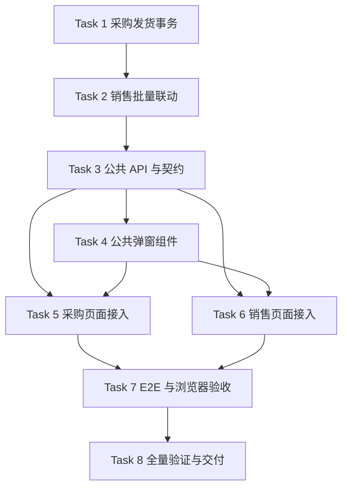

# 销售与采购订单工厂发货实施任务

## 1. 文档状态

- 状态：Phase 4 实施中
- Requirements 确认日期：2026-09-04
- Design 确认日期：2026-09-04
- 任务计划编写日期：2026-09-04
- 实施分支：`feat/purchase-order-domain`
- 任务拆解基线 SHA：`db3ea230ed4ef01c0e2e162358ac02ca76dc8977`
- Requirements：[销售与采购订单工厂发货需求规格](./requirements.md)
- Design：[销售与采购订单工厂发货技术设计](./design.md)

本文档将已确认的需求与技术设计拆成 8 个可独立验证的小步任务。Phase 3 Gate 确认前，不修改运行时代码、公共 API、DTO、OpenAPI、数据库或生成文件。

## 2. 执行纪律

每个功能任务遵循以下闭环：

```text
确认任务边界
-> 添加能够证明当前能力缺失的失败测试
-> 记录红测原因
-> 实施最小功能
-> 补齐异常、权限、并发和幂等路径
-> 运行聚焦验证
-> 审计 diff 与 generated 边界
-> 创建可独立构建的绿色小步提交
```

规则：

1. 不提交只有红测、无法构建或契约未同步的中间状态。
2. Server 状态与事务规则是业务真相源；Web 不复制销售状态推进判断。
3. 不手工编辑 `docs/openapi/openapi.json` 或 `web/apps/qsmds-arco/src/api/generated/*`，统一通过 `node --run contract:sync` 生成。
4. 不修改 Prisma Schema，不新增或应用 migration，不新增第三方依赖。
5. 单次批量发货必须是同一数据库事务；任一目标失败时不得产生部分状态、历史或审计记录。
6. 遵循已确认锁顺序：销售明细 UUID 升序、采购订单 UUID 升序、销售订单主行。
7. “货物入仓”“装柜出货”及其他未实施动作继续只弹“功能正在建设中”。
8. 每个提交前检查 `git diff --cached --name-only`、`git diff --cached --check` 和 `git diff --cached --stat`。
9. Commit Message 类型使用英文、描述使用中文；不得提交 `.env`、日志、构建产物或根依赖违规产物。
10. 命令失败必须如实报告；未授权 push、PR、merge、部署、分支删除或 Git 历史重写。

## 3. 阶段门禁

### Gate A - Phase 4 与 Git

- [x] 用户确认本任务计划并授权进入 Phase 4。
- [x] 用户授权按本计划创建本地小步提交。
- [x] 不授权 push、PR、merge、部署或分支删除。

### Gate B - 公共 API、DTO 与 OpenAPI

Phase 4 开始前需要用户明确授权以下公共契约变更：

- [x] 新增 `GET /api/sales-orders/{salesOrderId}/factory-shipment-context`。
- [x] 新增 `POST /api/purchase-orders/{purchaseOrderId}/factory-shipments`。
- [x] 新增 `POST /api/sales-orders/{salesOrderId}/factory-shipments`。
- [x] 新增对应请求、响应、错误码和 OpenAPI Schema，并同步 Web generated types。
- [x] 复用 `sales-orders:read/update` 与 `purchase-orders:read/update`，不新增权限编码。

### Gate C - 数据库和范围边界

- [x] 明确确认本期不修改 Prisma Schema，不新增或应用 migration。
- [x] 发货时间、操作人和说明继续由现有状态历史、审计记录承载。
- [x] 本期不实现部分数量发货、物流商、运单号、发货附件、入仓或装柜业务。

出现以下情况必须暂停并重新确认：

- 需要新增发货表、字段、枚举、migration 或权限编码。
- 需要改变销售或采购状态机中设计之外的转换规则。
- 需要让前端直接写销售履约状态或循环调用单采购状态接口。
- 需要删除文件、引入第三方依赖或改变其他业务域公共 API。

## 4. 实施任务

- [x] 1. 建立工厂发货领域规则与事务服务
  - 在 `server/src/modules/purchase-orders/factory-shipments/` 添加纯规范化逻辑和统一应用服务。
  - 先添加失败测试，覆盖请求模式、目标去重、批量上限、UUID、版本、NFKC 说明规范化和 500 code point 限制。
  - 先添加失败测试，覆盖单张 `PREPARING -> SHIPPED` 和 `ORDERED -> PREPARING -> SHIPPED`。
  - 对 `ORDERED` 在同一事务内写入两次合法状态历史；自动补齐原因固定为“确认发货时系统自动完成备货状态”。
  - 对 `SHIPPED/SIGNED` 实现无副作用安全重试；非法状态拒绝且不写版本、历史或审计。
  - 独立备货采购只锁采购单，不读取或更新销售订单。
  - 运行聚焦单元测试、Server typecheck 和 diff 检查。
  - 建议提交：`feat: 实现采购订单工厂发货事务`。
  - _Requirements: R1, R4, R6, R7_

- [x] 2. 实现销售关联采购批量发货与销售状态派生
  - 先添加失败测试，覆盖指定一张、多张、全部待发货和完整候选集合变化。
  - 事务内按稳定锁顺序锁定销售明细、有效采购订单和销售订单，并重新校验关联、版本、候选集合和采购覆盖。
  - 拒绝混入其他销售订单、备货采购、已取消采购或重复目标；任何目标失败时整体回滚。
  - 扩展 `SalesOrderPurchaseCoverageService`：仅在销售订单为 `CONFIRMED + PREPARING`、采购覆盖完整且全部有效关联采购单为 `SHIPPED/SIGNED` 时进入 `LAND_TRANSIT`。
  - 写入销售状态历史原因“全部有效关联采购订单已发货”和最小必要审计元数据。
  - 覆盖部分发货保持 `PREPARING`、最后一张推进、覆盖不完整不推进、后续状态不重复推进。
  - 运行聚焦单元测试、并发测试、Server typecheck 和 diff 检查。
  - 建议提交：`feat: 联动销售订单工厂发货状态`。
  - _Requirements: R2, R4, R5, R6, R7_

- [x] 3. 提供发货上下文和提交公共 API
  - 先添加 Controller、DTO、权限和 OpenAPI 失败测试。
  - 实现销售发货上下文查询，仅返回当前销售订单有效的销售关联采购单。
  - 将 `ORDERED/PREPARING` 稳定排序在前，将 `SHIPPED/SIGNED` 灰态数据稳定排序在后。
  - 实现单张采购发货 Controller 与销售批量发货 Controller，二者调用同一领域服务。
  - 实施已确认的 read/update 组合权限、`409/422/400/404` 错误语义、私有缓存和 CSRF 规范。
  - 为两个写接口禁止客户端自动重试，并只返回服务端计算的统一结果 DTO。
  - 运行 Controller 测试、`node --run contract:sync`、`node --run contract:check`、Server typecheck 和 lint。
  - 审计生成文件只包含本任务的契约变化。
  - 建议提交：`feat: 提供订单工厂发货接口`。
  - _Requirements: R1, R2, R3, R6, R7, R8_

- [ ] 4. 实现 `QsFactoryShipmentModal` 公共组件
  - 先为 `logic.ts` 添加失败测试，覆盖稳定排序、指定/全部模式、预计剩余数量、单张固定目标和提交可用性。
  - 基于 `QsGenericModal` 实现 `PURCHASE_ORDER` 与 `SALES_ORDER` 两种受控模式，组件内部不直接请求 API。
  - 销售模式实现约 `8:4` 的列表与影响摘要；只滚动采购单列表，标题、范围、摘要和底部按钮固定。
  - 待发货行可选，已发货行灰色只读并置后；窄屏按订单信息、范围、列表、摘要、说明顺序垂直布局。
  - 采购模式实现紧凑单列，并在 `ORDERED` 时明确提示系统将自动补齐备货状态。
  - 实现可选发货说明、提交中锁定、错误保留输入和语义化 submit/retry emits。
  - 在组件库添加销售模式、采购模式、加载、空态、错误和窄屏示例。
  - 运行组件聚焦测试、Web typecheck、lint 和视觉检查。
  - 建议提交：`feat: 新增订单工厂发货弹窗组件`。
  - _Requirements: R1, R2, R3, R8_

- [ ] 5. 接入待办采购“发货”入口
  - 先添加页面集成失败测试，证明 `SHIPMENT` 不再落入建设中轻提示。
  - 使用当前采购列表行打开单张采购模式，提交 `expectedVersion` 和可选说明。
  - 根据服务端结果展示独立备货、部分关联、全部关联或安全重试轻提示，不在 Web 猜测销售状态。
  - 成功后刷新采购列表、汇总数据和 `QsStatusSwitchToolbar` 计数。
  - 状态冲突时保留弹窗上下文并引导刷新；服务端错误不误报成功。
  - 保持“到仓”“付款”和其他未实施事件原有行为不变。
  - 运行采购页面测试、Web API 测试、typecheck 和 lint。
  - 建议提交：`feat: 接入待办采购发货操作`。
  - _Requirements: R1, R3, R7, R8_

- [ ] 6. 接入销售待办“工厂发货”入口
  - 先添加页面集成失败测试，证明 `FACTORY_SHIPMENT` 不再落入建设中轻提示。
  - 打开弹窗时加载最新发货上下文，支持指定一张、多张或全部剩余待发货采购单。
  - 操作按钮同时要求 `sales-orders:update` 与 `purchase-orders:update`；缺少任一权限不得提交。
  - 提交时携带用户确认时看到的完整目标与版本；候选集合冲突后刷新上下文并要求重新确认。
  - 根据统一结果展示剩余采购单数量或销售订单已进入陆运中的轻提示。
  - 成功后刷新销售列表和 `QsStatusSwitchToolbar` 计数。
  - 保持“货物入仓”“装柜出货”等其他动作继续只弹建设中轻提示。
  - 运行销售页面测试、Web API 测试、typecheck 和 lint。
  - 建议提交：`feat: 接入销售订单工厂发货操作`。
  - _Requirements: R2, R3, R5, R7, R8_

- [ ] 7. 完成 Server E2E 与浏览器验收
  - 添加销售订单关联两张采购单的 E2E：先发一张保持 `PREPARING`，再发最后一张进入 `LAND_TRANSIT`。
  - 验证从采购入口发最后一张时产生相同销售联动结果。
  - 验证 `ORDERED` 自动补齐两步历史、操作人、操作时间、原因和审计数据。
  - 验证并发发货无重复历史，取消、跨销售目标、权限缺失和陈旧版本均失败关闭。
  - 浏览器验证销售指定发货、销售全部发货、独立备货发货、`ORDERED` 发货和双窗口冲突五个场景。
  - 核对只滚动列表、灰色已发货行、响应式布局和轻提示文案。
  - 运行 `node --run ci:server-e2e` 与 `node --run ci:browser-auth-e2e`。
  - 建议提交：`test: 补齐订单工厂发货验收覆盖`。
  - _Requirements: R1-R8_

- [ ] 8. 全量验证与交付审计
  - 运行 Server 单元测试、typecheck 和 lint。
  - 运行契约同步/检查、Web API 测试、typecheck 和 lint。
  - 运行 Server E2E、Browser Auth E2E、根 `node --run check` 与 `git diff --check`。
  - 审计状态机、锁顺序、事务回滚、权限组合、敏感信息和 generated 文件边界。
  - 确认 Prisma Schema 与 migration 目录没有变化，其他建设中按钮没有被误接入。
  - 将本文件中已完成任务实时标记为 `[x]`，记录最终命令结果和 Git 提交。
  - 仅交付本地提交；不 push、不创建 PR、不 merge、不部署。
  - _Requirements: R1-R8_

## 5. 任务依赖



Task 1 至 Task 3 先建立可信服务端事务和契约，Task 4 再建立无业务写入的展示组件，Task 5 与 Task 6 分别接入两个入口，最后统一完成跨入口验收。

## 6. 最终验证命令

实际聚焦测试文件在实施时按新增路径替换占位部分，最终至少执行：

```bash
pnpm -C server exec jest <factory-shipment-focused-specs> --runInBand
pnpm -C server typecheck
pnpm -C server lint
node --run contract:sync
node --run contract:check
pnpm -C web test:api
pnpm -C web typecheck
pnpm -C web lint
node --run ci:server-e2e
node --run ci:browser-auth-e2e
node --run check
git diff --check
```

## 7. Git 提交计划

按绿色状态小步提交，建议顺序：

```text
feat: 实现采购订单工厂发货事务
feat: 联动销售订单工厂发货状态
feat: 提供订单工厂发货接口
feat: 新增订单工厂发货弹窗组件
feat: 接入待办采购发货操作
feat: 接入销售订单工厂发货操作
test: 补齐订单工厂发货验收覆盖
```

如某一步必须与相邻步骤合并才能保持编译和契约绿色，可以合并本地提交，但不得提交失败状态。Phase 4 完成前不创建文档专用提交，规格文档随首个绿色功能提交一并纳入。
