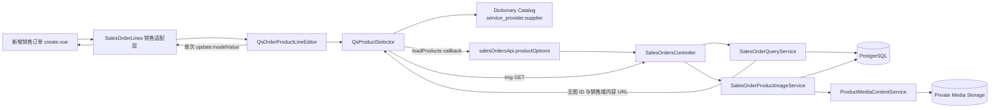
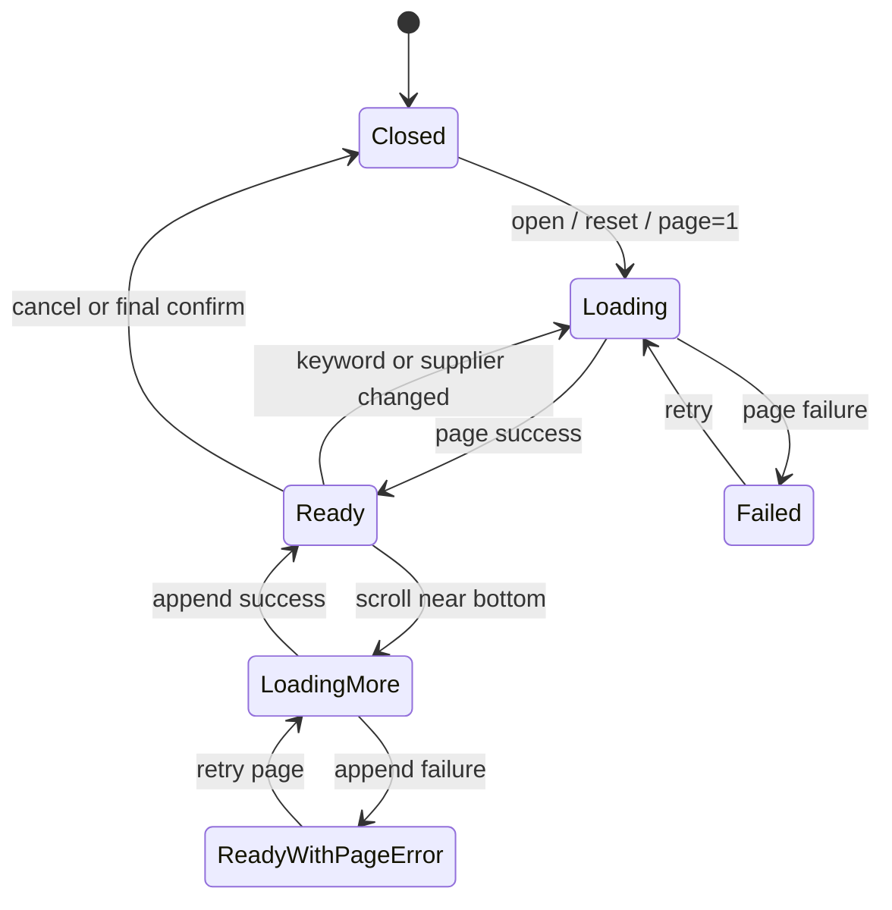

# 通用订单产品明细编辑与产品选择器技术设计

## 1. 文档状态

- 状态：Phase 2-Phase 4 已完成，自动化、真实浏览器与用户手动验收已通过
- 设计日期：2026-08-23
- Phase 2 确认日期：2026-08-23
- 需求基线：[通用订单产品明细编辑与产品选择器需求规格](./requirements.md)
- 关联领域基线：[销售订单域技术设计](../sales-order-domain/design.md)
- 当前分支：`feat/sales-order-domain`
- 当前基线提交：`0899db3`
- 用户已授权按改动内容分批提交；仍不授权推送、合并、部署、数据库变更或依赖新增

## 2. 当前实现审计

### 2.1 已有能力

- 新增销售订单已经通过路由参数固定 `TWD | MYR`，产品与销售位于同一步骤。
- `GET /sales-orders/product-options` 使用 `sales-orders:create` 权限并返回全部 `ACTIVE` 产品；订单币种只决定返回哪一列可空标准价，不参与候选资格筛选。
- `sales-order-lines.vue` 已有空表、数据库/临时产品、价格、正整数数量、行小计和删除能力。
- `sales-order-create.logic.ts` 已使用十进制定点安全逻辑，并在“下一步”和正式提交前执行金额硬拦截。
- `service_provider.supplier` 已由 Dictionary Catalog 提供，产品列表已有包含停用历史值的只读筛选口径。
- `QsGenericModal`、`FaTooltip`、`ImageGroup`、`MoneyInput`、`AmountDisplay` 和 `FaPopover` 可以复用。

### 2.2 当前缺口

- 候选产品接口固定 `take: 50`，没有 `supplierValue`、分页信息或 `total`。
- 候选产品响应没有主图；现有产品媒体内容路由要求 `product-media:read`，不能直接作为只具备 `sales-orders:create` 用户的产品选择器图片来源。
- 页面加载时预取产品，选择仍发生在明细行内，无法保留跨筛选/分页的待处理状态。
- `sales-order-lines.vue` 同时承担销售领域适配和表格实现，尚未形成业务中立组件。
- 产品名称和备注没有统一的单行溢出及键盘 Tooltip 契约。

## 3. 设计原则

1. **领域权限不外溢**：录单候选与主图读取继续由 `sales-orders:create` 授权，不要求产品管理权限，也不放宽既有产品媒体内容接口。
2. **组件不直接请求销售 API**：通用组件通过调用方传入的异步加载函数读取产品，避免采购复用时耦合销售接口。
3. **弹窗内暂存、最终一次提交**：选择器只产生变更集，编辑器重新校验后一次性更新 `v-model`，取消无副作用。
4. **稳定 ID 判重**：数据库产品只按 `productId`，明细行只按 `line.key` 识别；不按名称、编号或数组下标判重。
5. **单一金额真相源**：表格展示汇总、销售步骤校验和 DTO 构建复用同一套 Web 十进制定点 reducer；Server 仍执行最终重新计算。
6. **不新增持久化结构**：主图只用于当前编辑会话展示，不写入订单 DTO；本期不需要 Schema 或 migration。
7. **复用现有基础设施**：不建立第二套 Modal、Tooltip、金额、字典或媒体流能力。

## 4. 总体架构



### 4.1 组件职责

| 层 | 职责 | 禁止事项 |
| --- | --- | --- |
| `create.vue` | 权限、固定币种、API loader、销售步骤校验与提交 | 不维护产品选择器内部分页和待处理状态 |
| `sales-order-lines.vue` | 销售标签、错误路径和现有销售表单类型适配 | 不复制产品卡片、表格和汇总实现 |
| `QsOrderProductLineEditor` | 明细行编辑、选择器编排、原子应用、两项汇总 | 不请求 API、不读取路由/Store、不保存订单 |
| `QsProductSelector` | 检索 UI、供应商目录、分页、卡片、已有明细判重、已选投影与会话变更 | 最终确认前不修改父明细、不持久化业务数据 |
| Sales Order Server | 候选资格、分页、主图授权和最小响应 | 不信任 Web 币种、价格或产品状态 |

## 5. Server 设计

### 5.1 候选产品 API 扩展

保留既有路径和权限：

`GET /api/sales-orders/product-options`

查询参数调整为：

| 参数 | 类型 | 规则 |
| --- | --- | --- |
| `currencyCode` | `TWD | MYR` | 必填，只决定返回哪一币种的可空标准价，不决定产品资格 |
| `keyword` | `string?` | 1–128 Unicode code points；trim + NFKC；名称/编号 contains insensitive |
| `supplierValue` | `string?` | 1–64 Unicode code points；精确 raw value，不 trim 或改变大小写 |
| `page` | `integer` | 默认 `1`，最小 `1` |
| `pageSize` | `integer` | 默认 `20`，范围 `1..50` |

响应调整为分页结构：

```ts
interface SalesOrderProductOptionsDto {
  items: SalesOrderProductOptionDto[]
  page: number
  pageSize: number
  total: number
}

interface SalesOrderProductOptionDto {
  id: string
  productNo: string
  name: string
  attributes: Record<string, unknown>[]
  standardUnitPriceAmount: string | null
  currencyCode: 'TWD' | 'MYR'
  mainImage: null | {
    id: string
    contentUrl: string
  }
}
```

`contentUrl` 使用销售订单域内容路由，不返回产品采购成本、另一币种价格、存储对象键、Checksum 或完整媒体元数据。

### 5.2 查询与分页实现

`SalesOrderQueryService.productOptions()` 接收规范化查询对象，不再接收两个位置参数。查询规则：

```text
status = ACTIVE
AND supplierValue = exactRawValue       // 仅参数存在时
AND (productNo ILIKE keyword OR name ILIKE keyword) // 仅关键词存在时
```

- 顺序固定为 `updatedAt DESC, id DESC`。
- `skip = (page - 1) * pageSize`，`take = pageSize`。
- `findMany` 与 `count` 使用同一 `where`；响应 `total` 来自 Server，不用页长度推算。
- 对当前页产品 ID 执行一次批量主图查询，禁止逐产品 N+1。
- 新增产品媒体查询 helper 只读取 `IMAGE + isPrimary + detachedAt=null + READY` 的主图，不加载附加图片或视频。
- 数据库状态异常、同一产品出现多张有效主图或媒体映射越界时失败关闭，不返回任意一张猜测图片。
- 不修改 Product Schema、索引或销售订单 Schema；现有查询条件已有产品状态、供应商和价格字段，索引调整若在实施期被证明必要，须回到设计门禁重新确认。

### 5.3 销售订单候选主图内容路由

新增只读路径：

```text
GET  /api/sales-orders/product-options/:productId/main-image/:productMediaId/content
HEAD /api/sales-orders/product-options/:productId/main-image/:productMediaId/content
query: currencyCode=TWD|MYR
permission: sales-orders:create
```

采用独立销售订单路径，而不是给 `/products/:productId/media/:productMediaId/content` 增加 OR 权限。这样可避免持有录单权限的用户通过已知 ID 读取停用产品或非主图媒体；缺少当前币种标准价不再影响主图资格。

新增 `SalesOrderProductImageService`：

1. 使用 `productId + productMediaId` 查询产品；保留 `currencyCode` 作为既有内容 URL 请求上下文。
2. 要求产品 `ACTIVE`、媒体属于该产品、类型为图片、当前为主图、未脱离且资产 `READY`；不检查币种标准价。
3. 任一条件不满足时统一返回防枚举 404。
4. 资格通过后委托既有 `ProductMediaContentService.resolve()` 处理 ETag、Range、Content-Type、私有存储和 internal redirect。
5. GET 与 HEAD 保持相同授权和资格校验；GET 才返回内容体。

为复用现有安全内容服务：

- `ProductsModule` 只额外导出 `ProductMediaContentService`。
- `SalesOrdersModule` 导入 `ProductsModule` 并注册 `SalesOrderProductImageService`。
- 把产品媒体 HTTP 响应头应用逻辑提取成无状态 helper；现有产品内容路由与新销售内容路由共享，不复制 Range/ETag 实现。
- 扩展现有媒体 OpenAPI decorator，使调用方可以提供唯一 `operationId` 和 404 领域错误码；产品原路径的公共契约保持不变。

### 5.4 DTO、OpenAPI 与错误矩阵

需要修改：

- `SalesOrderProductOptionsQueryDto`：增加 `supplierValue`、`page`、`pageSize` 与规范化规则。
- `SalesOrderProductOptionDto`：增加最小 `mainImage`。
- `SalesOrderProductOptionsDto`：增加 `page`、`pageSize`、`total`。
- 主图路径参数 DTO：UUID v4 `productId`、`productMediaId`，查询复用固定币种校验。

错误口径：

| 场景 | HTTP / Code |
| --- | --- |
| 无 `sales-orders:create`、强制改密 | 403 既有错误 |
| 查询参数非法 | 422 `VALIDATION_FAILED` |
| 候选状态在查询期间失效 | 409 `SALES_ORDER_STATE_CHANGED` |
| 主图不存在、无资格或不匹配 | 404 `SALES_ORDER_PRODUCT_IMAGE_NOT_FOUND` |
| 私有媒体存储不可用 | 503 `MEDIA_STORAGE_UNAVAILABLE` |

OpenAPI decorators 仍是公共接口真相源。生成类型通过既有 contract sync 更新，不手工编辑 `types.gen.ts`。

## 6. Web 公共类型与加载契约

### 6.1 产品选择器类型

放置在 `components/business/QsProductSelector/types.ts`：

```ts
interface ProductSelectorQuery {
  currencyCode: 'TWD' | 'MYR'
  keyword?: string
  supplierValue?: string
  page: number
  pageSize: number
}

interface ProductSelectorItem {
  id: string
  productNo: string
  name: string
  attributes: readonly Record<string, unknown>[]
  standardUnitPriceAmount: string
  currencyCode: 'TWD' | 'MYR'
  mainImage: null | { id: string, contentUrl: string }
}

interface ExistingCatalogLine {
  key: string
  productId: string
  productNo: string
  name: string
  quantity: string
}

type ProductSelectionChange
  = | { kind: 'ADD', product: ProductSelectorItem }
    | { kind: 'INCREMENT', lineKey: string, productId: string, delta: 1 }

type ProductPageLoader = (
  query: ProductSelectorQuery,
  signal: AbortSignal,
) => Promise<ProductSelectorPage>
```

通用组件只调用 `ProductPageLoader`。销售页面 adapter 把生成的 `SalesOrderProductOptionsDto` 映射为该分页结构；未来采购订单可以提供自己的 loader。

### 6.2 通用订单明细类型

放置在 `components/business/QsOrderProductLineEditor/types.ts`：

```ts
interface OrderProductLineModel {
  key: string
  lineType: 'CATALOG' | 'CUSTOM'
  productId: string | null
  productNo: string | null
  name: string
  description: string
  standardUnitPriceAmount: string | null
  actualUnitPriceAmount: string | null
  quantity: string
  mainImage: null | { id: string, contentUrl: string }
}
```

字段名保持与现有销售订单错误路径和 DTO adapter 兼容，但组件可见文案不从字段名推断。调用方必须传入 `OrderProductLineLabels`：

- 参考单价标题
- 本单单价标题
- 本单小计标题
- 参考价汇总标题
- 本单价汇总标题
- 数据库产品、临时产品和临时编号文案

销售订单传入“标准价 / 本单售价 / 本单售价小计 / 标准价汇总 / 本单售价汇总”。采购订单未来可使用自己的标签而无需改组件。

`SalesOrderLineFormModel` 改为结构兼容的销售别名或扩展类型；`mainImage` 是 Web 会话字段，DTO 构建必须明确忽略。

## 7. `QsProductSelector` 设计

### 7.1 公共契约

Props：

- `currency`
- `existingLines`
- `loadProducts`
- `disabled?`
- `pageSize?`，默认 `20`

Events：

- `confirm(changes)`：只在用户点击最终“确认添加”后触发一次。
- 不提供逐产品 `change` 或内部查询状态事件，避免调用方误把暂存选择当成已写入明细。

选择器自身使用 `QsGenericModal size="xl"` 管理完整弹窗生命周期，并通过局部 `sm:!max-w-[68rem]` 加宽内容区；`v-model` 开关由 `QsOrderProductLineEditor` 控制。组件关闭后销毁弹窗内容，确保查询与会话状态不泄漏到下次会话。

### 7.2 布局

桌面端：

- 弹窗 Header：“选择数据库产品”，明确产品选择不限制币种，当前币种只用于标准价显示和本单售价录入。
- Body：`minmax(0, 3fr) minmax(18rem, 2fr)` 左宽右窄分栏。
- 左侧：顶部搜索/供应商筛选，中部独立滚动卡片列表，底部固定显示“共 N 个产品”。
- 右侧：应用本次变更后的数据库产品已选清单；Footer 提供“取消”和“确认添加”。
- `QsGenericModal` Header/Footer 固定，只有选择器中部结果区承担产品滚动。

窄屏：单列；结果区在上、已选清单在下；Footer 按钮满足 44px 触控目标。组件只覆盖当前弹窗最大宽度，不修改 `QsGenericModal` 尺寸枚举，避免扩大公共 Modal 契约。

### 7.3 查询状态机



实现状态：

- `queryKey = currency + normalizedKeyword + supplierValue`
- `requestVersion` 与当前 `AbortController`
- `itemsById: Map` 与有序 `itemIds`
- `page`、`pageSize`、`total`、`hasNextPage`
- `changes: ProductSelectionChange[]`，包含 `ADD(quantity)`、`INCREMENT(delta)`、`REMOVE`
- `selectedItems`，由打开时已有数据库明细叠加 `changes` 计算得到

关键词使用约 300ms 防抖；Enter 立即执行并取消待执行防抖。查询条件变化会 Abort 旧请求、递增版本、清空旧页；迟到结果只有版本和 queryKey 同时匹配时才能落地。加载下一页复用同一入口并以 `loadingMore` 锁防止重复请求。

### 7.4 供应商目录

- 组件内部使用 `useDictionaryCatalog('service_provider.supplier')`。
- 筛选下拉使用 `FaSelect`，首项为“全部供应商”且值映射为 `undefined`。
- 使用完整 `catalog.items` 构造只读筛选，停用条目显示“（已停用）”；不使用只允许有效新写入的 `QsDictionarySelect`。
- Catalog 加载或失败不阻塞不带供应商条件的产品查询；失败状态单独呈现并提供 `retry()`。
- Catalog 身份失效时清除旧供应商选项；已有不可信筛选值不得继续静默查询。

### 7.5 产品卡片与主图

- 卡片根节点使用可聚焦按钮语义，支持 Enter/Space。
- 主图使用单图 `ImageGroup` 或等价的既有图片加载/失败能力，禁用不必要的预览；无主图显示统一占位。
- 右侧名称使用较大加粗字级，编号使用次级数据字级。
- 本次新增状态显示图标与“已选择”；已有明细状态显示“已在明细 · 数量 N”。
- 选择状态同时使用图标、文字、边框，不只依靠颜色。

### 7.6 重复产品确认

产品选择器已经位于 `QsGenericModal` 内，而 `QsGenericModal` 当前明确不支持嵌套 Modal Stack。因此重复产品询问使用锚定产品卡片的 `FaPopover` 确认浮层，而不是嵌套第二个 Modal 或 `window.confirm()`。

现有 `FaPopover` 会无条件阻止打开时自动聚焦。为满足确认操作的键盘契约，给公共组件增加一个最小、向后兼容的 `autoFocus?: boolean` Prop，默认 `false` 保持全部既有调用方行为；本选择器显式传入 `true`，使焦点进入第一个确认操作，关闭后由 Reka 恢复到产品卡片。不得为此增加新的 Popover 实现或修改既有默认值。

确认浮层行为：

- 文案固定为“产品已存在，是否增加数量？”。
- 操作为“取消”“增加数量”。
- 打开时通过 live region 宣告确认问题；键盘可进入两个操作按钮，关闭后焦点返回产品卡片。
- 每次确认都把目标产品的 `quantity` 或 `delta` 累计 `+1`；仍只保留一个产品交互身份和一条最终差异。
- 窄屏使用 `collisionPadding` 和上下方向，避免浮层越出选择器。

这仍是用户可见的局部确认弹窗，但技术上不创建第二个模态焦点域。

### 7.7 右侧已选清单与最终确认

- 打开时先投影全部已有数据库产品；`ADD` 项显示名称、编号、数量和“新增”，原明细显示“已有明细”。
- `INCREMENT` 按累计 `delta` 更新右侧预期数量，不创建重复清单项。
- 移除本次新增项会取消 `ADD`；移除已有项会产生 `REMOVE` 并同步左侧卡片状态。
- 重新选择待删除产品会撤销 `REMOVE`；其后仍可继续确认增加数量。
- 没有任何会话差异时，“确认添加”禁用。
- 取消、遮罩、Escape 或关闭按钮均清空会话差异，不触发 `confirm`。

## 8. `QsOrderProductLineEditor` 设计

### 8.1 公共契约

Props：

- `modelValue: readonly OrderProductLineModel[]`
- `currency: 'TWD' | 'MYR'`
- `currencies: readonly CurrencyDescriptor[]`
- `labels: OrderProductLineLabels`
- `loadProducts: ProductPageLoader`
- `fieldErrors?: Readonly<Record<string, string>>`
- `disabled?: boolean`
- `maxLines?: number`，默认 `100`

Event 仅使用：

- `update:modelValue(nextLines)`

产品选择器弹窗由编辑器组合，调用方无需分别同步两套选择状态。

### 8.2 表格与编辑行为

- 保留语义化 `<table>`、`<thead>`、`<tbody>`，外层 `overflow-x-auto`。
- 最小总宽度按十列内容设置；金额和数量右对齐，操作列固定视觉宽度。
- 数据库行来源、编号、名称、主图和标准价只读；标准价缺失时显示“暂无”。数据库行与临时行的本单售价均默认 `0.00`，最多输入两位小数，数量和备注可编辑。
- 临时行由按钮直接追加：名称为空、数量 `1`、本单售价 `0.00`、编号“仅本订单”、主图/标准价 `—`。
- 行来源使用文本/Tag，不再使用可切换 Select。
- 删除图标调用纯 reducer 删除目标 key；不产生 API 请求。
- 明细为空时表格仍渲染 Header 和跨列 `FaEmpty`。

### 8.3 原子应用选择器变更

`applyProductSelectionChanges(currentLines, changes, maxLines)` 是纯函数：

1. 基于当前 `modelValue` 重新建立 `productId -> line` 与 `lineKey -> line` 索引。
2. 先完整校验所有变更：ID 唯一、`ADD` 当前不存在、`INCREMENT` 仍命中相同产品和行、数量可安全增加、应用后不超过行数上限。
3. 任一项失败则返回错误且不生成部分结果。
4. 全部通过后在内存构造新数组：`ADD` 追加新行，数量默认 `1`，本单售价统一默认 `0.00` 且不复制标准价；`INCREMENT` 只更新目标行数量。
5. 只触发一次 `update:modelValue`。

该二次校验防止弹窗打开后调用方状态发生变化，也保证“确认添加”具备原子 UI 语义。

### 8.4 金额 reducer

从现有销售订单 Web 金额逻辑抽取或复用纯函数：

```text
standardTotal = Σ(catalog.standardUnitPriceAmount × quantity)
actualTotal   = Σ(all.actualUnitPriceAmount × quantity)
lineActualSubtotal = actualUnitPriceAmount × quantity
```

- 使用十进制字符串转 `bigint` 定点单位，禁止 `Number` 浮点累计。
- 临时产品不参与 `standardTotal`。
- 无数据库产品时标准价汇总显示当前币种零值；缺少当前币种标准价的数据库产品不计入标准价汇总，并提示未计入数量。
- 无效价格或数量的行显示可恢复占位，表单错误由既有销售步骤校验输出。
- `calculateSalesOrderLineSubtotal()` 委托同一实际金额 reducer，避免表格汇总与“下一步”硬拦截出现两套算法。

### 8.5 单行溢出与 Tooltip

- 名称单元格使用 `min-w-0 + truncate`，触发根节点可聚焦；`FaTooltip` 内容使用原始完整名称。
- 备注保持 `FaInput` 单行。Tooltip 绑定当前完整值，仅非空且实际或可能溢出时启用；输入自身仍支持选取和横向文本滚动。
- Tooltip 支持 Hover 与 Focus，不在浮层内放按钮或输入控件。
- 产品编号、金额、来源和数量使用 `whitespace-nowrap`；整表行高不因长文本变化。

## 9. 销售订单页面接入

### 9.1 保留销售适配层

现有 `sales-order-lines.vue` 不再保留具体表格实现，改为薄适配层：

- 传入销售标签与固定币种。
- 把 `SalesOrderLineFormModel` 映射为结构兼容的 `OrderProductLineModel`。
- 把销售字段错误映射到通用组件行字段。
- 透传产品 loader 和 `update:modelValue`。

这样 `create.vue` 仍按销售订单领域组织步骤，而通用组件不依赖销售页面。

### 9.2 取消页面级预取

从 `create.vue` 移除：

- `productOptions` 全量 Ref。
- 页面挂载时的 `loadProductOptions()`。
- 页面级 `productLoading/productError` 展示。
- 与旧预取绑定的 AbortController 和 request version。

新增 `loadSalesOrderProductPage(query, signal)`，只负责调用 `salesOrdersApi.productOptions(query, signal)` 并返回分页 DTO。产品选择弹窗打开后才发起第一页请求。

### 9.3 产品与销售信息布局

- “产品与销售”仍是同一个步骤。
- `QsOrderProductLineEditor` 先展示按钮、明细表和两个汇总。
- “销售与付款信息”紧跟编辑器下方，保留手填销售总价、定金、尾款三个同排输入框。
- 删除销售卡片中重复的“产品明细汇总”展示块，避免与编辑器“本单售价汇总”形成两个视觉真相源。
- 点击该步骤“下一步”时继续运行既有金额硬拦截；组件改造不得改变最终核对页和提交二次确认。

### 9.4 DTO 与详情映射

- 数据库产品仍只提交 `lineType/productId/actualUnitPriceAmount/quantity`。
- 临时产品仍提交 `lineType/name/description/actualUnitPriceAmount/quantity`。
- `productNo`、标准价和 `mainImage` 仅用于当前 Web 会话显示，不进入创建 DTO。
- Server 保存时继续从可信产品记录生成编号、名称、属性和标准价快照。
- `QsSalesOrderDesc` 和最终核对页继续读取现有销售表单映射；主图不扩大为订单持久化字段。

## 10. 组件库展示

两个业务组件均增加本地 Fixture Showcase，避免完成后在组件库不可见：

- `/component-library/business/product-selector`
- `/component-library/business/order-product-line-editor`

Showcase 只使用内存分页 loader 和本地图片 Fixture，不请求 Server、不读取真实产品、不修改订单。状态至少覆盖：

- 默认加载、关键词/供应商筛选、下一页、无结果、失败重试。
- 已有明细同步、本次新增、累计加量、删除同步、取消无副作用。
- 空明细、数据库产品、临时产品、长名称/备注 Tooltip、两项汇总。
- TWD/MYR 显示、暗色主题和窄屏横向滚动。

路由继续放在 `router/modules/component.library.ts`，不加入正式业务导航。

## 11. 并发、身份与生命周期

- 选择器每次打开创建独立 session id、AbortController 和会话变更集合。
- 关闭/卸载时 Abort 产品请求、清理防抖 Timer、关闭重复确认 Popover 并清空所有暂存状态。
- 固定币种发生变化时立即关闭选择器并清除候选；正常新增页不会提供币种切换。
- Dictionary Catalog 由既有 Provider 处理身份隔离和失效；产品请求仍由选择器版本号防止迟到响应。
- `create.vue` 既有身份 epoch、提交锁和离开确认保持不变。
- 图片 401/403/404/503 或浏览器加载失败均降级为占位，不把图片失败升级为阻断产品选择；正式保存仍以产品资格校验为准。

## 12. 安全与性能

### 12.1 安全

- 候选列表和主图均要求有效 Session、非强制改密状态和 `sales-orders:create`。
- 主图路由每次重新校验产品资格和主图关系，防止通过已知媒体 ID 越权读取其他产品媒体。
- 搜索词、供应商 raw value、产品名称和媒体文件名不得写入错误日志或审计元数据。
- 图片响应继续使用 `nosniff`、安全 Content-Disposition、Opaque ETag、Range 和私有 no-store 契约。
- 不把候选查询和主图读取解释为订单保存，不触发 CSRF、幂等 Key 或编号派发。

### 12.2 性能

- 默认页 20、最大 50；首次打开不预取全部产品。
- 产品页、总数和本页主图采用固定数量查询，禁止 N+1。
- 卡片主图使用浏览器原生懒加载；右侧已选清单不生成 Base64 副本。
- `itemsById` 合并重复页结果；筛选切换释放旧数组和图片节点。
- 产品图片失败不重复无限请求；重新打开弹窗或显式重试才建立新会话。

## 13. 聚焦测试与验收策略

遵守“只进行必要测试、不做全量测试验收”的当前约束。Phase 4 只运行与本变更直接相关的检查；不运行根 `node --run check` 或无关模块全量套件，除非用户另行授权。

### 13.1 Server 聚焦测试

- DTO：分页、关键词、精确供应商、固定币种和非法输入。
- Query Service：ACTIVE/关键词/供应商 AND 条件、稳定顺序、`total`、分页、当前币种可空价格和批量主图。
- 主图 Service/Controller：权限元数据、可售资格、仅主图、防枚举 404、GET/HEAD 委托和存储错误。
- OpenAPI：新增分页字段、查询参数、主图响应和唯一 operationId。

### 13.2 Web 聚焦测试

- API adapter：完整 query、AbortSignal 与局部呈错。
- `QsProductSelector/logic.ts`：搜索版本、分页追加、跨筛选保留、已有明细索引、累计加量、删除/恢复和取消清空。
- `QsOrderProductLineEditor/logic.ts`：空表、ADD/INCREMENT/REMOVE 原子 reducer、上限、删除、标准价/本单售价汇总。
- `FaPopover`：默认继续阻止自动聚焦，只有 `autoFocus=true` 时允许焦点进入内容，关闭恢复触发器。
- 组件结构：左右布局、卡片信息、右侧状态、表格列序、Tooltip、无行内产品搜索。
- 销售页面：产品与销售同一步、销售与付款信息紧随明细、三个输入同排、金额下一步硬拦截保持。
- 组件库路由和本地 Fixture 不得调用真实 API。

### 13.3 必要集成检查

- Server 销售订单相关 Jest 文件。
- Web 新增组件、销售订单页面与 API 的 Node 测试文件。
- Server/Web TypeScript typecheck。
- OpenAPI contract sync/check。
- 一条真实浏览器流程：打开选择器 → 回显已有明细 → 对已选产品累计加量 → 删除同步 → 取消验证无副作用 → 再次确认写入 → 验证加宽弹窗、长名称省略与 Tooltip。
- 用户手动验收已通过；按用户指令分批提交，不推送或合并。

## 14. 预计文件矩阵

### 14.1 Server

- `server/src/modules/sales-orders/dto/sales-order-query.dto.ts`
- `server/src/modules/sales-orders/dto/sales-order-response.dto.ts`
- `server/src/modules/sales-orders/sales-order-query.service.ts`
- `server/src/modules/sales-orders/sales-orders.controller.ts`
- `server/src/modules/sales-orders/sales-orders.module.ts`
- `server/src/modules/sales-orders/products/sales-order-product-image.service.ts`（新增）
- `server/src/modules/products/media/product-media-query.mapper.ts`
- `server/src/modules/products/media/product-media-content.contract.ts`
- `server/src/modules/products/media/product-media-content.http.ts`（新增，无状态共享 helper）
- `server/src/modules/products/products.controller.ts`
- `server/src/modules/products/products.module.ts`
- 对应聚焦 spec 与 OpenAPI 生成产物

### 14.2 Web

- `web/apps/qsmds-arco/src/components/business/QsProductSelector/`（新增）
- `web/apps/qsmds-arco/src/components/business/QsOrderProductLineEditor/`（新增）
- `web/packages/components/src/basic/popover/index.vue`（仅增加默认关闭的 `autoFocus` 能力）
- `web/apps/qsmds-arco/src/api/modules/sales-orders.ts`
- `web/apps/qsmds-arco/src/views/operations/sales-orders/create.vue`
- `web/apps/qsmds-arco/src/views/operations/sales-orders/sales-order-lines.vue`
- `web/apps/qsmds-arco/src/views/operations/sales-orders/sales-order-create.logic.ts`
- `web/apps/qsmds-arco/src/views/component_library/business/` 下两个 Showcase 与 Fixture（新增）
- `web/apps/qsmds-arco/src/router/modules/component.library.ts`
- 对应聚焦 API/View/Browser 测试与生成类型

不预计修改 Prisma Schema、migration、权限目录、正式业务导航或依赖。

## 15. 需求追踪

| Requirement | 设计章节 |
| --- | --- |
| R1 组件分层与复用 | 4、6、8、9 |
| R2 固定币种与资格 | 5.1、5.2、9 |
| R3 弹窗信息架构 | 7.1、7.2 |
| R4 搜索/供应商/分页 | 5.1、5.2、7.3、7.4 |
| R5 产品卡片 | 5.3、7.5 |
| R6 已有明细与判重 | 6.1、7.6、8.3 |
| R7 待处理与原子确认 | 7.7、8.3 |
| R8 入口与空态 | 8.1、8.2、9.1 |
| R9 表格字段行为 | 8.2、9.4 |
| R10 汇总和硬校验 | 8.4、9.3、9.4 |
| R11 宽度与 Tooltip | 8.2、8.5 |
| R12 加载/错误/恢复 | 7.3、7.4、11 |
| R13 响应式/主题/无障碍 | 7.2、7.5、7.6、8.5、10 |
| R14 权限/安全/门禁 | 5、11、12、13 |

## 16. Phase 2 确认结果

本设计已于 2026-08-23 确认，允许进入 Phase 3 任务拆分。确认本设计不等于授权实施；在 `tasks.md` 再次确认前，不创建生产组件、不修改 API、不生成契约、不运行实现测试。

已确认的核心技术决策：

1. 候选产品接口扩展为供应商 + 分页 + 总数 + 最小主图响应。
2. 主图使用独立销售订单内容路由，不放宽 `product-media:read` 路由。
3. `QsProductSelector` 使用 loader 注入，`QsOrderProductLineEditor` 使用标签配置保持采购复用能力。
4. 重复产品确认使用选择弹窗内的 `FaPopover` 局部确认浮层，避免嵌套 Modal。
5. 现有 `sales-order-lines.vue` 保留为薄销售适配层。
6. 本期不新增 Schema/migration，只进行必要聚焦测试和一条真实浏览器验收。
