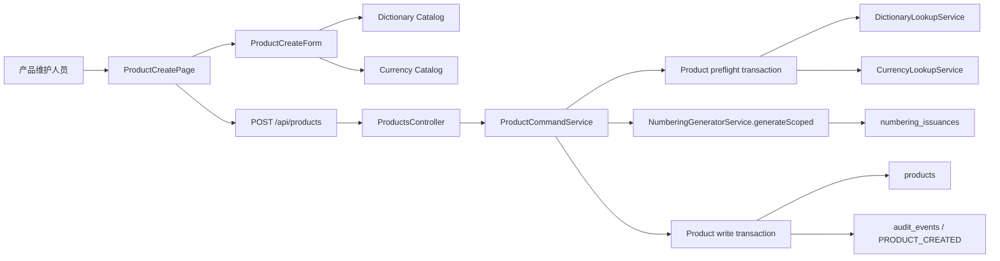
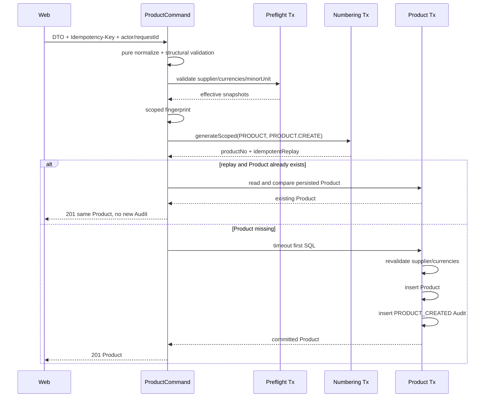

# 产品创建技术设计

## 1. 文档状态

- 状态：Phase 4 本地实施与验收已完成
- 编写日期：2026-08-12
- Requirements：`specs/product-create/requirements.md`
- 实施分支：`feat/admin-product-management`
- 设计范围：产品创建 API、编号幂等桥接、Product Command、审计 enum migration、正式创建页面与自动化验证
- 完成日期：2026-08-12
- 当前门禁：设计范围已实施并完成本地全量验收；持久开发数据库 migration 与外部发布仍需独立确认

## 2. 当前真相源与审计结论

### 2.1 已有能力

1. Product 表已经包含创建所需的全部业务字段、审计字段、具名约束和不可变产品编号 Trigger，本期不需要修改 Product 表。
2. `ProductsModule` 当前只有 `GET /api/products`、`ProductQueryService` 和响应 DTO，没有 Command Service 或写 DTO。
3. `products:create` 权限和 `/admin/products/create` 路由已经存在；页面仍是占位内容，产品列表“新增产品”仍只弹轻提示。
4. `NumberingGeneratorService` 是内部服务，没有 HTTP 发号接口；`NumberingModule` 已导出该服务。
5. `DictionaryLookupService.requireEffectiveValue()` 已提供调用方事务内的 Type `FOR SHARE -> Item FOR SHARE` 写时校验。
6. Currency Catalog 返回全部货币及 `enabled/minorUnit`，但 Currency 模块尚未提供供其他业务模块使用的事务内有效币种 Lookup。
7. `AuditService.record()` 必须消费调用方 `TransactionClient`，可以保证 Product 与成功 Audit 原子提交。
8. Web 已有 `MoneyInput`、`QsDictionarySelect`、`QsGenericModal`、`QsToast`、Catalog Provider、局部 API 错误呈现和身份域取消机制。
9. Axios 只有显式 `retry: true` 的安全读取才会重试；所有 Product mutation 仍必须明确声明 `retry: false`。

### 2.2 2026-08-12 可变运行态证据

只读开发库核对时，`PRODUCT` Rule、`service_provider.supplier`、`TWD`、`MYR` 与 `CNY` 均可用。它们属于可变业务配置：Web 可以据此提供当前选项，但 Server 每次写入仍必须重新校验，不能把本地结果写死在代码或 migration 中。

### 2.3 现有编号幂等缺口

当前 `NumberingGeneratorService.generate()` 使用：

```text
unique scope = consumerCode + SHA-256(idempotencyKey)
request fingerprint = SHA-256(numbering.generate.v1 + ruleCode)
```

这足以保证相同 Consumer/Key 不重复发号，却无法区分 Product 创建的操作者与规范化 Payload。若编号已经提交而 Product 事务失败，同一 Key 携带另一份 Payload 时，现有 Ledger 仍会返回原编号，违反已确认的幂等冲突要求。

本设计不新增 `product_create_requests` 表，也不复制已经退役的 Supplier 领域结构。改为利用 `numbering_issuances` 已有的 `request_fingerprint_hash`：给编号服务增加一个内部、显式、业务中立的 scoped 入口，由 Product 传入已计算好的 32-byte 作用域摘要。

### 2.4 设计决策摘要

1. `POST /api/products` 是本期唯一新增 Product operation，成功响应复用 `ProductListItemDto`。
2. Product Command 在事务外完成纯规范化和 Payload 指纹计算；数据库有效性在发号前预检，并在 Product 写事务内再次锁定校验。
3. 编号事务与 Product 事务保持独立；Product 失败产生的编号间隙是被接受且可审计的业务事实，不回收编号。
4. 编号服务增加 `generateScoped()`；既有 `generate()` 和历史 v1 指纹保持原语义，避免破坏已有 issuance 重放。
5. Currency 模块增加业务中立的 `CurrencyLookupService.requireEnabledCodes()`，按 code 稳定排序并在调用方事务内 `FOR SHARE`。
6. Product insert 与 `PRODUCT_CREATED` Audit 在同一事务内；幂等读取既有 Product 时不重复写审计。
7. Schema 只给 `AuditEventType` 增加 `PRODUCT_CREATED`；Product、Currency、Numbering 表不增删列或约束。
8. Web 页面按桌面不对称双栏、窄屏单栏实现；不修改公共组件契约，不增加媒体输入。

## 3. 目标架构



分层职责：

```text
ProductsController
  -> 权限、DTO、Idempotency-Key Header、可信请求上下文、OpenAPI

ProductCommandService
  -> 规范化、预检、作用域指纹、发号、重放协调、Product/Audit 事务、错误映射

Product command persistence
  -> Product 精确 select/insert、产品编号唯一竞态识别

DictionaryLookupService / CurrencyLookupService
  -> 调用方事务内的业务中立有效值锁定校验

NumberingGeneratorService
  -> 不认识 Product；只消费 opaque scoped fingerprint 并保持发号 Ledger 幂等

ProductCreatePage
  -> 表单状态、Catalog 状态、权限、请求生命周期、未知结果恢复、导航

ProductCreateForm / ProductAttributesEditor
  -> 可访问输入、字段错误、属性增删排序；不请求 API、不读取权限 Store
```

## 4. Server 设计

### 4.1 模块与文件

```text
server/src/modules/products/
  dto/product-create.dto.ts
  product-command.normalizer.ts
  product-command.persistence.ts
  product-command.service.ts
  product-create-fingerprint.ts
  product.persistence-error.mapper.ts
  product.errors.ts
  products.controller.ts
  products.module.ts
  *.spec.ts

server/src/modules/currencies/
  currency-lookup.service.ts
  currency-lookup.service.spec.ts

server/src/modules/numbering/
  numbering-internal-input.ts
  numbering-generator.service.ts
  existing specs updated for scoped generation

server/prisma/
  schema.prisma
  migrations/<timestamp>_product_created_audit_event/migration.sql
```

`ProductsModule` 增加 `AuthModule`、`CurrencyModule`、`NumberingModule` 依赖并注册 `ProductCommandService`。`CurrencyModule` 只导出新的 Lookup；Currency Query/Command 继续保持模块私有。`AuditService` 继续从既有 `AuthModule` 导出边界注入，不在 Product 中复制 writer。

### 4.2 创建 DTO

```ts
class ProductMoneyInputDto {
  amount: string | null
  currency: string
}

class ProductAttributeInputDto {
  title: string
  value: string
}

class CreateProductRequestDto {
  name: string
  status: ProductStatus
  supplierValue: string | null
  twdSalePrice: ProductMoneyInputDto
  myrSalePrice: ProductMoneyInputDto
  purchaseCost: ProductMoneyInputDto
  attributes: ProductAttributeInputDto[]
}
```

设计约束：

- 所有顶层字段显式必填；`supplierValue` 与三个 `amount` 用 `null` 表达业务空值，不接受 `undefined`、空字符串或字段缺失。
- `class-transformer` 对三个 Money 和 Attribute 数组执行嵌套转换，`class-validator` 做结构、类型、枚举和初步长度校验。
- 全局 `whitelist + forbidNonWhitelisted` 继续拒绝顶层、Money、Attribute 内未知字段，因此客户端不能提交媒体或 Server 专属字段。
- DTO 只负责适合装饰器表达的边界；trim/NFC、Unicode code point、严格金额和跨字段规则由 Command normalizer 再验证，Service 直调与 HTTP 保持同一语义。

### 4.3 Header 与可信上下文

Controller 从 Header 读取 `Idempotency-Key`，要求精确 canonical lowercase UUID v4：

```text
^[0-9a-f]{8}-[0-9a-f]{4}-4[0-9a-f]{3}-[89ab][0-9a-f]{3}-[0-9a-f]{12}$
```

Header 缺失、重复合并值、大小写非 canonical 或 UUID 版本不符均返回：

```text
422 VALIDATION_FAILED
fieldErrors.idempotencyKey = ["Idempotency-Key 必须是 canonical lowercase UUID v4"]
```

Command context 只由请求对象生成：

```ts
interface ProductCommandContext {
  actorUserId: string       // getRequestAuthContext(request).userId
  requestId: string         // getRequestId(request)
  idempotencyKey: string    // Header，不进入 DTO
}
```

原始 Key 只传给编号服务用于局部 Hash，不进入异常、响应、Audit、日志、Product 行或浏览器持久化存储。

### 4.4 规范化规则

`normalizeProductCreateCommand()` 是无 IO 纯函数，先于任何发号执行：

1. `name/title/value` 执行 ECMAScript `trim()` 和 NFC；长度按 Unicode code points 计算。
2. `supplierValue` 为 `null` 或 trim 后保持原稳定 value；不改大小写、不把空串变成 null。
3. `ACTIVE + null supplierValue` 立即返回 `PRODUCT_SUPPLIER_REQUIRED`，不进入数据库和发号。
4. 销售价 currency 必须分别精确为 `TWD/MYR`；采购币种必须匹配 `^[A-Z]{3}$`。
5. amount 只接受 `null` 或 `^(?:0|[1-9]\d*)(?:\.\d+)?$`；禁止符号、前导零、分组符和科学计数法。
6. 非空 amount 的整数部分最多 26 位、小数部分最多 4 位；规范化为 `DECIMAL(30,4)` 等价值，例如 `1`、`1.0` 都得到内部 `1.0000`。
7. Attribute 最多 50 项，保持顺序与重复标题；规范化后生成新的冻结数组，避免调用方后续修改影响指纹或写入。
8. 规范化失败统一形成安全的字段路径，例如 `attributes.3.title`，不得携带原始值。

币种 `minorUnit` 属于数据库配置。Preflight 读取后再次检查客户端原始小数位是否超过该币种 `minorUnit`；尾随零也按提交位数计算，避免 Web 与 Server 对录入精度产生两套语义。

### 4.5 Product scoped fingerprint

Product 使用固定字段顺序构造 canonical JSON，再计算 SHA-256：

```text
version = product.create.v1
ruleCode = PRODUCT
consumerCode = PRODUCT.CREATE
actorUserId = canonical lowercase UUID
payload = fully normalized Create Product payload
```

摘要包含操作者，因此同一个 Header Key 不能跨用户重放。摘要包含完整规范化业务值，但只把 64 位小写十六进制摘要传给 Numbering；原始 Payload 不进入发号表。

必须使用手写固定字段 serializer，不使用对象 key 自动排序或 locale 排序。测试用固定向量锁定：字段顺序、NFC、null、金额 `scale=4`、属性顺序和重复标题都会产生稳定结果。

### 4.6 编号服务 scoped 入口

保留现有方法和历史语义：

```ts
generate(input: GenerateNumberRequest): Promise<GenerateNumberResult>
```

新增内部方法：

```ts
generateScoped(input: GenerateScopedNumberRequest): Promise<GenerateNumberResult>

interface GenerateScopedNumberRequest extends GenerateNumberRequest {
  requestFingerprint: string // exactly 64 lowercase hex chars
}
```

规则：

- `generate()` 继续计算现有 `numbering.generate.v1 + ruleCode` 指纹，保证历史 issuance 可重放。
- `generateScoped()` 解码调用方摘要为 32-byte Buffer，并沿用现有 `consumerCode + idempotencyKeyHash` 唯一范围和 constant-time fingerprint 比较。
- scoped 输入只接受固定长度摘要，不接受 Product Payload、actor、任意 JSON 或 raw Buffer。
- 两个入口最终进入同一发号状态机、竞态恢复和错误映射，不复制第二套序列逻辑。
- Product 固定调用 `ruleCode=PRODUCT`、`consumerCode=PRODUCT.CREATE`。

无需修改 `numbering_issuances` 表或既有数据。改变同一 Key 的 Product Payload/actor 时，Ledger 在 Product 不存在的编号间隙场景也能返回 `NUMBERING_IDEMPOTENCY_CONFLICT`。

### 4.7 Currency Lookup

新增业务中立接口：

```ts
requireEnabledCodes(
  transaction: Prisma.TransactionClient,
  codes: readonly string[],
): Promise<readonly EffectiveCurrency[]>

interface EffectiveCurrency {
  code: string
  minorUnit: 0 | 1 | 2 | 3 | 4
}
```

实现要求：

- 输入先去重并按 code 字节序稳定排序。
- 用同一条 `SELECT ... WHERE code IN (...) ORDER BY code FOR SHARE` 锁定货币行。
- 任意 code 缺失、停用、重复返回异常或持久化 `minorUnit` 越界时整体失败关闭。
- 错误对象只携带稳定 reason/code，不携带原 SQL、数据库异常或整份输入。
- Product 每次检查 `TWD`、`MYR` 与采购币种。即使 amount 为 null，币种列仍会被持久化，因此币种也必须当前有效。

### 4.8 创建时序



详细步骤：

1. 事务外验证 Header、Context、DTO 和纯规范化规则。
2. Preflight transaction 的第一条 SQL 设置 timeout；按 Supplier Type/Item，再按 Currency code 的固定锁序验证当前配置和金额精度。失败时不发号。
3. 计算 scoped fingerprint，调用独立的 Numbering transaction。编号一旦提交永不回收。
4. 若返回 `idempotentReplay=true`，先按 `productNo` 读取 Product：
   - 已存在且 actor 与规范化业务值精确一致：直接返回，不重写 Product/Audit，也不要求历史供应商仍启用。
   - 已存在但内容不一致：返回幂等冲突。
   - 不存在：这是允许恢复的编号间隙，继续 Product 写事务。
5. Product transaction 第一条 SQL再次设置 timeout，随后按同一锁序重验 Supplier/Currency。配置在 Preflight 后变化时回滚 Product，但保留 issuance，允许相同 Key/Payload 重试。
6. 插入 Product，固定媒体空值、审计用户和 `version=1`；随后在同一事务写成功 Audit。
7. 事务返回完整 Product select，并复用 `mapProductListItem()` 输出；新建路径可使用锁定到的有效供应商 label/tone，重放路径使用历史解析语义。
8. 同一 Key 并发插入触发精确 `products_product_no_key` 时，失败事务结束后重读 Product；只有精确匹配才转为幂等成功，否则返回冲突。

### 4.9 持久化写入

```text
id = database generated UUID
name = normalized name
productNo = scoped issuance.number
status = normalized status
supplierValue = normalized supplier or null
mainImage = null
images = []
videos = []
twdSalePriceAmount = normalized amount or null
twdSalePriceCurrency = TWD
myrSalePriceAmount = normalized amount or null
myrSalePriceCurrency = MYR
purchaseCostAmount = normalized amount or null
purchaseCostCurrency = effective selected code
attributes = normalized ordered JSON array
createdByUserId = actorUserId
updatedByUserId = actorUserId
version = 1
```

Product persistence 只处理精确 select/insert。P2002/23505 只依据可信 `products_product_no_key` 或 `productNo` target 判定，不解析驱动 message 正文；其他异常统一脱敏。

### 4.10 Audit

Prisma enum 与 forward migration 新增：

```text
PRODUCT_CREATED
```

成功 Audit：

```ts
{
  eventType: PRODUCT_CREATED,
  outcome: SUCCESS,
  actorType: USER,
  actorUserId,
  targetType: 'PRODUCT',
  targetId: product.id,
  requestId,
  metadata: {
    productNo,
    status,
    supplierSelected: supplierValue !== null,
    twdSalePriceProvided: twdAmount !== null,
    myrSalePriceProvided: myrAmount !== null,
    purchaseCostProvided: purchaseAmount !== null,
    attributeCount: attributes.length,
  },
}
```

不记录失败 Audit：无效输入、无权请求与发号失败没有可信 Product target，现有系统也不为每个业务校验错误创建失败 Audit。HTTP/Request ID 已提供运维关联。Audit 不包含金额、属性值、供应商 value、raw Key、作用域摘要或请求体。

### 4.11 Migration

新增唯一 append-only migration，只执行 Audit enum 扩展并用测试锁定：

```sql
ALTER TYPE "audit_event_type" ADD VALUE 'PRODUCT_CREATED';
```

约束：

- 不修改旧 migration。
- 不变更 Product/Numbering/Currency/Dictionary 表。
- 不 seed 产品、编号、货币或供应商数据。
- 在隔离 PostgreSQL 验证空库全量重放和当前版本升级。
- migration 文件创建属于 Schema 实施；应用到持久开发库仍是单独数据库写门禁，本 Gate 不授权应用。

## 5. HTTP API 设计

### 5.1 Operation

```http
POST /api/products
Content-Type: application/json
X-Qianshu-CSRF: 1
Idempotency-Key: <canonical-lowercase-uuid-v4>
```

```text
permission: products:create
session: required
authorization: true
csrf: true
operationId: products_create
success: 201 ProductListItemDto
privateNoStore: true
```

OpenAPI 用 `@ApiHeader` 声明必填 Header，用 `@ApiContractResponse` 统一 Request ID。generated Web types 只通过根 `contract:sync` 更新，不手改 snapshot 或 `types.gen.ts`。

### 5.2 错误矩阵

| HTTP | Code | 说明 |
| --- | --- | --- |
| 403 | `CSRF_REJECTED` | CSRF 失败 |
| 403 | `FORBIDDEN` | 缺少 `products:create` |
| 403 | `PASSWORD_CHANGE_REQUIRED` | 强制改密状态 |
| 409 | `PRODUCT_CREATE_IDEMPOTENCY_CONFLICT` | 相同 Key 的 actor/Payload 冲突 |
| 409 | `PRODUCT_NUMBERING_UNAVAILABLE` | Rule 缺失、停用、无 Active Version 或容量耗尽 |
| 409 | `PRODUCT_STATE_CHANGED` | 锁超时、序列化冲突或提交期间依赖状态变化 |
| 409 | `PRODUCT_NUMBER_CONFLICT` | 发号结果与既有 Product 身份冲突 |
| 422 | `PRODUCT_SUPPLIER_REQUIRED` | Active 缺少供应商 |
| 422 | `PRODUCT_SUPPLIER_UNAVAILABLE` | 供应商当前不可用 |
| 422 | `PRODUCT_CURRENCY_UNAVAILABLE` | 任一持久化币种不可用 |
| 422 | `VALIDATION_FAILED` | Header/DTO/金额/属性字段失败 |
| 500 | `INTERNAL_ERROR` | 未分类内部错误，固定脱敏消息 |

字段错误只返回白名单路径。Numbering、Prisma、PostgreSQL 和 Catalog 底层异常不得透出内部 code/message；业务映射函数只消费可信类型与具名约束。

## 6. Web 设计

### 6.1 文件结构

```text
web/apps/qsmds-arco/src/views/admin/product-management/create/
  index.vue
  product-create-form.vue
  product-attributes-editor.vue
  product-create.logic.ts

web/apps/qsmds-arco/src/api/modules/products.ts
web/apps/qsmds-arco/test/api/products.test.ts
web/apps/qsmds-arco/test/views/product-create.logic.test.ts
web/apps/qsmds-arco/test/views/product-create-page.test.ts
```

`index.vue` 负责权限、Catalog、请求与路由；Form/Attributes 只消费 Props/Emits。产品领域逻辑留在页面目录，不写进 `MoneyInput`、`QsDictionarySelect` 或其他公共组件。

### 6.2 Form model

```ts
interface ProductCreateFormModel {
  name: string
  status: 'DRAFT' | 'ACTIVE' | 'INACTIVE'
  supplierValue: string | null
  twdSalePriceAmount: string | null
  myrSalePriceAmount: string | null
  purchaseCostAmount: string | null
  purchaseCostCurrency: string
  attributes: Array<{ key: string, title: string, value: string }>
}
```

`key` 只用于 Vue 稳定渲染，不进入 API。默认状态为 `DRAFT`、供应商 `null`、三个金额 `null`、采购币种 `CNY`、属性 `[]`。

`buildCreateProductRequest()` trim/NFC 并复用 MoneyInput 的严格结果生成 DTO。Server 仍是最终真相源；Web 校验只为即时反馈，不替代 Server 事务校验。

### 6.3 Catalog 与 MoneyInput

- 供应商使用 `QsDictionarySelect dictionaryCode="service_provider.supplier"`，v-model 保存 Item `value`。
- 页面另订阅同一个 Dictionary Provider 状态，用于 Active 必填、Catalog 错误提示和提交门禁；Provider 缓存负责避免业务组件之间复制网络实现。
- `TWD` 与 `MYR` 金额分别只传入当前 Catalog 中对应的单一 CurrencyDescriptor，因此沿用 MoneyInput 现有币种选择语义但不能切换到其他币种。
- 采购成本传入 `selectableCurrencies`，默认 `CNY`；切换只改 code，不改 amount。
- Currency Catalog loading/error、固定币种缺失或停用时保留草稿并阻止提交，提供“重试货币资料”。
- DRAFT/INACTIVE 且 Supplier Catalog 失败时允许保持 `null` 提交；ACTIVE 或已选择 supplier 时阻止提交并提供重试。

### 6.4 页面状态机

```text
editing
  -> submitting
      -> success-with-read-permission -> list
      -> success-create-only -> success-summary
      -> deterministic-failure -> editing (new Key on next submit)
      -> unknown-result -> frozen

unknown-result
  -> manual-replay with same snapshot/key -> submitting
  -> explicit-abandon -> editing with clean default model
```

规则：

1. 第一次有效提交时用 `crypto.randomUUID().toLowerCase()` 创建 Key，并深复制本次 DTO snapshot。
2. API 方法显式设置 `retry: false`、`errorPresentation: local`、`Idempotency-Key` Header 和 AbortSignal。
3. 提交期间 Form、Catalog 重试、取消、属性操作和双击提交全部锁定。
4. 明确 `4xx` 解锁表单；任何用户修改都会让下一次提交生成新 Key。
5. Network error 或 HTTP `5xx` 进入 unknown-result：冻结 DTO 与 Key，不允许编辑、不自动请求。
6. “使用相同请求重新确认”只重放冻结 snapshot 与 Key；不能从当前可变 Form 重建 Payload。
7. “放弃本次确认”先展示明确确认，再清除内存 snapshot/Key 并重置表单。
8. 身份域变化时 Abort 当前请求，递增 request version，清除 Product 草稿与幂等上下文；旧响应不能更新新身份页面。
9. 组件卸载只 Abort 请求，不把 Key 或 Payload写入 LocalStorage、SessionStorage、URL、Pinia 或 console。

### 6.5 成功行为

- 用户具有 `products:read`：Toast 显示 `产品 <productNo> 创建成功`，清除 dirty 标记后 `router.push({ name: 'adminProductList' })`。
- 用户只有 `products:create`：页面切换为成功摘要，展示产品编号和“继续新增”；不显示无权访问的列表按钮。
- “继续新增”创建全新默认模型，Key 仍延迟到下一次有效提交生成。
- 产品列表页按钮改为导航 `adminProductCreate`；查看、编辑轻提示保持不变。

### 6.6 错误与字段聚焦

页面只解析标准化 API error 的白名单字段：

```text
name
status
supplierValue
twdSalePrice.amount
twdSalePrice.currency
myrSalePrice.amount
myrSalePrice.currency
purchaseCost.amount
purchaseCost.currency
attributes.<0..49>.title
attributes.<0..49>.value
idempotencyKey
```

未知路径降级为表单级错误，不拼接 DOM selector。字段错误应用后 `nextTick()`，滚动并聚焦第一个真实表单控件。错误摘要使用 `role=alert`，可附安全 `requestId`。

### 6.7 未保存变更

- `hasProductCreateChanges()` 比较当前 model 与默认 baseline；输入、状态、供应商、金额或属性变化均计为 dirty。
- `onBeforeRouteLeave` 在 dirty 或 unknown-result 时暂停导航，展示同级 `QsGenericModal`；用户明确放弃后 resolve navigation。
- 浏览器刷新/关闭使用标准 `beforeunload`，不自定义浏览器文案。
- 创建成功、显式放弃或继续新增重置 baseline 后不再提示。
- 页面“取消”与路由离开复用同一守卫，不使用 `window.confirm` 构建第二套交互。

## 7. UI Design Spec

### 7.1 Design direction

采用 Industrial / utilitarian 管理后台风格：信息密度清晰、边界明确、强调操作确定性，不使用营销式 Hero、渐变或装饰性图形。

```text
Primary intent: 创建一条可审计、可重放确认的 Product
Visual priority: 产品名称与价格 > 状态与供应商 > 属性 > 系统说明
Desktop layout: 8/4 asymmetric grid
Mobile layout: single column
```

### 7.2 页面结构

```text
FaPageHeader
  title: 新增产品
  description: 创建产品基础资料、价格与属性，产品编号由系统自动派发。
  action: 返回产品列表（仅 products:read）

FaPageMain
  catalog/error alert
  form error summary

  desktop grid
    left 8 columns
      基础资料 card
      销售与成本 card
      产品属性 card
      媒体延期 note

    right 4 columns
      状态与供应商 card
      自动编号 / 审计说明 card
      submit actions

  mobile
    all cards in semantic DOM order
    full-width Cancel / Create buttons
```

右栏只在桌面使用 `lg:sticky lg:top-4 self-start`，不使用固定定位；窄屏时状态/供应商在价格前显示，保证业务依赖先于提交。可通过 CSS grid areas 保持 DOM 与视觉顺序一致。

### 7.3 Token、字体与间距

- 只使用 `bg-background`、`bg-card`、`bg-muted`、`text-foreground`、`text-muted-foreground`、`border-border`、`text-primary`、`text-destructive` 等既有语义 Token。
- 正文字体沿用 `Noto Sans SC`；金额、产品编号占位和 requestId 使用 `font-mono tabular-nums`，对应 `Noto Sans Mono`。
- Card 使用既有圆角、1px border 与轻量 shadow，不创建新 Design Token。
- 页面间距以 `4/6` 为主，表单项 `gap-4`，Section 内不叠加多层无意义 Card。
- 不使用渐变、Emoji、新字体或新图标依赖；图标只使用 `FaIcon` 与现有 Lucide 名称。

### 7.4 关键组件

- 产品名称：标准 `FaInput`，清晰 required/maxlength/autocomplete 语义。
- 状态：三项 `FaSelect`；旁边用文字解释 DRAFT/ACTIVE/INACTIVE，不只依赖颜色。
- 供应商：`QsDictionarySelect`；Active 状态动态显示 required 和明确错误。
- 金额：`MoneyInput`；固定销售币种用单一 descriptor，采购成本用有效币种集合。
- 属性：每行标题、值、上移、下移、删除；序号可见，按钮有 `aria-label`，边界按钮 disabled。
- 媒体延期：低强调 `FaAlert`，说明本期创建后媒体为空，不显示不可用上传控件。
- 提交：Primary“创建产品”，Outline“取消”；未知结果时替换为“使用相同请求重新确认”和“放弃本次确认”。

### 7.5 Responsive 与 Accessibility

- `<640px` 所有主操作至少 44px 高且全宽；属性动作允许换行，不产生横向滚动。
- 表单使用真实 label、description、`aria-invalid` 和错误关联；不能用 placeholder 替代 label。
- 键盘可完成所有字段、属性增删排序、Catalog 重试、提交与取消。
- 提交容器暴露 `aria-busy=true`；成功摘要使用可聚焦 heading，失败摘要使用 `role=alert`。
- Reduced Motion 下不增加自定义持续动画；loading icon 若沿用组件动画，服从全局 reduced-motion 规则。
- Light/Dark 两种主题下使用现有语义 Token，禁止用硬编码白底或浅色专属状态色。

## 8. 测试策略

### 8.1 Server TDD 顺序

1. DTO RED：缺失/未知/嵌套非法字段、枚举、Header 协议。
2. Normalizer RED：NFC/code point、金额 grammar/scale/bounds、Active supplier、Attribute 顺序/上限。
3. Fingerprint RED：固定向量、等价金额、actor/Payload/属性顺序变化。
4. Numbering scoped RED：旧 v1 重放不漂移、scoped 重放、scope 冲突、raw 值不进入 persistence/error。
5. Currency Lookup RED：稳定锁序、缺失/停用、minorUnit 损坏、事务复用与脱敏。
6. Product Command RED：preflight-before-number、两次有效性校验、写入、Audit 原子性、编号间隙恢复、重放无 Audit、并发唯一竞态和错误映射。
7. Controller/OpenAPI RED：permission、CSRF、Header、201 DTO、唯一 `products_create` operation 和错误矩阵。
8. 隔离 PostgreSQL E2E RED：真实发号、金额/JSON 持久化、审计、相同 Key 重放、actor/Payload 冲突、Product 失败后的同 Key 恢复、并发创建。
9. Migration RED：Audit enum 正向升级与全量 replay，证明其他 Product schema 未漂移。

### 8.2 Web TDD 顺序

1. Logic RED：默认 model、dirty、规范化 DTO、字段路径白名单、unknown-result 状态机。
2. API RED：POST URL、Header、CSRF 由 client 注入、`retry:false`、AbortSignal、response type。
3. Page RED：路由入口、Catalog 失败、Active supplier、MoneyInput 装配、属性排序、提交锁、错误聚焦、权限分支。
4. Navigation RED：列表新增按钮、离开确认、read/create-only 成功行为、身份域取消和 stale response。
5. Responsive/a11y source contract：双栏到单栏、44px target、无横向滚动、label/aria/busy、无硬编码主题。

### 8.3 最终验证命令

实施阶段按先局部、后全量执行：

```bash
pnpm -C server exec node --import tsx --test <product create unit specs>
pnpm -C web exec tsx --test <product create web specs>

node --run test:root
pnpm -C server check
pnpm -C server test:e2e:ci
node --run contract:sync
node --run contract:check
pnpm -C web check
node --run check
git diff --check
git status --short --branch
```

`contract:sync` 是实施阶段受控生成动作；Design/Tasks 阶段不运行。测试数据库必须使用隔离临时 PostgreSQL，不把 E2E 写入持久开发库。

## 9. 安全、并发与失败策略

1. 原始 Idempotency-Key 只存在于浏览器内存、HTTP Header 和编号服务局部 Hash 变量。
2. Product Payload 摘要包含 actor 并使用固定版本前缀，不能跨命令域复用。
3. Server 不记录 Payload、金额、Attribute、Cookie、Token、数据库 URL 或底层错误正文。
4. 规范化与确定性校验尽量在发号前完成；配置在 preflight 后变化造成的编号间隙不回收。
5. Product/Audit 必须同事务，timeout 必须是两个业务事务的第一条 SQL。
6. Supplier 锁序固定为 Type -> Item，Currency 锁序固定为 code ascending；Product 不能自行颠倒。
7. 相同 Key 并发最终最多一条 Product 和一条成功 Audit；不同 Key 永远视为独立创建。
8. Web 不自动重放 unsafe mutation；只有用户明确触发才使用冻结 Key/Payload确认未知结果。
9. 浏览器和 Server 都把不可信错误结构按白名单读取，未知字段路径不得参与 selector 或 HTML。

## 10. 非目标

- 图片、视频上传、URL 输入、预览、对象存储或媒体审计。
- Product 查看、编辑、状态流转、删除、SKU/SPU、批量导入。
- Product 名称唯一约束、重复检测或审批流。
- 修改 `QsDictionarySelect`、`MoneyInput`、`QsGenericModal` 等公共组件契约。
- 新建 Product 幂等表、回收编号或填补编号间隙。
- 自动汇率换算、采购币种快照或价格历史表。
- 将表单草稿或幂等上下文持久化到浏览器。
- 本地持久开发库 migration、外部 push、PR、merge 或部署。

## 11. 风险与关闭策略

| 风险 | 设计关闭方式 |
| --- | --- |
| 同 Key 不同 Payload 误返回同一编号 | scoped fingerprint 写入既有 issuance Ledger |
| 历史 issuance 因算法升级不能重放 | 保留 `generate()` v1，新增独立 scoped 入口 |
| 发号后 Product 失败形成间隙 | 接受间隙；相同 Key/Payload 可恢复同一编号 |
| Supplier/Currency 在预检后停用 | Product 事务内按固定锁序再次校验 |
| 同 Key 并发 Product unique race | 精确约束识别、事务后重读并比较 |
| Audit 写失败但 Product 已成功 | Product/Audit 同事务整体回滚 |
| HTTP 结果未知导致重复创建 | Web 冻结 Key/Payload，仅允许人工同请求确认 |
| Catalog 故障丢失用户输入 | 保留内存草稿并提供重试，按依赖状态阻止提交 |
| 动态 Attribute 错误定位注入 | 只接受白名单正则路径和 `0..49` 索引 |
| 页面离开丢失草稿 | QsGenericModal 路由守卫 + beforeunload |

## 12. 独立确认门禁

Gate D 确认本设计时，需要明确授权后续 Tasks 可以包含以下高风险变更；确认前均不实施：

1. 新增公共 API：`POST /api/products` / `products_create`。
2. 新增公共 DTO：Create Product request 与必填 `Idempotency-Key` Header 契约。
3. 新增内部数据结构：`GenerateScopedNumberRequest` 与 `NumberingGeneratorService.generateScoped()`。
4. 修改 Prisma enum：`AuditEventType.PRODUCT_CREATED`。
5. 创建 append-only migration：只扩展 `audit_event_type`，不修改其他表。
6. 更新 OpenAPI snapshot 与 generated Web types。

即使 Gate D 与后续 Tasks 均确认，migration 也只允许在隔离 PostgreSQL 验证；应用到持久开发数据库需要用户另行明确授权。

## 13. 实施结果

本设计已按确认边界实现。`NumberingGeneratorService.generateScoped()` 保持业务中立，Product Command 使用稳定 actor/payload 指纹协调 issuance 与幂等重放；供应商继续保存 `service_provider.supplier` 的稳定 value，Currency Lookup 与 Dictionary Lookup 在 Product 写入事务内重验。Product 与 `PRODUCT_CREATED` Audit 同事务提交，失败不会产生半成品 Product。

Web 创建页使用扁平权威表单模型、Catalog 可信门禁、冻结的 Key/Payload、人工 unknown-result 重放与身份/权限/请求版本/Abort 四重守卫。真实 Browser 验收还发现并修复了金额表单项注册路径与页面扁平模型不一致的问题；修复后 Server 字段错误显式映射到三个金额字段，移动端触控目标保持在页面作用域内，不修改共享组件契约。

最终验证证明 Schema、Server、OpenAPI、Web、Browser、构建与根治理均通过。一次 Server 隔离 E2E 首跑出现与产品无关的字典并发 `socket hang up` 和认证清理时序断言失败；未改源码重跑同一 Job 后 `27/27` suites、`160/160` tests 全绿，并在后续根聚合检查中保持绿色。构建只保留既有依赖 pure annotation、chunk size 与 plugin timing 非阻断警告。
