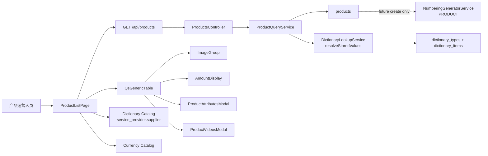

# 产品列表技术设计

## 1. 文档状态

- 状态：Phase 4 与搜索增量本地实施完成
- 编写日期：2026-08-12
- 确认日期：2026-08-12
- Requirements：`specs/product-list/requirements.md`
- 实施分支：`feat/admin-product-management`
- 设计基线 SHA：`a033832`
- 设计范围：Product Schema、只读列表 API、名称/编号搜索、正式产品列表页面与自动化验证
- 实施边界：Gate D1 与 Gate D2 已完成；外部 Git 与部署动作仍需 Gate E

## 2. 当前真相源与审计结论

### 2.1 实施后仓库事实

1. `server/prisma/schema.prisma` 已包含 `Product` Model 与 `ProductStatus` enum，并由新的 forward migration 建立数据库结构。
2. Server 已注册 ProductModule、Controller、DTO 与 Query Service，OpenAPI 只新增 `products_list` 读取 operation。
3. 已有 `products:read`、`products:create` 权限，并由 migration `20260811090000_product_management_permissions` 授予 `system_admin`。
4. Web `/admin/products/list` 已接入正式只读 API；`/admin/products/create` 继续保持原占位边界。
5. `QsGenericTable` 已提供分页、筛选、列显隐、固定、对齐、操作列、桌面表格、窄屏卡片和稳定状态。
6. `ImageGroup`、`AmountDisplay`、`DateTimeDisplay`、`QsToast`、`QsGenericModal` 与 Dictionary/Currency Catalog 均可直接复用。
7. Supplier 独立领域已经退役；当前唯一允许的供应商来源是 `service_provider.supplier` Dictionary Type。

### 2.2 2026-08-12 本地只读运行态核对

本地容器 `qianshu-dms-dev-postgres` 的只读查询确认：

- `PRODUCT` Numbering Rule：`ENABLED`，version `3`。
- `service_provider.supplier` Dictionary Type：启用，version `3`。
- 供应商 Dictionary Item：共 `1` 条，其中启用 `1` 条。

这些值属于可变业务数据，不进入 migration seed，也不能推广为其他环境事实。正式实施和未来创建功能开始前必须重新只读核对。

### 2.3 历史边界

已回滚的旧产品管理 migration、已删除分支和旧 Product 数据不属于当前实现基线。新设计不得复制旧表、旧 API、旧审计类型或旧 Supplier 关系，只能以当前 Schema 与已确认需求为真相源。

## 3. 设计结论

1. 新增一个扁平 `products` 主表和 `product_status` enum，不拆分 SPU、SKU、媒体、价格或属性子表。
2. 图片与视频按有序 PostgreSQL `text[]` 保存；属性按有序 JSONB 数组保存。当前没有属性查询需求，不做关系化过度设计。
3. 三组金额均以 `DECIMAL(30,4)` 金额列和独立三位币种列保存；金额可空，币种不可空。
4. `supplier_value` 保存 `service_provider.supplier` Item 的稳定 `value`，不建 Supplier FK，也不复制 Label。
5. 唯一读取接口 `GET /api/products` 支持分页、产品名称/编号 `keyword` 包含搜索、`status` 与 `supplierValue` 精确筛选；不提供全文检索引擎或用户排序。
6. ProductQueryService 批量解析一页内去重后的供应商值，避免 N+1 查询，并在 DTO 中返回历史解析状态。
7. Web 列表以页面局部逻辑组合现有组件；不修改 `QsGenericTable`、`ImageGroup`、`AmountDisplay` 或 `QsDictionarySelect` 公共契约。
8. 页头新增、行查看和行编辑均只调用 `QsToast.info`；不发请求、不导航、不新增 `products:update`。
9. 属性与视频使用产品列表领域内的只读 `QsGenericModal` 包装，不抽象为新的公共业务组件。
10. OpenAPI snapshot 与 Web generated types 只通过根 `contract:sync` 生成，不手工编辑。

## 4. 目标架构



分层职责：

```text
ProductsController
  -> 只声明权限、DTO、OpenAPI 与响应类型

ProductQueryService
  -> 规范化分页/筛选、读取 Product、批量解析供应商、映射 DTO

DictionaryLookupService
  -> 提供业务中立的单值/批量历史值解析，不认识 Product

Product list page
  -> 拥有权限、请求、Catalog 辅助状态、列定义、弹窗和占位操作

QsGenericTable / base components
  -> 只提供中立展示与交互能力，不读取产品 API 或 Store
```

## 5. 数据模型

### 5.1 Prisma 草案

```prisma
enum ProductStatus {
  DRAFT
  ACTIVE
  INACTIVE

  @@map("product_status")
}

model Product {
  id                       String        @id @default(dbgenerated("gen_random_uuid()")) @db.Uuid
  name                     String        @db.VarChar(128)
  productNo                String        @unique(map: "products_product_no_key") @map("product_no") @db.VarChar(64)
  status                   ProductStatus @default(DRAFT)
  supplierValue            String?       @map("supplier_value") @db.VarChar(64)
  mainImage                String?       @map("main_image") @db.VarChar(2048)
  images                   String[]      @default([])
  videos                   String[]      @default([])
  twdSalePriceAmount       Decimal?      @map("twd_sale_price_amount") @db.Decimal(30, 4)
  twdSalePriceCurrency     String        @default("TWD") @map("twd_sale_price_currency") @db.Char(3)
  myrSalePriceAmount       Decimal?      @map("myr_sale_price_amount") @db.Decimal(30, 4)
  myrSalePriceCurrency     String        @default("MYR") @map("myr_sale_price_currency") @db.Char(3)
  purchaseCostAmount       Decimal?      @map("purchase_cost_amount") @db.Decimal(30, 4)
  purchaseCostCurrency     String        @default("CNY") @map("purchase_cost_currency") @db.Char(3)
  attributes               Json          @default("[]") @db.JsonB
  createdByUserId          String?       @map("created_by_user_id") @db.Uuid
  updatedByUserId          String?       @map("updated_by_user_id") @db.Uuid
  version                  Int           @default(1)
  createdAt                DateTime      @default(now()) @map("created_at") @db.Timestamptz(6)
  updatedAt                DateTime      @default(now()) @updatedAt @map("updated_at") @db.Timestamptz(6)

  createdBy User? @relation("ProductCreatedBy", fields: [createdByUserId], references: [id], onDelete: Restrict, onUpdate: Restrict)
  updatedBy User? @relation("ProductUpdatedBy", fields: [updatedByUserId], references: [id], onDelete: Restrict, onUpdate: Restrict)

  @@index([status, updatedAt(sort: Desc), id(sort: Desc)], map: "products_status_updated_at_id_idx")
  @@index([supplierValue, updatedAt(sort: Desc), id(sort: Desc)], map: "products_supplier_value_updated_at_id_idx")
  @@index([updatedAt(sort: Desc), id(sort: Desc)], map: "products_updated_at_id_idx")
  @@map("products")
}
```

`User` 增加反向关系：

```prisma
productsCreated Product[] @relation("ProductCreatedBy")
productsUpdated Product[] @relation("ProductUpdatedBy")
```

以上结构已按 Gate D1 授权实现，并通过 Schema contract 与隔离 PostgreSQL 重放验证。

### 5.2 字段设计

| Field | PostgreSQL | Null | Default | 说明 |
| --- | --- | --- | --- | --- |
| `id` | `uuid` | no | `gen_random_uuid()` | 行身份，列表不展示 |
| `name` | `varchar(128)` | no | - | 产品名称 |
| `product_no` | `varchar(64)` | no | - | `PRODUCT` Rule 生成，唯一且不可修改 |
| `status` | `product_status` | no | `DRAFT` | 产品状态 |
| `supplier_value` | `varchar(64)` | yes | `null` | 供应商字典稳定 value |
| `main_image` | `varchar(2048)` | yes | `null` | 主图 URL |
| `images` | `text[]` | no | `{}` | 有序附加图片 URL |
| `videos` | `text[]` | no | `{}` | 有序视频 URL |
| `*_amount` | `numeric(30,4)` | yes | `null` | 精确金额 |
| `*_currency` | `char(3)` | no | `TWD/MYR/CNY` | 独立币种代码 |
| `attributes` | `jsonb` | no | `[]` | 有序 `{title,value}` 列表 |
| `created_by_user_id` | `uuid` | yes | `null` | 创建人 |
| `updated_by_user_id` | `uuid` | yes | `null` | 更新人 |
| `version` | `integer` | no | `1` | 后续乐观并发控制 |
| `created_at/updated_at` | `timestamptz(6)` | no | database time | 审计时间 |

### 5.3 数据库约束

Prisma 不能表达的约束由新 forward migration 显式创建，使用具名约束并纳入 Schema contract tests：

```text
products_name_nonblank_check
  btrim(name) <> ''

products_product_no_nonblank_check
  btrim(product_no) <> ''

products_supplier_value_nonblank_check
  supplier_value IS NULL OR btrim(supplier_value) <> ''

products_active_supplier_required_check
  status <> 'ACTIVE' OR supplier_value IS NOT NULL

products_twd_currency_check
  twd_sale_price_currency = 'TWD'

products_myr_currency_check
  myr_sale_price_currency = 'MYR'

products_purchase_currency_format_check
  purchase_cost_currency ~ '^[A-Z]{3}$'

products_*_amount_nonnegative_check
  amount IS NULL OR amount >= 0

products_attributes_array_check
  jsonb_typeof(attributes) = 'array'

products_version_positive_check
  version >= 1

products_identity_immutable_trigger
  BEFORE UPDATE 时拒绝修改 id 或 product_no
```

`product_no` 的唯一索引只能阻止重复，不能阻止已发编号被替换。migration 因此增加
具名 `enforce_product_identity_immutability()` Function 与
`products_identity_immutable_trigger`，只保护 `id/product_no` 两个身份字段，不在
Trigger 中实现状态、字典或金额业务流程。

`ACTIVE` 的“供应商当前有效”无法由 Product 表的静态 CHECK 持续证明。数据库只保证非空；未来创建或状态变更服务必须在事务内调用 `DictionaryLookupService.requireEffectiveValue()`。供应商之后被字典管理员停用时不自动改变 Product，读取端按历史值展示。

### 5.4 列表字段的存储选择

- `images`、`videos` 当前只保存 URL 且要求顺序，不需要单项查询或独立生命周期，因此使用 `text[]`，不创建媒体子表。
- `attributes` 需要保存标题和值的组合与顺序，但本期不筛选、不统计，使用 JSONB 数组。
- 本期没有写 API，详细 URL 协议、列表数量上限和属性逐项长度由未来创建/编辑规格定义；本 migration 不插入数据，也不引入未经确认的业务上限。
- `mainImage` 与 `images` 分开保存；`images` 不重复主图是未来写服务的业务校验，不建立跨列 Trigger。

### 5.5 供应商不建立外键

`dictionary_items.value` 只在 `dictionary_type_id` 范围内唯一，而 Product 只保存已确认的稳定 value。为避免同时复制 Type ID 或绑定可变 Item UUID，不建立数据库 FK。完整性边界为：

```text
future Product write transaction
  -> DictionaryLookupService.requireEffectiveValue({
       dictionaryCode: 'service_provider.supplier',
       value: supplierValue,
     })

Product historical read
  -> DictionaryLookupService.resolveStoredValues(...)
```

不得为了建立 FK 增加 `supplier_dictionary_item_id`、`supplier_type_id` 或 Label 快照。

### 5.6 币种不建立 Product 专用关系

三个币种列保存 ISO-style code，并由现有 Currency Catalog 负责展示精度与符号。销售币种由数据库 CHECK 固定为 `TWD/MYR`；采购币种为三位大写代码并默认 `CNY`。未来写入非默认采购币种时，应复用 Currency 业务校验确认 code 可用。本期只读列表不新增 Product-Currency FK 或汇率快照。

### 5.7 Migration 策略

- 新增一个 append-only forward migration，例如 `YYYYMMDDHHMMSS_product_list_schema`。
- migration 只创建 `product_status`、`products`、索引、约束、身份不可变 Trigger 和外键。
- 不修改 `20260811090000_product_management_permissions` 或任何旧 migration。
- 不 seed Product、`PRODUCT` Rule、Currency 或 Dictionary Item。
- migration 首尾使用单事务；自检应证明 enum、表、列、约束、索引和关系完整。
- 在隔离 PostgreSQL 中验证空库全量重放和从当前 migration 集升级两条路径。
- 是否应用到本地开发库属于后续数据库写操作，必须在实施阶段单独确认。

## 6. Server 设计

### 6.1 模块结构

```text
server/src/modules/products/
  products.module.ts
  products.controller.ts
  product-query.service.ts
  product-query.normalizer.ts
  product-query.mapper.ts
  product.errors.ts
  dto/product-list-query.dto.ts
  dto/product-response.dto.ts

  *.spec.ts
```

`ProductsModule` 注册到 `server/src/http.modules.ts`。本期不创建 Command Service、写 DTO、状态服务或 Audit writer。

### 6.2 HTTP 契约

```http
GET /api/products?page=1&pageSize=20&keyword=<name-or-number>&status=<DRAFT|ACTIVE|INACTIVE>&supplierValue=<exact-value>
```

权限与应用契约：

```text
permission: products:read
session: required
authorization: required
privateNoStore: true
operationId: products_list
success: 200 ProductPageDto
errors:
  403 FORBIDDEN | PASSWORD_CHANGE_REQUIRED
  422 VALIDATION_FAILED
```

本期不提供：

```text
POST /api/products
GET /api/products/{productId}
PATCH /api/products/{productId}
POST /api/products/{productId}/activate
POST /api/products/{productId}/deactivate
DELETE /api/products/{productId}
```

### 6.3 查询 DTO

```ts
class ProductListQueryDto {
  keyword?: string       // trim 后 1..128 Unicode code points, name/productNo contains
  status?: ProductStatus // DRAFT | ACTIVE | INACTIVE, exact match
  supplierValue?: string // 1..64 Unicode code points, nonblank, exact raw value
  page = 1               // integer >= 1
  pageSize = 20          // integer 1..100
}
```

`keyword` 去除首尾空白后，对 `name/productNo` 执行不区分大小写的包含匹配；空白或超过 128 个 Unicode code points 时返回 `422 VALIDATION_FAILED`。`supplierValue` 不执行 trim、大小写转换或 Label 映射；读取过滤不要求供应商当前有效，否则无法查询历史记录。

`status` 只接受 `DRAFT/ACTIVE/INACTIVE` 并执行精确匹配；没有 `sortBy` 或 `sortOrder`，也不搜索供应商 Label、状态、价格、属性或审计字段。筛选增量必须先扩展 Requirements 与 OpenAPI，不能在实现中隐式增加。

### 6.4 响应 DTO

```ts
type ProductStatusDto = 'DRAFT' | 'ACTIVE' | 'INACTIVE'
type ProductSupplierStateDto = 'EFFECTIVE' | 'DISABLED' | 'UNKNOWN'

interface ProductMoneyDto {
  amount: string | null
  currency: string
}

interface ProductSupplierDto {
  value: string
  label: string | null
  tone: DictionaryTone | null
  state: ProductSupplierStateDto
}

interface ProductAttributeDto {
  title: string
  value: string
}

interface ProductActorDto {
  id: string
  displayName: string
}

interface ProductListItemDto {
  id: string
  name: string
  productNo: string
  status: ProductStatusDto
  supplier: ProductSupplierDto | null
  mainImage: string | null
  images: string[]
  videos: string[]
  twdSalePrice: ProductMoneyDto
  myrSalePrice: ProductMoneyDto
  purchaseCost: ProductMoneyDto
  attributes: ProductAttributeDto[]
  createdBy: ProductActorDto | null
  updatedBy: ProductActorDto | null
  version: number
  createdAt: string
  updatedAt: string
}

interface ProductPageDto {
  items: ProductListItemDto[]
  page: number
  pageSize: number
  total: number
}
```

金额 mapper 必须使用 Prisma Decimal 的 `toFixed()`/`toString()` 输出十进制字符串，不得调用 `Number()`。属性 mapper 在 Server 边界检查 JSON 形状；若数据库出现不符合已确认结构的数据，应返回受控内部错误并记录安全诊断，不得把任意 JSON 透传给 Web。

### 6.5 查询与稳定排序

ProductQueryService 使用同一 `where` 计算 count 和 rows：

```ts
const where: Prisma.ProductWhereInput = {}
if (status !== undefined) where.status = status
if (supplierValue !== undefined) where.supplierValue = supplierValue
if (keyword !== undefined) {
  where.OR = [
    { name: { contains: keyword, mode: 'insensitive' } },
    { productNo: { contains: keyword, mode: 'insensitive' } },
  ]
}

orderBy: [
  { updatedAt: 'desc' },
  { id: 'desc' },
]
```

查询 `createdBy/updatedBy` 时只选择 `id/displayName`。不把完整 User、密码、状态、角色或 Profile 带入 Product DTO。

### 6.6 供应商批量历史解析

现有 `DictionaryLookupService.resolveStoredValue()` 是单值读取。直接对每行调用会形成 N+1，因此增加业务中立的批量方法：

```ts
resolveStoredValues(input: {
  dictionaryCode: string
  values: readonly string[]
}): Promise<readonly StoredDictionaryValueResolution[]>
```

实现要求：

1. 规范化并校验一次 `dictionaryCode`。
2. 按精确字符串去重 `values`，空数组直接返回空结果。
3. 使用一次 Type/Item 查询读取匹配项和 Type enabled 状态。
4. 为每个输入 raw value 返回 `known/effectiveEnabled/label/tone` 解析，不丢失未知值。
5. 保留输入 raw value，不 trim、不改大小写。
6. 将现有单值方法复用同一纯映射内核，避免两套历史状态语义漂移。

Product mapper 转换规则：

```text
supplierValue = null
  -> supplier = null

known = false
  -> { value, label: null, tone: null, state: 'UNKNOWN' }

known = true && effectiveEnabled = false
  -> { value, label, tone, state: 'DISABLED' }

known = true && effectiveEnabled = true
  -> { value, label, tone, state: 'EFFECTIVE' }
```

若字典批量解析失败，整个产品列表请求失败关闭，不返回可能错误的供应商 Label。错误映射沿用现有只读查询错误边界，不泄露 SQL 或连接信息。

### 6.7 Numbering 边界

本期 Query Module 不导入 `NumberingModule`，任何列表代码均不得调用 `NumberingGeneratorService`。Product Schema 的 `product_no` 只建立唯一和非空约束。

未来创建功能需要单独设计：

```text
ruleCode: PRODUCT
consumerCode: PRODUCT.CREATE
idempotencyKey: create request stable key
```

编号生成与 Product insert 的失败、重试、间隙和幂等事务边界必须在创建规格中确认，本文件不提前承诺。

## 7. Web 设计

### 7.1 页面文件边界

```text
web/apps/qsmds-arco/src/views/admin/product-management/list/
  index.vue
  product-list.logic.ts
  product-attributes-modal.vue
  product-videos-modal.vue

web/apps/qsmds-arco/src/api/modules/products.ts
```

对应测试：

```text
web/apps/qsmds-arco/test/api/products.test.ts
web/apps/qsmds-arco/test/views/product-list.test.ts
web/apps/qsmds-arco/test/views/product-list.logic.test.ts
```

不新增 Product Store。页面使用 OpenAPI generated types 与 API adapter，业务副作用保留在页面。

### 7.2 页面结构

```vue
<div class="product-list-page min-w-0">
  <FaPageHeader ...>
    <!-- title / description / create placeholder action -->
  </FaPageHeader>

  <FaPageMain>
    <!-- auxiliary Catalog warning -->
    <QsGenericTable ...>
      <!-- special cells / actions / responsive row -->
    </QsGenericTable>
  </FaPageMain>

  <ProductAttributesModal ... />
  <ProductVideosModal ... />
</div>
```

设计继续使用 Fantastic-admin/Fa/Tailwind 与语义 Token。页头标题为“产品列表”，描述说明当前是产品资料总览；右侧新增按钮形成不对称操作重心。页面不增加统计卡、装饰背景或无需求的工具栏。

### 7.3 权限与占位动作

```ts
const canRead = computed(() => auth('products:read'))
const canCreate = computed(() => auth('products:create'))
```

- `canRead=false`：显示页面级无权限 `FaEmpty`，不发产品或 Catalog 请求。
- `canCreate=true`：显示页头“新增产品”；点击 `toast.info('新增产品功能将在后续版本开放')`。
- 操作列“查看”“编辑”只在已读取的行上显示，均属于无副作用说明入口，不新增权限。
- “查看”提示：`产品详情功能将在后续版本开放`。
- “编辑”提示：`产品编辑功能将在后续版本开放`。
- 本期保留既有 `/admin/products/create` 占位路由与文件，不删除、不重定向；该入口后续是否收敛到列表页需要单独确认。

### 7.4 请求状态与竞态控制

页面沿用现有管理页模式：

```text
rows / total / page / pageSize / searchKeyword / filters
listLoading / listError / listRequestId
listRequestVersion / listAbortController
authEpoch snapshot
```

行为：

1. 新请求前 Abort 旧请求。
2. 响应仅在 permission、authEpoch、requestVersion 与 controller 均仍有效时提交。
3. 搜索、启用状态和供应商筛选事件使用最终显式状态；搜索提交/清空及筛选应用/清空都回第一页。
4. 同一轮多个查询事件合并为一次 microtask 请求。
5. 卸载或失去读取权限时 Abort 请求并清空产品数据。
6. 错误通过本地 error presentation 显示安全文案和可选 requestId。

### 7.5 API Adapter

```ts
export type ProductListQuery = NonNullable<ProductsListData['query']>

export function createProductsApi(client: AxiosInstance) {
  return {
    list: (query: ProductListQuery, signal: AbortSignal) =>
      client.get<ProductPageDto>('products', {
        errorPresentation: 'local',
        params: query,
        signal,
      }),
  }
}
```

adapter 不手写 DTO，不做重试策略猜测，不读取 Store。

### 7.6 列定义

| Column ID | Title | Accessor/Slot | Default | Width |
| --- | --- | --- | --- | --- |
| generated | 行号 | Qs built-in | fixed left | built-in |
| `productNo` | 产品编号 | text | fixed left, copyable | 180 |
| `name` | 产品名称 | text | visible | 220 |
| `status` | 产品状态 | `FaTag` | visible | 110 |
| `supplier` | 供应商 | custom | visible | 180 |
| `mainImage` | 产品主图 | `ImageGroup` | visible | 112 |
| `images` | 产品图片 | `ImageGroup` | visible | 160 |
| `videos` | 产品视频 | button | visible | 120 |
| `twdSalePrice` | 台币销售价 | `AmountDisplay` | visible, right | 150 |
| `myrSalePrice` | 马币销售价 | `AmountDisplay` | visible, right | 150 |
| `purchaseCost` | 采购成本价 | `AmountDisplay` | visible, right | 150 |
| `attributes` | 产品属性 | button | visible | 130 |
| `createdAt` | 创建时间 | `DateTimeDisplay` | visible | 180 |
| `createdBy` | 创建人 | text | visible | 140 |
| `updatedAt` | 更新时间 | `DateTimeDisplay` | visible | 180 |
| `updatedBy` | 更新人 | text | visible | 140 |
| reserved | 操作 | actions slot | fixed right | 144 |

`id` 只传给 `row-key`，`version` 只保留在 DTO，不进入 columns。`table-class` 设置页面所需最小宽度，使横向滚动只发生在 Table 容器；不在页面根节点添加 `overflow-x-auto`。

状态展示：

```text
DRAFT    -> 草稿，neutral/outline
ACTIVE   -> 启用，success semantic tone
INACTIVE -> 停用，muted/secondary
```

三种状态始终显示中文文本，颜色只是辅助。

### 7.7 图片展示

主图：

```vue
<ImageGroup
  :items="toMainImageItems(row.original)"
  :max-count="1"
  size="md"
  radius="lg"
/>
```

附加图片：

```vue
<ImageGroup
  :items="toProductImageItems(row.original)"
  :max-count="3"
  size="md"
  radius="lg"
/>
```

映射过滤空 URL，并以稳定 URL/位置组合作为 `key`；`alt` 包含产品名称和图片位置。图片点击由 `ImageGroup` 打开整组预览并阻止行操作冒泡。

### 7.8 金额展示

页面通过 `useCurrencyCatalog()` 获取 `currencies`，三列统一映射：

```vue
<AmountDisplay
  :value="money.amount"
  :currency="money.currency"
  :currencies="currencies"
/>
```

Catalog 错误以辅助 `FaAlert` 展示并允许重试；`AmountDisplay` 在未知币种时显示原始金额和 code，不因目录失败把可审计金额吞成 `—`。金额不在列表内换算或汇总。

### 7.9 供应商单元格与筛选

单元格只消费 Server 已解析的 `supplier`：

```text
null      -> —
EFFECTIVE -> Label
DISABLED  -> Label + 已停用 Tag
UNKNOWN   -> raw value + 未知 Tag
```

筛选选项来自 Web Dictionary Catalog，而不是 Product API 响应：

```ts
catalog.items.map(item => ({
  label: item.effectiveEnabled
    ? item.label
    : `${item.label}（已停用）`,
  value: item.value,
}))
```

这里故意使用 `catalog.items` 而不是 `selectableItems`：列表筛选是历史读取，不是写入选择，因此已停用的已知值仍应可筛选。

状态策略：

- loading：产品列表照常加载；供应商筛选暂不提供新候选，显示轻量加载说明。
- missing：显示“未配置供应商字典”，列表保持可用。
- error：显示 `FaAlert` 与“重试加载”，列表保持可用。
- ready：把供应商 options 注入 `filterDefinitions`。
- 已应用 raw 条件期间 Catalog 失效：保留当前条件和一个 raw option，确保用户可以查看并清空，不静默扩大结果集。

`QsGenericTable.FilterPanel` 只接受 `label/value`，因此不直接嵌入 `QsDictionarySelect`，也不修改共享 FilterPanel。未来产品表单才使用 `QsDictionarySelect` 做写入选择。

### 7.10 属性弹窗

`ProductAttributesModal` 是页面局部只读组件：

- Props：`open`、`productName`、`attributes`。
- Emits：`update:open`。
- 使用 `QsGenericModal size="md"`。
- 内容使用 `<dl>` 或语义化列表逐项显示 Title/Value。
- 长文本可换行，技术 raw value 不强制截断。
- 空数组不打开弹窗；表格显示 `—`。
- 不增加编辑、复制全量 JSON 或提交动作。

### 7.11 视频弹窗

`ProductVideosModal` 是页面局部只读组件：

- Props：`open`、`productName`、`videos`。
- 使用一个当前选中播放器和完整地址列表，不同时自动加载多个播放器。
- 原生 `<video controls preload="metadata">`，不得自动播放。
- 地址列表按钮可用键盘选择当前预览。
- 不支持的协议、Codec、CORS 或加载失败保留“在新窗口打开”链接，并使用 `target="_blank" rel="noopener noreferrer"`。
- 关闭弹窗时停止播放并释放当前 UI 状态，不修改 Product 数据。
- 窄屏下播放器宽度受 Modal 内容区约束，不产生页面级横向溢出。

### 7.12 响应式与无障碍

- Desktop 使用 QsGenericTable 的 FaTable 内核、固定列、Column Settings Popover 和 Filter Popover。
- 小于 `768px` 使用 QsGenericTable 既有结构化卡片；同一 `cell-*` 展示语义和 actions slot 继续复用。
- 小于 `640px` 的按钮、筛选项、媒体入口和 Modal 操作至少 `44px`。
- 产品编号使用数据强调/Mono 语义，普通中文名称与供应商 Label 使用 Sans。
- 图标全部使用 Lucide/FaIcon，不使用 Emoji。
- 所有图标按钮提供 `aria-label`；属性和视频入口包含数量与产品上下文。
- 弹窗使用可访问标题、焦点约束、Escape 和明确关闭入口。
- 保留 light/dark 与 Reduced Motion 契约，不在页面硬编码主题颜色。

## 8. OpenAPI 与契约同步

已新增：

```text
operationId:
  products_list

schemas:
  ProductStatus
  ProductSupplierStateDto
  ProductMoneyDto
  ProductSupplierDto
  ProductAttributeDto
  ProductActorDto
  ProductListItemDto
  ProductPageDto
```

同步流程：

```text
Server source + DTO tests
  -> node --run contract:sync
  -> server/openapi/openapi.json
  -> web/openapi/openapi.json
  -> web/apps/qsmds-arco/src/api/generated/**
```

生成产物只由命令修改。`ci-contract-baseline` 需要把 `products_list` 作为本期精确新增 operation，不放宽其他 operation 门禁。

## 9. 文件变更矩阵

### 9.1 实际新增

```text
server/prisma/migrations/20260812090000_product_list_schema/migration.sql
server/src/modules/products/**
server/test/product-list-api.e2e-spec.ts
server/src/infrastructure/database/product-list-schema.spec.ts

web/apps/qsmds-arco/src/api/modules/products.ts
web/apps/qsmds-arco/src/views/admin/product-management/list/product-list.logic.ts
web/apps/qsmds-arco/src/views/admin/product-management/list/product-attributes-modal.vue
web/apps/qsmds-arco/src/views/admin/product-management/list/product-videos-modal.vue
web/apps/qsmds-arco/test/api/products.test.ts
web/apps/qsmds-arco/test/views/product-list.test.ts
web/apps/qsmds-arco/test/views/product-list.logic.test.ts
```

### 9.2 实际修改

```text
server/prisma/schema.prisma
server/src/http.modules.ts
server/src/modules/dictionaries/dictionary-lookup.service.ts
server/src/modules/dictionaries/dictionary-lookup.service.spec.ts
server/openapi/openapi.json                       # generated only

web/openapi/openapi.json                          # generated only
web/apps/qsmds-arco/src/api/generated/**          # generated only
web/apps/qsmds-arco/src/views/admin/product-management/list/index.vue
web/apps/qsmds-arco/test/api/product-management-routes.test.ts
web/apps/qsmds-arco/test/browser/management.browser.test.mjs
scripts/browser-auth/provision-admin.mjs
scripts/browser-auth-runtime.test.mjs
scripts/root-governance.test.mjs
docs/后端文档/数据库迁移规范.md
```

Web generated types 已由 `contract:sync` 重建，但按仓库规则不跟踪；上述实际文件均未越过 Requirements 范围。

### 9.3 明确不修改或删除

```text
server/src/modules/suppliers/**                    # current runtime already absent
web/apps/qsmds-arco/src/api/modules/suppliers.ts  # current runtime already absent
web/apps/qsmds-arco/src/components/business/QsGenericTable/**
web/apps/qsmds-arco/src/components/base/ImageGroup/**
web/apps/qsmds-arco/src/components/base/AmountDisplay/**
web/apps/qsmds-arco/src/components/business/QsDictionarySelect/**
web/apps/qsmds-arco/src/views/admin/product-management/create/index.vue
web/apps/qsmds-arco/src/router/modules/product.management.ts
existing prisma migrations
package.json / lockfiles
```

若实现发现必须修改或删除上述对象，应停止并重新取得确认。

## 10. 测试策略

### 10.1 TDD 顺序

1. Schema/migration contract RED：Product enum、列、约束、索引和既有权限边界缺失。
2. Dictionary batch resolution RED：重复、停用、未知和空值批量解析能力缺失。
3. Product query/mapper RED：分页、名称/编号搜索、精确筛选、稳定排序、Decimal string、JSON shape 和 actor whitelist。
4. Controller/OpenAPI RED：`products_list`、权限和错误契约缺失。
5. API E2E RED：数据库 Product fixture 无法通过 HTTP 读取或筛选。
6. Web API/logic RED：generated type adapter、查询构造、历史供应商 option 和媒体映射缺失。
7. View RED：页面尚未组合 QsGenericTable、特殊单元格、Catalog 状态、占位动作和弹窗。
8. Browser RED：真实权限、供应商筛选、图片、金额、弹窗、窄屏和暗色行为缺失。

### 10.2 Server 覆盖

- Prisma schema 与 migration 文本契约。
- 隔离 PostgreSQL 空库重放和升级。
- Product list query DTO 边界：分页、keyword trim/空白/超长、精确 supplier raw。
- `resolveStoredValues()`：空数组、去重、同 Label 不同 value、Type disabled、Item disabled、unknown、顺序。
- Query Service：name/productNo OR、keyword 与 supplier AND、where 复用、stable order、supplier batch、actor whitelist。
- Mapper：三组 Decimal string/null、属性合法/非法 JSON、空列表。
- Controller metadata：`products:read`、`products_list`、private no-store、403/422。
- API E2E：无权限、分页、名称/编号搜索、供应商组合筛选、空结果、已停用/未知历史值。

### 10.3 Web 覆盖

- API adapter 只消费 generated types、正确编码 query、传递 AbortSignal。
- Query builder trim/省略 `keyword` 但不 trim `supplierValue`，`status` 只序列化生成契约允许的枚举值；搜索、分页和筛选切换正确。
- Catalog options 包含已停用已知值并保留 stable value。
- Product table 列顺序、默认 fixed、id/version 不可见、actions right-fixed。
- `ImageGroup maxCount=1/3`、`AmountDisplay` 三列、DateTimeDisplay。
- 属性/视频空态、数量按钮、Modal props 和 close behavior。
- 新增/查看/编辑只触发 `QsToast.info`，无 router/API mutation。
- 权限变化、Abort、迟到响应、requestId 错误与 Catalog 降级。

### 10.4 Browser 覆盖

优先扩展现有 `management.browser.test.mjs` 和 `test:browser:auth` Job，不新建 Product 专属 CI Job：

- `products:read` 与 `products:create` 菜单/按钮权限。
- 搜索提交/清空、启用状态与供应商筛选应用/清空和分页归一，并验证组合请求。
- 产品编号左固定、操作列右固定、Column Settings。
- 主图与多图预览、`+N` 行为。
- 金额格式、未知 Catalog 回退。
- 属性弹窗、视频弹窗、关闭与键盘。
- 1440px Desktop、390x844 Mobile、light/dark、Reduced Motion、无页面级横向溢出。

Browser fixture 可以在隔离测试数据库直接插入受控 Product 数据；这只是测试准备，不新增生产创建接口或 seed。

## 11. 实施验证命令

Phase 4 使用以下本地验证矩阵；`ci:contract` 只在真实 GitHub event context 中运行，本地使用 `contract:check` 与对应 baseline 单测：

```bash
# Schema / Server
pnpm -C server prisma:validate
pnpm -C server typecheck
pnpm -C server lint
pnpm -C server test --runInBand
node --run ci:server-e2e

# OpenAPI
node --run contract:sync
node --run contract:check

# Web
pnpm -C web test:api
pnpm -C web typecheck
pnpm -C web lint
pnpm -C web build
node --run ci:browser-auth-e2e

# Repository
node --run test:root
node --run check
node --run build
git diff --check
git status --short
```

如果 `tsx --test` 在受限 shell 出现 `listen EPERM ...*.pipe`，应改用项目已验证的 Node/tsx 兼容入口或在允许 IPC 的环境重跑；不得把环境限制伪报为测试通过。

## 12. 风险与失败边界

| Risk | Failure mode | Mitigation |
| --- | --- | --- |
| 可变 `PRODUCT` Rule | 其他环境缺失或停用 | migration 不 seed；未来创建前只读预检并失败关闭 |
| 可变供应商字典 | Product 原供应商之后停用 | 保存 stable value；Server 历史解析；不自动改 Product 状态 |
| Supplier N+1 | 每行一次字典查询 | 新增业务中立 batch resolver，按页面值去重 |
| Decimal 精度 | API/Web 转成浮点丢失 | Prisma Decimal -> string；AmountDisplay 消费 string |
| JSON 漂移 | attributes 非数组或字段非法 | DB array-type CHECK + Server mapper fail-closed |
| 媒体地址不可播放 | CORS、Codec、协议不支持 | 不自动播放；单播放器；保留安全外链 |
| Catalog 辅助请求失败 | 筛选或币种展示不可用 | Product list 独立加载；Alert/retry；保留 raw 值 |
| 旧产品方案回流 | 恢复废弃 Product/Supplier 结构 | 只按当前 Schema 实施；旧分支和 migration 仅作历史证据 |
| 占位 Create Route 重复入口 | 菜单与页头同时出现新增入口 | 本期不删除已存在路由；后续单独确认信息架构收敛 |
| 公共契约扩张 | 实现时顺手加入详情/写 API | Operation allowlist 只允许 `products_list`；契约门禁精确校验 |

## 13. 安全与工程治理

- 所有 Product API 继续经过 Session、PasswordChangeRequired 和 Permission Guard。
- Product list 使用 private no-store，不写浏览器持久缓存或新的 Pinia Store。
- Controller 只返回白名单 DTO，不序列化 Prisma record 或 User 全对象。
- 错误信息不回显 SQL、数据库结构、不可信 URL 响应或内部异常。
- 不硬编码密钥，不修改或提交 `.env`。
- 根目录不引入 dependency、lockfile、workspace 或 `node_modules`。
- Server/Web 继续通过 HTTP/OpenAPI 协作，不建立跨目录源码引用。
- 实施阶段小步提交，Commit 类型使用英文、描述使用中文。
- 本地完成不代表 push、PR、merge、部署或数据库发布授权。

## 14. Phase 2 确认边界与 Phase 4 结论

确认本设计意味着接受以下技术方向：

1. `products` 扁平表、`text[]` 媒体列表、JSONB 属性与成对金额/币种列。
2. `supplier_value` 不建 Supplier/Dictionary FK，写时校验、读时批量历史解析。
3. 本期只新增 `GET /api/products`；查询参数为分页、名称/编号 `keyword`、精确 `status` 和 `supplierValue`。
4. Product 列表不提供真实创建、详情、编辑、状态变更或删除。
5. 现有 Create 占位路由保留不动；列表页新增、查看、编辑均只 Toast。
6. 不修改公共 Qs 组件；页面通过 slots、Catalog 和局部 Modal 组合。
7. 通过现有 management Browser Job 覆盖产品列表，不新增独立 CI Job。

首期方向已完成 Phase 2、Phase 3 与 Gate D1 确认，并在 Phase 4 实现；`keyword` 搜索与 `status` 精确筛选分别作为单独确认的公共 API 增量实施。Gate D2 已单独授权，`20260812090000_product_list_schema` 已应用到本地持久开发数据库并通过结构与健康检查；Gate E 未授权，因此没有 push、PR、merge 或部署。
