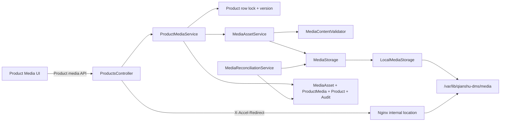
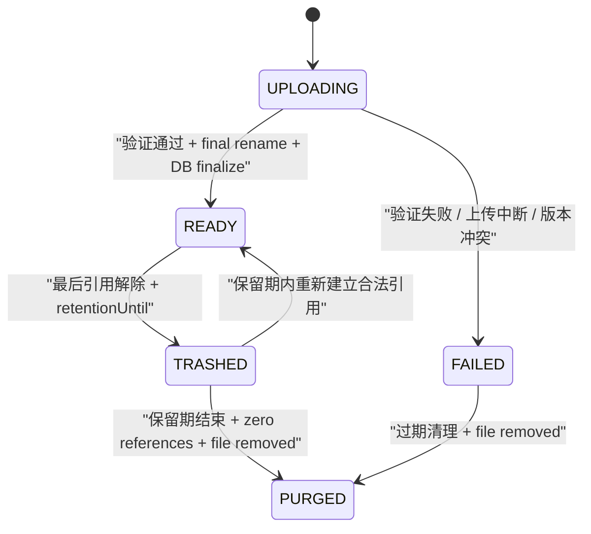
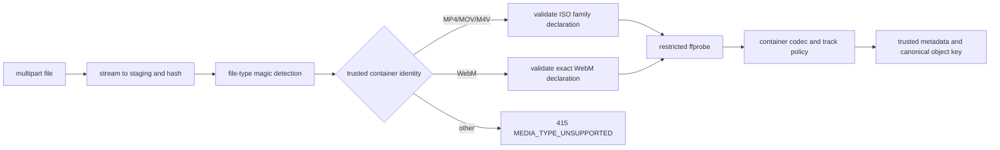

# 统一媒体资产与产品媒体技术设计

## 1. 文档状态

- 状态：Design 已确认，等待 Phase 3 任务清单确认
- 编写日期：2026-08-13
- 确认日期：2026-08-13
- Requirements：`specs/product-media/requirements.md`
- 规划分支：`feat/media-asset-product-media`
- 设计范围：MediaAsset 基础设施、ProductMedia 关联、产品媒体 API 与 Web、单机本地存储、私有访问和运维合同
- 实施边界：本文不授权修改 Prisma Schema、Migration、公共 API、代码、依赖、数据库或部署环境

## 2. 设计原则

1. `MediaAsset` 只理解文件，Product 只通过 `ProductMedia` 表达业务语义。
2. 领域授权必须从 ProductMedia 入口判断，不能因为知道 MediaAsset ID 就取得文件。
3. 数据库事务与文件系统不存在真正的分布式原子提交，因此使用状态机、原子 rename 和定期对账收敛。
4. 首期只实现 Local driver；通过窄接口隔离存储，不提前实现 S3、MinIO 或多驱动并存。
5. `DOCUMENT` 是基础能力，不是 Product 能力；类型限制在 Server 和数据库边界重复保证。
6. 任何删除都先解除领域引用，再经过保留期和全引用检查；不把“删除产品图片”等同于立即删文件。
7. Product 媒体写入使用既有 Product 行锁与 `version`，不建立第二套并发版本。
8. 不保留新旧 URL 双写，不引入不必要的长期兼容层。

## 3. 目标架构



模块依赖方向：

```text
ProductsModule
  -> MediaModule public application services and contracts

MediaModule
  -> DatabaseModule
  -> LocalMediaStorage
  -> MediaContentValidator
  -> MediaReconciliationService

MediaModule
  -X-> ProductsModule
```

未来真实业务域只能像 ProductsModule 一样依赖 MediaModule，并建立自己的关联表、服务和内容授权路由。

## 4. 数据模型

### 4.1 枚举

```prisma
enum MediaType {
  IMAGE
  VIDEO
  DOCUMENT
}

enum MediaAssetStatus {
  UPLOADING
  READY
  FAILED
  TRASHED
  PURGED
}

enum ProductMediaKind {
  IMAGE
  VIDEO
}
```

`ProductMediaKind` 有意不包含 `DOCUMENT`。该字段与 MediaAsset 类型存在受约束的冗余，用于
同类型排序、数量上限和索引；写服务与数据库 Trigger 必须保证两者一致。

### 4.2 MediaAsset

概念 Schema：

```prisma
model MediaAsset {
  id                  String           @id @default(dbgenerated("gen_random_uuid()")) @db.Uuid
  mediaType           MediaType        @map("media_type")
  status              MediaAssetStatus @default(UPLOADING)
  storageDriver       String           @default("local") @map("storage_driver") @db.VarChar(32)
  objectKey           String?          @unique @map("object_key") @db.VarChar(512)
  originalFilename    String           @map("original_filename") @db.VarChar(255)
  mimeType            String?          @map("mime_type") @db.VarChar(127)
  sizeBytes           BigInt?          @map("size_bytes")
  checksumSha256      String?          @map("checksum_sha256") @db.Char(64)
  width               Int?
  height              Int?
  durationMs          Int?             @map("duration_ms")
  videoCodec          String?          @map("video_codec") @db.VarChar(32)
  audioCodec          String?          @map("audio_codec") @db.VarChar(32)
  uploadExpiresAt     DateTime?         @map("upload_expires_at") @db.Timestamptz(6)
  retentionUntil      DateTime?         @map("retention_until") @db.Timestamptz(6)
  failureCode         String?           @map("failure_code") @db.VarChar(64)
  createdByUserId     String            @map("created_by_user_id") @db.Uuid
  createdAt           DateTime          @default(now()) @map("created_at") @db.Timestamptz(6)
  updatedAt           DateTime          @updatedAt @map("updated_at") @db.Timestamptz(6)
  deletedAt           DateTime?         @map("deleted_at") @db.Timestamptz(6)
}
```

实施时需补充具名约束：

- `size_bytes >= 0`，`width/height/duration_ms` 在非空时必须为正数。
- SHA-256 必须为 64 位小写十六进制；`object_key` 只能是规范化相对 key，禁止 `..`、反斜线、
  前导斜线、NUL 和空 segment。
- `UPLOADING/FAILED` 允许尚未产生的 `objectKey/mimeType/sizeBytes/checksum` 为 null；`READY/TRASHED`
  必须保留可信 objectKey、MIME、字节数和 checksum。已物化内容进入 `PURGED` 后继续保留这些内容身份；
  从未完成物化的超期上传则必须让全部内容身份与类型元数据保持 null，并保留固定 failureCode，不得伪造
  objectKey、MIME、字节数或 checksum。READY IMAGE 必须具有 width/height；READY VIDEO 必须具有
  width/height/duration/videoCodec，audioCodec 可空。
- `UPLOADING` 必须具有 `uploadExpiresAt`；`TRASHED` 必须具有 `retentionUntil/deletedAt`；
  `PURGED` 必须具有 `deletedAt`。
- `mediaType`、`storageDriver`、`objectKey`、内容元数据在 READY 后不可由业务操作原地修改；未来如需
  迁移存储，只能通过独立、可校验且可恢复的运维迁移更新 storage pointer，内容身份和 checksum 不变。
  状态仅允许按受控状态机迁移。
- `createdByUserId` 使用真实 User 外键并采用 `ON DELETE RESTRICT`，不复制用户名。

`sizeBytes` 在数据库使用 BigInt，在 JSON 使用 decimal string。原始文件名只用于授权后的 UI 展示，
不得参与对象 key、日志或审计。

### 4.3 ProductMedia

概念 Schema：

```prisma
model ProductMedia {
  id                String           @id @default(dbgenerated("gen_random_uuid()")) @db.Uuid
  productId         String           @map("product_id") @db.Uuid
  mediaAssetId      String           @map("media_asset_id") @db.Uuid
  kind              ProductMediaKind
  sortOrder         Int              @map("sort_order")
  isPrimary         Boolean          @default(false) @map("is_primary")
  createdByUserId   String           @map("created_by_user_id") @db.Uuid
  detachedByUserId  String?          @map("detached_by_user_id") @db.Uuid
  createdAt         DateTime         @default(now()) @map("created_at") @db.Timestamptz(6)
  updatedAt         DateTime         @updatedAt @map("updated_at") @db.Timestamptz(6)
  detachedAt        DateTime?        @map("detached_at") @db.Timestamptz(6)
}
```

关系与数据库约束：

- Product、MediaAsset、User 外键均使用 `ON DELETE RESTRICT`。
- CHECK：`sort_order >= 0`；`is_primary=true` 时 `kind=IMAGE`；解除关联时 detached actor/time 同时存在。
- Partial unique：同 Product、同 MediaAsset 只能存在一个有效关联。
- Partial unique：同 Product、同 kind、同 sortOrder 只能存在一个有效关联。
- Partial unique：同 Product 最多一个 `is_primary=true AND detached_at IS NULL`。
- Constraint Trigger：新增/更新有效关联时锁定 MediaAsset，要求 `status=READY` 且
  `ProductMedia.kind = MediaAsset.mediaType`；MediaAsset 的 DOCUMENT 因枚举不匹配而被数据库拒绝。
- Constraint Trigger：MediaAsset 从 READY 转出前必须确认不存在有效 ProductMedia；未来新增领域关联表时，
  必须在同一 Trigger function 中扩展显式引用检查，防止绕过应用服务误删仍被引用的文件。
- Deferred Constraint Trigger：事务提交时 READY MediaAsset 必须至少存在一个已实现领域的有效关联；
  本期即有效 ProductMedia，防止业务服务错误提交孤立的可读资产。
- 解除关联不删除行；所有默认查询必须显式使用 `detachedAt IS NULL`。

排序更新先锁 Product，再把目标 kind 的现有 sortOrder 移到安全偏移区，最后写入从 0 开始的连续
顺序，以避免 partial unique 在逐行更新期间发生交换冲突。

### 4.4 Product 结构替换

实施 Migration 删除：

```text
products.main_image
products.images
products.videos
```

Product 继续保留当前 `version` 和审计字段。删除旧列前必须执行只读预检：

```sql
SELECT
  count(*) FILTER (WHERE main_image IS NOT NULL) AS main_image_count,
  count(*) FILTER (WHERE cardinality(images) > 0) AS images_count,
  count(*) FILTER (WHERE cardinality(videos) > 0) AS videos_count
FROM products;
```

任一计数非零即停止，不自动下载 URL、不自动清空、不创建占位 MediaAsset。处理历史数据需要新的
明确授权和独立迁移方案。

### 4.5 引用安全的未来扩展

本期 `MediaAssetReferenceRepository.hasActiveReferences(assetId)` 只显式查询 ProductMedia。
未来新增领域关联表时，该交付必须修改同一查询为明确的 `EXISTS ... OR EXISTS ...`，并增加“任一
领域仍引用则不可 TRASHED/PURGED”的数据库集成测试。这里不建立插件注册表或多态 owner 表。

## 5. MediaAsset 状态机



状态转换必须使用带旧状态条件的更新，避免清理任务和用户操作相互覆盖。`PURGED` 保留数据库最小
事实，不再提供内容；已生成的 objectKey 永不复用，从未生成 objectKey 的超期上传保持 null。

## 6. 存储设计

### 6.1 配置

后续实施预计增加以下环境变量示例，但不得写入真实 `.env`：

```text
MEDIA_STORAGE_DRIVER=local
MEDIA_STORAGE_ROOT=/var/lib/qianshu-dms/media
MEDIA_STAGING_TTL_HOURS=24
MEDIA_TRASH_RETENTION_DAYS=7
MEDIA_FFPROBE_PATH=/usr/bin/ffprobe
```

启动校验：

- driver 首期只能为 `local`。
- root 必须是绝对路径，解析 realpath 后不得位于项目源码、release、`server/dist`、`/tmp` 或根目录。
- root/staging/assets/trash 必须在同一文件系统、可写且不经过不受信任 symlink。
- 目录建议权限 `0750`、文件 `0640`；运行用户与 Nginx 读取组按部署文档设置。
- `ffprobe` 必须可执行且版本命令成功；视频上传能力在依赖缺失时失败关闭，图片仍可按健康状态策略运行。

### 6.2 objectKey 与目录

```text
/var/lib/qianshu-dms/media/
  staging/{mediaAssetId}.{randomUuid}.part
  assets/YYYY/MM/{mediaAssetId}.{canonicalExtension}
  trash/YYYY/MM/{mediaAssetId}.{canonicalExtension}
```

数据库只保存例如 `assets/2026/08/<uuid>.webp` 的 objectKey。日期来自 Server 受信时钟；扩展名来自
Server 内容识别，不使用客户端后缀。

### 6.3 MediaStorage 接口

```ts
interface MediaStorage {
  createStagingWrite(assetId: string): Promise<Writable>
  finalize(stagingKey: string, objectKey: string): Promise<void>
  inventory(input: InventoryInput): Promise<InventoryPage>
  open(objectKey: string, range?: ByteRange): Promise<ReadableObject>
  moveToTrash(objectKey: string, trashKey: string): Promise<void>
  restoreFromTrash(trashKey: string, objectKey: string): Promise<void>
  purge(key: string): Promise<void>
  stat(key: string): Promise<StoredObjectStat | null>
}
```

接口不包含 Product ID、权限或 HTTP 响应。`inventory` 只接受受控 namespace、可选 prefix、最多 500
条的 limit 和上页 cursor，并只返回 canonical key、size 与 modifiedAt；绝对路径不会离开 Local driver。
首期仅实现 `LocalMediaStorage`；未来对象存储驱动必须通过另一个已确认设计加入，不在本期创建空实现。

### 6.4 流式上传

1. Controller 在 multipart parser 层限制单文件、字段数量和总字节数。
2. Service 校验 Product 存在、权限和 expectedVersion 快照，但不在上传期间持有数据库锁。
3. 创建 `UPLOADING` MediaAsset 和随机 staging key。
4. 文件流同时执行字节计数、SHA-256 和上限控制；超限立即销毁流并删除 staging。
5. Validator 从 staging 读取受限内容完成类型与元数据验证。
6. 生成 canonical objectKey，先以受状态条件保护的更新保存可信内容元数据，再在同一文件系统执行
   atomic rename。若两步之间崩溃，对账任务按 UPLOADING 状态、staging/final stat 收敛，不得标记 READY。
7. 最终事务锁定 Product、复核 expectedVersion/数量上限，在同一事务内受控标记 READY、建立 ProductMedia、
   `Product.version + 1` 并写 Audit。
8. 若最终事务失败，MediaAsset 保持不可见非 READY 状态，reconciler 根据状态和文件位置回收。

该流程不宣称文件系统与 PostgreSQL 原子；其安全性来自 READY 可见性、幂等状态迁移和对账。

## 7. 内容验证设计

### 7.1 通用验证

- 客户端文件名和 MIME 只用于快速反馈，不作为可信判定。
- Server 同时比较规范化扩展名、multipart MIME、magic bytes 和解析器结果。
- 所有解析器必须设置最大读取、最大 entry 数、最大展开尺寸和超时；失败使用公开错误码，内部错误不透传。
- 先流式限制字节数，再调用内容解析器，避免解析器接触超限文件。

### 7.2 Image

| 类型 | MIME | canonical extension | 上限 |
|---|---|---|---:|
| JPEG | `image/jpeg` | `.jpg` | 10MiB |
| PNG | `image/png` | `.png` | 10MiB |
| WebP | `image/webp` | `.webp` | 10MiB |

图片解析必须验证完整结构并取得 width/height；拒绝 SVG、动画伪装和无法解码内容。本期不压缩、
不旋转像素、不去 EXIF；浏览器展示方向需在实施测试中明确。若保留 EXIF，内容路由仍不得公开
不必要的文件元数据到 JSON。

### 7.3 Video

只接受下列矩阵：

| 容器 | 视频编码 | 音频编码 | 其他轨道 | 上限 |
|---|---|---|---|---:|
| MP4 / MOV / M4V | H.264 `avc1/avc3`、HEVC `hvc1/hev1` | 无或单 AAC | data 可保留；字幕/附件拒绝 | 500MiB |
| WebM | VP8、VP9、AV1 | 无或单 Opus/Vorbis | data、字幕、附件拒绝 | 500MiB |

生产运行时使用受限子进程调用配置的 `ffprobe`：不经过 shell、固定参数、关闭网络协议、设置超时和
输出上限，只解析 JSON。MP4/MOV/M4V 允许播放器可忽略的辅助 data stream；字幕、附件、多视频轨、
多音频轨、无法解析 duration/dimensions 或 codec/tag 不匹配均失败。WebM 不接受辅助 data stream。
本期不调用 `ffmpeg` 转码，不生成 poster；列表可使用 `<video preload="metadata">` 的第一帧表现，
解码失败时显示稳定视频占位和私有下载入口。

### 7.4 Document

| 类型 | MIME | canonical extension | 上限 |
|---|---|---|---:|
| PDF | `application/pdf` | `.pdf` | 50MiB |
| DOCX | `application/vnd.openxmlformats-officedocument.wordprocessingml.document` | `.docx` | 50MiB |
| XLSX | `application/vnd.openxmlformats-officedocument.spreadsheetml.sheet` | `.xlsx` | 50MiB |

PDF 需要有效 header/trailer 和受限解析；OOXML 需要验证 ZIP central directory、对应 content types、
entry 数与展开比例，并拒绝宏、加密或外部可执行内容。本期只通过 MediaAsset 内部服务和测试提供
该能力，没有 ProductMedia 分支、通用 Controller 或 Web 入口。

## 8. Server 模块与服务

建议文件结构：

```text
server/src/modules/media/
  media.module.ts
  media-asset.service.ts
  media-asset.persistence.ts
  media-content-validator.ts
  media-storage.ts
  local-media-storage.ts
  media-reconciliation.service.ts
  media-reference.repository.ts
  media.errors.ts
  *.spec.ts

server/src/modules/products/media/
  dto/product-media-upload.dto.ts
  dto/product-media-layout.dto.ts
  dto/product-media-detach.dto.ts
  dto/product-media-response.dto.ts
  product-media.service.ts
  product-media.persistence.ts
  product-media.mapper.ts
  *.spec.ts
```

职责：

- `MediaAssetService`：创建 UPLOADING 记录、驱动流式存储、调用 validator、准备 finalize、失败收敛。
- `MediaContentValidator`：业务中立类型白名单与可信元数据，不读取 Product。
- `MediaStorage`：物理对象操作，不读取数据库、Session 或权限。
- `MediaReconciliationService`：批量领取超期候选、stat/移动/清理、记录指标；多实例安全虽非首期部署需求，
  仍使用 `FOR UPDATE SKIP LOCKED` 防止重复处理。
- `ProductMediaService`：Product 权限后的业务策略、行锁、版本、数量、排序、主图、关联、Product Audit。
- `ProductMediaPersistence`：明确 SQL/Prisma 查询，不向 MediaModule 泄露 Product 业务。

MediaModule 不提供通用上传 Controller。Document 能力由内部 service contract 暴露给未来已确认业务域。

内部合同采用“准备资产 + 领域事务激活”两阶段，不让 MediaAsset 自行猜测 owner：

```ts
interface PrepareMediaAssetInput {
  stream: Readable
  originalFilename: string
  declaredMimeType: string | null
  requestedType: MediaType
  allowedTypes: readonly MediaType[]
  actorUserId: string
}

interface PreparedMediaAsset {
  id: string
  mediaType: MediaType
  objectKey: string
  trustedMetadata: MediaTrustedMetadata
}

interface MediaAssetService {
  prepare(input: PrepareMediaAssetInput): Promise<PreparedMediaAsset>
  activate(transaction: Prisma.TransactionClient, assetId: string): Promise<void>
  fail(assetId: string, failureCode: string): Promise<void>
}
```

`prepare()` 完成 streaming、可信验证、内容元数据持久化和 final rename，但资产仍是 UPLOADING、不可读；
ProductMediaService 在自己的 Product 事务中调用 `activate()` 并建立领域关联，deferred constraint
在提交时验证 READY 资产已被有效引用。Product 调用时
`allowedTypes=[IMAGE, VIDEO]`，因此 DOCUMENT 在进入关联逻辑前即被拒绝；Document validator 与
prepare path 仍由内部单元/集成测试真实覆盖。未来 Document 业务域必须在自己的显式关联事务中调用
同一 `activate()`，不能绕过领域引用直接建立孤立 READY 资产。

## 9. 公共 API 设计

### 9.1 响应 DTO

```ts
interface ProductMediaItemDto {
  id: string
  kind: 'IMAGE' | 'VIDEO'
  originalFilename: string
  mimeType: string
  sizeBytes: string
  width: number
  height: number
  durationMs: number | null
  sortOrder: number
  isPrimary: boolean
  contentUrl: string
  createdAt: string
}

interface ProductMediaDto {
  mainImage: ProductMediaItemDto | null
  images: ProductMediaItemDto[]
  videos: ProductMediaItemDto[]
}
```

`ProductListItemDto` 中删除旧 `mainImage: string|null`、`images: string[]`、`videos: string[]`，
新增 `media: ProductMediaDto`。`contentUrl` 是领域路由，不是 storage URL：

```text
/api/products/{productId}/media/{productMediaId}/content
```

不返回 MediaAsset ID、objectKey、checksum 或 storageDriver。列表和详情共用 mapper，主图从 images
中 `isPrimary=true` 推导；若数据库异常出现多主图，查询失败关闭并记录完整性告警，不随机选择。

### 9.2 上传产品媒体

```http
POST /api/products/{productId}/media
Content-Type: multipart/form-data
permission: products:update
operationId: products_upload_media
```

multipart fields：

```text
file: exactly one binary part
kind: IMAGE | VIDEO
expectedVersion: positive integer string
```

返回最新 Product DTO 和新 ProductMedia item。Mutation 使用 `retry: false`，不在 base Product DTO
加入媒体。Document 在 DTO 枚举层被拒绝，Service 仍重复校验。

### 9.3 原子保存顺序与主图

```http
PUT /api/products/{productId}/media/layout
Content-Type: application/json
permission: products:update
operationId: products_update_media_layout
```

```ts
interface UpdateProductMediaLayoutRequestDto {
  expectedVersion: number
  imageIds: string[]
  videoIds: string[]
  primaryImageId: string | null
}
```

请求必须精确包含当前全部有效关联 ID，各数组无重复；Server 不能把缺失项解释为删除。解除关联必须
调用独立 DELETE。布局无变化为 no-op。

### 9.4 解除关联

```http
DELETE /api/products/{productId}/media/{productMediaId}
Content-Type: application/json
permission: products:update
operationId: products_detach_media
```

Body 只含 `{ expectedVersion }`。解除主图后 `mainImage=null`；不自动选替代项。响应最新 Product。

### 9.5 私有内容

```http
GET /api/products/{productId}/media/{productMediaId}/content
permission: product-media:read
operationId: products_get_media_content
```

同一路径提供 HEAD 合同，operationId 为 `products_head_media_content`；权限和存在性判断与 GET 相同，
但不返回响应体。

Server 校验：Session → permission → ProductMedia 属于 Product 且有效 → MediaAsset READY → objectKey
规范化。之后根据 `MEDIA_CONTENT_DELIVERY_MODE` 选择交付：

- `application`：Server 使用 MediaStorage 打开对象，GET 流式输出，HEAD 只返回元数据；支持单个
  `bytes=start-end`、`bytes=start-` 或 `bytes=-suffix`，返回 206/416、Content-Length/Content-Range。
- `internal_redirect`：Server 不读取文件，返回下列内部转发 Header，由 Nginx 完成 Range/HEAD。

两种模式共享：

```text
Content-Type: <trusted mime>
Content-Disposition: inline; filename="<sanitized ASCII filename; video suffix reconciled to trusted extension>"
Cache-Control: private, no-store
X-Content-Type-Options: nosniff
ETag: "sha256-<opaque digest>"
Accept-Ranges: bytes
```

仅 `internal_redirect` 额外返回：

```text
X-Accel-Redirect: /_qianshu_internal_media/<encoded objectKey>
```

Nginx `location /_qianshu_internal_media/` 必须 `internal` 并通过安全 alias 映射 media root。
不存在、已解除或非 READY 对外统一为安全 404，避免资产枚举；READY 但对象不可读返回固定
`MEDIA_STORAGE_UNAVAILABLE`，不得泄露绝对路径。

### 9.6 权限

- `products:read`：读取产品 JSON。
- `products:update`：上传、布局、主图、解除关联。
- `product-media:read`：读取 ProductMedia 二进制内容，不隐式要求 `products:read`。

Migration 为 `system_admin` 授予新读取权限，并为当前需要展示产品列表缩略图的内置角色显式补齐；
不得在 Guard 中写“拥有 products:read 自动放行”的隐藏映射。Web 路由 auth 只控制入口，Server 和
数据库 RBAC 才是权限真相源。

### 9.7 公开错误

| HTTP | error code | 场景 |
|---:|---|---|
| 400 | `MEDIA_MULTIPART_INVALID` | part/field 数量或 multipart 结构错误 |
| 404 | `PRODUCT_MEDIA_NOT_FOUND` | 产品、关联或可见资产不存在 |
| 409 | `PRODUCT_STATE_CHANGED` | Product version 冲突 |
| 409 | `PRODUCT_MEDIA_LAYOUT_CHANGED` | layout 集合不是当前完整集合 |
| 413 | `MEDIA_FILE_TOO_LARGE` | 字节上限 |
| 415 | `MEDIA_TYPE_UNSUPPORTED` | 类型、MIME、codec 或 Product Document 策略拒绝 |
| 422 | `MEDIA_CONTENT_INVALID` | magic/解析/元数据不一致 |
| 422 | `PRODUCT_MEDIA_LIMIT_EXCEEDED` | 数量上限 |
| 503 | `MEDIA_STORAGE_UNAVAILABLE` | 磁盘、目录或 validator 运行时不可用 |

所有错误使用既有 Error Envelope 和安全 requestId；不得把路径、ffprobe stderr、SQL 或原文件内容
放入公开响应。

## 10. 并发、事务与审计

### 10.1 锁顺序

媒体最终写事务固定顺序：

```text
transaction timeout
-> Product FOR UPDATE
-> expectedVersion
-> current ProductMedia ordered snapshot
-> MediaAsset FOR UPDATE
-> validate READY candidate and limits
-> ProductMedia mutation
-> Product version/audit fields update
-> PRODUCT_UPDATED Audit
-> response snapshot
```

清理任务先领取 MediaAsset，再通过统一引用检查；若需要改变 ProductMedia，只遵守同一 Product-first
锁顺序。不得在持有 MediaAsset 锁时反向等待 Product，避免死锁。

### 10.2 审计

复用现有 `PRODUCT_UPDATED`。基础 Product 更新继续保持原合同；产品媒体事件的 metadata 固定为：

```text
productNo
changedFields = media
previousStatus
status
previousVersion
version
action = UPLOAD_MEDIA | UPDATE_MEDIA_LAYOUT | DETACH_MEDIA
productMediaId (layout operation can be null)
mediaType (layout operation can be null)
```

不记录文件名、objectKey、checksum、字节内容、URL 或完整布局。上传 finalize 的 MediaAsset READY、
ProductMedia、Product version 和 Audit 同一数据库事务；Audit 失败则数据库整体回滚，文件由对账收敛。

## 11. 清理、对账与运维

### 11.1 定时任务

- 每小时：领取 `UPLOADING/FAILED` 且超过 24h 的资产，清理 staging/final 残留并转 PURGED。
- 每小时：领取 `TRASHED` 且 retention 到期的资产，重新检查全部引用后移动/删除并转 PURGED。
- 每日低峰：数据库 READY/TRASHED 与文件 stat 对账，发现 missing/size mismatch 只告警并隔离，
  不自动伪造文件或删除数据库关联。
- 每日低峰：扫描 staging/trash 中无法映射数据库的对象；先隔离和记录，达到安全期限后再清理。

任务使用批次、时间预算和 `SKIP LOCKED`，单次失败不阻塞其他候选。指标只使用数量、字节和状态，
标签不得包含 assetId、objectKey 或 filename，以免高基数和泄露。

### 11.2 容量与告警

- 目标卷最低 30GB，建议 50GB。
- 可用空间 <20% warning，<10% critical；critical 时上传失败关闭，读取继续。
- staging 最老年龄 >24h、READY 文件缺失、引用指向非 READY、清理连续失败均告警。
- 日志包含 requestId、phase、mediaType、result、duration bucket 和 size bucket。

### 11.3 备份恢复

数据库与媒体目录分别备份，但恢复文档必须记录同一时间点。至少一份加密备份离开生产单机故障域。
恢复顺序：恢复数据库 → 恢复 assets/trash → 运行只读 reconciler dry run → 校验 size/checksum → 开放读取。
staging 不作为业务备份；恢复后超期 UPLOADING 由状态机清理。

## 12. Web 设计

### 12.1 信息架构

产品编辑页新增业务域内的 `ProductMediaPanel`，不创建全局媒体管理路由：

```text
Product edit page
  Product fields
  ProductMediaPanel
    Image workspace
      Primary image
      Ordered image cards
    Video workspace
      Ordered video cards
    Upload queue
    Rules and capacity summary
```

桌面使用约 7/5 非对称布局：左侧主画布承载预览/排序，右侧窄栏承载上传队列、格式限制和剩余数量；
窄屏按主图、图片、视频、上传队列、规则顺序单列。列表页继续使用 `ImageGroup` 与视频弹窗，但输入
改为结构化 `contentUrl`。

### 12.2 组件边界

- `ProductMediaPanel`：领域 API、权限、Product version、dirty/unknown 状态拥有者。
- `ProductImageBoard`：图片选择、主图、键盘排序和视觉反馈，不请求 API。
- `ProductVideoBoard`：视频预览、预览降级和排序，不请求 API；下载动作只向父层发出领域事件。
- `ProductMediaUploadQueue`：文件级进度、取消、失败和 retry 按钮；retry 必须由用户显式触发。
- `ProductMediaRules`：允许格式、上限和剩余数量。

现有 `FaImageUpload` 使用 URL model，不能表达 ProductMedia ID、Product version、服务端解除关联和
未知结果；不得强行把 Server 生命周期塞入其 `v-model`。首期优先组合既有 Fa 上传 primitive 和
Product 领域组件，并通过 `customRequest` 接入 API；如确需修改公共组件契约，应另开确认门禁并保持
公共组件业务中立。

### 12.3 视觉规范

- Purpose：高密度、低误操作地维护内部产品媒体。
- Aesthetic：`Industrial/utilitarian`，使用清晰边框、克制阴影和稳定信息层级，不使用渐变或营销卡片。
- Palette：Ink `#0F172A`、Paper `#FFFFFF`、Mist `#F1F5F9`、Teal `#0F766E`、
  Amber `#B45309`；代码只引用现有 semantic tokens。
- Typography：`Noto Sans SC`；尺寸、时长、文件大小、顺序号使用 `Noto Sans Mono`。
- Layout：桌面 7/5，图片网格根据容器 3–4 列，窄屏 1–2 列；卡片比例来自真实媒体，不强制裁切原图。
- Iconography：使用项目图标库的 Upload、Star、Grip、Play、Trash、Retry；不用 emoji 或文字字符代替图标。
- Motion：拖拽/排序只使用短距离 transform/opacity，并遵守 Reduced Motion。

### 12.4 交互状态

```text
loading
  -> ready-readonly | ready-editable
ready-editable
  -> uploading -> finalizing -> ready-editable
  -> dirty-layout -> saving-layout -> ready-editable
  -> detaching -> ready-editable
  -> conflict
  -> reconciling -> ready-editable | unknown
```

- 上传进度基于实际 bytes，不用伪进度。
- 上传完成前不插入可排序正式卡片；可使用带 `finalizing` 标签的队列项。
- 设主图和排序先形成本地 dirty snapshot，点击“保存媒体布局”一次原子提交。
- 删除使用明确文件名/类型确认；成功后从有效列表移除，Undo 不在首期承诺。
- 冲突时保留本地布局快照用于对照，但必须重新加载并由用户决定重新应用。
- Document 文件在选择阶段显示“产品媒体仅支持图片和视频”，不进入上传队列。
- 视频 `MediaError` 为 decode/source-not-supported 时保留上传成功状态，显示浏览器预览降级和下载；
  network error 显示加载失败，aborted 不误报为格式问题。

### 12.5 可访问性

- 上传 input 有可见 label；dropzone 不是唯一入口。
- 卡片操作具有可访问名称，主图用文本 + icon + `aria-pressed`，不能只靠边框颜色。
- 键盘排序提供“前移/后移”按钮；拖拽仅为增强能力。
- progress 使用原生/ARIA progress semantics，完成与失败通过 polite live region 通知。
- 删除确认后焦点返回相邻卡片或上传按钮；错误焦点移动到队列项标题。
- 触控目标至少 44px，Dark 模式对比度达标，视频控件可键盘操作。

## 13. Migration 与发布顺序

建议单个功能阶段内的小步顺序，但每一步均以实施确认后的 tasks 为准：

1. TDD 建立 MediaAsset/ProductMedia Migration、约束 Trigger 和隔离 PostgreSQL 测试。
2. 建立 storage/validator/state machine 单测，使用临时目录，不写真实持久路径。
3. 建立 ProductMedia service 的行锁、版本、排序、主图、引用和审计测试。
4. 增加权限 Migration、Controller/OpenAPI 契约和私有内容路由测试。
5. 更新 Product mapper/DTO 并删除 URL 字段，Server 与 Web 同一提交窗口保持契约一致。
6. 实现 Product Media Web 与组件测试、真实 Chrome 宽窄屏/Dark/键盘验收。
7. 增加 Nginx internal location、systemd 目录权限、ffprobe 和健康检查部署合同。
8. 隔离数据库验证后，只读检查开发库旧媒体计数与待迁移集合；不满足精确前置条件即停止。
9. 获得数据库应用确认后执行 Migration，验证约束、权限、行数和文件目录，再重启服务。

公共 API、Schema、依赖、数据库应用和部署配置属于后续实施门禁，不因本文通过而自动授权。

## 14. 测试策略与验证命令草案

实施采用 TDD，至少覆盖：

- Schema：enum、FK、partial unique、type trigger、主图、排序、软解除和旧数据预检。
- Validator：MP4/MOV/M4V 受控别名、WebM 严格身份、magic/MIME/extension 冲突、大小边界、
  损坏文件、容器/codec/轨道矩阵、OOXML zip bomb。
- Storage：path traversal、symlink、partial write、atomic rename、磁盘满、trash/restore/purge。
- Service：version conflict、上传最终冲突、20/5 上限、Document 拒绝、no-op、Audit rollback。
- Reconciler：crash window、零引用检查、未来引用 contract、批次并发和 dry run。
- API：RBAC、CSRF、multipart、413/415/422、Range/HEAD、404 anti-enumeration、OpenAPI。
- Web：权限、结构化 mapper、进度、取消、排序、主图、冲突、unknown、窄屏和 accessibility。
- Web video：文件选择白名单、decode/network/aborted 分流、预览失败状态复位、私有下载和不泄露 objectKey。
- E2E：真实 PostgreSQL、临时 Local storage、Nginx 等价 header contract 和恢复对账。

计划验证命令需在 tasks 阶段结合仓库脚本最终确认，至少包括：

```bash
cd server && pnpm test
cd server && pnpm typecheck
cd server && pnpm lint
cd web && pnpm typecheck
cd web && pnpm lint
cd web && pnpm build
node --run check
git diff --check
```

命令报错必须如实保留和报告；restricted shell 的 IPC `EPERM` 只在证据充分时改用仓库既有兼容入口，
不得把环境错误伪装为测试通过。

## 15. 风险与取舍

| 风险 | 设计响应 |
|---|---|
| 单机磁盘故障同时影响数据库和媒体 | 持久卷、离机备份、恢复校验；不声称本期高可用 |
| DB 与文件系统无法原子提交 | 非 READY 不可见、atomic rename、状态机、定期对账 |
| 视频大文件阻塞或耗尽内存 | streaming、Nginx/Server 双层上限、ffprobe timeout，不转码 |
| 允许上传但浏览器不能解码 | 上传成功与预览能力解耦；按 MediaError 降级并提供同一授权内容下载 |
| Document 扩大攻击面 | 严格 allowlist、受限 parser、无公开入口、Product 双重拒绝 |
| 未来域引用导致误删 | 显式关联表、统一 zero-reference 查询、保留期、回归合同 |
| 新旧产品 API 类型不兼容 | 同阶段更新 Server/OpenAPI/Web，不长期双写；上线前检查调用方 |
| 权限耦合阻碍未来订单展示 | 独立 `product-media:read`，领域内容路由不要求 products:read |
| 本地方案未来迁移云存储 | 存储接口、storageDriver/objectKey/checksum，不暴露绝对路径 |

## 16. 非目标

与 Requirements 一致：不实现 Product Document、通用媒体库、假设领域关联、多态 owner、转码、
抽帧、图片编辑、CDN、多机存储、自动跨资产去重、公开分享和批量维护。

## 17. 2026-08-16 多视频容器扩展设计

### 17.1 容器身份与信任边界

`file-type@21.3.4` 是 magic-byte 身份真相源，`ffprobe` 是容器可解析性、轨道和 codec 真相源；文件名和
multipart MIME 只参与受控一致性判断。不得单独依赖任意一方。

| 检测身份 | `file-type` | 输入扩展名/MIME 规则 | canonical extension | trusted MIME |
|---|---|---|---|---|
| MP4 | `mp4 / video/mp4` | 扩展名和声明 MIME 均属于 ISO 家族 | `.mp4` | `video/mp4` |
| MOV | `mov / video/quicktime` | 扩展名和声明 MIME 均属于 ISO 家族 | `.mov` | `video/quicktime` |
| M4V | `m4v / video/x-m4v` | 扩展名和声明 MIME 均属于 ISO 家族 | `.m4v` | `video/x-m4v` |
| WebM | `webm / video/webm` | 必须精确为 `.webm / video/webm` | `.webm` | `video/webm` |

ISO 家族扩展名仅为 `.mp4/.mov/.m4v`，声明 MIME 仅为 `video/mp4`、`video/quicktime`、
`video/x-m4v`。它允许样例 `.mp4 + video/mp4 + ftypqt` 归一为可信 MOV，但不接受 `M4P`、`M4A`、
`F4V`、3GP、HEIC 或其他同样使用 ISO Base Media File Format 的类型。WebM 不参与家族互认。



### 17.2 Validator 类型和数据流

在媒体模块内部新增业务中立的 `TrustedVideoContainer` 判别联合，不进入公共 DTO：

```ts
type TrustedVideoContainer =
  | { kind: 'MP4'; canonicalExtension: '.mp4'; mimeType: 'video/mp4' }
  | { kind: 'MOV'; canonicalExtension: '.mov'; mimeType: 'video/quicktime' }
  | { kind: 'M4V'; canonicalExtension: '.m4v'; mimeType: 'video/x-m4v' }
  | { kind: 'WEBM'; canonicalExtension: '.webm'; mimeType: 'video/webm' }
```

`MediaContentValidator` 先建立该身份，再把身份传给 `validateVideoContent`。`ffprobe.format_name` 对
MP4/MOV/M4V 使用组合 demuxer 名，因此 ISO 家族只要求命中受控 `mov/mp4` 格式集合，并依赖先前的
magic identity 区分 canonical 类型；WebM 必须包含 `webm` token。

`ValidatedVideoContent` 扩展为：

```text
canonicalExtension = .mp4 | .mov | .m4v | .webm
mimeType = video/mp4 | video/quicktime | video/x-m4v | video/webm
videoCodec = h264 | hevc | vp8 | vp9 | av1
audioCodec = aac | opus | vorbis | null
```

现有数据库列均为字符串，`objectKey` 也已允许 canonical extension，因此不改 Prisma Schema、不新增
migration。`originalFilename` 保留用户输入用于界面显示；内容响应的下载文件名使用净化后的 stem 加
可信 canonical extension，避免把 MOV 再下载成伪 `.mp4`。

### 17.3 失败语义

| 阶段 | 内部错误 | HTTP |
|---|---|---:|
| 扩展名/MIME/magic 不属于同一已确认家族 | `MEDIA_CONTENT_TYPE_MISMATCH` | 415 |
| 容器受支持但 codec、tag 或轨道策略不允许 | `MEDIA_CONTENT_UNSUPPORTED` | 415 |
| 文件损坏、ffprobe 非零、可信时长/尺寸缺失或源文件发生变化 | `MEDIA_CONTENT_INVALID` | 422 |
| ffprobe 缺失、超时或受限进程不可用 | `MEDIA_VALIDATOR_UNAVAILABLE` | 503 |

公开响应继续只返回低基数错误和 requestId；不得包含探测结果、原路径或 ffprobe stderr。FAILED
MediaAsset 保留对应稳定 failureCode，staging 文件仍按现有失败路径取消。

### 17.4 内容交付与 OpenAPI

`ProductMediaContentService` 的可信 MIME/extension 表增加 MOV、M4V、WebM。GET/HEAD、Range、ETag、
RBAC、application/internal_redirect 行为不变；响应使用真实 `Content-Type` 和 canonical 下载扩展名。
OpenAPI 200/206 binary content 与 Content-Type enum 同步增加：

```text
video/quicktime
video/x-m4v
video/webm
```

`ProductMediaItemDto.mimeType` 已为 string，Product JSON 结构不变；Server/Web 快照仍通过正式
`contract:sync` 生成，不手工修改。

### 17.5 Web 行为

- 文件 input `accept` 增加 `.mov,.m4v,.webm`；客户端选择校验复用与 Server 对齐的 ISO 家族和 WebM
  精确规则，但仍明确声明 Server 是最终真相源。
- `ProductMediaRules` 用两行容器矩阵说明编码，不使用“任意视频格式”等模糊文案。
- 产品编辑卡片、编辑预览 Modal 和产品列表视频 Modal 都监听 `<video>` error。错误码 3/4 显示
  “当前浏览器不支持预览”，错误码 2 显示“视频加载失败”，错误码 1 不形成持久失败状态。
- 只要存在经过 `resolveProductMediaContentUrl` 校验的同源私有 URL，预览降级区就提供下载动作；使用
  原生同源 `download` 导航，不先读成 Blob，避免在浏览器内复制最多 500MiB 内容。
- 切换视频、关闭 Modal、内容 URL 或 authEpoch 改变时清理预览失败状态；下载不改变 Product dirty、
  upload queue 或 Product version。
- UI 仅消费现有语义 Token、Noto 字体和 Lucide 图标，不修改公共 Fa/Qs 组件契约。

### 17.6 测试与交付策略

1. RED：以表驱动测试锁定四种容器 identity、ISO 别名、WebM 严格匹配和禁止品牌。
2. RED：mock `ffprobe` JSON 覆盖五种视频 codec、三种音频 codec、格式 token、字幕/附件/data/
   多轨及 415/422/503 分流。
3. GREEN：最小扩展 Validator 类型和容器策略；不引入新依赖或 Schema。
4. RED/GREEN：扩展内容服务、Controller/OpenAPI 测试，验证真实 MIME、canonical extension 和 Range。
5. RED/GREEN：扩展 Web 选择规则、三处预览降级、下载、状态复位和可访问名称测试。
6. 本地冒烟：用用户样例 MOV 验证 READY 元数据；用临时 ffmpeg 产物验证 M4V/WebM，临时文件不得提交。
7. 收口：专项测试、Server/Web 全量、`contract:sync/check`、真实 Chrome 和根 `node --run check`。

本设计不授权修改数据库、安装依赖、转码、remux、部署、push 或 merge。
