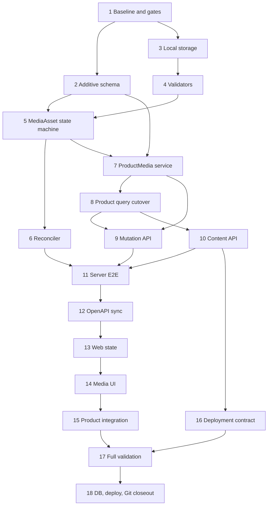

# 统一媒体资产与产品媒体实施任务

## 1. 文档状态

- 状态：Phase 4 实施中，Gate DEP 已确认，Task 1-9 已完成
- 编写日期：2026-08-13
- 实施分支：`feat/media-asset-product-media`
- Requirements：`specs/product-media/requirements.md`
- Design：`specs/product-media/design.md`
- Phase R：已于 2026-08-13 确认
- Phase D：已于 2026-08-13 确认
- Phase T：已于 2026-08-13 确认
- Phase 4 / Gate I：已于 2026-08-13 确认
- Gate DEP：已于 2026-08-13 确认精确依赖、系统依赖与安全限额；实际安装仍受 Gate OPS 约束
- 持久开发数据库、生产部署、push、PR 和 merge：均未授权

本计划把统一 MediaAsset 基础设施和首个 ProductMedia 领域切片拆为 18 个任务。任务顺序固定为：

```text
绿色基线与高风险门禁
-> additive Schema
-> storage/config
-> IMAGE/VIDEO/DOCUMENT validator
-> MediaAsset state machine
-> reconciler/reference safety
-> ProductMedia command
-> Product structured query cutover
-> upload/layout/detach API
-> private content API
-> Server E2E
-> OpenAPI sync
-> Web domain state
-> Web media UI
-> list/detail integration
-> deployment and recovery contracts
-> browser/full validation
-> optional persistent DB and Git closeout
```

## 2. 执行纪律

每个功能任务遵循同一 TDD 闭环：

```text
确认门禁、当前 HEAD 与任务边界
-> 添加只因目标能力缺失而失败的测试
-> 运行并记录预期 RED 命令、退出码和失败原因
-> 实现最小正确能力
-> 补齐并发、失败、安全与回归路径
-> 运行任务级 GREEN 验证
-> 更新 tasks.md 的勾选状态和真实证据
-> 检查 staged diff、secrets、generated 和 migration 边界
-> 创建绿色小步提交
```

执行规则：

1. RED 只能作为实施过程证据，不提交永久失败、不能 typecheck 或不能构建的状态。
2. 命令报错、测试失败、环境缺失和非阻断 warning 必须如实记录；未转绿不得勾选任务。
3. 只使用 `apply_patch` 编辑手写源码和文档；格式化或官方生成命令可机械更新产物。
4. 不手工修改 `server/openapi/openapi.json`、`web/openapi/openapi.json` 或 generated API types。
5. 不修改任何既有 migration；新 migration 必须 append-only，具备结构测试和隔离 PostgreSQL replay。
6. Additive Media Schema 与 Product API cutover 分开实施；过渡期不得双写 URL 与 ProductMedia。
7. Product 旧 URL 列只有在非空计数为零、Server/Web 已准备同批切换且门禁再次满足时才删除。
8. 不下载既有外部 URL、不清空非空旧字段、不创建占位 MediaAsset、不写业务演示数据。
9. `MediaAsset` 不保存 `ownerType/ownerId`；本期不创建 ProductMedia 以外的领域关联表。
10. ProductMedia 永远拒绝 DOCUMENT；Product Controller、DTO、Web 均不得出现 Product Document 分支。
11. MediaModule 不提供公共通用上传或资产库 Controller；Document 只通过内部 service contract 验证。
12. 首期只实现 Local storage driver，不创建 S3/MinIO 空实现或多驱动运行时选择器。
13. 大文件必须 streaming 到 staging；不得把完整图片、视频或 Document 读入 Node.js heap。
14. 原始文件名、objectKey、checksum、文件内容、路径、Token、Cookie、连接字符串和完整 Payload
    不得进入 Audit 或公开错误；日志只记录安全 requestId 和低基数元数据。
15. Product mutation 显式 `retry:false`；网络/`5xx` 后只读取对账，不自动重传文件或 mutation。
16. 不修改公共 Fa/Qs 组件业务契约；如证据证明必须修改，停止并重新确认，且保持公共组件业务中立。
17. Server/Web 维持独立依赖域；不在根目录安装依赖或创建根 lockfile/node_modules。
18. Prisma generate、Server build、OpenAPI sync/check 和 Web generated types 按顺序执行，避免并发改写。
19. 每个小步提交前运行任务级测试、`git diff --check`、暂存范围和敏感文件检查。
20. Commit Message 使用英文类型和中文描述；不 amend、rebase、force push 或改写历史。
21. tasks 中的命令是最低验证集；若真实改动扩大影响，必须增加相应回归，不得缩减验证掩盖失败。
22. 未经明确授权，不应用持久数据库 migration，不修改真实生产配置，不 push、PR、merge、部署、
    删除分支或清理用户 worktree。
23. Tasks 8–11 是一个不可发布的公共契约切换窗口：source、DTO、E2E 必须各自 GREEN，但 tracked
    OpenAPI 在 Task 12 前允许只因尚未生成而 `contract:check` 预期 RED；该 RED 必须记录且不得夹杂其他
    漂移。Task 12 必须紧随其后转绿，在此窗口内不得 push、PR、交付或开始 Web 实现。

## 3. 阶段与高风险门禁

### Gate R - Requirements

- [x] 统一 MediaAsset、仅 ProductMedia 领域关联、私有媒体、本地首期存储和未来显式领域扩展已确认。
- [x] MediaAsset 支持 IMAGE/VIDEO/DOCUMENT，ProductMedia 只支持 IMAGE/VIDEO 已确认。
- [x] 文件类型、限额、数量、保留期、权限、结构化响应、备份容量和 UI 合同已确认。

### Gate D - Design

- [x] MediaAsset/ProductMedia 模型、约束 Trigger、状态机、Local storage、X-Accel-Redirect 和 Range 已确认。
- [x] Product version 并发、PRODUCT_UPDATED 审计、API operations、Web 组件边界和迁移停止条件已确认。
- [x] 首期要求生产运行时提供受限 `ffprobe`，不转码、不抽帧已确认。

### Gate T - Phase 3 任务清单

- [x] 用户已于 2026-08-13 确认本任务顺序、TDD 纪律、提交序列、停止条件和需求追踪矩阵。

### Gate I - Phase 4 与高风险代码变更

- [x] 用户已于 2026-08-13 授权 Phase 4，并再次明确授权以下实际修改：
  - Prisma 新增 `MediaType`、`MediaAssetStatus`、`ProductMediaKind`、`MediaAsset`、`ProductMedia`、
    Product/User relations、约束 Trigger、索引和新 migration。
  - 新增真实权限 `product-media:read` 并授予已确认角色。
  - 新增 Product media upload/layout/detach/content/HEAD 公共 API，替换 Product 响应媒体结构。
  - 在零旧媒体数据门禁下删除 Product 的 `mainImage/images/videos` 列。
- [x] Gate T 与 Gate I 已分别确认；Task 1 仍严格保持只读审计和文档取证边界。

### Gate DEP - 第三方与系统依赖

- [x] Task 1 已确认当前直接/传递依赖和 Node.js 标准库能力，并在 4.1 节形成最小候选清单、精确版本、用途、
  许可证、维护状态、原生构建风险与 lockfile 影响。
- [x] 用户已于 2026-08-13 确认 4.1 节全部精确候选；Task 2 不需要也没有修改 package 或 lockfile。
- [x] `ffprobe` 是已确认的生产系统依赖；Task 1 已记录本地版本和 Ubuntu 24.04 获取证据。
- [x] `qpdf` 作为 PDF 受限结构/加密检查的系统依赖及 Ubuntu 24.04 精确版本策略已确认；
  实际安装仍须通过 Gate OPS。

### Gate DB - 持久开发数据库

- [ ] 所有 migration 必须先在一次性 PostgreSQL 完成空库 replay、当前基线升级、重复 deploy 和回滚演练。
- [ ] 应用前展示目标数据库、唯一待迁移集合、旧媒体只读计数、Product 行数、备份与恢复路径，
  再取得独立明确授权。
- [ ] 任一旧媒体计数非零、待迁移集合不精确、Schema drift、备份失败或恢复验证失败时停止。

### Gate OPS - 部署配置与生产文件系统

- [ ] 仓库内模板和验证脚本可以在 Gate I 后实施；写入真实 `/var/lib/qianshu-dms/media`、修改生产
  Nginx/systemd、安装系统包或重启生产服务必须取得独立授权。

### Gate E - 外部发布

- [ ] 本地完成后暂停；push、PR、merge、部署、分支删除和非本地环境变更均需新的明确授权。

## 4. 实施任务

- [x] 1. 建立 Phase 4 绿色基线并完成实施前只读审计
  - [x] 1.1 复核 branch、HEAD、工作树、三份规格和 Gate R/D/T/I，发现重叠用户修改时停止。
  - [x] 1.2 只读核对 Product Schema、Controller/DTO/mapper、`PRODUCT_UPDATED`、权限、Web 产品页面、
    `FaImageUpload/FaFileUpload`、Nginx/release 模板和健康检查现状。
  - [x] 1.3 对目标数据库仅执行只读查询，记录 Product 行数以及 `mainImage/images/videos` 非空计数和
    有限样例 ID；不输出完整 URL，不修改任何数据。
  - [x] 1.4 审计 Server 当前 direct/transitive dependencies、Node 24 能力、Multer 行为、图片/OOXML/PDF
    parser 候选和本地/CI `ffprobe` 可用性，形成 Gate DEP 精确候选。
  - [x] 1.5 运行 Product/Audit/Permission/OpenAPI、Web 产品视图和根治理的现有绿色基线。
  - [x] 1.6 记录基线 SHA、命令、退出码、测试数量、可变环境快照和停止条件；本任务只提交审计文档。
  - _Requirements: R1-R12_

### 4.1 Task 1 基线证据与 Gate DEP 候选

#### 仓库与现有合同

- 审计基线为分支 `feat/media-asset-product-media`、SHA
  `5c9220fc8c7c5b00dc2600dbdecceb4b79f216a2`；审计开始时工作树清洁，未发现重叠用户修改。
- Prisma `Product` 仍包含 `mainImage String?`、`images String[]`、`videos String[]`；仓库尚无
  `MediaAsset`、`ProductMedia`、媒体 migration 或媒体公共 API。
- Product Controller 现有 list/detail/create/update 合同和 `PRODUCT_UPDATED` 审计事件保持不变；Web
  list/detail/video 仍消费 URL 字符串。本任务未运行 `contract:sync`，`contract:check` 证明 tracked
  OpenAPI 和 generated types 无漂移。
- 当前真实产品权限为 `products:create/read/update`，均只授予 `system_admin`；尚无
  `product-media:read`。仓库有 release package 和 health 能力，但没有 Nginx/systemd 媒体模板。
- `FaImageUpload` 的业务模型是 `string[]` URL，`FaFileUpload` 的业务模型是上传 FileItem；二者可提供预览、
  进度和 custom request 原语，但不能持有 ProductMedia ID、主图、排序、version 或领域生命周期。因此继续
  采用业务层组合组件，不修改公共 Fa/Qs 契约。

#### 只读数据库与运行环境

- 目标为本机容器 `qianshu-dms-dev-postgres` / PostgreSQL 16。查询使用显式 read-only transaction；
  `product_count=2`、`main_image_count=0`、`images_count=0`、`videos_count=0`，因此没有样例 ID 可输出。
  零旧媒体前置条件当前满足，但删除旧列前必须再次查询，不能把本快照当成未来事实。
- 本机为 macOS arm64、Node.js `v24.16.0`、pnpm `11.9.0`；Server engine 为 `^24.15.0`。生产目标为
  Ubuntu 24.04 / glibc / x64 / Node.js 24，GitHub Actions 使用 `ubuntu-24.04`。
- 本机 `ffprobe` 为 `/opt/homebrew/bin/ffprobe`、`8.1.1`，具备 MP4/H.264/AAC 解析能力；其协议列表也
  包含网络协议，所以实现必须使用固定 argv、协议白名单/禁网络、无 shell、超时和输出上限。
- Ubuntu 24.04 `ffmpeg` 包当前为 `7:6.1.1-3ubuntu5` 并提供 `ffprobe`；现有 CI workflow 未安装它，
  runner 清单也未声明预装，因此后续必须在 CI/runtime 显式安装并记录 `ffprobe -version`。
- 本机没有 `qpdf`。Ubuntu 24.04 `noble-updates` 当前提供 `qpdf 11.9.0-1.1ubuntu0.1`；在 Gate DEP/OPS
  允许前不得安装。若获确认，CI/runtime 必须显式安装并记录版本，不能依赖 runner 偶然预装。

#### 当前依赖与精确候选

Server 当前没有媒体直接依赖；传递树已有 `multer@2.2.0 -> busboy@1.6.0`，以及
`@nestjs/common@11.1.28 -> file-type@21.3.4`。Multer 默认 memory storage 会把完整文件放入 heap，
不满足 500MiB 视频合同，因此产品媒体上传不使用默认 Multer buffering。

以下是等待 Gate DEP 确认的完整候选；未确认前不得改 package、lockfile 或安装系统包：

| 位置 | 精确候选 | 许可证 | 唯一用途与取舍 |
|---|---|---|---|
| runtime | `busboy@1.6.0` | MIT | 直接依赖流式 multipart 和 parser limits，不依赖 Nest 的传递实现细节 |
| dev | `@types/busboy@1.5.4` | MIT | 锁定 Busboy TypeScript 合同 |
| runtime | `file-type@21.3.4` | MIT | magic-byte hint；与当前 Nest 传递版本对齐，不能替代完整解析 |
| runtime | `sharp@0.35.3` | Apache-2.0 | 完整解码 JPEG/PNG/WebP 并读取可信尺寸；拒绝动画和解码错误 |
| runtime | `yauzl@3.4.0` | MIT | 异步读取 OOXML central directory/entry stream，限制内存和不安全路径 |
| dev | `@types/yauzl@3.4.0` | MIT | `yauzl` 本体不自带声明，锁定当前 3.4 API 类型 |
| system | Ubuntu `ffmpeg 7:6.1.1-3ubuntu5` | GPL/LGPL 组合 | 提供 `/usr/bin/ffprobe`；只探测 MP4/H.264/AAC，不转码 |
| system | Ubuntu `qpdf 11.9.0-1.1ubuntu0.1` | Apache-2.0 | 独立进程执行 PDF 结构、stream encoding 与加密检查，避免整文件进入 Node heap |

不引入 `pdfjs-dist`：本期不渲染、不提取文本，结构验证交给 `qpdf`，可减少 JS heap、DOM/worker
兼容和大体积依赖风险。`sharp` 带平台预构建可选包，预计 lockfile 会新增 macOS arm64 与 Linux x64
glibc 的 optional dependency 记录，并需把 `sharp: true` 加入 `server/pnpm-workspace.yaml` 的
`allowBuilds`；Gate DEP 后仍要用一次性目录做 frozen fresh install、Node 24 load、release archive 和
Ubuntu 24.04 smoke，实证不满足时立即停止，不放宽合同。

官方取证入口：
[Busboy](https://github.com/mscdex/busboy)、
[file-type](https://www.npmjs.com/package/file-type)、
[sharp install](https://sharp.pixelplumbing.com/install/)、
[yauzl](https://github.com/thejoshwolfe/yauzl)、
[@types/yauzl](https://www.npmjs.com/package/%40types/yauzl)、
[Ubuntu ffmpeg](https://packages.ubuntu.com/noble/ffmpeg)、
[Ubuntu qpdf](https://packages.ubuntu.com/noble-updates/qpdf)、
[qpdf inspection](https://qpdf.readthedocs.io/en/stable/cli.html#pdf-inspection)。

#### 等待一并确认的安全限额

这些是解析器的技术防滥用常量，不扩大业务类型或文件大小合同：

- multipart：`files=1`、`fields=2`、`parts=3`、`fieldNameSize=64B`、`fieldSize=4KiB`、
  `headerPairs=100`；binary `fileSize` 仍按 IMAGE 10MiB / VIDEO 500MiB，超限立即销毁流。
- IMAGE：`maxInputPixels=40_000_000`、单边不超过 `16_384`、只允许单帧；完整 decode 失败即拒绝。
- OOXML：最多 `2_000` entries、单 entry 展开不超过 `50MiB`、总展开不超过 `200MiB`、任一 entry
  或总压缩比不超过 `100:1`；拒绝 encrypted、path traversal、宏 content type 和外部可执行内容。
- `ffprobe`：15 秒 timeout、stdout/stderr 各 256KiB；`qpdf`：15 秒 timeout、stdout/stderr 各 64KiB；
  均使用绝对可执行路径、固定 argv、`shell:false`，stderr 只转内部低基数错误，不进入公开响应或 Audit。

#### 基线验证与异常记录

- Server 定向 Jest：exit `0`，30 suites / 267 tests 全部通过。
- Web 产品定向 Node tests：exit `0`，46 tests 全部通过。
- `node --run contract:check`：exit `0`；Prisma generate、Server build、临时 OpenAPI/Web API 生成成功，
  tracked 合同无漂移，生成目录均受既有 ignore 保护。
- `node --run test:root` 首次为 662/663：冻结的历史词汇 allowlist 检测到本任务文档一处无关表述。
  已删除该表述而未修改 allowlist；修正文档后复跑 exit `0`，663/663 全部通过。
- 一次本地 package manifest 读取命令因 shell quote 错误触发 Node `SyntaxError`；两次数据库查询分别因
  SQL label/separator quote 错误在 `BEGIN` 后解析失败；修正后使用拆分的 read-only 查询取得上述结果。
  `pnpm view`/`npm view` registry 查询无响应后以 Ctrl-C 结束（exit `130`），改查官方包/仓库资料。
  这些失败均未产生 package、lockfile、数据库或业务文件写入。
- 本任务没有修改源码、Schema、API、依赖或 lockfile，没有写数据库或真实媒体目录；下一步停在
  Gate DEP，Gate DB、Gate OPS、Gate E 仍未授权。

- [x] 2. 以 TDD 建立 additive MediaAsset/ProductMedia Schema 与权限
  - 前置：Gate I、Gate DEP 中与 Schema 测试有关的部分已通过。
  - [x] 2.1 先建立 Prisma/migration RED，精确锁定三个 enum、两张表、User/Product relations、具名
    CHECK/FK/index/partial unique、类型/主图/有效引用/deferred READY Trigger 和权限 seed。
  - [x] 2.2 RED 必须证明 DOCUMENT 无法进入 ProductMedia、READY 不能孤立提交、被引用 READY 不能转出。
  - [x] 2.3 新增 additive migration：保留 Product 三个旧 URL 列，不改旧列、不 seed MediaAsset。
  - [x] 2.4 新增稳定 `product-media:read` Permission ID、中文名称、资源 catalog 与真实角色授权自检。
  - [x] 2.5 用一次性 PostgreSQL 验证空库全量 replay、基线升级、重复 deploy、约束正反例和无业务数据 seed。
  - [x] 2.6 运行 Prisma validate/generate、Schema/Permission tests、Server typecheck/lint 和根治理。
  - [x] 2.7 更新证据并提交：`feat: 建立媒体资产数据结构`。
  - _Requirements: R1-R3, R6, R8, R11-R12_

### 4.2 Task 2 实施证据

- TDD RED：Server 静态 Schema/Permission 测试先因 `PRODUCT_MEDIA_PERMISSION_CODES` 和媒体结构缺失退出
  `1`；Web 权限目录为 42/43，唯一失败是缺少产品媒体资源。补齐基础结构后，又先增加具名 Trigger
  错误契约并确认 RED，再实现数据库约束；一处测试正则遗漏 SQL 双引号导致 3/4，修正测试读取规则后
  未放宽任何业务断言。
- 最小实现新增 `MediaType`、`MediaAssetStatus`、`ProductMediaKind`、`MediaAsset`、`ProductMedia` 和
  User/Product relations；migration `20260813120000_media_asset_product_media_schema` 建立具名 CHECK、
  Restrict FK、partial unique/index 与 deferred READY 引用 Trigger。`MediaAsset` 支持 IMAGE/VIDEO/DOCUMENT，
  `ProductMediaKind` 只有 IMAGE/VIDEO；旧 `mainImage/images/videos` 全部保留，migration 未 seed
  MediaAsset/ProductMedia。
- 权限使用稳定 ID `00000000-0000-4000-8000-000000000146`，code 为 `product-media:read`、名称为
  `读取产品媒体`，精确授予 `system_admin`；Server 权限常量、认证 E2E 固定契约与 Web 中文资源目录同步。
- 一次性 PostgreSQL 16 从空库按顺序应用 17 条 migration，第二次 deploy 无待应用项；媒体 E2E 覆盖
  DOCUMENT/类型不匹配、孤立 READY、引用状态退出、最后关联分离、内容身份不可变、排序/资产/主图唯一、
  VIDEO 主图和物理删除拒绝等正反例，最终目标套件 3/3 suites、21/21 tests 通过。另从前 16 条基线升级，
  升级前后 1 条 Product 及三个旧媒体字段的零计数保持不变，两张新表存在且零业务数据。
- 最终验证：Prisma validate/generate 通过；Server unit 157/157 suites、1553/1553 tests，typecheck/lint
  通过；隔离 `ci:server-e2e` 完整重放、重复 deploy、status 和 29/29 suites、169/169 tests 全部通过；
  Web 权限目录 43/43、typecheck/lint 通过；`contract:check` 无公共 API 漂移；根治理在同步第 17 条 migration
  基线后通过。
- 异常均如实保留：`prisma migrate diff --from-migrations` 因当前 Prisma 要求显式 shadow database URL
  退出 `1`；改用隔离实际 datasource 比对只显示两个实施前已存在且与媒体无关的差异（编号索引等价重建、
  `user_profiles.updated_at` 默认值），没有媒体差异，未越界修复。一次 Jest 命令多传 `--` 被当成 pattern，
  一次隔离测试遗漏 migration、一次从 `server/` 寻找根脚本均失败，均以正确命令复跑转绿。一次误在根目录
  调用 `pnpm exec` 产生受治理禁止的根 lockfile/node_modules，已立即通过预授权 `node --run cleanup:root`
  精确移除；没有删除其他文件。
- 本任务未修改依赖或 lockfile，未安装 `ffprobe/qpdf`，未创建真实媒体目录，未修改公共 API/OpenAPI，
  未删除 Product 旧列，未应用持久开发数据库 migration，未 push、PR、merge 或部署。

- [x] 3. 以 TDD 建立 Local storage 配置和安全文件操作
  - [x] 3.1 先建立 config/storage RED，覆盖绝对 root、禁用源码/release/tmp/root、realpath、symlink、
    同文件系统、权限、不可写、磁盘不足、path traversal 和 objectKey 规范化。
  - [x] 3.2 实现业务中立 `MediaStorage` 和唯一 `LocalMediaStorage`，使用随机 staging、受限权限、
    atomic rename、stat、trash、restore、purge；不得认识 Product。
  - [x] 3.3 使用测试临时目录验证 partial write、取消、目标冲突、磁盘/权限错误与可靠清理，不写真实媒体目录。
  - [x] 3.4 增加配置 DTO/示例和可测试健康结果，不记录 root 下的用户文件名或敏感环境值。
  - [x] 3.5 运行 storage/config tests、Server typecheck/lint、根配置安全测试和 diff-check。
  - [x] 3.6 更新证据并提交：`feat: 建立本地媒体存储`。
  - _Requirements: R2, R5, R11-R12_

### 4.3 Task 3 实施证据

- TDD 初始 RED：`media.config.spec.ts` 与 `local-media-storage.spec.ts` 因目标模块尚不存在退出 `1`；
  配置接入 RED 又以 6 个 `env.validation` 断言失败证明缺少媒体环境变量合同。安全补测分别证明运行期
  替换 staging symlink、非法 Range 未关闭 handle、宽松目录权限以及未知 storage namespace 会失败。
- 新增 `MEDIA_STORAGE_DRIVER`、`MEDIA_STORAGE_ROOT`、`MEDIA_STAGING_TTL_HOURS` 和
  `MEDIA_TRASH_RETENTION_DAYS` 的固定默认值、范围及脱敏校验；root 必须是非根绝对路径，真实 canonical
  路径必须位于源码、release 和系统临时目录之外。示例只写占位部署路径，不写真实环境或敏感值。
- `MediaStorage` 保持业务中立；唯一 `LocalMediaStorage` 只管理 `staging/assets/trash`，使用随机 staging key、
  streaming handle、`0750/0640` 受限权限、同设备 atomic rename，并实现 range open、stat、trash、restore
  和幂等 purge。每次操作都拒绝 traversal、非 canonical key、未知 namespace、symlink、设备漂移、宽松权限
  和不可信文件类型；公开异常与健康结果只包含固定低基数 code/message，不含路径或文件名。
- 文件系统测试全部使用 `mkdtemp` 一次性 sandbox 并可靠清理，覆盖 partial write/cancel、目标冲突、
  rename 失败保留 source、磁盘不足、不可写、跨设备、运行期 symlink 替换、Range handle 关闭和安全 purge；
  没有创建或写入真实 `/var/lib/qianshu-dms/media`。
- 最终定向验证为 4 suites / 81 tests，Server 全量为 159 suites / 1587 tests；`pnpm typecheck`、
  `pnpm lint`、`pnpm build`、`node --run contract:check` 和根治理 663/663 均 exit `0`。
- 一次并行运行 `typecheck` 与 `lint` 同时改写 Prisma generated 目录，分别出现缺失类型和 `ENOTEMPTY`；
  按共享生成目录串行约束重新执行 `pnpm prisma:generate` 后，全部命令已逐项复跑转绿。早期两个测试断言
  还分别受 macOS `/var -> /private/var` canonical 路径和数值字符串 canary 干扰，只修正测试取证方式，
  未放宽生产合同。
- 本任务未修改 Prisma Schema、migration、公共 API/OpenAPI、package 或 lockfile，未安装系统依赖，
  未连接持久数据库，未 push、PR、merge 或部署。

- [x] 4. 以 TDD 实现可信内容验证器
  - 前置：Gate DEP 已确认精确 package 和 lockfile 变化。
  - [x] 4.1 先为通用流式计数/SHA-256/上限和 extension/MIME/magic/parser 冲突建立 RED。
  - [x] 4.2 实现 IMAGE validator：JPEG/PNG/WebP、完整解码、width/height、10MiB，拒绝 SVG、损坏和伪装。
  - [x] 4.3 实现 VIDEO validator：MP4、H.264、AAC/无音轨、duration/dimensions、500MiB；`ffprobe`
    固定 argv、无 shell、禁网络、超时、输出上限和安全 stderr。
  - [x] 4.4 实现 DOCUMENT validator：PDF/DOCX/XLSX、50MiB、OOXML content types、entry/展开限制，
    拒绝宏、加密、zip bomb、脚本和伪装；不新增 HTTP 入口。
  - [x] 4.5 使用最小自有二进制 fixtures 和边界 fixtures；不得提交含敏感内容或不明版权的大文件。
  - [x] 4.6 运行 validator unit/integration、依赖安全/许可证检查、Server typecheck/lint 和 diff-check。
  - [x] 4.7 更新证据并提交：`feat: 实现媒体内容验证`。
  - _Requirements: R2, R4-R5, R11_

### 4.4 Task 4 实施证据

- 初始 TDD RED 为 5 suites / 0 tests：通用流式 guard、受限子进程、IMAGE、VIDEO、DOCUMENT 目标模块与
  `sharp` 直接依赖均尚不存在，Jest exit `1`。后续安全 RED 分别证明 OOXML 根关系、主 part 根元素、
  嵌套脚本及验证期间 staging 改写原本会通过；每项均以最小生产改动转绿。
- 精确新增 runtime `file-type@21.3.4`、`sharp@0.35.3`、`yauzl@3.4.0` 和 dev
  `@types/yauzl@3.4.0`；只在 pnpm `allowBuilds` 精确增加 `sharp: true`。`busboy/@types/busboy`
  留到真实 multipart Task 9，不提前引入。lockfile 同时锁定 macOS arm64 与 Linux x64 glibc 的
  sharp/libvips optional packages。
- 通用 guard 对 pipeline streaming 计算 bigint 字节数和 SHA-256，超限 chunk 不向 staging 下游转发；
  受限进程只接受绝对 executable、固定 argv、`shell:false`、closed stdin、最小 locale env、15 秒 timeout
  及 stdout/stderr byte cap，公开错误不含路径、命令参数或 stderr。
- IMAGE 只接受 JPEG/PNG/WebP 且 extension、声明 MIME、`file-type` magic 与 sharp parser 必须一致；
  `metadata + stats` 完整解码但不返回像素 Buffer，限制 10MiB、40M pixels、16,384 单边与单帧，返回
  浏览器 EXIF orientation 后的 width/height，不重编码原文件。
- VIDEO 只接受 MP4/H.264 `avc1`，且最多一个 AAC 音轨、不得有未知额外 stream；限制 500MiB，使用
  `ffprobe -protocol_whitelist file` 固定 JSON 字段取得可信 duration/dimensions/codec。本机编译产物通过
  `ffprobe 8.1.1` 真实 16x16 H.264/200ms smoke。
- DOCUMENT 只接受 PDF/DOCX/XLSX、50MiB。PDF 先验证 header/trailer 和危险 name，再以 qpdf 执行
  `--check`、`--show-encryption` 与受限 JSON object/attachment 扫描；Ubuntu 24.04 x64 容器以
  `qpdf 11.9.0` 实证 `--json=1` 参数兼容。OOXML 按 central directory lazy/streaming 逐 entry 验证 CRC，
  限制 2,000 entries、单 entry 50MiB、总展开 200MiB、100:1 ratio、受检 XML heap 4MiB；拒绝 encrypted、
  traversal、portable duplicate、special file、macro/embedded executable、external relationship、DTD/entity、
  script，以及错误 content type、根关系、主 part 根元素/namespace。
- 所有 parser 返回后复核 staging 的 `dev/inode/size/mtime/ctime`，验证期间替换或改写立即失败关闭。
  测试 ZIP/PDF/image/video 均为测试内生成的最小项目自有 fixture，全部位于 `mkdtemp` 并可靠清理，
  未提交二进制或大文件，未写真实媒体目录。
- fresh frozen install 与 Node 24 load 通过：`sharp 0.35.3/libvips 8.18.3`、`file-type` 与 `yauzl` 均可加载；
  许可证分别为 Apache-2.0、MIT、MIT，`@types/yauzl` 为 MIT。正式参数 `pnpm --filter ... --prod deploy`
  的进程已结束且临时发布目录由 `finally` 清理，但终端回传丢失，因此不把它计为发布产物加载成功证据；
  最初误用无 filter 的 `pnpm deploy --prod` 退出 `1` 并报告 `ERR_PNPM_NOTHING_TO_DEPLOY`，未留下产物。
- `pnpm audit --prod --audit-level high` exit `1`：10 vulnerabilities（1 low / 6 moderate / 3 high）。
  `pnpm why` 证明 high 为既有 Prisma/Nest Swagger 链的 `fast-uri/js-yaml`，没有路径经过本任务新增三项
  runtime parser；本任务未越界升级框架依赖，也未将该既有风险误报为通过。
- 最终定向验证 8 suites / 137 tests，Server 全量 164 suites / 1645 tests；`pnpm typecheck`、`pnpm lint`、
  `pnpm build`、`node --run contract:check` 均 exit `0`，根治理在精确更新 sharp allowlist 快照后
  663/663 通过。根治理首次为 662/663，仅因该精确安全配置尚未同步测试期望，未放宽治理规则。
- Ubuntu 容器首次 arm64 HTTP 更新源 502，HTTPS 又因基础镜像没有 CA bundle安全拒绝；改用生产目标
  `linux/amd64` 后索引成功，但安装完整 ffmpeg 依赖集合再次遇到若干官方 `.deb` 502，因此 Ubuntu ffprobe
  smoke 未完成。容器均使用 `--rm` 且已清理；qpdf x64 smoke 和本机 ffprobe 真实 smoke 均已通过，
  没有关闭 TLS、禁用签名或安装任何主机/生产系统包。
- 本任务未修改 Prisma Schema、migration、公共 API/OpenAPI 或数据库，未创建 Product Document 分支，
  未连接持久数据库，未 push、PR、merge 或部署。

- [x] 5. 以 TDD 实现 MediaAsset prepare/activate 状态机
  - [x] 5.1 先建立 persistence/service RED，覆盖 UPLOADING 可空元数据、24h expiry、可信元数据 finalize、
    READY 必需字段、条件状态迁移和内容身份不可变。
  - [x] 5.2 实现 streaming `prepare()`：staging 写入、hash/size、validator、可信 metadata、final rename；
    返回 PreparedMediaAsset 但保持不可见 UPLOADING。
  - [x] 5.3 实现调用方 transaction 内 `activate()`、失败收敛和幂等状态条件；不接收 owner 多态字段。
  - [x] 5.4 Product policy 固定 `allowedTypes=[IMAGE, VIDEO]`；DOCUMENT prepare contract 由内部测试真实覆盖。
  - [x] 5.5 覆盖每个 crash window、Audit/DB rollback 后 final 残留、重复调用和公开错误脱敏。
  - [x] 5.6 运行 state machine/storage/validator 回归、Server typecheck/lint 和 diff-check。
  - [x] 5.7 更新证据并提交：`feat: 实现媒体资产生命周期`。
  - _Requirements: R1-R5, R7-R8, R11_

### 4.5 Task 5 实施证据

- 初始 TDD RED 为 2 suites / 0 tests：`MediaAssetPersistence` 与 `MediaAssetService` 目标模块尚不存在，
  Jest exit `1`。随后同大小 staging 替换的安全测试真实 RED，证明仅比较 size 与文件 stat 无法把上传流
  checksum 绑定到 validator 实际读取内容；实现 validator 独立 streaming SHA-256 后转绿。
- `MediaAssetPersistence` 明确创建 UPLOADING 记录和 24 小时 expiry，尚未取得的内容元数据保持 null；
  `markPrepared()` 只在 `status=UPLOADING AND objectKey IS NULL` 时写服务端可信元数据，不切 READY。
  `activate(transaction, assetId)` 复用调用方 `Prisma.TransactionClient`，只允许完整 UPLOADING 条件更新，
  重复 READY 幂等，FAILED/TRASHED/PURGED/不存在均失败关闭；`failUploading()` 只允许 UPLOADING → FAILED。
- `prepare()` 顺序固定为创建数据库事实、流式 staging/size/SHA-256、受控本地验证源、magic/parser、独立
  validator checksum、条件元数据写、atomic rename、final stat 和 final streaming checksum 复核。只有上传摘要、
  validator 摘要与最终对象摘要三者一致才返回 PreparedMediaAsset，且返回时数据库仍为 UPLOADING。
- `LocalMediaStorage.withStagingValidationSource()` 只在 callback 生命周期提供经过 canonical realpath、设备号、
  文件类型和权限检查的 staging path；绝对路径不进入返回对象、数据库、日志或错误。canonical objectKey 只用
  Server UTC 年/月、MediaAsset UUID 和 parser canonical extension，原始文件名只保留去路径/控制字符且最多
  255 Unicode code points 的展示值。
- Product policy 固定为 `IMAGE/VIDEO`，DOCUMENT 不能进入 ProductMedia；集成测试使用真实 LocalMediaStorage、
  streaming、MediaContentValidator、atomic rename 和最终读取，分别真实覆盖 WebP 完整解码与内部 PDF prepare，
  persistence input 不包含 `productId/ownerType/ownerId`，本任务没有通用 Controller 或 Web 入口。
- crash-window 覆盖：初始 DB create 失败、staging 创建失败、上传中断、validator 拒绝、size/checksum 不一致、
  元数据条件竞争/写入失败、rename/stat/final checksum 失败，以及 final 成功后领域事务回滚。失败后只使用固定
  低基数 failureCode，拒绝任意运行时字符串；不删除或误标 READY 的 final 残留，留给 Task 6 reconciler。
- 最终定向验证为 8 suites / 97 tests；Server 全量为 167 suites / 1673 tests；`pnpm typecheck`、`pnpm lint`、
  `pnpm build`、`node --run contract:check` 与根治理 663/663 均 exit `0`。
- 一次并行执行 typecheck/lint 同时运行 Prisma generate，lint 报 `ENOTEMPTY`、typecheck 看到不完整 generated
  类型产生连带错误；单独恢复 `pnpm prisma:generate` 后全部严格串行转绿。首次全量命令误用
  `pnpm test -- --runInBand`，Jest 把参数当 pattern 并以 No tests found 退出 `1`；改为项目实际参数
  `pnpm test --runInBand` 后全量通过。Local validation callback 测试还因 macOS `/var → /private/var`
  canonical 映射首次失败，只修正测试比较 realpath，未放宽生产路径合同。
- 本任务未修改 Prisma Schema、migration、公共 API/OpenAPI、Web、依赖或数据库，未注册会访问真实生产路径的
  AppModule provider，未创建 Product Document 分支，未 push、PR、merge 或部署。

- [x] 6. 以 TDD 实现引用安全、回收和对账
  - [x] 6.1 先建立 `MediaAssetReferenceRepository` RED，本期只能显式查询有效 ProductMedia。
  - [x] 6.2 实现最后引用解除后的 TRASHED/7 天保留、保留期内 restore、到期后二次零引用检查和 PURGED。
  - [x] 6.3 实现 UPLOADING/FAILED 24h 清理、staging/final/trash/database 差异 dry run 和安全批次处理。
  - [x] 6.4 使用 `FOR UPDATE SKIP LOCKED`、状态条件更新和固定锁顺序验证重复 worker 不重复清理。
  - [x] 6.5 对 missing/size mismatch 只隔离告警，不自动伪造 READY、解除引用或删除数据库事实。
  - [x] 6.6 建立未来领域扩展 contract test，要求新增关联表时同步修改 reference repository 与 Trigger。
  - [x] 6.7 运行 reconciler/reference/storage tests、Server typecheck/lint 和 diff-check。
  - [x] 6.8 更新证据并提交：`feat: 增加媒体回收与对账`。
  - _Requirements: R1, R5, R8, R11-R12_

### 4.6 Task 6 实施证据

- 首批 TDD RED 为 5 suites：引用仓库、retention service、reconciliation persistence 尚不存在，Local storage
  缺少 inventory，且 corrective migration 缺失；Jest exit `1`。第二批 reconciler RED 同样因 service 不存在
  退出 `1`；时间预算 RED 精确证明合同尚未实现。实现后新增隔离候选继续处理测试，首次发现可变 exclusion
  数组改变已传入参数的观察值，改为边界快照后转绿，未放宽 SQL 或并发断言。
- `MediaAssetReferenceRepository` 本期只显式查询 `ProductMedia.mediaAssetId` 且 `detachedAt=null`；contract test
  从 Prisma Schema 识别全部带 `mediaAssetId/detachedAt` 的实际关联 model，并要求表集合与 repository 常量、
  数据库 active-reference Trigger 同步。没有 owner 多态字段、动态插件注册表或假设中的其他领域关联。
- `MediaAssetRetentionService` 固定调用合同为调用方先锁 Product、再锁 MediaAsset、再查全部引用；最后引用
  解除后验证 assets/trash 单一位置与可信 size，执行 atomic move 后用旧状态条件进入 TRASHED，保留期固定
  7 天。保留期内恢复先验证文件位置与 size、restore 后条件回到 READY，关联仍必须由调用方同一事务建立；
  到期边界、active reference、missing、size mismatch 和双位置均失败关闭。
- `MediaReconciliationPersistence` 每次在交互事务中使用 `FOR UPDATE SKIP LOCKED LIMIT 1` 领取候选；当前批次
  使用参数化 exclusion 使隔离行不阻塞后续候选。UPLOADING 先以固定 `MEDIA_ASSET_UPLOAD_EXPIRED` 收敛为
  FAILED，再条件转 PURGED；FAILED/TRASHED 同样使用旧状态条件。批次最大 100，默认时间预算 5 秒、最大
  60 秒，单候选文件失败不阻塞后续候选。
- 新增向前 migration `20260814120000_media_asset_reconciliation_constraints`，不改旧 migration、不写业务行：
  已物化资产 PURGED 后保留完整 objectKey/MIME/size/checksum；从未物化的超期上传只允许全部内容身份与类型
  元数据为 null，并要求 failureCode，拒绝部分或伪造元数据。隔离 PostgreSQL 16 从空库重放 18 条 migration、
  重复 deploy 和 status 成功；真实 E2E 覆盖两种 PURGED、部分元数据拒绝和两个连接 SKIP LOCKED 唯一领取。
- `MediaStorage.inventory()` 只接受 staging/assets/trash、受控 prefix、1–500 limit 与同 namespace cursor；Local
  driver 对目录和文件逐级检查 canonical realpath、设备、类型、权限和 symlink，按 key 稳定分页且不暴露绝对
  路径。dry run 分批比较 database/assets/trash/staging，只返回 matched 与 missing/sizeMismatch/duplicate/
  unexpected/orphan/unmappable 低基数计数，不返回 assetId、objectKey、filename 或 checksum，也不执行任何写入。
- 最终定向验证为 7 suites / 50 tests；Server 全量为 172 suites / 1697 tests；Prisma validate、typecheck、lint、
  build、`contract:check` 与根治理 663/663 均 exit `0`。隔离 Server E2E 首轮 29 suites 中媒体 suite 通过，
  仅既有 management suite 一次 `socket hang up`，结果为 28/29 suites、170/171 tests；按失败范围在全新隔离
  数据库定向复跑该 suite 为 8/8 tests、exit `0`，未修改业务实现或放宽测试。
- 本任务未修改公共 API/OpenAPI、Web、依赖或 lockfile，未应用持久开发数据库，未访问真实
  `/var/lib/qianshu-dms/media`，未注册 scheduler/AppModule provider，未实现 ProductMedia 命令或 Product
  Document，未 push、PR、merge 或部署。

- [x] 7. 以 TDD 实现 ProductMedia 领域命令
  - [x] 7.1 先建立 ProductMedia persistence/service RED，覆盖 Product `FOR UPDATE`、expectedVersion、
    20/5 上限、类型一致、重复关联、连续排序、唯一主图和软解除。
  - [x] 7.2 实现上传前快速版本检查和上传后最终事务复核；长上传不得持有 Product 锁。
  - [x] 7.3 最终事务内 activate MediaAsset、创建 ProductMedia、更新 Product version/actor/time、记录
    `PRODUCT_UPDATED changedFields=media`，Audit 失败整体回滚。
  - [x] 7.4 实现完整 layout 快照更新、无变化 no-op、主图只来自 images、解除主图后不自动替代。
  - [x] 7.5 覆盖同版本并发、排序交换、上传最终冲突、解除/清理竞态、Document 双重拒绝和安全错误映射。
  - [x] 7.6 运行 ProductMedia/Product/Audit tests、Server typecheck/lint 和 diff-check。
  - [x] 7.7 更新证据并提交：`feat: 实现产品媒体领域服务`。
  - _Requirements: R1-R3, R7-R8, R11_

### 4.7 Task 7 实施证据

- 初始 TDD RED 为 2 suites / 0 tests：`ProductMediaPersistence` 与 `ProductMediaService` 目标模块尚不存在，
  TypeScript 编译失败且 Jest exit `1`。最小实现后的首轮静态验证中 typecheck 通过，但 ESLint 真实发现
  4 个 unsafe mock/数组问题；收紧后又发现 1 个测试夹具允许非 Error Promise rejection，进一步限定为
  Error 后转绿，未关闭或放宽规则。最终把 command 规范化、固定错误映射和事务编排拆为独立文件。
- `readUploadPreflight()` 使用单条无锁参数化 SELECT 同时读取 Product version 和同类型有效关联数；只有早期
  version/20 张图片/5 个视频检查通过后才调用 streaming `prepare()`。文件准备期间不打开 Product 事务；最终
  事务仍以 timeout → Product `FOR UPDATE` → expectedVersion → active snapshot 的顺序重新验证版本、数量、
  连续排序和重复资产，冲突资产固定收敛为 `MEDIA_ASSET_DOMAIN_TRANSACTION_FAILED`，等待 reconciler 清理。
- 上传最终事务按 Product-first 锁序执行 MediaAsset activate、非主图 ProductMedia 创建、Product version/actor/time
  更新和 `PRODUCT_UPDATED` Audit。metadata 固定为 `changedFields=media`、productNo、前后状态/版本、action、
  productMediaId 和 mediaType，不包含 filename、objectKey、checksum、URL 或布局；Audit 失败时数据库整体回滚，
  已准备资产在事务外条件进入 FAILED。
- layout 要求无重复且精确覆盖当前全部有效 image/video ID；主图只能来自 imageIds。写入先将所有有效行移动到
  高于最终 `0..n-1` 的安全排序区并清空主图，再写回连续排序和唯一主图，因此真实 PostgreSQL 的 0/1 交换不
  触发 partial unique。完整顺序和主图都不变时直接返回当前快照，不更新 Product version 或重复写 Audit。
- 解除关联只写 detached actor/time，随后以完整剩余快照恢复连续排序；解除主图时 primary 变为 null，不自动
  选择替代图片。数据库 Audit 成功后才调用同事务 retention，减少 Audit 失败先移动物理文件的窗口；调用时仍
  保持 Product → MediaAsset 锁序，`TRASHED/ACTIVE_REFERENCE` 成功，其余隔离或状态竞态安全失败并整体回滚。
- Product Service 在 preflight 前只允许 IMAGE/VIDEO，合法 DOCUMENT 不能进入 MediaAsset prepare；既有数据库
  `ProductMediaKind`/type Trigger 同样拒绝 DOCUMENT。错误只依据固定生命周期码、约束名和 SQLSTATE 映射为
  413/415/422/409/503 或固定 INTERNAL_ERROR，不解析底层 message、路径、SQL 或文件内容。
- 专用一次性 PostgreSQL 16 runner 从空库重放 18 条 migration、重复 deploy 和 status 成功；真实 1 suite /
  2 tests 覆盖两个同版本上传只有一个提交、失败资产进入 FAILED、排序交换、唯一主图、layout no-op、解除主图、
  retention 和 Audit rollback。专用 suite 的首次共享 E2E 尝试自身通过，但不可删除 ProductMedia 历史行污染了
  后续假设空业务表的 suites，最终为 25/30 suites、155/173 tests；改为显式独占数据库门禁后，共享 E2E 在
  全新数据库为 29 passed / 1 skipped suites、171 passed / 2 skipped tests，未放宽任何业务或数据库约束。
- 最终定向验证为 2 suites / 19 tests；Server 全量为 174 suites / 1716 tests；Prisma validate、typecheck、
  lint、build、`contract:check`、`git diff --check` 和统一 `node --run check` 均 exit `0`，根治理 665/665 通过。
- 本任务未修改 Prisma Schema、migration、公共 API/OpenAPI、Products Controller/Module、Web、依赖或 lockfile，
  未应用持久开发数据库，未访问真实 `/var/lib/qianshu-dms/media`，未注册 scheduler/AppModule provider，未提供
  Product Document 分支，未 push、PR、merge 或部署。

- [x] 8. 以 TDD 切换 Product 查询到结构化媒体并删除旧列
  - 前置：Task 7 GREEN；旧媒体只读计数精确为零；Gate I 仍有效。
  - [x] 8.1 先建立 mapper/DTO/query RED，要求 `media.mainImage/images/videos` 稳定结构、顺序、空值和
    领域 contentUrl，且不泄露 MediaAsset ID/objectKey/checksum/storageDriver。
  - [x] 8.2 实现列表/详情批量加载 ProductMedia，避免 N+1；主图从 images 的 `isPrimary` 投影且仍保留在 images。
  - [x] 8.3 建立 cutover migration RED：非空旧媒体数据必须在 DROP 前 fail-closed；删除三列且不触碰其他 Product 字段。
  - [x] 8.4 原子更新 Prisma、Product select/mapper/DTO/tests 和所有 Server caller，移除新代码中的旧 URL 语义，
    不建立双写或兼容字段。
  - [x] 8.5 用隔离 PostgreSQL 覆盖空旧数据成功、三类非空数据分别停止、Product 行数不变量和回滚演练。
  - [x] 8.6 运行 Product query/schema tests、Prisma validate/generate、Server typecheck/lint 和 diff-check。
  - [x] 8.7 更新证据并提交：`refactor: 切换产品媒体数据结构`。
  - _Requirements: R3, R6, R9, R12_

### 4.8 Task 8 实施证据

- 持久开发库只读事务预检为 `product_count=2`、`main_image_count=0`、`images_count=0`、
  `videos_count=0`；未对持久开发库执行 migration 或任何写操作。
- RED 先由 4 suites 建立：缺失媒体 mapper、Product 查询仍返回旧 URL 字段、Controller 缺少结构化 DTO、
  Prisma 与 migration 尚未删除旧列；结果为 4 failed suites、3 failed / 6 passed tests。
- Product 列表与详情在同一事务中读取 Product 和有效 ProductMedia；列表对当前页全部 Product ID 只执行一次
  ProductMedia `IN` 查询。mapper 固定按 `sortOrder/id` 排序，主图仍保留于 images，并对非 READY、类型/metadata、
  重复布局和多个主图等持久化异常失败关闭；公开结构不选择或返回 MediaAsset ID、objectKey、checksum、storageDriver。
- cutover migration 先以 `ACCESS EXCLUSIVE` 锁定 Product，再精确检查三类旧字段；任一非空即以固定 `P0001`
  停止并保留抽样 Product ID，全部为空才在同一事务删除 `main_image/images/videos`，不读写其他 Product 字段。
- 隔离 PostgreSQL 为 1 suite / 1 test，通过三类非空分别停止、空数据成功、Product 名称/编号/version 不变量、
  恢复旧空列和再次 cutover 演练；独占 ProductMedia E2E 为 1 suite / 2 tests，共享 E2E 为 29 passed /
  2 skipped suites、171 passed / 3 skipped tests，19 条 migration 的 deploy、重复 deploy 和 status 均通过。
- 最终定向验证为 10 suites / 71 tests，Server 全量为 176 suites / 1725 tests；Prisma generate、typecheck、
  lint、build、根治理 667/667、`git diff --check` 均通过。`contract:check` 按 Task 8-11 窗口预期 RED；临时生成
  快照证明 paths 与全部非 Schema 契约不变，差异精确为新增 `ProductMediaDto`/`ProductMediaItemDto` 和修改
  `ProductListItemDto`，tracked OpenAPI 与 Web generated contract 留待 Task 12 同步。
- 本任务未实现上传/布局/解除关联或私有内容 API，未同步 OpenAPI/Web contract，未改 Web、依赖或 lockfile，
  未访问真实媒体根目录，未 push、PR、merge 或部署。

- [x] 9. 以 TDD 实现上传、布局和解除关联 API
  - [x] 9.1 先建立 DTO/Controller RED，锁定三个 operation、Session/RBAC/CSRF、private no-store、
    multipart 单文件、field allowlist、limit、expectedVersion 和 `retry:false` 合同。
  - [x] 9.2 实现 `POST /api/products/{productId}/media`，仅接受 IMAGE/VIDEO，流式接入 prepare/领域事务。
  - [x] 9.3 实现 `PUT /api/products/{productId}/media/layout`，要求完整无重复 imageIds/videoIds 快照。
  - [x] 9.4 实现 `DELETE /api/products/{productId}/media/{productMediaId}`，Body 只接受 expectedVersion。
  - [x] 9.5 覆盖 multipart malformed、超限早拒绝、413/415/422、409、404 anti-enumeration、权限、
    CSRF、强制改密、unknown fields 和日志脱敏。
  - [x] 9.6 运行 DTO/Controller/Module/API tests、Server typecheck/lint 和 diff-check。
  - [x] 9.7 更新证据并提交：`feat: 增加产品媒体维护接口`。
  - _Requirements: R3-R5, R7, R9, R11_

### 4.9 Task 9 实施证据

- TDD RED 分层锁定了 DTO/OpenAPI 错误状态、Busboy 流式 parser、Controller/HTTP adapter、
  Module/lazy storage 和 CSRF multipart 边界；初始目标文件缺失时多个 suite 按预期在编译阶段 RED。
  实现中又真实暴露 Busboy 在精确 limit 值时的截断语义、PassThrough error listener 时序、失败的
  lazy initialization Promise 缓存以及 OpenAPI preview DI metadata 问题；均先由测试复现再最小修正。
- Server 将 `busboy@1.6.0` 和 `@types/busboy@1.5.4` 锁定为直接依赖。parser 只允许
  `kind`/`expectedVersion` 两个字段和一个 `file`，小字段必须先于 file part；OpenAPI 显式
  记录该顺序。文件直接流入 MediaAsset，并延迟文件 EOF 到完整 multipart framing 验证后，
  因此尾部未知字段、第二文件或截断请求不会形成“HTTP 报错但领域已提交”。
- 新增三个经确认的 mutation：`POST /api/products/{productId}/media`、
  `PUT /api/products/{productId}/media/layout` 和
  `DELETE /api/products/{productId}/media/{productMediaId}`。全部要求 Session、`products:update`、
  CSRF、`expectedVersion`、private no-store 与 `retry:false`；上传只接受 IMAGE/VIDEO，Product Document 在
  parser/DTO/领域三层被拒绝。响应只返回最新 Product 和领域 ProductMedia，不泄露 MediaAsset ID、
  objectKey、checksum、storage driver 或绝对路径。
- 错误合同覆盖 `MEDIA_MULTIPART_INVALID`、`MEDIA_FILE_TOO_LARGE`、
  `MEDIA_TYPE_UNSUPPORTED`、`MEDIA_CONTENT_INVALID`、`PRODUCT_MEDIA_LIMIT_EXCEEDED`、
  `PRODUCT_STATE_CHANGED`、`PRODUCT_MEDIA_LAYOUT_CHANGED`、`PRODUCT_MEDIA_NOT_FOUND` 和
  `MEDIA_STORAGE_UNAVAILABLE`；API E2E 同时证明 anonymous、缺权限、强制改密、缺 CSRF、
  unknown fields、DOCUMENT 和超限都在领域提交前失败关闭。
- 新增业务中立 `MediaModule`，只导出 `MediaAssetService` 与 `MediaAssetRetentionService`；
  `LazyLocalMediaStorage` 保证 OpenAPI preview/应用启动不访问真实 media root，首个媒体操作才创建与
  验证 Local driver，并允许运维修复后重试失败的首次初始化。本任务没有新增通用上传
  Controller、ProductMedia 以外的领域关联或云存储空实现。
- 最终 Server unit 为 182/182 suites、1757/1757 tests；产品媒体 HTTP E2E 为 1 suite / 8 tests；
  隔离 PostgreSQL 16 完整重放 19 条 migration，重复 deploy/status 成功，共享 E2E 为 30 passed /
  2 skipped suites、179 passed / 3 skipped tests。Prisma validate、typecheck、lint、build、根治理 667/667 和
  `git diff --check` 均通过。
- `contract:check` 按 Task 8–11 公共契约窗口预期 exit `1`。临时生成快照证明只新增上述
  3 paths 和 6 个媒体 DTO、只修改 `ProductListItemDto`；已有 path 无任何变化，非 path/schema
  合同字节一致，也没有 GET/HEAD content 或 Product Document operation。tracked OpenAPI 与 Web generated
  仍留待 Task 12 同步。
- 异常如实保留：一次将 typecheck/test 并行触发 Prisma generate 目录竞态，改为串行后全绿；
  一次全量 Jest 在无断言失败时 exit `139`/`SIGSEGV`，同命令后续两次均完整通过；根治理首次
  666/667 发现新测试夹具含冻结历史词汇，删除无关夹具字段后转绿，未修改 allowlist。
  还有一次 multipart OpenAPI 属性顺序断言在明确流式顺序合同后按预期失败，收紧断言后 22/22 通过。
- 本任务未修改 Prisma Schema/migration，未写持久开发数据库或真实 media root，未实现 Task 10
  内容读取，未同步 OpenAPI/Web，未修改 Web，未 push、PR、merge 或部署。

- [x] 10. 以 TDD 实现私有内容 GET/HEAD 授权与内部转发
  - [x] 10.1 先建立内容 Controller RED，要求独立 `product-media:read`，不隐式要求 `products:read`。
  - [x] 10.2 实现 Product/ProductMedia/READY 关联验证和安全 404，禁止直接按 MediaAsset ID 下载。
  - [x] 10.3 返回可信 MIME、sanitized filename、private no-store、nosniff、opaque ETag、Accept-Ranges 和
    安全编码的 X-Accel-Redirect；GET/HEAD 权限一致，HEAD 无 body。
  - [x] 10.4 建立 Nginx 等价 header contract test，证明内部 location 不能由外部 URL 直接访问且无 path traversal。
  - [x] 10.5 覆盖有/无 `products:read` 的媒体角色、已解除/非 READY、条件请求、Range/HEAD 和 anti-enumeration。
  - [x] 10.6 运行 content/RBAC/security tests、Server typecheck/lint 和 diff-check。
  - [x] 10.7 更新证据并提交：`feat: 增加产品媒体私有访问`。
  - _Requirements: R5-R6, R8-R9, R11_

Task 10 evidence（2026-08-14）：

- TDD 首轮用内容 Service/Controller 契约测试锁定 `GET/HEAD
  /api/products/{productId}/media/{productMediaId}/content`、独立 `product-media:read`、无 Nest body、
  OpenAPI binary/header matrix 与防枚举错误；因生产模块和第五个 Controller 依赖尚不存在，2 个 suite 在编译期
  RED、0 tests。最小实现后 2 suites / 12 tests 转绿；复核再建立 `VIDEO + image/webp` 异常组合 RED，确认旧实现
  错误返回 200，随后把 ProductMedia kind、MediaAsset mediaType 与可信 MIME 三者绑定并转绿。
- 新增 `ProductMediaContentService`，只按 `productId + productMediaId + detachedAt IS NULL + MediaAsset READY`
  查询领域关联；缺失、解除、非 READY、DOCUMENT、kind/type/MIME 不一致、checksum 缺失或不安全 `objectKey`
  全部固定为 `PRODUCT_MEDIA_NOT_FOUND`。数据库异常固定为 `INTERNAL_ERROR`，查询与公开路由均不接受
  MediaAsset ID，也不注入或调用 `MediaStorage.open()`，Nest 进程不读取、不流式传输媒体文件。
- 200 响应只从受信元数据生成四种 MIME、ASCII inline filename、`Accept-Ranges: bytes`、`nosniff`、
  带命名空间二次摘要的 opaque ETag 与逐段编码的 `/_qianshu_internal_media/assets/...`；全局边界补充
  `private, no-store` 和 `X-Request-Id`。strong/weak/list/wildcard `If-None-Match` 命中后只返回无 body 304，
  不下发 `X-Accel-Redirect`；Range 不在应用层解析或改写，由内部代理负责字节区间与最终 HEAD 行为。显式
  HEAD 路由先于同路径 GET 注册，并有顺序断言防止 Express 的 GET fallback 抢先处理 HEAD。
- object key 复用 canonical `assets` namespace 校验，拒绝绝对路径、反斜杠、空 segment 和 `.`/`..`；HTTP
  E2E 证明内部 URI 不是 Nest 公开路由。真实 Nginx `location ... internal`、真实文件映射、生产打包与配置验收
  仍严格留在 Task 16，本任务没有伪造或提前落地生产 Nginx 配置。
- 最终内容 Service 为 11/11 tests；内容 Controller/OpenAPI 与同域回归合计 5 suites / 24 tests；Server 全量
  unit 为 184/184 suites、1770/1770 tests。内容与既有媒体共享 E2E 为 2/2 suites、15/15 tests，覆盖
  匿名、只有 `products:read`、只有 `product-media:read`、强制改密、统一 404、304、GET/HEAD、Range、
  非法 UUID 和内部 URI 直连拒绝。Prisma validate、typecheck、lint、build、根治理 667/667 与
  `git diff --check` 均通过。
- 额外运行全量 `pnpm test:e2e` 时因当前 shell 没有 `DATABASE_URL` 而 exit `1`：21 个 PostgreSQL suite
  缺少隔离数据库并产生后续共享状态失败；本任务没有绕过或写入本地数据库，Task 10 的无数据库定向/共享
  E2E 保持全绿，官方隔离 PostgreSQL 与文件系统全套验收仍由 Task 11 承担。
- `contract:check` 按 Task 8–11 公共契约窗口预期 exit `1`。一次性生成对比证明 tracked snapshot 仅缺少
  Task 8–10 的 4 个媒体 path、6 个媒体 DTO，并只更新 `ProductListItemDto`；无 path/schema 删除、无既有
  path 内容变化，其他顶层合同字节一致。Task 10 新增的 content path 只包含
  `products_get_media_content` 与 `products_head_media_content`，tracked OpenAPI/Web generated 继续留待
  Task 12 原子同步。
- 本任务未修改 Prisma Schema/migration、未写持久数据库或真实 media root、未修改 Web、未执行
  `contract:sync`、未实现 Task 11/16、未 push、PR、merge 或部署。

- [x] 11. 补齐 Server 隔离 PostgreSQL 与文件系统 E2E
  - [x] 11.1 建立一次性 PostgreSQL + 临时 Local root harness，启动前证明无 ProductMedia/MediaAsset seed。
  - [x] 11.2 覆盖图片上传、视频 metadata、Product Document 拒绝、排序、主图、解除、版本并发和 Audit 原子性。
  - [x] 11.3 覆盖上传中断、final rename 后 DB 失败、staging expiry、trash/restore/purge、仍被引用禁止清理。
  - [x] 11.4 覆盖 RBAC、CSRF、强制改密、GET/HEAD/Range header、404 anti-enumeration 和隐私字段。
  - [x] 11.5 覆盖 Migration 空库 replay、旧媒体三种非空停止、重复 deploy、Product 行数与权限授权不变量。
  - [x] 11.6 运行定向 E2E 与官方 `node --run ci:server-e2e`，可靠清理容器、临时文件和子进程。
  - [x] 11.7 更新证据；仅测试变更提交 `test: 补齐媒体资产服务端验收`，生产缺陷使用独立 `fix:` 提交。
  - _Requirements: R1-R9, R11-R12_

Task 11 evidence（2026-08-14）：

- `ci-postgres` 现在把本次私有 `0700` session 作为 `QIANSHU_CI_TEMP_ROOT` 传给 child，并仍在正常退出、
  child 失败和信号路径中统一清理容器、session 与子进程组。媒体夹具只接受系统临时目录内、非 symlink、
  权限无 group/other 位且带 CI session 标识的 canonical root；其内再创建独立 sandbox 与 `0750` Local
  media root。macOS `/var` 到 `/private/var` 的合法 canonical alias 已在真实运行中验证，未放宽 canonical
  containment、目录权限或 session 标识。
- `ProductMediaE2eHarness` 组合真实 `PrismaService`、`MediaAssetService`、`LocalMediaStorage`、
  `ProductMediaService`、Retention、Reference Repository 与 Reconciliation；图片执行真实 WebP decode，视频执行
  真实 MP4 identity/metadata 规则并只把外部 `ffprobe` 进程替换为确定性受控输出。suite 在创建 actor 前证明
  `MediaAsset=0`、`ProductMedia=0`，并证明 `product-media:read` 仍精确授权给 `system_admin`。
- 真实 lifecycle 专属 E2E 为 4/4 tests，数据库并发/Audit 专属 E2E 为 2/2 tests：真实 IMAGE/VIDEO 文件、
  H.264/AAC/duration/dimensions、完整排序与主图、同版本并发唯一成功、no-op layout、解除、Audit 成功/失败
  原子性均通过；上传 stream 中断会留下受控 FAILED 且无
  staging，final rename 后 Product version 竞争会留下可对账 FAILED 文件，过期 worker 能清除它和独立过期
  staging。真实文件还覆盖 active reference 禁止回收、trash、事务内 restore/re-reference、再次 trash 与 purge。
- Runtime HTTP 专属 E2E 为 3/3 tests：授权 multipart 图片写入真实 DB/文件并只返回公开快照；Product
  `DOCUMENT`、缺 CSRF、缺 `products:update` 与强制改密均在 DB/文件变化前拒绝。只有
  `product-media:read` 时 GET/HEAD/Range、opaque ETag/304、private no-store、nosniff 与内部转发 header
  通过；missing 与 detached 返回相同稳定 404，响应不泄露 object key、checksum、driver、detached 状态。
- Cutover 专属 E2E 为 1/1 test：逐一证明 legacy `main_image`、`images`、`videos` 非空时 fail-closed，全部清空
  后 migration 成功；Product 行保留、恢复演练和重复执行通过。专属 runner 还对空库连续执行两次
  `migrate deploy` 与 `migrate status`，证明 19 migrations 可从零重放且二次 deploy 无 pending migration。
- 官方 `node --run ci:server-e2e` 已串联公共 E2E、媒体服务、Runtime HTTP 与 cutover。首次运行在既有
  `dictionary-management-api.e2e-spec.ts` 出现一次 Node HTTP parser `Parse Error: Expected HTTP/`，公共阶段按
  设计 fail-closed，媒体阶段未启动；精确重跑未复现且未修改该领域代码。最终公共 E2E 为 31 passed suites、
  186 passed tests（另 4 suites / 10 tests 按独占门禁 skip），随后 lifecycle 4/4、并发/Audit 2/2、HTTP
  3/3、cutover 1/1 全绿。
- Server `prisma:validate`、typecheck、lint、build 均通过；unit 为 184/184 suites、1770/1770 tests，根治理为
  667/667 tests，`git diff --check` 通过。一次验证命令误写成 `pnpm -C server test -- --runInBand`，Jest 把
  flag 当 pattern 并报告 `No tests found`；已用正确的 `pnpm -C server test --runInBand` 完整重跑并转绿。
- `contract:check` 按 Task 8–11 窗口预期 exit `1`。临时生成的结构化对比再次证明 tracked Server/Web snapshot
  字节一致，generated 只新增 4 个媒体 paths、6 个媒体 DTO，并只变更 `ProductListItemDto`；无 path/schema
  删除、无既有 path 变化、其他顶层合同完全一致，Task 12 前没有执行 `contract:sync`。
- 本任务没有发现或修改生产业务缺陷，没有修改公共 API、Prisma Schema/migration、Web、真实数据库或真实
  media root；未执行 push、PR、merge 或部署。全部变更均为测试夹具、CI 验收编排与本证据，使用单一
  `test: 补齐媒体资产服务端验收` 提交。

- [x] 12. 同步 OpenAPI 与 Web generated contract
  - [x] 12.1 先运行 `node --run contract:check`，记录 tracked snapshot 缺少新 operations/DTO 的预期 RED。
  - [x] 12.2 串行运行根 `node --run contract:sync`，不得手工编辑 snapshot 或 generated types。
  - [x] 12.3 核对 diff 只包含已确认的结构化 Product media、POST/PUT/DELETE/GET/HEAD、multipart 和错误合同。
  - [x] 12.4 证明 Server/Web OpenAPI snapshot 字节一致，旧 Product URL 字段和未授权 Document API 均不存在。
  - [x] 12.5 运行 `contract:check`、`ci:contract`、Server build、Web typecheck 和 diff-check。
  - [x] 12.6 更新证据并提交：`chore: 同步产品媒体接口契约`。
  - _Requirements: R6-R7, R9, R11_

Task 12 evidence（2026-08-14）：

- 首轮 `node --run contract:check` 按预期 exit `1`，证明 tracked snapshot 尚未包含 Task 8–10 已确认的媒体
  operations/DTO。首次 `contract:sync` 继续 fail-closed，定位到根契约校验器尚不认识已确认的 `retry:false`、
  上传 `413/415` 与 HEAD 无 body 契约；没有修改 Controller/DTO 绕过失败。
- 按 TDD 先增加可选 `retry` 必须为 boolean、`413/415` error metadata 和 HEAD 禁止声明 content 的测试，
  首轮新增场景 3 项 RED；最小更新 `openapi-contract` 后专属测试 165/165、根治理 671/671 转绿。该变更只让
  仓库契约校验器识别已经确认的公共合同，没有放宽其他 method、成功响应或错误 envelope 规则。
- 第二次串行 `node --run contract:sync` 成功；Server/Web snapshot 和 Web generated types 均由正式生成器原子
  发布，未手工编辑。两份 snapshot 字节一致，SHA-256 均为
  `c15b69a1da8c6a3ec78108fb0339de7157dd232c1737a7efef01d231ea34ba8a`；generated 目录仍精确包含唯一
  非空 regular file `types.gen.ts`。
- 相对同步前基线精确新增 4 个 path：媒体集合、layout、单项解除和内容路由；新增 6 个
  `ProductMedia*Dto`，只变更既有 `ProductListItemDto`。无 path/schema 删除、无既有 path 内容变化；POST 保持
  multipart，PUT/DELETE 保持 JSON，GET binary、HEAD 无 body，错误 matrix 与 `retry:false` 均通过结构化核对。
  Product 旧顶层 `mainImage/images/videos` URL 字段和 Product Document API 均不存在，ProductMedia 只允许
  IMAGE/VIDEO。
- Web typecheck 首次暴露 5 个旧 URL 消费点后，获得确认提前完成 Task 13.6。Web TDD 先以结构化 fixture、stable
  media ID、领域 `contentUrl` 和拒绝外部 URL 建立 3 项 RED，再更新列表/详情 adapter、ImageGroup 与视频弹窗；
  定向 19/19、Web 全量 785/785 tests 转绿。页面只接受与当前 product/media ID 精确匹配的受保护同源内容路由，
  未增加临时顶层 URL 兼容字段、上传队列或 ProductMediaPanel。
- 最终 `contract:check`、Server build、Web typecheck、ESLint、Stylelint、Web build 和 `git diff --check` 均通过；
  Web build 只有既有第三方 Rolldown annotation 与 chunk-size warning，exit `0`。直接本地运行 `ci:contract`
  因缺少 GitHub event 环境按设计 exit `1`；使用当前 HEAD 作为精确 base 的受控 `pull_request` 事件环境执行同一
  `ci:contract` 已通过，没有关闭或绕过 baseline 门禁。
- 本任务未修改 Prisma Schema/migration、Controller、DTO 或真实 media root，未实现 Task 13 其余状态机、Task 14
  上传维护界面或 Task 16 部署模板，未写数据库，未 push、PR、merge 或部署。

- [x] 13. 以 TDD 建立 Web ProductMedia API 与纯状态逻辑
  - [x] 13.1 先建立 API adapter RED，覆盖 generated DTO、multipart progress/Abort、layout/detach、contentUrl 和 retry:false。
  - [x] 13.2 建立纯逻辑 RED，覆盖 20/5 上限、允许格式、Document 立即拒绝、stable ID、主图、连续排序和完整 layout。
  - [x] 13.3 实现上传队列状态、真实 bytes progress、取消、finalizing、显式 retry 和单项安全错误。
  - [x] 13.4 实现 dirty snapshot、conflict、reconciling/unknown；网络/5xx 只 GET 最新 Product，不自动重放。
  - [x] 13.5 身份/权限变化必须 Abort 并清除跨用户文件引用、Object URL、snapshot 和错误；Object URL 及时 revoke。
  - [x] 13.6 更新产品列表/详情 adapter 消费结构化 media，删除 URL 字段映射和仅 HTTP(S) URL 的旧视频逻辑。
  - [x] 13.7 运行 Web API/logic/adapter tests、typecheck、ESLint 和 diff-check。
  - [x] 13.8 更新证据并提交：`feat: 建立产品媒体前端状态`。
  - _Requirements: R3-R4, R6-R7, R9-R11_

Task 13 evidence（2026-08-14）：

- API adapter 先建立 3 项契约测试，因 `product-media` 模块不存在而 RED。最小实现后固定 multipart
  `kind -> expectedVersion -> file` 顺序，不手工写 boundary；上传透传 Axios 真实 progress callback 与
  `AbortSignal`，layout 使用 PUT、detach 使用带 JSON body 的 DELETE，三类 mutation 均使用 generated DTO、
  保留完整 `AxiosResponse`、局部呈错并显式 `retry:false`。领域 `contentUrl` 只接受与当前 Product ID 和
  ProductMedia stable ID 精确匹配的同源路由，外部或错配 URL 返回 `null`。
- API 3/3 首次转绿后，与产品列表逻辑合并运行暴露 Node 测试不解析 `@/api` 运行时别名；没有跳过该回归，
  改为现有纯逻辑使用的相对导入后 API/列表合计 8/8 转绿。Task 12 的列表 helper 迁入领域 API 单一真相源，
  列表继续重导出原函数，不保留重复 URL 校验实现。
- 文件/状态 RED 先以两个不存在的纯逻辑模块确认失败。实现后客户端只接受 MIME 与扩展名同时匹配的
  JPEG/PNG/WebP/MP4，分别执行 10MiB/500MiB 与当前媒体加保留队列的 20/5 上限；PDF/DOCX/XLSX 在选择阶段
  固定返回“产品媒体仅支持图片和视频”，不进入队列，Server 校验仍是最终真相源。
- 上传队列只保存 stable ID 和安全展示元数据，真实 `File`、Object URL 与 `AbortController` 由当前身份资源
  注册表独占。progress 只消费实际 loaded bytes，进入 finalizing 不伪造 100%；只有明确失败项可由用户显式
  retry，conflict/reconciling/unknown 均禁止自动重传。成功或取消单项立即 Abort、revoke 并移除 File 引用；
  authEpoch、用户或权限边界统一中止全部请求并清空 File、Object URL、Product、layout snapshot、queue 和错误，
  重复清理保持幂等。
- layout snapshot 对图片/视频 stable ID、类型、从零连续 sortOrder、唯一主图和 mainImage 投影失败关闭；本地
  reorder/primary 使用不可变完整 ID 数组，一次构造原子 layout request。dirty、saving、conflict 保留本地意图；
  network/5xx 只进入 reconciling 并 GET 最新 Product。layout 只在 `version+1` 且完整顺序/主图匹配时成功收敛，
  detach 只在 `version+1` 且目标消失时收敛，upload 只在唯一新关联同时匹配 kind、原文件名和 sizeBytes 时收敛；
  其他结果进入 unknown，状态对象不提供自动 replay 动作。
- 队列集合补充测试先因业务入口缺少 append/update/snapshot exports 而 RED；最小实现后成功响应会更新最新
  Product version/media 并移除对应队列项，dirty 布局禁止被响应静默覆盖。所有响应还必须同时通过 Abort、
  `products:update` 调用方权限、authEpoch 与 requestVersion 门禁。最终 ProductMedia 纯状态/资源为 12/12，
  ProductMedia API 为 3/3，Web 全量为 800/800 tests。
- 首轮静态验证如实发现 1 个 readonly generated DTO 类型问题和 3 个 import order lint 问题；保持运行时深冻结并
  精确桥接 generated Array 类型、手工调整导入后，Web typecheck、ESLint、Stylelint、production build、
  `contract:check`、根治理 671/671 与 `git diff --check` 均通过。build 仅有既有第三方 Rolldown annotation、
  chunk-size 和 plugin timing warning，字体验收为 565 files、450 text artifacts、108 font assets，exit `0`。
- 根治理首次运行因两个新测试 fixture 直接写出已退役的英文服务商字段而为 670/671；没有扩充供应商残留冻结
  允许集合，而是用计算键补齐 generated DTO 的历史响应位，使全部 Task 13 新文件不再引入该术语。精确残留扫描
  为零，相关测试、lint 和根治理随后全部转绿。
- 本任务未修改 Server、OpenAPI snapshot、Prisma Schema/migration、数据库、共享组件公共契约或页面 UI；没有
  实现 Task 14 ProductMediaPanel、拖拽/键盘/可访问性界面或 Task 15 编辑页接入，未 push、PR、merge 或部署。

- [x] 14. 以 TDD 实现 ProductMediaPanel 与上传维护体验
  - [x] 14.1 先建立 View RED，固定只读/可维护权限、Image/Video board、Upload queue、rules、错误和 dirty 状态。
  - [x] 14.2 实现桌面 7/5、图片 3–4 列、窄屏 1–2 列/单列，无横向滚动；只消费既有 semantic tokens。
  - [x] 14.3 图片支持预览、主图、拖拽增强、键盘前移/后移和解除；视频支持预览/排序/解除且无主图操作。
  - [x] 14.4 上传 input 有可见 label，dropzone 非唯一入口；队列暴露 progress、取消、失败、显式 retry 和 live region。
  - [x] 14.5 实现 dirty 离开确认、冲突对照、首错聚焦、焦点恢复、44px 触控、Dark 和 Reduced Motion。
  - [x] 14.6 复用/组合 Fa 上传 primitive；若必须改变公共契约，停止并请求新确认，不把 Product 规则下沉。
  - [x] 14.7 运行 View/accessibility tests、Web typecheck、ESLint、Stylelint、build 和 diff-check。
  - [x] 14.8 更新证据并提交：`feat: 实现产品媒体维护界面`。
  - _Requirements: R3-R4, R7, R9-R10_

Task 14 evidence（2026-08-14）：

- View/accessibility 合同先新增 7 项测试，首次因展示辅助模块不存在而稳定 RED；最小实现后固定
  `ProductMediaPanel`、Image/Video board、Upload queue、rules、权限、错误、dirty、布局和无障碍边界，定向
  7/7、Web 全量 807/807 tests 转绿。测试同时禁止硬编码颜色、gradient 和横向滚动，并证明产品媒体规则没有
  PDF/DOCX/XLSX、说明书或证书入口。
- `ProductMediaPanel` 按桌面约 7/5 非对称布局组合媒体画布与窄侧栏，图片网格从单列、窄屏双列到桌面 3–4 列；
  全部界面只使用现有 semantic tokens、Noto 类型类和 Fa/Lucide 图标。图片按真实比例 `object-contain` 展示，
  支持文本化主图状态、预览、键盘前移/后移和同 board 拖拽增强；视频保留原生 keyboard controls，支持预览、
  排序和解除且不存在主图动作。外部拖放的非本 board stable ID 失败关闭。
- 上传区域保留与原生 input 关联的可见 label 和独立“浏览本机文件”按钮，并组合 `FaFileUpload` 的拖放、粘贴与
  选择能力；`beforeUpload` 只把 File 交给 Product 领域队列并返回 false，共享组件不会自行发出缺少 Product
  version 的请求。上传按队列串行执行，进度只来自 Axios `loaded` bytes；取消在途上传后先 Abort/revoke，再 GET
  对账，不把取消误报成确定失败。明确失败才显示显式 retry，conflict/reconciling/unknown 均不自动重放。
- 布局变更保留完整本地 draft，并通过一次原子 layout mutation 保存；冲突或未知结果展示本地/最新布局对照，
  只有用户明确选择才采用最新状态或基于最新版本恢复本地布局。解除操作显示文件名和媒体类型确认；成功后焦点
  回到相邻卡片或上传入口。上传选择/服务端错误聚焦关联标题的队列项，状态通过 polite live region 通知；主要
  操作为 44px，Dark 使用 semantic tokens，动画遵守 Reduced Motion。
- 面板副作用拆为布局/解除主控制器和独立上传控制器；File、Object URL、AbortController、authEpoch、request
  version 与权限边界集中管理。身份或维护权限变化会 Abort/revoke 并清空跨用户队列、错误和本地快照；受保护
  `contentUrl` 只在 `contentReadable` 为 true 且精确匹配 Product/ProductMedia stable ID 时交给 DOM。
- 首轮静态校验如实发现 `FaBadge` 公共契约不适合作为普通状态标签、脚本事件命名和媒体查询语法问题，改用既有
  `FaTag` 并按项目规则修正；生产 build 首次又发现外部拖放 `sourceId` 可能为 undefined，补充字符串与 board
  归属收窄后复跑通过。最终 Web typecheck、ESLint、Stylelint、production build、`contract:check`、根治理
  671/671 与 `git diff --check` 均通过；build 仅有既有第三方 Rolldown annotation、chunk-size 和 plugin timing
  warning，字体验收为 599 files、484 text artifacts、108 font assets，exit `0`。
- 本任务未修改 Server、OpenAPI、数据库 Schema/migration、共享组件公共契约或依赖；没有接入产品编辑页、路由
  和最终 RBAC 组合，这些仍属于 Task 15。未写数据库，未 push、PR、merge 或部署。

- [x] 15. 接入产品编辑、列表和详情并完成 Web 回归
  - [x] 15.1 产品编辑页接入 ProductMediaPanel，共享 Product version，但基础表单提交和媒体上传状态机保持独立。
  - [x] 15.2 `products:update` 控制维护；`product-media:read` 控制内容；缺少内容权限时显示稳定无泄露占位。
  - [x] 15.3 产品列表继续使用 ImageGroup 和视频弹窗，改用结构化 item/contentUrl，保持分页/search/filter 不回归。
  - [x] 15.4 产品详情 Drawer 展示结构化媒体和安全错误，不恢复 URL 文本或 Product Document。
  - [x] 15.5 覆盖上传后 Product version 刷新、基础编辑冲突、路由离开、auth epoch、迟到响应和创建流程回归。
  - [x] 15.6 运行产品全套 Web tests、`test:api`、typecheck、lint、build 和 diff-check。
  - [x] 15.7 更新证据并提交：`feat: 接入产品媒体业务流程`。
  - _Requirements: R6-R7, R9-R10_

Task 15 evidence（2026-08-14）：

- 先扩展产品 View/logic 合同，目标集首次 29 项中 24 项通过、5 项稳定 RED，分别锁定编辑页接入、列表内容权限、
  详情/视频失败关闭、创建说明和只读媒体辅助逻辑；最小实现后目标集 29/29、产品域完整测试 71/71、Web 全量
  `test:api` 810/810 转绿。
- 编辑页直接组合 `ProductMediaPanel`，`products:update` 只决定媒体维护，`product-media:read` 独立决定内容读取，
  `authEpoch` 直接来自当前账户身份域。媒体 mutation 返回的新 Product 只更新共享 snapshot/version，不重建
  `formModel`，因此未保存的基础字段不会被上传、布局或解除响应覆盖；基础 PATCH 成功也立即回写最新 Product，
  后续媒体请求继续使用最新版本。两套状态机继续各自处理提交、上传、冲突、unknown 和离开保护。
- 列表桌面与移动视图继续复用 `ImageGroup` 和视频弹窗，分页、search、供应商筛选与详情请求编排未改变；
  图片辅助逻辑新增显式 `contentReadable` 参数并默认由调用方失败关闭。缺少 `product-media:read` 时，列表、详情
  Drawer 和视频弹窗只渲染带 shield icon 的稳定占位，不调用内容 URL resolver、不创建 ``、`<video>` 或
  外链。详情仍使用结构化 media，不恢复 URL 文本或 Product Document。
- 创建流程仍不接受媒体文件；共享表单只在 create 模式提示“创建后进入编辑页维护媒体”，edit 模式由真实
  `ProductMediaPanel` 取代旧延期说明。既有产品冲突、路由离开、auth epoch、迟到响应、上传 version 和创建
  unknown 回归均包含在 71 项产品域测试中。
- Web typecheck、ESLint、Stylelint、production build、`contract:check`、根治理 671/671、`git diff --check`
  与视觉规则扫描全部通过；build 仅有既有第三方 Rolldown annotation、chunk-size 和 plugin timing warning，
  字体验收为 599 files、484 text artifacts、108 font assets。首次视觉扫描把 TypeScript `interface` 误判为字体
  `Inter` 并以 `1` 退出，修正为单词边界后复跑无命中。
- 补充任务证据后的首次根治理复跑为 670/671，原因是证据文字新引入退役英文服务商术语；未扩充残留冻结
  允许集合，改用当前中文术语后再次复跑 671/671。
- 本任务未修改 Server、OpenAPI、数据库 Schema/migration、共享组件公共契约、路由或依赖；未写数据库，未执行
  Browser/真实文件验收（仍属 Task 17），未 push、PR、merge 或部署。

- [x] 16. 建立部署模板、健康检查、容量与恢复 dry run
  - 前置：Gate OPS 只授权仓库内模板；不得修改真实主机。
  - [x] 16.1 根据仓库真实部署结构新增/更新 Local root、Nginx internal location、body limit、Range、运行用户/组、
    systemd Environment 与 `ffprobe` preflight 模板；不提交 `.env`。
  - [x] 16.2 健康检查区分 read/write/video validator，磁盘 critical 时写失败关闭、已有媒体读取继续。
  - [x] 16.3 增加容量、staging age、FAILED、reconciliation mismatch、上传失败率和清理结果的低基数指标/告警合同。
  - [x] 16.4 实现只读 reconciliation/backup-restore validation dry run，校验 DB 引用、文件存在、size/checksum，
    不删除、不修复、不输出敏感文件名。
  - [x] 16.5 文档明确 30GB minimum/50GB recommended、离机备份、同一恢复点、恢复顺序和生产授权边界。
  - [x] 16.6 运行 release/package/config/security tests、shell/script tests、Server checks 和 diff-check。
  - [x] 16.7 更新证据并提交：`ops: 增加媒体存储部署合同`。
  - _Requirements: R5-R6, R8, R11-R12_

### 4.16 Task 16 实施证据

- TDD 初始 RED 同时证明四个缺口：`media-operational-health` 尚不存在而报 `TS2307`；9% 可用空间仍可
  创建 staging；`ReconciliationAssetRecord` 尚无 checksum 而报 `TS2353`；部署模板、监控合同和恢复
  runbook 均不存在。实现后定向 5 suites / 46 tests 全部通过。
- Server release 新增 `deploy/environment`、`deploy/nginx`、`deploy/systemd` 与 `deploy/monitoring`，并由
  `package.json files` 精确纳入归档。Nginx 保持 internal alias、单 Range、501MiB multipart 边界和
  request buffering 关闭；systemd 固定受限 User/Group、`UMask=0027`、release 只读、媒体 root 单独可写，
  `ExecStartPre` 调用同一媒体 preflight。模板没有 Secret，也不会被 release pipeline 自动安装。
- 独立媒体 health 命令不修改公开 `/api/health` 或 OpenAPI，固定区分 read、write、video validator。
  容量 warning/critical 分别为 20%/10%；Local storage 在低于 10% 时拒绝新 staging，而已打开的 assets
  读取仍成功。编译后命令使用 canonical 一次性 root 与本机 `ffprobe 8.1.1` smoke，三项 capability 均 up；
  首次使用 macOS `/tmp` alias 被 canonical 检查按预期拒绝，改用 `/private/tmp` 后 exit `0`，未放宽规则。
- `media-observability.json` 固定容量、staging age、FAILED、reconciliation mismatch、上传失败率和清理
  结果的 metric/type/Label/alert 合同，禁止 assetId、productId、objectKey、filename、requestId 等高基数
  Label。health CLI 实际输出 capability/capacity，恢复 CLI 实际输出各类 mismatch；其他运行采集器只能按
  该固定合同接入，不能自行扩张 Label。
- 现有 reconciliation dry run 增加数据库 `checksumSha256` 只读投影，并以受控 no-follow FileHandle 对
  READY/TRASHED 文件流式计算 SHA-256；读前后复核 inode/size/time，结果仍只含低基数计数。新增
  `media:recovery:dry-run` 在恢复数据库与 `assets/trash` 后校验 DB 引用、location、存在性、size/checksum，
  任一 mismatch 或未完成均非零退出；代码路径没有 purge、repair 或数据库 mutation。
- 运维文档明确目标卷最低 30GB、建议 50GB、加密离机备份、数据库与媒体同一恢复点、固定恢复顺序、
  staging 非业务备份、只读 dry run 和生产授权/回退边界。仓库验证没有创建真实 `/var/lib`、修改 `/etc`、
  安装系统包、重启服务、运行恢复或写数据库。
- 最终 Server 全量为 186/186 suites、1779/1779 tests；typecheck、lint、build、`contract:check` 和
  `git diff --check` 通过；release/package/package-boundary 加媒体合同定向 89/89、根脚本 675/675 通过。真实
  `pnpm deploy --prod` 只在受限一次性目录验证四个模板进入产物，268 个 production packages 全部复用本地
  store，随后可靠清理。
- 失败均如实保留并修正：一次全量 Jest 多传 `--` 被当成 pattern 而报 no tests，改用正确入口后全绿；
  一次 checksum 测试变量作用域导致 typecheck 失败、一次 lint 报 unsafe return/无 await、一次根 package
  精确清单仍为旧三项，均只修正对应测试或类型表达后复跑。一次带 `rm -rf` 的临时 package 清理命令在
  执行前被工具策略拒绝，确认无产物后改为带固定前缀断言的 Node 清理并通过。
- 本任务未修改数据库 Schema/migration、公共 API/OpenAPI、Web、依赖或 lockfile，未提交 `.env`，未输出
  真实媒体文件名或存储路径，未 push、PR、merge、部署或修改真实主机。

- [ ] 17. 完成 Browser、全量测试和本地运行验收
  - [ ] 17.1 真实 Chrome 覆盖桌面/窄屏、Dark、Reduced Motion、键盘排序、上传进度、主图、视频、删除和冲突。
  - [ ] 17.2 覆盖 read-only、update-only、media-read-only 等真实 RBAC 组合，证明未来内部页面可只读产品媒体。
  - [ ] 17.3 使用自有小 fixtures 覆盖 JPEG/PNG/WebP/MP4 和 Product Document 拒绝；浏览器产物可靠清理。
  - [ ] 17.4 运行完整 Server test/typecheck/lint/build、Web test/typecheck/lint/build、OpenAPI、隔离 E2E 和 root check。
  - [ ] 17.5 从根 `node --run dev` 重启本地服务，验证 Web HTTP、`/api/health`、数据库、图片、视频 Range 和清洁 Git。
  - [ ] 17.6 如发现失败，先增加失败测试再最小修复；每个修复独立提交，不把已知失败描述成完成。
  - [ ] 17.7 更新 tasks 真实总数、命令、warning、运行环境和 commit 列表，提交：`test: 完成产品媒体全量验收`。
  - _Requirements: R1-R12_

- [ ] 18. 持久开发数据库、真实部署与 Git 收口
  - 前置：Task 1–17 GREEN；Gate DB、Gate OPS、Gate E 分别按实际动作授权。
  - [ ] 18.1 未获 Gate DB 时只展示 migration 集合、旧媒体计数、Product 行数、drift、备份与恢复证据并暂停。
  - [ ] 18.2 获 Gate DB 后才应用精确 migration；验证权限、Trigger、列切换、Product 行数和 migration status。
  - [ ] 18.3 未获生产 Gate OPS 时不得创建真实目录、安装 ffprobe、修改 Nginx/systemd、重启或部署。
  - [ ] 18.4 获生产 Gate OPS 后按 runbook 备份、部署、验证健康/Range/容量/对账并保留可恢复版本。
  - [ ] 18.5 检查 Git staged/unstaged/untracked、`.env`、密钥、日志、fixtures、构建产物和提交序列。
  - [ ] 18.6 未获 Gate E 时停在本地清洁分支；获授权后才 push/PR/merge，且用 exact HEAD SHA 验证 CI。
  - _Requirements: R5-R6, R8, R11-R12_

### 4.17 2026-08-16 媒体显示与视频兼容修复

- [x] 确认本地图片请求返回 200 但无响应体，根因为只有 `X-Accel-Redirect` 且开发环境无 Nginx。
- [x] 增加 `application | internal_redirect` 私有内容交付配置；非 production 默认应用直出，production
  默认内部转发，单机部署可显式选择应用直出。
- [x] 应用直出覆盖 GET/HEAD、完整内容、单 Range、206、416、304、可信 Header 与存储故障固定错误。
- [x] 媒体按钮为宽度 0 的 FaIcon 显式设置尺寸并包裹文字，修复图片、视频和上传队列按钮重叠。
- [x] 视频放宽为 MP4 + H.264 `avc1/avc3` 或 HEVC `hvc1/hev1`，允许单 AAC 和辅助 data stream；
  字幕、附件及多音视频轨继续失败关闭，不增加转码。
- [x] 完成全量 Server/Web 验证、真实浏览器验收和标准 Git 提交。
  - GREEN：`node --run check` 退出码为 0；真实 Chrome 的认证、产品媒体和管理页面共 3 项通过。
  - GREEN：本地媒体健康检查显示 read/write/videoValidator 均为 up，H.264 `avc3` 与 HEVC `hvc1`
    真实 `ffprobe` 冒烟通过；开发 Web/Server 分别返回 HTTP 200 和数据库 up。

## 5. 任务依赖与可并行边界



Task 2 与 Task 3 可在 Gate DEP/I 已满足后并行研究，但同一共享 Prisma/generated/lockfile 文件不得并发写。
Task 6 与 Task 7 在 Task 5 后可并行开发各自测试；Task 8–12 涉及公共 Product/OpenAPI 契约，必须串行。
Web Task 13 可在 OpenAPI 同步后开始；Task 14/15 不与 generated sync 并发。

## 6. 需求追踪矩阵

| Requirement | 核心任务 | 最终验收 |
|---|---|---|
| R1 统一媒体资产边界 | 2, 5, 6, 7 | 11, 17 |
| R2 MediaAsset 数据完整性 | 2, 4, 5 | 11, 17 |
| R3 ProductMedia 与主图 | 2, 7, 8, 14 | 11, 17 |
| R4 文件类型与内容验证 | 4, 5, 9, 13 | 11, 17 |
| R5 本地存储与故障恢复 | 3, 5, 6, 16 | 11, 17, 18 |
| R6 私有访问与未来订单使用 | 2, 10, 15, 16 | 11, 17 |
| R7 产品媒体写入与并发 | 7, 9, 13, 15 | 11, 17 |
| R8 生命周期、保留与引用安全 | 2, 5, 6 | 11, 16, 17 |
| R9 产品 API 数据合同 | 8, 9, 10, 12, 13 | 11, 17 |
| R10 Product Web 维护体验 | 13, 14, 15 | 17 |
| R11 审计、安全与可观测性 | 2–7, 9–10, 16 | 11, 17 |
| R12 数据迁移、备份与验收 | 1–2, 6, 8, 11, 16 | 17, 18 |

每项 Requirement 至少有一个实现任务和一个后置验收任务。Phase 4 更新 tasks 时应把真实 RED/GREEN
证据写入对应任务，不得只凭代码存在勾选。

## 7. 验证命令矩阵

精确目标测试文件在 Phase 4 随 RED 测试落盘后补入 tasks 证据；以下为不得省略的稳定入口：

```bash
git status --short --branch
git diff --check

pnpm -C server prisma:validate
pnpm -C server prisma:generate
pnpm -C server typecheck
pnpm -C server lint
pnpm -C server test
pnpm -C server build

node --run ci:server-e2e
node --run contract:sync
node --run contract:check
node --run ci:contract

pnpm -C web test:api
pnpm -C web typecheck
pnpm -C web lint
pnpm -C web build

node --run test:root
node --run check
```

涉及真实 Chrome 时追加产品媒体专用 browser suite；涉及 release/Nginx/systemd 时追加仓库中实际建立的
config/package/smoke tests。`contract:sync` 是生成动作，只在公共 API 已获得 Gate I 且即将提交契约时运行。

## 8. 计划提交序列

1. `feat: 建立媒体资产数据结构`
2. `feat: 建立本地媒体存储`
3. `feat: 实现媒体内容验证`
4. `feat: 实现媒体资产生命周期`
5. `feat: 增加媒体回收与对账`
6. `feat: 实现产品媒体领域服务`
7. `refactor: 切换产品媒体数据结构`
8. `feat: 增加产品媒体维护接口`
9. `feat: 增加产品媒体私有访问`
10. `test: 补齐媒体资产服务端验收`
11. `chore: 同步产品媒体接口契约`
12. `feat: 建立产品媒体前端状态`
13. `feat: 实现产品媒体维护界面`
14. `feat: 接入产品媒体业务流程`
15. `ops: 增加媒体存储部署合同`
16. `test: 完成产品媒体全量验收`

任务中途暴露的独立缺陷使用单独 `fix:` 提交。若一个任务没有产生文件变更，不创建空提交；任务范围因
真实代码结构需要合并或拆分提交时，先更新 tasks 说明原因。每个提交必须在其任务级验证范围内绿色、
可审计；唯一暂态例外是执行规则 23 明确限定的 OpenAPI generated drift，并须在 Task 12 立即收敛。

## 9. 停止条件

- Gate I、Gate DEP、Gate DB、Gate OPS 或 Gate E 与即将执行动作不匹配。
- Product 旧媒体任一计数非零，或只读样例显示存在需要保留的真实 URL。
- 需要建立 ProductMedia 以外的领域表、通用媒体库/Controller 或 `ownerType + ownerId`。
- 需要让 ProductMedia 接受 DOCUMENT，或增加产品说明书/证书入口。
- 需要实现云存储、多机共享、CDN、转码、抽帧、病毒扫描、OCR、自动跨资产去重或公开分享。
- 必须修改公共 Fa/Qs 组件业务契约、恢复已退役的历史业务领域或跨 Web/Server 源码依赖。
- exact dependency 候选未获确认、许可证/原生构建/Node 24/Ubuntu 24 x64 证据不满足发布要求。
- migration 待执行集合不精确、Schema drift、隔离 replay/rollback 失败、备份或恢复验证失败。
- 存储 root 无法证明安全、同文件系统、可写和不经过不受信任 symlink。
- `ffprobe` 无法以受限、可复现方式提供，或 codec 验证必须放宽已确认合同。
- 发现用户未提交的重叠修改、敏感信息、不可解释测试失败或无法可靠清理的测试资源。
- 任务要求扩大到 push、PR、merge、真实部署、生产重启或未授权数据库写入。
