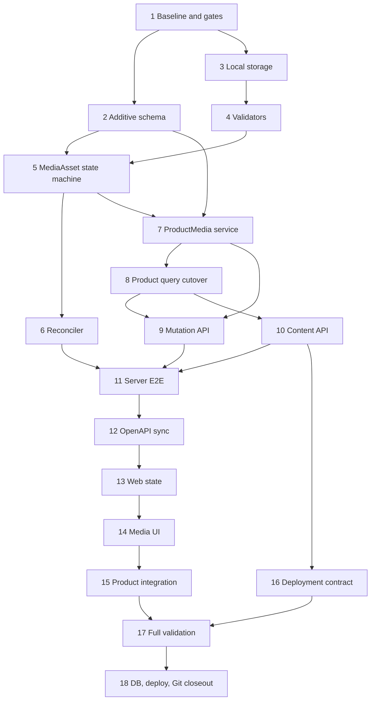

# 统一媒体资产与产品媒体实施任务

## 1. 文档状态

- 状态：Phase 4 实施中，Gate DEP 已确认，Task 1-2 已完成
- 编写日期：2026-08-13
- 实施分支：`feat/media-asset-product-media`
- Requirements：`specs/product-media/requirements.md`
- Design：`specs/product-media/design.md`
- Phase R：已于 2026-08-13 确认
- Phase D：已于 2026-08-13 确认
- Phase T：已于 2026-08-13 确认
- Phase 4 / Gate I：已于 2026-08-13 确认
- Gate DEP：已于 2026-08-13 确认精确依赖、系统依赖与安全限额；实际安装仍受 Gate OPS 约束
- 持久开发数据库、生产部署、push、PR 和 merge：均未授权

本计划把统一 MediaAsset 基础设施和首个 ProductMedia 领域切片拆为 18 个任务。任务顺序固定为：

```text
绿色基线与高风险门禁
-> additive Schema
-> storage/config
-> IMAGE/VIDEO/DOCUMENT validator
-> MediaAsset state machine
-> reconciler/reference safety
-> ProductMedia command
-> Product structured query cutover
-> upload/layout/detach API
-> private content API
-> Server E2E
-> OpenAPI sync
-> Web domain state
-> Web media UI
-> list/detail integration
-> deployment and recovery contracts
-> browser/full validation
-> optional persistent DB and Git closeout
```

## 2. 执行纪律

每个功能任务遵循同一 TDD 闭环：

```text
确认门禁、当前 HEAD 与任务边界
-> 添加只因目标能力缺失而失败的测试
-> 运行并记录预期 RED 命令、退出码和失败原因
-> 实现最小正确能力
-> 补齐并发、失败、安全与回归路径
-> 运行任务级 GREEN 验证
-> 更新 tasks.md 的勾选状态和真实证据
-> 检查 staged diff、secrets、generated 和 migration 边界
-> 创建绿色小步提交
```

执行规则：

1. RED 只能作为实施过程证据，不提交永久失败、不能 typecheck 或不能构建的状态。
2. 命令报错、测试失败、环境缺失和非阻断 warning 必须如实记录；未转绿不得勾选任务。
3. 只使用 `apply_patch` 编辑手写源码和文档；格式化或官方生成命令可机械更新产物。
4. 不手工修改 `server/openapi/openapi.json`、`web/openapi/openapi.json` 或 generated API types。
5. 不修改任何既有 migration；新 migration 必须 append-only，具备结构测试和隔离 PostgreSQL replay。
6. Additive Media Schema 与 Product API cutover 分开实施；过渡期不得双写 URL 与 ProductMedia。
7. Product 旧 URL 列只有在非空计数为零、Server/Web 已准备同批切换且门禁再次满足时才删除。
8. 不下载既有外部 URL、不清空非空旧字段、不创建占位 MediaAsset、不写业务演示数据。
9. `MediaAsset` 不保存 `ownerType/ownerId`；本期不创建 ProductMedia 以外的领域关联表。
10. ProductMedia 永远拒绝 DOCUMENT；Product Controller、DTO、Web 均不得出现 Product Document 分支。
11. MediaModule 不提供公共通用上传或资产库 Controller；Document 只通过内部 service contract 验证。
12. 首期只实现 Local storage driver，不创建 S3/MinIO 空实现或多驱动运行时选择器。
13. 大文件必须 streaming 到 staging；不得把完整图片、视频或 Document 读入 Node.js heap。
14. 原始文件名、objectKey、checksum、文件内容、路径、Token、Cookie、连接字符串和完整 Payload
    不得进入 Audit 或公开错误；日志只记录安全 requestId 和低基数元数据。
15. Product mutation 显式 `retry:false`；网络/`5xx` 后只读取对账，不自动重传文件或 mutation。
16. 不修改公共 Fa/Qs 组件业务契约；如证据证明必须修改，停止并重新确认，且保持公共组件业务中立。
17. Server/Web 维持独立依赖域；不在根目录安装依赖或创建根 lockfile/node_modules。
18. Prisma generate、Server build、OpenAPI sync/check 和 Web generated types 按顺序执行，避免并发改写。
19. 每个小步提交前运行任务级测试、`git diff --check`、暂存范围和敏感文件检查。
20. Commit Message 使用英文类型和中文描述；不 amend、rebase、force push 或改写历史。
21. tasks 中的命令是最低验证集；若真实改动扩大影响，必须增加相应回归，不得缩减验证掩盖失败。
22. 未经明确授权，不应用持久数据库 migration，不修改真实生产配置，不 push、PR、merge、部署、
    删除分支或清理用户 worktree。
23. Tasks 8–11 是一个不可发布的公共契约切换窗口：source、DTO、E2E 必须各自 GREEN，但 tracked
    OpenAPI 在 Task 12 前允许只因尚未生成而 `contract:check` 预期 RED；该 RED 必须记录且不得夹杂其他
    漂移。Task 12 必须紧随其后转绿，在此窗口内不得 push、PR、交付或开始 Web 实现。

## 3. 阶段与高风险门禁

### Gate R - Requirements

- [x] 统一 MediaAsset、仅 ProductMedia 领域关联、私有媒体、本地首期存储和未来显式领域扩展已确认。
- [x] MediaAsset 支持 IMAGE/VIDEO/DOCUMENT，ProductMedia 只支持 IMAGE/VIDEO 已确认。
- [x] 文件类型、限额、数量、保留期、权限、结构化响应、备份容量和 UI 合同已确认。

### Gate D - Design

- [x] MediaAsset/ProductMedia 模型、约束 Trigger、状态机、Local storage、X-Accel-Redirect 和 Range 已确认。
- [x] Product version 并发、PRODUCT_UPDATED 审计、API operations、Web 组件边界和迁移停止条件已确认。
- [x] 首期要求生产运行时提供受限 `ffprobe`，不转码、不抽帧已确认。

### Gate T - Phase 3 任务清单

- [x] 用户已于 2026-08-13 确认本任务顺序、TDD 纪律、提交序列、停止条件和需求追踪矩阵。

### Gate I - Phase 4 与高风险代码变更

- [x] 用户已于 2026-08-13 授权 Phase 4，并再次明确授权以下实际修改：
  - Prisma 新增 `MediaType`、`MediaAssetStatus`、`ProductMediaKind`、`MediaAsset`、`ProductMedia`、
    Product/User relations、约束 Trigger、索引和新 migration。
  - 新增真实权限 `product-media:read` 并授予已确认角色。
  - 新增 Product media upload/layout/detach/content/HEAD 公共 API，替换 Product 响应媒体结构。
  - 在零旧媒体数据门禁下删除 Product 的 `mainImage/images/videos` 列。
- [x] Gate T 与 Gate I 已分别确认；Task 1 仍严格保持只读审计和文档取证边界。

### Gate DEP - 第三方与系统依赖

- [x] Task 1 已确认当前直接/传递依赖和 Node.js 标准库能力，并在 4.1 节形成最小候选清单、精确版本、用途、
  许可证、维护状态、原生构建风险与 lockfile 影响。
- [x] 用户已于 2026-08-13 确认 4.1 节全部精确候选；Task 2 不需要也没有修改 package 或 lockfile。
- [x] `ffprobe` 是已确认的生产系统依赖；Task 1 已记录本地版本和 Ubuntu 24.04 获取证据。
- [x] `qpdf` 作为 PDF 受限结构/加密检查的系统依赖及 Ubuntu 24.04 精确版本策略已确认；
  实际安装仍须通过 Gate OPS。

### Gate DB - 持久开发数据库

- [ ] 所有 migration 必须先在一次性 PostgreSQL 完成空库 replay、当前基线升级、重复 deploy 和回滚演练。
- [ ] 应用前展示目标数据库、唯一待迁移集合、旧媒体只读计数、Product 行数、备份与恢复路径，
  再取得独立明确授权。
- [ ] 任一旧媒体计数非零、待迁移集合不精确、Schema drift、备份失败或恢复验证失败时停止。

### Gate OPS - 部署配置与生产文件系统

- [ ] 仓库内模板和验证脚本可以在 Gate I 后实施；写入真实 `/var/lib/qianshu-dms/media`、修改生产
  Nginx/systemd、安装系统包或重启生产服务必须取得独立授权。

### Gate E - 外部发布

- [ ] 本地完成后暂停；push、PR、merge、部署、分支删除和非本地环境变更均需新的明确授权。

## 4. 实施任务

- [x] 1. 建立 Phase 4 绿色基线并完成实施前只读审计
  - [x] 1.1 复核 branch、HEAD、工作树、三份规格和 Gate R/D/T/I，发现重叠用户修改时停止。
  - [x] 1.2 只读核对 Product Schema、Controller/DTO/mapper、`PRODUCT_UPDATED`、权限、Web 产品页面、
    `FaImageUpload/FaFileUpload`、Nginx/release 模板和健康检查现状。
  - [x] 1.3 对目标数据库仅执行只读查询，记录 Product 行数以及 `mainImage/images/videos` 非空计数和
    有限样例 ID；不输出完整 URL，不修改任何数据。
  - [x] 1.4 审计 Server 当前 direct/transitive dependencies、Node 24 能力、Multer 行为、图片/OOXML/PDF
    parser 候选和本地/CI `ffprobe` 可用性，形成 Gate DEP 精确候选。
  - [x] 1.5 运行 Product/Audit/Permission/OpenAPI、Web 产品视图和根治理的现有绿色基线。
  - [x] 1.6 记录基线 SHA、命令、退出码、测试数量、可变环境快照和停止条件；本任务只提交审计文档。
  - _Requirements: R1-R12_

### 4.1 Task 1 基线证据与 Gate DEP 候选

#### 仓库与现有合同

- 审计基线为分支 `feat/media-asset-product-media`、SHA
  `5c9220fc8c7c5b00dc2600dbdecceb4b79f216a2`；审计开始时工作树清洁，未发现重叠用户修改。
- Prisma `Product` 仍包含 `mainImage String?`、`images String[]`、`videos String[]`；仓库尚无
  `MediaAsset`、`ProductMedia`、媒体 migration 或媒体公共 API。
- Product Controller 现有 list/detail/create/update 合同和 `PRODUCT_UPDATED` 审计事件保持不变；Web
  list/detail/video 仍消费 URL 字符串。本任务未运行 `contract:sync`，`contract:check` 证明 tracked
  OpenAPI 和 generated types 无漂移。
- 当前真实产品权限为 `products:create/read/update`，均只授予 `system_admin`；尚无
  `product-media:read`。仓库有 release package 和 health 能力，但没有 Nginx/systemd 媒体模板。
- `FaImageUpload` 的业务模型是 `string[]` URL，`FaFileUpload` 的业务模型是上传 FileItem；二者可提供预览、
  进度和 custom request 原语，但不能持有 ProductMedia ID、主图、排序、version 或领域生命周期。因此继续
  采用业务层组合组件，不修改公共 Fa/Qs 契约。

#### 只读数据库与运行环境

- 目标为本机容器 `qianshu-dms-dev-postgres` / PostgreSQL 16。查询使用显式 read-only transaction；
  `product_count=2`、`main_image_count=0`、`images_count=0`、`videos_count=0`，因此没有样例 ID 可输出。
  零旧媒体前置条件当前满足，但删除旧列前必须再次查询，不能把本快照当成未来事实。
- 本机为 macOS arm64、Node.js `v24.16.0`、pnpm `11.9.0`；Server engine 为 `^24.15.0`。生产目标为
  Ubuntu 24.04 / glibc / x64 / Node.js 24，GitHub Actions 使用 `ubuntu-24.04`。
- 本机 `ffprobe` 为 `/opt/homebrew/bin/ffprobe`、`8.1.1`，具备 MP4/H.264/AAC 解析能力；其协议列表也
  包含网络协议，所以实现必须使用固定 argv、协议白名单/禁网络、无 shell、超时和输出上限。
- Ubuntu 24.04 `ffmpeg` 包当前为 `7:6.1.1-3ubuntu5` 并提供 `ffprobe`；现有 CI workflow 未安装它，
  runner 清单也未声明预装，因此后续必须在 CI/runtime 显式安装并记录 `ffprobe -version`。
- 本机没有 `qpdf`。Ubuntu 24.04 `noble-updates` 当前提供 `qpdf 11.9.0-1.1ubuntu0.1`；在 Gate DEP/OPS
  允许前不得安装。若获确认，CI/runtime 必须显式安装并记录版本，不能依赖 runner 偶然预装。

#### 当前依赖与精确候选

Server 当前没有媒体直接依赖；传递树已有 `multer@2.2.0 -> busboy@1.6.0`，以及
`@nestjs/common@11.1.28 -> file-type@21.3.4`。Multer 默认 memory storage 会把完整文件放入 heap，
不满足 500MiB 视频合同，因此产品媒体上传不使用默认 Multer buffering。

以下是等待 Gate DEP 确认的完整候选；未确认前不得改 package、lockfile 或安装系统包：

| 位置 | 精确候选 | 许可证 | 唯一用途与取舍 |
|---|---|---|---|
| runtime | `busboy@1.6.0` | MIT | 直接依赖流式 multipart 和 parser limits，不依赖 Nest 的传递实现细节 |
| dev | `@types/busboy@1.5.4` | MIT | 锁定 Busboy TypeScript 合同 |
| runtime | `file-type@21.3.4` | MIT | magic-byte hint；与当前 Nest 传递版本对齐，不能替代完整解析 |
| runtime | `sharp@0.35.3` | Apache-2.0 | 完整解码 JPEG/PNG/WebP 并读取可信尺寸；拒绝动画和解码错误 |
| runtime | `yauzl@3.4.0` | MIT | 异步读取 OOXML central directory/entry stream，限制内存和不安全路径 |
| dev | `@types/yauzl@3.4.0` | MIT | `yauzl` 本体不自带声明，锁定当前 3.4 API 类型 |
| system | Ubuntu `ffmpeg 7:6.1.1-3ubuntu5` | GPL/LGPL 组合 | 提供 `/usr/bin/ffprobe`；只探测 MP4/H.264/AAC，不转码 |
| system | Ubuntu `qpdf 11.9.0-1.1ubuntu0.1` | Apache-2.0 | 独立进程执行 PDF 结构、stream encoding 与加密检查，避免整文件进入 Node heap |

不引入 `pdfjs-dist`：本期不渲染、不提取文本，结构验证交给 `qpdf`，可减少 JS heap、DOM/worker
兼容和大体积依赖风险。`sharp` 带平台预构建可选包，预计 lockfile 会新增 macOS arm64 与 Linux x64
glibc 的 optional dependency 记录，并需把 `sharp: true` 加入 `server/pnpm-workspace.yaml` 的
`allowBuilds`；Gate DEP 后仍要用一次性目录做 frozen fresh install、Node 24 load、release archive 和
Ubuntu 24.04 smoke，实证不满足时立即停止，不放宽合同。

官方取证入口：
[Busboy](https://github.com/mscdex/busboy)、
[file-type](https://www.npmjs.com/package/file-type)、
[sharp install](https://sharp.pixelplumbing.com/install/)、
[yauzl](https://github.com/thejoshwolfe/yauzl)、
[@types/yauzl](https://www.npmjs.com/package/%40types/yauzl)、
[Ubuntu ffmpeg](https://packages.ubuntu.com/noble/ffmpeg)、
[Ubuntu qpdf](https://packages.ubuntu.com/noble-updates/qpdf)、
[qpdf inspection](https://qpdf.readthedocs.io/en/stable/cli.html#pdf-inspection)。

#### 等待一并确认的安全限额

这些是解析器的技术防滥用常量，不扩大业务类型或文件大小合同：

- multipart：`files=1`、`fields=2`、`parts=3`、`fieldNameSize=64B`、`fieldSize=4KiB`、
  `headerPairs=100`；binary `fileSize` 仍按 IMAGE 10MiB / VIDEO 500MiB，超限立即销毁流。
- IMAGE：`maxInputPixels=40_000_000`、单边不超过 `16_384`、只允许单帧；完整 decode 失败即拒绝。
- OOXML：最多 `2_000` entries、单 entry 展开不超过 `50MiB`、总展开不超过 `200MiB`、任一 entry
  或总压缩比不超过 `100:1`；拒绝 encrypted、path traversal、宏 content type 和外部可执行内容。
- `ffprobe`：15 秒 timeout、stdout/stderr 各 256KiB；`qpdf`：15 秒 timeout、stdout/stderr 各 64KiB；
  均使用绝对可执行路径、固定 argv、`shell:false`，stderr 只转内部低基数错误，不进入公开响应或 Audit。

#### 基线验证与异常记录

- Server 定向 Jest：exit `0`，30 suites / 267 tests 全部通过。
- Web 产品定向 Node tests：exit `0`，46 tests 全部通过。
- `node --run contract:check`：exit `0`；Prisma generate、Server build、临时 OpenAPI/Web API 生成成功，
  tracked 合同无漂移，生成目录均受既有 ignore 保护。
- `node --run test:root` 首次为 662/663：冻结的历史词汇 allowlist 检测到本任务文档一处无关表述。
  已删除该表述而未修改 allowlist；修正文档后复跑 exit `0`，663/663 全部通过。
- 一次本地 package manifest 读取命令因 shell quote 错误触发 Node `SyntaxError`；两次数据库查询分别因
  SQL label/separator quote 错误在 `BEGIN` 后解析失败；修正后使用拆分的 read-only 查询取得上述结果。
  `pnpm view`/`npm view` registry 查询无响应后以 Ctrl-C 结束（exit `130`），改查官方包/仓库资料。
  这些失败均未产生 package、lockfile、数据库或业务文件写入。
- 本任务没有修改源码、Schema、API、依赖或 lockfile，没有写数据库或真实媒体目录；下一步停在
  Gate DEP，Gate DB、Gate OPS、Gate E 仍未授权。

- [x] 2. 以 TDD 建立 additive MediaAsset/ProductMedia Schema 与权限
  - 前置：Gate I、Gate DEP 中与 Schema 测试有关的部分已通过。
  - [x] 2.1 先建立 Prisma/migration RED，精确锁定三个 enum、两张表、User/Product relations、具名
    CHECK/FK/index/partial unique、类型/主图/有效引用/deferred READY Trigger 和权限 seed。
  - [x] 2.2 RED 必须证明 DOCUMENT 无法进入 ProductMedia、READY 不能孤立提交、被引用 READY 不能转出。
  - [x] 2.3 新增 additive migration：保留 Product 三个旧 URL 列，不改旧列、不 seed MediaAsset。
  - [x] 2.4 新增稳定 `product-media:read` Permission ID、中文名称、资源 catalog 与真实角色授权自检。
  - [x] 2.5 用一次性 PostgreSQL 验证空库全量 replay、基线升级、重复 deploy、约束正反例和无业务数据 seed。
  - [x] 2.6 运行 Prisma validate/generate、Schema/Permission tests、Server typecheck/lint 和根治理。
  - [x] 2.7 更新证据并提交：`feat: 建立媒体资产数据结构`。
  - _Requirements: R1-R3, R6, R8, R11-R12_

### 4.2 Task 2 实施证据

- TDD RED：Server 静态 Schema/Permission 测试先因 `PRODUCT_MEDIA_PERMISSION_CODES` 和媒体结构缺失退出
  `1`；Web 权限目录为 42/43，唯一失败是缺少产品媒体资源。补齐基础结构后，又先增加具名 Trigger
  错误契约并确认 RED，再实现数据库约束；一处测试正则遗漏 SQL 双引号导致 3/4，修正测试读取规则后
  未放宽任何业务断言。
- 最小实现新增 `MediaType`、`MediaAssetStatus`、`ProductMediaKind`、`MediaAsset`、`ProductMedia` 和
  User/Product relations；migration `20260813120000_media_asset_product_media_schema` 建立具名 CHECK、
  Restrict FK、partial unique/index 与 deferred READY 引用 Trigger。`MediaAsset` 支持 IMAGE/VIDEO/DOCUMENT，
  `ProductMediaKind` 只有 IMAGE/VIDEO；旧 `mainImage/images/videos` 全部保留，migration 未 seed
  MediaAsset/ProductMedia。
- 权限使用稳定 ID `00000000-0000-4000-8000-000000000146`，code 为 `product-media:read`、名称为
  `读取产品媒体`，精确授予 `system_admin`；Server 权限常量、认证 E2E 固定契约与 Web 中文资源目录同步。
- 一次性 PostgreSQL 16 从空库按顺序应用 17 条 migration，第二次 deploy 无待应用项；媒体 E2E 覆盖
  DOCUMENT/类型不匹配、孤立 READY、引用状态退出、最后关联分离、内容身份不可变、排序/资产/主图唯一、
  VIDEO 主图和物理删除拒绝等正反例，最终目标套件 3/3 suites、21/21 tests 通过。另从前 16 条基线升级，
  升级前后 1 条 Product 及三个旧媒体字段的零计数保持不变，两张新表存在且零业务数据。
- 最终验证：Prisma validate/generate 通过；Server unit 157/157 suites、1553/1553 tests，typecheck/lint
  通过；隔离 `ci:server-e2e` 完整重放、重复 deploy、status 和 29/29 suites、169/169 tests 全部通过；
  Web 权限目录 43/43、typecheck/lint 通过；`contract:check` 无公共 API 漂移；根治理在同步第 17 条 migration
  基线后通过。
- 异常均如实保留：`prisma migrate diff --from-migrations` 因当前 Prisma 要求显式 shadow database URL
  退出 `1`；改用隔离实际 datasource 比对只显示两个实施前已存在且与媒体无关的差异（编号索引等价重建、
  `user_profiles.updated_at` 默认值），没有媒体差异，未越界修复。一次 Jest 命令多传 `--` 被当成 pattern，
  一次隔离测试遗漏 migration、一次从 `server/` 寻找根脚本均失败，均以正确命令复跑转绿。一次误在根目录
  调用 `pnpm exec` 产生受治理禁止的根 lockfile/node_modules，已立即通过预授权 `node --run cleanup:root`
  精确移除；没有删除其他文件。
- 本任务未修改依赖或 lockfile，未安装 `ffprobe/qpdf`，未创建真实媒体目录，未修改公共 API/OpenAPI，
  未删除 Product 旧列，未应用持久开发数据库 migration，未 push、PR、merge 或部署。

- [ ] 3. 以 TDD 建立 Local storage 配置和安全文件操作
  - [ ] 3.1 先建立 config/storage RED，覆盖绝对 root、禁用源码/release/tmp/root、realpath、symlink、
    同文件系统、权限、不可写、磁盘不足、path traversal 和 objectKey 规范化。
  - [ ] 3.2 实现业务中立 `MediaStorage` 和唯一 `LocalMediaStorage`，使用随机 staging、受限权限、
    atomic rename、stat、trash、restore、purge；不得认识 Product。
  - [ ] 3.3 使用测试临时目录验证 partial write、取消、目标冲突、磁盘/权限错误与可靠清理，不写真实媒体目录。
  - [ ] 3.4 增加配置 DTO/示例和可测试健康结果，不记录 root 下的用户文件名或敏感环境值。
  - [ ] 3.5 运行 storage/config tests、Server typecheck/lint、根配置安全测试和 diff-check。
  - [ ] 3.6 更新证据并提交：`feat: 建立本地媒体存储`。
  - _Requirements: R2, R5, R11-R12_

- [ ] 4. 以 TDD 实现可信内容验证器
  - 前置：Gate DEP 已确认精确 package 和 lockfile 变化。
  - [ ] 4.1 先为通用流式计数/SHA-256/上限和 extension/MIME/magic/parser 冲突建立 RED。
  - [ ] 4.2 实现 IMAGE validator：JPEG/PNG/WebP、完整解码、width/height、10MiB，拒绝 SVG、损坏和伪装。
  - [ ] 4.3 实现 VIDEO validator：MP4、H.264、AAC/无音轨、duration/dimensions、500MiB；`ffprobe`
    固定 argv、无 shell、禁网络、超时、输出上限和安全 stderr。
  - [ ] 4.4 实现 DOCUMENT validator：PDF/DOCX/XLSX、50MiB、OOXML content types、entry/展开限制，
    拒绝宏、加密、zip bomb、脚本和伪装；不新增 HTTP 入口。
  - [ ] 4.5 使用最小自有二进制 fixtures 和边界 fixtures；不得提交含敏感内容或不明版权的大文件。
  - [ ] 4.6 运行 validator unit/integration、依赖安全/许可证检查、Server typecheck/lint 和 diff-check。
  - [ ] 4.7 更新证据并提交：`feat: 实现媒体内容验证`。
  - _Requirements: R2, R4-R5, R11_

- [ ] 5. 以 TDD 实现 MediaAsset prepare/activate 状态机
  - [ ] 5.1 先建立 persistence/service RED，覆盖 UPLOADING 可空元数据、24h expiry、可信元数据 finalize、
    READY 必需字段、条件状态迁移和内容身份不可变。
  - [ ] 5.2 实现 streaming `prepare()`：staging 写入、hash/size、validator、可信 metadata、final rename；
    返回 PreparedMediaAsset 但保持不可见 UPLOADING。
  - [ ] 5.3 实现调用方 transaction 内 `activate()`、失败收敛和幂等状态条件；不接收 owner 多态字段。
  - [ ] 5.4 Product policy 固定 `allowedTypes=[IMAGE, VIDEO]`；DOCUMENT prepare contract 由内部测试真实覆盖。
  - [ ] 5.5 覆盖每个 crash window、Audit/DB rollback 后 final 残留、重复调用和公开错误脱敏。
  - [ ] 5.6 运行 state machine/storage/validator 回归、Server typecheck/lint 和 diff-check。
  - [ ] 5.7 更新证据并提交：`feat: 实现媒体资产生命周期`。
  - _Requirements: R1-R5, R7-R8, R11_

- [ ] 6. 以 TDD 实现引用安全、回收和对账
  - [ ] 6.1 先建立 `MediaAssetReferenceRepository` RED，本期只能显式查询有效 ProductMedia。
  - [ ] 6.2 实现最后引用解除后的 TRASHED/7 天保留、保留期内 restore、到期后二次零引用检查和 PURGED。
  - [ ] 6.3 实现 UPLOADING/FAILED 24h 清理、staging/final/trash/database 差异 dry run 和安全批次处理。
  - [ ] 6.4 使用 `FOR UPDATE SKIP LOCKED`、状态条件更新和固定锁顺序验证重复 worker 不重复清理。
  - [ ] 6.5 对 missing/size mismatch 只隔离告警，不自动伪造 READY、解除引用或删除数据库事实。
  - [ ] 6.6 建立未来领域扩展 contract test，要求新增关联表时同步修改 reference repository 与 Trigger。
  - [ ] 6.7 运行 reconciler/reference/storage tests、Server typecheck/lint 和 diff-check。
  - [ ] 6.8 更新证据并提交：`feat: 增加媒体回收与对账`。
  - _Requirements: R1, R5, R8, R11-R12_

- [ ] 7. 以 TDD 实现 ProductMedia 领域命令
  - [ ] 7.1 先建立 ProductMedia persistence/service RED，覆盖 Product `FOR UPDATE`、expectedVersion、
    20/5 上限、类型一致、重复关联、连续排序、唯一主图和软解除。
  - [ ] 7.2 实现上传前快速版本检查和上传后最终事务复核；长上传不得持有 Product 锁。
  - [ ] 7.3 最终事务内 activate MediaAsset、创建 ProductMedia、更新 Product version/actor/time、记录
    `PRODUCT_UPDATED changedFields=media`，Audit 失败整体回滚。
  - [ ] 7.4 实现完整 layout 快照更新、无变化 no-op、主图只来自 images、解除主图后不自动替代。
  - [ ] 7.5 覆盖同版本并发、排序交换、上传最终冲突、解除/清理竞态、Document 双重拒绝和安全错误映射。
  - [ ] 7.6 运行 ProductMedia/Product/Audit tests、Server typecheck/lint 和 diff-check。
  - [ ] 7.7 更新证据并提交：`feat: 实现产品媒体领域服务`。
  - _Requirements: R1-R3, R7-R8, R11_

- [ ] 8. 以 TDD 切换 Product 查询到结构化媒体并删除旧列
  - 前置：Task 7 GREEN；旧媒体只读计数精确为零；Gate I 仍有效。
  - [ ] 8.1 先建立 mapper/DTO/query RED，要求 `media.mainImage/images/videos` 稳定结构、顺序、空值和
    领域 contentUrl，且不泄露 MediaAsset ID/objectKey/checksum/storageDriver。
  - [ ] 8.2 实现列表/详情批量加载 ProductMedia，避免 N+1；主图从 images 的 `isPrimary` 投影且仍保留在 images。
  - [ ] 8.3 建立 cutover migration RED：非空旧媒体数据必须在 DROP 前 fail-closed；删除三列且不触碰其他 Product 字段。
  - [ ] 8.4 原子更新 Prisma、Product select/mapper/DTO/tests 和所有 Server caller，移除新代码中的旧 URL 语义，
    不建立双写或兼容字段。
  - [ ] 8.5 用隔离 PostgreSQL 覆盖空旧数据成功、三类非空数据分别停止、Product 行数不变量和回滚演练。
  - [ ] 8.6 运行 Product query/schema tests、Prisma validate/generate、Server typecheck/lint 和 diff-check。
  - [ ] 8.7 更新证据并提交：`refactor: 切换产品媒体数据结构`。
  - _Requirements: R3, R6, R9, R12_

- [ ] 9. 以 TDD 实现上传、布局和解除关联 API
  - [ ] 9.1 先建立 DTO/Controller RED，锁定三个 operation、Session/RBAC/CSRF、private no-store、
    multipart 单文件、field allowlist、limit、expectedVersion 和 `retry:false` 合同。
  - [ ] 9.2 实现 `POST /api/products/{productId}/media`，仅接受 IMAGE/VIDEO，流式接入 prepare/领域事务。
  - [ ] 9.3 实现 `PUT /api/products/{productId}/media/layout`，要求完整无重复 imageIds/videoIds 快照。
  - [ ] 9.4 实现 `DELETE /api/products/{productId}/media/{productMediaId}`，Body 只接受 expectedVersion。
  - [ ] 9.5 覆盖 multipart malformed、超限早拒绝、413/415/422、409、404 anti-enumeration、权限、
    CSRF、强制改密、unknown fields 和日志脱敏。
  - [ ] 9.6 运行 DTO/Controller/Module/API tests、Server typecheck/lint 和 diff-check。
  - [ ] 9.7 更新证据并提交：`feat: 增加产品媒体维护接口`。
  - _Requirements: R3-R5, R7, R9, R11_

- [ ] 10. 以 TDD 实现私有内容 GET/HEAD 授权与内部转发
  - [ ] 10.1 先建立内容 Controller RED，要求独立 `product-media:read`，不隐式要求 `products:read`。
  - [ ] 10.2 实现 Product/ProductMedia/READY 关联验证和安全 404，禁止直接按 MediaAsset ID 下载。
  - [ ] 10.3 返回可信 MIME、sanitized filename、private no-store、nosniff、opaque ETag、Accept-Ranges 和
    安全编码的 X-Accel-Redirect；GET/HEAD 权限一致，HEAD 无 body。
  - [ ] 10.4 建立 Nginx 等价 header contract test，证明内部 location 不能由外部 URL 直接访问且无 path traversal。
  - [ ] 10.5 覆盖有/无 `products:read` 的媒体角色、已解除/非 READY、条件请求、Range/HEAD 和 anti-enumeration。
  - [ ] 10.6 运行 content/RBAC/security tests、Server typecheck/lint 和 diff-check。
  - [ ] 10.7 更新证据并提交：`feat: 增加产品媒体私有访问`。
  - _Requirements: R5-R6, R8-R9, R11_

- [ ] 11. 补齐 Server 隔离 PostgreSQL 与文件系统 E2E
  - [ ] 11.1 建立一次性 PostgreSQL + 临时 Local root harness，启动前证明无 ProductMedia/MediaAsset seed。
  - [ ] 11.2 覆盖图片上传、视频 metadata、Product Document 拒绝、排序、主图、解除、版本并发和 Audit 原子性。
  - [ ] 11.3 覆盖上传中断、final rename 后 DB 失败、staging expiry、trash/restore/purge、仍被引用禁止清理。
  - [ ] 11.4 覆盖 RBAC、CSRF、强制改密、GET/HEAD/Range header、404 anti-enumeration 和隐私字段。
  - [ ] 11.5 覆盖 Migration 空库 replay、旧媒体三种非空停止、重复 deploy、Product 行数与权限授权不变量。
  - [ ] 11.6 运行定向 E2E 与官方 `node --run ci:server-e2e`，可靠清理容器、临时文件和子进程。
  - [ ] 11.7 更新证据；仅测试变更提交 `test: 补齐媒体资产服务端验收`，生产缺陷使用独立 `fix:` 提交。
  - _Requirements: R1-R9, R11-R12_

- [ ] 12. 同步 OpenAPI 与 Web generated contract
  - [ ] 12.1 先运行 `node --run contract:check`，记录 tracked snapshot 缺少新 operations/DTO 的预期 RED。
  - [ ] 12.2 串行运行根 `node --run contract:sync`，不得手工编辑 snapshot 或 generated types。
  - [ ] 12.3 核对 diff 只包含已确认的结构化 Product media、POST/PUT/DELETE/GET/HEAD、multipart 和错误合同。
  - [ ] 12.4 证明 Server/Web OpenAPI snapshot 字节一致，旧 Product URL 字段和未授权 Document API 均不存在。
  - [ ] 12.5 运行 `contract:check`、`ci:contract`、Server build、Web typecheck 和 diff-check。
  - [ ] 12.6 更新证据并提交：`chore: 同步产品媒体接口契约`。
  - _Requirements: R6-R7, R9, R11_

- [ ] 13. 以 TDD 建立 Web ProductMedia API 与纯状态逻辑
  - [ ] 13.1 先建立 API adapter RED，覆盖 generated DTO、multipart progress/Abort、layout/detach、contentUrl 和 retry:false。
  - [ ] 13.2 建立纯逻辑 RED，覆盖 20/5 上限、允许格式、Document 立即拒绝、stable ID、主图、连续排序和完整 layout。
  - [ ] 13.3 实现上传队列状态、真实 bytes progress、取消、finalizing、显式 retry 和单项安全错误。
  - [ ] 13.4 实现 dirty snapshot、conflict、reconciling/unknown；网络/5xx 只 GET 最新 Product，不自动重放。
  - [ ] 13.5 身份/权限变化必须 Abort 并清除跨用户文件引用、Object URL、snapshot 和错误；Object URL 及时 revoke。
  - [ ] 13.6 更新产品列表/详情 adapter 消费结构化 media，删除 URL 字段映射和仅 HTTP(S) URL 的旧视频逻辑。
  - [ ] 13.7 运行 Web API/logic/adapter tests、typecheck、ESLint 和 diff-check。
  - [ ] 13.8 更新证据并提交：`feat: 建立产品媒体前端状态`。
  - _Requirements: R3-R4, R6-R7, R9-R11_

- [ ] 14. 以 TDD 实现 ProductMediaPanel 与上传维护体验
  - [ ] 14.1 先建立 View RED，固定只读/可维护权限、Image/Video board、Upload queue、rules、错误和 dirty 状态。
  - [ ] 14.2 实现桌面 7/5、图片 3–4 列、窄屏 1–2 列/单列，无横向滚动；只消费既有 semantic tokens。
  - [ ] 14.3 图片支持预览、主图、拖拽增强、键盘前移/后移和解除；视频支持预览/排序/解除且无主图操作。
  - [ ] 14.4 上传 input 有可见 label，dropzone 非唯一入口；队列暴露 progress、取消、失败、显式 retry 和 live region。
  - [ ] 14.5 实现 dirty 离开确认、冲突对照、首错聚焦、焦点恢复、44px 触控、Dark 和 Reduced Motion。
  - [ ] 14.6 复用/组合 Fa 上传 primitive；若必须改变公共契约，停止并请求新确认，不把 Product 规则下沉。
  - [ ] 14.7 运行 View/accessibility tests、Web typecheck、ESLint、Stylelint、build 和 diff-check。
  - [ ] 14.8 更新证据并提交：`feat: 实现产品媒体维护界面`。
  - _Requirements: R3-R4, R7, R9-R10_

- [ ] 15. 接入产品编辑、列表和详情并完成 Web 回归
  - [ ] 15.1 产品编辑页接入 ProductMediaPanel，共享 Product version，但基础表单提交和媒体上传状态机保持独立。
  - [ ] 15.2 `products:update` 控制维护；`product-media:read` 控制内容；缺少内容权限时显示稳定无泄露占位。
  - [ ] 15.3 产品列表继续使用 ImageGroup 和视频弹窗，改用结构化 item/contentUrl，保持分页/search/filter 不回归。
  - [ ] 15.4 产品详情 Drawer 展示结构化媒体和安全错误，不恢复 URL 文本或 Product Document。
  - [ ] 15.5 覆盖上传后 Product version 刷新、基础编辑冲突、路由离开、auth epoch、迟到响应和创建流程回归。
  - [ ] 15.6 运行产品全套 Web tests、`test:api`、typecheck、lint、build 和 diff-check。
  - [ ] 15.7 更新证据并提交：`feat: 接入产品媒体业务流程`。
  - _Requirements: R6-R7, R9-R10_

- [ ] 16. 建立部署模板、健康检查、容量与恢复 dry run
  - 前置：Gate OPS 只授权仓库内模板；不得修改真实主机。
  - [ ] 16.1 根据仓库真实部署结构新增/更新 Local root、Nginx internal location、body limit、Range、运行用户/组、
    systemd Environment 与 `ffprobe` preflight 模板；不提交 `.env`。
  - [ ] 16.2 健康检查区分 read/write/video validator，磁盘 critical 时写失败关闭、已有媒体读取继续。
  - [ ] 16.3 增加容量、staging age、FAILED、reconciliation mismatch、上传失败率和清理结果的低基数指标/告警合同。
  - [ ] 16.4 实现只读 reconciliation/backup-restore validation dry run，校验 DB 引用、文件存在、size/checksum，
    不删除、不修复、不输出敏感文件名。
  - [ ] 16.5 文档明确 30GB minimum/50GB recommended、离机备份、同一恢复点、恢复顺序和生产授权边界。
  - [ ] 16.6 运行 release/package/config/security tests、shell/script tests、Server checks 和 diff-check。
  - [ ] 16.7 更新证据并提交：`ops: 增加媒体存储部署合同`。
  - _Requirements: R5-R6, R8, R11-R12_

- [ ] 17. 完成 Browser、全量测试和本地运行验收
  - [ ] 17.1 真实 Chrome 覆盖桌面/窄屏、Dark、Reduced Motion、键盘排序、上传进度、主图、视频、删除和冲突。
  - [ ] 17.2 覆盖 read-only、update-only、media-read-only 等真实 RBAC 组合，证明未来内部页面可只读产品媒体。
  - [ ] 17.3 使用自有小 fixtures 覆盖 JPEG/PNG/WebP/MP4 和 Product Document 拒绝；浏览器产物可靠清理。
  - [ ] 17.4 运行完整 Server test/typecheck/lint/build、Web test/typecheck/lint/build、OpenAPI、隔离 E2E 和 root check。
  - [ ] 17.5 从根 `node --run dev` 重启本地服务，验证 Web HTTP、`/api/health`、数据库、图片、视频 Range 和清洁 Git。
  - [ ] 17.6 如发现失败，先增加失败测试再最小修复；每个修复独立提交，不把已知失败描述成完成。
  - [ ] 17.7 更新 tasks 真实总数、命令、warning、运行环境和 commit 列表，提交：`test: 完成产品媒体全量验收`。
  - _Requirements: R1-R12_

- [ ] 18. 持久开发数据库、真实部署与 Git 收口
  - 前置：Task 1–17 GREEN；Gate DB、Gate OPS、Gate E 分别按实际动作授权。
  - [ ] 18.1 未获 Gate DB 时只展示 migration 集合、旧媒体计数、Product 行数、drift、备份与恢复证据并暂停。
  - [ ] 18.2 获 Gate DB 后才应用精确 migration；验证权限、Trigger、列切换、Product 行数和 migration status。
  - [ ] 18.3 未获生产 Gate OPS 时不得创建真实目录、安装 ffprobe、修改 Nginx/systemd、重启或部署。
  - [ ] 18.4 获生产 Gate OPS 后按 runbook 备份、部署、验证健康/Range/容量/对账并保留可恢复版本。
  - [ ] 18.5 检查 Git staged/unstaged/untracked、`.env`、密钥、日志、fixtures、构建产物和提交序列。
  - [ ] 18.6 未获 Gate E 时停在本地清洁分支；获授权后才 push/PR/merge，且用 exact HEAD SHA 验证 CI。
  - _Requirements: R5-R6, R8, R11-R12_

## 5. 任务依赖与可并行边界



Task 2 与 Task 3 可在 Gate DEP/I 已满足后并行研究，但同一共享 Prisma/generated/lockfile 文件不得并发写。
Task 6 与 Task 7 在 Task 5 后可并行开发各自测试；Task 8–12 涉及公共 Product/OpenAPI 契约，必须串行。
Web Task 13 可在 OpenAPI 同步后开始；Task 14/15 不与 generated sync 并发。

## 6. 需求追踪矩阵

| Requirement | 核心任务 | 最终验收 |
|---|---|---|
| R1 统一媒体资产边界 | 2, 5, 6, 7 | 11, 17 |
| R2 MediaAsset 数据完整性 | 2, 4, 5 | 11, 17 |
| R3 ProductMedia 与主图 | 2, 7, 8, 14 | 11, 17 |
| R4 文件类型与内容验证 | 4, 5, 9, 13 | 11, 17 |
| R5 本地存储与故障恢复 | 3, 5, 6, 16 | 11, 17, 18 |
| R6 私有访问与未来订单使用 | 2, 10, 15, 16 | 11, 17 |
| R7 产品媒体写入与并发 | 7, 9, 13, 15 | 11, 17 |
| R8 生命周期、保留与引用安全 | 2, 5, 6 | 11, 16, 17 |
| R9 产品 API 数据合同 | 8, 9, 10, 12, 13 | 11, 17 |
| R10 Product Web 维护体验 | 13, 14, 15 | 17 |
| R11 审计、安全与可观测性 | 2–7, 9–10, 16 | 11, 17 |
| R12 数据迁移、备份与验收 | 1–2, 6, 8, 11, 16 | 17, 18 |

每项 Requirement 至少有一个实现任务和一个后置验收任务。Phase 4 更新 tasks 时应把真实 RED/GREEN
证据写入对应任务，不得只凭代码存在勾选。

## 7. 验证命令矩阵

精确目标测试文件在 Phase 4 随 RED 测试落盘后补入 tasks 证据；以下为不得省略的稳定入口：

```bash
git status --short --branch
git diff --check

pnpm -C server prisma:validate
pnpm -C server prisma:generate
pnpm -C server typecheck
pnpm -C server lint
pnpm -C server test
pnpm -C server build

node --run ci:server-e2e
node --run contract:sync
node --run contract:check
node --run ci:contract

pnpm -C web test:api
pnpm -C web typecheck
pnpm -C web lint
pnpm -C web build

node --run test:root
node --run check
```

涉及真实 Chrome 时追加产品媒体专用 browser suite；涉及 release/Nginx/systemd 时追加仓库中实际建立的
config/package/smoke tests。`contract:sync` 是生成动作，只在公共 API 已获得 Gate I 且即将提交契约时运行。

## 8. 计划提交序列

1. `feat: 建立媒体资产数据结构`
2. `feat: 建立本地媒体存储`
3. `feat: 实现媒体内容验证`
4. `feat: 实现媒体资产生命周期`
5. `feat: 增加媒体回收与对账`
6. `feat: 实现产品媒体领域服务`
7. `refactor: 切换产品媒体数据结构`
8. `feat: 增加产品媒体维护接口`
9. `feat: 增加产品媒体私有访问`
10. `test: 补齐媒体资产服务端验收`
11. `chore: 同步产品媒体接口契约`
12. `feat: 建立产品媒体前端状态`
13. `feat: 实现产品媒体维护界面`
14. `feat: 接入产品媒体业务流程`
15. `ops: 增加媒体存储部署合同`
16. `test: 完成产品媒体全量验收`

任务中途暴露的独立缺陷使用单独 `fix:` 提交。若一个任务没有产生文件变更，不创建空提交；任务范围因
真实代码结构需要合并或拆分提交时，先更新 tasks 说明原因。每个提交必须在其任务级验证范围内绿色、
可审计；唯一暂态例外是执行规则 23 明确限定的 OpenAPI generated drift，并须在 Task 12 立即收敛。

## 9. 停止条件

- Gate I、Gate DEP、Gate DB、Gate OPS 或 Gate E 与即将执行动作不匹配。
- Product 旧媒体任一计数非零，或只读样例显示存在需要保留的真实 URL。
- 需要建立 ProductMedia 以外的领域表、通用媒体库/Controller 或 `ownerType + ownerId`。
- 需要让 ProductMedia 接受 DOCUMENT，或增加产品说明书/证书入口。
- 需要实现云存储、多机共享、CDN、转码、抽帧、病毒扫描、OCR、自动跨资产去重或公开分享。
- 必须修改公共 Fa/Qs 组件业务契约、恢复已退役的历史业务领域或跨 Web/Server 源码依赖。
- exact dependency 候选未获确认、许可证/原生构建/Node 24/Ubuntu 24 x64 证据不满足发布要求。
- migration 待执行集合不精确、Schema drift、隔离 replay/rollback 失败、备份或恢复验证失败。
- 存储 root 无法证明安全、同文件系统、可写和不经过不受信任 symlink。
- `ffprobe` 无法以受限、可复现方式提供，或 codec 验证必须放宽已确认合同。
- 发现用户未提交的重叠修改、敏感信息、不可解释测试失败或无法可靠清理的测试资源。
- 任务要求扩大到 push、PR、merge、真实部署、生产重启或未授权数据库写入。
