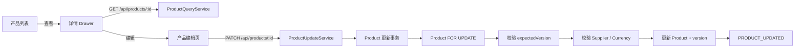

# 产品查看与编辑技术设计

## 1. 架构



## 2. API

### `GET /api/products/{productId}`

- operationId：`products_get_by_id`
- permission：`products:read`
- response：`ProductListItemDto`
- errors：`403`、`404 PRODUCT_NOT_FOUND`、`422 VALIDATION_FAILED`
- private no-store

### `PATCH /api/products/{productId}`

- operationId：`products_update`
- permission：`products:update`
- Session + CSRF + private no-store
- response：`ProductListItemDto`
- errors：`403`、`404 PRODUCT_NOT_FOUND`、`409 PRODUCT_STATE_CHANGED`、
  `422 PRODUCT_SUPPLIER_REQUIRED/PRODUCT_SUPPLIER_UNAVAILABLE/PRODUCT_CURRENCY_UNAVAILABLE/VALIDATION_FAILED`
- unsafe mutation 禁止 Axios 自动重试，不使用创建幂等键。

Update DTO 采用部分更新，要求 `expectedVersion` 和至少一个业务字段。Money 字段出现时提交
完整 `{ amount, currency }`。全局 whitelist 拒绝 Product 身份、媒体和审计字段。

## 3. Server 分层

- `ProductQueryService`：新增 `getById()`，复用 `PRODUCT_RESPONSE_SELECT`、mapper 和历史供应商解析。
- `ProductUpdateNormalizer`：白名单、trim/NFC、Money/属性规范化和目标快照合并。
- `ProductUpdatePersistence`：参数化 `FOR UPDATE`、精确 update、`version + 1`、事务快照读取。
- `ProductUpdateService`：拥有更新事务、依赖校验、changedFields、no-op、审计和错误映射。
- `ProductCommandService`：继续只负责带编号幂等语义的创建。

事务固定顺序：timeout → Product FOR UPDATE → expectedVersion → 目标快照/差异 →
Supplier Type/Item FOR SHARE → Currency code FOR SHARE → Product update → Audit → response read。

目标仍为 Active 时验证全部外部引用；Active 降级与非 Active 维护仅验证本次主动修改的引用，
因此历史失效引用不会阻止退出 Active。

## 4. 并发与错误恢复

行锁使同版本并发请求串行化。后获得锁的请求看到更新后的版本并返回
`PRODUCT_STATE_CHANGED`。no-op 也先校验版本，避免 stale 请求被当作成功。

Web PATCH 遇到网络或 `5xx` 后立即 GET：当版本为 `expectedVersion + 1` 且本次提交的
规范化字段全部匹配时判定成功；其余进入 unknown，不自动重放 mutation。

## 5. 权限与 Migration

追加两条 Migration：

1. 新增稳定权限 `00000000-0000-4000-8000-000000000145 / products:update / 编辑产品`，
   授予 `system_admin` 并自检。
2. `ALTER TYPE audit_event_type ADD VALUE PRODUCT_UPDATED`。

Product 表和 `product_status` 不变。隔离数据库验证通过后，按用户授权应用到
`qianshu_dms_dev`；待迁移集合不精确时停止。

## 6. Web 结构

- 列表页拥有详情请求、权限、AbortSignal、requestVersion、authEpoch 和目标 Product ID。
- `product-detail-drawer.vue` 只展示数据并发出 retry/edit/close。
- `/admin/products/:productId/edit` 使用 `meta.auth='products:update'`、`menu=false`、
  `activeMenu='/admin/products/list'`；页面再用 `authAll(['products:read','products:update'])`。
- 创建与编辑抽取共享 `product-form.vue`、`product-attributes-editor.vue` 和字段纯逻辑；
  创建幂等状态机与编辑并发状态机保持独立。
- 编辑成功回列表；列表再次读取服务端数据。

编辑状态机：`loading → editing → submitting → success`，失败分支为 `editing`、
`conflict`、`reconciling → success|unknown`。

## 7. 审计

真实变更写入 `PRODUCT_UPDATED`，元数据只包含：

```text
productNo
changedFields
previousVersion
version
previousStatus
status
```

Product 与 Audit 原子提交；no-op 不写审计。Web 映射中文“产品已更新”。

## 8. 测试与安全

采用 TDD：Migration → DTO/normalizer → persistence/service → Controller/OpenAPI → Web
API/路由/逻辑 → Drawer/编辑页 → 隔离 E2E → Chrome。所有响应使用安全公开错误，日志和
审计禁止 Cookie、Token、连接字符串、完整 Payload、价格、属性内容和媒体 URL。
