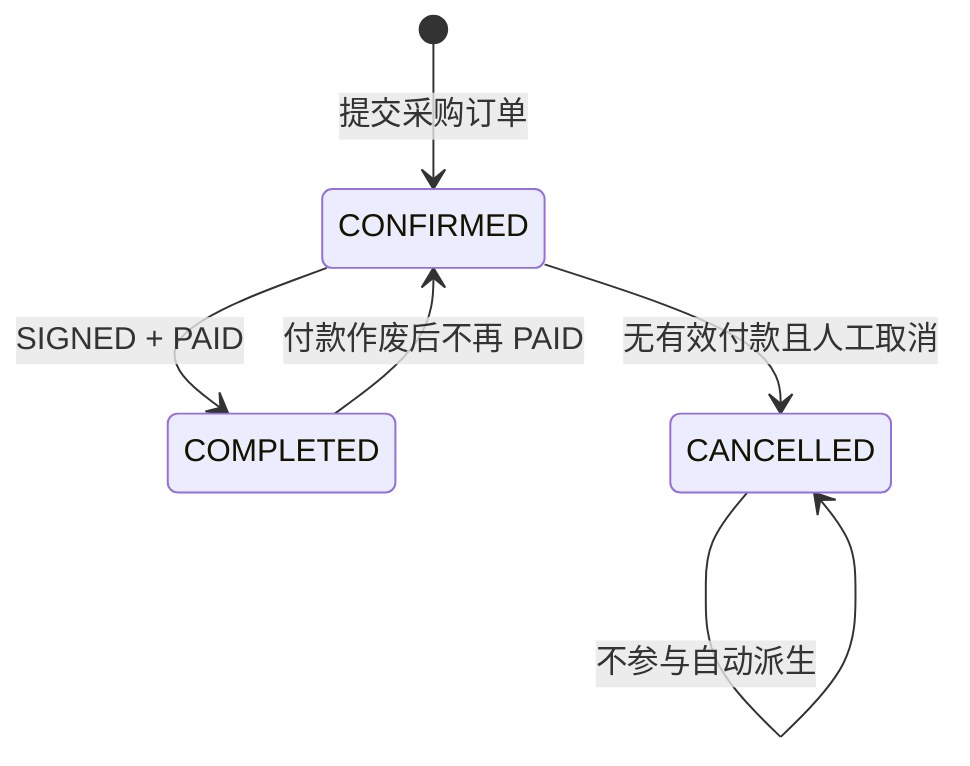

# 采购订单自动完成状态技术设计

## 1. 设计目标

在不新增人工完成入口的前提下，将采购订单 `COMPLETED` 建模为服务端根据 `SIGNED + PAID` 自动维护的订单状态。所有关联字段必须在同一事务、同一次采购订单行锁内写入，数据库约束作为最后一道事实一致性保护。

## 2. 当前架构与变更边界

### 2.1 当前真相源

- 数据模型：`server/prisma/schema.prisma`
- 订单与履约规则：`server/src/modules/purchase-orders/domain/purchase-order-state-machine.ts`
- 履约、付款、付款作废事务：`server/src/modules/purchase-orders/purchase-order-mutation.service.ts`
- 列表待办谓词：`server/src/modules/purchase-orders/purchase-order-query.service.ts`
- 公共契约：服务端 DTO、`server/openapi/openapi.json`、`web/openapi/openapi.json`
- 前端展示：`purchase-order-list.logic.ts`、采购列表页面和 `QsPurchaseOrderDesc` 的详情映射

### 2.2 保持不变

- `PATCH /api/purchase-orders/:purchaseOrderId/order-status` 继续只接受 `CANCELLED`。
- 履约编码继续使用 `SIGNED` 表示“已签收”。
- 付款状态继续由有效付款累计金额派生。
- 状态历史继续写入 `purchase_order_status_history`，审计继续复用 `PURCHASE_ORDER_ORDER_STATUS_CHANGED`。
- 不新增 UI 按钮、路由、权限或第三方依赖。

## 3. 状态模型

### 3.1 订单状态集合

```text
CONFIRMED  已确认
COMPLETED  已完成（系统派生）
CANCELLED  已取消
```

### 3.2 派生函数

在 `purchase-order-state-machine.ts` 新增纯函数：

```ts
derivePurchaseOrderStatus({
  orderStatus,
  fulfillmentStatus,
  paymentStatus,
}): PurchaseOrderStatus
```

规则：

1. 当前为 `CANCELLED` 时始终返回 `CANCELLED`。
2. `fulfillmentStatus === 'SIGNED' && paymentStatus === 'PAID'` 时返回 `COMPLETED`。
3. 其余非取消状态返回 `CONFIRMED`，因此付款作废可将 `COMPLETED` 自动回退。

人工订单状态迁移仍只有 `CONFIRMED -> CANCELLED`；`COMPLETED` 不加入人工迁移表的目标集合。



## 4. 事务设计

### 4.1 核心原则

数据库将增加“`COMPLETED` 必须同时 `SIGNED + PAID`”约束。因此不能先把 `paymentStatus` 从 `PAID` 改为非已付清，再单独回退 `orderStatus`；两个字段必须在一次 `purchaseOrder.update()` 中原子更新。

### 4.2 履约推进

`updateFulfillmentStatus()` 在锁定采购订单后：

1. 校验履约顺序。
2. 使用目标履约状态、当前付款状态计算目标订单状态。
3. 单次更新 `fulfillmentStatus`、派生后的 `orderStatus` 和 `version + 1`。
4. 写入履约状态历史和履约审计。
5. 仅当订单状态发生变化时，追加订单状态历史与订单状态审计。

### 4.3 记录付款与作废付款

将现有 `writePaymentStatus()` 收敛为同时维护付款和派生订单状态的私有方法：

1. 输入重新计算后的目标 `paymentStatus`。
2. 使用当前履约状态计算目标 `orderStatus`。
3. 单次更新 `paymentStatus`、`orderStatus` 和 `version + 1`。
4. 仅对实际变化的维度写状态历史。
5. 仅在订单状态变化时记录自动状态审计。

记录付款和作废付款均复用该方法，因此自动完成与自动回退使用同一规则，不形成两套分支。

### 4.4 自动状态审计

复用 `PURCHASE_ORDER_ORDER_STATUS_CHANGED`，元数据至少包含：

```json
{
  "fromStatus": "CONFIRMED",
  "toStatus": "COMPLETED",
  "automatic": true,
  "trigger": "FULFILLMENT"
}
```

`trigger` 只允许 `FULFILLMENT` 或 `PAYMENT`。触发用户沿用当前请求的 `actorUserId`；未发生订单状态变化时不写历史和审计。

## 5. 数据库设计

### 5.1 Prisma schema

```prisma
enum PurchaseOrderStatus {
  CONFIRMED
  COMPLETED
  CANCELLED
}
```

### 5.2 Migration

新增 migration：

```text
server/prisma/migrations/20260831130000_purchase_order_auto_completion/migration.sql
```

迁移步骤：

1. `BEGIN` 并设置有限的 `lock_timeout`、`statement_timeout`。
2. 对 `purchase_orders` 获取 `ACCESS EXCLUSIVE` 锁，阻断枚举替换窗口中的并发写入。
3. 临时移除依赖 `order_status` 的 `purchase_orders_source_quantity_trigger`；该触发器函数保持不变。
4. 创建包含三种状态的临时 Enum，替换 `order_status` 类型并恢复默认值 `CONFIRMED`。
5. 将现有 `CONFIRMED + SIGNED + PAID` 行回填为 `COMPLETED`。
6. 添加约束 `purchase_orders_completed_requires_signed_paid_check`。
7. 以原名称、时机、延期属性和触发器函数恢复 `purchase_orders_source_quantity_trigger`。
8. 在 `DO` 验证块中校验枚举顺序、完成订单条件及符合条件订单已全部回填。
9. 任一步失败则回滚整个事务。

回填不写状态历史与审计，因为 migration 没有可信业务操作人；该事实在 migration 注释和规格中明确记录。

## 6. 查询与待办设计

- 待办采购的基础订单条件由 `orderStatus != CANCELLED` 收紧为 `orderStatus = CONFIRMED`。
- 默认待办仍要求“未签收或未付清”；具体任务仍按当前履约/付款谓词分类。
- `isPendingPurchaseOrder()` 只对 `CONFIRMED` 返回可能待办。
- 付款作废导致 `COMPLETED -> CONFIRMED` 后，已签收但未付清订单会重新进入“待付款”。
- 全部采购允许用 `orderStatus = COMPLETED` 查询。

## 7. API 与前端设计

### 7.1 OpenAPI

- `PurchaseOrderStatus` 响应和查询枚举增加 `COMPLETED`。
- `PurchaseOrderStatusRequestDto.toStatus` 仍固定为 `CANCELLED`，明确禁止客户端人工完成。
- 执行根契约同步生成 Web 类型，不手写重复 DTO。

### 7.2 Web

- `ORDER_STATUSES` 增加 `COMPLETED`，允许全部采购筛选。
- `orderStatusLabel()` 增加 `COMPLETED: 已完成`。
- `orderStatusTagClass()` 将 `COMPLETED` 映射到与销售订单已完成相同的主色标签。
- 采购详情通过既有 `orderStatusLabel()` 自动显示，无需修改 `QsPurchaseOrderDesc` 公共 API。
- `nextPurchaseOrderFulfillmentStatus()` 对 `COMPLETED` 返回 `null`；当前完成态本身已是 `SIGNED`，该判断用于收紧领域表达。

## 8. 测试策略

### 8.1 失败测试优先

1. 状态机测试：新增枚举后因迁移表不完整或缺少派生函数而失败。
2. Mutation 测试：
   - 已付清订单签收后自动完成；
   - 已签收订单付清后自动完成；
   - 未满足双条件时保持已确认；
   - 完成订单付款作废后自动回退；
   - 作废后仍已付清时保持完成；
   - 状态不变时不重复写订单历史和审计；
   - 付款/履约与订单状态使用同一次 update。
3. Query 测试：待办只查询 `CONFIRMED`。
4. Web 逻辑测试：已完成文案、颜色、筛选序列化和无履约动作。

### 8.2 回归验证

```bash
pnpm -C server test -- purchase-order-state-machine.spec.ts purchase-order-mutation.service.spec.ts purchase-order-query.service.spec.ts --runInBand
pnpm -C server typecheck
node --run contract:sync
node --run contract:check
pnpm -C web exec tsx --test apps/qsmds-arco/test/views/purchase-order-list.logic.test.ts apps/qsmds-arco/test/views/purchase-order-pages.test.ts apps/qsmds-arco/test/views/purchase-order-desc.logic.test.ts
pnpm -C web typecheck
pnpm -C server db:migrate:deploy
pnpm -C server exec prisma migrate status
node --run check
```

应用 migration 后验证 Server `/api/health` 数据库为 `up`、Web 返回 HTTP 200，并在真实页面确认“已完成”筛选项和状态标签。

## 9. 安全与兼容性

- 不接受客户端提交完成条件，服务端只读取已锁定订单事实。
- 不硬编码密钥，不输出数据库连接字符串。
- Enum 替换采用事务和有限锁等待，防止长时间阻塞。
- 数据库约束阻止绕过服务写入不满足条件的 `COMPLETED`。
- 既有 `CONFIRMED`、`CANCELLED` API 值保持兼容；新增值属于已确认的公共 API 扩展。
- 不提供无意义的向后兼容分支或人工完成入口。
