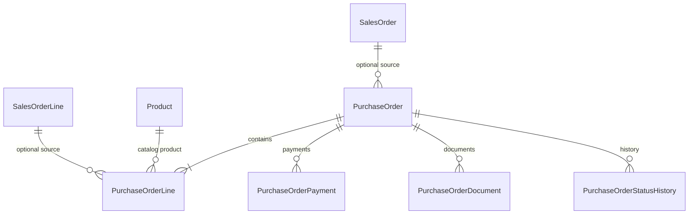
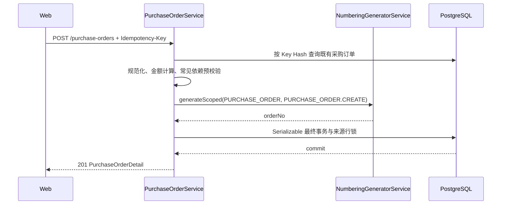

# 采购订单域技术设计

## 1. 文档状态

- 状态：已确认
- 确认日期：2026-08-27
- 需求规格：[采购订单域需求规格](./requirements.md)
- 编号规则：`PURCHASE_ORDER`
- 编号消费者：`PURCHASE_ORDER.CREATE`
- 固定币种：`CNY`
- 业务日期时区：`Asia/Shanghai`

## 2. 设计原则与真相源

| 能力 | 真相源 |
| --- | --- |
| 采购编号 | `NumberingGeneratorService` + `NumberingIssuance` |
| 采购约定 | `PurchaseOrder`、`PurchaseOrderLine` |
| 销售来源 | `SalesOrder.id`、`SalesOrderLine.id` |
| 客户名 | 关联 `SalesOrder.customerName` |
| 产品身份与当前采购成本 | `Product.id`、`Product.purchaseCostAmount` |
| 供应商 | `service_provider.supplier` 字典 Item 稳定 `value` |
| 实际付款 | `PurchaseOrderPayment` |
| 可选付款凭证 | `PurchaseOrderDocument` + `MediaAsset` |
| 状态历史 | `PurchaseOrderStatusHistory` |
| HTTP 契约 | Controller、DTO、OpenAPI decorators |
| Web DTO | Web OpenAPI snapshot 生成类型 |

采购订单使用独立模型和独立状态枚举，不向 `SalesOrder` 添加采购业务字段，不创建独立 Supplier 模型，也不把 `CUSTOM` 产品写入产品域。

## 3. 领域关系



- `PurchaseOrder.salesOrderId` 不唯一，允许一个销售订单对应多张采购订单。
- `PurchaseOrderLine.sourceSalesOrderLineId` 不唯一，允许拆分数量到多张采购订单。
- 所有关联使用 `onDelete: Restrict`、`onUpdate: Restrict`，历史订单不得因主数据清理失去来源。

## 4. 状态模型

```text
PurchaseOrderStatus:
CONFIRMED -> CANCELLED

PurchaseOrderFulfillmentStatus:
PENDING_ORDER -> ORDERED -> PREPARING -> SHIPPED -> SIGNED

PurchaseOrderPaymentStatus:
UNPAID | PARTIALLY_PAID | PAID（由有效付款事实派生）
```

取消订单要求不存在有效付款；订单取消后不再接受履约变化或付款。采购履约不增加质检、退货和补货分支。

## 5. 数据库设计

### 5.1 枚举

```text
PurchaseOrderType: SALES_LINKED | STOCK
PurchaseOrderStatus: CONFIRMED | CANCELLED
PurchaseOrderFulfillmentStatus: PENDING_ORDER | ORDERED | PREPARING | SHIPPED | SIGNED
PurchaseOrderPaymentStatus: UNPAID | PARTIALLY_PAID | PAID
PurchaseOrderLineType: CATALOG | CUSTOM
PurchaseOrderPaymentType: DEPOSIT | BALANCE | OTHER
PurchaseOrderDocumentType: PAYMENT_VOUCHER
PurchaseOrderStatusDimension: ORDER | FULFILLMENT | PAYMENT
```

### 5.2 `PurchaseOrder`

| 字段 | 数据库类型 | 约束 |
| --- | --- | --- |
| `id` | `uuid` | 主键，`gen_random_uuid()` |
| `orderNo` | `varchar(64)` | 非空、唯一 |
| `createIdempotencyKeyHash` | `bytea` | 32 bytes、唯一 |
| `createRequestFingerprintHash` | `bytea` | 32 bytes |
| `purchaseType` | enum | 非空 |
| `salesOrderId` | `uuid?` | `SALES_LINKED` 必填，`STOCK` 为空 |
| `supplierValue` | `varchar(64)` | 非空、非空白，保存字典稳定值 |
| `orderDate` | `date` | 非空，不允许未来业务日期 |
| `currencyCode` | `char(3)` | 固定 `CNY`，外键到 `Currency.code` |
| `shippingMarkText` | `varchar(2000)?` | 空白规范化为 `null` |
| `lineSubtotalAmount` | `decimal(30,4)` | 非负 |
| `purchaseTotalAmount` | `decimal(30,4)` | 等于明细合计 |
| `depositDueAmount` | `decimal(30,4)` | 非负 |
| `balanceDueAmount` | `decimal(30,4)` | 非负 |
| `orderStatus` | enum | 创建时固定 `CONFIRMED` |
| `fulfillmentStatus` | enum | 默认 `PENDING_ORDER` |
| `paymentStatus` | enum | 服务端派生；零元订单为 `PAID` |
| `createdByUserId` | `uuid` | 来自可信 Session |
| `remark` | `varchar(1000)?` | 非空白 |
| `version` | `integer` | `>= 1` |
| `createdAt/updatedAt` | `timestamptz(6)` | 审计时间 |

主表硬约束：

```text
(purchaseType = SALES_LINKED AND salesOrderId IS NOT NULL)
OR
(purchaseType = STOCK AND salesOrderId IS NULL)

currencyCode = CNY
purchaseTotalAmount = lineSubtotalAmount
purchaseTotalAmount = depositDueAmount + balanceDueAmount
```

建议索引：

- 唯一：`orderNo`、`createIdempotencyKeyHash`。
- 列表：`orderDate DESC, id DESC`。
- 待办：`orderStatus, fulfillmentStatus, paymentStatus, orderDate DESC, id DESC`。
- 来源：`salesOrderId, orderDate DESC, id DESC`。
- 供应商：`supplierValue, orderDate DESC, id DESC`。

`paidAmount` 与 `outstandingAmount` 不持久化到主表，由有效付款聚合返回，避免事实表与汇总字段漂移。

### 5.3 `PurchaseOrderLine`

| 字段 | 数据库类型 | 说明 |
| --- | --- | --- |
| `id` | `uuid` | 主键 |
| `purchaseOrderId` | `uuid` | 所属采购订单 |
| `lineNumber` | `smallint` | 正整数，和订单组成唯一键 |
| `lineType` | enum | `CATALOG | CUSTOM` |
| `productId` | `uuid?` | `CATALOG` 必填，`CUSTOM` 为空 |
| `sourceSalesOrderLineId` | `uuid?` | 关联采购必填，备货采购为空 |
| `productNoSnapshot` | `varchar(64)?` | 产品编号快照 |
| `productNameSnapshot` | `varchar(128)` | 非空白 |
| `productAttributesSnapshot` | `jsonb` | 必须为数组 |
| `descriptionSnapshot` | `varchar(1000)?` | 说明快照 |
| `referencePurchaseUnitPriceAmount` | `decimal(30,4)` | 页面“采购定价” |
| `actualPurchaseUnitPriceAmount` | `decimal(30,4)` | 页面“本单采购价” |
| `quantity` | `integer` | 正整数 |
| `lineTotalAmount` | `decimal(30,4)` | 本单采购价乘数量 |
| `createdAt` | `timestamptz(6)` | 创建时间 |

行形状约束：

- `CATALOG`：`productId`、产品编号快照和两个价格均非空。
- `CUSTOM`：`productId`、产品编号快照为空；两个价格非空且完全相等。
- `lineTotalAmount = actualPurchaseUnitPriceAmount * quantity`。
- `(purchaseOrderId, lineNumber)` 唯一。
- `sourceSalesOrderLineId` 建普通索引，不建唯一索引。

跨表规则由最终事务和数据库约束触发器共同保护：

- `SALES_LINKED` 的每条采购行必须引用当前订单 `salesOrderId` 下的销售行。
- `STOCK` 的每条采购行必须没有销售来源。
- 未取消采购订单对同一销售行的数量合计不得超过销售行数量。

### 5.4 快照来源

| 场景 | 名称/编号/属性/说明 | 采购定价 | 本单采购价 |
| --- | --- | --- | --- |
| 关联 `CATALOG` | 销售明细快照 | 当前产品 `purchaseCostAmount` | 用户填写 |
| 关联 `CUSTOM` | 销售明细快照 | 用户填写 | 用户填写且相等 |
| 备货 `CATALOG` | 当前产品档案 | 当前产品 `purchaseCostAmount` | 用户填写 |
| 备货 `CUSTOM` | 用户填写 | 用户填写 | 用户填写且相等 |

正式产品确认时必须重新校验 `Product.status = ACTIVE`、采购成本存在、成本币种为 `CNY`，且产品供应商等于订单供应商。历史快照在产品改名、调价或停用后保持不变。

### 5.5 `PurchaseOrderPayment`

- 保存 `purchaseOrderId`、`paymentType`、`amount`、`paidAt`、`paymentMethod`、`remark`、创建人与时间。
- `paymentMethod` 保存 `payment.method` 字典稳定值，并在付款事务内校验有效性。
- 作废使用 `voidedAt`、`voidedByUserId`、`voidReason`，不物理删除。
- 金额必须大于零；写入时锁定采购订单并聚合全部有效付款，累计金额不得超过采购总价。
- 付款状态由有效付款合计派生，并由延迟约束触发器验证父表状态与事实一致。

### 5.6 `PurchaseOrderDocument`

- 首期只使用 `PAYMENT_VOUCHER`；付款凭证本身可选，但一旦创建凭证记录，必须关联且只能关联同一采购订单下的 `paymentId`。
- 显式关联 `purchaseOrderId + mediaAssetId`，不复用 `ProductMedia.id`。
- 保存标题、备注、创建/解除操作人和时间；解除为软解除。
- 付款凭证可选，缺少凭证不影响付款记录创建。
- 内容读取必须同时验证订单、凭证关联、媒体状态和调用方采购读取权限。

### 5.7 `PurchaseOrderStatusHistory`

- 保存 `purchaseOrderId`、状态维度、旧值、新值、原因、操作人和变化时间。
- 订单取消、履约变化和付款状态派生均写入历史。
- 不提供物理删除接口。

## 6. 金额模型

领域内部继续使用四位十进制整数单位，用户输入只接受规范十进制字符串：

```text
lineTotalAmount = actualPurchaseUnitPriceAmount * quantity
lineSubtotalAmount = sum(lineTotalAmount)
purchaseTotalAmount = lineSubtotalAmount
purchaseTotalAmount = depositDueAmount + balanceDueAmount
paidAmount = sum(active payment.amount)
outstandingAmount = purchaseTotalAmount - paidAmount
```

- CNY 用户输入最多两位小数，规范化后保存四位。
- 客户端可以提交手填 `purchaseTotalAmount`、定金和尾款，但服务端必须重新计算并硬比较。
- `CUSTOM` 两个价格在规范化到四位后必须相等。
- 零元订单不创建付款记录，付款状态直接派生为 `PAID`。

## 7. 销售来源与并发数量

采购域提供只返回最小字段的销售来源查询，不要求调用方拥有完整销售订单读取权限。销售来源只包含 `CONFIRMED` 且未取消订单。

```text
remainingQuantity
= salesOrderLine.quantity
- sum(
    purchaseOrderLine.quantity
    where sourceSalesOrderLineId = current line
      and purchaseOrder.orderStatus != CANCELLED
  )
```

最终创建事务使用 `Serializable`，并按销售行 UUID 稳定排序后加行锁：

1. 锁定全部来源销售行。
2. 校验来源行属于当前销售订单。
3. 聚合未取消采购数量。
4. 加入本次请求数量并校验不超量。
5. 重新校验产品、供应商、采购成本和字典状态。
6. 写入采购订单与明细。

取消订单时使用同一来源行锁顺序，保证取消释放数量和并发创建不会互相穿透。

## 8. 创建事务与编号幂等



请求指纹绑定创建人、采购类型、销售订单、供应商、日期、唛头、规范化明细、金额约定和备注。服务端不接受客户端订单号，也不保存或记录幂等键原文。

预校验发生在发号前；编号域发号后最终事务仍需重校验全部可变依赖。最终事务失败允许形成编号域可审计断号，同一 Key 重试继续复用原编号。

## 9. 权限设计

```text
purchase-orders:read
purchase-orders:create
purchase-orders:create-stock
purchase-orders:update
purchase-orders:payment
purchase-orders:document
```

- `purchase-orders:create-stock` 标记 `systemOnly = true`，只 seed 给稳定角色 `system_admin`。
- 创建接口基础要求 `purchase-orders:create`；当 `purchaseType = STOCK` 时，服务层在最终事务中再次要求 `purchase-orders:create-stock`。
- Web 仅在拥有 `purchase-orders:create-stock` 时显示“新增备货采购”，但按钮隐藏不是授权边界。
- 销售来源查询、采购产品选项和相应媒体读取使用采购域权限，不复用销售订单创建权限。

## 10. 公共 API

| Method | Path | Permission | Purpose |
| --- | --- | --- | --- |
| `GET` | `/api/purchase-orders` | `purchase-orders:read` | `view=all|pending` 分页筛选 |
| `GET` | `/api/purchase-orders/:purchaseOrderId` | `purchase-orders:read` | 采购订单详情 |
| `GET` | `/api/purchase-orders/product-options` | `purchase-orders:create` | 按供应商选择 CNY 采购产品 |
| `GET` | `/api/purchase-orders/source-sales-orders` | `purchase-orders:create` | 最小销售来源列表 |
| `GET` | `/api/purchase-orders/source-sales-orders/:salesOrderId/lines` | `purchase-orders:create` | 可同步行及剩余数量 |
| `POST` | `/api/purchase-orders` | `purchase-orders:create` | 幂等确认创建采购订单 |
| `PATCH` | `/api/purchase-orders/:purchaseOrderId/order-status` | `purchase-orders:update` | 取消订单 |
| `PATCH` | `/api/purchase-orders/:purchaseOrderId/fulfillment-status` | `purchase-orders:update` | 顺序推进履约状态 |
| `POST` | `/api/purchase-orders/:purchaseOrderId/payments` | `purchase-orders:payment` | 新增实际付款并可选关联凭证 |
| `POST` | `/api/purchase-orders/:purchaseOrderId/payments/:paymentId/void` | `purchase-orders:payment` | 作废实际付款 |
| `POST` | `/api/purchase-orders/document-uploads` | `purchase-orders:document` | 上传未关联可选凭证 |
| `DELETE` | `/api/purchase-orders/:purchaseOrderId/documents/:documentId` | `purchase-orders:document` | 软解除付款凭证 |
| `GET/HEAD` | `/api/purchase-orders/:purchaseOrderId/documents/:documentId/content` | `purchase-orders:read` | 私有凭证内容读取 |

创建请求不包含 `orderNo` 或可选币种。`CATALOG` 的采购定价不信任客户端，服务端按产品档案生成；`CUSTOM` 请求必须携带两个相等的价格。

“待办采购”固定谓词：

```text
orderStatus != CANCELLED
AND (fulfillmentStatus != SIGNED OR paymentStatus != PAID)
```

## 11. Web 设计与组件边界

### 11.1 当前页面

- `/qs-operations/purchase/pending-purchase-orders` 使用 Server `view=pending` 查询尚未签收或尚未付清的采购订单。
- `/qs-operations/purchase/purchase-orders` 使用 Server `view=all` 查询全部采购订单，并提供销售关联采购与管理员备货采购入口。
- `/qs-operations/purchase/purchase-orders/create` 是隐藏创建页，按路由 `type=SALES_LINKED|STOCK` 收窄创建能力。
- 两个列表共用查询、筛选、移动卡片和详情抽屉；详情抽屉承载履约、付款、凭证和状态历史。

### 11.2 Web 实现边界

- 复用 `QsProductSelector` 和 `QsOrderProductLineEditor`，组件继续保持业务中立。
- 将 `ProductSelectorCurrency` 扩展为包含 `CNY`，采购域提供独立 loader。
- 增加行级采购定价编辑策略：`CATALOG` 只读，`CUSTOM` 必填且可编辑。
- 销售订单 `CUSTOM` 行标准价为空的现有行为必须保持不变。
- 创建入口分为“新增销售关联采购”和“新增备货采购”，后者受 system-only 权限控制。
- 详情与写操作分别使用 `purchase-orders:read`、`purchase-orders:update`、`purchase-orders:payment` 和 `purchase-orders:document` 权限；客户端隐藏不作为授权边界。
- 付款凭证保持可选；付款、作废、取消和履约均使用显式确认，写成功后重新查询当前列表。
- 视觉继续沿用现有 Industrial/utilitarian 工作台、主题 Token、Noto 字体和 Lucide 图标。

## 12. 测试策略

- 纯函数：金额、数量、`CUSTOM` 双价格相等、请求指纹、待办谓词和状态机。
- Schema：枚举、表、外键、索引、类型形状、CNY、金额等式、付款汇总和销售来源数量触发器。
- Service：幂等重放、发号时机、产品/供应商漂移、销售来源归属、超量采购、管理员备货权限、取消释放数量。
- API：DTO 白名单、权限、CSRF、错误矩阵、OpenAPI operationId 和响应契约。
- Web logic：CNY 产品映射、来源同步、剩余数量、`CUSTOM` 价格错误、两类创建入口和错误回显。
- E2E：销售关联创建、管理员备货创建、普通用户拒绝、并发数量竞争、付款与作废、待办列表退出条件。

## 13. 安全、迁移与实施门禁

- 数据库变更只能使用新的 append-only migration，不修改既有销售订单迁移。
- Migration 必须同时 seed 权限并只把 `purchase-orders:create-stock` 授予 `system_admin`。
- 审计元数据不得包含幂等 Key 原文、完整唛头、凭证内容或完整请求体。
- Schema、migration 和公共 API 的实际修改必须在 Phase 4 前单独获得用户授权。
- 本设计确认不授权 push、merge、发布或部署。
