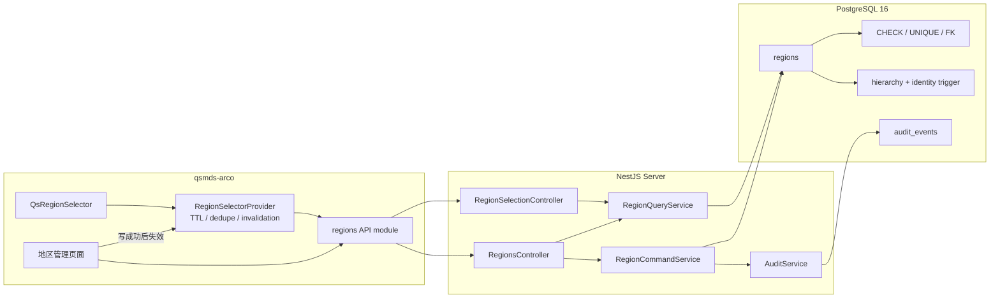
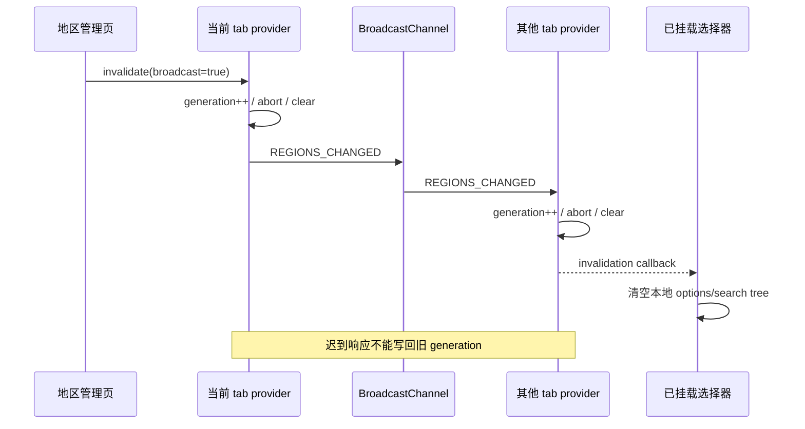
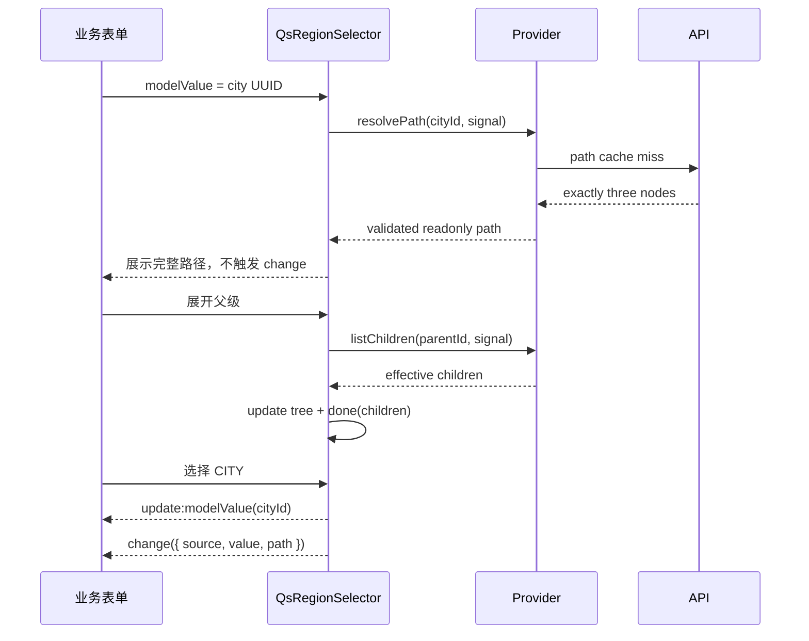

# 地区选择器与地区管理技术设计

## 1. 文档状态

- 状态：技术设计已实施并验收（2026-07-28）
- 需求基线：`requirements.md` 已确认
- 目标分支：`feat/region-selector-management`
- 正式 Web 应用：`web/apps/qsmds-arco`
- Server：`server`
- 真实业务入口：`/system/basic-data/regions`
- 公共业务组件：`QsRegionSelector`
- 实施计划：`tasks.md`（已完成）

本文记录已经实施并通过验收的技术契约。后续变更不得在未更新并重新确认本文的情况下
改变三级结构、种子数量、公共 value、公共 API、权限或缓存边界。

## 2. 设计目标与边界

### 2.1 目标

1. 用 PostgreSQL 最终约束
   `COUNTRY_REGION → PROVINCE_STATE → CITY`，不能只依赖前端或 Service 自觉。
2. 让空库和升级库通过不可变 migration 得到同一份 602 节点首期数据，并能追溯来源、
   许可证、摘要和转换过程。
3. 为正常登录用户提供按需加载、搜索和历史路径回显接口；不要求地区管理权限。
4. 为管理员提供受 `regions:*` 保护的查询、创建、编辑和启停接口，并在同一事务审计。
5. 让 `QsRegionSelector` 只向业务调用方暴露 `CITY UUID | null`，组件不暴露 Arco
   类型、不读取页面 Store、不内置写操作。
6. 把“地区管理”实现为真实业务页面，并继续复用现有 Fa、Arco、Qs 视觉与交互体系。
7. 在首期仅 602 个节点时保持实现简单，同时确保未来增加其他国家/地区时不下载全量
   城市、不修改 schema、不改变组件 value。

### 2.2 明确边界

- 固定三层，不设计第四层。
- `effectiveEnabled` 是查询结果，不是持久化字段。
- 不提供物理删除、移动节点、修改层级或修改技术编码。
- 不实现批量导入、在线同步、地图、经纬度、时区、邮编或运费区域。
- 不新增 Repository、UseCase、Pinia Store 或查询库。
- 不修改其余四个基础数据空页面的业务内容。
- 组件库 Showcase 使用显式 fixture provider，不访问正式业务 API，也不替代真实页面。

### 2.3 真相源优先级

1. 已确认的 `requirements.md`，包括固定来源、摘要、转换规则和数量。
2. `server/prisma/schema.prisma` 与已提交 migration。
3. Controller DTO、`ApiApplicationContract` 与生成的 OpenAPI 契约。
4. `web/apps/qsmds-arco/src/api/generated/types.gen.ts`。
5. 正式应用中的 Fa、Arco、Qs 组件实际源码和运行行为。
6. 本文定义的组件领域类型、provider 和页面组合边界。

README、Showcase 和手写示例不得覆盖上述真相源。

## 3. 总体架构



Server 继续采用仓库现有的
`Controller → Service → PrismaService → PostgreSQL`，不增加无必要的抽象层。
选择器的只读缓存只存在于 Web provider；Server 响应保持
`private, no-store`，地区管理查询始终以数据库当前状态为准。

## 4. 领域模型与不变量

### 4.1 层级

| `level` | `parentId` | 合法父级 | 可否作为最终 value |
| --- | --- | --- | --- |
| `COUNTRY_REGION` | 必须为 `null` | 无 | 否 |
| `PROVINCE_STATE` | 必须非空 | `COUNTRY_REGION` | 否 |
| `CITY` | 必须非空 | `PROVINCE_STATE` | 是 |

以下字段构成节点身份，创建后不可修改：

- `id`
- `code`
- `level`
- `parentId`

名称、英文名和排序可编辑；`enabled` 只能通过独立启停命令修改。来源字段和行政类型由
种子或后续显式数据 migration 管理，不进入首期管理表单。

### 4.2 状态

```text
COUNTRY_REGION.effectiveEnabled = country.enabled
PROVINCE_STATE.effectiveEnabled = country.enabled && province.enabled
CITY.effectiveEnabled = country.enabled && province.enabled && city.enabled
```

禁用父级只更新目标行的 `enabled`，不批量改写后代。管理查询同时返回 `enabled` 和
`effectiveEnabled`；业务 options 和搜索只返回 `effectiveEnabled=true`，历史 path
不按状态过滤。

### 4.3 归一化

显示文本 normalizer 用于 `name`、`englishName` 和 `sourceName`：

1. Unicode NFC；
2. 首尾空白删除；
3. 连续 Unicode whitespace 折叠为一个 ASCII 空格；
4. 保留显示大小写和文字，不做拼音、翻译或繁简转换。

`normalizedName` 在上述显示结果上执行
`toLocaleLowerCase('en-US')`，再做一次 NFC，并重新执行非空和 128 code points
上限校验。固定 `en-US` 是名称比较 locale，不受进程或数据库默认 locale 影响。

`code` 先 trim、转大写，再匹配：

```text
^[A-Z0-9][A-Z0-9._-]{1,63}$
```

Server normalizer 和 seed generator 使用同一套 golden vectors 验证，覆盖中英文、
全角/组合字符、连续 Unicode 空白、`É/é`、`İ/i̇` 和普通 Latin 大小写。同一 parent
下 `normalizedName` 唯一；根节点另用 partial unique index 处理
`parentId IS NULL`。

长度统一按 Unicode code points 而不是 UTF-16 code units 计算；DTO 使用项目内自定义
validator/normalizer，数据库用 `char_length` 兜底。`name` 为 1..128；
`englishName` 和 `sourceName` 为 `null` 或 1..128 code points。创建时省略的
`englishName` 存为 `null`；创建或编辑时显式提交且规范化后为空也存为 `null`；
update 中省略字段仍表示不修改。

## 5. 数据库设计

### 5.1 Prisma 模型

```prisma
enum RegionLevel {
  COUNTRY_REGION
  PROVINCE_STATE
  CITY

  @@map("region_level")
}

model Region {
  id                 String      @id @default(dbgenerated("gen_random_uuid()")) @db.Uuid
  code               String      @unique(map: "regions_code_key") @db.VarChar(64)
  name               String      @db.VarChar(128)
  normalizedName     String      @map("normalized_name") @db.VarChar(128)
  englishName        String?     @map("english_name") @db.VarChar(128)
  sourceName         String?     @map("source_name") @db.VarChar(128)
  sourceCode         String?     @map("source_code") @db.VarChar(64)
  administrativeType String      @map("administrative_type") @db.VarChar(64)
  level              RegionLevel
  parentId           String?     @map("parent_id") @db.Uuid
  enabled            Boolean     @default(true)
  sortOrder          Int         @default(0) @map("sort_order")
  createdAt          DateTime    @default(now()) @map("created_at") @db.Timestamptz(6)
  updatedAt          DateTime    @default(now()) @updatedAt @map("updated_at") @db.Timestamptz(6)

  parent   Region?  @relation(
    "RegionHierarchy",
    fields: [parentId],
    references: [id],
    onDelete: Restrict,
    onUpdate: Restrict
  )
  children Region[] @relation("RegionHierarchy")

  @@unique(
    [parentId, normalizedName],
    map: "regions_parent_id_normalized_name_key"
  )
  @@index(
    [parentId, sortOrder, normalizedName, id],
    map: "regions_parent_id_sort_order_name_id_idx"
  )
  @@index(
    [level, enabled, normalizedName, id],
    map: "regions_level_enabled_name_id_idx"
  )
  @@map("regions")
}
```

仅层级使用数据库 enum。`administrativeType` 使用受长度和格式约束的字符串，避免未来
增加其他国家行政类型时修改 schema。管理 API 创建的节点按层级生成
`COUNTRY_REGION`、`PROVINCE_STATE` 或 `CITY` 通用行政类型；正式来源可使用
`PROVINCE`、`AUTONOMOUS_REGION`、`DIRECT_ADMIN_COUNTY_LEVEL`、
`ADMINISTRATIVE_DISTRICT` 等准确值。

### 5.2 数据库约束

Migration 使用稳定名称建立以下约束，便于测试和安全错误映射：

| 约束 | 目的 |
| --- | --- |
| `regions_code_format_check` | `code` 格式 |
| `regions_name_nonblank_check` | `name` 不为空白 |
| `regions_normalized_name_nonblank_check` | 归一化名称不为空白 |
| `regions_english_name_nonblank_check` | 非空英文名不能只含空白 |
| `regions_source_name_nonblank_check` | 非空来源名不能只含空白 |
| `regions_source_code_ascii_check` | `sourceCode` 为非控制 ASCII |
| `regions_administrative_type_format_check` | 行政类型为稳定大写技术值 |
| `regions_sort_order_nonnegative_check` | `sortOrder >= 0` |
| `regions_parent_shape_check` | 根无父级、二三级必须有父级 |
| `regions_no_self_parent_check` | 禁止自引用 |
| `regions_parent_id_fkey` | 父级存在，更新/删除 `RESTRICT` |

PostgreSQL 普通 unique 不会让多个 `NULL` 互斥，因此额外建立：

```sql
CREATE UNIQUE INDEX "regions_root_normalized_name_key"
  ON "regions" ("normalized_name")
  WHERE "parent_id" IS NULL;
```

### 5.3 规范化责任与层级 trigger

Node Service 是管理写入 normalizer，seed generator 是 migration 写入 normalizer；
两者必须先产生规范化后的显示字段和 `normalizedName`，再交给 Prisma/SQL。数据库不
使用环境相关的 `lower()` 重算 `en-US` 比较键，避免 Node、libc 和 ICU 版本产生隐式
差异；数据库负责字段长度/非空检查和 `normalizedName` unique 最终冲突。

正式运行时不支持绕过 Service 的直接维护 SQL。后续数据 migration 必须复用同一
normalizer/golden vectors，并由 E2E 对库内 `name`、`englishName`、`sourceName` 和
`normalizedName` 做 canonical 扫描；不规范的生成资产在部署前失败。

另建 `enforce_region_hierarchy()`：

1. `UPDATE` 如改变 `id`、`code`、`level` 或 `parentId`，以
   `regions_identity_immutable_check` 拒绝。
2. 根节点只接受 `parentId IS NULL`。
3. 二三级先用 `SELECT ... FOR SHARE` 读取父级。
4. 父级不存在按 FK 失败；父级层级不匹配按
   `regions_hierarchy_check` 失败。
5. `BEFORE INSERT OR UPDATE OF id, code, level, parent_id` 执行。

父级 identity 不可修改、删除受 FK 约束，且每层只允许指向固定上一层，因此错层、
孤儿、自引用和循环均无法形成。Service 仍先做同样的业务预校验，以便返回中文稳定
错误；trigger 是并发写和直接 SQL 的最终防线。

## 6. Migration 与种子设计

### 6.1 两段向前 migration

实现拆成两份不可变 migration：

```text
server/prisma/migrations/<timestamp>_regions_schema_and_permissions/
server/prisma/migrations/<timestamp>_regions_seed/
```

第一份创建 enum、表、函数、trigger、索引、审计事件和权限；第二份只写固定种子并做
数量与关键路径断言。两份 SQL 都显式使用事务，任意一步失败不得留下部分状态。

已经提交的 migration 不得被后续数据更新改写。地区数据更新必须新增 forward
migration，并明确保护管理员维护过的数据。

### 6.2 可审计数据资产

```text
server/prisma/region-data/
├── README.md
├── manifest.json
├── regions.seed.json
└── sources/
    ├── china-mainland-codes.json
    ├── taiwan-counties.xml
    └── malaysia-state-district.csv

server/scripts/region-data/
└── generate-region-seed.mjs
```

`manifest.json` 固定记录：

- source URL、commit、快照日或数据发布日期；
- license、归属和不得暗示官方背书的说明；
- 三份原始文件 SHA-256；
- `transformVersion`；
- 固定 UUID namespace；
- 各数据域、各 level 的预期数量；
- 关键路径和来源 code。

原始快照、manifest、canonical `regions.seed.json`、转换脚本和生成后的 migration SQL
一并提交。脚本只使用 Node 内置模块，不新增依赖；运行时、构建、启动和 migration
都不访问网络。

### 6.3 确定性转换

- 转换前先校验三份原始文件 SHA-256，不匹配立即失败。
- 使用固定 UUID namespace
  `9acbca9a-32e2-4d7c-b00f-26a2e0dc5c1e`，按 RFC 4122 UUIDv5 对
  `region:<code>` 生成 ID。
- 先生成、校验和稳定排序 canonical JSON，再生成 SQL。
- SQL 按 3 个根、48 个省州、551 个城市分三批插入，不能依赖同一批多行 INSERT
  的 trigger 可见顺序。
- 不使用 `ON CONFLICT DO NOTHING`；任何漂移或冲突都必须使 migration 失败。
- 末尾用 SQL 断言逐数据域数量、总量、唯一 code 和关键路径。

固定数量：

| Level | 中国大陆 | 中国台湾 | 马来西亚 | 合计 |
| --- | ---: | ---: | ---: | ---: |
| `COUNTRY_REGION` | 1 | 1 | 1 | 3 |
| `PROVINCE_STATE` | 31 | 1 | 16 | 48 |
| `CITY` | 369 | 22 | 160 | 551 |
| 总节点 | 401 | 24 | 177 | 602 |

强制关键路径至少包括：

```text
中国 → 北京市 → 北京市
中国台湾 → 台湾 → 高雄市
马来西亚 → <固定州区> → <固定行政区>
```

台湾高雄节点保留来源代码 `E` / `64000`，技术编码固定为 `TW-64000`。
台湾节点的单一 `sourceCode` 使用可逆格式
`<countycode>/<countycode01>`，例如高雄市为 `E/64000`；
`manifest.json` 同时记录两个原字段名，避免把两个官方 code 压缩成不可追溯值。

### 6.4 权限与审计 enum

第一份 migration 新增：

```text
regions:read
regions:create
regions:update
regions:enable
regions:disable
```

五项均为 `systemOnly=false`，以支持正式的地区管理员和部分写权限角色；migration
默认全部授予内置 `system_admin`。权限延续现有连续固定 UUID，并加入
`MANAGEMENT_PERMISSION_CODES`：

```text
00000000-0000-4000-8000-000000000113  regions:read
00000000-0000-4000-8000-000000000114  regions:create
00000000-0000-4000-8000-000000000115  regions:update
00000000-0000-4000-8000-000000000116  regions:enable
00000000-0000-4000-8000-000000000117  regions:disable
```

由于它们不是 `systemOnly` 权限，migration 必须显式写入内置 `system_admin` 的 grant，
不能依赖首个认证 migration 中只授予 `system_only=true` 权限的历史语句。

审计 enum 新增：

```text
REGION_CREATED
REGION_UPDATED
REGION_ENABLED
REGION_DISABLED
```

## 7. Server 模块设计

### 7.1 文件与依赖

```text
server/src/modules/regions/
├── dto/
│   ├── region-command.dto.ts
│   ├── region-management.dto.ts
│   ├── region-selection.dto.ts
│   └── region.dto.ts
├── region.normalizer.ts
├── region.persistence-error.mapper.ts
├── region-query.service.ts
├── region-command.service.ts
├── region-selection.controller.ts
├── regions.controller.ts
└── regions.module.ts
```

`RegionsModule` 导入 `PrismaModule` 和已经导出 `AuditService` 的 `AuthModule`，并注册到
`server/src/http.modules.ts`。正式应用与 OpenAPI preview 共用该模块清单。

全局 `ValidationPipe` 的 `whitelist + forbidNonWhitelisted + 422` 继续作为 DTO 边界。
路径 UUID 使用 `RegionIdParamDto + @IsUUID()`，不使用会返回默认 400 的
`ParseUUIDPipe`。

### 7.2 选择接口

选择接口只要求正常 Session，使用 `@RequireAuthenticatedSession()`；不声明
`regions:*`，仍受强制改密、全局认证、请求 ID 和安全错误边界保护。

| Method | Path | `operationId` | 成功响应 |
| --- | --- | --- | --- |
| GET | `/api/region-selection/options?parentId=` | `region_selection_options_list` | `RegionOptionDto[]` |
| GET | `/api/region-selection/search?query=&limit=` | `region_selection_search` | `RegionSearchResponseDto` |
| GET | `/api/region-selection/paths/:cityId` | `region_selection_path_get` | `RegionPathDto` |

全部声明：

```text
session: required
authorization: false
validation: true
privateNoStore: true
```

查询语义：

- `options` 省略 `parentId` 时返回有效根；指定父级时只返回其有效直属下级。
- 父级不存在返回 `REGION_PARENT_NOT_FOUND`；父级为 `CITY` 返回
  `REGION_HIERARCHY_INVALID`。
- 父级自身或祖先停用时返回空 options。
- `search` 只返回三层均启用的 `CITY` 完整路径；匹配范围覆盖 city、province/state、
  country/region 三个路径节点各自的名称、英文名和 code。
- 名称和英文名使用规范化后的 case-insensitive substring；code 同时支持转大写后的
  exact 和 substring。全部条件参数化，不拼接用户输入 SQL。
- 搜索词执行与名称一致的 NFC、trim、空白折叠；至少一个有效字符。
- `limit` 默认 20、最大 50，读取 `limit + 1` 计算 `hasMore`。
- `path` 不过滤状态，必须返回恰好三层；不存在和非 CITY 使用不同错误。
- options 固定按 `sortOrder ASC, normalizedName ASC, id ASC` 排序。
- search 先按最小命中等级排序：exact code/name、prefix、substring；同等级再依次按
  country、province/state、city 各自的 `sortOrder, normalizedName, id` 排序。
  `limit + 1` 必须应用在完整稳定排序之后。

### 7.3 管理接口

| Method | Path | Permission | 成功响应 |
| --- | --- | --- | --- |
| GET | `/api/regions/navigation` | `regions:read` | `RegionNavigationNodeDto[]` |
| GET | `/api/regions` | `regions:read` | `RegionPageDto` |
| GET | `/api/regions/:regionId` | `regions:read` | `RegionDto` |
| POST | `/api/regions` | `regions:create` | `201 RegionDto` |
| PATCH | `/api/regions/:regionId` | `regions:update` | `200 RegionDto` |
| POST | `/api/regions/:regionId/enable` | `regions:enable` | `200 RegionMutationResultDto` |
| POST | `/api/regions/:regionId/disable` | `regions:disable` | `200 RegionMutationResultDto` |

`navigation` 一次返回全部国家/地区及其直属省/州的嵌套结构，包含停用节点，不返回
城市。未来全球数据下左侧导航仍只承载前两层。

`GET /regions` 查询参数：

```ts
interface RegionListQuery {
  parentId?: string
  query?: string
  code?: string
  ownStatus?: 'ENABLED' | 'DISABLED'
  availability?: 'EFFECTIVE' | 'ANCESTOR_DISABLED'
  page?: number
  pageSize?: number
  sortBy?: 'code' | 'name' | 'sortOrder' | 'updatedAt'
  sortOrder?: 'asc' | 'desc'
}
```

- 省略 `parentId` 表示根；Server 根据 parent 推导目标 level，不接受客户端另传 level。
- 搜索和筛选只作用于当前 parent 的直属下级。
- `code` 是精确查询，用于创建结果未知后的 read-after-write。
- `ownStatus` 只过滤目标节点自身 `enabled`。
- `availability=EFFECTIVE` 表示目标及全部祖先均启用；
  `ANCESTOR_DISABLED` 只表示目标自身启用但至少一个祖先停用。
- `ownStatus=DISABLED` 与任意 `availability` 组合互斥，DTO 返回
  `422 VALIDATION_FAILED`；页面不会构造该组合。
- 默认 `page=1`、`pageSize=20`，最大 `pageSize=100`。
- 默认稳定排序与 options 一致；自定义排序始终追加 `id` 作为最终 tie-breaker。
- `count + rows` 在同一 interactive transaction 中完成并应用现有 query timeout。

写接口继续启用 CSRF；启停 body 复用 `EmptyRequestDto`。本期没有 `DELETE`。

### 7.4 DTO

```text
RegionOptionDto:
  id, parentId, code, name, englishName, level,
  enabled, effectiveEnabled, hasChildren

RegionPathNodeDto:
  id, parentId, code, name, englishName, level,
  enabled, effectiveEnabled, hasChildren

RegionPathDto:
  cityId, path[exactly 3]

RegionSearchItemDto:
  cityId, path[exactly 3]

RegionSearchResponseDto:
  items, limit, hasMore

RegionNavigationNodeDto:
  id, parentId, code, name, englishName, level,
  enabled, effectiveEnabled, children

RegionDto:
  id, parentId, code, name, englishName, sourceName, sourceCode,
  administrativeType, level, enabled, effectiveEnabled,
  sortOrder, createdAt, updatedAt

RegionPageDto:
  items, page, pageSize, total

RegionMutationResultDto:
  region, affectedCount
```

Command DTO：

```text
CreateRegionRequestDto:
  parentId: uuid | null   // 必填；null 表示创建根
  code: string            // 2..64；Service 规范化为大写
  name: string            // 1..128 code points
  englishName?: string    // 规范化后 null 或 1..128 code points
  sortOrder: integer      // 0..2147483647
  enabled: boolean

UpdateRegionRequestDto:
  name?: string
  englishName?: string | null // 非空时 1..128 code points
  sortOrder?: integer
```

空 patch 返回 `422 VALIDATION_FAILED`。`code`、`parentId`、`level` 和 `enabled`
不出现在 update DTO；额外字段由全局边界拒绝。

### 7.5 查询实现

固定三层使用显式 self join，而不是递归加载全树：

- options：读取目标 parent 的 ancestry，再查询直属 children。
- search：`CITY → PROVINCE_STATE → COUNTRY_REGION` 两次 join，三层同时过滤
  `enabled=true`。
- path：按 UUID 读取 city 及两级 parent，不过滤 `enabled`。
- navigation：查询 level 1/2 后在 Service 组装，按稳定顺序返回。
- management list：按 parent 和推导 level 查询，并显式计算 `effectiveEnabled`。

首期 551 个城市且搜索上限 50，先使用 `level + enabled` 和 parent 索引做有界扫描。
不为未证明的规模引入 `pg_trgm`；全球数据达到需要时再以独立 migration 和性能证据
增加索引。

### 7.6 写事务与并发

所有真实 mutation 使用 interactive transaction：

```text
applyTransactionTimeouts
→ 以稳定顺序加锁
→ 业务预校验
→ 写 Region
→ 写 Audit
→ commit
```

创建：

- `parentId=null` 推导根；根/省州分别推导下一层；CITY 下创建拒绝。
- parent 使用 `FOR SHARE`。
- 预查 code 和 sibling normalized name；数据库 unique 处理并发最终冲突。

编辑：

- 目标使用 `FOR UPDATE`。
- 只接受名称、英文名和排序。
- 实际无变化时幂等返回，不写空审计。

启停：

- 读取目标 ancestry 和 subtree。
- 对“祖先链 ∪ subtree”按 UUID 稳定排序后加锁，避免并发启停形成反向锁序。
- 只更新目标 `enabled`。
- 在内存计算 subtree 前后 `effectiveEnabled`，`affectedCount` 是有效状态发生变化的
  节点数。
- 已处于目标状态时幂等返回，不写重复审计。

数据库写或 Audit 任一失败，事务整体回滚。写请求不做客户端自动重试。

### 7.7 审计

| 操作 | Event | `changedFields` | `affectedCount` |
| --- | --- | --- | ---: |
| 创建 | `REGION_CREATED` | 实际创建字段排序后逗号连接 | 1 |
| 编辑 | `REGION_UPDATED` | 实际变化字段排序后逗号连接 | 1 |
| 启用 | `REGION_ENABLED` | `enabled` | 有效状态变化节点数 |
| 禁用 | `REGION_DISABLED` | `enabled` | 有效状态变化节点数 |

统一使用：

```text
targetType = "Region"
targetId = region.id
actor = trusted Session userId
metadata = changedFields, level, affectedCount
```

metadata 只包含现有 Audit 允许的标量，不记录完整请求体、名称前后值、token、Cookie
或内部异常。

### 7.8 稳定错误

| HTTP | `code` | 场景 |
| ---: | --- | --- |
| 400 | `BAD_REQUEST` | malformed JSON 或请求格式无法解析 |
| 404 | `REGION_NOT_FOUND` | 目标或 path value 不存在 |
| 404 | `REGION_PARENT_NOT_FOUND` | parent 不存在 |
| 409 | `REGION_CODE_ALREADY_EXISTS` | 全局 code 冲突 |
| 409 | `REGION_NAME_ALREADY_EXISTS` | 同 parent 规范化名称冲突 |
| 409 | `REGION_STATE_CHANGED` | serialization、deadlock、lock timeout |
| 422 | `REGION_HIERARCHY_INVALID` | 父子层级错误或 CITY 下创建 |
| 422 | `REGION_VALUE_NOT_CITY` | path 输入存在但不是 CITY |
| 422 | `VALIDATION_FAILED` | DTO、格式、长度、空 patch 或负排序 |
| 500 | `INTERNAL_ERROR` | 未知数据库或审计失败 |

`region.persistence-error.mapper.ts` 只识别白名单 Prisma code、structured target、
PostgreSQL SQLSTATE 和已知 constraint；响应与安全日志不包含 SQL、constraint 名、
Prisma message 或驱动堆栈。每个 Controller endpoint 在
`ApiApplicationContract.errors` 中显式列出可能错误。

最低映射：

```text
P2002 + code target                              → REGION_CODE_ALREADY_EXISTS
P2002 + parentId/normalizedName target           → REGION_NAME_ALREADY_EXISTS
P2002 or 23505 + regions_root_normalized_name_key → REGION_NAME_ALREADY_EXISTS
P2003 or 23503 + regions_parent_id_fkey           → REGION_PARENT_NOT_FOUND
P2034 or 40001 / 40P01 / 55P03                   → REGION_STATE_CHANGED
23514 + regions_hierarchy_check                  → REGION_HIERARCHY_INVALID
other                                            → INTERNAL_ERROR
```

所有接收 JSON body 的 endpoint 在 `ApiApplicationContract` 声明
`badRequest:true`，OpenAPI 因而列出 `400 BAD_REQUEST`；DTO 字段错误仍为
`422 VALIDATION_FAILED`。

## 8. Web API、Provider 与缓存

### 8.1 文件边界

```text
web/apps/qsmds-arco/src/
├── api/modules/regions.ts
└── components/business/QsRegionSelector/
    ├── README.md
    ├── control-attrs.ts
    ├── index.vue
    ├── logic.ts
    ├── provider.ts
    └── types.ts
```

`api/modules/regions.ts` 只使用 OpenAPI generated DTO 和既有 Axios client，不在页面或
组件内手写响应类型。它同时提供选择只读 API 和管理 API，所有请求使用
`errorPresentation: 'local'`；全部写请求显式 `retry:false`。

`provider.ts` 把 generated DTO 做运行时结构校验、转换并冻结为组件领域类型。组件不
直接 import API client 或 Pinia Store；默认 provider 由应用启动层提供，Showcase
通过 `provider` prop 显式传入本地 fixture。

`provider.ts` 导出 typed injection key。`main.ts` 在安装 Pinia 后创建默认 provider
并 `app.provide(...)`；组件传入的 `provider` prop 优先于全局默认值。正式业务页面
通常不传该 prop，只有隔离测试、Showcase 或明确的嵌入环境覆盖 provider。

### 8.2 组件领域类型

```ts
export type RegionLevel
  = | 'COUNTRY_REGION'
    | 'PROVINCE_STATE'
    | 'CITY'

export interface RegionSelectorNode<
  L extends RegionLevel = RegionLevel,
> {
  readonly id: string
  readonly parentId: string | null
  readonly level: L
  readonly name: string
  readonly englishName: string | null
  readonly code: string
  readonly enabled: boolean
  readonly effectiveEnabled: boolean
  readonly hasChildren: boolean
}

export type RegionSelectorPath = readonly [
  RegionSelectorNode<'COUNTRY_REGION'>,
  RegionSelectorNode<'PROVINCE_STATE'>,
  RegionSelectorNode<'CITY'>,
]

export type RegionSelectorChange
  = | {
    readonly source: 'select'
    readonly value: string
    readonly path: RegionSelectorPath
  }
  | {
    readonly source: 'clear'
    readonly value: null
    readonly path: null
  }

export interface RegionSelectorSearchResult {
  readonly paths: readonly RegionSelectorPath[]
  readonly hasMore: boolean
}
```

Provider 收敛为读能力：

```ts
export interface RegionSelectorProvider {
  listChildren(input: {
    readonly parentId: string | null
    readonly signal: AbortSignal
  }): Promise<readonly RegionSelectorNode[]>

  resolvePath(input: {
    readonly cityId: string
    readonly signal: AbortSignal
  }): Promise<RegionSelectorPath>

  search(input: {
    readonly query: string
    readonly signal: AbortSignal
  }): Promise<RegionSelectorSearchResult>

  subscribeInvalidation?(
    listener: () => void,
  ): () => void
}
```

`resolvePath` 必须在运行时校验：

- 数组恰好三项；
- level 顺序固定；
- parent ID 连续；
- 最后一项 ID 等于请求 city ID；
- 每项必要字段完整。

畸形响应收敛为固定本地错误，不能渲染半条路径或隐式清空业务 value。

### 8.3 缓存 key 与生命周期

默认 provider 由 factory 构造，显式注入：

```ts
getIdentity(): { authEpoch: number, userId: string | null }
getAuthSignal(): AbortSignal
now(): number
channelFactory?: RegionBroadcastChannelFactory
```

Key 固定包含身份与规范化参数：

```text
<authEpoch>:<userId>|options|root
<authEpoch>:<userId>|options|<parentId>
<authEpoch>:<userId>|path|<cityId>
<authEpoch>:<userId>|search|<normalizedQuery>
```

规则：

1. 只缓存成功结果，TTL 固定 5 分钟。
2. 相同 key 的进行中请求合并。
3. 每个消费者有独立 AbortSignal；取消一个消费者不能中断其他消费者。
4. 全部消费者取消、认证 signal 中止或全局失效时才中止底层请求。
5. failure、cancel 和畸形响应都不缓存。
6. 请求启动时捕获 `identityKey + generation`，写缓存前再次比较。
7. identity 改变时先 `generation++`，再 abort、clear；旧响应不能回写。
8. 返回 readonly/frozen 数据，调用方不能污染共享缓存。

默认 provider 监听当前 auth signal 的 abort。signal 因登出或 epoch 推进而中止时，
立即执行本地失效并通知已挂载选择器；下一次读请求重新取得新 identity 与新 auth
signal。

组件自身对 path、root、search 以及每个 parent 另维护 request version，避免 provider
之外的 UI 状态也被迟到响应覆盖。

### 8.4 同标签和跨标签失效

默认 provider 导出受控的：

```ts
invalidateRegionSelectorCache({
  broadcast: true,
})
```

管理写操作成功或 read-after-write 确认成功后调用。当前 tab 立即：

- `generation++`
- abort in-flight
- 清空 cache
- 通知 `subscribeInvalidation` 订阅者

跨标签使用：

```text
BroadcastChannel: qianshu-regions-v1
Message: { type: "REGIONS_CHANGED" }
```

消息只表达失效，不携带地区数据。其他 tab 收到后只做本地失效，不再次广播，避免循环。
不支持 `BroadcastChannel` 的客户端依赖最长 5 分钟 TTL 最终看到最新结果。



## 9. `QsRegionSelector` 组件设计

### 9.1 分类与内核

`QsRegionSelector` 是带地区领域语义的应用级业务组件，放在
`src/components/business/QsRegionSelector/`，不移动到 `web/packages/*`。

内部采用项目已锁定的 `ACascader@2.58.0`，不使用现有 `FaCascader`：

- `ACascader` 已具备 lazy `loadMore`、搜索输入、loading/error、完整 label 和键盘
  导航。
- `FaCascader` 当前面向一次性完整树，缺少远程搜索、lazy、错误重试和 readonly，
  且固定 `200px` 宽度。
- 扩大 `FaCascader` 公共 API 会同时影响共享 package，超出本需求。

固定内核配置：

```text
multiple = false
pathMode = false
checkStrictly = false
expandTrigger = "click"
allowSearch = !readonly
allowClear = clearable && !readonly
searchOptionOnlyLabel = false
```

非 CITY 统一 `isLeaf=false`，只有 CITY 为 `isLeaf=true`。组件在 change handler
再次校验完整三层，从结构和事件两侧共同禁止提交中间层。Arco 只作为私有内核，任何
Arco props、option 或 event 类型都不进入公共 API。

### 9.2 公共 API

Props：

```ts
interface QsRegionSelectorProps {
  modelValue?: string | null  // default null
  provider?: RegionSelectorProvider
  placeholder?: string
  clearable?: boolean       // default true
  disabled?: boolean        // default false
  readonly?: boolean        // default false
  error?: boolean           // 调用方表单校验态
}
```

Events：

```ts
update:modelValue: [value: string | null]
change: [detail: RegionSelectorChange]
focus: [event: FocusEvent]
blur: [event: FocusEvent]
```

Attrs：

```text
id
name
required
autocomplete
tabindex
aria-*
class
style
data-*
```

组件默认 `w-full`。不开放 `pathMode`、`multiple`、`checkStrictly`、separator、
search delay 或 popup 内核参数，不增加可写 `v-model:path`。路径只通过用户 change
事件返回；外部 model path 回显不触发 change。

用户清空时统一发出：

```ts
emit('update:modelValue', null)
emit('change', {
  source: 'clear',
  value: null,
  path: null,
})
```

不得把 Arco 的 `undefined` 或空字符串泄露给调用方。

### 9.3 数据树与交互状态

组件内部保留三棵独立树：

- `navigationTree`：用户打开和逐级 lazy load 得到的有效 options；
- `resolvedPathTree`：当前 `modelValue` 的完整路径，可包含已停用节点；
- `searchTree`：当前一次远程搜索返回的完整路径。

真正交给 `ACascader` 的交互树只合并 `navigationTree` 与当前搜索态的
`searchTree`，并保持 Server 顺序；搜索词变化时整棵替换 `searchTree`，清空搜索后
立即退出交互树，不能让历史搜索持续膨胀内存。`resolvedPathTree` 只用于当前值的严格
校验和安全 fallback label，不进入普通 options；否则单条历史路径的部分 children 会
让 Arco 误判父级已完成 lazy load，阻断同国省州或同省城市切换。

行为：

1. `modelValue=null` 时 mount 不下载地区；首次打开才加载 roots。
2. 非空 model mount/watch 时只调 `resolvePath`，不下载全树。
3. 历史停用路径进入 `resolvedPathTree`，leaf 设为不可新选，并在完整 label 后显示
   “已停用”；它不能进入普通 options 或 search。
4. 外部 value 不存在或不是 CITY 时保留原 value，显示本地错误和重试，不能擅自清空
   业务记录。
5. lazy 成功同时更新 `navigationTree` 并调用 `done(children)`。
6. lazy 失败调用 `done()` 而不是 `done([])`；后者会让 Arco 误判已加载完成。组件显示
   安全错误与“重试加载”。
7. 远程搜索在归一化后一个有效字符开始，250ms debounce；固定请求最多 50 条，只保留
   最新 request version。
8. 搜索结果用完整 path 展示，名称相同的城市不能脱离上级；`hasMore=true` 时显示
   “结果较多，请继续输入以缩小范围”。
9. `readonly` 保持可聚焦和路径可读，但固定关闭 popup、搜索和清空。
10. `disabled` 阻止交互，但非空 value 仍执行 path 回显。

组件受控管理 Arco `inputValue`。每个合并后的 leaf 预计算包含三层 name、
englishName、code 和完整路径的 normalized `searchText`，`filterOption` 只对 Server
已经返回或已加载的路径做本地一致性过滤；它不能替代远程搜索，也不能从未加载树中
推断结果。`formatLabel` 固定渲染完整三级路径。



### 9.4 真实输入属性桥接

这是已识别、必须被测试锁定的上游 DOM 风险。

Arco 2.58.0 的 `InputLabel` 只把输入事件及 `name`、`required`、`autocomplete` 等
白名单属性交给内部 `<input>`；`id` 和多数 `aria-*` 默认落到外层 `<span>`。仅对
`ACascader` 执行 `v-bind="$attrs"` 不满足已确认的真实控件契约。

`control-attrs.ts` 实现局部、版本受控的 bridge：

1. 组件使用 `inheritAttrs:false`，区分 wrapper attrs 与 control attrs。
2. mount 和相关 attrs 更新后，从当前 Cascader root 精确取得唯一内部 `<input>`。
3. 同步并在移除时清理：
   `id`、`name`、`tabindex`、`required`、`autocomplete` 和全部 `aria-*`。
4. 合并而不是覆盖调用方的 `aria-describedby`，追加内部 loading/error/status ID。
5. 组件同步 `role=combobox`、`aria-haspopup=menu`、`aria-expanded`、
   `aria-busy`、`aria-readonly` 和最终 `aria-invalid`。
6. focus/blur 与 `defineExpose({ focus, blur })` 都操作该真实 input。

该 bridge 不扩散为全局补丁，也不暴露为公共 API。Arco 升级时，组件测试和真实浏览器
测试必须断言 `document.getElementById(id).tagName === 'INPUT'`，内部 DOM 改变将直接
导致测试失败。

Arco 的真实 input value 是搜索草稿，已选路径显示在 sibling label，不能直接把它当作
CITY UUID 做原生表单序列化。Bridge 因此同时定义复合控件语义：

- 调用方传 `required` 时，真实 input 保留 `aria-required=true`；
- `modelValue=null` 时设置 native `required` 和
  `setCustomValidity('请选择地区')`，即使输入了搜索词但未选 CITY 仍无效；
- 已选 CITY 时清除 custom validity，并移除 native `required`，避免 Arco 空搜索值
  把有效选择误判为空；
- 如 input 属于原生 form 且存在 `name`，监听该 form 的 `formdata` 事件，以
  `formData.set(name, modelValue ?? '')` 覆盖搜索草稿；Vue 表单仍以 v-model 为首选。

浏览器测试必须证明空值 required 无效、选中 CITY 后有效，并证明 `FormData` 中提交的
是 CITY UUID 而不是搜索词或完整 label。

### 9.5 状态、响应式与可访问性

- root、lazy、search、path 分别维护 loading/error/retry，取消和 stale 不显示错误。
- loading 使用 `role=status`、`aria-live=polite` 和 `aria-busy=true`。
- failure 使用 `role=alert`，只显示安全中文信息和可选 `requestId`。
- 调用方 `error` 或组件不可恢复错误使真实 input `aria-invalid=true`。
- 已选 label 使用完整三级路径，分隔符固定为 ` / `。
- popup 最大宽度为 `calc(100vw - 24px)`；多列只允许 popup 内部滚动，不能形成页面级
  横向滚动。
- `390px` 下触控区域不小于 44px，弹层不超出可用视口。
- 键盘复用 Arco 的 Enter、方向键和 Escape，并单独验证清空按钮键盘可达。
- 暗色模式只使用现有主题变量。
- `prefers-reduced-motion: reduce` 下关闭 popup 内非必要 transition/animation，状态
  不依赖动画表达。

### 9.6 README 与 Showcase

新增独立业务组件路由：

```text
/component-library/business/region-selector
```

Showcase 必须显式传入本地 provider，数据仅保留少量中国、中国台湾、马来西亚路径，
并标注“交互样例，不是正式地区数据”。至少展示：

- 标准选择；
- `中国台湾 / 台湾 / 高雄市`；
- 已停用历史路径；
- readonly；
- disabled；
- 一次失败后可重试。

README 说明 public API、provider、CITY UUID value、缓存/身份边界、错误状态、表单
接入和不保存展示名称的规则。

## 10. 地区管理页面

### 10.1 文件和组件结构

```text
web/apps/qsmds-arco/src/views/system/basic-data/regions/
├── index.vue
├── regions.logic.ts
├── region-scope-tree.vue
├── region-form-modal.vue
└── region-status-change-modal.vue
```

```text
RegionsIndex
├─ FaPageHeader
│  ├─ 刷新
│  └─ 新增国家/地区
├─ FaPageMain
│  └─ ResponsiveGrid
│     ├─ RegionScopeTree
│     └─ RegionListSection
│        ├─ 当前范围与路径
│        ├─ 上下文新增按钮
│        └─ QsGenericTable
├─ QsGenericDrawer
│  └─ RegionScopeTree
├─ RegionFormModal
│  └─ QsGenericModal
└─ RegionStatusChangeModal
   └─ QsGenericModal
```

页面只使用一个 `FaPageMain`。页面负责 API、权限、写流程和领域状态；
`QsGenericTable` 继续拥有搜索/筛选/分页/error/empty/移动卡片展示，不重复实现另一套
表格工具栏。

### 10.2 导航与直属下级

桌面布局：

```css
grid-template-columns: 18rem minmax(0, 1fr);
```

左侧只显示国家/地区和省/州；城市永远在右侧分页列表。树上方增加虚拟根：

```ts
const ROOT_SCOPE_ID = '__region_root__'
```

| 当前范围 | 右侧直属下级 | 新增操作 |
| --- | --- | --- |
| 全部地区 | 国家/地区 | 新增国家/地区 |
| 国家/地区 | 省/州 | 新增省/州 |
| 省/州 | 城市 | 新增城市 |

停用或继承停用节点仍可选中和管理，不能把它们设置为 Tree `disabled`。节点显示明确的
“自身停用”或“继承停用”文字状态，不能只靠颜色。

小于 `768px`：

- 左侧树隐藏；
- “选择地区范围”按钮打开底部 `QsGenericDrawer`；
- 选择后关闭 Drawer 并恢复触发按钮焦点；
- `QsGenericTable` 使用自定义地区卡片；
- 不设置固定页面高度，不产生页面级横向滚动。

### 10.3 页面状态

```ts
type RegionScope
  = | {
    kind: 'ROOT'
    id: null
    label: '全部地区'
    path: readonly []
  }
  | {
    kind: 'COUNTRY_REGION' | 'PROVINCE_STATE'
    id: string
    label: string
    path: readonly RegionPathNodeDto[]
  }

interface RegionListState {
  rows: RegionDto[]
  total: number
  page: number
  pageSize: number
  search: string
  ownStatus?: 'ENABLED' | 'DISABLED'
  availability?: 'EFFECTIVE' | 'ANCESTOR_DISABLED'
  sorting: TableSortingState
  loading: boolean
  error: string | null
  requestId: string | null
  requestVersion: number
}
```

页面不新增全局 Store。初始化并行加载 navigation 和根直属列表。切换 scope 时：

- 清空旧 scope rows，避免短暂显示错误父级数据；
- 清空 search；
- page 重置为 1；
- 保留 pageSize、sorting、ownStatus 和 availability；
- 启动新请求。

搜索、筛选、排序统一重置 page。`QsGenericTable` 连续清理事件使用一个微任务合并请求；
分页只消费完整 `paginationChange`，不重复监听页码字段。

navigation 和 list 各有独立 `AbortController + requestVersion`。响应写入前同时校验：

- requestVersion 仍最新；
- 当前 scope 未变化；
- auth epoch 未变化；
- signal 未中止。

### 10.4 表格

默认每页 20，可选 20 / 50 / 100。列：

| 列 | 表现 |
| --- | --- |
| 名称 | 中文/默认名称为主，英文名为辅助 |
| Code | 等宽数据字体，可复制 |
| 层级 | 国家/地区、省/州、城市 |
| 行政类型 | `administrativeType` |
| 自身状态 | 启用、停用 |
| 有效状态 | 有效、自身停用、继承停用 |
| 排序 | 数字数据字体 |
| 更新时间 | `DateTimeDisplay` |
| 操作 | 编辑、启用或停用 |

三种展示状态互斥：

```ts
if (!region.enabled) {
  return 'SELF_DISABLED'
}

if (!region.effectiveEnabled) {
  return 'ANCESTOR_DISABLED'
}

return 'EFFECTIVE'
```

`QsGenericTable` 使用 `addable=false`，新增入口只在页面上下文出现。移动卡片展示上述
关键信息，操作使用带文本的真实按钮，不只显示图标。

权限：

- `regions:update`：编辑；
- `regions:enable`：自身停用时启用；
- `regions:disable`：自身启用时停用；
- 无删除。

### 10.5 新增与编辑

新增字段：

- 父级路径，只读；
- 目标 level，只读；
- `name`，必填；
- `englishName`，可选；
- `code`，必填；
- `sortOrder`，必填；
- `enabled`，必填。

编辑字段：

- 父级路径、level、code，只读；
- `name`、`englishName`、`sortOrder` 可编辑。

编辑请求绝不提交 `id`、`code`、`level`、`parentId`、`enabled`。code 在创建提交前
转大写；前端校验仅用于快速反馈，Server/DB 是最终真相源。

服务端字段错误映射到具体表单项，顶部保留安全错误摘要和 requestId。失败不清空输入。
提交期间禁用提交/取消/遮罩/Escape/关闭按钮并防止重复请求；只有成功或确认成功后关闭。

### 10.6 启停与未知写结果

启停使用独立确认 Modal。停用文案必须显示：

- 完整地区路径；
- 当前操作对象；
- 全部后代将从业务选择器失效；
- 历史数据不会删除。

不得乐观更新。成功后：

1. 刷新当前直属下级列表；
2. 国家或省州变化时刷新 navigation；
3. 保留当前 scope；
4. 失效当前和其他 tab 的选择器缓存；
5. 使用 `QsToast` 提示。

网络中断导致写结果未知时不自动重试：

- 创建按全局唯一 `code` 精确查询，并核对 parent 和提交字段；
- 编辑按 ID 查询并核对提交的可变字段；
- 启停按 ID 查询并核对 `enabled`；
- 匹配时视为已确认成功并执行正常刷新/失效；
- 不匹配或查询仍失败时保留表单/确认上下文，提示
  “操作结果未知，请刷新后确认”。

### 10.7 视觉、状态与可访问性

- 只使用 `bg-background`、`bg-card`、`bg-muted`、`bg-accent`、
  `border-border`、`text-foreground`、`text-muted-foreground`、
  `text-destructive` 等现有语义 token。
- 不增加渐变、统计卡、装饰图形、Emoji 或另一套字体/视觉体系。
- 导航错误用 `FaAlert`，保留已有导航并提供 retry 和 requestId。
- 列表错误交给 `QsGenericTable`，保留 scope。
- 空状态区分“没有下级”和“搜索/筛选无结果”。
- 状态提供文字，不以红绿颜色作为唯一信息。
- 抽屉按钮提供 `aria-expanded`、`aria-controls` 和当前范围文本。
- 操作按钮可访问名称包含地区名。
- 表单 label 明确关联真实 input；首个错误字段自动聚焦。
- 错误摘要 `role=alert`；Modal/Drawer 复用现有焦点锁定与焦点恢复。
- 暗色、390px 和 reduced motion 作为正式验收状态。

## 11. 路由与前端权限

新增：

```ts
export const BASIC_DATA_READ_PERMISSIONS = [
  'regions:read',
] as const
```

路由调整：

1. `/system/basic-data` 父路由使用 `BASIC_DATA_READ_PERMISSIONS`。
2. `/system/basic-data/regions` 使用 `meta.auth = 'regions:read'`。
3. 删除基础数据父路由固定跳转地区页的 `redirect`。
4. 复用现有 `setupRedirectAuthChildrenRoute` 选择第一个有权限子路由。
5. 把 `regions:read` 加入 `MANAGEMENT_READ_PERMISSIONS`，让仅有地区读取权限的用户
   也能进入系统管理首页。
6. 其余四个空页面内容不变。

后续其他基础数据页成为真实业务页时，应把各自 read 权限加入父级 any-of 集合，并给
叶子配置独立权限，不能恢复固定 redirect。

页面计算：

```text
canRead
canCreate
canUpdate
canEnable
canDisable
```

前端权限只收敛菜单和按钮；Server PermissionGuard 始终是最终授权边界。

## 12. 一致性、安全与失败传播

### 12.1 读写一致性

- Server 不缓存地区读响应。
- 管理页每次查询数据库当前状态。
- 选择器最长容忍 5 分钟陈旧读，管理写确认成功后主动跨 tab 失效。
- path 即使停用也可读，避免历史业务记录失去显示能力。
- cache 与组件树同时有 identity/generation/request version 三道迟到响应防线。

### 12.2 写入一致性

- Client 不自动重试 POST/PATCH。
- Service 预校验提供可理解错误，DB constraint/trigger 处理并发最终约束。
- Region 和 Audit 同事务。
- status mutation 只改变目标 own state，effective state 实时计算。
- 未知结果先读后判，不重复写。

### 12.3 安全

- 选择接口仍要求正常 authenticated Session，不成为公开匿名数据接口。
- 管理接口逐 endpoint 权限控制，写接口保留 CSRF。
- DTO 拒绝 extra fields。
- 响应、Toast、Alert、Audit 和安全日志不包含 SQL、Prisma message、stack、
  token、Cookie、密码、连接字符串或完整请求体。
- OpenAPI example 只使用虚构 UUID 和安全数据。

## 13. TDD 与验证设计

实施阶段按层级先写失败测试，再写最小实现和重构。

### 13.1 Schema 与 seed

`server/src/infrastructure/database/region-schema.spec.ts`：

- Prisma enum/model/字段/FK/索引；
- named check、root partial unique、canonical data scan、hierarchy trigger；
- identity immutable；
- 四个 Audit event、五项权限；
- 两段 migration；
- seed 不联网、不含 `ON CONFLICT DO NOTHING`；
- source SHA、数量和关键路径。

隔离 PostgreSQL 16 E2E：

- 空库两次 migrate deploy 后 `migrate status` clean；
- 精确断言 3 / 48 / 551 / 602 及各数据域分项；
- `中国台湾 → 台湾 → 高雄市`；
- `中国 → 北京市 → 北京市`；
- 马来西亚 16 个州区和固定路径；
- code、根/同父名称唯一，并验证 partial unique 并发冲突映射；
- 库内 `name`、`englishName`、`sourceName`、`normalizedName` 全量符合 canonical
  normalizer；
- 负排序、错层、孤儿、自引用、identity update 被数据库拒绝；
- parent 有 child 时 delete 被 FK RESTRICT；
- `system_admin` 获得五项 `systemOnly=false` 权限。

### 13.2 Server

- 显示字段与名称比较键 normalizer golden vectors，包括 `É/é`、`İ/i̇`；
- options/search/path 查询、搜索命中等级和完整稳定排序；
- 普通用户可选，匿名 401，强制改密拒绝，不要求 `regions:read`；
- 管理 API 无权限 403，部分权限只开放对应动作；
- 写接口无 CSRF 拒绝；
- disabled path 可回显，disabled 节点不进入 options/search；
- 非 CITY path 使用 `REGION_VALUE_NOT_CITY`；
- create/update 归一化、englishName code points 上限、不可变字段、重复
  code/sibling name/root name 及并发冲突；
- 父级启停不改后代 own state；
- Audit actor/target/requestId/metadata；
- 模拟 Audit 失败证明同事务回滚；
- OpenAPI operationId、认证、权限、CSRF、no-store、response、malformed JSON 400
  和 errors；
- 不存在 DELETE route。

### 13.3 Provider 与组件

- API method/path/query/signal/`errorPresentation`；
- path 三级运行时校验；
- TTL、in-flight dedupe、单消费者取消、全部消费者取消；
- failure 不缓存、identity/generation 迟到结果不回写；
- BroadcastChannel 只发失效、收到后不回广播；
- tree merge、lazy retry、search debounce/stale；
- public props/events/value null；
- 只提交 CITY，回显不触发 change；
- 真实 input required 复合控件有效性与 FormData CITY UUID 序列化；
- 台湾路径、停用回显、readonly、disabled；
- README 和 Showcase 显式 fixture provider；
- `ACascader` 固定内核配置，不使用 `FaCascader`。

### 13.4 页面与路由

- 把现有“地区空页面、无权限”断言先改成失败测试；
- 其余四个基础数据页仍为空；
- 页面只有一个 `FaPageMain`，使用 `QsGenericTable`，不直接组合
  `FaTable/FaPagination`；
- scope 到直属 level、ownStatus/availability 互斥过滤、状态映射、排序白名单、
  过期响应；
- 表单 create/edit 字段差异、提交锁、错误保留；
- status 后代影响文案、权限、未知结果确认；
- 父路由无固定 redirect、叶子/首页权限正确；
- navigation 不含城市，停用节点仍可选。

### 13.5 真实浏览器

桌面和 390px 均覆盖：

- 选择器打开、逐级 lazy、搜索、键盘选择、清空、失败重试；
- 已有 city ID path 回显、停用标记；
- `中国台湾 / 台湾 / 高雄市`；
- 真实 input 的 id/name/aria/label focus、required validity 和 FormData city UUID；
- 多实例 in-flight dedupe 与管理后缓存失效；
- 管理页权限拒绝、导航、分页、创建、编辑、启停；
- Drawer 焦点恢复、移动卡片和 Modal；
- light、dark、reduced motion；
- `document.documentElement.scrollWidth <= clientWidth`。

### 13.6 验证命令

实现阶段至少运行：

```bash
pnpm -C server prisma:validate
pnpm -C server test -- --runInBand
pnpm -C server check
pnpm -C server build
node --run ci:server-e2e

node --run contract:sync
node --run contract:check

pnpm -C web test:api
pnpm -C web typecheck
pnpm -C web lint
pnpm -C web build

node --run ci:browser-regions-e2e
node --run check
git diff --check
```

`ci:browser-regions-e2e` 在实施时作为无第三方根依赖的脚本入口加入，并复用根级隔离
PostgreSQL 编排；浏览器结论必须对应当前 HEAD，不以“页面能打开”替代交互断言。

## 14. 关键取舍与风险

| 主题 | 采用 | 未采用 | 原因/控制 |
| --- | --- | --- | --- |
| 数据结构 | 单表 self relation + 固定 level | 三张表、任意深度树 | 固定三级更易强约束，全球扩展只增行 |
| 有效状态 | 查询计算 | 冗余落库并级联更新 | 避免父级启停写放大和状态漂移 |
| 行政类型 | 受约束字符串 | DB enum | 全球行政类型不可预先穷举 |
| 层级约束 | Service + DB trigger | 只做 DTO 校验 | 直接 SQL 与并发也必须安全 |
| 种子 | 固定快照 + forward migration | 启动联网同步 | 可复现、可审计、部署无网络依赖 |
| 搜索索引 | 现有索引 + bounded scan | 立即引入 `pg_trgm` | 首期规模小，避免无证据扩展 |
| 组件内核 | 私有 `ACascader` adapter | 扩展 `FaCascader`、重写 Cascader | 保留完整交互，缩小公共变更 |
| 数据依赖 | provider 注入 | 组件直接 import API/Store | Showcase 可隔离，公共边界可测试 |
| 缓存 | 轻量 memory cache | 新增查询库/全局 Store | 满足 TTL/dedupe/identity，控制范围 |
| 页面 | 树 + 直属下级表格 | 全量三级树 | 全球城市不进入深度监听树 |
| 删除 | 不提供 | 软删/硬删 | 需求明确，避免业务引用风险 |

已知风险及控制：

1. **Arco 内部 DOM 变化**：局部 input bridge 依赖单选 Cascader 内唯一 input；用源码
   契约测试和真实浏览器 input 断言锁定，升级失败时在该 adapter 内修复。
2. **名称归一化漂移**：Server 与 seed generator 共用规则和 golden vectors，DB 用
   canonical E2E scan 与 unique 兜底；正式环境不支持绕过 Service 的维护 SQL。
3. **种子口径漂移**：固定源文件、commit/date、SHA、manifest、canonical JSON 和 SQL
   数量断言共同保护。
4. **写成功但响应丢失**：不重试 mutation，按 code/ID 精确 read-after-write。
5. **跨 tab 通知不可用**：当前 tab 总是立即失效，其他 tab 最迟在 5 分钟 TTL 后刷新。
6. **未来全球搜索规模增长**：API 已有 lazy、bounded search 和稳定 value；性能证据
   出现后可新增索引，不改变组件契约。

## 15. 需求追踪

| Requirement | 设计章节 |
| --- | --- |
| R1 严格三级数据 | 4、5 |
| R2 可审计种子 | 6 |
| R3 业务选择接口 | 7.2、7.4、7.5 |
| R4 `QsRegionSelector` | 8、9 |
| R5 管理查询 | 7.3、10.2、10.3、10.4 |
| R6 新增编辑启停 | 7.6、10.5、10.6 |
| R7 权限路由审计 | 6.4、7.7、11 |
| R8 校验错误安全 | 7.8、12 |
| R9 性能一致性扩展 | 7.5、8、9.3、12 |
| R10 测试文档交付 | 9.6、13 |

## 16. 设计确认点

确认本文即确认以下实现取舍：

1. `regions` 单表、固定三级、DB trigger、identity 不可变。
2. `administrativeType` 为非 enum 技术字符串，`effectiveEnabled` 不落库。
3. 首期数据为固定 602 节点，使用可审计快照、确定性 UUIDv5 和两段 migration。
4. 选择接口只要求正常 Session；管理接口使用五项 `regions:*` 权限。
5. `QsRegionSelector` 是业务组件，value 为 `CITY UUID | null`，使用注入 provider 和
   私有 `ACascader` adapter。
6. 通过局部 DOM bridge 保证真实 input 接收 id/name/aria，并用浏览器测试锁定。
7. 地区管理使用前两层导航 + 当前直属下级 `QsGenericTable`，移动端导航进入 Drawer。
8. mutation 不自动重试；确认成功后当前 tab 立即、其他 tab 通过失效广播清缓存。

本文已按照 `tasks.md` 完成实施；最终门禁、数据审计与交付证据记录在该文档
“Task 15 最新验收证据”一节。
