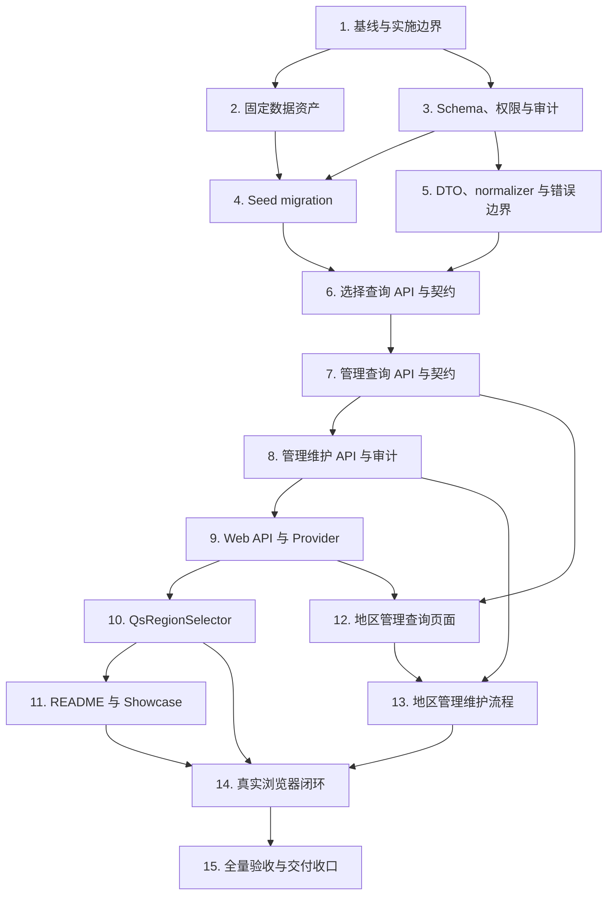

# 地区选择器与地区管理实施计划

## 1. 文档状态

- 状态：Phase 4 实施中（Task 15）
- 目标分支：`feat/region-selector-management`
- 需求规格：[地区选择器与地区管理需求](./requirements.md)
- 技术设计：[地区选择器与地区管理技术设计](./design.md)
- 需求提交：`6af70fc docs: 添加地区选择器需求文档`
- 设计提交：`38fb1b2 docs: 添加地区选择器技术设计`
- 正式 Web 应用：`web/apps/qsmds-arco`
- Server：`server`
- 真实业务入口：`/system/basic-data/regions`

本清单已在用户确认后进入 Phase 4 实施；Task 1-14 已按测试、实现、验证和提交结果
实时勾选。尚未完成的 Task 15 保持未勾选，不得提前声明全量验收或交付完成。

## 2. 执行规则

1. 新功能与复杂修改严格采用 TDD：
   - 先增加或调整测试；
   - 运行定向命令，确认测试因目标能力缺失而失败；
   - 实现最小能力使定向测试转绿；
   - 重构并运行阶段门禁。
2. 红测是过程证据，不提交失败状态。每个 Git 检查点必须恢复受影响基线为绿色。
3. 实施过程中实时更新本文件 checkbox；代码、数据、验证或提交未完成时不得提前勾选。
4. `requirements.md`、`design.md` 是已确认真相源。若必须改变三级结构、602 节点数量、
   数据来源、CITY UUID value、API、权限或组件公共契约，立即暂停并重新确认。
5. 数据固定为：
   - 3 个 `COUNTRY_REGION`；
   - 48 个 `PROVINCE_STATE`；
   - 551 个 `CITY`；
   - 总计 602 个节点。
6. 强制验收路径为 `中国台湾 → 台湾 → 高雄市`；同时验证
   `中国 → 北京市 → 北京市` 和一条固定马来西亚路径。
7. 不修改既有 migration；所有 schema 和数据变化使用新的 forward migration。
8. 不在运行时、构建、启动或 migration 中联网下载地区数据；不使用
   `ON CONFLICT DO NOTHING` 掩盖漂移。
9. Server 与 Web 保持独立依赖域。根目录不新增依赖、pnpm workspace、lockfile、
   `node_modules` 或 `.pnpm-store`。
10. 不手工修改 Prisma generated client、OpenAPI snapshot 或 Web generated types；
    分别使用 Prisma/OpenAPI 正式生成链路。
11. 不新增前端状态管理或请求库，不修改第三方源码，不引入第二套视觉系统。
12. 页面 API、权限、写操作和领域流程归调用方所有；`QsGenericTable` 继续负责查询展示
    UI，`QsRegionSelector` 不吸收管理动作。
13. 不提供物理删除、移动节点、修改 level/parent/code、批量导入或在线同步。
14. 命令失败必须保留并报告真实错误，区分代码失败、预期红测、基线失败与沙箱限制。
    `tsx` IPC 或 `.git/index.lock` 权限问题只对同一条窄命令授权重试。
15. 不执行 merge、push、PR、分支删除或 worktree 清理，除非用户后续明确要求。

需求编号使用 `R1` 至 `R10`，对应 `requirements.md` 第 6 节十项 Requirement。

## 3. 依赖顺序



Task 2 和 Task 3 在逻辑上可独立推进，但 Seed migration 必须同时消费已经验收的数据
资产和 schema。其余任务按图中顺序执行，不跨过未完成的公共契约。

## 4. 实施任务

- [x] 1. 复核实施边界并建立绿色基线
  - [x] 1.1 检查 `git status --short --branch`、当前 HEAD、现有 worktree 和未提交差异，
    确认只在 `feat/region-selector-management` 工作且不覆盖用户文件。
  - [x] 1.2 检查根目录不存在 `pnpm-workspace.yaml`、`pnpm-lock.yaml`、
    `node_modules/`、`.pnpm-store/` 等违规产物。
  - [x] 1.3 运行 Server、契约、Web、根脚本和现有浏览器基线：

    ```bash
    pnpm -C server check
    pnpm -C server build
    node --run ci:server-e2e
    node --run contract:check
    pnpm -C web check
    pnpm -C web build
    node --run test:root
    node --run ci:browser-auth-e2e
    ```

  - [x] 1.4 记录 `basic-data-routes.test.ts` 当前“地区为空页面、无权限”基线，以及其余
    四个基础数据空页面断言；后续只改变地区相关断言。
  - [x] 1.5 若基线失败，停止功能修改并先报告；未经确认不得把无关基线修复混入本分支。
  - [x] 1.6 把本文状态更新为“实施中（Task 2）”；Task 1 状态随 Task 2 的首个绿色提交
    一并记录，不制造仅勾选 checkbox 的空提交。
  - _Requirements: R1-R10_

- [x] 2. 以 TDD 固化三地来源、转换器和 canonical 数据资产
  - [x] 2.1 先新增并运行失败的
    `server/scripts/region-data/generate-region-seed.test.mjs`，固定三份源文件 SHA-256：
    - 中国大陆：
      `8c4e8afc5dfc16b77d34cf39b2547d07ab6a46e46b414679d494e50353970edc`
    - 中国台湾：
      `5e9dfa16d989e569179f02375775ac5f0036d866305a4e11456e989ff59504f1`
    - 马来西亚：
      `6ed9f08a88e3bd93a3cfe697b2135352688c495ae4595c6a37ae0980fffe7995`
  - [x] 2.2 红测固定来源 commit/date、license/归属、过滤规则、稳定 UUIDv5 namespace、
    canonical 排序、显示字段 normalizer 和技术 code。
  - [x] 2.3 红测精确断言各数据域及 3/48/551/602 数量，不用“大于零”或少量样例代替。
  - [x] 2.4 红测固定中国 31/369、中国台湾 1/22、马来西亚 16/160，以及直辖市同名
    叶子、省直管业务叶子、同名马来西亚三级叶子。
  - [x] 2.5 红测固定 `中国台湾 → 台湾 → 高雄市`，并断言
    `sourceName` 为来源繁体、`sourceCode="E/64000"`、`code="TW-64000"`。
  - [x] 2.6 新增：

    ```text
    server/prisma/region-data/
    ├── README.md
    ├── manifest.json
    ├── regions.seed.json
    └── sources/
        ├── china-mainland-codes.json
        ├── taiwan-counties.xml
        └── malaysia-state-district.csv

    server/scripts/region-data/
    └── generate-region-seed.mjs
    ```

  - [x] 2.7 转换器只使用 Node 内置模块；先验证 hash，再规范化、转换、计数、生成 UUID，
    任一差异立即失败。不得调用 `fetch`、HTTP client 或隐式读取临时目录。
  - [x] 2.8 `regions.seed.json` 只由转换器生成；人工审校映射以显式、可 review 的输入
    固定，不引入机器翻译或自动繁简转换。
  - [x] 2.9 README/manifest 记录 URL、版本、日期、许可证、归属、原始摘要、转换规则、
    数量、关键路径和 `transformVersion`。
  - [x] 2.10 运行并保存绿色结果：

    ```bash
    shasum -a 256 \
      server/prisma/region-data/sources/china-mainland-codes.json \
      server/prisma/region-data/sources/taiwan-counties.xml \
      server/prisma/region-data/sources/malaysia-state-district.csv
    node --test server/scripts/region-data/generate-region-seed.test.mjs
    node server/scripts/region-data/generate-region-seed.mjs --check
    ```

  - [x] 2.11 更新 Task 1-2 状态，只暂存本任务数据资产/脚本/测试，运行 staged diff 检查，
    创建提交：`feat: 添加地区固定数据资产`。
  - _Requirements: R2, R9, R10_

- [x] 3. 以 TDD 建立 Region schema、三级强约束、权限与审计类型
  - [x] 3.1 先新增并运行失败的
    `server/src/infrastructure/database/region-schema.spec.ts`，固定 Prisma enum/model、
    字段映射、索引、具名 check、partial unique、FK、trigger、权限和 Audit enum。
  - [x] 3.2 先新增并运行失败的 `server/test/region-schema.e2e-spec.ts`，在隔离
    PostgreSQL 16 验证根/二级/三级合法写入和所有非法层级写入。
  - [x] 3.3 在 `server/prisma/schema.prisma` 增加 `RegionLevel`、自关联 `Region` 和四个
    Region Audit event；`effectiveEnabled` 不落库。
  - [x] 3.4 新增不可变
    `<timestamp>_regions_schema_and_permissions/migration.sql`，显式事务创建：
    - 表、enum、索引与 root partial unique；
    - code/name/source/admin type/sort/parent shape check；
    - `ON DELETE/UPDATE RESTRICT` self FK；
    - hierarchy 和 identity immutable trigger。
  - [x] 3.5 E2E 证明错层、孤儿、自引用、负排序、重复 code、重复根/同父名称、
    identity UPDATE 和存在 child 的 parent DELETE 均被数据库拒绝且不留部分数据。
  - [x] 3.6 Migration 新增并显式授予 `system_admin`：

    ```text
    00000000-0000-4000-8000-000000000113  regions:read
    00000000-0000-4000-8000-000000000114  regions:create
    00000000-0000-4000-8000-000000000115  regions:update
    00000000-0000-4000-8000-000000000116  regions:enable
    00000000-0000-4000-8000-000000000117  regions:disable
    ```

  - [x] 3.7 五项权限固定为 `systemOnly=false`；更新
    `permission.constants.ts` 及受精确权限集合影响的 access-control/auth schema/API
    测试，不通过兼容 fallback 放宽旧断言。
  - [x] 3.8 运行：

    ```bash
    pnpm -C server test -- --runInBand region-schema.spec.ts
    pnpm -C server prisma:validate
    pnpm -C server typecheck
    node --run ci:server-e2e
    ```

  - [x] 3.9 确认未提交 Prisma generated client，更新 Task 3 状态并创建提交：
    `feat: 添加地区数据库结构与权限`。
  - _Requirements: R1, R7, R8, R10_

- [x] 4. 以 TDD 生成并验证 602 节点 Seed migration
  - [x] 4.1 先新增并运行失败的 `server/test/region-seed.e2e-spec.ts`，固定分域数量、
    level 数量、唯一 code、canonical 字段和关键路径。
  - [x] 4.2 扩展静态 schema 测试，要求 schema 与 seed 为两份独立 migration，seed
    不联网、不改旧 migration、不含 `ON CONFLICT DO NOTHING`。
  - [x] 4.3 使用 Task 2 转换器和 `regions.seed.json` 生成不可变
    `<timestamp>_regions_seed/migration.sql`，不得手工维护 602 行双份真相。
  - [x] 4.4 Seed SQL 显式事务并按 3 个根、48 个省州、551 个城市三批插入；末尾 SQL
    断言总量、各数据域、唯一 code 和三条关键路径。
  - [x] 4.5 E2E 全量扫描 `name`、`englishName`、`sourceName`、`sourceCode`、
    `normalizedName`、`administrativeType`、UUID 和 parent chain，不能只验证 count。
  - [x] 4.6 运行：

    ```bash
    node --test server/scripts/region-data/generate-region-seed.test.mjs
    node server/scripts/region-data/generate-region-seed.mjs --check
    pnpm -C server test -- --runInBand region-schema.spec.ts
    node --run ci:server-e2e
    ```

  - [x] 4.7 确认隔离流程已经执行两次 `prisma migrate deploy` 和一次
    `prisma migrate status`，且第二次没有重复数据。
  - [x] 4.8 更新 Task 4 状态并创建提交：`feat: 添加地区首期种子数据`。
  - _Requirements: R1, R2, R9, R10_

- [x] 5. 以 TDD 实现 DTO、normalizer 和持久化错误边界
  - [x] 5.1 先新增并运行失败的 DTO 测试，覆盖 selection、management、command、
    UUID param、query pagination/sort/filter、额外字段和空 PATCH。
  - [x] 5.2 先新增并运行失败的 `region.normalizer.spec.ts`，覆盖 NFC、Unicode 空白、
    `en-US` lowercase、`É/é`、`İ/i̇`、code 大写、code points 上限和可选字段转 null。
  - [x] 5.3 先新增并运行失败的 `region.persistence-error.mapper.spec.ts`，覆盖：
    - code unique；
    - sibling composite unique；
    - root partial unique；
    - parent FK；
    - hierarchy check；
    - serialization/deadlock/lock timeout；
    - 未知异常固定 500 且不泄露底层内容。
  - [x] 5.4 新增 `server/src/modules/regions/dto/*.ts`、
    `region.normalizer.ts`、`region.persistence-error.mapper.ts`，公共 DTO 与
    `design.md` 第 7.4 节一致。
  - [x] 5.5 `ownStatus` 与 `availability` 使用设计中的互斥规则；不接受客户端 level
    推导管理列表。
  - [x] 5.6 运行定向测试、`prisma:validate`、Server typecheck/lint；确认中文字段错误和
    `422 VALIDATION_FAILED` 契约稳定。
  - [x] 5.7 更新 Task 5 状态并创建提交：`feat: 添加地区服务输入与错误边界`。
  - _Requirements: R1, R3, R5, R6, R8, R10_

- [x] 6. 以 TDD 实现地区选择查询 Service、Controller 与 OpenAPI
  - [x] 6.1 先新增并运行失败的 query service、selection controller/module 测试和
    `server/test/region-selection-api.e2e-spec.ts`。
  - [x] 6.2 测试固定 options 根/直属下级 lazy 查询、父级校验、有效状态过滤和
    `sortOrder, normalizedName, id` 稳定排序。
  - [x] 6.3 测试固定 search 的三层字段匹配、exact/prefix/substring 命中等级、完整
    path 稳定排序、默认/最大 limit 和 `hasMore`。
  - [x] 6.4 测试固定 path 恰好三层、停用历史值仍返回状态、不存在与非 CITY 错误分离。
  - [x] 6.5 实现 `RegionQueryService`、`RegionSelectionController`、`RegionsModule`，
    并注册到 `server/src/http.modules.ts`。
  - [x] 6.6 三个 endpoint 使用 `@RequireAuthenticatedSession()`、`privateNoStore`，
    不声明或隐式授予 `regions:*`。
  - [x] 6.7 E2E 覆盖匿名 401、强制改密拒绝、正常无管理权限用户成功、非法 UUID 422、
    安全错误和 `X-Request-Id`。
  - [x] 6.8 增加 OpenAPI 契约测试，固定 operationId、Session、无 authorization、
    no-store、DTO 和 endpoint errors。
  - [x] 6.9 运行：

    ```bash
    pnpm -C server test -- --runInBand regions
    pnpm -C server check
    pnpm -C server build
    node --run ci:server-e2e
    node --run contract:sync
    node --run contract:check
    ```

  - [x] 6.10 只提交生成链路产生的 OpenAPI snapshot/Web types，不提交 Prisma generated
    client；更新 Task 6 状态并创建提交：`feat: 添加地区选择查询接口`。
  - _Requirements: R3, R4, R8, R9, R10_

- [x] 7. 以 TDD 实现地区管理查询 API 与 OpenAPI
  - [x] 7.1 先新增并运行失败的 management query service/controller 测试和
    `server/test/regions-management-api.e2e-spec.ts` 读取场景。
  - [x] 7.2 实现 `GET /api/regions/navigation`，一次返回全部国家/地区及省/州，
    包含停用状态但不加载城市。
  - [x] 7.3 实现 `GET /api/regions`：parent 推导 level、当前直属下级、query/code、
    `ownStatus/availability`、分页、排序白名单和最终 UUID tie-breaker。
  - [x] 7.4 实现 `GET /api/regions/:regionId`，返回来源字段、own/effective 状态和时间，
    支持后续 unknown mutation read-after-write。
  - [x] 7.5 `count + rows` 使用同一 interactive transaction 和既有 query timeout；
    effective 状态使用固定两级 join 计算，不落库。
  - [x] 7.6 Controller 全部要求 `regions:read`；E2E 覆盖无权限 403、读取权限成功、
    current parent 隔离、三种互斥展示状态和 100 pageSize 上限。
  - [x] 7.7 更新契约测试并运行 `contract:sync/contract:check`，确认新增 management
    query DTO/operationId/permission/no-store/errors。
  - [x] 7.8 运行 Server 定向测试、check、build、隔离 E2E；更新 Task 7 状态并创建提交：
    `feat: 添加地区管理查询接口`。
  - _Requirements: R5, R7, R8, R9, R10_

- [x] 8. 以 TDD 实现地区创建、编辑、启停、并发与审计
  - [x] 8.1 先新增并运行失败的 `RegionCommandService`、management controller 和真实
    PostgreSQL E2E 写场景。
  - [x] 8.2 创建测试固定 parent 推导 level、CITY 下拒绝、parent `FOR SHARE`、全局
    code 和 sibling/root normalized name 并发冲突。
  - [x] 8.3 编辑测试固定 `SELECT ... FOR UPDATE`、仅 name/englishName/sortOrder、
    identity 字段 422、空/无变化幂等。
  - [x] 8.4 启停测试固定 ancestry/subtree 稳定锁序、只改变目标 own state、后代
    effective 状态实时变化、`affectedCount` 和重复命令幂等。
  - [x] 8.5 所有真实 mutation 先 `applyTransactionTimeouts`，Region 和 Audit 在同一
    transaction；模拟 Audit 失败证明 Region 回滚。
  - [x] 8.6 Audit 固定四个 event、trusted actor、`targetType="Region"`、target UUID、
    排序 `changedFields`、string level、number affectedCount，不记录字段值或请求体。
  - [x] 8.7 实现 POST/PATCH/enable/disable endpoint，分别要求
    `regions:create/update/enable/disable` 和 CSRF；在 OpenAPI 中固定写接口契约，
    Task 9 的 Web wrapper 显式使用 `retry:false`；不注册 DELETE route。
  - [x] 8.8 E2E 覆盖部分权限组合、malformed JSON 400、DTO 422、404/409、CSRF、
    requestId、同事务回滚和安全日志。
  - [x] 8.9 更新 OpenAPI 契约测试，运行 Server check/build、隔离 E2E、
    `contract:sync/contract:check`。
  - [x] 8.10 更新 Task 8 状态并创建提交：`feat: 添加地区管理维护接口`。
  - _Requirements: R1, R6, R7, R8, R9, R10_

- [x] 9. 以 TDD 实现 Web API 与 RegionSelectorProvider
  - [x] 9.1 先新增并运行失败的 `web/apps/qsmds-arco/test/api/regions.test.ts`，固定
    method/path/query/body/signal、local error presentation，以及全部写请求 no-retry。
  - [x] 9.2 新增 `src/api/modules/regions.ts`，只从 generated types 导入 DTO；不手写
    OpenAPI 响应结构。
  - [x] 9.3 先新增并运行失败的 `region-selector-provider.test.ts`，固定 DTO runtime
    校验、恰好三层 path、parent 连续、city ID 相等、deep readonly/freeze。
  - [x] 9.4 红测固定 identity cache key、5 分钟 TTL、相同 key in-flight dedupe、
    单消费者取消、全部消费者取消、failure/cancel 不缓存。
  - [x] 9.5 红测固定 auth signal/epoch/userId、generation 防迟到、登出清理和
    `subscribeInvalidation`。
  - [x] 9.6 红测固定 `BroadcastChannel("qianshu-regions-v1")` 只发送
    `{ type: "REGIONS_CHANGED" }`，接收后不回广播、不传地区数据。
  - [x] 9.7 实现 `types.ts`、`provider.ts` 和受控 invalidation API；`main.ts` 在安装
    Pinia 后提供默认 provider，provider prop 仍可供隔离环境覆盖。
  - [x] 9.8 运行 API/provider 定向测试、`pnpm -C web test:api`、typecheck、lint；
    确认无新依赖和无业务数据持久化。
  - [x] 9.9 更新 Task 9 状态并创建提交：`feat: 添加地区选择数据提供层`。
  - _Requirements: R3, R4, R6, R8, R9, R10_

- [x] 10. 以 TDD 实现 `QsRegionSelector`
  - [x] 10.1 先新增并运行失败的 `region-selector.logic.test.ts` 和
    `region-selector.test.ts`，固定 `CITY UUID | null`、typed change 和只读 tuple。
  - [x] 10.2 红测固定 navigation/resolved/search 三棵树隔离、交互树 UUID merge、
    partial path 不阻断 lazy load、`done()` retry、250ms remote search 和 request
    version stale 防护。
  - [x] 10.3 红测固定 existing ID path 回显不触发 change、停用 path 标记、无效 path
    保留原 value、只允许 CITY、clear 转 null。
  - [x] 10.4 实现 `logic.ts`、`control-attrs.ts`、`index.vue`，以
    `ACascader@2.58.0` 为私有内核；不得使用/扩展 `FaCascader` 或暴露 Arco 类型。
  - [x] 10.5 固定 `multiple/pathMode/checkStrictly/expandTrigger` 等内核参数，控制
    `inputValue`、`filterOption`、`formatLabel`、loading/error/retry。
  - [x] 10.6 实现真实 input bridge：id/name/tabindex/required/autocomplete/aria、
    focus/blur、describedby 合并、清理旧 attr 和 Arco DOM 唯一 input 断言。
  - [x] 10.7 实现复合 required 与原生 form 语义：搜索词不能替代 CITY 选择，
    `FormData` 必须写 CITY UUID。
  - [x] 10.8 使用现有语义 token 实现 full width、完整 path、停用/错误文字、390px
    popup 内部滚动、dark 和 reduced motion；不增加渐变、卡片堆叠或局部字体栈。
  - [x] 10.9 定向运行：

    ```bash
    pnpm -C web exec node --import tsx --test \
      apps/qsmds-arco/test/views/region-selector.logic.test.ts \
      apps/qsmds-arco/test/views/region-selector.test.ts \
      apps/qsmds-arco/test/views/region-selector-control-attrs.test.ts \
      apps/qsmds-arco/test/views/region-selector-provider.test.ts
    pnpm -C web test:api
    pnpm -C web typecheck
    pnpm -C web lint
    pnpm -C web build
    ```

  - [x] 10.10 如 `tsx` CLI 在沙箱报 IPC `listen EPERM`，仅对上述
    `node --import tsx --test` 窄命令授权重试，不修改 watcher 或测试语义。
  - [x] 10.11 更新 Task 10 状态并创建提交：`feat: 添加地区选择器组件`。
  - _Requirements: R3, R4, R8, R9, R10_

- [x] 11. 以 TDD 增加中文 README 与隔离 Showcase
  - [x] 11.1 先扩展 `component-library-routes.test.ts` 并新增
    `region-selector-showcase.test.ts`，固定第 10 个独立组件叶子路由。
  - [x] 11.2 新增 `/component-library/business/region-selector`、页面和
    `RegionSelectorShowcase.vue`；不得把多个组件重新聚合到同一示例页。
  - [x] 11.3 Showcase 显式传本地 fixture provider，醒目标注“交互样例，不是正式地区
    数据”，不得 import 正式 API、Store 或默认 provider。
  - [x] 11.4 覆盖标准、中国台湾高雄、停用历史路径、readonly、disabled、一次失败重试
    和窄屏状态。
  - [x] 11.5 完成 `QsRegionSelector/README.md`：public API、provider、value/path、
    缓存/身份、错误、表单、FormData、示例边界和调用方职责。
  - [x] 11.6 运行组件路由/Showcase/选择器测试、Web typecheck/lint/build；更新
    Task 11 状态并创建提交：`feat: 添加地区选择器示例与文档`。
  - _Requirements: R4, R9, R10_

- [x] 12. 以 TDD 实现地区管理查询路由与真实业务页面
  - [x] 12.1 先修改并运行失败的 `basic-data-routes.test.ts`、
    `system-management-routes.test.ts` 和 `system-management.test.ts`：
    - 地区页不再为空；
    - 其余四个基础数据页仍为空；
    - 地区叶子需要 `regions:read`；
    - 父路由没有固定 redirect；
    - 系统首页 any-of 包含 `regions:read`。
  - [x] 12.2 先新增并运行失败的 `regions.logic.test.ts`，固定 scope → 直属 level、
    query 参数、own/effective 状态、sorting whitelist、request version 和事件合并。
  - [x] 12.3 修改 `router/modules/basic.data.ts`、`system.management.ts` 及必要路由测试，
    新增 `BASIC_DATA_READ_PERMISSIONS`，复用现有授权子路由 redirect guard。
  - [x] 12.4 实现：

    ```text
    views/system/basic-data/regions/
    ├── index.vue
    ├── regions.logic.ts
    └── region-scope-tree.vue
    ```

  - [x] 12.5 页面只组合一个 `FaPageMain`：桌面 `18rem + minmax(0,1fr)`，左侧只显示
    国家/地区和省/州，右侧 `QsGenericTable` 分页显示直属下级。
  - [x] 12.6 停用/继承停用导航节点必须仍可选；状态有文字。移动端导航进入底部
    `QsGenericDrawer` 并恢复焦点。
  - [x] 12.7 `QsGenericTable` 使用 `addable=false`、受控 page/pageSize/search/filter/
    sorting、完整桌面列和移动卡片；不直接重建 `FaTable/FaPagination`。
  - [x] 12.8 实现 navigation/list AbortController、requestVersion、scope 保护、error/
    retry/requestId 和区分空状态；页面查询不读取 selector cache。
  - [x] 12.9 运行 route/logic/page 定向测试、全量 `test:api`、typecheck、lint、build。
  - [x] 12.10 更新 Task 12 状态并创建提交：`feat: 添加地区管理查询页面`。
  - _Requirements: R5, R7, R8, R9, R10_

- [x] 13. 以 TDD 实现地区管理表单、启停和缓存联动
  - [x] 13.1 先新增并运行失败的 form/status component 与 pure logic 测试，固定新增/
    编辑字段差异、code 只读、字段错误、提交锁和重复提交保护。
  - [x] 13.2 实现 `region-form-modal.vue`：父路径/level 只读；创建接收
    name/englishName/code/sortOrder/enabled；编辑只提交三个可变字段。
  - [x] 13.3 实现 `region-status-change-modal.vue`：独立启停确认、完整路径、后代选择器
    失效说明、无数据删除说明和语义化危险操作。
  - [x] 13.4 页面按 `regions:create/update/enable/disable` 分别显示动作，Server 仍是
    最终授权；任何位置都不出现 DELETE。
  - [x] 13.5 mutation 不做乐观更新、不自动重试；提交中阻止按钮、遮罩、Escape、
    close button 和重复请求。
  - [x] 13.6 实现 unknown result 对账：
    - create 按 parent scope + exact code 查询；
    - update/status 按 ID 查询；
    - 只在最终状态匹配时按成功处理；
    - 无法确认时保留上下文并提示刷新确认。
  - [x] 13.7 成功或确认成功后刷新当前列表/必要 navigation、保留 scope、调用
    `invalidateRegionSelectorCache({ broadcast:true })` 并用 `QsToast` 提示。
  - [x] 13.8 测试 source/status/page composition、权限组合、字段错误、unknown result、
    cache invalidation 和移动卡片动作。
  - [x] 13.9 运行 management API/logic/component tests、全量 Web check/build。
  - [x] 13.10 更新 Task 13 状态并创建提交：`feat: 添加地区管理维护流程`。
  - _Requirements: R5, R6, R7, R8, R9, R10_

- [x] 14. 建立隔离地区 Browser E2E 并完成真实交互验收
  - [x] 14.1 先扩展 root workflow 单元测试，固定新的
    `ci:browser-regions-e2e` package script、隔离 PostgreSQL 生命周期、进程退出和敏感
    文本遮罩。
  - [x] 14.2 新增 `scripts/ci-browser-regions-e2e.mjs` 及其测试，复用现有固定
    PostgreSQL 16、认证 fixture、Server 和 Web test build，不依赖开发数据库。
  - [x] 14.3 新增 `web/apps/qsmds-arco/test/browser/regions.browser.test.mjs`，浏览器
    断言必须同时核对真实 HTTP 结果、DOM/Store 状态和最终数据库可观察结果，不能只
    检查 Toast。
  - [x] 14.4 选择器在真实浏览器覆盖：
    - 打开、lazy、搜索、键盘三级导航、清空、Escape；
    - root/lazy/search/path 四类失败与 retry；
    - stale 响应不覆盖；
    - existing/disabled path；
    - `中国台湾 / 台湾 / 高雄市`；
    - 真实 INPUT 的 id/name/aria/focus/required；
    - `FormData` 为 CITY UUID；
    - readonly、disabled、多实例 dedupe。
  - [x] 14.5 管理页覆盖无权限 403、只读和各部分写权限、导航、搜索、双状态筛选、
    sorting、pagination、create、update、enable、disable、无 DELETE。
  - [x] 14.6 覆盖 mutation 成功后的当前 tab 立即失效、同源第二 tab 失效通知和迟到
    cache 响应不回写；广播载荷不得出现名称、code 或完整地区数据。
  - [x] 14.7 桌面和 `390x844` 验证一个主内容面板、Drawer 焦点恢复、移动卡片、Modal、
    popup 内滚动和 `scrollWidth <= clientWidth`。
  - [x] 14.8 分别验证 light、dark、`prefers-reduced-motion: reduce`、键盘可见焦点、
    状态非颜色依赖和无新增 console warning/error。
  - [x] 14.9 运行 `node --run ci:browser-regions-e2e`；若发现缺陷，先增加最小失败回归
    测试，再使用独立 `fix: 中文描述` 提交修复并重跑受影响门禁。
  - [x] 14.10 更新 Task 14 状态并创建提交：`test: 添加地区功能浏览器验收`。
  - _Requirements: R3-R10_

- [ ] 15. 完成全量门禁、数据审计和交付收口
  - [ ] 15.1 重新运行数据资产与 Server 全量门禁：

    ```bash
    node --test server/scripts/region-data/generate-region-seed.test.mjs
    node server/scripts/region-data/generate-region-seed.mjs --check
    pnpm -C server prisma:validate
    pnpm -C server check
    pnpm -C server build
    node --run ci:server-e2e
    ```

  - [ ] 15.2 重新生成后验证契约无漂移：

    ```bash
    node --run contract:sync
    node --run contract:check
    ```

  - [ ] 15.3 运行 Web、Browser 和根级完整门禁：

    ```bash
    pnpm -C web check
    pnpm -C web build
    node --run ci:browser-regions-e2e
    node --run test:root
    node --run check
    git diff --check
    ```

  - [ ] 15.4 复核最新隔离数据库证据精确为 3/48/551/602，并包含台湾、北京和马来西亚
    关键路径；不得引用早期或不同 HEAD 的结果。
  - [ ] 15.5 复核 OpenAPI 选择接口无需 `regions:*`，管理接口逐 endpoint 权限、CSRF、
    no-store、错误矩阵正确，且没有 DELETE。
  - [ ] 15.6 复核组件 README、Showcase fixture、真实业务页职责和缓存广播边界，没有
    示例数据成为正式真相源。
  - [ ] 15.7 检查 staged/unstaged/untracked 范围，无 `.env`、密钥、日志、构建产物、
    Prisma generated client、根依赖产物或无关用户修改。
  - [ ] 15.8 把所有真实完成项勾选并把文档状态改为“已完成”；如没有代码修复，创建
    最终提交：`docs: 记录地区功能验收结果`，不制造其他空提交。
  - [ ] 15.9 检查 `git status --short` 和提交历史；不 push、不 merge、不删除分支，
    等待用户给出后续 Git 生命周期要求。
  - _Requirements: R1-R10_

## 5. Git 提交计划

| 检查点 | Commit message | 主要内容 |
| --- | --- | --- |
| Phase 3 | `docs: 添加地区选择器实现步骤` | 本 `tasks.md` |
| Task 1 | 不单独提交 | 基线证据；状态随 Task 2 记录 |
| Task 2 | `feat: 添加地区固定数据资产` | 固定源、manifest、canonical JSON、转换器和测试 |
| Task 3 | `feat: 添加地区数据库结构与权限` | Prisma、schema migration、约束、权限、Audit |
| Task 4 | `feat: 添加地区首期种子数据` | seed migration、数量和关键路径 E2E |
| Task 5 | `feat: 添加地区服务输入与错误边界` | DTO、normalizer、error mapper |
| Task 6 | `feat: 添加地区选择查询接口` | selection query/API/E2E/OpenAPI |
| Task 7 | `feat: 添加地区管理查询接口` | navigation/list/detail/E2E/OpenAPI |
| Task 8 | `feat: 添加地区管理维护接口` | create/update/status/transaction/Audit/OpenAPI |
| Task 9 | `feat: 添加地区选择数据提供层` | Web API、provider、cache、identity/invalidation |
| Task 10 | `feat: 添加地区选择器组件` | public component、Arco adapter、input bridge |
| Task 11 | `feat: 添加地区选择器示例与文档` | README、fixture Showcase、组件路由 |
| Task 12 | `feat: 添加地区管理查询页面` | 权限路由、导航、直属下级表格、响应式 |
| Task 13 | `feat: 添加地区管理维护流程` | 表单、启停、未知结果、Toast、缓存联动 |
| Task 14 | `test: 添加地区功能浏览器验收` | 隔离 runner、真实浏览器场景 |
| Task 15 | `docs: 记录地区功能验收结果` | 最新门禁证据和最终任务状态 |
| 发现的独立缺陷 | `fix: <中文描述>` | 先回归测试，再做最小修复 |

每次提交前：

1. 只暂存当前检查点明确文件。
2. 运行 `git diff --cached --check`。
3. 审查 `git diff --cached --name-status`、`--stat` 和完整 staged diff。
4. 确认没有 `.env`、密钥、日志、构建产物、根依赖产物、生成 client 或无关修改。
5. 提交后运行对应定向绿色测试，并检查 `git status --short`。

## 6. 需求覆盖矩阵

| Requirement | 主要任务 |
| --- | --- |
| R1 严格三级地区数据 | 3, 4, 5, 8, 15 |
| R2 可审计首期种子 | 2, 4, 14, 15 |
| R3 业务选择只读接口 | 5, 6, 9, 10, 14, 15 |
| R4 `QsRegionSelector` | 9, 10, 11, 14, 15 |
| R5 地区管理查询 | 7, 9, 12, 13, 14, 15 |
| R6 新增编辑排序启停 | 8, 9, 13, 14, 15 |
| R7 权限路由审计 | 3, 7, 8, 12, 13, 14, 15 |
| R8 API 校验错误安全 | 3, 5-10, 12-15 |
| R9 性能一致性全球扩展 | 2, 4, 6, 7, 9, 10, 12-15 |
| R10 测试文档交付 | 1-15 |

## 7. 暂停与重新确认条件

出现以下任一情况必须暂停，不得自行扩大范围：

1. 固定源 SHA、license、转换数量或关键路径与需求不一致。
2. 需要改变 3/48/551/602、三级层级、CITY UUID value 或台湾路径。
3. 需要修改已经提交的 migration、提供 DELETE、移动 parent 或改变 code。
4. 需要新增依赖、全局 Store、查询库、第二套视觉系统或修改第三方源码。
5. `ACascader` 实际 DOM/键盘行为无法通过局部 adapter 满足已确认 input 契约。
6. 需要改变公共 API、权限 code、错误 code 或缓存身份边界。
7. 发现与当前任务重叠的用户未提交修改，无法安全绕开。
8. 完成需要迁移共享开发/生产数据库、停止非本任务进程、push、merge、删除分支或其他
   尚未授权的外部状态变更。
