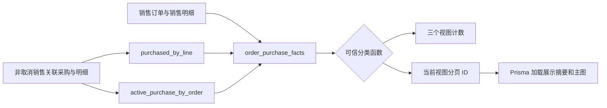
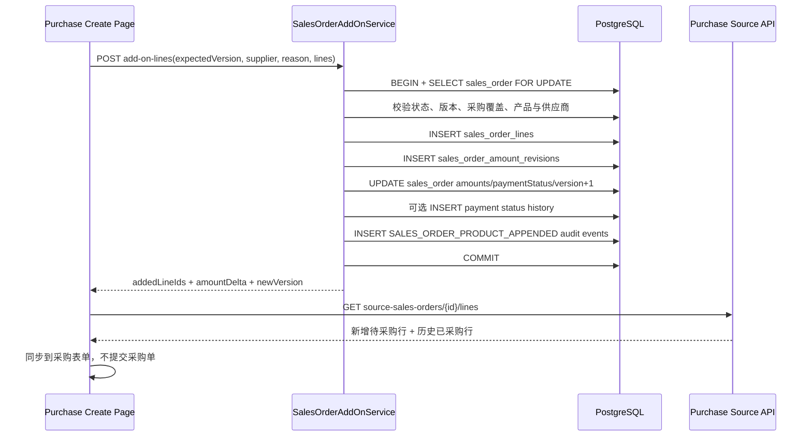

# 销售订单三类采购与海运前加购技术设计

## 1. 文档状态

- 阶段：Phase 2 - Technical Design
- 状态：已被「销售订单产品修改与采购入口收敛」规格替代，仅保留历史设计依据
- 编写日期：2026-09-02
- 需求规格：[销售订单三类采购与海运前加购需求](./requirements.md)
- 替代规格：[销售订单产品修改技术设计](../sales-order-product-editing/design.md)

## 2. 设计结论

本次改造保留采购创建页现有四步表单、销售来源逐行同步和采购数量数据库硬约束，在此基础上增加三个互斥的销售来源视图，以及一条只服务于“已完成采购后海运前加购”的销售产品追加命令。

核心结论如下：

1. `/api/purchase-orders/source-sales-orders` 继续是三个候选视图、可信计数和来源产品同步的采购权限边界；客户端只能提交固定视图编码，不能自行组合销售状态和采购数量条件。
2. 新增加购上下文、加购产品选项和销售产品追加 API，统一挂在销售订单资源下，同时要求 `purchase-orders:create` 与 `sales-orders:update` 两项权限。
3. 销售产品追加、四个金额字段、付款状态、金额修订、必要的付款状态历史和审计必须位于同一个数据库事务。
4. 同一旧版本最多成功一次。客户端不为加购 POST 自动重试；网络结果未知时要求刷新核对，不使用新版本静默重放同一批产品。
5. 不新增业务表或字段。为准确审计销售产品追加事实，仅建议给 `AuditEventType` 增加 `SALES_ORDER_PRODUCT_APPENDED`，并配套一条增量 migration。
6. `FaMultiStepLoader` 的第 1、2 步展示同一个服务端原子事务的两个业务结果，第 3 步重新读取采购权限域来源明细并同步到采购表单；不会把销售行写入和金额更新拆成两个可部分成功的请求。

## 3. 当前真相源与复用边界

| 关注点 | 当前真相源 | 本次处理 |
| --- | --- | --- |
| 来源订单查询 | `purchase-order-source-query.service.ts` | 从履约状态筛选改为采购事实聚合分类 |
| 来源视图编码 | `domain/purchase-order-source-sales-order-view.ts` | 改为三个互斥视图和共享纯判定函数 |
| 来源逐行采购事实 | `salesOrderLines()` | 继续返回已采购、剩余和历史采购快照 |
| 采购数量最终校验 | `PurchaseOrderCreateDependencyService` 与 PostgreSQL constraint trigger | 保持不变，继续阻止超量采购 |
| 全量覆盖自动推进 | `SalesOrderPurchaseCoverageService` | 保持 `PENDING -> PREPARING`；后续履约状态不回退 |
| 销售金额计算 | `domain/sales-order-decimal.ts` | 复用四位定点金额和付款状态推导 |
| 销售行输入 | `sales-order-command.normalizer.ts` | 提取可复用的 CATALOG/CUSTOM 行规范化逻辑 |
| 销售金额审计 | `SalesOrderAmountRevision` | 每次加购新增一条前后金额快照 |
| 通用审计 | `AuditService.record()` | 新增专用事件，每个新增销售明细记录一条审计 |
| 销售订单选择器 | `QsSalesOrderSelectorModal` | 增加确认文案、确认禁用原因和受控关闭能力 |
| 产品编辑器 | `QsOrderProductLineEditor` | 原销售行只读摘要与新增行分离，新增行复用编辑器 |
| 多步骤反馈 | `FaMultiStepLoader` | 顺序执行保存、结果确认、采购同步 |

## 4. 三视图领域模型

### 4.1 固定视图编码

服务端和 OpenAPI 使用以下固定值：

```ts
export const PURCHASE_ORDER_SOURCE_SALES_ORDER_VIEWS = [
  'UNPURCHASED',
  'PARTIALLY_PURCHASED',
  'COMPLETED_PURCHASE_ADD_ON',
] as const
```

对应界面文案：

| 编码 | 文案 | 确认动作 |
| --- | --- | --- |
| `UNPURCHASED` | 未采购订单-采购 | 选择并同步全部可采购产品 |
| `PARTIALLY_PURCHASED` | 部分采购订单-采购 | 选择并同步剩余产品 |
| `COMPLETED_PURCHASE_ADD_ON` | 已完成采购-加购产品 | 打开销售订单加购产品弹窗 |

旧值 `INITIAL_PURCHASE`、`SUPPLEMENTAL_PURCHASE` 不保留兼容分支，避免旧名称继续表达已经失效的“按履约阶段分类”语义。Web generated client、组件库示例和采购页适配器随 OpenAPI 一次同步。

### 4.2 共享事实结构

服务端使用统一事实结构执行分类：

```ts
interface SalesOrderPurchaseFacts {
  readonly orderStatus: SalesOrderStatus
  readonly fulfillmentStatus: SalesOrderFulfillmentStatus
  readonly activePurchaseOrderCount: number
  readonly purchasedQuantity: number
  readonly remainingQuantity: number
}
```

纯判定函数只接受可信数据库事实：

```ts
classifyPurchaseSourceView(
  facts: SalesOrderPurchaseFacts,
): PurchaseOrderSourceSalesOrderView | null
```

判定顺序：

1. `orderStatus != CONFIRMED` 或履约不属于海运前时返回 `null`；
2. `PENDING + activePurchaseOrderCount = 0 + remainingQuantity > 0` 返回 `UNPURCHASED`；
3. `activePurchaseOrderCount > 0 + purchasedQuantity > 0 + remainingQuantity > 0` 返回 `PARTIALLY_PURCHASED`；
4. `activePurchaseOrderCount > 0 + remainingQuantity = 0` 返回 `COMPLETED_PURCHASE_ADD_ON`；
5. 其余异常或不完整事实返回 `null`，不得猜测视图。

`PREPARING`、`LAND_TRANSIT`、`WAREHOUSE_ARRIVED` 中新增销售行后会因 `remainingQuantity > 0` 进入部分采购视图；采购补齐后恢复为已完成采购加购视图，履约状态始终保持原值。

### 4.3 聚合查询

`PurchaseOrderSourceQueryService.salesOrders()` 使用参数化 `$queryRaw` CTE 先计算候选 ID 和事实，再由 Prisma 按 ID 加载客户、出单人、产品主图和行摘要。禁止使用 `$queryRawUnsafe` 或拼接关键词。

聚合分为三层：

1. `purchased_by_line`：按 `sourceSalesOrderLineId` 汇总有效采购明细数量；
2. `active_purchase_by_order`：按 `salesOrderId` 统计有效销售关联采购单；
3. `order_purchase_facts`：逐销售明细计算 `GREATEST(salesQuantity - purchasedQuantity, 0)` 后汇总到销售订单。

有效采购过滤必须同时包含：

```text
purchase_orders.purchase_type = SALES_LINKED
purchase_orders.sales_order_id = sales_orders.id
purchase_orders.order_status != CANCELLED
purchase_order_lines.source_sales_order_line_id = sales_order_lines.id
```

查询流程：



计数查询和分页查询共享同一关键词基础条件。关键词仍只匹配销售订单号或客户名；切换视图时保留关键词、页码回到 1。排序保持 `orderDate DESC, id DESC`。

### 4.4 快捷入口兼容

从销售待采购列表点击“新增采购”进入采购页时，不再只查询旧的首次采购视图。页面按销售订单 ID 和订单号先查询 `UNPURCHASED`，未命中时再查询 `PARTIALLY_PURCHASED`；命中任一视图即可自动绑定。快捷入口不得自动进入 `COMPLETED_PURCHASE_ADD_ON` 或在未确认时写入销售产品。

## 5. 公共 API 设计

### 5.1 采购来源列表

保留：

```http
GET /api/purchase-orders/source-sales-orders
```

查询：

```ts
interface PurchaseOrderSourceSalesOrdersQueryDto {
  view: 'UNPURCHASED' | 'PARTIALLY_PURCHASED' | 'COMPLETED_PURCHASE_ADD_ON'
  keyword?: string
  page?: number
  pageSize?: number
}
```

权限保持 `purchase-orders:create`。响应结构保留现有订单摘要、状态、产品预览、分页和 `counts[]`，其中 `counts[]` 扩展为三个固定值。服务端不返回客户端可组合的原始采购过滤器。

### 5.2 加购上下文

新增：

```http
GET /api/sales-orders/{salesOrderId}/add-on-context
```

权限：

```ts
@RequirePermissions('purchase-orders:create', 'sales-orders:update')
```

响应只包含加购弹窗必需信息：

```ts
interface SalesOrderAddOnContextDto {
  salesOrder: {
    id: string
    orderNo: string
    customerName: string
    currencyCode: 'TWD' | 'MYR'
    fulfillmentStatus: SalesOrderFulfillmentStatus
    paymentStatus: SalesOrderPaymentStatus
    version: number
  }
  amounts: {
    lineSubtotalAmount: string
    agreedTotalAmount: string
    depositDueAmount: string
    balanceDueAmount: string
    paidAmount: string
    outstandingAmount: string
  }
  existingLines: readonly {
    id: string
    lineNumber: number
    lineType: SalesOrderLineType
    productNo: string | null
    productName: string
    actualUnitPriceAmount: string
    quantity: number
    lineTotalAmount: string
  }[]
  availableLineCapacity: number
}
```

上下文接口按最新数据库事实重新校验“已完成采购-加购产品”资格。订单不再符合条件时返回业务错误，不把失效上下文交给表单继续编辑。

### 5.3 加购产品选项和图片

新增：

```http
GET  /api/sales-orders/{salesOrderId}/add-on-product-options
HEAD /api/sales-orders/{salesOrderId}/add-on-product-options/{productId}/main-image/{productMediaId}/content
GET  /api/sales-orders/{salesOrderId}/add-on-product-options/{productId}/main-image/{productMediaId}/content
```

产品查询参数：

```ts
interface SalesOrderAddOnProductOptionsQueryDto {
  supplierValue: string
  keyword?: string
  page?: number
  pageSize?: number
}
```

三条端点均要求 `purchase-orders:create` 与 `sales-orders:update`。产品选项请求会重新校验订单仍符合加购资格和供应商字典值仍有效；服务端从销售订单读取币种，复用现有销售产品选项映射，只返回：

- `status = ACTIVE`；
- `supplierValue = 当前采购表单供应商`；
- 当前销售币种对应的标准售价；
- 当前有效唯一主图。

产品选项接口不会接受客户端传入销售币种；图片内容 URL 携带经过编码的 `supplierValue` 查询参数，内容接口重新校验销售订单资格、产品供应商、当前主图和加购权限关系。

### 5.4 追加销售产品

新增：

```http
POST /api/sales-orders/{salesOrderId}/add-on-lines
```

权限与安全：

- `purchase-orders:create` 与 `sales-orders:update` 必须全部满足；
- 要求 Session、CSRF、私有禁缓存；
- Axios `retry: false`；
- 不接受或派发采购订单号；
- 不接受客户端提交销售金额汇总。

请求：

```ts
interface SalesOrderAddOnLinesRequestDto {
  expectedVersion: number
  supplierValue: string
  reason: string
  lines: readonly (
    | {
        lineType: 'CATALOG'
        productId: string
        actualUnitPriceAmount: string
        quantity: number
      }
    | {
        lineType: 'CUSTOM'
        name: string
        description: string | null
        actualUnitPriceAmount: string
        quantity: number
      }
  )[]
}
```

响应：

```ts
interface SalesOrderAddOnResultDto {
  salesOrderId: string
  previousVersion: number
  version: number
  addedLineIds: readonly string[]
  amountDelta: string
  paymentStatus: SalesOrderPaymentStatus
  amounts: {
    lineSubtotalAmount: string
    agreedTotalAmount: string
    depositDueAmount: string
    balanceDueAmount: string
    paidAmount: string
    outstandingAmount: string
  }
}
```

主要错误：

| HTTP | 错误码 | 场景 |
| ---: | --- | --- |
| 403 | `FORBIDDEN` / CSRF 既有错误 | 任一权限缺失或请求安全校验失败 |
| 404 | `SALES_ORDER_NOT_FOUND` | 销售订单不存在 |
| 409 | `SALES_ORDER_ADD_ON_VERSION_CONFLICT` | `expectedVersion` 与行锁后的版本不同 |
| 409 | `SALES_ORDER_STATE_CHANGED` | 并发依赖状态变化或数据库冲突 |
| 422 | `SALES_ORDER_ADD_ON_NOT_ALLOWED` | 非已确认、已到海运、无有效采购或当前仍有剩余 |
| 422 | `SALES_ORDER_ADD_ON_SUPPLIER_UNAVAILABLE` | 供应商字典值当前不可用 |
| 422 | `SALES_ORDER_ADD_ON_PRODUCT_SUPPLIER_MISMATCH` | 正式产品不属于指定供应商 |
| 422 | `SALES_ORDER_LINE_LIMIT_EXCEEDED` | 原行数加新增行数超过 100 |
| 422 | `VALIDATION_FAILED` | 字段、金额、数量或未知字段不合法 |

## 6. 销售加购服务设计

### 6.1 服务职责

新增 `SalesOrderAddOnQueryService` 和 `SalesOrderAddOnService`：

- Query 服务提供上下文、供应商限定产品选项和图片授权关系；
- Command 服务只处理行锁后的追加、金额、状态历史和审计；
- Controller 负责 DTO、权限和 HTTP 契约，不包含领域计算；
- 采购来源查询仍留在采购模块，不让销售查询 API 替代采购权限域同步接口。

### 6.2 输入规范化

将现有创建命令中的销售行规范化提取为共享纯函数，创建和加购使用相同规则：

- CATALOG：规范小写 UUID v4、本单售价最多两位小数、数量为正整数；
- CUSTOM：名称 1–128 字符、描述可空且最多 1000 字符、本单售价最多两位小数、数量为正整数；
- 统一计算四位定点 `lineTotalAmount`；
- 拒绝未知字段；
- 单次新增至少 1 行，订单累计最多 100 行。

加购原因执行 NFKC、去首尾空白、1–500 字符校验。`supplierValue` 使用供应商字典稳定 `value`，写入前通过 `requireEffectiveValue()` 重新校验。

### 6.3 写入前资格校验

事务开始后按以下顺序处理：

1. `SELECT sales_orders ... FOR UPDATE` 锁定销售订单主行；
2. 比较 `expectedVersion`；
3. 校验 `orderStatus = CONFIRMED`；
4. 校验履约属于 `PENDING / PREPARING / LAND_TRANSIT / WAREHOUSE_ARRIVED`；
5. 读取有效采购和逐行剩余事实；
6. 要求有效采购存在且订单剩余数量为 0；
7. 校验累计销售行数上限；
8. 读取并校验正式产品仍为启用状态且供应商匹配；
9. 从数据库构造产品编号、名称、属性和标准售价快照。

任何一步失败都不写入销售明细、金额、修订或审计。`SEA_TRANSIT`、`SIGNED` 以及非 `CONFIRMED` 状态统一进入业务硬拦截，不允许调用方回退履约状态后再试。

### 6.4 原子金额计算

客户端只提交新增行输入，服务端计算：

```text
amountDelta = SUM(newLine.actualUnitPriceAmount × newLine.quantity)

newLineSubtotalAmount = oldLineSubtotalAmount + amountDelta
newAgreedTotalAmount  = oldAgreedTotalAmount + amountDelta
newDepositDueAmount   = oldDepositDueAmount
newBalanceDueAmount   = oldBalanceDueAmount + amountDelta
```

有效收款按 `SalesOrderPayment.voidedAt IS NULL` 汇总。新付款状态使用：

```ts
deriveSalesOrderPaymentStatus(newAgreedTotalAmount, paidAmount)
```

若付款状态变化，例如原订单已付清、加购后变为部分付款，则同一事务新增一条 `SalesOrderStatusHistory`：

- `dimension = PAYMENT`；
- `fromStatus`、`toStatus` 使用真实前后值；
- `reason = 客户加购产品导致应收金额增加`；
- 操作人使用当前可信用户。

销售履约状态不写、不回退、不自动推进。销售订单 `version` 在整个加购事务中只增加 1。

### 6.5 持久化顺序



新增销售明细 ID 在服务端预生成后批量写入，便于响应和审计使用。`lineNumber` 从锁内查询到的最大行号继续递增；相同目录产品可以形成新的独立行。

`SalesOrderAmountRevision` 每次请求只新增一条，保存四个金额字段的完整前后快照、加购原因和操作人。

### 6.6 审计事件与 migration

建议向 Prisma / PostgreSQL `AuditEventType` 增加：

```text
SALES_ORDER_PRODUCT_APPENDED
```

不扩展 `AuditService` 的通用 metadata 类型。每个新增销售明细写一条同类型审计，使用相同 `requestId` 与 `amountRevisionId` 关联为一个批次：

```text
targetType = SALES_ORDER_LINE
targetId = 新增销售明细 ID
metadata.salesOrderId
metadata.amountRevisionId
metadata.lineNumber
metadata.lineType
metadata.lineAmountDelta
metadata.operationAmountDelta
metadata.reason
metadata.supplierValue
metadata.previousVersion
metadata.version
```

这样在 100 行上限内仍能完整保存每个新增明细 ID，不需要把 UUID 数组塞入受限的单个 metadata 字符串。审计不记录客户电话、地址、产品描述或凭证。

建议 migration 只包含：

```sql
ALTER TYPE "audit_event_type" ADD VALUE 'SALES_ORDER_PRODUCT_APPENDED';
```

没有表、列、索引、约束或数据回填。该 migration 必须在实施阶段单独获得确认后才能创建和应用。

## 7. 并发、未知结果与恢复

### 7.1 同版本并发

- 销售订单主行锁串行化同一订单的状态变更和加购；
- 第一个请求成功后版本增加 1；
- 第二个携带相同 `expectedVersion` 的请求在获得锁后返回 `SALES_ORDER_ADD_ON_VERSION_CONFLICT`；
- 不按产品 ID 合并或猜测第二个请求意图。

### 7.2 网络结果未知

加购 POST 不配置自动重试，也不在 `FaMultiStepLoader` 内自动重放。出现超时、连接中断等未知结果时：

1. 停止加载器并保留原销售订单号、供应商和本次输入摘要；
2. 显示持久错误，明确要求刷新销售来源核对；
3. 使用采购来源三个视图和来源明细重新读取最新数据库事实；
4. 若新增行已经提交，订单会进入 `PARTIALLY_PURCHASED`，用户从该视图同步剩余产品；
5. 若版本未变化且订单仍在 `COMPLETED_PURCHASE_ADD_ON`，用户可以重新发起一次新的显式确认；
6. 若版本已变化但无法确认本次结果，不自动改用新版本提交，必须先查看最新产品摘要。

本方案以版本冲突和显式刷新满足“不得静默重复”。首期不新增通用幂等操作表；若未来需要对未知结果直接返回原响应，再独立设计可重放的 mutation operation 表。

### 7.3 销售成功、采购同步失败

销售事务成功后立即把目标订单提升为采购表单的已关联订单，再执行来源明细刷新：

- 刷新成功：新增行进入可编辑采购行，既有采购历史继续显示为灰色只读行；
- 刷新或产品匹配失败：不回滚销售变更，保留关联订单和供应商，在页面显示可重试错误；
- 用户也可以重新打开选择器，从 `PARTIALLY_PURCHASED` 视图恢复；
- 再次同步只读取剩余销售明细，不会再创建销售产品。

## 8. Web 组件与交互设计

### 8.1 `QsSalesOrderSelectorModal`

公共组件保持无 API、无权限、无采购写入，新增以下通用 props：

```ts
interface SalesOrderSelectorModalActionProps {
  readonly confirmText?: string
  readonly confirmDisabled?: boolean
  readonly confirmDisabledReason?: string | null
  readonly closeOnConfirm?: boolean
}
```

- 默认 `confirmText = 确认选择`、`closeOnConfirm = true`，不破坏其他调用方默认体验；
- 采购适配器使用 `closeOnConfirm = false`，由父级在业务前置校验通过后关闭；
- 第三视图使用 `confirmText = 加购产品`；
- 缺少 `sales-orders:update` 时确认按钮禁用，页脚显示“需要销售订单更新权限”；
- 缺少供应商不把按钮永久禁用，点击时由采购页发出轻提示“请先选择供应商”，并保持弹窗打开。

顶部 `QsStatusSwitchToolbar`、搜索区和底部分页继续固定，只有候选列表滚动。

### 8.2 采购域选择器适配器

`purchase-source-sales-order-selector.vue` 负责：

- 三个视图、可信计数、搜索、分页和 AbortSignal；
- 把确认结果连同当前视图编码回传采购页；
- 为第三视图提供确认文案和权限禁用原因；
- 普通选择与加购意图使用有判别字段的事件载荷，不通过文案反推动作。

建议事件：

```ts
interface PurchaseSourceSalesOrderSelection {
  readonly view: PurchaseOrderSourceSalesOrderView
  readonly item: PurchaseOrderSourceSalesOrderListItemDto
}
```

### 8.3 `QsSalesOrderAddOnProductsModal`

新增纯展示组件：

```text
web/apps/qsmds-arco/src/components/business/QsSalesOrderAddOnProductsModal/
```

组件基于 `QsGenericModal`，不直接请求接口。职责：

- 展示订单、履约、币种、原销售产品和金额摘要；
- 只编辑本次新增产品和加购原因；
- 计算并展示新增小计及提交后的金额预览；
- 发出取消和确认意图；
- 提交锁定时禁止重复操作。

桌面布局：

```text
┌────────────────────────────────────────────────────────────┐
│ 销售订单加购产品                                            │
├───────────────────┬────────────────────────────────────────┤
│ 订单 / 客户 / 状态 │ 新增加购产品                            │
│ 原产品紧凑摘要     │ QsOrderProductLineEditor                │
│ 原金额与变化摘要   │ 加购原因                                │
│                   │ 新增小计 / 新约定总价                    │
├───────────────────┴────────────────────────────────────────┤
│ 取消                         检查并确认加购                   │
└────────────────────────────────────────────────────────────┘
```

桌面使用约 `5:7` 不对称双栏；移动端依次排列订单摘要、原产品、新增产品、金额变化和操作区。原产品不进入 `modelValue`，因此不能被修改、删除或计入本次新增小计。

产品编辑器参数：

- `currency = salesOrder.currencyCode`；
- `fixedProductSupplierValue = purchaseForm.supplierValue`；
- `maximumLines = availableLineCapacity`；
- CATALOG 与 CUSTOM 均可新增；
- CATALOG 标准售价来自加购产品选项，本单售价和数量由用户填写；
- CUSTOM 要求名称、本单售价、数量，描述可选；
- 默认加购原因“客户加购产品”。

弹窗第一次确认后再显示小型二次确认面，列出销售订单号、新增产品数、金额增量和新约定总价。二次确认才启动服务端命令。

### 8.4 `FaMultiStepLoader` 接入

固定三个步骤：

```ts
const steps: Step[] = [
  {
    name: 'addOnResult',
    text: '正在新增销售产品',
    afterText: '销售产品新增完成',
    action: appendSalesOrderLines,
  },
  {
    text: '完成销售订单金额变更',
    afterText: '销售订单金额已更新',
    action: verifyReturnedAmounts,
  },
  {
    name: 'sourceLines',
    text: '同步产品到采购单',
    afterText: '新增产品已同步到采购单',
    action: reloadAndSynchronizeSourceLines,
  },
]
```

第 1 步的单次 API 已原子完成销售行和金额写入；第 2 步只验证第 1 步返回的版本、金额增量和金额结果，不发起第二次写请求。这样加载器文案符合业务过程，同时不存在“产品已写、金额未写”的中间状态。

加载期间设置 `preventClose = true`，提交按钮和页面离开均受锁。`error` 事件由采购页面关闭加载器并按失败步骤决定恢复提示，不让组件自行吞掉错误。

### 8.5 采购表单状态

新增独立状态：

```text
addOnCandidate
addOnContext
addOnLines
addOnReason
addOnModalVisible
addOnConfirmVisible
addOnLoaderVisible
addOnFailure
```

`addOnCandidate` 与正式 `selectedSalesOrder` 分离：

- 用户取消加购时不覆盖当前已关联订单；
- 销售事务成功后才把 candidate 写入正式关联；
- 第 3 步同步沿用现有 `synchronizePurchaseOrderSourceLines()`，新增行可编辑、已有采购历史行置灰；
- 成功后不自动提交采购、不创建幂等键、不派发采购订单号。

## 9. 视觉、响应式与无障碍

- 使用既有主题变量映射确认的白、浅灰、边框灰、主绿色和辅助灰，不新增硬编码紫色或装饰性渐变；
- 中文使用现有 `Noto Sans SC`，订单号、金额和数量使用现有 mono 样式；
- 触控目标移动端不少于 44px；
- 选择器保持 `radiogroup/radio` 语义，视图切换清空失效草稿选择；
- 禁用加购按钮必须同时显示文本原因，不能只用颜色；
- 弹窗首个错误字段可聚焦，错误信息使用 `role=alert`；
- 二次确认和加载器开启后正确管理焦点，结束后焦点回到采购表单同步按钮或错误恢复入口；
- 原产品只读摘要、金额变化和新增产品表分别提供可访问标题，不把颜色作为唯一状态信息。

## 10. 文件变更范围

### 10.1 Server

预计修改：

```text
server/prisma/schema.prisma
server/src/modules/purchase-orders/domain/purchase-order-source-sales-order-view.ts
server/src/modules/purchase-orders/purchase-order-source-query.service.ts
server/src/modules/purchase-orders/dto/purchase-order-query.dto.ts
server/src/modules/purchase-orders/dto/purchase-order-response.dto.ts
server/src/modules/purchase-orders/purchase-orders.controller.ts
server/src/modules/sales-orders/sales-order-command.normalizer.ts
server/src/modules/sales-orders/sales-orders.controller.ts
server/src/modules/sales-orders/sales-orders.module.ts
server/src/modules/sales-orders/products/sales-order-product-image.service.ts
```

预计新增：

```text
server/prisma/migrations/<timestamp>_sales_order_product_appended_audit_event/migration.sql
server/src/modules/sales-orders/dto/sales-order-add-on.dto.ts
server/src/modules/sales-orders/sales-order-add-on-query.service.ts
server/src/modules/sales-orders/sales-order-add-on.service.ts
server/src/modules/sales-orders/sales-order-add-on-query.service.spec.ts
server/src/modules/sales-orders/sales-order-add-on.service.spec.ts
server/src/infrastructure/database/sales-order-add-on-schema.spec.ts
```

现有 Controller、DTO、来源查询和 E2E 测试随契约扩展更新。

### 10.2 Web

预计修改：

```text
web/apps/qsmds-arco/src/api/modules/sales-orders.ts
web/apps/qsmds-arco/src/components/business/QsSalesOrderSelectorModal/index.vue
web/apps/qsmds-arco/src/components/business/QsSalesOrderSelectorModal/types.ts
web/apps/qsmds-arco/src/views/operations/purchase-orders/purchase-source-sales-order-selector.vue
web/apps/qsmds-arco/src/views/operations/purchase-orders/create.vue
web/apps/qsmds-arco/src/views/operations/purchase-orders/purchase-order-create.logic.ts
web/apps/qsmds-arco/src/views/component_library/business/components/SalesOrderSelectorModalShowcase.vue
```

预计新增：

```text
web/apps/qsmds-arco/src/components/business/QsSalesOrderAddOnProductsModal/index.vue
web/apps/qsmds-arco/src/components/business/QsSalesOrderAddOnProductsModal/types.ts
web/apps/qsmds-arco/src/components/business/QsSalesOrderAddOnProductsModal/logic.ts
web/apps/qsmds-arco/src/components/business/QsSalesOrderAddOnProductsModal/README.md
web/apps/qsmds-arco/src/views/operations/purchase-orders/purchase-order-sales-add-on.logic.ts
web/apps/qsmds-arco/src/views/component_library/business/sales-order-add-on-products-modal.vue
web/apps/qsmds-arco/src/views/component_library/business/components/SalesOrderAddOnProductsModalShowcase.vue
```

OpenAPI 生成产物通过仓库脚本同步，不手改 generated types。

## 11. TDD 与验证策略

### 11.1 纯领域和服务单元测试

先写失败测试：

1. 三视图分类互斥，覆盖 PENDING、海运前、海运中、无采购、部分采购、全部采购和取消采购；
2. 相同产品多行和 CUSTOM 按销售明细 ID 计算；
3. 三个计数与当前关键词使用相同事实口径；
4. 加购行规范化与销售创建保持一致；
5. 行锁后版本不同、状态失效、进入海运、剩余大于 0 时完全不写；
6. CATALOG 供应商不匹配、产品停用和累计超过 100 行时拒绝；
7. 同产品追加形成新行，旧行不更新；
8. 四个金额字段、付款状态和待收金额按确认公式变化；
9. 付款状态变化时写历史，不变化时不写多余历史；
10. 任一写入失败时销售行、金额、修订、历史和审计共同回滚；
11. 每条新增销售明细都有专用审计，且不含敏感字段；
12. 同一 `expectedVersion` 并发请求最多一个成功。

### 11.2 Controller、OpenAPI 与契约测试

覆盖：

- 三个来源视图枚举和计数 DTO；
- 加购上下文、产品选项、图片 GET/HEAD 和 POST 路由；
- 两项权限必须全部满足；
- CSRF、错误码、`retry: false` 和私有禁缓存；
- Server OpenAPI、Web OpenAPI 与 generated client 同步无漂移。

### 11.3 Web 逻辑和组件测试

覆盖：

- 三视图切换保留关键词、重置页码和草稿选择；
- 第三视图确认文案、权限禁用原因和未选供应商轻提示；
- 取消加购不覆盖当前已选销售订单；
- 原销售行只读，新行可编辑，相同产品可以重新选择；
- 金额预览、原因校验、行数上限和二次确认；
- loader 防重复启动、三步顺序、分步错误和状态清理；
- 销售成功但同步失败时保留关联与恢复入口；
- 快捷入口能定位未采购或部分采购订单；
- 1440px 桌面双栏和 390px 移动纵向布局不产生页面级横向溢出。

### 11.4 PostgreSQL E2E

隔离数据库验证：

1. 未采购、部分采购、全部采购分别进入正确视图；
2. 取消有效采购后按最新事实重新分类；
3. 加购成功后订单从已完成采购视图进入部分采购视图；
4. 新增产品采购补齐后退出部分采购视图且履约状态不变；
5. PREPARING、LAND_TRANSIT、WAREHOUSE_ARRIVED 可加购；
6. SEA_TRANSIT、SIGNED 和非 CONFIRMED 状态拒绝；
7. 两个并发加购只有一个版本成功；
8. 金额修订、付款状态历史和审计与销售行同事务提交；
9. 后续采购仍受来源数量 trigger 约束，不得超过新增销售行数量。

### 11.5 实施阶段验证命令

```bash
pnpm -C server prisma:validate
pnpm -C server test -- purchase-order-source-query.service.spec.ts sales-order-add-on-query.service.spec.ts sales-order-add-on.service.spec.ts --runInBand
pnpm -C server typecheck
pnpm -C server lint
node --run contract:sync
node --run contract:check
pnpm -C web test:api
pnpm -C web typecheck
pnpm -C web lint
pnpm -C web build
pnpm -C server test:e2e -- purchase-order-service.e2e-spec.ts sales-order-service.e2e-spec.ts
node --run check
git diff --check
```

应用 migration 前后额外执行：

```bash
pnpm -C server db:migrate:deploy
pnpm -C server prisma:drift:check
```

浏览器验收使用隔离测试数据，验证桌面、移动、权限不足、海运硬拦截、加购成功、同步失败恢复和未知结果提示；不得在验收期间自动提交真实业务采购单。

## 12. Git 与实施边界

- Phase 2 只提交规格文档，不修改业务代码、不生成 OpenAPI、不创建或应用 migration；
- Phase 3 任务拆分确认后才开始 TDD 实施；
- Prisma Schema、migration 和公共 API 的实际修改必须以本设计确认及 migration 单独确认为前提；
- 实施时按领域纯逻辑、服务端 API、契约同步、公共组件、采购页接入、E2E 小步提交；
- Commit 类型使用英文、描述使用中文；
- 不推送、不发布、不部署。

## 13. Phase 2 确认记录

2026-09-02 已确认：

1. 技术设计整体，包括三视图编码、四个新端点、销售加购原子事务、版本冲突恢复和 Web 组件结构；
2. 数据库变更边界仅新增 `AuditEventType.SALES_ORDER_PRODUCT_APPENDED` 及一条 `ALTER TYPE ... ADD VALUE` migration，不新增表、列或数据回填。

该确认允许进入 Phase 3 任务拆分，不代表已经授权应用 migration 或开始业务实现。
