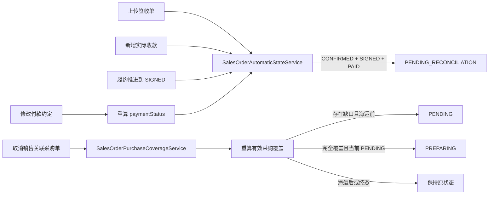

# 销售订单自动状态重算技术设计

## 1. 设计目标

在不新增数据库结构和公开接口字段的前提下，把销售订单的自动待对账、采购覆盖重算及付款状态重算收敛到可信服务端事务中。前端只读取接口返回的最终订单状态选择成功轻提示，不自行复制状态规则。

## 2. 架构边界



### 2.1 销售域职责

新增 `SalesOrderAutomaticStateService`，作为自动进入待对账的唯一写入入口。该服务注册在 `SalesOrdersModule`，由以下服务注入使用：

- `SalesOrderMutationService`
- `SalesOrderDocumentService`

该服务不暴露 Controller，不改变公开 API。

### 2.2 采购域职责

扩展既有 `SalesOrderPurchaseCoverageService`，同时支持：

- 创建采购订单后的完全覆盖推进。
- 取消采购订单后的覆盖重新计算。

`PurchaseOrderMutationService` 在采购取消事务中调用覆盖服务，不跨事务发送事件，也不依赖异步补偿。

## 3. 自动待对账设计

### 3.1 服务接口

```ts
type SalesOrderAutomaticReconciliationTrigger
  = | 'DELIVERY_RECEIPT'
    | 'FULFILLMENT'
    | 'PAYMENT'
    | 'PAYMENT_TERMS'

interface SalesOrderAutomaticStateContext {
  actorUserId: string
  requestId: string
}

advanceToPendingReconciliationWhenEligible(
  transaction: Prisma.TransactionClient,
  context: SalesOrderAutomaticStateContext,
  salesOrderId: string,
  trigger: SalesOrderAutomaticReconciliationTrigger,
): Promise<boolean>
```

返回值只供服务测试和内部分支使用；公开接口继续返回既有 `SalesOrderDetailDto`。

### 3.2 算法

1. 在调用方已持有销售订单行锁的事务内，重新读取 `orderStatus`、`fulfillmentStatus`、`paymentStatus`。
2. 只有精确满足 `CONFIRMED + SIGNED + PAID` 时继续。
3. 使用既有 `assertSalesOrderStatusTransition()` 再次校验 `CONFIRMED -> PENDING_RECONCILIATION`。
4. 更新 `orderStatus` 并递增 `version`。
5. 写入 `SalesOrderStatusHistory`：
   - `dimension = ORDER`
   - `fromStatus = CONFIRMED`
   - `toStatus = PENDING_RECONCILIATION`
   - `reason = 订单已签收且已付清，系统自动进入待对账`
6. 写入 `SALES_ORDER_ORDER_STATUS_CHANGED` 审计事件，metadata 包含：
   - `automatic: true`
   - `trigger`
   - `fromStatus`
   - `toStatus`
7. 不调用完成逻辑，不产生 `COMPLETED`。

### 3.3 调用位置

| 业务事务 | 调用时机 |
|---|---|
| `updateFulfillmentStatus` | 履约状态、履约历史和审计写入后 |
| `submitDeliveryReceipt` | 签收单、`SIGNED`、履约历史和审计写入后 |
| `recordPayment` | 实际收款、凭证、付款状态和对应审计写入后 |
| `updatePaymentTerms` | 金额、付款状态、付款历史和金额修订写入后 |

所有调用都发生在原业务事务提交前，因此自动推进失败会使整个原操作回滚。

## 4. 付款约定状态重算

### 4.1 当前问题

既有 `updatePaymentTerms()` 会调用 `deriveSalesOrderPaymentStatus()` 校验新总价不能低于有效收款，但丢弃了计算结果，没有更新 `paymentStatus`。

### 4.2 修改方案

1. 使用有效收款聚合和新 `agreedTotalAmount` 计算 `newPaymentStatus`。
2. 在更新金额的同一条 `salesOrder.update` 中写入 `paymentStatus`，避免金额与付款状态短暂不一致。
3. 当状态变化时写入 `PAYMENT` 状态历史，原因固定为“修改付款约定后系统重新计算付款状态”。
4. 金额修订与 `SALES_ORDER_PAYMENT_TERMS_UPDATED` 审计保持现状。
5. 写入后调用自动待对账服务。
6. 本期不修改 Web 页面，不新增调用入口。

## 5. 采购取消覆盖重算

### 5.1 事务与锁顺序

继续沿用采购取消已有锁顺序：

1. 按 UUID 升序锁定采购单关联的销售明细行。
2. 锁定采购订单主行。
3. 校验采购订单可取消。
4. 将采购订单更新为 `CANCELLED`。
5. 锁定关联销售订单主行并重新聚合覆盖。
6. 必要时更新销售履约状态、历史和审计。
7. 提交同一事务。

采购订单锁定结果需要补充读取 `purchaseType`、`salesOrderId`，避免取消后再次通过不受信任请求推导关联关系。

### 5.2 有效覆盖口径

- 只统计 `purchaseType = SALES_LINKED`。
- 只统计 `orderStatus != CANCELLED` 的采购订单。
- 按 `sourceSalesOrderLineId` 汇总数量，不按产品 ID 合并。
- 只读取 `removedAt IS NULL` 的销售明细。
- 每条销售明细的有效采购数量均大于等于销售数量，才算完全覆盖。

### 5.3 派生规则

```ts
if (salesOrder.orderStatus !== 'CONFIRMED') keep()
else if (!PRE_SEA_STATUSES.includes(salesOrder.fulfillmentStatus)) keep()
else if (!fullyCovered) set('PENDING')
else if (salesOrder.fulfillmentStatus === 'PENDING') set('PREPARING')
else keep()
```

状态变化时写入：

- `SalesOrderStatusHistory.dimension = FULFILLMENT`
- 原状态与派生状态
- 原因：“取消采购订单后重新计算销售产品采购覆盖”
- `SALES_ORDER_FULFILLMENT_STATUS_CHANGED` 审计事件
- metadata：`automatic`、`trigger = PURCHASE_CANCELLATION`、`purchaseOrderId`、`purchaseOrderNo`

`STOCK` 采购或 `salesOrderId = null` 时直接跳过。

## 6. Web 轻提示设计

不新增布局和视觉组件，继续复用根层单例 `QsToast`。

### 6.1 销售收款与签收

调用前保留原订单状态，调用后读取响应中的最终状态：

```ts
const automaticallyReconciled = previousOrderStatus === 'CONFIRMED'
  && response.data.orderStatus === 'PENDING_RECONCILIATION'
```

- 自动待对账：`订单已签收且已付清，已自动进入待对账`
- 普通收款成功：`实际收款记录添加成功`
- 普通签收成功：`签收单上传成功，订单已进入已签收`

### 6.2 采购取消

- `purchaseType = SALES_LINKED`：`采购订单已取消，关联销售订单采购覆盖状态已重新计算`
- `purchaseType = STOCK`：`采购订单已取消`

采购详情响应不新增销售状态字段；轻提示只承诺服务端已完成重算，不在客户端猜测具体目标状态。

### 6.3 保持建设中动作

`FACTORY_SHIPMENT`、`WAREHOUSE_RECEIPT`、`CONTAINER_SHIPMENT` 继续走现有 `toast.info()` 分支，不调用 `updateFulfillmentStatus()`。

## 7. 一致性与失败处理

- 所有派生写入使用已有 Prisma 事务与行锁。
- 不使用事务提交后的异步监听，避免原操作成功但派生状态失败。
- 不接受客户端提交“是否自动待对账”或“覆盖是否完整”等派生事实。
- 失败继续沿用原接口错误码，不新增客户端可控状态字段。
- 状态历史只有实际状态变化时写入，幂等无变化时不重复写入。
- 自动待对账服务对非 `CONFIRMED + SIGNED + PAID` 返回 `false`，不抛业务错误。

## 8. 测试策略

### 8.1 Server

1. 新增自动状态服务单元测试：符合条件、各项不符合、历史和审计。
2. 扩展 `SalesOrderMutationService`：
   - 收款后自动待对账。
   - 履约到签收后自动待对账。
   - 修改付款约定写回 `paymentStatus` 与历史。
3. 扩展 `SalesOrderDocumentService`：上传签收单后调用自动待对账。
4. 扩展 `SalesOrderPurchaseCoverageService`：
   - 取消后覆盖不足回到 `PENDING`。
   - 其他采购仍完全覆盖时保持状态。
   - 海运后、终态、备货采购不变化。
5. 扩展 `PurchaseOrderMutationService`：证明取消和覆盖重算处于同一事务。

### 8.2 Web

1. 销售记录弹窗测试自动待对账与普通成功两种提示。
2. 采购取消测试销售关联采购与备货采购两种提示。
3. 保留并加强三个建设中物流动作只显示 `toast.info()` 的断言。

### 8.3 最终验证

```bash
cd server && pnpm test --runInBand <focused-specs>
cd web && pnpm test -- <focused-tests>
node --run contract:check
node --run check
git diff --check
git status --short
```

## 9. 不实施内容

- 不新增付款约定修改入口。
- 不实现工厂发货、货物入仓、装柜出货。
- 不新增 schema、migration、权限或接口字段。
- 不自动进入 `COMPLETED`。
- 不自动把已进入待对账的订单回退为已确认。
