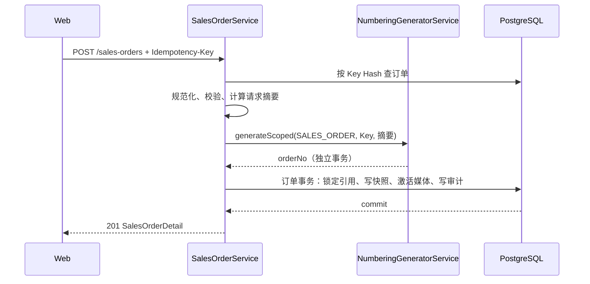

# 销售订单域技术设计

## 1. 文档状态

- 状态：已确认并进入实施
- 确认日期：2026-08-20
- 需求规格：[销售订单域需求规格](./requirements.md)
- 编号规则：`SALES_ORDER`
- 业务日期时区：`Asia/Shanghai`

## 2. 设计边界与真相源

| 能力 | 真相源 |
| --- | --- |
| 订单编号 | `NumberingGeneratorService` + `NumberingIssuance` |
| 订单约定与快照 | `SalesOrder`、`SalesOrderLine` |
| 实际收款 | `SalesOrderPayment` |
| 凭证关联 | `SalesOrderDocument` + `MediaAsset` |
| 状态历史 | `SalesOrderStatusHistory` |
| 已确认金额修订 | `SalesOrderAmountRevision` |
| 地区身份 | `Region.id`；历史展示使用订单快照 |
| 产品身份 | `Product.id`；历史展示和价格使用订单行快照 |
| HTTP 契约 | Controller、DTO、OpenAPI decorators |
| Web DTO | Web OpenAPI snapshot 生成类型 |

客户、产品、地区和媒体信息只通过明确外键与快照关联，不引入多态 owner，不创建客户主数据，也不把订单临时产品写入产品域。

## 3. 状态模型

```text
SalesOrderStatus: DRAFT -> CONFIRMED
                  DRAFT -> CANCELLED
                  CONFIRMED -> CANCELLED（仅未签收、无有效收款且无未取消的销售关联采购单）

SalesOrderFulfillmentStatus:
PENDING -> PREPARING -> LAND_TRANSIT -> WAREHOUSE_ARRIVED -> SEA_TRANSIT -> SIGNED

SalesOrderPaymentStatus:
UNPAID -> PARTIALLY_PAID -> PAID
```

付款状态只由有效收款总额派生。履约进入 `SIGNED` 前必须存在有效签收单。所有状态变化写入 `SalesOrderStatusHistory`，通用 `AuditEvent` 只存非敏感动作摘要。

## 4. 数据库设计

### 4.1 枚举

```text
SalesOrderStatus: DRAFT | CONFIRMED | CANCELLED
SalesOrderFulfillmentStatus: PENDING | PREPARING | LAND_TRANSIT | WAREHOUSE_ARRIVED | SEA_TRANSIT | SIGNED
SalesOrderPaymentStatus: UNPAID | PARTIALLY_PAID | PAID
SalesOrderLineType: CATALOG | CUSTOM
SalesOrderPaymentType: DEPOSIT | BALANCE | OTHER
SalesOrderDocumentType: DEPOSIT_VOUCHER | DELIVERY_RECEIPT | OTHER
SalesOrderStatusDimension: ORDER | FULFILLMENT | PAYMENT
```

### 4.2 `SalesOrder`

核心字段：

- 身份：`id`、`orderNo`、`createIdempotencyKeyHash`、`createRequestFingerprintHash`。
- 基础信息：`orderDate`、`issuerUserId`、`currencyCode`。
- 客户快照：姓名、电话、三级地区 ID/编码/名称快照、详细地址、完整地址。
- 金额：`lineSubtotalAmount`、`agreedTotalAmount`、`depositDueAmount`、`balanceDueAmount`。
- 状态：`orderStatus`、`fulfillmentStatus`、`paymentStatus`。
- 并发与时间：`version`、`createdAt`、`updatedAt`。

关键约束：

- `orderNo` 唯一；只存编号结果，不在订单表复制编号规则配置。
- 幂等 Key 只保存 SHA-256；同一 Hash 唯一。
- `currencyCode IN ('TWD', 'MYR')`。
- 所有金额非负，`agreedTotalAmount = lineSubtotalAmount`，且 `agreedTotalAmount = depositDueAmount + balanceDueAmount`。
- 三级地区均为外键；服务层在事务内锁定/读取并校验完整父子链。
- 地址详细值和完整值不得包含 Unicode 空白字符。
- 地区分析索引按 `currencyCode + status + regionId + orderDate` 建立国家、省州和城市三组索引。

### 4.3 `SalesOrderLine`

- `CATALOG` 行必须有 `productId`，并保存产品编号、名称、属性、标准单价快照。
- `CUSTOM` 行必须没有 `productId`，标准单价为空，只保存临时名称、说明和成交价。
- `quantity` 为正整数。
- `actualUnitPriceAmount >= 0`，用户输入最多两位小数，领域内部仍规范化为四位定点金额。
- `lineTotalAmount = actualUnitPriceAmount * quantity`。
- `(salesOrderId, lineNumber)` 唯一，顺序从 1 开始且由服务端重排。

### 4.4 `SalesOrderPayment`

- 金额为正数，币种继承订单而不重复允许客户端选择。
- 保存类型、收款时间、方式、外部参考号、备注和操作人。
- 作废使用 `voidedAt/voidedByUserId/voidReason`，不物理删除。
- 同一订单有效收款总额不得超过约定总价；写入时锁定订单行并重新计算。

### 4.5 `SalesOrderDocument`

- 显式关联 `salesOrderId + mediaAssetId`，可选关联 `paymentId`。
- 保存凭证类型、标题、说明、关联/解除操作人和时间。
- 有效关联要求 `MediaAsset.status = READY` 且类型为 `IMAGE | DOCUMENT`。
- `MediaAsset` 引用基础设施增加 `sales_order_documents`，媒体回收必须同时检查产品和订单引用。

### 4.6 历史与修订

- `SalesOrderStatusHistory` 保存维度、旧值、新值、原因、操作人和时间。
- `SalesOrderAmountRevision` 保存四项约定金额的修改前后值、原因、操作人和时间。
- 两表不可提供物理删除接口。

## 5. 地址规范化

服务端使用单一纯函数执行：

1. `NFKC` 规范化。
2. 移除所有 Unicode `White_Space`。
3. 构造已选地区前缀候选：完整三级、`省/州 + 城市`、城市。
4. 当详细地址以任一候选开头时返回 `ADDRESS_DETAIL_CONTAINS_SELECTED_REGION`。
5. 否则将四段分别去空白后直接拼接为 `customerFullAddressSnapshot`。

防重只匹配开头，不扫描中间文本，也不做模糊相似度删除。

## 6. 创建事务与编号幂等



- 订单先检查自身幂等记录，再调用编号域。
- 编号域使用 `consumerCode = SALES_ORDER` 和相同 Key；请求摘要绑定规范化订单内容。
- 编号成功但订单事务失败时允许断号；同 Key 重试从编号域重放原编号。
- 订单事务必须重新验证货币、产品、地区、临时媒体和金额，避免选择后状态漂移。

## 7. 公共 API

| Method | Path | Permission | Purpose |
| --- | --- | --- | --- |
| `GET` | `/sales-orders` | `sales-orders:read` | 分页筛选列表 |
| `GET` | `/sales-orders/:salesOrderId` | `sales-orders:read` | 订单详情 |
| `GET` | `/sales-orders/product-options` | `sales-orders:create` | 按固定币种选择产品 |
| `POST` | `/sales-orders` | `sales-orders:create` | 幂等正式保存订单 |
| `PATCH` | `/sales-orders/:salesOrderId/order-status` | `sales-orders:update` | 订单状态流转 |
| `PATCH` | `/sales-orders/:salesOrderId/fulfillment-status` | `sales-orders:update` | 履约状态流转 |
| `PATCH` | `/sales-orders/:salesOrderId/payment-terms` | `sales-orders:update` | 受控修改定金/尾款 |
| `POST` | `/sales-orders/:salesOrderId/payments` | `sales-orders:payment` | 新增实际收款 |
| `POST` | `/sales-orders/:salesOrderId/payments/:paymentId/void` | `sales-orders:payment` | 作废实际收款 |
| `POST` | `/sales-orders/document-uploads` | `sales-orders:document` | 上传未关联临时凭证，不发号 |
| `POST` | `/sales-orders/:salesOrderId/documents` | `sales-orders:document` | 关联已上传凭证 |
| `DELETE` | `/sales-orders/:salesOrderId/documents/:documentId` | `sales-orders:document` | 软解除凭证 |
| `GET/HEAD` | `/sales-orders/:salesOrderId/documents/:documentId/content` | `sales-orders:read` | 私有内容读取 |

所有 mutation 启用 Session、CSRF、权限、`X-Request-Id` 和稳定错误矩阵。创建接口要求 UUID v4 `Idempotency-Key`；服务端不把 Key 原文写入数据库、日志或错误。

## 8. Web 设计规格

### 8.1 视觉

- Purpose：高密度一次性出单，及时呈现金额、地址和状态错误。
- Aesthetic：`Industrial/utilitarian`。
- Palette：`#F6F7F8`、`#FFFFFF`、`#1D2129`、`#165DFF`、`#00B42A`、`#F53F3F`；实现使用现有主题 Token。
- Typography：`Noto Sans SC`、`Noto Sans TC`。
- Layout：桌面 8/4 非对称布局，右侧金额摘要 sticky；窄屏单列。

### 8.2 页面交互

- 列表页“新增销售订单”先打开 `QsGenericModal` 选择币种。
- 创建页固定币种，分为基础信息、客户地址、产品明细、凭证和备注五个区块。
- 产品明细支持数据库产品搜索和临时产品行，价格与数量变化立即更新展示汇总，但最终以服务端校验为准。
- 右侧摘要展示明细汇总、约定总价、定金、尾款及等式状态。
- 全部订单的操作列提供“取消订单”入口：仅对满足取消门禁的订单显示，确认弹窗必填原因，成功后刷新列表与状态计数。
- 日期上限为今天；出单人只读显示当前用户。
- 未保存离开使用明确确认，不依赖浏览器 history 返回。

## 9. 测试策略

- 纯函数：金额十进制、地址规范化、防重、请求摘要、状态机。
- Service 单元测试：幂等、状态漂移、产品快照、地区快照、付款派生、取消门禁（收款/签收/未取消采购单）、签收凭证门禁。
- Schema E2E：命名约束、外键、索引、金额等式、正整数、媒体引用、不可变历史。
- API E2E：权限、CSRF、错误矩阵、并发 Key、订单全流程。
- Web 源码/逻辑测试：币种弹窗、路由门禁、表单映射、错误回显、金额硬拦截。
- Browser E2E：选择币种 -> 创建订单 -> 列表回显的真实 Chromium 流程。

## 10. 安全与隐私

- 审计元数据不得包含电话、完整地址、凭证内容、幂等 Key 或完整请求体。
- 所有 DTO 使用白名单和长度限制；未知字段由全局验证边界拒绝。
- 媒体内容继续使用既有私有存储、内容校验和受权读取能力。
- Web 不把未保存客户信息、凭证或幂等上下文写入持久化 Store、LocalStorage、URL 或日志。
