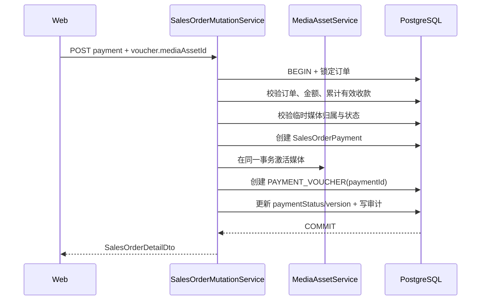

# 销售订单收款与凭证技术设计

## 1. 文档状态

- 状态：待确认
- 设计日期：2026-08-25
- 需求规格：[销售订单收款与凭证需求规格](./requirements.md)
- 依赖设计：[销售订单域技术设计](../sales-order-domain/design.md)

## 2. 当前实现审计

### 2.1 当前能力

- `SalesOrderPayment` 已支持实际收款、作废和付款状态派生。
- `SalesOrderDocument` 已通过可选 `paymentId` 同时承载订单级凭证和收款凭证。
- 临时凭证上传已使用媒体域的 `UPLOADING -> READY` 生命周期，上传本身不发放订单编号。
- 数据库触发器已禁止物理删除收款、修改收款事实、物理删除凭证和修改凭证事实。
- Web 已具备订单创建凭证上传、实际收款记录查看和订单凭证查看能力。

### 2.2 与新需求的差异

| 当前实现 | 目标实现 |
| --- | --- |
| 新增订单允许 0–20 份凭证 | 新增订单必须且只能有一份出单凭证 |
| 创建页允许选择定金凭证、签收单或其他 | 创建页固定为出单凭证，不显示类型选择器 |
| `SalesOrderPaymentType` 只有定金、尾款、其他 | 增加过程款和开票税金 |
| 收款记录与凭证通过两个接口分别写入 | 一次收款事务同时创建收款与唯一凭证 |
| 收款保存 `referenceNo` | 从数据库、DTO、服务和响应中物理删除 |
| 通用凭证接口可选传入 `paymentId` | 业务写入改为出单、收款、签收三个受控入口 |
| 上传签收单与通用凭证混用 | “货物签收”弹窗只上传一份签收单 |
| 凭证详情只显示是否关联收款 | 按凭证业务类型显示订单级或具体收款信息 |

### 2.3 当前开发库数据快照

2026-08-25 的只读审计结果：

- 销售订单：5 张。
- 有一份有效凭证的订单：2 张；无有效凭证的订单：3 张。
- 有效凭证：2 份，均为未关联收款的 `DEPOSIT_VOUCHER`。
- 实际收款：0 条；`referenceNo` 非空记录：0 条。

该快照只用于验证本地迁移路径。迁移实现仍必须处理允许的全部历史枚举组合，不能依赖开发库数量。

## 3. 目标架构

继续复用 `SalesOrderPayment`、`SalesOrderDocument` 和 `MediaAsset`，不新增签收业务表。本期只把三种写入语义收紧：

```text
SalesOrder
├─ ORDER_ISSUANCE_VOUCHER（恰好一份，仅新订单强制）
├─ SalesOrderPayment（0..n）
│  └─ PAYMENT_VOUCHER（每笔有效或已作废收款恰好一份）
└─ DELIVERY_RECEIPT（0..n，订单级凭证）
```

- `paymentId = null` 只允许出单凭证和签收单。
- `paymentId != null` 只允许收款凭证。
- 签收审批后续通过独立审批模型引用 `DELIVERY_RECEIPT`，本期不提前增加审批字段。

## 4. 数据模型设计

### 4.1 收款类型

`SalesOrderPaymentType` 调整为：

```text
DEPOSIT
PROGRESS
INVOICE_TAX
BALANCE
OTHER
```

所有类型都属于真实到账。`INVOICE_TAX` 与其他类型一样计入有效收款总额，因为 `agreedTotalAmount` 已按含税销售总价保存。

### 4.2 凭证类型

`SalesOrderDocumentType` 调整为：

```text
ORDER_ISSUANCE_VOUCHER
PAYMENT_VOUCHER
DELIVERY_RECEIPT
```

不保留 `DEPOSIT_VOUCHER` 和 `OTHER` 兼容分支。收款的业务阶段由关联 `SalesOrderPayment.paymentType` 表达，避免为每种收款复制一组凭证枚举。

### 4.3 `SalesOrderPayment`

删除：

```text
referenceNo / reference_no
```

保留：

- `id`：内部 UUID，用于关联和审计。
- `paymentType`：五种收款类型。
- `amount`：正数定点金额。
- `receivedAt`：不晚于当前时间的 UTC 时间。
- `paymentMethod`：可选收款方式。
- `remark`：可选备注。
- 创建和作废审计字段。

收款事实继续不可变；录错后只能作废，不能修改或物理删除。

### 4.4 `SalesOrderDocument`

沿用现有字段，`title` 改为服务端生成的不可编辑系统标题。新增数据库约束：

```sql
CHECK (
  (document_type = 'PAYMENT_VOUCHER' AND payment_id IS NOT NULL)
  OR
  (document_type IN ('ORDER_ISSUANCE_VOUCHER', 'DELIVERY_RECEIPT') AND payment_id IS NULL)
)
```

新增部分唯一索引：

```sql
-- 每张订单最多一份有效出单凭证；历史缺失记录仍可读取。
UNIQUE (sales_order_id)
WHERE detached_at IS NULL
  AND document_type = 'ORDER_ISSUANCE_VOUCHER'

-- 每笔收款最多一份有效收款凭证。
UNIQUE (payment_id)
WHERE detached_at IS NULL
  AND document_type = 'PAYMENT_VOUCHER'
```

“至少一份”由服务事务保证：

- 创建新订单时，创建事务要求且写入一份出单凭证。
- 添加收款时，收款事务要求且写入一份收款凭证。
- 出单凭证和收款凭证不提供独立解除入口，从而维持创建后的最小数量。

签收单允许同一订单保存多份；每次“货物签收”操作只写入一份。

### 4.5 标题生成

新增服务端纯函数 `createSalesOrderDocumentTitle()`，输入为：

- 最终订单客户姓名。
- 受信任的凭证业务标签。
- 媒体资产上传时间或服务事务时间。

输出格式：

```text
客户名-凭证类型-yyyyMMddHHmmssSSS
```

规则：

1. 客户名执行 `trim + NFKC`。
2. 时间按 `Asia/Shanghai` 格式化，与订单业务日期口径保持一致。
3. 标题最长 128 个 Unicode code point；超长时只截断客户名。
4. 服务端忽略客户端标题；Web 纯函数只负责提前预览相同格式。
5. `MediaAsset.originalFilename` 保留用户上传的原始文件名和扩展名。

收款凭证标签从收款类型映射：

```text
DEPOSIT -> 定金凭证
PROGRESS -> 过程款凭证
INVOICE_TAX -> 开票税金凭证
BALANCE -> 尾款凭证
OTHER -> 其他收款凭证
```

## 5. 数据库迁移设计

新迁移建议命名：

```text
20260825xxxxxx_sales_order_payment_and_receipt_semantics
```

迁移顺序：

1. 创建目标收款类型和凭证类型的临时 PostgreSQL Enum。
2. 将 `sales_order_payments.payment_type` 转换到新增五值 Enum；已有值保持同名映射。
3. 将 `sales_order_documents.document_type` 按以下规则转换：
   - 原类型为 `DELIVERY_RECEIPT`：转为 `DELIVERY_RECEIPT`，并要求 `payment_id IS NULL`。
   - `payment_id IS NOT NULL`：转为 `PAYMENT_VOUCHER`。
   - 其余 `DEPOSIT_VOUCHER | OTHER`：转为 `ORDER_ISSUANCE_VOUCHER`。
4. 删除旧 Enum，重命名目标 Enum。
5. 物理删除 `sales_order_payments.reference_no`。
6. 修改收款不可变触发器，移除对 `reference_no` 的比较。
7. 增加凭证类型与 `payment_id` 形状约束。
8. 增加两个部分唯一索引。
9. 使用迁移内断言验证：不存在类型/关联形状错误；不存在同一订单多份有效出单凭证；不存在同一收款多份有效收款凭证。

如果任一断言失败，迁移必须整体失败，不得自动删除、合并或猜测历史凭证。

`reference_no` 删除不可逆，历史值不会在回滚中恢复；用户已明确接受物理删除。部署前仍应通过只读 SQL 输出非空数量，作为迁移记录。

历史上没有出单凭证的订单继续可查询，但不补造媒体文件。仅新建订单受“恰好一份出单凭证”约束。

## 6. API 设计

### 6.1 临时媒体上传

保留：

```http
POST /api/sales-orders/document-uploads
```

- 只创建当前用户名下的 `UPLOADING` 媒体资产。
- 不接收订单 ID、收款 ID、凭证类型或标题。
- 不修改订单、付款和履约状态。
- 继续由未关联临时媒体清理机制回收弃用文件。

### 6.2 创建订单

`CreateSalesOrderRequestDto` 把 `documents[]` 改为单数：

```ts
interface SalesOrderIssuanceVoucherInputDto {
  mediaAssetId: string
}

interface CreateSalesOrderRequestDto {
  // 既有订单字段
  issuanceVoucher: SalesOrderIssuanceVoucherInputDto
}
```

- 不接收 `documentType`、`title` 或凭证备注。
- `POST /sales-orders` 同时要求 `sales-orders:create` 和 `sales-orders:document`。
- 服务端把凭证类型固定为 `ORDER_ISSUANCE_VOUCHER`。

### 6.3 添加收款

扩展现有接口：

```http
POST /api/sales-orders/:salesOrderId/payments
```

请求：

```ts
interface SalesOrderPaymentRequestDto {
  paymentType: 'DEPOSIT' | 'PROGRESS' | 'INVOICE_TAX' | 'BALANCE' | 'OTHER'
  amount: string
  receivedAt: string
  paymentMethod: string | null
  remark: string | null
  voucher: {
    mediaAssetId: string
  }
}
```

- 删除 `referenceNo`。
- 同时要求 `sales-orders:payment` 和 `sales-orders:document`。
- 成功返回更新后的 `SalesOrderDetailDto`，其中新收款包含唯一 `voucher`。

### 6.4 货物签收

新增专用接口：

```http
POST /api/sales-orders/:salesOrderId/delivery-receipts
```

请求：

```ts
interface SalesOrderDeliveryReceiptRequestDto {
  mediaAssetId: string
}
```

- 要求 `sales-orders:document`。
- 固定写入 `DELIVERY_RECEIPT` 和 `paymentId = null`。
- 不接收签收人、签收时间、备注或目标履约状态。
- 不修改 `fulfillmentStatus`，只递增订单 `version` 并写入凭证审计。

### 6.5 通用凭证写接口

现有 `POST /sales-orders/:salesOrderId/documents` 不再允许 Web 创建任意业务类型凭证。实施时选择直接移除该公共接口，不保留未使用的兼容分支：

- 出单凭证只通过创建订单事务写入。
- 收款凭证只通过添加收款事务写入。
- 签收单只通过货物签收接口写入。

凭证内容读取接口保持不变。通用解除接口只允许解除签收单；出单凭证和收款凭证返回领域错误。

### 6.6 响应契约

`SalesOrderPaymentDto`：

- 删除 `referenceNo`。
- 增加非空 `voucher: SalesOrderDocumentDto`，便于收款弹窗一次展示完整记录。

`SalesOrderDocumentDto`：

- 保留 `paymentId` 供关系校验。
- `documentType` 使用三个目标值。
- 标题只返回服务端保存值。

## 7. 服务事务设计

### 7.1 创建订单与出单凭证

沿用现有幂等发号和最终订单事务：

1. 请求规范化时要求单个 `issuanceVoucher.mediaAssetId`。
2. 请求指纹包含该媒体 UUID，保证同一幂等键不能替换凭证内容。
3. 最终事务锁定并验证地区、产品和媒体资产。
4. 创建 `CONFIRMED` 订单和产品明细。
5. 激活媒体，按最终客户名生成标题，创建 `ORDER_ISSUANCE_VOUCHER`。
6. 记录凭证和订单创建审计后提交。

任一步失败时订单事务回滚，编号域仍遵循现有允许断号的边界。

### 7.2 添加收款与唯一凭证



关键顺序：先获得新收款 ID，再创建带 `paymentId` 的凭证；所有数据库写入共用现有事务客户端。媒体对象已经预上传，事务只改变 `MediaAsset` 状态和业务关联。

### 7.3 作废收款

- 沿用软作废，不修改或移除关联收款凭证。
- 重新汇总全部未作废收款并派生付款状态。
- 详情把关联凭证标记为“已关联已作废收款”，保留完整审计链。

### 7.4 货物签收

1. 锁定订单并确认存在。
2. 验证临时媒体属于当前用户且可激活。
3. 激活媒体，生成签收单标题。
4. 创建 `DELIVERY_RECEIPT`，`paymentId = null`。
5. 递增订单 `version`，写入 `SALES_ORDER_DOCUMENT_ATTACHED` 审计。
6. 保持 `fulfillmentStatus` 原值，不写状态历史。

现有人工流转至 `SIGNED` 的门禁继续要求至少一份有效签收单，为后续审批替换该入口保留基础。

## 8. Web 设计

### 8.1 视觉规格

- Purpose：让用户在三个明确业务事件中上传唯一对应的材料，避免通用凭证分类错误。
- Aesthetic：`Industrial/utilitarian`，延续当前销售订单页面。
- Palette：完全使用现有主题 Token；成功/主操作使用现有绿色，错误使用 destructive Token。
- Typography：沿用 `Noto Sans SC` / `Noto Sans TC` 和现有金额字体。
- Layout：复用 `QsGenericModal`、现有表单间距和响应式单列策略，不建设新的视觉体系。
- Icon：继续使用 Lucide；添加收款使用 `hand-coins`，货物签收使用 `package-check` 或现有同义图标。

### 8.2 新增订单凭证步骤

- 步骤标题和卡片标题统一改为“出单凭证”。
- 文件输入移除 `multiple`，上传一份后隐藏或禁用上传按钮。
- 移除凭证类型、标题和凭证备注编辑控件。
- 显示原始文件名、媒体信息、图片预览和自动标题预览。
- 最后一步校验及正式提交都要求恰好一份。
- 无 `sales-orders:document` 权限时显示硬拦截说明，不再显示“可不附凭证直接创建订单”。

### 8.3 添加收款弹窗

- 在“实际收款记录”弹窗标题区域提供“添加收款”主按钮。
- 表单字段：收款类型、金额、收款时间、收款方式、备注、单文件凭证上传。
- 不显示交易流水号。
- 上传后显示 `FaImagePreview` 或文档图标、原始文件名和自动标题预览。
- 未上传、正在上传、金额非法、未来时间或权限不足时禁止提交。
- Mutation 不自动重试；提交期间锁定关闭和重复提交。
- 成功后关闭添加弹窗，刷新实际收款记录、订单列表金额和付款状态。

### 8.4 货物签收弹窗

- 在“订单凭证”弹窗标题区域提供“货物签收”主按钮。
- 内容只包含单文件签收单上传、预览、自动标题和错误提示。
- 不显示签收人、签收时间、备注或履约状态选择器。
- 成功后刷新订单凭证，不显示“订单进度已更新”类提示。

### 8.5 凭证详情

- `ORDER_ISSUANCE_VOUCHER`：类型“出单凭证”，归属“订单级凭证”。
- `DELIVERY_RECEIPT`：类型“签收单”，归属“订单级凭证”。
- `PAYMENT_VOUCHER`：展示关联收款类型、金额、收款时间和有效/已作废状态。
- 图片继续由 `FaImagePreview` 展示，文档继续通过受权内容 URL 打开。

## 9. 权限与安全

| 操作 | 权限 |
| --- | --- |
| 临时凭证上传 | `sales-orders:document` |
| 创建订单 | `sales-orders:create` + `sales-orders:document` |
| 添加收款 | `sales-orders:payment` + `sales-orders:document` |
| 作废收款 | `sales-orders:payment` |
| 货物签收 | `sales-orders:document` |
| 查看记录和私有内容 | `sales-orders:read` |

`RequirePermissions()` 当前使用全量满足语义，组合权限不需要新增授权机制。Web 必须使用同一组合条件控制操作入口，但服务端权限仍是安全真相源。

服务端必须继续校验：

- 媒体由当前用户上传，状态为 `UPLOADING`，对象存在且类型为 `IMAGE | DOCUMENT`。
- 收款、凭证和订单属于同一订单。
- 日志及审计元数据不包含客户姓名、媒体标题、原文件名和完整请求体。

## 10. 错误契约

建议新增稳定错误码：

| Code | 场景 |
| --- | --- |
| `SALES_ORDER_ISSUANCE_VOUCHER_REQUIRED` | 新订单缺少出单凭证 |
| `SALES_ORDER_ISSUANCE_VOUCHER_IMMUTABLE` | 尝试解除唯一出单凭证 |
| `SALES_ORDER_PAYMENT_VOUCHER_REQUIRED` | 添加收款缺少凭证 |
| `SALES_ORDER_PAYMENT_VOUCHER_IMMUTABLE` | 尝试独立解除收款凭证 |
| `SALES_ORDER_DOCUMENT_RELATION_INVALID` | 凭证类型与 `paymentId` 形状不一致 |
| `SALES_ORDER_DOCUMENT_UNAVAILABLE` | 临时媒体不可用或已被使用 |

金额、取消订单、未来收款时间和媒体存储错误继续复用现有错误码。

## 11. 测试策略

新功能与复杂修改采用 TDD。

### 11.1 Server 聚焦测试

- 标题纯函数：七种文案、`Asia/Shanghai` 时间戳、NFKC、Unicode 截断。
- 创建 DTO/Normalizer：缺失、数组、多份、未知字段和合法单份出单凭证。
- 创建服务：订单与唯一出单凭证同事务；媒体失败时订单不落库。
- 收款服务：五种类型、含税累计、未来时间、超收、取消订单、唯一凭证及完整回滚。
- 作废收款：凭证保留、累计金额和付款状态重新派生。
- 货物签收：只创建签收单，不改变订单进度或状态历史。
- 查询服务：收款返回唯一凭证，订单级凭证文案所需关系完整。

### 11.2 Schema 与迁移测试

- Enum 值与 Prisma 模型一致。
- `reference_no` 列不存在。
- 凭证类型/`payment_id` 形状约束生效。
- 出单凭证和收款凭证部分唯一索引生效。
- 收款和凭证不可变、软作废/软解除触发器继续生效。
- 使用旧枚举组合构造迁移前数据库，验证迁移后的确定性映射。

### 11.3 Web 聚焦测试

- 创建页只允许一份出单凭证并硬拦截缺失状态。
- 自动标题预览与凭证类型映射。
- 添加收款弹窗字段、权限、上传和提交映射；不存在流水号控件。
- 货物签收弹窗只有单文件上传，不提交履约状态。
- 凭证详情显示订单级或关联收款语义。
- 桌面与窄屏入口一致。

### 11.4 契约与必要验证

实施阶段至少运行：

```bash
pnpm -C server prisma:validate
pnpm -C server typecheck
pnpm -C server test -- --runInBand <focused sales-order specs>
node --run contract:sync
node --run contract:check
pnpm -C web typecheck
pnpm -C web test:api
git diff --check
```

数据库迁移还需要使用隔离 PostgreSQL 执行 deploy、约束和迁移数据断言。根据用户约束，实施验收只运行必要的聚焦检查，不默认执行全量浏览器或全仓测试。

## 12. 实施顺序与发布边界

1. 先补充 Schema/迁移测试和服务失败测试。
2. 修改 Prisma Enum、字段、约束、迁移和生成客户端。
3. 收紧创建订单凭证契约。
4. 实现收款与凭证原子事务。
5. 实现货物签收专用接口。
6. 更新 OpenAPI 快照和 Web 生成类型。
7. 改造创建页及两个操作弹窗。
8. 更新记录弹窗语义和聚焦测试。
9. 在隔离数据库验证迁移，再对目标开发库执行迁移。

本阶段只确认设计。任务拆分、代码实施、数据库迁移执行和历史数据写入必须在后续确认门之后进行。
