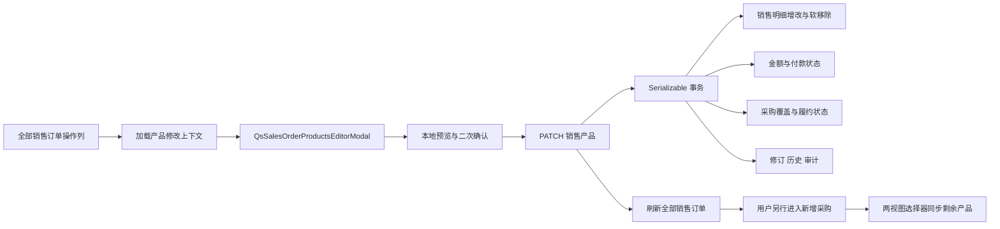

# 销售订单产品修改与采购入口收敛技术设计

## 1. 文档状态

- 阶段：Phase 2 - Technical Design
- 状态：已确认
- 编写日期：2026-09-02
- 需求规格：[销售订单产品修改与采购入口收敛需求](./requirements.md)

## 2. 设计结论

1. 删除采购域“已完成采购-加购产品”视图和采购创建页加购状态机，采购来源选择器只保留两个可信视图。
2. 以销售域专用的产品修改上下文、产品选项和修改命令替换现有 add-on API；全部接口只要求 `sales-orders:update`。
3. 将 `QsSalesOrderAddOnProductsModal` 替换为 `QsSalesOrderProductsEditorModal`，并把唯一业务入口放到“全部销售订单”操作列。
4. 弹窗以统一的 `OrderProductLineModel[]` 编辑既有行和新增行；提交时既有行携带稳定 `lineId`、目标数量和可修改销售快照，新行继续使用 CATALOG/CUSTOM 联合类型。服务端要求请求包含全部当前有效既有行，避免“遗漏代表删除”的歧义。
5. 给 `SalesOrderLine` 增加 `removedAt` 软移除字段。数量降为 `0` 时保留原销售明细和已取消采购历史，但不再参与有效产品、金额和采购覆盖计算。
6. 新增 `SALES_ORDER_PRODUCTS_CHANGED` 审计枚举；保留既有 `SALES_ORDER_PRODUCT_APPENDED` 历史值，不重写历史审计。
7. 产品、金额、定金/尾款、付款状态、履约状态、金额修订、状态历史和审计在一个 Serializable 事务中提交。
8. migration 先在隔离 PostgreSQL 完整验证，再直接应用当前开发数据库；不应用生产数据库。

## 3. 架构与数据流



采购页面与销售产品修改之间不再存在直接跳转、自动同步或多步骤写入流程。

## 4. 数据模型与 migration

### 4.1 Prisma 模型

在 `SalesOrderLine` 增加：

```prisma
removedAt DateTime? @map("removed_at") @db.Timestamptz(6)
```

不增加 `removedByUserId`：操作人、原因和变更快照统一存入不可变审计日志，避免为单一业务状态增加重复关系。既有 `quantity >= 1` 约束保持不变；业务移除通过 `removedAt` 表达，不写入数量 `0`。

### 4.2 审计枚举

```text
SALES_ORDER_PRODUCTS_CHANGED
```

既有 `SALES_ORDER_PRODUCT_APPENDED` 只作为历史值保留。新命令统一写一条操作级审计，metadata 仅保存：

- `addedLineIds`
- `quantityChanges: [{ lineId, from, to }]`
- `removedLineIds`
- `amountDelta`
- `depositReduced`
- `fromFulfillmentStatus`
- `toFulfillmentStatus`
- `previousVersion`
- `version`
- `reason`

不写入客户联系方式、地址、产品说明或附件内容。

### 4.3 数据库约束调整

增量 migration 完成以下 DDL：

1. 新增可空 `sales_order_lines.removed_at`，现有数据默认全部有效，无需回填。
2. 替换 `enforce_sales_order_line_subtotal()`：只统计 `removed_at IS NULL` 的明细，并要求至少一条有效明细。
3. 扩展 `enforce_purchase_order_line_source()`：非取消采购单不得引用已软移除销售明细；取消采购单可以继续保留历史引用。
4. 扩展 `enforce_purchase_order_source_quantity()`：只要已软移除明细仍存在有效采购数量即拒绝提交；有效采购数量仍不得超过销售明细数量。
5. 保留现有外键与销售行正数量约束，不删除历史采购明细。
6. 给 `audit_event_type` 追加新枚举值，不修改旧值。

### 4.4 有效销售明细读取规范

以下所有运行时读取统一增加 `removedAt: null` 或 SQL `removed_at IS NULL`：

- 销售订单列表、详情、产品汇总和产品图片授权。
- 销售产品修改上下文。
- 采购来源候选聚合、候选预览、来源明细同步。
- 采购创建依赖校验和销售采购覆盖推进。

历史取消采购记录仍可通过采购订单自身详情读取，不依赖销售订单当前有效产品列表。

## 5. 公共 API 设计

### 5.1 删除旧 API

从 Controller、OpenAPI 和 Web 客户端移除：

```text
GET  /api/sales-orders/{salesOrderId}/add-on-context
GET  /api/sales-orders/{salesOrderId}/add-on-product-options
HEAD /api/sales-orders/{salesOrderId}/add-on-product-options/{productId}/main-image/{productMediaId}/content
GET  /api/sales-orders/{salesOrderId}/add-on-product-options/{productId}/main-image/{productMediaId}/content
POST /api/sales-orders/{salesOrderId}/add-on-lines
```

### 5.2 新增修改上下文

```text
GET /api/sales-orders/{salesOrderId}/product-edit-context
Permission: sales-orders:update
```

响应核心结构：

```ts
interface SalesOrderProductEditContextDto {
  salesOrder: {
    id: string
    orderNo: string
    customerName: string
    currencyCode: 'TWD' | 'MYR'
    orderStatus: SalesOrderStatus
    fulfillmentStatus: SalesOrderFulfillmentStatus
    paymentStatus: SalesOrderPaymentStatus
    version: number
  }
  amounts: {
    lineSubtotalAmount: string
    agreedTotalAmount: string
    depositDueAmount: string
    balanceDueAmount: string
    paidAmount: string
    outstandingAmount: string
  }
  existingLines: Array<{
    id: string
    lineNumber: number
    lineType: 'CATALOG' | 'CUSTOM'
    productId: string | null
    productNo: string | null
    productName: string
    description: string | null
    standardUnitPriceAmount: string | null
    actualUnitPriceAmount: string
    quantity: number
    lineTotalAmount: string
    activePurchasedQuantity: number
    canDecrease: boolean
    mainImage: {
      id: string
      contentUrl: string
    } | null
  }>
  availableLineCapacity: number
}
```

资格固定为 `orderStatus = CONFIRMED` 且履约状态属于海运前。上下文不依赖采购供应商。

### 5.3 新增销售产品选项

```text
GET  /api/sales-orders/{salesOrderId}/product-edit-options
HEAD /api/sales-orders/{salesOrderId}/product-edit-options/{productId}/main-image/{productMediaId}/content
GET  /api/sales-orders/{salesOrderId}/product-edit-options/{productId}/main-image/{productMediaId}/content
Permission: sales-orders:update
```

查询只返回有效目录产品，根据销售订单币种映射标准售价，不接收 `supplierValue`。图片内容继续逐次校验订单修改资格、产品状态和主图关系。

### 5.4 新增产品修改命令

```text
PATCH /api/sales-orders/{salesOrderId}/products
Permission: sales-orders:update
CSRF: required
Retry: false
```

请求：

```ts
interface SalesOrderProductsUpdateRequestDto {
  expectedVersion: number
  reason: string
  confirmDepositReduction: boolean
  existingLines: Array<{
    lineId: string
    name: string
    description: string | null
    actualUnitPriceAmount: string
    desiredQuantity: number // 0 表示业务移除
  }>
  newLines: SalesOrderLineInputDto[]
}
```

约束：

1. `existingLines` 必须与事务内全部有效既有行一一对应，不能重复、遗漏或加入其他订单行。
2. `desiredQuantity` 不得低于有效已采购数量；有效已采购数量大于 `0` 时禁止移除，未采购行可以通过 `0` 业务移除。
3. `desiredQuantity = 0` 转换为 `removedAt = now()`，不把数据库数量写成 `0`。
4. `newLines` 可以为空；最终有效产品至少一行、最多 100 行。
5. 客户端不提交汇总金额、目标状态或采购数量；既有行只提交允许修改的销售快照字段，产品档案和采购快照均不更新。

响应：

```ts
interface SalesOrderProductsUpdateResultDto {
  salesOrderId: string
  previousVersion: number
  version: number
  addedLineIds: string[]
  updatedLineIds: string[]
  removedLineIds: string[]
  amountDelta: string
  fulfillmentStatus: SalesOrderFulfillmentStatus
  paymentStatus: SalesOrderPaymentStatus
  depositReduced: boolean
  amounts: SalesOrderProductEditAmountsDto
}
```

### 5.5 错误契约

| HTTP | Code | 语义 |
| --- | --- | --- |
| `404` | `SALES_ORDER_NOT_FOUND` | 销售订单不存在 |
| `409` | `SALES_ORDER_PRODUCT_EDIT_VERSION_CONFLICT` | 订单版本已变化 |
| `409` | `SALES_ORDER_PRODUCT_EDIT_STATE_CHANGED` | 产品、状态或行集合已变化 |
| `422` | `SALES_ORDER_PRODUCT_EDIT_NOT_ALLOWED` | 非已确认或已经海运 |
| `422` | `SALES_ORDER_PRODUCT_DECREASE_PURCHASE_LOCKED` | 目标数量低于有效已采购数量或试图移除已采购行 |
| `422` | `SALES_ORDER_DEPOSIT_REDUCTION_CONFIRMATION_REQUIRED` | 需要下调定金但缺少明确确认 |
| `422` | `SALES_ORDER_TOTAL_BELOW_RECEIVED` | 新总价低于有效收款 |
| `422` | `SALES_ORDER_LINE_LIMIT_EXCEEDED` | 有效产品行超限或为空 |
| `422` | `VALIDATION_FAILED` | DTO 或字段校验失败 |

## 6. 服务端事务设计

### 6.1 锁顺序

采购创建当前先按 ID 锁定销售明细，再锁定销售订单主行。新产品修改命令沿用相同顺序，避免与并发采购形成反向锁：

1. 事务外只做参数规范化，不信任业务事实。
2. 事务内先读取当前有效行 ID 快照。
3. 按行 ID 排序执行 `SELECT ... FOR UPDATE` 锁定全部有效销售明细。
4. 再对销售订单执行 `SELECT ... FOR UPDATE`。
5. 重新读取订单、全部有效行、有效采购数量和有效收款，并校验版本及行集合。
6. 任何并发变化或 PostgreSQL 序列化失败统一映射为可恢复冲突，不泄漏 Prisma 错误。

采购创建的销售明细锁查询同步增加 `removed_at IS NULL`，确保软移除行无法成为新采购来源。

### 6.2 单事务写入顺序

1. 规范化新增行并读取有效产品快照。
2. 计算既有行目标数量、可修改销售快照、软移除集合和新增行。
3. 服务端重算新产品小计、`amountDelta` 和订单金额。
4. 若新总价小于有效收款，拒绝。
5. 若新总价小于原定金且 `confirmDepositReduction !== true`，拒绝。
6. 写入既有行数量与小计、软移除时间、新增行。
7. 更新订单金额：
   - `newDeposit = min(oldDeposit, newAgreedTotal)`
   - `newBalance = newAgreedTotal - newDeposit`
8. 依据有效收款重算付款状态。
9. 依据有效销售行与有效采购数量计算剩余数量：
   - 剩余大于 `0`：目标履约状态为 `PENDING`。
   - 剩余等于 `0` 且当前为 `PENDING`、存在有效采购：目标为 `PREPARING`。
   - 剩余等于 `0` 且当前已为其他海运前状态：保持当前状态。
10. 金额元组变化时写 `SalesOrderAmountRevision`；状态变化时写对应 `SalesOrderStatusHistory`。
11. 写一条 `SALES_ORDER_PRODUCTS_CHANGED` 审计。
12. 销售订单 `version` 在本命令中只增加一次。

## 7. 采购来源两视图改造

`PurchaseOrderSourceSalesOrderView` 收敛为：

```ts
type PurchaseOrderSourceSalesOrderView =
  | 'UNPURCHASED'
  | 'PARTIALLY_PURCHASED'
```

删除 SQL 和领域分类器中的 `COMPLETED_PURCHASE_ADD_ON` 分支。所有候选事实只统计 `removed_at IS NULL` 的销售明细。

`PurchaseSourceSalesOrderSelector`：

- 删除第三个 toolbar item、权限禁用说明和“加购产品”动作语义。
- 所有确认动作统一返回所选销售订单并进入既有来源明细加载。
- 不再接收 `canAddSalesOrderProducts`。

采购创建页删除：

- `QsSalesOrderAddOnProductsModal` 引用和状态。
- `purchase-order-sales-add-on.logic.ts`。
- add-on context、产品选项和 mutation 调用。
- `FaMultiStepLoader` 销售加购步骤。
- `sales-orders:update` 权限判断。

保留普通销售来源同步、已采购灰色行、采购价格和最终采购提交逻辑。

## 8. Web 组件与页面设计

### 8.1 新组件

新建：

```text
components/business/QsSalesOrderProductsEditorModal/
  index.vue
  logic.ts
  types.ts
  README.md
```

删除旧 `QsSalesOrderAddOnProductsModal` 目录及其旧测试、Showcase 和路由，新增对应编辑组件展示页。

组件保持纯 UI 边界：不直接引用 API 或账户 Store，只通过 props 接收上下文、币种、草稿和产品加载器，通过事件发出取消、重试、复核和确认意图。

### 8.2 编辑模型

前端草稿拆分为：

```ts
interface SalesOrderProductEditLine extends OrderProductLineModel {
  sourceLineId: string | null
  originalQuantity: number | null
  activePurchasedQuantity: number
}
```

既有行与新增行统一使用 `QsOrderProductLineEditor`。既有行通过 `sourceLineId` 保持身份稳定：

- 无有效采购的既有行可编辑销售快照、售价和数量，也可删除。
- 存在有效采购的既有行锁定删除、产品身份、来源和类型，数量下限为
  `activePurchasedQuantity`；名称、描述、备注和本单售价仍可编辑。
- 所有快照修改只落到销售明细，不回写产品档案或任何既有采购明细。

### 8.3 二次确认

普通确认展示：

- 增加行数。
- 数量增加、减少与移除行数。
- 原总价、新总价和金额差额。
- 原履约状态、预计新履约状态。

当 `newAgreedTotalAmount < oldDepositDueAmount` 时，同一确认视图切换为 amber 风险语义，并额外展示：

- 原定金。
- 新定金。
- 定金减少金额。
- “确认调整定金并保存”主按钮。

此时 intent 固定携带 `confirmDepositReduction: true`。普通确认携带 `false`。不连续弹出第三层确认。

### 8.4 全部销售订单页面

1. `viewMode = all` 时操作列宽度从当前单按钮宽度扩展到容纳“查看 + 修改产品”。
2. `canEditProducts(order)` 同时校验：`sales-orders:update`、`CONFIRMED`、海运前。
3. 点击后加载 context 和产品选项；成功提交后关闭弹窗、成功 Toast、刷新当前页与状态计数。
4. 本地校验失败使用 Warning Toast；服务端冲突保留草稿并在弹窗内显示持久错误。
5. 不自动跳转采购创建页。

## 9. 文件级改造边界

### Server

- 新增 `sales-order-product-edit-query.service.ts` 与 `sales-order-product-edit.service.ts`。
- 新增 `dto/sales-order-product-edit.dto.ts`，扩展 response/query DTO。
- 调整 `sales-orders.controller.ts`、`sales-orders.module.ts`、产品图片授权服务。
- 删除旧 add-on service/query/DTO 及其专用测试。
- 调整采购来源领域分类、查询、采购创建依赖和覆盖服务。
- 调整 Prisma schema、schema governance 测试、migration 与 OpenAPI。

### Web

- 新增 `QsSalesOrderProductsEditorModal` 及组件库 Showcase。
- 调整销售订单 API 客户端与“全部销售订单”页面。
- 将采购来源选择器改为两视图。
- 删除采购创建页 add-on 状态机、旧组件、旧 Showcase 和相关测试。
- 同步 generated OpenAPI types；不手写生成文件。

### Specs

- 将 `sales-order-add-on-purchase` 标记为被本规格替代，保留历史文档。
- 新规格跟踪任务和实际验证结果。

## 10. TDD 与验证策略

### 10.1 Server RED → GREEN

1. 领域分类测试先要求只有两个采购视图。
2. DTO/normalizer 测试覆盖完整既有行集合、`0` 软移除、重复 ID、空有效行和确认标记。
3. Query 测试覆盖海运前资格、每行有效采购数量、取消采购不锁定和无供应商条件。
4. Service 测试覆盖增加、减少、移除、有效采购锁定、已取消采购、金额/定金/收款、状态回退/推进、版本冲突和事务失败。
5. 数据库测试固定软移除、活动行小计和采购来源约束。
6. Controller/OpenAPI 测试固定新路径、`sales-orders:update` 权限、错误码和 `retry: false`。
7. 隔离 PostgreSQL E2E 覆盖 migration、并发修改与采购创建竞态。

### 10.2 Web RED → GREEN

1. Logic 测试固定差额预览、行锁最小数量、业务移除和定金下调确认。
2. 组件测试固定纯组件边界、`90rem`、纵向三段结构、普通/加强确认与错误保留。
3. 销售列表测试固定入口资格、权限、提交刷新和不自动跳采购。
4. 采购页面与选择器测试固定第三视图和 add-on 流程完全移除。
5. API 测试固定 generated DTO、新端点和 mutation 禁止自动重试。

### 10.3 完整验证

```bash
pnpm -C server prisma:validate
pnpm -C server test -- <targeted specs>
node ./scripts/ci-postgres.mjs -- node ./scripts/ci-server-e2e.mjs
node --run contract:sync
node --run contract:check
pnpm -C web exec tsx --test <targeted tests>
pnpm -C server typecheck
pnpm -C web typecheck
pnpm -C server lint
pnpm -C web lint
node --run check
git diff --check
```

## 11. migration 应用与验证

仅在 migration schema 测试、隔离 PostgreSQL E2E、Prisma validate 和契约验证通过后执行：

```bash
pnpm -C server db:migrate:deploy
pnpm -C server exec prisma migrate status
```

应用前只检查目标数据库身份与 migration 状态，不输出连接字符串。应用后验证：

1. 新 migration 为 `Applied`。
2. `sales_order_lines.removed_at` 存在且历史行均为 `NULL`。
3. `SALES_ORDER_PRODUCTS_CHANGED` 枚举存在且唯一。
4. 数据库约束函数为新定义。
5. Server `/api/health` 中 database 为 `up`。

若必要验证失败，停止应用并如实报告；不使用 `migrate reset`、手工改 migration 表或其他破坏性恢复。

## 12. 风险与控制

| 风险 | 控制 |
| --- | --- |
| 软移除行仍进入金额或采购覆盖 | 数据库触发器、服务查询统一过滤及 schema 测试 |
| 并发采购与减少产品形成竞态 | 统一“销售行 → 销售订单”锁顺序、Serializable、数据库约束 |
| 客户端伪造可减少状态 | 服务端事务内重算每行有效采购数量 |
| 自动下调定金未获确认 | 前端加强确认 + 服务端确认标记硬校验 |
| 修改后订单仍留在错误采购阶段 | 同事务重算剩余数量并写履约状态历史 |
| 删除旧 API 造成生成契约残留 | Controller 测试、contract sync/check、全仓 `rg add-on` 审计 |
| migration 误应用错误数据库 | 应用前仅展示脱敏目标身份和 migration 状态，禁止 reset |

## 13. Phase 2 确认门

本技术设计已确认，并同时确认以下高风险变更边界：

1. 新增 `sales_order_lines.removed_at` 并调整四类数据库约束/读取语义。
2. 新增审计枚举和增量 migration，并在验证后应用当前开发数据库。
3. 删除旧 add-on 公共 API、旧组件目录和采购页加购状态机。
4. 新增产品修改公共 API 和 generated OpenAPI 契约。

确认后进入 Phase 3 任务拆分；Phase 3 再次确认后才开始业务代码实施。
