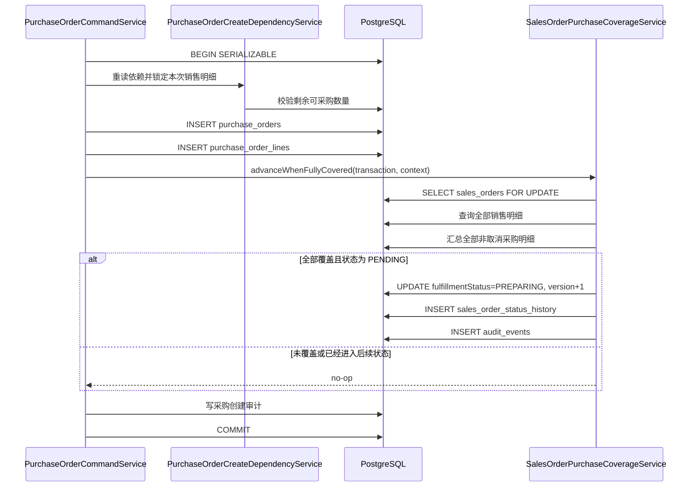

# 销售订单采购覆盖进度联动技术设计

## 1. 文档状态

- 状态：已确认
- 编写日期：2026-09-01
- 需求规格：[销售订单采购覆盖进度联动需求](./requirements.md)

## 2. 设计目标

在销售关联采购订单正式创建的同一数据库事务中，按销售明细累计所有非取消采购数量。全部销售明细均已足量采购且销售履约状态仍为 `PENDING` 时，自动推进为 `PREPARING`，并完整记录销售履约历史与审计事件。

设计必须满足以下约束：

- 不新增或修改公共 API、DTO、OpenAPI 契约；
- 不修改 Prisma Schema，不新增 migration；
- 不修改 Web 页面和公共组件；
- 复用现有销售履约状态机、采购幂等和事务错误语义；
- 不把采购覆盖逻辑混入销售订单人工状态变更接口。

## 3. 当前架构与真相源

| 关注点 | 当前真相源 |
| --- | --- |
| 采购创建事务 | `server/src/modules/purchase-orders/purchase-order-command.service.ts` |
| 销售来源及剩余数量校验 | `server/src/modules/purchase-orders/purchase-order-create-dependency.service.ts` |
| 销售履约状态机 | `server/src/modules/sales-orders/domain/sales-order-state-machine.ts` |
| 销售履约历史结构 | `SalesOrderStatusHistory`，`dimension = FULFILLMENT` |
| 审计写入 | `AuditService.record()` 与 `SALES_ORDER_FULFILLMENT_STATUS_CHANGED` |
| 数据关联 | `PurchaseOrder.salesOrderId`、`PurchaseOrderLine.sourceSalesOrderLineId` |
| 端到端验证 | `server/test/purchase-order-service.e2e-spec.ts` |

当前 `PurchaseOrderCommandService.create()` 已包含：

1. 幂等键查询；
2. 发号前依赖预检；
3. 幂等发号；
4. `Serializable` 最终事务；
5. 最终依赖重读和销售明细行锁；
6. 采购订单与明细写入；
7. 采购创建审计。

联动逻辑插入第 6 步之后、最终事务返回之前。任何联动失败都会回滚采购订单、采购明细和事务内审计。

## 4. 组件设计

### 4.1 新增 `SalesOrderPurchaseCoverageService`

新增文件：

```text
server/src/modules/purchase-orders/sales-order-purchase-coverage.service.ts
```

职责限定为：

1. 在调用方事务中锁定关联销售订单；
2. 计算全部销售明细的有效采购覆盖；
3. 在满足条件时执行 `PENDING -> PREPARING`；
4. 写入销售履约状态历史和审计。

建议接口：

```ts
interface AdvanceSalesOrderPurchaseProgressInput {
  readonly actorUserId: string
  readonly purchaseOrderId: string
  readonly purchaseOrderNo: string
  readonly requestId: string
  readonly salesOrderId: string
}

advanceWhenFullyCovered(
  transaction: Prisma.TransactionClient,
  input: AdvanceSalesOrderPurchaseProgressInput,
): Promise<void>
```

服务仅接受已经标准化且由最终事务产生的可信 ID，不解析 HTTP 输入，不自行开启事务。

### 4.2 模块注册与调用

- 在 `PurchaseOrdersModule.providers` 注册 `SalesOrderPurchaseCoverageService`。
- 在 `PurchaseOrderCommandService` 构造函数注入该服务。
- 仅当 `command.purchaseType === 'SALES_LINKED'` 且 `command.salesOrderId !== null` 时调用。
- 调用发生在 `purchaseOrderLine.createMany()` 之后，使本次新建明细自然进入数据库累计查询。
- 备货采购不调用联动服务。

不注入 `SalesOrderMutationService`，避免采购模块依赖销售模块的 HTTP 变更服务及产生模块循环依赖。销售履约状态机是无状态纯函数，可以直接复用。

## 5. 事务与并发设计

### 5.1 锁粒度

联动服务首先执行销售订单主行锁：

```sql
SELECT id, order_status, fulfillment_status
FROM sales_orders
WHERE id = CAST($salesOrderId AS uuid)
FOR UPDATE
```

锁定销售订单主行的原因：现有采购创建只锁定本次请求涉及的销售明细。若两张采购单同时采购同一销售订单的不同明细，仅依赖明细行锁无法保证最后一个提交者一定看到另一张采购单。主行锁可让同一销售订单的覆盖判定串行执行，而不同销售订单仍可并发。

现有最终事务使用 `Serializable` 隔离级别。数据库序列化冲突、死锁和锁等待超时继续由 `PurchaseOrderCommandService` 映射为 `PURCHASE_ORDER_STATE_CHANGED`，不新增错误码。

### 5.2 事务顺序



采购创建审计和销售联动审计的先后不构成业务语义；二者必须位于同一事务并随事务共同提交或回滚。

### 5.3 幂等路径

`PurchaseOrderCommandService.create()` 在进入预检和最终事务前先查询采购幂等键。命中完全一致的既有采购订单时直接返回既有 ID，因此不会再次执行覆盖服务、增加销售版本、状态历史或审计事件。

## 6. 覆盖算法

### 6.1 查询销售明细

按 `salesOrderId` 查询全部销售明细：

```ts
transaction.salesOrderLine.findMany({
  where: { salesOrderId },
  select: { id: true, quantity: true },
})
```

### 6.2 汇总有效采购数量

按所有销售明细 ID 分组汇总：

```ts
transaction.purchaseOrderLine.groupBy({
  by: ['sourceSalesOrderLineId'],
  where: {
    sourceSalesOrderLineId: { in: salesLineIds },
    purchaseOrder: {
      salesOrderId,
      purchaseType: 'SALES_LINKED',
      orderStatus: { not: 'CANCELLED' },
    },
  },
  _sum: { quantity: true },
})
```

过滤 `salesOrderId` 和 `purchaseType` 属于防御性限定；核心关联仍以 `sourceSalesOrderLineId` 为准。

### 6.3 判定函数

将纯计算单独导出为无副作用函数，便于覆盖边界测试：

```ts
isSalesOrderPurchaseFullyCovered(
  salesLines: readonly { id: string, quantity: number }[],
  purchasedBySource: ReadonlyMap<string | null, number>,
): boolean
```

规则：

- 销售明细必须非空；空集合返回 `false`，避免异常数据被误判为全部覆盖；
- 每条销售明细的累计采购数量必须大于等于销售数量；
- 不按 `productId` 合并，不读取价格、名称、描述或行类型；
- 缺失汇总行按采购数量 `0` 处理。

## 7. 状态写入设计

### 7.1 前置状态

锁定销售订单后：

- 若 `orderStatus != CONFIRMED`，沿用最终事务依赖状态变化语义，使创建失败并重试，而不是联动一个已不可采购的销售订单；
- 若 `fulfillmentStatus != PENDING`，覆盖计算可以直接停止，保持当前后续状态；
- 若 `fulfillmentStatus = PENDING`，仅在全部覆盖时继续推进。

### 7.2 复用状态机

写入前调用：

```ts
assertSalesOrderFulfillmentTransition(
  'PENDING',
  'PREPARING',
  { hasActiveDeliveryReceipt: false },
)
```

这样未来状态机规则发生变化时，自动联动不会绕过领域约束。

### 7.3 原子写入

状态发生变化时依次执行：

1. 更新 `SalesOrder.fulfillmentStatus = PREPARING`；
2. `SalesOrder.version` 增加 `1`；
3. 新增 `SalesOrderStatusHistory`：
   - `dimension = FULFILLMENT`；
   - `fromStatus = PENDING`；
   - `toStatus = PREPARING`；
   - `changedByUserId = actorUserId`；
   - `reason = 采购订单提交后已覆盖全部销售产品`；
4. 写入 `SALES_ORDER_FULFILLMENT_STATUS_CHANGED` 审计事件：
   - `targetType = SALES_ORDER`；
   - `targetId = salesOrderId`；
   - `actorUserId`、`requestId` 沿用采购创建上下文；
   - 元数据包含 `fromStatus`、`toStatus`、`automatic = true`、`trigger = PURCHASE_COVERAGE`、`purchaseOrderId`、`purchaseOrderNo`。

状态不变化时以上四项全部不执行。

## 8. 错误与安全边界

- 不新增面向客户端的错误码。
- 找不到销售订单、订单状态发生并发变化或事务序列化失败时，使用既有 `PURCHASE_ORDER_STATE_CHANGED`。
- 覆盖服务不得记录产品名、描述、唛头、备注、幂等键或价格等不必要业务数据到审计元数据。
- 审计元数据只保存稳定标识、状态编码和自动触发来源。
- 所有 SQL 参数使用 Prisma 参数化模板，不使用字符串拼接或 `$queryRawUnsafe`。

## 9. 文件变更范围

预计修改：

```text
server/src/modules/purchase-orders/purchase-orders.module.ts
server/src/modules/purchase-orders/purchase-order-command.service.ts
server/src/modules/purchase-orders/purchase-order-command.service.spec.ts
server/test/purchase-order-service.e2e-spec.ts
```

预计新增：

```text
server/src/modules/purchase-orders/sales-order-purchase-coverage.service.ts
server/src/modules/purchase-orders/sales-order-purchase-coverage.service.spec.ts
```

不修改：

```text
server/prisma/schema.prisma
server/prisma/migrations/**
server/openapi/openapi.json
web/openapi/openapi.json
web/**
```

## 10. TDD 与验证策略

### 10.1 单元测试

先写失败测试，再实现：

1. 空销售明细不判定为全覆盖；
2. 任一销售明细数量不足时返回未覆盖；
3. 多张采购累计补齐时返回已覆盖；
4. 相同产品多行和 `CUSTOM` 行按销售明细 ID 独立计算；
5. 全部覆盖且为 `PENDING` 时写状态、版本、历史和审计；
6. 未覆盖或已是后续履约状态时完全不写；
7. 备货采购不调用联动服务；
8. 销售关联采购在明细写入后调用联动服务；
9. 幂等命中时不调用联动服务。

### 10.2 PostgreSQL E2E

扩展采购服务隔离数据库测试：

1. 单张采购只覆盖部分明细，销售状态保持 `PENDING`；
2. 第二张采购补齐最后数量，销售状态变为 `PREPARING`；
3. 数据库产品与 `CUSTOM` 混合时正确推进；
4. 同一销售订单不同明细并发提交后，最终状态必为 `PREPARING`；
5. 自动推进只产生一条履约历史和一条销售履约审计；
6. 幂等重放不增加历史或审计；
7. 备货采购不修改销售订单。

### 10.3 验证命令

```bash
pnpm -C server test -- sales-order-purchase-coverage.service.spec.ts purchase-order-command.service.spec.ts --runInBand
pnpm -C server typecheck
pnpm -C server lint
pnpm -C server test:e2e -- purchase-order-service.e2e-spec.ts
node --run check
git diff --check
```

此需求没有前端变更，不执行会写入真实业务数据的浏览器操作；服务端隔离 PostgreSQL E2E 是运行态验收真相源。
