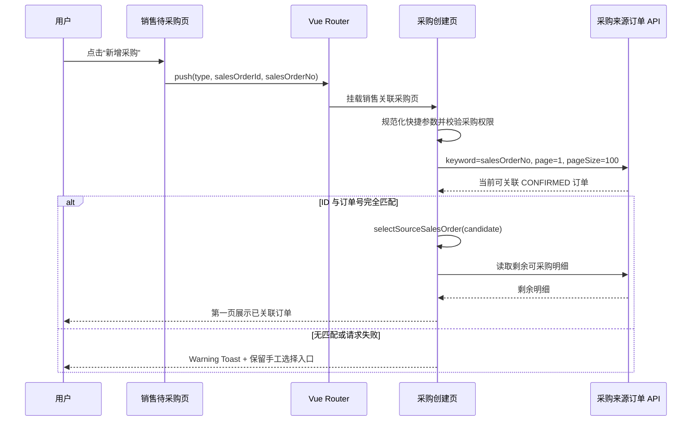

# 销售订单快捷新增采购技术设计

## 1. 文档状态

- 状态：已确认
- 编写日期：2026-09-01
- 需求规格：[requirements.md](./requirements.md)

## 2. 设计目标

在不扩展公共 API 的前提下，把销售待采购列表中的 `SUBMIT_PURCHASE` 从占位动作改为真实的采购创建入口。采购创建页使用现有采购域来源订单接口重新确认 URL 中的来源，并复用既有 `selectSourceSalesOrder()` 完成第一步绑定。

设计必须满足以下约束：

- 仅修改 Web 前端、测试和规格文档；
- 不修改 Server、DTO、OpenAPI、Prisma Schema 或 migration；
- 不信任路由参数中的订单信息；
- 不改变采购产品同步、付款约定、最终提交、编号派发和销售采购覆盖规则；
- 不改变备货采购入口和管理员权限；
- 自动绑定只执行一次，不覆盖用户后续主动选择。

## 3. 当前架构与真相源

| 关注点 | 当前真相源 |
| --- | --- |
| 待采购动作解析 | `sales-order-list-view.logic.ts` 中的 `PENDING_ACTION_BY_FULFILLMENT_STATUS` |
| 待办操作权限与分发 | `sales-orders/index.vue` 中的 `canShowSalesOrderRowAction()`、`handleSalesOrderRowAction()` |
| 采购创建路由 | `operations.workbench.ts` 中的 `operationsPurchaseOrderCreate` |
| 采购类型解析 | `purchase-order-create.logic.ts` 中的 `parsePurchaseOrderCreateType()` |
| 可关联销售订单 | `GET /api/purchase-orders/source-sales-orders`，固定筛选 `orderStatus = CONFIRMED` |
| 关联订单剩余明细 | `GET /api/purchase-orders/source-sales-orders/{salesOrderId}/lines` |
| 采购第一步绑定 | `create.vue` 中的 `selectSourceSalesOrder()` |
| 来源选择弹窗 | `purchase-source-sales-order-selector.vue` 与 `QsSalesOrderSelectorModal` |

现有来源订单列表接口只支持按销售订单号或客户名模糊搜索，不支持按 ID 查询。因此快捷入口同时携带订单号用于定位、订单 ID 用于最终身份匹配。订单号不是授权或身份依据。

## 4. 路由与权限设计

### 4.1 动作文案

保留动作键 `SUBMIT_PURCHASE`，只把 `sales-order-list-view.logic.ts` 中的标签从“提交采购”改为“新增采购”。保留现有 `clipboard-plus` 图标和操作列布局。

不重命名动作键的原因：动作键是当前待办动作解析的内部稳定标识，需求只改变用户语义和执行行为，重命名会扩大无必要的变更范围。

### 4.2 展示权限

在 `sales-orders/index.vue` 新增：

```ts
const canCreatePurchase = computed(() => auth('purchase-orders:create'))
```

`canShowSalesOrderRowAction()` 对 `SUBMIT_PURCHASE` 返回 `canCreatePurchase.value`。其他已落地动作继续使用原权限，其他占位动作保持现有行为。

### 4.3 导航参数

`handleSalesOrderRowAction()` 对 `SUBMIT_PURCHASE` 使用命名路由：

```ts
router.push({
  name: 'operationsPurchaseOrderCreate',
  query: {
    type: 'SALES_LINKED',
    salesOrderId: order.id,
    salesOrderNo: order.orderNo,
  },
})
```

命名路由继续继承现有 `purchase-orders:create` 路由守卫及“全部采购”菜单高亮，不硬编码路径。

## 5. 路由参数规范化

在 `purchase-order-create.logic.ts` 增加纯函数：

```ts
export interface PurchaseOrderSourceShortcut {
  readonly salesOrderId: string
  readonly salesOrderNo: string
}

export function parsePurchaseOrderSourceShortcut(input: {
  readonly purchaseType: PurchaseOrderCreateType | null
  readonly salesOrderId: unknown
  readonly salesOrderNo: unknown
}): PurchaseOrderSourceShortcut | null
```

规范化规则：

1. `purchaseType` 必须是 `SALES_LINKED`；
2. `salesOrderId` 与 `salesOrderNo` 都必须是单个字符串，数组直接拒绝；
3. 两个值均执行 `trim()`，订单号额外执行 `normalize('NFKC')`；
4. 任一值为空或超过现有接口允许的 128 个 Unicode code point 时返回 `null`；
5. 备货采购始终返回 `null`。

该函数不校验订单是否存在，也不把参数转换为 DTO；可信性由采购域接口查询结果确认。

## 6. 自动绑定设计

### 6.1 页面状态

`purchase-orders/create.vue` 增加独立的快捷来源请求状态：

- `sourceShortcut`：页面初始化时解析一次的只读快捷参数；
- `shortcutAbortController`：仅管理来源订单定位请求；
- `shortcutLookupStarted`：防止同一组件生命周期内重复执行。

快捷定位请求与现有 `sourceAbortController` 分离。前者负责查询候选订单，后者仍由 `selectSourceSalesOrder()` 管理剩余明细请求，避免一个控制器同时承担两段生命周期。

### 6.2 查询与精确匹配

新增页面内函数 `bindSourceSalesOrderFromShortcut()`：

1. 确认当前入口有效、类型为 `SALES_LINKED`、快捷参数有效且尚未执行；
2. 记录当前 `authEpoch` 并创建 `AbortController`；
3. 调用现有 `purchaseOrdersApi.sourceSalesOrders()`：

```ts
{
  keyword: sourceShortcut.salesOrderNo,
  page: 1,
  pageSize: 100,
}
```

4. 仅接受同时满足以下条件的结果：
   - `candidate.id === sourceShortcut.salesOrderId`；
   - `candidate.orderNo === sourceShortcut.salesOrderNo`；
5. 在请求未取消、身份纪元未变化、页面仍未由用户绑定其他订单时，调用现有 `selectSourceSalesOrder(candidate)`；
6. 查询无精确匹配或请求失败时，不写入 `selectedSalesOrder`，使用 Warning Toast 提示“销售订单自动关联失败，请手工选择销售订单”。

使用最大允许的 `pageSize = 100` 是在现有接口下提高精确订单命中率，同时避免为恶意或过宽的路由查询无限翻页。正常应用入口传入唯一订单号，目标行应位于首个搜索结果页；异常情况按需求安全降级为手工选择。

### 6.3 单次执行与竞态处理

- 只从 `onMounted()` 调用一次，不监听路由查询参数，不因步骤切换或返回第一步重新执行。
- 调用前先完成创建权限和采购类型检查；无效入口仍执行现有重定向。
- 若用户已通过选择器绑定订单，则自动查询返回后不覆盖现有选择。
- 身份纪元变化或组件卸载时同时取消快捷定位、剩余明细、同步和提交请求。
- 自动绑定成功后仍停留在第一步，不打开弹窗、不切换步骤、不调用产品同步。
- `selectSourceSalesOrder()` 本身保持单一可信绑定入口，继续负责来源切换清理、剩余明细读取和过期响应隔离。

## 7. 交互与视觉设计

本需求不新增页面结构或组件：

- 销售待办操作只替换文案并接入真实跳转；
- 采购创建页继续使用既有四步布局；
- 自动绑定成功后复用现有销售订单关联卡片、绿色内边框、订单号、客户和日期展示；
- 用户仍可点击“选择销售订单”打开 `QsSalesOrderSelectorModal` 改选；
- 正常自动绑定不显示成功提示；失败使用现有 `useQsToast()` Warning Toast，不增加页面级 `FaAlert`。

视觉继续使用需求规格中的 `#009A44`、`#FFFFFF`、`#F5F7F6`、`#D7DED9`、`#111827` 基准色，以及 `Noto Sans SC` / `Noto Sans Mono` 字体体系。实现使用现有语义主题变量，不写新的固定样式。

## 8. 数据流



## 9. 错误处理

| 场景 | 处理 |
| --- | --- |
| 路由参数缺失、数组、空值或超长 | 忽略快捷绑定，不发送定位请求 |
| 订单已不是 `CONFIRMED` | 来源接口不返回；显示 Warning Toast |
| ID 与订单号不匹配 | 不绑定；显示 Warning Toast |
| 来源查询网络失败 | 不绑定；显示 Warning Toast |
| 剩余明细为空 | 沿用 `selectSourceSalesOrder()` 的“没有剩余可采购产品”页面反馈 |
| 用户在自动请求期间已选其他订单 | 丢弃自动结果，不覆盖用户选择 |
| 登录身份变化或页面卸载 | Abort 请求，不显示过期错误，不写入状态 |

## 10. TDD 与验证设计

### 10.1 RED：纯逻辑测试

更新：

- `test/views/sales-order-list-view.logic.test.ts`
- `test/views/purchase-order-create.logic.test.ts`

先增加失败断言：

- 待采购动作标签为“新增采购”；
- 快捷参数仅接受销售关联采购的两个单值字符串；
- 数组、空值、超长值和备货采购返回 `null`；
- 规范化后的订单 ID 与订单号可供精确匹配。

### 10.2 RED：页面契约测试

更新：

- `test/views/sales-order-pages.test.ts`
- `test/views/purchase-order-pages.test.ts`

先断言：

- 销售页新增采购权限判断；
- `SUBMIT_PURCHASE` 使用命名路由并传递三个查询参数；
- 其他占位动作仍显示建设中轻提示；
- 采购页调用快捷参数解析与自动绑定函数；
- 定位查询使用采购域接口、精确 ID/订单号匹配、单次执行和 Abort 清理；
- 自动绑定仍复用 `selectSourceSalesOrder()`。

### 10.3 GREEN：最小实现

只修改：

- `sales-order-list-view.logic.ts`
- `sales-orders/index.vue`
- `purchase-order-create.logic.ts`
- `purchase-orders/create.vue`
- 对应 Web 测试文件

不修改路由定义、API 模块、generated client、Server 或公共组件。

### 10.4 浏览器验收

扩展 `test/browser/purchase-orders.browser.test.mjs`，使用已有真实 HTTP 测试数据验证：

1. 打开销售待办“待采购”；
2. 找到目标订单并确认操作文字为“新增采购”；
3. 点击后 URL 进入销售关联采购创建页并包含三个查询参数；
4. 第一页自动显示目标销售订单及绿色内边框；
5. 点击“选择销售订单”仍能打开选择弹窗；
6. 不提交采购订单，避免产生额外业务数据。

### 10.5 验证命令

```bash
pnpm -C web exec tsx --test \
  apps/qsmds-arco/test/views/sales-order-list-view.logic.test.ts \
  apps/qsmds-arco/test/views/purchase-order-create.logic.test.ts \
  apps/qsmds-arco/test/views/sales-order-pages.test.ts \
  apps/qsmds-arco/test/views/purchase-order-pages.test.ts
pnpm -C web typecheck
pnpm -C web lint
pnpm -C web test:browser:auth -- --test-name-pattern="purchase orders"
node --run check
git diff --check
```

浏览器命令若现有脚本不透传 `--test-name-pattern`，则直接运行 `pnpm -C web test:browser:auth`，并如实记录完整结果。

## 11. Git 设计

完成需求、设计和任务拆分确认后，按小步提交：

1. `docs: 定义销售订单快捷新增采购规则`
2. `feat: 支持销售订单快捷新增采购`

不推送远端，不创建 PR，不混入其他工作区变更。
