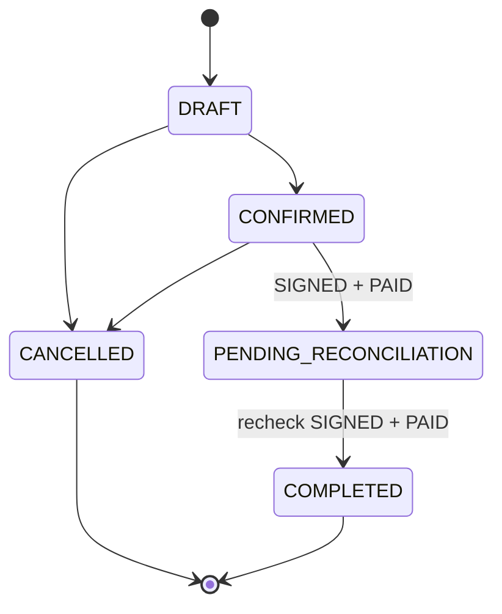

# 销售订单对账与完成状态技术设计

## 1. 文档状态

- 状态：已确认
- 设计日期：2026-08-30
- 需求规格：[销售订单对账与完成状态需求规格](./requirements.md)
- 依赖设计：[销售订单域技术设计](../sales-order-domain/design.md)

## 2. 当前实现审计

### 2.1 数据与契约

- `SalesOrder.orderStatus` 当前 PostgreSQL/Prisma Enum 只有 `DRAFT`、`CONFIRMED`、`CANCELLED`。
- `SalesOrder.fulfillmentStatus` 与 `SalesOrder.paymentStatus` 是独立持久化字段；订单行锁查询已经同时读取三套状态和约定总价。
- `SalesOrderStatusHistory.fromStatus/toStatus` 使用 `VARCHAR(32)` 保存编码，新编码长度满足现有结构，无需修改历史表。
- `PATCH /api/sales-orders/:salesOrderId/order-status`、查询 DTO 和响应 DTO 均直接引用 Prisma 生成的 `SalesOrderStatus`，扩展枚举后可通过 OpenAPI 同步进入 Web。
- 当前订单状态 mutation 已在事务中先锁定订单，再读取有效实际收款、校验状态机、更新订单、写状态历史和审计事件，边界可直接复用。

### 2.2 状态规则

- 当前订单状态机仅允许 `DRAFT -> CONFIRMED | CANCELLED` 和 `CONFIRMED -> CANCELLED`。
- 当前取消操作根据有效实际收款硬拦截，不信任 `paymentStatus` 的单独值。
- 履约状态已经严格终止于 `SIGNED`，不能回退。
- 付款状态由有效实际收款自动派生；约定金额只允许在 `CONFIRMED` 修改。
- 实际收款新增目前只拦截 `CANCELLED`；作废收款未检查订单状态，因此需要显式冻结 `COMPLETED`。

### 2.3 Web

- 全部订单工具栏已经存在“待对账”和“已完成”入口，但这两个入口目前返回空查询目标。
- 选择占位状态时页面显示“尚未进入当前数据契约”。
- 订单列表与窄屏卡片共用状态标签函数；变更记录弹窗另有编码到中文的映射。
- Web 目前没有销售订单状态变更操作入口；本期按已确认范围只接入真实筛选和展示，不新增流转按钮。

## 3. 目标状态模型

目标 Prisma Enum：

```prisma
enum SalesOrderStatus {
  DRAFT
  CONFIRMED
  PENDING_RECONCILIATION
  COMPLETED
  CANCELLED

  @@map("sales_order_status")
}
```

目标状态机：



状态机先校验允许的相邻流转，再校验目标状态的业务条件，保证：

- `CONFIRMED -> COMPLETED` 返回状态流转无效，而不是条件错误。
- `CONFIRMED -> PENDING_RECONCILIATION` 条件不足时返回待对账条件错误。
- `PENDING_RECONCILIATION -> COMPLETED` 条件不足时返回完成条件错误。

## 4. 数据库迁移设计

新增且只追加一个 migration：

```text
20260830120000_expand_sales_order_status_reconciliation
```

为保证 Enum 顺序、约束创建和失败回滚处于同一事务，不使用跨事务的 `ALTER TYPE ... ADD VALUE`，而是复用仓库已验证的 Enum 原子替换模式：

1. 开启事务并设置有限的 lock/statement timeout。
2. 对 `sales_orders` 获取 `ACCESS EXCLUSIVE` 锁，防止 Enum 替换期间并发写入。
3. 创建 `sales_order_status_next`，包含五个目标状态。
4. 移除 `sales_orders.order_status` 默认值。
5. 通过 `order_status::text` 无损转换当前三类状态到新 Enum。
6. 删除旧 Enum，将新 Enum 重命名为 `sales_order_status`。
7. 恢复 `order_status DEFAULT 'DRAFT'`。
8. 新增数据库约束 `sales_orders_completed_requires_signed_paid_check`：

```sql
CHECK (
  order_status <> 'COMPLETED'
  OR (
    fulfillment_status = 'SIGNED'
    AND payment_status = 'PAID'
  )
)
```

9. 断言 Enum 顺序完全一致、所有当前订单状态有效、所有 `COMPLETED` 行满足 `SIGNED + PAID`。
10. 提交事务。

迁移不更新业务行、不增加订单版本、不修改业务更新时间、不制造状态历史或审计事件。既有订单继续保持 `DRAFT`、`CONFIRMED` 或 `CANCELLED`。

## 5. Server 设计

### 5.1 状态机与错误契约

扩展 `ORDER_TRANSITIONS`：

```text
DRAFT: [CONFIRMED, CANCELLED]
CONFIRMED: [PENDING_RECONCILIATION, CANCELLED]
PENDING_RECONCILIATION: [COMPLETED]
COMPLETED: []
CANCELLED: []
```

`assertSalesOrderStatusTransition` 的上下文扩展为：

```ts
{
  activeReceivedAmount: string
  fulfillmentStatus: SalesOrderFulfillmentStatus
  paymentStatus: SalesOrderPaymentStatus
}
```

新增稳定业务错误：

| Error Code | HTTP | 触发条件 |
| --- | ---: | --- |
| `SALES_ORDER_RECONCILIATION_CONDITIONS_NOT_MET` | 422 | 进入待对账时不是 `SIGNED + PAID` |
| `SALES_ORDER_COMPLETION_CONDITIONS_NOT_MET` | 422 | 进入已完成时重新校验不是 `SIGNED + PAID` |
| `SALES_ORDER_COMPLETED` | 422 | 对已完成订单执行被禁止的业务 mutation |

既有非法跳转继续返回 `SALES_ORDER_STATUS_TRANSITION_INVALID`；已有有效收款取消继续返回 `SALES_ORDER_CANCEL_HAS_PAYMENTS`。

### 5.2 Mutation 原子性

`updateOrderStatus()` 保持现有事务顺序：

```text
transaction timeouts
  -> SELECT ... FOR UPDATE 锁订单
  -> 汇总有效实际收款
  -> 校验允许流转
  -> 校验当前 fulfillmentStatus/paymentStatus
  -> UPDATE orderStatus + version
  -> INSERT ORDER status history
  -> INSERT audit event
  -> commit
```

所有前置条件来自锁定后的订单数据，不接受客户端提交履约或付款状态。

### 5.3 完成后冻结

- `updatePaymentTerms()` 已限定 `CONFIRMED`，无需放宽。
- `recordPayment()` 和 `voidPayment()` 增加 `COMPLETED` 硬拦截并返回 `SALES_ORDER_COMPLETED`。
- `PENDING_RECONCILIATION` 保留收款纠错能力：可以作废错误收款并重新记录；若因此不再 `PAID`，完成操作会在锁内重新校验并拒绝，直到付款状态恢复。
- `SIGNED` 已是履约终态，因此不存在完成后继续推进或回退履约状态的合法路径。
- 数据库 `COMPLETED` Check Constraint 作为应用服务之外的最终防线。

### 5.4 公共 API 与 OpenAPI

路径和请求结构不变：

```http
GET   /api/sales-orders?orderStatus=...
PATCH /api/sales-orders/:salesOrderId/order-status
```

变化仅限公共枚举和新增 422 错误码。通过根级 `contract:sync` 更新：

- Server OpenAPI snapshot。
- Web OpenAPI snapshot。
- Web `types.gen.ts` 和 `sdk.gen.ts`。

禁止手工编辑生成类型和快照。

## 6. Web 设计

### 6.1 可信状态筛选

`resolveSalesOrderQueryTargets('all', ...)` 调整为：

```text
ALL -> CONFIRMED + PENDING_RECONCILIATION + CANCELLED + COMPLETED
CONFIRMED -> CONFIRMED
PENDING_RECONCILIATION -> PENDING_RECONCILIATION
CANCELLED -> CANCELLED
COMPLETED -> COMPLETED
```

现有公开列表接口只接收单个 `orderStatus`，因此“全部订单”继续使用并行单值查询、按订单 ID 去重并按币种重算汇总。`DRAFT` 继续排除。

待办订单查询继续固定 `orderStatus=CONFIRMED`，因此待对账、已完成和已取消订单不会混入待采购、物流或收款待办。采购订单的销售来源查询同样继续固定 `CONFIRMED`，可自然排除三类不可新关联状态。

### 6.2 标签与空状态

- `PENDING_RECONCILIATION` 显示“待对账”，使用现有 amber 语义类。
- `COMPLETED` 显示“已完成”，使用现有 primary/green 语义类。
- 桌面列表、窄屏卡片和变更记录使用一致中文映射。
- 删除“尚未进入当前数据契约”的特殊空状态，统一使用常规无数据文案。
- 不改变页面结构、字体、列宽、路由或工具栏布局。

### 6.3 本期不新增操作入口

本期不在 Web 新增“进入待对账”或“完成订单”按钮。状态流转能力由既有 Server endpoint 提供；后续新增操作入口时复用该 endpoint，并根据三个稳定业务错误呈现轻提示或局部错误。

## 7. TDD 与验证策略

### 7.1 失败测试基线

1. Schema 测试期望五值订单状态 Enum、追加 migration 和完成状态 Check Constraint。
2. 隔离 PostgreSQL migration 测试验证：
   - 旧三状态数据无损保留。
   - 五值 Enum 顺序正确。
   - 合法 `SIGNED + PAID + COMPLETED` 可写入。
   - 非法完成组合被数据库约束拒绝。
3. 状态机测试覆盖两条新增合法流转、直接完成/回退/取消拒绝和两类条件错误。
4. Mutation 测试覆盖锁内上下文、状态历史、审计事件、重新校验及已完成收款冻结。
5. Query/DTO/OpenAPI 测试覆盖两个新增枚举查询值和错误契约。
6. Web 逻辑测试先期望真实查询目标，再更新标签、空状态、变更记录和 API 生成契约断言。

### 7.2 聚焦验证

```bash
pnpm -C server prisma:validate
pnpm -C server exec jest \
  src/infrastructure/database/sales-order-reconciliation-status-schema.spec.ts \
  src/modules/sales-orders/domain/sales-order-state-machine.spec.ts \
  src/modules/sales-orders/sales-order-mutation.service.spec.ts \
  --runInBand
node --run contract:sync
node --run contract:check
pnpm -C web test:api
pnpm -C web typecheck
pnpm -C web lint
git diff --check
```

### 7.3 数据库验证与应用

1. 使用隔离 PostgreSQL 16 从完整 migration 链执行两次 `db:migrate:deploy` 并核对 `migrate status`。
2. 运行新增 migration E2E，验证约束和无损转换。
3. 在不打印凭据的前提下核对当前连接目标，确认不是生产标识后执行：

```bash
pnpm -C server db:migrate:deploy
pnpm -C server exec prisma migrate status
```

4. 使用只读 SQL 核对五个 Enum 值、约束存在且 migration 已完成。
5. 最终运行根级 `node --run check`。

## 8. 安全与发布边界

- 本次 Prisma Schema、追加 migration、公共 API 枚举和开发数据库应用已获得明确授权。
- 不修改、重命名或删除既有 migration。
- 不运行 `prisma db push`，不伪造或修改 `_prisma_migrations`。
- 不回填、自动推进或批量修改现有销售订单业务状态。
- 不输出 `.env`、数据库密码、连接字符串、客户信息或完整请求体。
- 迁移和兼容代码作为同一发布单元提交；不 push、不部署生产环境。

## 9. 不采用的方案

### 9.1 继续保留前端派生状态

无法提供可靠查询、状态历史和服务端流转约束，拒绝采用。

### 9.2 满足 `SIGNED + PAID` 后自动进入待对账

会把履约/收款事实与运营确认动作混为一体，不符合已确认的显式流转规则，拒绝采用。

### 9.3 允许从已确认直接进入已完成

会绕过对账阶段和二次校验，拒绝采用。

### 9.4 只依赖应用层校验完成状态

无法防止脚本、未来代码或异常路径写入不满足条件的 `COMPLETED`，因此增加数据库 Check Constraint 作为防御性不变量。
