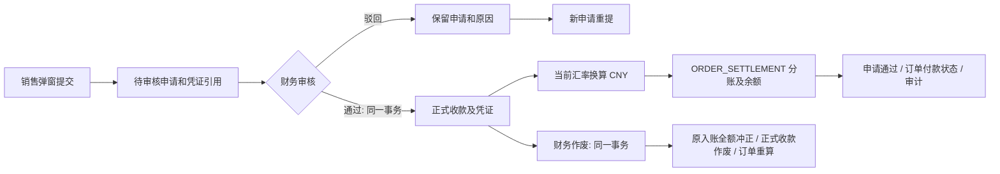

# 销售收款审核与资金入账技术设计

## 1. 状态、依据与交付边界

- 日期：2026-09-08；基于 `a950234` 源码静态核对。
- 状态：技术设计与实施清单已由用户明确确认，代码实现与隔离验收完成，详见 [验证记录](verification.md)；业务库迁移及发布未执行。
- 需求真相源：[已确认需求](requirements.md)。
- 工程采用 Controller → Service → Prisma → PostgreSQL；业务服务组合现有模块，不预建 Repository/UseCase 层。
- 当前资金数据库和算法均为 CNY 两位小数，与早期资金规格中的四位描述不同。本设计以现行代码为准：订单原币四位，汇率十二位，入账人民币两位。

| 现状 | 源码依据 | 设计影响 |
| --- | --- | --- |
| 正式收款创建即参与订单状态计算 | `server/src/modules/sales-orders/sales-order-mutation.service.ts` 的 `recordPayment`；`server/prisma/schema.prisma` 的 `SalesOrderPayment` | 待审核申请单独存表 |
| 数据库按未作废支付记录校验金额/付款状态 | `server/prisma/migrations/20260820120000_sales_order_domain/migration.sql` | 保留正式收款汇总含义，不把待审核写入正式表 |
| 汇率表示每 1 CNY 对应外币数量 | `server/prisma/schema.prisma` 的 `ExchangeRate.foreignUnitsPerCny` | 外币除以汇率 |
| 资金余额、批次金额及流水为 Decimal(30,2) | `server/prisma/schema.prisma` 的 `FundAccount`、`FundPostingBatch`、`FundLedgerEntry` | 人民币只在换算结束时舍入至分 |
| 资金公开端口无外部事务参数 | `server/src/modules/fund-accounts/application/fund-posting.contract.ts`、`fund-posting.service.ts` | 新增受控事务内业务入账/冲正入口 |
| 媒体引用仅列出三个领域表 | `server/src/modules/media/media-reference.repository.ts` | 新申请表加入数据库守卫和媒体生命周期引用集合 |
| 当前正式收款作废拒绝 COMPLETED 订单 | `server/src/modules/sales-orders/sales-order-mutation.service.ts` 的 `voidPayment` | 首期保留，不能因为允许负余额而绕过订单终态 |

## 2. 模块与流程

- 在销售订单域下新增收款申请命令、查询服务及 Controller；财务工作台是该领域的处理界面。
- 复用正式收款、凭证、审计、自动状态计算和资金引擎，禁止在财务页面另建独立账本。
- 财务新页替换现有占位页；采购工作台、采购付款占位页不在本期范围。

## 3. 新增申请表

新增 `SalesReceiptRequest` / `sales_receipt_requests`；首期不增加独立审核历史表或通用附件表。

| 字段 | 类型/空值 | 规则 |
| --- | --- | --- |
| `id` | UUID，主键 | 系统生成；首期不新增业务编号规则 |
| `salesOrderId` | UUID，非空外键 | 所属订单，Restrict 删除 |
| `accountOwnerUserId` | UUID，非空外键 | 提交时由订单 issuerUserId 取得并冻结 |
| `paymentType` | SalesOrderPaymentType，非空 | 沿用五种收款类型 |
| `amount` | Decimal(30,4)，非空 | 原币金额，严格大于 0 |
| `currencyCode` | VarChar(3)，非空 | 服务端读取订单，首期仅 TWD/MYR |
| `receivedAt` | Timestamptz(6)，非空 | 实际收款时间，不晚于服务端当前时间 |
| `paymentMethod` | VarChar(64)，非空 | `payment.method` 字典稳定值 |
| `paymentMethodNameSnapshot` | VarChar(128)，非空 | 提交时取得显示名，名称长度与真实字典契约核对 |
| `remark` | VarChar(500)，可空 | 空白规范化后保存 |
| `voucherMediaAssetId` | UUID，非空外键 | 恰好一份有效凭证；不用可变数组或多态 owner |
| `voucherTitle` | VarChar(128)，非空 | 服务端按既有收款凭证命名规则生成 |
| `status` | PENDING_REVIEW / APPROVED / REJECTED | 默认 PENDING_REVIEW |
| `submittedByUserId` | UUID，非空外键 | 当前登录操作者 |
| `submittedAt` | Timestamptz(6)，非空 | 数据库当前时间 |
| `reviewedByUserId` | UUID，可空外键 | 终审操作者 |
| `reviewedAt` | Timestamptz(6)，可空 | 终审数据库时间 |
| `reviewRemark` | VarChar(500)，可空 | 驳回非空，通过可空 |
| `approvedPaymentId` | UUID，可空、唯一外键 | 通过时一次写入，与申请属于同一订单 |
| `resubmittedFromId` | UUID，可空自关联 | 仅关联同订单的已驳回申请；保留历史，不自动替换旧内容 |
| `version` | Int，默认 1 | 每次状态变化加一 |
| `idempotencyKeyHash` | Bytes，非空 | 原始键不入审计日志 |
| `requestFingerprintHash` | Bytes，非空 | 对规范化业务字段和凭证 ID 计算；冻结首期指纹格式 |
| `updatedAt` | Timestamptz(6)，非空 | 服务端管理 |

约束与索引：

- `(submittedByUserId, idempotencyKeyHash)` 唯一；同键同内容恢复原申请，不同内容返回冲突。
- `(status, submittedAt DESC, id DESC)` 支撑财务队列；`(salesOrderId, status)` 支撑待审核金额；账户归属/提交人分页索引按实际查询补充。
- 提交后业务字段、归属、凭证和指纹不可改；只允许待审核到一个终审态，终审信息不可覆盖。禁止硬删除申请。
- PENDING_REVIEW 无终审字段/正式收款；REJECTED 有审核人、时间和非空原因，无正式收款；APPROVED 有审核人、时间和正式收款。
- 通过关联使用同订单组合约束；延期约束在事务末核验申请、正式收款、入账批次的完整一致性。
- 申请凭证不能被第二条无重提关系的申请重复使用；提交时校验上传者与可用状态。重提沿用原凭证时必须有读取原申请权限且引用同一份冻结媒体。

## 4. 正式收款扩展与快照

保留原字段及 `voidedAt/voidedByUserId/voidReason`，新增：

| 字段 | 类型 | 规则 |
| --- | --- | --- |
| `origin` | LEGACY / REVIEWED | 存量标记 LEGACY；切换后新记录只允许 REVIEWED |
| `fundPostingBatchId` | UUID，可空且唯一 | 新审核记录必须关联一个 BUSINESS 批次 |
| `fundReversalBatchId` | UUID，可空且唯一 | 新审核收款作废后必须关联对应全额 REVERSAL 批次 |
| `exchangeRateId` | UUID，可空外键 | 新审核记录必须有使用的汇率记录 |
| `exchangeRateVersionSnapshot` | Int，可空 | 实际采用版本 |
| `foreignUnitsPerCnySnapshot` | Decimal(30,12)，可空 | 实际采用的正汇率 |
| `exchangeRateCapturedAt` | Timestamptz(6)，可空 | 审核入账读取时点 |

- 原币金额来自正式收款，原币币种来自冻结申请；CNY 总金额从原入账批次 `businessAmount` 读取，不额外维护重复合计。
- 账户、分账比例、规则版本、分录金额、余额前后值继续由现有资金批次及流水保存。
- REVIEWED 的收款创建、凭证、汇率快照、入账关联同事务齐备；LEGACY 不伪造审核和资金记录。
- 入账绑定后不可替换；冲正关联只可在首次作废时设置。扩展现有收款不可变守卫，不能直接沿旧守卫允许任意新增字段变化。
- 新审核记录作废后申请仍为 APPROVED，页面派生显示“已通过·收款已作废”。

## 5. 汇率、舍入与可用余额

1. 锁定当前订单币种和 `ExchangeRate`，读取启用状态、ID、版本和 `foreignUnitsPerCny`；缺失、停用、非正值均拒绝审核。
2. `CNY = ROUND_HALF_UP(原币金额 / foreignUnitsPerCny, 2)`。实现使用整数定点或显式足够精度的 Decimal，禁止 Number 运算及提前截断。
3. 原币正数但舍入后 CNY 为 0.00，或者换算结果超出 Decimal(30,2) 范围时拒绝通过，不生成零额/溢出流水。
4. 将 CNY 两位金额交给现有 `ORDER_SETTLEMENT` 引擎；用户份额按现行规则舍入至分，公司承接尾差，总额守恒。
5. 每笔收款按各自审核时汇率换算。不同批次可能使用不同汇率，不能用当前汇率重算历史汇总。
6. 全额冲正按原分录逐项反向，允许负余额；不重新读取比例、规则或汇率用于金额计算。
7. 入账直接更新现有余额，本期不新增可提现余额字段、冻结层或提现/消费功能。

示例仅为算法验收，不代表当前实际配置：收款 10,000.0000 TWD，汇率 4.8 TWD/CNY，得到 2,083.33 CNY；用户比例 30.00% 时用户 625.00、公司 1,458.33。冲正分别扣回 625.00 与 1,458.33，即使当前比例、汇率已改变。

## 6. 受控资金接入与事务

- 保留现有独立入账入口；新增内部 `postBusinessEventInTransaction(transaction, context, input)` 及全额业务冲正入口。
- 两个新入口不能开启嵌套事务，不能调用管理员冲正端口冒充业务冲正；共用资金引擎既有校验、规则计算、流水和审计代码。
- 固定建议来源 `SALES_RECEIPT`，仅允许 `ORDER_SETTLEMENT`；固定 consumer `SALES_RECEIPT.APPROVE` / `SALES_RECEIPT.VOID`，不接受客户端传入。
- 来源配置/允许类型属于新增受控持久化配置，实施时列入 migration 授权；不得自动启用被管理员停用的既有规则，也不自动创建用户资金账户。
- 入账 `businessId=申请 UUID`，幂等键按申请 UUID 派生；冲正键按正式收款 UUID 派生。请求 ID 只用于追踪，不作幂等键。
- 资金流水归属开单人，审计操作者是审核人/纠错人；必要时为内部受信上下文补齐 actorUserId，禁止以账户归属代替操作者。
- 当前资金服务的唯一键冲突恢复发生在事务外。复用外层事务时，数据库错误必须向外传播并先回滚，再读取幂等结果；禁止在 aborted transaction 中尝试恢复。

### 6.1 锁序与金额预占

- 销售侧统一先锁销售订单，再锁申请或正式收款；涉及既有销售产品修改时，保留“销售明细 → 销售订单”的现有顺序。
- 审核随后锁汇率依赖及媒体，进入资金引擎后遵循其业务来源、类型、原批次（冲正时）及账户 UUID 排序锁序；禁止资金持锁路径再反向修改销售订单。
- 同一订单的申请、审核、驳回、作废、取消和调减金额都通过订单锁序列化；待审核金额从申请表汇总，不新增手工维护的余额字段。
- 提交及调减订单金额都必须保证已确认收款加待审核收款不超应收。销售产品改价引发总额变化时也纳入校验。
- 取消有待审核申请的订单返回明确冲突，先处理申请；不静默丢弃待审记录。COMPLETED 订单继续禁止新增和作废；本期不引入重开订单。
- 全域锁序由真实 PostgreSQL 并发测试验证，文档描述不能代替死锁/竞态实测。

### 6.2 审核通过

单事务：重读权限/身份 → 锁订单和申请 → 处理已成功重放 → 校验预览版本和当前依赖 → 校验可收金额及凭证 → 换汇 → 创建正式收款/凭证 → 事务内资金入账 → 写入批次与汇率关联 → 更新申请 → 重算订单/写审计 → 延期约束核验 → 提交。

- 预览中订单金额、汇率、规则或比例变化，返回 409 要求重新核对，不静默按不同金额入账。
- expectedContext 必须与本次实际使用的锁内快照比较：汇率在汇率行锁内比较，资金规则和比例在引擎取得来源/类型/账户锁后比较，并直接用这组快照计算分录。内部事务端口需接收受约束的预期规则/比例上下文；禁止先在锁外比较，再由引擎读取另一份新比例入账。
- 技术依赖失败保持待审核，不自动驳回；业务驳回是单独的人工作出决定。
- 驳回无资金操作，不依赖汇率和账户可用性；保存非空原因和审计，释放申请金额预占。

### 6.3 作废与全额冲正

单事务：重读纠错权限 → 锁订单/正式收款 → 重放或校验版本 → 确认原批次属于本次收款 → 按原分录全额冲正 → 保存冲正关联与作废信息 → 重算订单/写审计 → 提交。

- 相同已成功操作可返回原结果；原因/目标等内容冲突不得覆盖第一次操作。
- 若原批次已被其他路径部分或全额冲正，报冲突，不自动再扣款，也不将现有冲正认作本次纠错。
- 对关联 REVIEWED 收款的资金批次，现有管理员通用冲正入口必须拒绝直接冲正并引导回收款作废，防止订单与账户分离；该守卫与业务冲正共用原批次锁。
- LEGACY 收款没有入账记录：仅沿用原作废及订单重算，不扣资金账户，详情明确显示“历史收款，未关联资金入账”。

## 7. 公共接口建议

以下新/改契约已获实施授权；Controller/DTO 为真相源，OpenAPI 快照由工具生成。

| 接口 | 行为与关键输入 | 权限 |
| --- | --- | --- |
| POST `/api/sales-orders/:id/receipt-requests` | 原弹窗字段、可空 resubmittedFromId；Idempotency-Key 请求头；201 返回申请详情 | 既有 sales-orders:payment + sales-orders:document |
| GET `/api/sales-orders/:id/receipt-requests` | 订单上下文中的申请摘要，按状态/时间分页 | sales-orders:read |
| GET `/api/sales-receipt-requests` | 财务队列；状态、订单关键词、币种、归属人、提交时间分页 | 新 sales-receipts:read |
| GET `/api/sales-receipt-requests/:id` | 冻结申请、订单摘要、审核结果、资金结果 | sales-receipts:read |
| GET `/api/sales-receipt-requests/:id/approval-context` | 当前待确认金额、汇率/规则/比例及上下文版本 | sales-receipts:read + sales-receipts:review |
| GET/HEAD `/api/sales-receipt-requests/:id/voucher` | 凭证受权内容读取；复用媒体安全响应 | sales-receipts:read |
| POST `/api/sales-receipt-requests/:id/approve` | expectedVersion、expectedContext、可空 reason | 新 sales-receipts:review |
| POST `/api/sales-receipt-requests/:id/reject` | expectedVersion、必填 reason | sales-receipts:review |
| POST `/api/sales-orders/:id/payments/:paymentId/void` | 必填 reason、expectedOrderVersion；服务端派生稳定冲正键 | 新 sales-receipts:void |

- `expectedContext` 至少含订单版本、汇率 ID/版本、规则版本 ID、用户分成比例快照；这些只用于冲突比较，实际金额必须服务端重算。其他会影响分账的规则参数均受规则版本约束。
- 作废的 expectedOrderVersion 对应 SalesOrder.version；现有正式收款没有 version，不新增重复版本机制。审核的 expectedVersion 对应申请版本。
- 申请详情金额统一字符串；返回原币金额与币种、CNY 入账金额、规则和比例快照、审核人/时间、凭证及正式收款/作废摘要。
- 订单侧申请凭证访问通过受 sales-orders:read 保护的订单嵌套读取入口校验归属，不为查看自己的订单强行授予财务队列权限；同一 handler 不使用数组 any-of 冒充服务端权限策略。
- 财务跨订单队列属于有权查看全部收款的岗位能力，本期不新增组织/部门级数据范围。
- 原 POST `/api/sales-orders/:id/payments` 必须关闭直接生效能力，建议保留路由但返回明确业务冲突 `SALES_ORDER_RECEIPT_REVIEW_REQUIRED`，指引刷新后提交申请；禁止旧客户端绕过新审核。
- 返回成功前不能自动重试写请求；未知结果通过相同幂等键或重读申请/正式收款恢复。审核成功后的重放先识别原结果，不因为当前汇率改变重新入账。
- 新错误建议：422 `SALES_RECEIPT_AMOUNT_EXCEEDS_AVAILABLE`、`SALES_RECEIPT_RATE_UNAVAILABLE`、`SALES_RECEIPT_CNY_AMOUNT_INVALID`、`SALES_RECEIPT_POSTING_UNAVAILABLE`；409 `SALES_RECEIPT_STATE_CHANGED`、`SALES_RECEIPT_CONTEXT_CHANGED`、`SALES_RECEIPT_IDEMPOTENCY_CONFLICT`、`SALES_RECEIPT_REVERSAL_CONFLICT`；401/403/404 沿统一契约。不得泄露底层 SQL/账户内部配置。

## 8. 权限与前端

- 新增 `sales-receipts:read`、`sales-receipts:review`、`sales-receipts:void`；均可分配给普通角色，默认精确授予 system_admin，本期不创建新角色或改派现有用户角色。
- 原 `sales-orders:payment` 保留为提交能力，失去作废能力；前后端及旧 URL 同步更新。
- 财务工作台销售收款菜单从临时 payment 权限改为 sales-receipts:read；财务顶部 any-of 继续包含采购付款原权限。
- 财务用户通过本域详情/凭证接口取得必要订单资料，不附送通用 sales-orders:update、fund-accounts:manual-adjust 或 fund-transactions:reverse 权限。
- 审核不自动排除本人提交：用户未要求强制双人复核，本期按独立权限决定；如后续需要禁止自审，另确认规则。
- 弹窗保留现有收款字段，标题/按钮明确“提交收款审核”，成功提示“已提交，待财务审核”；待审金额与正式已收分开展示。
- 财务页面使用现有 QsGenericTable/详情与凭证组件，页签为待审核、已通过、已驳回；查询和汇总由服务端按条件完成，不在分页当前页计算全量统计。
- 审核详情显示原币金额、归属开单人、实际收款时间、提交信息、凭证、当前汇率、预计 CNY 与分账结果；预览不是冻结汇率的承诺，版本变化必须重新确认。
- 已通过详情展示真实入账快照，作废入口显示将冲正的原分录及允许负余额说明；作废原因必填，不把动作称为退款。
- 无权限、空数据、超时、汇率缺失、账号未开通和并发冲突都有明确反馈；亮/暗色、390px、键盘及焦点回归。

## 9. 媒体与历史兼容

- 提交时原子激活上传并建立申请引用；申请表加入 MEDIA_ASSET_REFERENCE_TABLES、引用查询、数据库 READY 引用延期检查和 reconciliation 测试。
- 财务通过时直接用已 READY 的同一媒体创建正式 SalesOrderDocument，不重复上传/命名，不修改已关联媒体内容。
- REJECTED 申请仍保留有效凭证引用作为证据；本期无申请删除和附件替换。重提不改变原记录。
- 新旧库均通过追加 migration 演进，不修改已有 migration；即便本机近期清空过订单，也必须测试存在历史记录的库。
- 存量正式收款标记 LEGACY，关联字段为空，保持原有效金额；禁止补造入账或批量改变账户余额。
- 部署需协调旧前端刷新，升级窗口停止旧写入口，迁移后先后端再前端；业务库迁移、重启、push/发布需要后续独立授权。

## 10. 验证与验收计划

| 类别 | 必要场景 |
| --- | --- |
| 金额单元测试 | 外币除汇率、四位原币/十二位汇率/两位 CNY、半分舍入、极小值变零、极大值溢出、分录总额守恒 |
| 提交/预占 | 双提交不能超额，同键重放/不同内容冲突；原币分开；待审不改变正式已收和资金；减价/取消受预占约束 |
| 审核真实事务 | 通过/驳回、缺汇率、规则停用、账户缺失、归属冻结、预览依赖变化；任一资金/凭证/订单/审计注入失败全回滚 |
| 并发与未知结果 | 同申请双审核、审核与驳回、不同申请同订单、同账户多订单、审核与改汇率/比例、提交/减价/取消并发；超时后恢复一次成功结果 |
| 冲正 | 原比例/汇率改变不影响冲正；负余额；重复作废；旧通用冲正不能绕过；原批次被部分冲正时拒绝；LEGACY 不扣资金；0%/100% 比例下只反转原实际存在的非零分录 |
| 媒体 | 待审/驳回/通过都有引用；跨订单越权读取失败；丢失/非 READY 凭证阻止审核；清理 worker 不误删 |
| 权限 | 提交/读取/审核/纠错分别测试；撤销权限后新请求拒绝；旧 payment POST 不能直接记收款；无新角色 |
| 数据库 | 新库/存量库迁移、重复部署、不可变及延期约束、同订单关联、正式收款与批次一致、无孤立 READY 媒体 |
| 浏览器 | 弹窗提交→财务审核→销售状态及真实账户余额→作废→原分录冲正；亮/暗色与窄屏，权限和错误恢复 |
| 工程 | 定向测试后运行必要 Server/Web/根检查、契约同步与只读一致性检查；按对应风险保留真实 PostgreSQL 集成验证 |

实施验证证据见 [verification.md](verification.md)；全部汇率、余额与浏览器操作使用隔离数据库中的合成数据。

## 11. 设计评审结论与下一阶段

本设计及六项业务决定已获用户确认。确认的实施选择包括：人民币两位精度、历史收款不补账、保留 COMPLETED 禁止作废、取消/减价受待审预占约束、收款关联批次禁止通用冲正、审核前依赖版本确认及新权限默认仅授予管理员。

实施任务见 [任务清单](tasks.md)，列出新增/修改 API、表字段、守卫、资金配置及测试。用户后续已明确批准按任务清单实施；业务库 migration 仍须单独授权。
