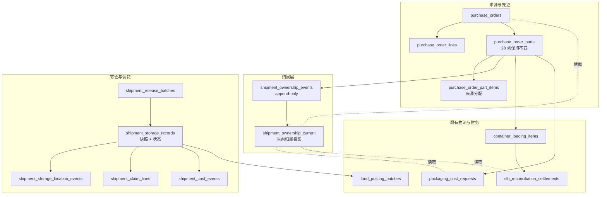
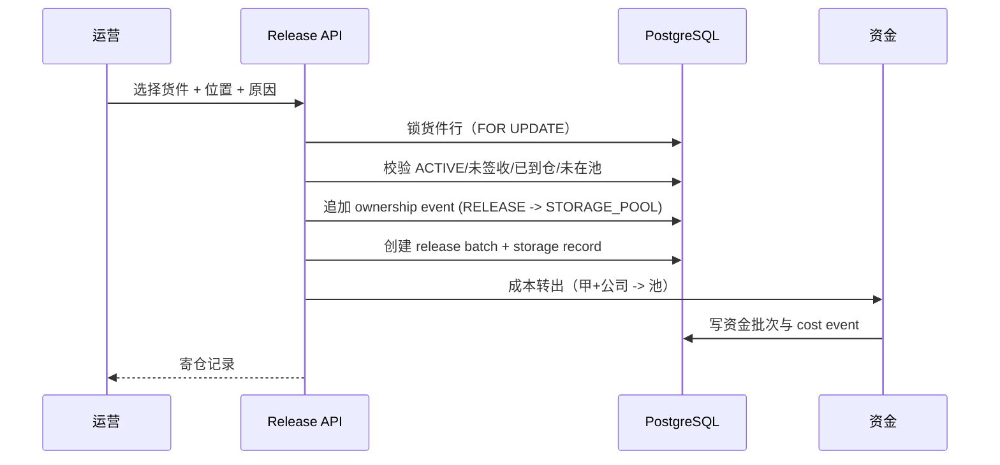
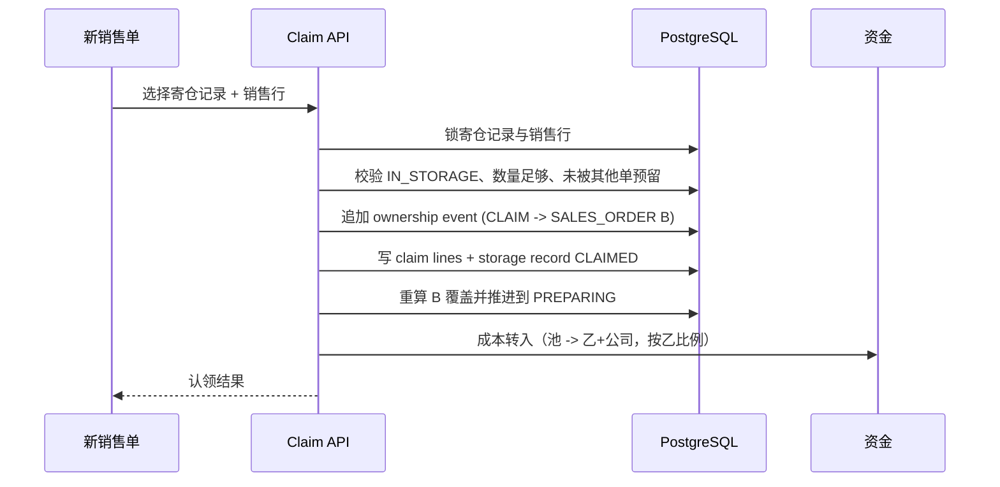

# 货件归属、寄仓与调货技术设计

## 1. 文档状态

- 状态：方案已确认，待实施授权
- 设计日期：2026-10-28
- 需求规格：[货件归属、寄仓与调货需求规格](./requirements.md)
- 实施边界：本文档只定义方案，不修改代码、公共 API、数据库或生成文件。

## 2. 设计结论

采用**业务归属脱离**，不物理拆父单：

- `purchase_order_parts` 保持 28 列、全部约束与索引不变，父单保留为来源与成本凭证；
- 新增 `shipment_ownership_events` 作为归属事实，新增 `shipment_ownership_current` 作为可查询的当前归属投影；
- 现有五条读取链路从 `purchaseOrder.salesOrderId` 切换到归属投影，迁移期两者 100% 等价；
- 寄仓、认领、位置移动、成本转移都在归属层之上追加，不触碰货件的不可变规则。

不采用物理拆父单的原因：父单不可变、分配不可增删改且要求数量精确覆盖、采购行来源冻结、编号身份含 `purchaseOrderId`，四层都要重写，而业务收益与归属层相同。

## 3. 总体架构



## 4. 数据模型

### 4.1 归属事件与当前投影

```sql
CREATE TYPE shipment_owner_type AS ENUM ('SALES_ORDER', 'STORAGE_POOL', 'COMPANY');
CREATE TYPE shipment_ownership_state AS ENUM ('ACTIVE', 'VOIDED');
CREATE TYPE shipment_ownership_reason AS ENUM
  ('PURCHASE_CREATED','ORDER_CANCELLED','CUSTOMER_CANCEL','CUSTOMER_REJECT','RELEASE','CLAIM','CORRECTION');

CREATE TABLE shipment_ownership_events (
  id                    uuid PRIMARY KEY DEFAULT gen_random_uuid(),
  shipment_id           uuid NOT NULL REFERENCES purchase_order_parts(id) ON DELETE RESTRICT,
  sequence              integer NOT NULL CHECK (sequence >= 1),
  owner_type            shipment_owner_type NOT NULL,
  owner_sales_order_id  uuid REFERENCES sales_orders(id) ON DELETE RESTRICT,
  state                 shipment_ownership_state NOT NULL DEFAULT 'ACTIVE',
  reason                shipment_ownership_reason NOT NULL,
  release_batch_id      uuid,
  occurred_at           timestamptz NOT NULL DEFAULT now(),
  actor_user_id         uuid NOT NULL REFERENCES users(id) ON DELETE RESTRICT,
  request_key           uuid NOT NULL,
  payload_hash          bytea NOT NULL,
  CONSTRAINT shipment_ownership_owner_shape
    CHECK ((owner_type = 'SALES_ORDER') = (owner_sales_order_id IS NOT NULL)),
  CONSTRAINT shipment_ownership_shipment_sequence_key UNIQUE (shipment_id, sequence),
  CONSTRAINT shipment_ownership_actor_request_key UNIQUE (actor_user_id, request_key)
);
```

规则：

- 事件表 `BEFORE UPDATE OR DELETE` 拒绝，事实只追加；
- 事件写入后由触发器维护 `shipment_ownership_current`，`sequence` 必须严格 +1；
- 当前归属 = 每个货件 `sequence` 最大的事件；
- `VOIDED` 表示随原采购单取消而作废，仍保留归属用于历史追溯；
- 归属只决定“当前归谁”，不改变货件状态、物流事实与成本凭证。

### 4.2 寄仓与认领

```sql
shipment_release_batches(
  id, reason, origin_sales_order_id,   -- 单批通常来自同一销售单；跨单时为空，以各寄仓记录为准
  actor_user_id, occurred_at, request_key, payload_hash, note
)

shipment_storage_records(
  id,
  shipment_id                uuid NOT NULL,
  release_batch_id           uuid NOT NULL,
  status                     storage_status NOT NULL,        -- IN_STORAGE / RESERVED / CLAIMED / VOIDED
  location_scope             location_scope NOT NULL,        -- MAINLAND / OVERSEAS
  warehouse_value            varchar(64) NOT NULL,
  warehouse_label_snapshot   varchar(128),
  location_updated_at        timestamptz NOT NULL,
  shipment_no_snapshot       varchar(64),
  shipping_mark_snapshot     varchar(72),
  origin_purchase_order_id   uuid NOT NULL,
  origin_sales_order_id      uuid NOT NULL,
  origin_issuer_user_id      uuid NOT NULL,
  origin_allocations         jsonb NOT NULL,                 -- 采购行 + 数量映射
  container_snapshot         jsonb,                          -- 柜次/装柜明细/收件人/COD/重量体积
  cost_snapshot              jsonb NOT NULL,                 -- 成本/已付/比例/两腿金额/付款批次 id
  snapshot_at                timestamptz NOT NULL,
  claimed_sales_order_id     uuid,
  claimed_at                 timestamptz,
  claimed_by                 uuid,
  created_at, updated_at
);
-- 同一货件同时只允许一条占用中的寄仓记录（在仓或已预留）
CREATE UNIQUE INDEX shipment_storage_records_active_key
  ON shipment_storage_records(shipment_id) WHERE status IN ('IN_STORAGE','RESERVED');

shipment_storage_location_events(
  id, storage_record_id, sequence,
  location_scope, warehouse_value, warehouse_label_snapshot,
  reason, occurred_at, actor_user_id, request_key, payload_hash,
  UNIQUE (storage_record_id, sequence),
  UNIQUE (actor_user_id, request_key)
)

shipment_claim_lines(
  id, storage_record_id, sales_order_line_id, quantity,
  claimed_at, claimed_by
)

shipment_cost_events(
  id, storage_record_id, direction,                       -- RELEASE / CLAIM
  transfer_group_id, fund_posting_batch_ids jsonb,         -- 一跳可能对应 2～3 张批次
  amount_cny, legs_snapshot jsonb,
  occurred_at, actor_user_id, request_key, payload_hash
)
```

### 4.3 位置模型

| 货件状态 | `location_scope` | `warehouse_value` |
|---|---|---|
| 未装柜、已到仓 | `MAINLAND` | 必须等于 `purchase_order_parts.destination_warehouse_value` |
| 已装柜（含未到港） | `OVERSEAS` | `RF_TZ` 或 `RF_LK` |
| 已签收 | 不允许释放 | — |

移动规则：

- 只允许 `OVERSEAS ↔ OVERSEAS`；
- 只允许在 `IN_STORAGE` 期间；
- 每次移动追加事件，写原因与操作人；
- 不改变归属、成本、唛头、编号、装柜事实。

### 4.4 字典

| 项 | 值 |
|---|---|
| 类型 code | `overseas.warehouse` |
| 类型名称 | 海外仓库 |
| 条目 | `RF_TZ`＝瑞锋-台中仓；`RF_LK`＝瑞锋-林口仓 |
| 校验 | 类型编码与条目值格式均已核对可通过现有字典规范 |

字典类型与条目默认停用，必须按“建条目 → 启用条目 → 启用类型”顺序启用。

## 5. 状态与解析

### 5.1 货件状态不变

`PurchaseOrderPartStatus` 仍是 `PENDING_REVIEW / ACTIVE / CANCELLED`。不加“寄仓中”：

- 货件行保持 `ACTIVE`；
- 寄仓中由 `shipment_storage_records.status = IN_STORAGE` 派生；
- 避免混用审批态与仓储态，也避免改动全站货件谓词。

### 5.2 归属解析

统一入口：

```text
resolveShipmentOwner(shipmentId)
  -> { ownerType, ownerSalesOrderId, state }
```

- `SALES_ORDER`：对账收款人、数据范围、履约推进都取该销售单；
- `STORAGE_POOL`：进入寄仓流程，不再推进原销售单；
- `COMPANY`：库存采购（`STOCK`）与无销售来源场景，`SELF` 不可见。

### 5.3 寄仓状态机

```text
IN_STORAGE --认领--> CLAIMED
IN_STORAGE --预留--> RESERVED --认领--> CLAIMED
IN_STORAGE/RESERVED --作废--> VOIDED
```

- 首期可只实现 `IN_STORAGE → CLAIMED`；预留用于并发冲突场景；
- 不做 `CLAIMED → IN_STORAGE` 的反向流转；新销售单取消后的回收另立规则（见缺口）。

## 6. 关键流程

### 6.1 释放



约束：

- 一次释放可包含多个货件，必须同一事务；
- 同一货件不能同时存在两条 `IN_STORAGE`；
- 已装柜货件不走装柜解绑，避免 `loaded_at` 被清空、履约回退；
- 释放后冻结该货件的装柜/签收与采购金额修订。

### 6.2 认领



### 6.3 成本两跳

设货件成本 C（采购 + 包装），原出单人比例 a，新出单人比例 b：

| 时点 | 甲 | 公司 | 池 | 乙 |
|---|---|---|---|---|
| 原采购付款 | −aC | −(1−a)C | 0 | — |
| 释放 | +aC | +(1−a)C | −C | — |
| 认领 | 0 | −(1−b)C | +C | −bC |
| 最终 | 0 | −(1−b)C | 0 | −bC |

实现要点：

- 不做“冲正”原采购付款批次，只做成本责任重分类；
- 每跳 2～3 张批次，用 `transfer_group_id` 同事务绑定；
- 幂等键 `${storageRecordId}:RELEASE` / `:CLAIM`；
- 成本取释放时快照，不读实时采购金额；
- 池账户建议用公司账户加 `purpose = SUSPENSE`，避免改“公司账户唯一”约束。

### 6.4 位置移动

- 输入：寄仓记录、目标仓库、原因；
- 校验：`IN_STORAGE`、`OVERSEAS ↔ OVERSEAS`；
- 追加位置事件并更新当前快照；
- 不影响成本、归属与物流事实。

## 7. 与现有链路的关系

| 链路 | 迁移后的真相源 | 行为变化 |
|---|---|---|
| 货件数据范围 `SELF` | `shipment_ownership_current` | 迁移期等价 |
| 柜次“我的/全部” | 当前归属 | 池内货件从原销售“我的”消失 |
| 装柜/到仓/签收推进履约 | 当前归属 | 池内不推进；认领后按新单推进 |
| SLH 匹配与结算 | 当前归属 | 池内账单挂起 |
| 包装费提报的货件可见性 | 当前归属 | 释放后禁止新提报；费用列表仍按 `ownerUserId` |

## 8. 编号、唛头与物流事实边界

| 项 | 规则 |
|---|---|
| 编号 | 不重新派发；调货不改号；历史账本不可改 |
| 唛头 | 保留原唛头；调货后仍不可改，否则 SLH 匹配断链 |
| 装柜 | 不撤销、不换柜；寄仓不通过解绑实现 |
| 签收 | 已签收不可释放；释放后池内不可签收，认领后按新单签收 |
| 到仓 | 不变；释放要求已到仓（建议规则，待确认） |
| 采购单 | 不取消、不改挂；终止态在销售单侧 |

## 9. 迁移策略

迁移期目标是**行为零变化**：

1. 新增归属事件与投影表，纯 additive；
2. 回填每个货件的当前归属，镜像采购链；
3. 采购创建与取消双写归属事件；
4. 五条读取链路逐条切换，每条独立验证与回退；
5. 加等价性命令，逐行比较新旧解析结果，零差异才继续。

迁移期不改 DTO、不改前端、不新增接口。

## 10. 里程碑

| 里程碑 | 内容 | 用户可见变化 |
|---|---|---|
| M1 | 归属层迁移（表、回填、双写、五条链路切换） | 无 |
| M2 | 销售单终止态 | 有 |
| M3 | 释放进池 + 寄仓管理页 + 海外仓字典 | 有 |
| M4 | 认领 + 成本转移 | 有 |
| M5 | 对账收款人 + 包装费前置 | 有 |

M1 必须先于 M2-M5；M3 必须先于 M4。

## 11. 风险

| 风险 | 影响 | 缓解 |
|---|---|---|
| 归属投影与事件不一致 | 归属错误 | 触发器维护 + parity 命令 + 迁移自检 |
| 五条链路切换遗漏 | 部分页面仍按采购单归属 | 逐条切换 + 全量测试 + 契约检查 |
| 成本转移批次形状不合法 | 资金记不上 | 先验证资金规则引擎与 `user_share_rate` 两腿模型 |
| 账单先于认领到达 | 对账阻断 | 挂起并给明确原因 |
| 历史目的地仓库为空 | 无法内地释放 | 只读核对 SQL + 显式 422 |
| 终止态遗漏判断点 | 订单被继续推进 | 按九类影响清单逐项验收 |
