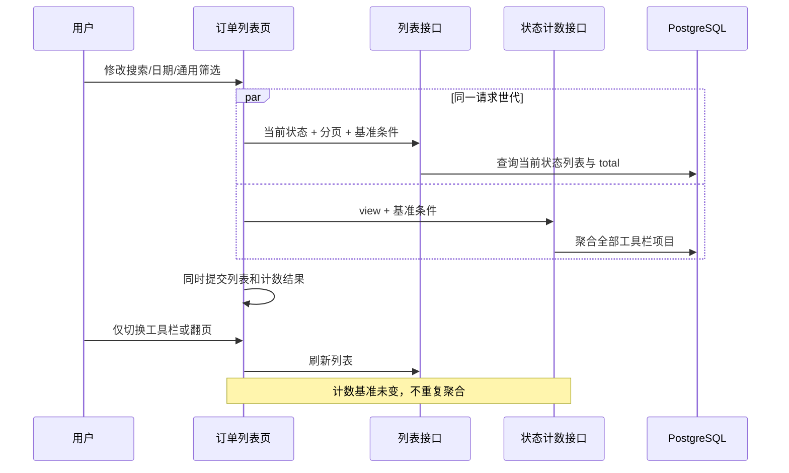

# 状态切换工具栏计数技术设计

## 1. 文档状态

- 状态：已确认并进入实施
- 确认日期：2026-08-31
- 需求规格：[状态切换工具栏计数需求](./requirements.md)
- 数据库变更：无
- 公共 API 变更：新增两个只读状态计数查询接口

## 2. 设计目标

1. 为全部采购接入与销售订单一致的状态切换工具栏。
2. 为销售全部、销售待办、采购全部、采购待办提供服务端权威全量计数。
3. 计数只受搜索、日期和其他非工具栏筛选影响，不受当前页、页大小或当前工具栏选择影响。
4. 保留待办分类可重叠语义，并对销售“全部待办”按订单 ID 去重。
5. 不改数据库 schema、状态机、列表分页协议或 `QsStatusSwitchToolbar` 公共组件 API。

## 3. 当前架构与方案选择

### 3.1 当前真相源

- 销售列表查询：`server/src/modules/sales-orders/sales-order-query.service.ts`
- 采购列表查询：`server/src/modules/purchase-orders/purchase-order-query.service.ts`
- 查询与响应 DTO：两个订单域各自的 `dto/*-query.dto.ts`、`dto/*-response.dto.ts`
- OpenAPI：`server/openapi/openapi.json`、`web/openapi/openapi.json`
- Web API 适配：`web/apps/qsmds-arco/src/api/modules/{sales-orders,purchase-orders}.ts`
- Web 列表逻辑：销售、采购订单列表页面及其 `*.logic.ts`
- 组件契约：`web/apps/qsmds-arco/src/components/business/QsStatusSwitchToolbar`

### 3.2 采用独立只读计数接口

新增：

```text
GET /api/sales-orders/status-counts
GET /api/purchase-orders/status-counts
```

不把计数直接放进现有分页响应，原因如下：

1. 翻页和修改页大小不会改变计数基准，分页响应每次重新聚合会产生无意义查询。
2. 单纯切换工具栏项目也不会改变其他项目计数，可以只刷新列表而复用当前计数。
3. 销售“全部/全部待办”当前可能由多个列表请求合并；独立接口只聚合一次，不会在每个目标请求中重复计算相同计数。
4. 新接口是纯增量公共 API，不改变现有列表查询参数和响应结构。

计数接口与列表接口由同一页面请求世代和 `AbortSignal` 协调。搜索、日期、通用筛选或视图变化时并发刷新列表与计数；状态切换和分页只刷新列表。



## 4. 公共 API 设计

### 4.1 通用响应形状

两个订单域分别声明强类型 DTO，不引入跨领域 DTO 依赖：

```ts
interface OrderStatusCountItemDto {
  value: StableStatusValue
  count: number
}

interface OrderStatusCountsDto {
  view: 'all' | 'pending'
  items: readonly OrderStatusCountItemDto[]
}
```

- `value` 使用工具栏现有稳定编码。
- `count` 是大于或等于 `0` 的整数。
- `items` 只返回当前 `view` 的项目，顺序与页面工具栏一致。
- 响应显式返回 `view`，Web 仅在响应视图与当前页面视图一致时采用结果，避免销售和待办共同使用 `ALL` 时串用旧计数。

### 4.2 销售计数接口

```text
GET /api/sales-orders/status-counts
permission: sales-orders:read
operationId: sales_orders_status_counts
```

查询参数：

```ts
interface SalesOrderStatusCountsQuery {
  view: 'all' | 'pending'
  keyword?: string
  currencyCode?: 'TWD' | 'MYR'
  issuerUserId?: string
  paymentStatus?: 'UNPAID' | 'PARTIALLY_PAID' | 'PAID'
  orderDateFrom?: string
  orderDateTo?: string
}
```

DTO 使用 `OmitType(SalesOrderListQueryDto, ['page', 'pageSize', 'orderStatus', 'fulfillmentStatus'])` 复用现有校验，再增加必填 `view`。销售待办页面继续不提交通用 `paymentStatus`，避免与“待收款”任务维度冲突；全部销售页面保留该基础筛选。

返回值：

- `view=all`：`ALL`、`CONFIRMED`、`PENDING_RECONCILIATION`、`CANCELLED`、`COMPLETED`。
- `view=pending`：`ALL`、`PENDING`、`PREPARING`、`LAND_TRANSIT`、`WAREHOUSE_ARRIVED`、`SEA_TRANSIT`、`WAITING_PAYMENT`。

### 4.3 采购计数接口

```text
GET /api/purchase-orders/status-counts
permission: purchase-orders:read
operationId: purchase_orders_status_counts
```

查询参数：

```ts
interface PurchaseOrderStatusCountsQuery {
  view: 'all' | 'pending'
  keyword?: string
  supplierValue?: string
  purchaseType?: 'SALES_LINKED' | 'STOCK'
  fulfillmentStatus?: 'ORDERED' | 'PREPARING' | 'SHIPPED' | 'SIGNED'
  paymentStatus?: 'UNPAID' | 'PARTIALLY_PAID' | 'PAID'
  orderDateFrom?: string
  orderDateTo?: string
}
```

DTO 使用 `OmitType(PurchaseOrderListQueryDto, ['page', 'pageSize', 'orderStatus', 'pendingTask'])`，因此计数不会被当前工具栏选择污染。

返回值：

- `view=all`：`ALL`、`CONFIRMED`、`COMPLETED`、`CANCELLED`。
- `view=pending`：`AWAITING_SHIPMENT`、`AWAITING_WAREHOUSE`、`AWAITING_PAYMENT`。

### 4.4 安全与错误契约

- 两个接口只要求各自订单域的 `read` 权限，不新增权限。
- 复用现有 Session、权限、请求 ID、私有 `no-store` 和 DTO 校验。
- 仅返回分类编码与数量，不返回订单内容、客户、供应商或金额。
- 错误继续使用 `403` 公共鉴权错误与 `422 VALIDATION_FAILED`。
- 不记录完整查询参数或敏感请求内容。

## 5. Server 查询设计

### 5.1 共享基准谓词

两个 Query Service 分别提取本领域的基础 `where` 构造函数，供列表和计数查询复用：

```ts
buildSalesOrderBaseWhere(input)
buildPurchaseOrderBaseWhere(input)
```

基础函数只处理关键字规范化、日期边界和非工具栏筛选，不处理当前工具栏状态。列表方法在基础谓词上追加当前 `orderStatus`、`fulfillmentStatus`、`paymentStatus` 或 `pendingTask`；计数方法在同一基础谓词上分别追加每个分类条件。这样可避免搜索、日期和供应商语义在两个接口中漂移。

销售关键字继续匹配订单号、客户名和客户电话；采购关键字继续匹配采购单号、销售单号和客户名。日期继续使用现有 UTC date 边界表达，不改变业务日期规则。

### 5.2 销售全部计数

全部销售明确排除 `DRAFT`。在基础谓词上执行一次 `groupBy(orderStatus)`，再按固定状态集合映射：

```text
FORMAL = CONFIRMED | PENDING_RECONCILIATION | CANCELLED | COMPLETED
ALL = 四个正式状态计数之和
```

未知或缺失分组按 `0` 返回；不得把 `DRAFT` 纳入 `ALL`。

### 5.3 销售待办计数

销售待办基础条件固定为 `orderStatus = CONFIRMED`：

```text
PENDING                 fulfillmentStatus = PENDING
PREPARING               fulfillmentStatus = PREPARING
LAND_TRANSIT            fulfillmentStatus = LAND_TRANSIT
WAREHOUSE_ARRIVED       fulfillmentStatus = WAREHOUSE_ARRIVED
SEA_TRANSIT             fulfillmentStatus = SEA_TRANSIT
WAITING_PAYMENT         paymentStatus IN (UNPAID, PARTIALLY_PAID)
ALL                     上述条件 OR 的去重订单数
```

使用一次履约状态 `groupBy`、一次付款状态 `groupBy` 和一次 `ALL` 联合 `count`。三次读取放入 `RepeatableRead` 事务，确保同一个计数响应内部基于一致快照。

### 5.4 采购全部计数

在采购基础谓词上执行一次 `groupBy(orderStatus)`：

```text
ALL = CONFIRMED + COMPLETED + CANCELLED
```

采购订单不存在草稿状态，全部三个状态均纳入 `ALL`。

### 5.5 采购待办计数

采购待办基础条件固定为 `orderStatus = CONFIRMED`：

```text
AWAITING_SHIPMENT    fulfillmentStatus IN (ORDERED, PREPARING)
AWAITING_WAREHOUSE   fulfillmentStatus = SHIPPED
AWAITING_PAYMENT     paymentStatus IN (UNPAID, PARTIALLY_PAID)
```

分别使用履约状态和付款状态 `groupBy`，两次读取放入 `RepeatableRead` 事务。同一订单可以同时贡献一个履约分类和待付款分类，禁止将三个数相加后当作去重总数。

### 5.6 性能边界

- 计数查询没有分页行、明细、媒体、付款金额或字典解析，不产生 N+1。
- 使用固定数量 `count/groupBy`，查询数量不随订单数或页数增长。
- 现有销售、采购复合状态索引和日期索引继续作为数据库执行基础；本需求不新增索引或 migration。
- 只有计数基准条件变化时 Web 才重新请求，翻页和纯状态切换不触发计数聚合。

## 6. Web 设计

### 6.1 API 适配

生成 OpenAPI 类型后，在两个 API 模块分别增加：

```ts
statusCounts(query, signal)
```

页面只使用生成的查询与响应 DTO，不手写重复网络契约。

### 6.2 统一计数映射

在 `QsStatusSwitchToolbar/logic.ts` 增加不改变组件 API 的纯函数：

```ts
withStatusSwitchCounts(items, counts): readonly QsStatusSwitchItem[]
```

规则：

1. 以稳定 `value` 匹配计数。
2. 服务端返回 `0` 时必须保留 `0`。
3. 初始加载或防御性缺失键使用 `0`，保证仓库内所有实际工具栏项始终渲染计数。
4. 保留项目原有 `label`、`disabled` 等属性。

销售和采购业务逻辑继续负责各自项目定义，只复用这个无业务语义的映射函数。

### 6.3 请求世代与刷新策略

每个列表页面保存当前计数快照：

```ts
interface StatusCountSnapshot {
  view: 'all' | 'pending'
  items: readonly StatusCountItemDto[]
}
```

- 初始值为空，通过映射函数显示 `0`。
- 搜索、日期、通用筛选、权限世代或 `viewMode` 变化：列表和计数并发刷新。
- 工具栏选择、页码或页大小变化：只刷新列表。
- 订单 mutation 成功或用户主动重试：列表和计数一起刷新，因为订单可能已经跨状态分类。
- 同一视图刷新期间保留上一次成功快照。
- 切换 `viewMode` 时，旧视图快照不参与映射，先展示当前视图的 `0`。
- 只有 `AbortSignal` 未取消、请求版本仍为最新、鉴权世代未变化时，列表和计数才一起提交到响应式状态。
- 任一并发请求失败时沿用现有列表错误反馈，并不把本次未完成的计数标记为成功。
- 每次列表成功后，使用同一响应的 `total` 校准当前选中项目的计数；这既保证当前表格 `total` 与选中项严格一致，也能吸收列表与独立计数请求之间可能发生的并发业务变化。其他未选中项目仍使用计数接口的同一快照，下一次基准条件变化或 mutation 刷新时整体更新。

### 6.4 全部采购工具栏

采购列表逻辑新增：

```ts
type PurchaseOrderAllStatusSelection =
  | 'ALL'
  | 'CONFIRMED'
  | 'COMPLETED'
  | 'CANCELLED'
```

- 全部采购从 URL `status` 读取，非法值和缺省值归一为 `ALL`。
- `ALL` 使用无 `status` 参数的规范 URL；其他值写入 `status`。
- 待办采购继续使用 URL `task` 和现有默认 `AWAITING_SHIPMENT`。
- `buildPurchaseOrderListQuery()` 在全部模式下把非 `ALL` 选择映射为 `orderStatus`；待办模式继续映射 `pendingTask`。
- 页面始终渲染一个 `QsStatusSwitchToolbar`，根据 `viewMode` 选择全部状态或待办任务数据与可访问名称。
- 通用筛选抽屉删除重复 `orderStatus` 定义；履约、付款、供应商和采购类型筛选保持不变。
- 路由 watcher 同时观察 `viewMode`、`status` 与 `task`，只在当前模式相关值变化时刷新。

### 6.5 销售订单工具栏

- 保持现有 URL `status`、项目顺序和列表查询目标不变。
- `getSalesOrderStatusItems()` 接收当前计数并通过共享映射函数返回带计数项目。
- 销售“全部/全部待办”的客户端列表合并逻辑保持不变；计数不再从合并后的明细推算。
- 计数查询使用与 `buildListQuery()` 相同的关键字、币种、出单人、付款和日期基准，其中当前工具栏对应的订单/履约状态不进入计数请求。

### 6.6 组件库

- 保留待办、全部订单、390px 窄容器和禁用状态场景。
- 将 `NO_COUNT` 改为带固定计数的普通状态。
- 所有固定示例项显式声明 `count`，但 `QsStatusSwitchItem.count` 仍保持可选，避免无必要的公共组件破坏性变更。

## 7. UI 规格落地

- 不修改 `QsStatusSwitchToolbar/index.vue` 的高度、宽度、颜色、下划线或滚动按钮。
- 计数继续使用现有 `font-mono tabular-nums`。
- 全部采购工具栏位于 `FaPageHeader` 后、`QsGenericTable` 前，与待办采购位置一致。
- 零计数仍占据同一标签内部位置，项目不折行。
- 窄屏继续由组件现有横向滚动处理，不新增移动端专用布局。

## 8. TDD 与验证策略

### 8.1 失败测试优先

1. Server DTO：接受合法 `view` 与基础筛选，拒绝非法视图、日期、UUID 和枚举。
2. Sales Query：
   - 全部视图排除 `DRAFT`；
   - 全部状态分组与 `ALL`；
   - 待办履约、待收款和去重 `ALL`；
   - 搜索、日期、币种、出单人与付款筛选进入基础谓词；
   - 零分组补 `0`。
3. Purchase Query：
   - 全部状态分组与 `ALL`；
   - 三类待办的重叠语义；
   - 搜索、日期、供应商、采购类型、履约与付款筛选进入基础谓词；
   - 零分组补 `0`。
4. Controller/OpenAPI：两个只读接口的权限、operationId、查询和响应契约。
5. Web 纯逻辑：计数按 value 合并、零值保留、缺失键归零、全部采购状态规范化和查询映射。
6. Web 页面：全部采购工具栏存在、重复订单状态筛选移除、四个正式页面均传入带计数项目。
7. 组件库：每个固定示例项均声明计数，禁用项仍带计数。

### 8.2 验证命令

```bash
pnpm -C server test -- sales-order-query-dto.spec.ts purchase-order-query-dto.spec.ts sales-order-query.service.spec.ts purchase-order-query.service.spec.ts --runInBand
pnpm -C server typecheck
pnpm -C server lint
node --run contract:sync
node --run contract:check
pnpm -C web exec tsx --test apps/qsmds-arco/test/views/status-switch-toolbar.test.ts apps/qsmds-arco/test/views/sales-order-list-view.logic.test.ts apps/qsmds-arco/test/views/sales-order-pages.test.ts apps/qsmds-arco/test/views/purchase-order-list.logic.test.ts apps/qsmds-arco/test/views/purchase-order-pages.test.ts
pnpm -C web typecheck
pnpm -C web lint
node --run check
```

真实页面验收：

1. `/qs-operations/sales-orders` 与对应待办页。
2. `/qs-operations/purchase/purchase-orders`。
3. `/qs-operations/purchase/pending-purchase-orders`。
4. 组件库 `QsStatusSwitchToolbar` 页面。
5. 验证搜索、日期、通用筛选会更新计数；状态切换和翻页保持同一计数；零值可见；窄屏可横向浏览。

## 9. 变更文件范围

### Server

- `server/src/modules/sales-orders/dto/sales-order-query.dto.ts`
- `server/src/modules/sales-orders/dto/sales-order-response.dto.ts`
- `server/src/modules/sales-orders/sales-order-query.service.ts`
- `server/src/modules/sales-orders/sales-orders.controller.ts`
- `server/src/modules/purchase-orders/dto/purchase-order-query.dto.ts`
- `server/src/modules/purchase-orders/dto/purchase-order-response.dto.ts`
- `server/src/modules/purchase-orders/purchase-order-query.service.ts`
- `server/src/modules/purchase-orders/purchase-orders.controller.ts`
- 对应既有 `.spec.ts`
- OpenAPI 快照

### Web

- `web/apps/qsmds-arco/src/api/modules/sales-orders.ts`
- `web/apps/qsmds-arco/src/api/modules/purchase-orders.ts`
- 生成 API 类型
- `QsStatusSwitchToolbar/logic.ts` 与测试
- 销售、采购订单列表逻辑和页面测试
- `StatusSwitchToolbarShowcase.vue`

### 明确不变

- `server/prisma/schema.prisma`
- `server/prisma/migrations/`
- 订单 mutation、状态机、权限与路由菜单
- `QsStatusSwitchToolbar/types.ts` 和 `index.vue` 公共契约
