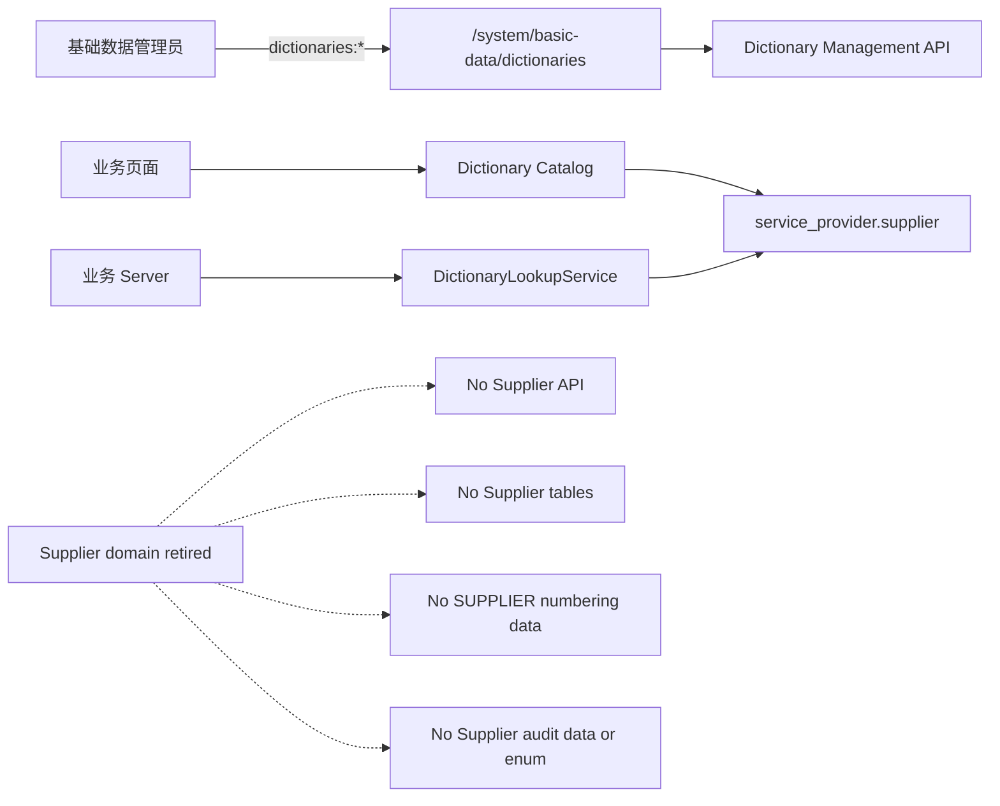

# 供应商字典化与独立模块退役技术设计

## 1. 文档状态

- 状态：已实施并通过本地验收
- 编写日期：2026-08-09
- Phase 2 确认日期：2026-08-09
- 实施验收日期：2026-08-09
- Requirements：`specs/supplier-dictionary-migration/requirements.md`
- 实施分支：`refactor/supplier-to-dictionary`
- 基线 SHA：`a41e7014709ce3adf46ba1c768f653c5de2c34d4`
- 数据策略：不迁移任何现有 Supplier；彻底删除 Supplier、`SUPPLIER` Numbering 与相关 Audit 运行态数据
- 发布边界：只设计和本地实施；不授权 push、PR、merge、部署或非本地数据库 migration

## 2. 设计结论

1. 不回退 Git，也不修改既有 migration；新增单事务 forward migration 表达最终退役状态。
2. 新建固定身份、空且停用的 `service_provider.supplier` Dictionary Type，不创建任何 Dictionary Item。
3. 删除 Supplier 两张业务表、专属 enum、函数、Trigger、权限和角色授权。
4. 删除 `SUPPLIER` Numbering Rule 及其全部 Version、Segment、PeriodState 和 Issuance。
5. 删除 Supplier 业务 Audit 和 `SUPPLIER` Rule 生命周期 Audit；重建 `audit_event_type`，移除四个 `SUPPLIER_*` label。
6. 删除 Supplier Server/Web/API/路由/页面/测试/CI，并移除只为 Supplier 增加且没有独立消费者的 Numbering/Region 扩展。
7. OpenAPI 删除属于显式破坏性变更；Contract baseline 只对六个 Supplier operationId 建立精确退役清单，不放宽其他 operationId 门禁。

## 3. 目标架构



退役后不存在供应商专属页面或服务。字典只表达平铺选项，后续业务表保存 Dictionary Item `value`，不保存字典 UUID 或 Label。

## 4. 最终数据模型

### 4.1 新 Dictionary Type

| Field | Value |
| --- | --- |
| `id` | `00000000-0000-4000-8000-000000002001` |
| `code` | `service_provider.supplier` |
| `name` | `供应商` |
| `description` | `合作供方中的供应商列表` |
| `enabled` | `false` |
| `sort_order` | `0` |
| `version` | `1` |
| `created_at/updated_at` | migration 执行时间 |

固定 ID 只用于跨环境可复核的 migration 身份；业务消费仍必须使用 Type code 和 Item value。migration 前置检查要求 ID 与 code 均未被占用，不执行 merge、upsert 或 `ON CONFLICT DO NOTHING`。

### 4.2 最终删除对象

```text
Supplier tables:
  supplier_create_requests
  suppliers

Supplier database types/functions:
  supplier_entity_type
  enforce_supplier_create_request_invariants()
  enforce_supplier_invariants()

Supplier permissions:
  suppliers:read
  suppliers:create
  suppliers:update
  suppliers:enable
  suppliers:disable

Supplier numbering hierarchy:
  numbering_rules(rule_code = SUPPLIER)
  related numbering_rule_versions
  related numbering_rule_segments
  related numbering_period_states
  related numbering_issuances

Supplier audit:
  event_type IN (
    SUPPLIER_CREATED,
    SUPPLIER_UPDATED,
    SUPPLIER_ENABLED,
    SUPPLIER_DISABLED
  )
  OR target_type = Supplier
  OR Supplier NumberingRule target/metadata
```

### 4.3 必须保留的历史

- `server/prisma/migrations/20260805090000_supplier_management_schema_and_permissions/migration.sql`。
- Prisma `_prisma_migrations` 中对应记录。
- Git commit、PR #11 和 CI 历史。
- 通用 Numbering/Audit Schema、权限与其他业务数据。

旧 Supplier migration 在空库重放时仍先创建 Supplier 对象；新退役 migration 随后将其删除。这是可审计的向前历史，不通过删除旧文件伪装成 Supplier 从未存在。

## 5. Forward migration

### 5.1 文件与事务

新增：

```text
server/prisma/migrations/
  20260809090000_supplier_domain_retirement/migration.sql
```

migration 使用一个显式 `BEGIN ... COMMIT`。不使用 `CASCADE`、`IF EXISTS`、`IF NOT EXISTS`、`ON CONFLICT DO NOTHING`、`session_replication_role` 或全局 Trigger 禁用。执行顺序固定为：锁与前置检查 → 字典 Type → 权限 → Audit 数据 → Supplier Schema → Numbering 数据 → Audit enum → 最终自检。

静态测试锁定旧 Supplier migration 的 SHA-256 为 `9f18a1f0e980fadd384e27985a872b099e1f210fd729b96eeed0872f5e8b284e`，任何修改、替换或删除都应失败。

### 5.2 锁与前置检查

migration 在读取任何退役目标前，对下列表按固定顺序取得 `ACCESS EXCLUSIVE` 锁：

```text
supplier_create_requests
suppliers
numbering_rules
numbering_rule_versions
numbering_rule_segments
numbering_period_states
numbering_issuances
audit_events
permissions
role_permissions
dictionary_types
dictionary_items
```

此顺序将 Numbering 固定为 Rule → Version → Segment/State → Issuance，与发号器的父到子锁序一致；Permission 保持父到 RolePermission，Dictionary 保持 Type 到 Item。迁移前必须先停止 Server 写流量，避免 DDL 长时间等锁。

事务内设置 `SET LOCAL lock_timeout = '5s'` 与 `SET LOCAL statement_timeout = '10min'`；无法按时取得全部锁时整体失败，不延长或绕过锁边界。

前置检查：

1. 旧 Supplier 两张表、两个函数、两个 Trigger 和 `supplier_entity_type` 精确存在。
2. 五个 Supplier Permission 的稳定 ID `...138` 至 `...142` 与 code 精确匹配。
3. `service_provider.supplier` 和固定 Type ID 均未占用。
4. `audit_event_type` 精确包含四个 `SUPPLIER_*` label；临时新 enum 名未被占用。
5. 四个 Numbering 具名 Trigger 存在且为 enabled：
   - `numbering_issuances_immutability_trigger`
   - `numbering_rule_segments_parent_draft_trigger`
   - `numbering_rule_versions_invariants_trigger`
   - `numbering_rules_invariants_trigger`
6. `SUPPLIER` Rule 允许不存在或精确存在一条；唯一约束保证不会存在多条。
7. 不存在 `consumer_code LIKE 'SUPPLIER.%'` 却不属于目标 Rule 的 Issuance；存在时视为身份漂移并失败。
8. 目标表未启用 RLS，避免删除或自检被行级策略静默过滤。
9. 将目标 Rule ID 和其他业务 Numbering/Audit 基线计数保存到事务内临时快照，供最终自检使用。

任一结构或身份漂移都抛出异常并整体回滚。

### 5.3 创建空供应商字典

以 `enabled=false` 插入第 4.1 节固定 Type。字典 Type Trigger 允许创建停用 Type；migration 不插入 Item、不启用 Type，也不伪造 `DICTIONARY_TYPE_CREATED` Audit。

### 5.4 删除权限

1. 按五个稳定 Permission ID 删除全部 `role_permissions`。
2. 按稳定 ID/code 对删除五条 `permissions`。
3. 自检 `permissions.code LIKE 'suppliers:%'` 和对应 RolePermission 均为零。

删除谓词同时使用稳定 ID 和 code，避免身份漂移时误删其他权限。

### 5.5 删除 Supplier Audit

在删除 Numbering Rule 前，使用事务内目标 Rule ID 快照删除以下 Audit：

1. `event_type` 为四个 `SUPPLIER_*` 的行。
2. `target_type = 'Supplier'` 的行。
3. `target_type = 'NumberingRule'` 且 `target_id` 等于目标 `SUPPLIER` Rule ID 的行。
4. `event_type` 属于通用 `NUMBERING_RULE_*` 集合，且 `metadata ->> 'ruleCode' = 'SUPPLIER'` 的 Rule 生命周期行。

通用 `NUMBERING_RULE_*` enum 仍由其他规则使用，只删除属于 `SUPPLIER` Rule 的行，不删除这些通用 enum label。如同一行的 Rule ID、`target_type`、`event_type` 与 metadata 语义互相矛盾，前置检查必须失败，不扩大删除谓词。`audit_events` 没有自定义不可变 Trigger，可以使用精确 `DELETE`。

### 5.6 删除 Supplier Schema

按 FK 子表到父表顺序执行：

```text
DROP TABLE supplier_create_requests;
DROP TABLE suppliers;
DROP FUNCTION enforce_supplier_create_request_invariants();
DROP FUNCTION enforce_supplier_invariants();
DROP TYPE supplier_entity_type;
```

`DROP TABLE` 会连同表内 Trigger、索引、约束和 Supplier → Numbering/Region FK 一起删除，因此不需要绕过 Supplier 行级不可删除 Trigger。所有 DROP 均不带 `CASCADE`；存在未知外部依赖时 migration 必须失败。Supplier 表必须在目标 Numbering Issuance 之前删除，以释放 Supplier → Issuance 的 `RESTRICT` FK。

### 5.7 删除 SUPPLIER Numbering hierarchy

只临时停用第 5.2 节列出的四个具名 User Trigger；不禁用 FK/Internal Trigger。删除顺序：

```text
numbering_issuances
numbering_period_states
numbering_rule_segments
numbering_rule_versions
numbering_rules
```

每条 DELETE 都通过事务内目标 Rule ID 限定。随后立即重新启用四个 Trigger，并在提交前验证其 `tgenabled='O'`。如果 migration 在重新启用前失败，PostgreSQL 事务回滚会恢复 Trigger 状态。

其他 Rule 的 Version、Segment、PeriodState、Issuance 不参与 DELETE。FK 保持启用，任何未知业务引用都会让删除失败。

### 5.8 重建 Audit enum

PostgreSQL 不支持直接删除 enum value。先确认已不存在四个 Supplier event，再执行：

1. 创建临时 `audit_event_type_without_supplier`，按当前顺序列出其余 40 个 label。
2. 将 `audit_events.event_type` 通过 `event_type::text::audit_event_type_without_supplier` 转换到新类型。
3. 删除旧 `audit_event_type`。
4. 把新类型重命名为 `audit_event_type`。
5. 验证 `audit_events_event_type_occurred_at_idx` 仍存在且有效。

实库 `pg_depend` 已确认旧 enum 只有 `audit_events.event_type` 和自动数组类型两个依赖，无默认值、函数参数、视图或其他业务列依赖。Prisma `AuditEventType` 同步删除：

```text
SUPPLIER_CREATED
SUPPLIER_UPDATED
SUPPLIER_ENABLED
SUPPLIER_DISABLED
```

### 5.9 最终自检

提交前必须验证：

- `service_provider.supplier` 精确存在、停用、版本 1、零 Item。
- Supplier 两张表、两个函数、两个 Trigger 和 `supplier_entity_type` 不存在。
- Supplier permissions/role grants 为零。
- `SUPPLIER` Rule 及其 Version、Segment、PeriodState、Issuance 为零。
- Supplier 业务 Audit 与 Supplier Rule Audit 为零。
- `audit_event_type` 为 40 个 label，且不含 `SUPPLIER_*`。
- 四个 Numbering Trigger 存在且 enabled。
- 其他 Numbering/Audit 基线计数和目标外内容不变。
- Prisma migration ledger 由 Prisma CLI 在 SQL 成功提交后登记，不由 migration 手工修改。

## 6. Prisma 与 Server 设计

### 6.1 Prisma schema

从 `server/prisma/schema.prisma` 删除：

- `SupplierEntityType`。
- `Supplier`、`SupplierCreateRequest`。
- Region 上四个 Supplier 反向关系。
- NumberingIssuance 上的 `supplier` 关系。
- `AuditEventType` 中四个 `SUPPLIER_*`。

保留完整 Dictionary、Numbering 和 Audit model。Prisma Client 通过正式 generate 命令更新，不手改生成代码。

### 6.2 删除 Supplier Server

删除整个目录：

```text
server/src/modules/suppliers/
```

删除 Supplier 专属 Schema/API E2E 与数据库 Helper：

```text
server/src/infrastructure/database/supplier-schema.spec.ts
server/test/supplier-management-api.e2e-spec.ts
server/test/supplier-e2e-database.ts
server/test/supplier-schema.e2e-spec.ts
```

从 `server/src/http.modules.ts` 删除 `SuppliersModule` import 和注册。

新建与当前退役语义匹配的静态及 PostgreSQL E2E 测试；不沿用 Supplier 主数据测试文件和 fixture：

```text
server/src/infrastructure/database/supplier-retirement-schema.spec.ts
server/test/supplier-retirement-migration.e2e-spec.ts
```

### 6.3 移除仅供 Supplier 的共享扩展

调用方审计后，以下能力只有 Supplier 使用，应退回引入前边界：

- 删除 `RegionLookupService` 及测试，从 `RegionsModule` providers/exports 移除。
- `NumberingGeneratorService.GenerateNumberResult` 不再返回 `issuanceId`。
- Numbering persistence 恢复原插入返回边界，移除仅为回传 issuance UUID 增加的字段和测试。
- Numbering generator E2E 移除 `issuanceId` 断言，但保留通用发号、幂等、并发和 ledger 验证。
- `ci-browser-dictionaries-e2e.mjs` 移除只为 Supplier runner 注入的可配置扩展，恢复单一字典 runner 边界。

不保留无调用方兼容代码。

### 6.4 权限与既有测试

删除 `MANAGEMENT_PERMISSION_CODES` 中五个 `suppliers:*`，权限总数从 42 恢复为 37。同步更新：

- AccessControl unit tests。
- Auth schema/API E2E。
- Dictionary schema 中 Audit enum 总数断言 `44 → 40`。

`management-api.e2e-spec.ts` 已使用 `MANAGEMENT_PERMISSION_CODES.length`、`region-schema.spec.ts` 的格式正则以及 Dictionary permission slice 都是通用健壮性改进，与 Supplier 运行时无关，原样保留。

## 7. 公共 API 与 Contract 治理

### 7.1 删除的 API

删除四个 path、六个 operation：

```text
GET  /api/suppliers                         suppliers_list
POST /api/suppliers                         suppliers_create
GET  /api/suppliers/{supplierId}            suppliers_get_by_id
PATCH /api/suppliers/{supplierId}            suppliers_update
POST /api/suppliers/{supplierId}/enable     suppliers_enable
POST /api/suppliers/{supplierId}/disable    suppliers_disable
```

删除 Supplier error matrix、四个 Supplier Audit enum label 与以下 14 个 Schema：

```text
ChangeSupplierStatusRequestDto
CreateSupplierRequestDto
SupplierDto
SupplierEnableReadinessDto
SupplierListItemDto
SupplierPageDto
SupplierPrimaryAddressDto
SupplierPrimaryAddressInputDto
SupplierPrimaryContactDto
SupplierPrimaryContactInputDto
SupplierRegionReferenceDto
SupplierRegistrationDto
SupplierRegistrationInputDto
UpdateSupplierRequestDto
```

Server/Web OpenAPI snapshot 只通过根 `contract:sync` 更新；被 gitignore 的 Web `types.gen.ts` 只重新生成，不纳入 Git。

### 7.2 精确退役 operationId

当前 `assertOperationIdBaseline` 默认禁止删除任何 baseline operationId。新增只读常量：

```text
RETIRED_OPERATION_IDS = {
  suppliers_list,
  suppliers_create,
  suppliers_get_by_id,
  suppliers_update,
  suppliers_enable,
  suppliers_disable
}
```

`scripts/openapi-contract.mjs`、`scripts/openapi-contract.test.mjs` 和 `scripts/contract-check.test.mjs` 显式实现并验证以下 Contract 规则：

1. baseline 缺失仅在 ID 位于精确清单时允许。
2. 非清单 operationId 的任何删除继续失败。
3. 当前 OpenAPI 若重新出现清单中的 retired ID，检查失败。
4. 不允许 wildcard、prefix 或环境变量临时跳过。
5. 单元/集成测试覆盖允许的六项、未知删除、清单重现和 snapshot 同步。

清单属于公共 API 退役审计证据，不是运行时 Supplier 兼容层。

“退役 ID 不得在当前契约重现”必须在无 baseline 的 `contract:sync`/`contract:check` 中也执行；“允许从历史 baseline 消失”只在传入 baseline 时生效。复用现有 `assertOpenApiContract` 调用链，不新增环境变量或 CI-only 旁路。

## 8. Web 路由与界面

删除：

```text
web/apps/qsmds-arco/src/api/modules/suppliers.ts
web/apps/qsmds-arco/src/router/modules/service.provider.ts
web/apps/qsmds-arco/src/views/system/service-provider/suppliers/
```

同步删除 Supplier API、Route、View、logic、component 和 Browser tests。`/system/service-provider` 没有其他子路由，因此整个“合作供方”父菜单删除，不保留空菜单或旧地址重定向。

更新：

- `router/routes.ts`：删除 ServiceProvider 注册和权限展开。
- `views/system/permissions/catalog.ts`：删除供应商权限 Label。
- System management route/view/browser tests：删除 Supplier 预期。
- Web package scripts：删除 Supplier test/browser 入口。

保留 `/system/basic-data/dictionaries`、Dictionary API/Catalog/Provider 和现有字典页面全部能力。页面不新增 Supplier 专属视觉分支。

## 9. CI 与工程脚本

删除：

```text
scripts/ci-browser-suppliers-e2e.mjs
scripts/ci-browser-suppliers-e2e.test.mjs
browser-suppliers-e2e GitHub Actions Job
root/web supplier browser scripts
```

`CI gate` 从八个 validation jobs 精确恢复为七个：

```text
root-governance
server-check-build
server-e2e
contract
web-check-build
browser-auth-e2e
browser-dictionaries-e2e
```

Workflow 总 Job 数为 8：七个 validation 加 `ci-gate`。`ci-gate.needs` 只含上述七项，结果数不等于 7，或任一结果为 `failure`/`cancelled`/`skipped` 都必须失败。同步更新 workflow governance、root governance 和 workspace script tests，不改变其他 Job 的命令、权限或超时。

Root governance 新增 Supplier 运行时残留门禁：大小写不敏感扫描 Git tracked 及未忽略的待纳入文件，命中集合必须精确等于旧/新 migration、新/旧规格、退役测试、数据库文档和 retired operationId 治理文件白名单。白名单外任何 Supplier/ServiceProvider 文本都使检查失败；另外单独检查 `RegionLookupService`、Numbering `issuanceId` 和 Dictionary runner 注入扩展三个非 Supplier 命名残留。

## 10. 文档与历史治理

- 将 `specs/supplier-management/requirements.md`、`design.md` 和 `tasks.md` 标记为已由本规格取代，保留其原始决策与交付证据，不删除文件。
- 更新 `docs/后端文档/数据库迁移规范.md`：完整列出 11 条 migration，明确旧 Supplier migration 与新退役 migration 都是不可变历史，并把当前 Prisma model 数恢复为 19。
- 不删除、改名或修改 `20260805090000_supplier_management_schema_and_permissions/migration.sql`，不手工修改 Prisma migration ledger。

## 11. TDD 与验证设计

### 11.1 红测顺序

1. 静态 Schema 测试先要求新 migration、空 Type、旧 migration 保留、最终 Prisma 无 Supplier。
2. PostgreSQL E2E 先证明当前 migration replay 最终仍有 Supplier/Numbering/Audit，形成预期红测。
3. Server module/permission/OpenAPI 负向测试先证明 Supplier 路由和契约仍存在。
4. Web route/script/CI tests 先证明 Supplier 页面、脚本和 Job 仍存在。
5. Contract tests 先证明六个 operationId 尚不能合法退役。

每组红测记录缺失能力原因后实施最小修复；不提交只有红测的中间状态。

### 11.2 PostgreSQL 矩阵

#### 空库完整重放

- 顺序执行全部 11 条 migration。
- 最终空 Type 存在、Supplier/Numbering/Audit 专属对象不存在。
- 第二次 `prisma migrate deploy` 无操作。
- `dictionary-e2e-database.ts` 的真实 migration 集合追加旧 Supplier 与新 retirement migration，使 Dictionary API/Browser 测试运行在最终 Schema，不绕开迁移历史。

#### 有数据升级

在应用退役 migration 前准备：

- Supplier 与 SupplierCreateRequest。
- `SUPPLIER` Rule、Version、5 Segment、PeriodState、Issuance。
- 四类 Supplier Audit、`target_type = 'Supplier'` 但 event type 非 Supplier 的 Audit，以及 Supplier Rule 生命周期 Audit。
- 至少一套非 Supplier Numbering 数据和非 Supplier Audit 控制组。
- 系统管理员和普通角色的 Supplier 授权，以及非 Supplier 权限、字典、地区控制组。

应用后验证所有目标归零、控制组逐字段不变、四个 Trigger 恢复 enabled、Audit enum 精确等于原 label 顺序移除四个 `SUPPLIER_*`。还要证明 Audit 索引 `indisvalid=true` 且 `indisready=true`，新的非 Supplier Audit 仍可写入，非 Supplier Numbering 的删除保护仍会返回原稳定约束。

#### 失败关闭

- Type ID 冲突。
- Type code 冲突。
- Permission ID/code 漂移。
- Trigger 缺失或预先 disabled。
- Audit enum/依赖漂移。
- 未知 FK/View 依赖。
- `SUPPLIER.*` consumer 与 Rule ID 不一致。

每种失败都验证事务回滚后 Supplier、Numbering、Audit、权限和字典保持执行前状态。其中至少一个用例在已完成字典插入、权限与 Audit 清理后因 Supplier 的未知外部依赖失败，证明晚期 DDL 也会回滚较早步骤。

### 11.3 API/Web/CI

- OpenAPI 不含 Supplier path/operation/schema/Audit label。
- `server/test/app.e2e-spec.ts` 中六个匿名旧 API 请求均返回现有 unknown-route `404` 语义，不能是 `401/403`、空列表或兼容响应。
- Web 不注册 ServiceProvider，不包含 Supplier 页面或权限。
- `server/test/dictionary-catalog-api.e2e-spec.ts` 在完整重放旧 Supplier 和新 retirement migration 后，证明 Dictionary Catalog 能读取空的 `service_provider.supplier`，其 Type 停用且 Item 为空。
- CI gate 精确七项，Supplier Job/script 不存在。
- 保留 Auth、Dictionary Browser E2E，验证删除未破坏管理后台和字典页面。

## 12. 部署、失败与回滚

### 12.1 本地实施

本地开发库允许在 Phase 4 明确任务中应用新 migration；执行前停止 Server 写流量并记录目标计数。成功后数据不可从应用恢复，这是用户确认的舍弃结果。

### 12.2 非本地环境

本次授权不包含任何非本地数据库。未来执行必须单独确认：

- 目标数据库与当前 migration status。
- 独立备份和恢复演练。
- 维护窗口，停止旧 Server 写流量。
- 新 Server/Web 与 migration 的原子发布顺序。

### 12.3 回滚语义

- migration 提交前：任一失败由 PostgreSQL 事务完整回滚。
- migration 提交后：不存在 down migration；Supplier、Numbering 和 Audit 数据只能从数据库备份恢复。
- 不能只回滚 Server/Web 到旧版本，因为旧代码会访问已删除表和 enum。
- 若需整体回滚，必须同时恢复迁移前数据库备份和匹配的旧 Server/Web artifact。
- Git revert 只能恢复代码，不能恢复已删除数据。

## 13. 安全与边界

- 不读取、输出或记录供应商业务字段；迁移只做目标删除和结构自检。
- 不在日志输出连接串、Hash、Cookie、Token 或完整请求体。
- 不使用全局 Trigger 绕过，不关闭 FK，不使用 `CASCADE`。
- 删除谓词必须绑定稳定 Permission ID/code、Rule code/ID、Audit enum/target/metadata。
- 任何结构、身份或依赖漂移均失败关闭，不做猜测性清理。
- 不引入第三方依赖、公共组件、Store、缓存或新 Supplier UI。

## 14. Phase 2 Gate

确认本设计即授权 Phase 3 依据以下冻结边界拆分任务，但仍不授权实施：

1. 新 forward migration 的固定 Type、锁序、具名 Trigger 处理、Numbering/Audit 删除和 enum 重建。
2. Prisma Schema、五项权限和公共 OpenAPI 的破坏性删除。
3. Supplier Server/Web 文件删除及只供 Supplier 的 Numbering/Region 扩展回退。
4. 六个 operationId 的精确 retired allowlist。
5. Supplier Browser Job 删除与 CI gate 八项变七项。
6. 旧 migration 永久保留；提交后只能依赖数据库备份恢复被删除数据。

Phase 2 Gate 不授权 push、PR、merge、部署、非本地 migration、修改分支保护或重写 Git 历史。
