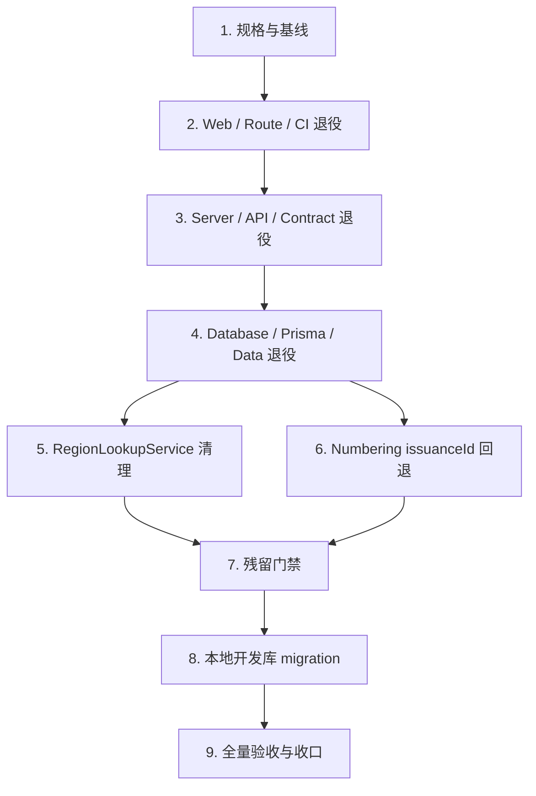

# 供应商字典化与独立模块退役实施任务

## 1. 文档状态

- 状态：Phase 4 实施中，Task 5 已完成，Task 6 待执行
- Requirements 确认日期：2026-08-09
- Design 确认日期：2026-08-09
- 任务计划编写日期：2026-08-09
- Phase 3 Gate 确认日期：2026-08-09
- 实施分支：`refactor/supplier-to-dictionary`
- 基线分支：`main`
- 基线 SHA：`a41e7014709ce3adf46ba1c768f653c5de2c34d4`
- Requirements：`specs/supplier-dictionary-migration/requirements.md`
- Design：`specs/supplier-dictionary-migration/design.md`

本文档将已确认的破坏性退役设计拆成 9 个可验证任务。Phase 3 Gate 确认前，不得修改运行时代码、Prisma Schema、公共 API 或数据库，不得删除文件。

## 2. 执行纪律

每个复杂任务遵循同一闭环：

```text
确认当前任务和删除边界
-> 写因旧能力仍存在或新退役能力缺失而失败的测试
-> 记录红测的预期原因
-> 实施最小删除或向前修复
-> 补齐失败关闭和回滚路径
-> 运行任务级验证
-> 审计 diff、敏感信息和 generated 边界
-> 创建可独立构建的绿色小步提交
```

规则：

1. 不提交只有红测、无法构建或契约未同步的中间状态。
2. 文件删除只针对本文档列出的精确路径，不使用宽泛 glob 或破坏性 Git 命令。
3. 不手工编辑 Prisma generated client、OpenAPI snapshot 或 Web generated types；契约仅通过 `node --run contract:sync` 生成。
4. 数据库退役先在一次性隔离 PostgreSQL 16 中完整重放和验证，不先对本地开发库试错。
5. 本地开发库在 Task 8 前只读；若实际对象或计数与冻结快照不同，必须停止并重新确认。
6. 每次提交前执行 `git diff --cached --name-only`、`git diff --cached --check` 和 `git diff --cached --stat`，不提交 `.env`、日志、构建产物、生成目录或根依赖违规产物。
7. Commit Message 类型使用英文，描述使用中文。
8. 命令失败必须报告真实原因，不跳过、隐藏或将未验证结果宣称为通过。
9. 未授权 push、PR、merge、部署、分支删除或 Git 历史重写。

## 3. 阶段门禁

### Gate A - Phase 4 与 Git

- [x] 用户确认本 Phase 3 任务计划并授权进入 Phase 4。
- [x] 已从干净 `main@a41e7014709ce3adf46ba1c768f653c5de2c34d4` 创建 `refactor/supplier-to-dictionary`。
- [x] 当前 `HEAD == main == origin/main` 的冻结 SHA。
- [x] 授权按第 7 节计划创建本地小步提交。
- [x] 未授权 push、PR、merge、部署或分支删除。

### Gate B - 删除、Schema、API 与本地数据库

Phase 4 必须得到用户对以下整包破坏性边界的明确确认：

- [x] 删除 Supplier Server/Web 运行时、页面、路由、领域测试、Browser runner 和 CI Job 文件。
- [x] 删除六个 Supplier 公共 operation、四条 API path、14 个 Supplier Schema 和四个 `SUPPLIER_*` Audit enum label。
- [x] 修改 `server/prisma/schema.prisma`，并新增 `20260809090000_supplier_domain_retirement` forward migration。
- [x] 在 migration 中删除 Supplier 两张表、函数、Trigger、enum、五项权限及授权。
- [x] 删除 `SUPPLIER` Rule 及全部 Version、Segment、PeriodState、Issuance ledger，以及所有 Supplier/Rule Audit。
- [x] 只对本地开发容器 `qianshu-dms-dev-postgres` (`127.0.0.1:15433`) 执行新 migration；不得对任何其他数据库执行。

2026-08-09 只读冻结快照为：

```text
migrations applied:              10/10
Supplier / create request:       1 / 2
Supplier permissions / grants:   5 / 5
SUPPLIER rule hierarchy:         1 rule / 1 version / 5 segments
SUPPLIER state / issuance:       1 / 1
Supplier-related Audit:          5 (2 business + 3 rule lifecycle)
target Dictionary Type / Items:  0 / 0
```

Task 8 必须重新只读获取这些值；任何漂移都不得被当作已授权的扩大删除范围。

### Gate C - 范围扩展

出现以下任一情况必须暂停并重新确认：

- 修改 DictionaryType/DictionaryItem 公共结构、Catalog 语义或字典页面设计。
- 修改非 Supplier Numbering/Audit 数据、enum label 或不可变契约。
- 删除或改写旧 Supplier migration、Prisma migration ledger、Git commit、PR 或 CI 历史。
- 使用 `CASCADE`、`DISABLE TRIGGER ALL/USER`、`session_replication_role` 或其他全局绕过。
- 新增第三方依赖、公共组件、Store、缓存、兼容 API 或旧 URL 重定向。
- 对非本地数据库执行 migration，push、PR、merge、部署或修改分支保护。

## 4. 依赖与绿色提交顺序



顺序不可随意交换：

1. 先删除 Web 消费方，Server API 暂时保留，Web 仍可独立构建。
2. 再删除 Server API 和 Supplier 运行时，此时数据库对象暂作为无消费方历史结构，Server/Web 仍可构建。
3. 随后追加 forward migration 并删除 Prisma 对象，因为已无 Supplier 运行时引用，可在不制造编译断层的情况下完成物理退役。
4. `RegionLookupService` 与 Numbering `issuanceId` 在 Supplier 调用方删除后分别作为独立绿色提交清理，不把两个通用模块的回退混入数据库提交。
5. 每个代码提交都必须在当前中间状态下绿色，不以“下一个提交会修复”为理由提交失败状态。

## 5. 实施任务

### Task 1 - 固化规格、取代标记与绿色基线

状态：已完成（2026-08-09）。

目标：把 Requirements、Design 和 Tasks 固定为实施真相源，不修改运行时或数据库。

TDD/步骤：

- [x] 核对 `HEAD == main == origin/main == a41e7014709ce3adf46ba1c768f653c5de2c34d4` 且工作区除本规格外无其他修改。
- [x] 将 `specs/supplier-management/{requirements,design,tasks}.md` 标记为已由本规格取代，不删除或改写原历史内容。
- [x] 运行 Root、Server、Contract、Web 和双端 Build 基线，记录任何既有失败。
- [x] 更新本文档 Task 1 验证记录，只暂存规格和取代标记。

验证：

```bash
node --run test:root
pnpm -C server check
node --run contract:check
pnpm -C web check
pnpm -C server build
pnpm -C web build
git diff --check
```

验证记录（2026-08-09）：

- `node --run test:root`：`654/654` 通过。
- `pnpm -C server check`：Prisma validate、TypeScript、ESLint 通过；Jest `148/148` suites、`1442/1442` tests 通过。
- `node --run contract:check`：退出码 `0`，Server OpenAPI 生成与 Web API 类型临时生成均通过。
- `pnpm -C web check`：Node `166/166`、TSX `49/49`、API/View `740/740`，共 `955/955` 通过；TypeScript、Vue TypeScript、ESLint、Stylelint 通过。
- `pnpm -C server build`：Prisma Client 生成与 Nest build 通过。
- `pnpm -C web build`：Vite production build、Noto 字体与 zero-residue 校验通过；仅出现既有第三方 annotation、chunk size 和 timing 非阻断提示。
- `git diff --check`：通过；旧 Supplier migration SHA-256 保持 `9f18a1f0e980fadd384e27985a872b099e1f210fd729b96eeed0872f5e8b284e`。

提交：`docs: 固化供应商字典化与退役规格`。

### Task 2 - 退役 Web 入口、领域页面与 Supplier Browser CI

状态：已完成（2026-08-09）。

目标：先删除 Supplier Web 消费方和专属 Browser Job，保留字典页面与其他七个 validation jobs。

TDD：

- [x] 先新增/更新反回归测试，使其因 ServiceProvider 路由、Supplier 页面/权限、package script 和第八个 Browser Job 仍存在而失败。
- [x] 记录红测只指向旧 Supplier Web/CI 能力，不修改字典 UI 或其他 Browser Job。

实施：

- [x] 删除 `web/apps/qsmds-arco/src/api/modules/suppliers.ts`。
- [x] 删除 `web/apps/qsmds-arco/src/router/modules/service.provider.ts`。
- [x] 删除 `web/apps/qsmds-arco/src/views/system/service-provider/suppliers/` 全目录。
- [x] 删除 Supplier API、Route、View、logic、component、Browser 和 helper 测试文件。
- [x] 从 `router/routes.ts` 删除 ServiceProvider 注册和首页权限展开，从 Web 权限目录删除一个 Supplier resource label；五个仍由 Server 暴露的 permission code 留到 Task 4 原子删除。
- [x] 删除根/Web Supplier scripts、`scripts/ci-browser-suppliers-e2e.mjs`、其测试和 Workflow Job。
- [x] 恢复 `ci-browser-dictionaries-e2e.mjs` 无参数 runner 边界，删除只为 Supplier runner 增加的注入选项。
- [x] 更新 workflow/root/workspace/system-management 治理测试，精确断言七个 validation jobs 加 `ci-gate`。

验收：

- `/system/service-provider/suppliers` 和空“合作供方”父路由不存在。
- 旧 URL 交给现有 catch-all，不新增 redirect 或兼容页。
- `/system/basic-data/dictionaries` 路由、页面、暗色和移动端契约不变。
- Workflow 总 Job 数为 8，`ci-gate.needs` 只含七个 validation jobs。

定向验证：

```bash
node --test \
  scripts/ci-browser-dictionaries-e2e.test.mjs \
  scripts/ci-workflows.test.mjs \
  scripts/root-governance.test.mjs
node --test web/scripts/workspace-scripts.test.mjs
pnpm -C web exec tsx --test \
  apps/qsmds-arco/test/api/system-management-routes.test.ts \
  apps/qsmds-arco/test/views/system-management.test.ts
pnpm -C web check
pnpm -C web build
node --run test:root
```

验证记录（2026-08-09）：

- TDD 红测：Root 定向 `85` 项中 `7` 项按预期失败；Web route/view `2` 项、workspace script `2` 项按预期失败，原因仅为旧 Supplier 路由、资源、脚本、runner 与 CI Job 仍存在。
- Root 定向测试：`85/85` 通过；`node --run test:root`：`652/652` 通过。
- Web 定向测试：route/view `49/49`、workspace scripts `9/9` 通过。
- `pnpm -C web check`：共 `921/921` 通过，TypeScript、Vue TypeScript、ESLint、Stylelint 通过。
- `pnpm -C web build`：Vite production build、Noto 字体和 zero-residue 通过，正式产物无 Supplier/ServiceProvider 残留。
- `node --run ci:browser-auth-e2e`：真实 Chrome `2/2` 通过；Task 4 前暂留的五个 Server Supplier permission code 与当前 API 一致。
- `node --run ci:browser-dictionaries-e2e`：真实 Chrome `1/1` 通过，既有字典生命周期、权限、移动端与无障碍能力保持绿色。
- `git diff --check` 通过；Server、Prisma、OpenAPI 和 lockfile 均无变更。

提交：`refactor: 退役供应商前端入口与专属门禁`。

### Task 3 - 退役 Supplier Server 运行时、公共 API 与 Contract

状态：已完成（2026-08-09）。

目标：删除可执行 Supplier 领域服务和六个 API；本任务不删除数据库对象，也不同时修改 Region/Numbering 通用模块。

TDD：

- [x] 先让 App/HTTP 模块测试要求 `SuppliersModule` 不存在，在 `server/test/app.e2e-spec.ts` 要求六个匿名旧请求均为 unknown-route `404`。
- [x] 先为六个 retired operationId 写 Contract 红测：允许从 baseline 缺失、拒绝其他缺失、拒绝 retired ID 重现。

实施：

- [x] 删除 `server/src/modules/suppliers/` 全目录。
- [x] 删除 `server/test/supplier-management-api.e2e-spec.ts` 和 `server/test/supplier-e2e-database.ts`；保留 Supplier Schema 测试到 Task 4 替换。
- [x] 从 `server/src/http.modules.ts` 删除 Supplier 模块注册。
- [x] 在 `scripts/openapi-contract.mjs` 中增加六项精确 retired operationId 治理，并更新 unit/integration tests；不使用 wildcard、prefix、环境变量或 CI-only waiver。
- [x] 在 `scripts/openapi-contract.test.mjs` 和 `scripts/contract-check.test.mjs` 验证无 baseline/有 baseline 两条真实命令链。
- [x] 通过 `node --run contract:sync` 删除四条 Supplier path、六个 operationId 和 14 个 Supplier Schema。

验收：

- Supplier Controller、DTO、Command、Query、Lifecycle、Normalizer、Persistence、Region validation 和 Idempotency 运行时完全不存在。
- 旧 API 不匹配路由，不返回 `401/403`、空列表或兼容响应。
- Contract baseline 只允许六个已退役 ID 消失；无 baseline 的 sync/check 也会拒绝它们重现。
- Region/Numbering 通用实现在本提交中不变，由 Task 5/6 分别清理已无调用方的扩展。

定向验证：

```bash
pnpm -C server prisma:generate
pnpm -C server exec jest --runInBand --runTestsByPath \
  src/app.module.spec.ts
node ./scripts/ci-postgres.mjs -- \
  pnpm -C server exec jest \
  --config test/jest-e2e.json \
  --runInBand \
  --runTestsByPath test/app.e2e-spec.ts
node --test \
  scripts/openapi-contract.test.mjs \
  scripts/contract-check.test.mjs
node --run contract:sync
node --run contract:check
pnpm -C server check
pnpm -C server build
pnpm -C web check
pnpm -C web build
```

验证记录（2026-08-09）：

- TDD 红测：模块单测因 `HTTP_MODULES` 仍注册 `SuppliersModule` 失败；六个旧 API 分别返回 `401/403` 而非 `404`；Contract 六项退役/重现测试按预期失败。
- App module 单测 `3/3`、隔离 App E2E `9/9` 通过；六个匿名旧 URL 均返回精确 `404 NOT_FOUND`。
- Contract 定向测试 `180/180` 通过；退役清单冻结且由独立字面量锁死为六项，近似名称与清单外删除仍失败。
- `node --run contract:sync` 与 `node --run contract:check` 通过；Server/Web snapshot 字节一致。
- 生成契约精确为 `52 paths / 69 operations / 80 schemas`，无四条 Supplier path、六个 operationId 或 14 个 Supplier Schema；四个 `SUPPLIER_*` Audit label 仍保留到 Task 4。
- `pnpm -C server check`：`139/139` suites、`1367/1367` tests 通过；Server build 通过。
- `node --run ci:server-e2e`：全部 10 条现有 migration 首次重放、二次 deploy、status 及 `24/24` suites、`120/120` tests 通过。
- `node --run test:root`：`660/660` 通过；`pnpm -C web check`：`921/921` 通过；Web build 通过。
- 独立 code review 无阻断；Region、Numbering、Prisma、permission 与旧 Supplier migration 均未修改。

提交：`refactor: 退役供应商服务端与公共接口`。

### Task 4 - 退役 Prisma Schema、物理数据与 Supplier 治理契约

状态：已完成（2026-08-09）。

目标：在隔离 PostgreSQL 中实现和验证单事务 forward migration，使最终 Prisma/DB 只保留空且停用的供应商字典 Type。

TDD：

- [x] 将旧 static Supplier Schema 测试替换为 `supplier-retirement-schema.spec.ts`，先证明新 migration 缺失、Prisma 仍有 Supplier、旧 migration 指纹未被锁定。
- [x] 将旧 PostgreSQL Supplier Schema E2E 替换为 `supplier-retirement-migration.e2e-spec.ts`，先覆盖空库 replay、有数据升级、Type 冲突回滚和未知依赖晚期回滚。
- [x] 先让 Auth/AccessControl/Dictionary schema 测试要求权限 `42 → 37`、Audit enum `44 → 40` 和五个 Supplier 权限消失。
- [x] 在 `dictionary-catalog-api.e2e-spec.ts` 先要求 Catalog 可读取停用且零 Item 的 `service_provider.supplier`。

实施：

- [x] 新增 `server/prisma/migrations/20260809090000_supplier_domain_retirement/migration.sql`，严格实现 Design 第 5 节的锁序、前置检查、精确删除、Trigger 恢复、enum 重建和最终自检。
- [x] 从 Prisma 删除 `SupplierEntityType`、`Supplier`、`SupplierCreateRequest`、Region 反向关系、NumberingIssuance 关系和四个 `SUPPLIER_*` Audit label。
- [x] 删除五个 Server Supplier 权限常量，同步 Auth/AccessControl 与 Dictionary schema 测试。
- [x] 删除旧 `supplier-schema` static/E2E，新增退役 static/E2E；旧 Supplier migration 必须保留且 SHA-256 严格为 `9f18a1f0e980fadd384e27985a872b099e1f210fd729b96eeed0872f5e8b284e`。
- [x] 把旧 Supplier 与新 retirement migration 追加到 Dictionary 隔离数据库的完整重放集合，并通过 Catalog API 验证目标 Type。
- [x] 更新 `docs/后端文档/数据库迁移规范.md`：11 条 migration、19 个最终 model，同时记录旧 Supplier migration 与新 retirement migration。
- [x] 再次运行 `contract:sync`，从 Audit API/OpenAPI 移除四个 Supplier enum label。

PostgreSQL 成功验收：

- `service_provider.supplier` 固定 Type 唯一、`enabled=false`、`version=1`、零 Item。
- Supplier 两表、两函数、两 Trigger、`supplier_entity_type`、五权限/授权均不存在。
- `SUPPLIER` Rule/Version/Segment/PeriodState/Issuance 和全部 Supplier/Rule Audit 均为零。
- Audit enum 精确等于原顺序移除四个 Supplier label，索引 `indisvalid=true`且 `indisready=true`。
- 四个 Numbering Trigger 恢复 `tgenabled='O'`，非 Supplier Numbering/Audit/权限/字典/地区 canary 逐字段不变。
- Type/ID 冲突、Trigger/enum 漂移、consumer/rule 错配和未知依赖均整体回滚。

定向验证：

```bash
pnpm -C server prisma:validate
pnpm -C server prisma:generate
pnpm -C server exec jest --runInBand --runTestsByPath \
  src/infrastructure/database/supplier-retirement-schema.spec.ts \
  src/infrastructure/database/dictionary-schema.spec.ts \
  src/modules/access-control/access-control.service.spec.ts
node ./scripts/ci-postgres.mjs -- \
  pnpm -C server exec jest \
  --config test/jest-e2e.json \
  --runInBand \
  --runTestsByPath \
  test/supplier-retirement-migration.e2e-spec.ts \
  test/auth-schema.e2e-spec.ts \
  test/dictionary-schema.e2e-spec.ts \
  test/dictionary-catalog-api.e2e-spec.ts
pnpm -C server check
pnpm -C server build
node --run contract:sync
node --run contract:check
node --run ci:server-e2e
```

验证记录（2026-08-09）：

- 初始 static 红测因退役 migration 尚不存在、Prisma 仍有 `21` 个 model/`44` 个 Audit label、权限仍为 `42` 项而按预期失败；初始隔离 DB 红测 `5/5` 因 migration 缺失而失败，Catalog 对目标 code 返回 `404`。
- 安全复审新增 rewrite-rule 失败关闭场景：static 红测 `2/8`、真实 `ON DELETE DO ALSO` E2E 红测 `1/1`，证明原实现会放过外部副作用；补充 `pg_rewrite` 门禁后 static `8/8` 和完整回滚场景转绿。
- 退役 static、Dictionary schema 与 AccessControl 定向验证共 `23/23` 通过；旧 Supplier migration SHA-256 保持 `9f18a1f0e980fadd384e27985a872b099e1f210fd729b96eeed0872f5e8b284e`。
- `supplier-retirement-migration.e2e-spec.ts` 在一次性 PostgreSQL 16 中 `20/20` 通过，覆盖空库 replay、有数据升级、精确舍弃 Supplier 数据、Type/权限/Trigger/enum/consumer/provenance/Audit 漂移、跨 Schema FK、未知依赖、rewrite rule 和晚期失败的整事务回滚。
- 完整 E2E 首次运行暴露测试隔离缺陷：Dictionary Type 冲突回滚断言未按 Schema 限定同名 enum，得到 `84` 而非当前隔离 Schema 的 `44`；加入 `current_schema()` 限定后，退役 E2E 重新 `20/20` 通过。
- `node --run ci:server-e2e` 最终通过：11 条 migration 首次部署、二次 deploy 无待执行项、status 最新，Jest `24/24` suites、`140/140` tests 通过；全程只使用一次性隔离 PostgreSQL，未写本地持久数据库。
- `pnpm -C server check`：Prisma validate、TypeScript、ESLint 通过，Jest `139/139` suites、`1371/1371` tests 通过；Server build 通过。
- `node --run contract:sync` 与 `node --run contract:check` 通过；Server/Web snapshot 字节一致，仍为 `52 paths / 69 operations / 80 schemas`，diff 仅从两处 Audit enum 精确移除四个 `SUPPLIER_*` label。
- `node --run test:root`：`660/660` 通过；`pnpm -C web check`：`921/921` 通过；Server/Web build 均通过，Web 仅有既有第三方 annotation、chunk size 和 timing 非阻断提示。
- 独立 SQL 终审无阻断；最终 Prisma 为 `19` 个 model、Audit enum `40` 项、管理权限 `37` 项，目标字典 Type 固定为空且停用。

提交：`refactor: 退役供应商数据结构与关联数据`。

### Task 5 - 删除无调用方的 RegionLookupService

状态：已完成（2026-08-09）。

目标：在 Supplier 调用方已全部删除后，回收只为 Supplier 引入的事务内地区查询扩展，不改变其他 Region 契约。

TDD/实施：

- [x] 先修改 `regions.module.spec.ts`，要求 providers/exports 不再包含 `RegionLookupService`。
- [x] 确认生产调用方数量为零；若发现非 Supplier 调用方，触发 Gate C 而不删除。
- [x] 删除 `region-lookup.service.ts` 和 `region-lookup.service.spec.ts`，更新 `regions.module.ts` 与模块测试。
- [x] 保留 Region Controller、Query、Command、Schema、Selector 和全部现有公共 API。

定向验证：

```bash
pnpm -C server prisma:generate
pnpm -C server exec jest --runInBand --runTestsByPath \
  src/modules/regions/regions.module.spec.ts \
  src/infrastructure/database/region-schema.spec.ts
pnpm -C server check
pnpm -C server build
```

验证记录（2026-08-09）：

- 只读调用面审计确认生产调用方为 `0`，历史消费者仅位于已在 Task 3 删除的 Supplier 模块；未发现触发 Gate C 的非 Supplier 调用方。
- TDD 红测精确为 `2` 项失败、`1` 项通过：失败项分别证明 `RegionsModule` 仍注册该 provider、源文件仍存在；HTTP 模块注册保持绿色。
- 删除后 Region 定向验证 `2/2` suites、`9/9` tests 通过；模块只保留 `RegionQueryService`、`RegionCommandService` 和两个既有 Controller，不再声明 exports。
- `pnpm -C server check` 通过：Prisma validate、TypeScript、ESLint 全绿，Jest `138/138` suites、`1366/1366` tests 通过；减少的测试恰好来自删除的专属 lookup spec。
- `pnpm -C server build` 与 `node --run contract:check` 通过；构建产物无已删除 lookup 文件，Prisma、数据库 Schema、权限与 OpenAPI 均未修改，Region 公共契约保持不变。
- `node --run test:root`：`660/660` 通过；生产源码和 Server 测试均无 `RegionLookupService`、`LockedRegionReference` 或 `lockReferences(...)` 残留，diff 精确为两个删除、两个模块修改和本任务记录。

提交：`refactor: 移除供应商专属地区查询扩展`。

### Task 6 - 恢复 NumberingGenerator 通用返回边界

状态：待执行；可与 Task 5 并行开发，但顺序提交。

目标：移除只为 Supplier 回传的 ledger UUID，保留发号器的顺序/随机生成、幂等 replay、并发恢复和永久 ledger。

TDD/实施：

- [ ] 先让 Generator/Persistence unit 与 E2E 要求返回结果只包含生成编号和 replay 状态，不暴露 `issuanceId`。
- [ ] 从 `GenerateNumberResult` 和 idempotent read result 移除 `issuanceId`。
- [ ] 将 `insertSequenceIssuance` 恢复为 `void`，`tryInsertRandomIssuance` 恢复为 `boolean`。
- [ ] 删除只验证 ledger UUID 返回的 fixture/断言，保留真实 ledger 行、幂等、唯一竞态和周期状态断言。

定向验证：

```bash
pnpm -C server prisma:generate
pnpm -C server exec jest --runInBand --runTestsByPath \
  src/modules/numbering/numbering-generator.persistence.spec.ts \
  src/modules/numbering/numbering-generator.service.spec.ts
node ./scripts/ci-postgres.mjs -- \
  pnpm -C server exec jest \
  --config test/jest-e2e.json \
  --runInBand \
  --runTestsByPath test/numbering-generator.e2e-spec.ts
pnpm -C server check
pnpm -C server build
node --run ci:browser-numbering-e2e
```

提交：`refactor: 恢复发号器通用返回边界`。

### Task 7 - 固化 Supplier 运行时残留门禁

状态：待 Task 5/6 绿色完成。

目标：用机器可执行的精确白名单防止 Supplier 路由、权限、发号和组件在未来被静默恢复，同时允许必须保留的审计历史。

TDD/实施：

- [ ] 先在 `scripts/root-governance.test.mjs` 写精确残留测试，对 Git tracked 及未忽略的待纳入文件执行大小写不敏感 `supplier|service[._ /-]?provider` 匹配，不让检查结果依赖“是否已暂存”。
- [ ] 断言命中文件集合精确等于第 6 节的 18 文件白名单，不使用目录级宽泛跳过。
- [ ] 另外断言 Regions 不含 `RegionLookupService`、Numbering Generator 源码/测试/E2E 不含 `issuanceId`、Dictionary production runner 恢复无参入口。
- [ ] 用临时 fixture 证明白名单外的 Supplier 文本会让治理测试失败，而旧 migration/retirement 证据不会误报。

定向验证：

```bash
node --test \
  scripts/root-governance.test.mjs \
  scripts/openapi-contract.test.mjs \
  scripts/contract-check.test.mjs \
  scripts/ci-browser-dictionaries-e2e.test.mjs
node --run test:root
```

提交：`test: 固化供应商退役残留边界`。

### Task 8 - 受控应用本地开发库 migration

状态：待 Task 7 绿色完成，且 Gate B 明确授权。

目标：仅对 `qianshu-dms-dev-postgres` 应用已验证的 forward migration，丢弃用户已确认的本地 Supplier、Numbering 和 Audit 数据。

执行前：

- [ ] 停止本地 Server 写流量，确认没有运行中的编辑/发号请求。
- [ ] 只读确认容器名、PostgreSQL 16、loopback 端口、当前 database/schema 和 `prisma migrate status`，不输出连接串或密码。
- [ ] 重新计数 Supplier、Request、Permission/Grant、Rule 层级、Issuance、Audit 和目标 Dictionary，与 Gate B 快照不同则停止。
- [ ] 确认 Task 4 的隔离 replay、回滚矩阵、Server check/build 和 `ci:server-e2e`，以及 Task 5/6/7 验证全部绿色。

执行：

```bash
pnpm -C server exec prisma migrate status
pnpm -C server db:migrate:deploy
pnpm -C server exec prisma migrate status
```

执行边界：

- 不使用 `migrate dev`、`db push`、`migrate reset`、`migrate resolve`、手工改 ledger 或 SQL 绕过。
- 命令超时、连接中断或结果不明时，先只读确定事务与 `_prisma_migrations` 状态，不盲目重跑。
- 不创建 Supplier 归档表、JSON 副本或专属备份；成功提交后没有 down migration，Git revert 不能恢复被删数据，只能依赖执行前已存在的数据库备份。
- Task 8 不创建 Git 提交；只把不含敏感信息的计数和 migration 状态记入验收文档。

执行后必须只读验证：

- 新 migration 恰好一条 `finished_at` 非空、`rolled_back_at` 为空的 ledger 记录。
- 空且停用字典 Type 存在，Supplier/Permission/Numbering/Audit 目标均归零。
- 其他 Numbering/Audit 计数与执行前控制组一致，四个 Numbering Trigger 仍 enabled。

### Task 9 - 全量验收、残留审计与 Git 收口

状态：待 Task 8 成功并确认本地数据库终态。

目标：证明最终代码、契约、Schema、CI 和本地开发库一致，且不影响字典、认证及其他管理能力。

全量验证：

```bash
node --run contract:sync
node --run test:root
pnpm -C server check
node --run contract:check
pnpm -C web check
pnpm -C server build
pnpm -C web build
node --run ci:server-e2e
node --run ci:browser-auth-e2e
node --run ci:browser-dictionaries-e2e
node --run ci:browser-numbering-e2e
node --run ci:browser-regions-e2e
node --run check
git diff --check
git status --short --branch
```

残留审计：

- [ ] 运行时 Server/Web、Prisma Schema、package scripts 和 Workflow 不含 Supplier 模块、路由、权限、发号或 Audit 能力。
- [ ] Supplier 文本只允许出现在：旧 migration、已取代规格、新 retirement migration/测试/规格，以及六个 retired operationId 治理证据。
- [ ] 旧 Supplier migration SHA-256 仍为 `9f18a1f0e980fadd384e27985a872b099e1f210fd729b96eeed0872f5e8b284e`。
- [ ] Server/Web OpenAPI snapshot 逐字节一致，不含 Supplier path/schema 和四个 Supplier Audit label。
- [ ] `CI gate` 只汇总七个 validation jobs，Supplier Browser script/Job 不存在。
- [ ] 无 `.env`、密钥、连接串、日志、生成目录、构建产物或根依赖违规产物被纳入。

文档收口：

- [ ] 把 Requirements/Design/Tasks 状态和任务验证记录更新为实际结果。
- [ ] 不将 push、PR、merge、部署或分支删除记为完成。

提交：`docs: 记录供应商退役验收结果`。

## 6. 精确删除与保留矩阵

最终预期文件矩阵：新增 6、修改 40、删除 45。计数是审计辅助，精确路径和内容边界才是真相源；若实施中发现矩阵外文件，必须先解释并判断是否触发 Gate C。

### 删除

```text
server/src/modules/suppliers/**
server/src/modules/regions/region-lookup.service.ts
server/src/modules/regions/region-lookup.service.spec.ts
server/src/infrastructure/database/supplier-schema.spec.ts
server/test/supplier-e2e-database.ts
server/test/supplier-management-api.e2e-spec.ts
server/test/supplier-schema.e2e-spec.ts

web/apps/qsmds-arco/src/api/modules/suppliers.ts
web/apps/qsmds-arco/src/router/modules/service.provider.ts
web/apps/qsmds-arco/src/views/system/service-provider/suppliers/**
web/apps/qsmds-arco/test/api/service-provider-routes.test.ts
web/apps/qsmds-arco/test/api/suppliers.test.ts
web/apps/qsmds-arco/test/browser/suppliers.browser.*
web/apps/qsmds-arco/test/views/supplier-*.test.ts

scripts/ci-browser-suppliers-e2e.mjs
scripts/ci-browser-suppliers-e2e.test.mjs
```

### 新增

```text
server/prisma/migrations/20260809090000_supplier_domain_retirement/migration.sql
server/src/infrastructure/database/supplier-retirement-schema.spec.ts
server/test/supplier-retirement-migration.e2e-spec.ts
specs/supplier-dictionary-migration/requirements.md
specs/supplier-dictionary-migration/design.md
specs/supplier-dictionary-migration/tasks.md
```

### 修改

删除 Supplier delta 并恢复合入前运行边界的 26 个文件：

```text
.github/workflows/ci.yml
package.json
scripts/ci-browser-dictionaries-e2e.mjs
scripts/ci-workflows.test.mjs
server/openapi/openapi.json
server/prisma/schema.prisma
server/src/http.modules.ts
server/src/modules/access-control/permission.constants.ts
server/src/modules/access-control/access-control.service.spec.ts
server/src/modules/numbering/numbering-generator.persistence.ts
server/src/modules/numbering/numbering-generator.persistence.spec.ts
server/src/modules/numbering/numbering-generator.service.ts
server/src/modules/numbering/numbering-generator.service.spec.ts
server/src/modules/regions/regions.module.ts
server/src/modules/regions/regions.module.spec.ts
server/test/auth-api.e2e-spec.ts
server/test/auth-schema.e2e-spec.ts
server/test/numbering-generator.e2e-spec.ts
web/apps/qsmds-arco/src/router/routes.ts
web/apps/qsmds-arco/src/views/system/permissions/catalog.ts
web/apps/qsmds-arco/test/api/system-management-routes.test.ts
web/apps/qsmds-arco/test/browser/management.browser.test.mjs
web/apps/qsmds-arco/test/views/system-management.test.ts
web/openapi/openapi.json
web/package.json
web/scripts/workspace-scripts.test.mjs
```

保留通用健壮性改进或新增退役治理的 14 个文件：

```text
docs/后端文档/数据库迁移规范.md
scripts/root-governance.test.mjs
scripts/openapi-contract.mjs
scripts/openapi-contract.test.mjs
scripts/contract-check.test.mjs
server/src/infrastructure/database/dictionary-schema.spec.ts
server/src/infrastructure/database/region-schema.spec.ts
server/test/app.e2e-spec.ts
server/test/management-api.e2e-spec.ts
server/test/dictionary-e2e-database.ts
server/test/dictionary-catalog-api.e2e-spec.ts
specs/supplier-management/requirements.md
specs/supplier-management/design.md
specs/supplier-management/tasks.md
```

其中 `region-schema.spec.ts` 保留通用 regex 健壮化，`management-api.e2e-spec.ts` 保留动态权限数量断言，`dictionary-schema.spec.ts` 保留 permission slice 写法并只将 Audit 总数恢复为 40；不为了“看起来像回退”而删除这些与 Supplier 运行时无关的改进。

### 必须保留

```text
server/prisma/migrations/20260805090000_supplier_management_schema_and_permissions/migration.sql
specs/supplier-management/requirements.md
specs/supplier-management/design.md
specs/supplier-management/tasks.md
server/src/modules/dictionaries/**
server/src/modules/numbering/**
server/src/modules/regions/**  # 除 RegionLookupService 两个精确文件
web/apps/qsmds-arco/src/views/system/basic-data/dictionaries/**
scripts/ci-browser-dictionaries-e2e.mjs
```

### Supplier 文本残留白名单

最终 Git tracked 及未忽略的待纳入文件中，匹配 `supplier|service[._ /-]?provider` 的路径集合必须精确为以下 18 个：

```text
docs/后端文档/数据库迁移规范.md
scripts/root-governance.test.mjs
scripts/openapi-contract.mjs
scripts/openapi-contract.test.mjs
scripts/contract-check.test.mjs
server/prisma/migrations/20260805090000_supplier_management_schema_and_permissions/migration.sql
server/prisma/migrations/20260809090000_supplier_domain_retirement/migration.sql
server/src/infrastructure/database/supplier-retirement-schema.spec.ts
server/test/app.e2e-spec.ts
server/test/dictionary-e2e-database.ts
server/test/dictionary-catalog-api.e2e-spec.ts
server/test/supplier-retirement-migration.e2e-spec.ts
specs/supplier-management/requirements.md
specs/supplier-management/design.md
specs/supplier-management/tasks.md
specs/supplier-dictionary-migration/requirements.md
specs/supplier-dictionary-migration/design.md
specs/supplier-dictionary-migration/tasks.md
```

白名单只保留 migration/规格/退役测试和 operationId 治理证据，不允许任何 Supplier 运行时或兼容能力。

## 7. Git 提交计划

| 顺序 | Commit Message | 边界 | 必须绿色 |
| --- | --- | --- | --- |
| 1 | `docs: 固化供应商字典化与退役规格` | 三份新规格 + 旧规格取代标记 | Root/Server/Contract/Web/Build 基线 |
| 2 | `refactor: 退役供应商前端入口与专属门禁` | Web/Route/Browser/CI | Root + Web check/build + workflow tests |
| 3 | `refactor: 退役供应商服务端与公共接口` | Supplier Server runtime + Contract | Server/Web check/build + Contract + API E2E |
| 4 | `refactor: 退役供应商数据结构与关联数据` | Prisma + forward migration + permissions/Audit + DB docs | migration matrix + Server E2E + Contract |
| 5 | `refactor: 移除供应商专属地区查询扩展` | RegionLookupService | Region unit + Server check/build |
| 6 | `refactor: 恢复发号器通用返回边界` | Numbering `issuanceId` 回收 | Numbering unit/E2E/Browser + Server check/build |
| 7 | `test: 固化供应商退役残留边界` | 18 文件白名单 + 3 个回退 canary | Root governance + Contract + Dictionary runner |
| 8 | `docs: 记录供应商退役验收结果` | 真实验证记录与规格状态 | 第 8 节全部绿色 |

Task 8 的本地数据库 migration 不单独创建 Git commit。任何提交都不授权 push、PR、merge 或部署。

## 8. 最终验证矩阵

```bash
# Root / governance
node --run test:root
node --run check

# Server / Prisma / isolated PostgreSQL
pnpm -C server prisma:validate
pnpm -C server check
pnpm -C server build
node --run ci:server-e2e

# Public contract
node --run contract:sync
node --run contract:check

# Web
pnpm -C web check
pnpm -C web build

# Retained browser coverage
node --run ci:browser-auth-e2e
node --run ci:browser-dictionaries-e2e
node --run ci:browser-numbering-e2e
node --run ci:browser-regions-e2e

# Git / residue
git diff --check
git status --short --branch
```

Phase 3 Gate 确认后才可开始 Task 1；即使 Gate A/B 通过，遇到 Gate C 范围扩展仍必须暂停。
