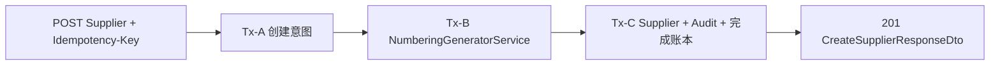

# 供应商管理技术设计

## 1. 文档状态

- 状态：已确认
- 确认日期：2026-08-05
- Requirements：`specs/supplier-management/requirements.md`
- Server：NestJS + Prisma + PostgreSQL
- Web：Vue 3 + Fantastic-admin/Fa/Qs + Tailwind/UnoCSS

## 2. 总体架构

V1 使用单行 `Supplier` 保存主体、一个联系人和一个地址；使用永久 `SupplierCreateRequest` 绑定创建幂等语义；编号继续由现有内部 `NumberingGeneratorService` 生成。



Numbering 自持事务，因此允许 Tx-B 已提交而 Tx-C 失败形成合法断号；重试必须复用原 issuance，不能重新发号。

## 3. 数据模型

### 3.1 SupplierEntityType

```text
ORGANIZATION
INDIVIDUAL
```

### 3.2 Supplier

主要字段：

```text
id UUID PK
code VARCHAR(64) UNIQUE
numberingIssuanceId UUID UNIQUE

legalName VARCHAR(200)
normalizedLegalName VARCHAR(200)
shortName VARCHAR(100) NULL
normalizedShortName VARCHAR(100) NULL
entityType SupplierEntityType

registrationCountryRegionId UUID NULL
registrationNumber VARCHAR(64) NULL
normalizedRegistrationNumber VARCHAR(64) NULL

contactName VARCHAR(128) NULL
normalizedContactName VARCHAR(128) NULL
contactPhone VARCHAR(32) NULL
normalizedContactPhone VARCHAR(32) NULL
contactWechatId VARCHAR(64) NULL
normalizedContactWechatId VARCHAR(64) NULL

addressCountryRegionId UUID NULL
addressProvinceStateId UUID NULL
addressCityId UUID NULL
addressLine VARCHAR(500) NULL
postalCode VARCHAR(32) NULL

remark VARCHAR(1000) NULL
enabled BOOLEAN DEFAULT false
version INTEGER DEFAULT 1
createdAt TIMESTAMPTZ
updatedAt TIMESTAMPTZ
```

约束：

- `id/code/numberingIssuanceId` 创建后不可变。
- 登记国家、登记号及其 normalized 值同时为空或同时有值。
- `(registrationCountryRegionId, normalizedRegistrationNumber)` 唯一。
- 地址 Region 只允许全空、国家、国家+省、完整三级；详细地址和邮编可独立为空。
- `enabled=true` 时，联系人姓名非空且电话或微信至少一项非空。
- `version >= 1`。
- 禁止 DELETE。
- Region 和 Numbering 外键均使用 `ON DELETE RESTRICT ON UPDATE RESTRICT`。

### 3.3 SupplierCreateRequest

```text
id UUID PK
idempotencyScopeHash BYTEA UNIQUE
requestFingerprintHash BYTEA
supplierId UUID NULL UNIQUE
createdAt TIMESTAMPTZ
```

- 两个 Hash 固定 32 bytes。
- 不保存原始 key 或业务 payload。
- `id/scopeHash/fingerprintHash/createdAt` 不可修改。
- `supplierId` 只允许一次 `NULL -> UUID`。
- 禁止 DELETE。

### 3.4 Numbering provenance

内部 `GenerateNumberResult` 增加 `issuanceId`。Supplier Trigger 校验：

```text
NumberingRule.ruleCode = SUPPLIER
NumberingIssuance.consumerCode = SUPPLIER.CREATE
NumberingIssuance.generatedNumber = Supplier.code
```

不增加公共 generate API。

## 4. 规范化与幂等

- 所有显示文本先 NFC + trim；可选空白统一存为 `NULL`。
- 名称搜索值使用固定 locale lowercase 和空白规范化。
- 登记号搜索值使用 NFKC、删除 Unicode 空白并 uppercase，保留标点。
- 电话不强制 E.164，不设唯一；搜索值删除展示性分隔符。
- 微信号只做 NFC/trim/lowercase 搜索，不套用当前注册正则。
- `Idempotency-Key` 必须为 canonical lowercase UUID v4。
- `scopeHash = SHA-256(version + actorUserId + endpoint + key)`。
- `fingerprintHash = HMAC-SHA-256(key, versioned canonical normalized payload)`。
- 不新增专用环境密钥；UUID v4 的高熵是该边界成立的前提。
- 传入 Numbering 的内部幂等值绑定 actor 和公共 key，长度保持在现有 200-byte 上限内。

## 5. 事务与锁序

### 5.1 Create

```text
Normalize / validate
Tx-A: timeout -> insert/lock create request -> precheck
Tx-B: NumberingGeneratorService.generate(SUPPLIER, SUPPLIER.CREATE)
Tx-C: timeout -> create request FOR UPDATE
      -> replay if completed
      -> Region UUID ASC FOR KEY SHARE
      -> NumberingIssuance FOR KEY SHARE
      -> duplicate precheck
      -> INSERT Supplier
      -> INSERT AuditEvent
      -> complete SupplierCreateRequest
      -> read response
```

### 5.2 Update / status

```text
timeout
-> Supplier FOR UPDATE
-> expectedVersion
-> changed Region UUID ASC FOR KEY SHARE
-> domain validation
-> write Supplier
-> write Audit
-> read response
```

先版本、后 no-op；无变化不增版、不写 Audit。

## 6. RegionLookupService

`RegionsModule` 新增并导出业务无关的事务内查询服务：

- 接收调用方 `Prisma.TransactionClient`。
- UUID 去重并在 SQL 内升序 `FOR KEY SHARE`。
- 返回 Region level、parentId、enabled 和 effective 状态。
- Supplier 域负责映射 `SUPPLIER_REGION_INVALID/UNAVAILABLE`。
- 新引用要求有效；未变化的历史停用引用可以保留。
- 不通过 HTTP 自调用，不写 Audit。

## 7. 公共 API

| Method | Path | operationId | Permission |
| --- | --- | --- | --- |
| GET | `/api/suppliers` | `suppliers_list` | `suppliers:read` |
| POST | `/api/suppliers` | `suppliers_create` | `suppliers:create` |
| GET | `/api/suppliers/{supplierId}` | `suppliers_get_by_id` | `suppliers:read` |
| PATCH | `/api/suppliers/{supplierId}` | `suppliers_update` | `suppliers:update` |
| POST | `/api/suppliers/{supplierId}/enable` | `suppliers_enable` | `suppliers:enable` |
| POST | `/api/suppliers/{supplierId}/disable` | `suppliers_disable` | `suppliers:disable` |

Create 使用必需的 `Idempotency-Key` Header；所有写接口要求 CSRF。无 DELETE、Catalog 或 generate。

### 7.1 Request group

```ts
registration?: {
  countryRegionId: string
  number: string
} | null

primaryContact?: {
  name: string | null
  phone: string | null
  wechatId: string | null
} | null

primaryAddress?: {
  countryRegionId: string | null
  provinceStateId: string | null
  cityId: string | null
  addressLine: string | null
  postalCode: string | null
} | null
```

PATCH 中分组省略表示不修改，`null` 表示清空，对象表示完整替换；`expectedVersion` 必填。

### 7.2 List minimization

列表只返回身份、主体、登记摘要、联系人姓名和渠道布尔值、Region 名称路径、状态、版本和更新时间。完整登记号、电话、微信、详细地址、邮编和备注只在详情返回。

### 7.3 Errors

```text
404 SUPPLIER_NOT_FOUND
409 SUPPLIER_IDEMPOTENCY_CONFLICT
409 SUPPLIER_REGISTRATION_ALREADY_EXISTS
409 SUPPLIER_STATE_CHANGED
422 SUPPLIER_REGION_INVALID
422 SUPPLIER_REGION_UNAVAILABLE
422 SUPPLIER_ENABLE_REQUIREMENTS_NOT_MET
503 SUPPLIER_NUMBERING_UNAVAILABLE
```

## 8. Audit 与权限

权限：

```text
suppliers:read       ...138
suppliers:create     ...139
suppliers:update     ...140
suppliers:enable     ...141
suppliers:disable    ...142
```

Audit event：

```text
SUPPLIER_CREATED
SUPPLIER_UPDATED
SUPPLIER_ENABLED
SUPPLIER_DISABLED
```

metadata 仅允许 `supplierCode/changedFields/previousVersion/version`。Audit 与业务写同事务。

## 9. Web

### DESIGN SPECIFICATION

1. **Purpose Statement**：为内部管理员提供高密度、可审计的供应商主数据维护界面。页面优先支持快速搜索、详情核验和受控编辑，不承担采购交易工作台职责。
2. **Aesthetic Direction**：Industrial/utilitarian，延续当前 Fantastic-admin 管理后台的克制、高密度和信息优先风格。
3. **Color Palette**：只使用当前主题语义 Token：`background`、`card`、`muted`、`border`、`primary`、`destructive`；不新增原始十六进制色或渐变。
4. **Typography**：使用项目全局 `Noto Sans SC` 与数据语义 `Noto Sans Mono`；不在页面内声明新字体栈。
5. **Layout Strategy**：非居中工作区结构，页面主体为横向管理表格，创建/编辑/详情从右侧 Drawer 进入；移动端切换为纵向卡片和 bottom action Drawer。

### 9.1 Route

```text
/system/service-provider       合作供方，父级权限中立
└── suppliers                  供应商管理，suppliers:read
```

首页读取权限加入独立 `SERVICE_PROVIDER_READ_PERMISSIONS`，不污染“权限体系”父级。

### 9.2 Components

```text
index.vue
supplier-management.logic.ts
supplier-form-drawer.vue       QsGenericDrawer xl
supplier-detail-drawer.vue     QsGenericDrawer lg
supplier-status-change-modal.vue QsGenericModal sm
```

页面拥有 API、权限、Abort、authEpoch、详情读取和 mutation 对账；领域组件只接收 props 并 emit。

### 9.3 Responsive / accessibility

- 使用 `FaPageHeader + FaPageMain + QsGenericTable`。
- 390px 使用卡片和 bottom action Drawer，触控目标至少 44px。
- 状态包含文字，不只依赖颜色。
- 表单提供真实 label、首错聚焦、脏表单保护和焦点恢复。
- 支持深色主题和 reduced motion。
- 创建结果未知时冻结 payload/key，不自动重放。

## 10. Test strategy

- Schema static + isolated PostgreSQL migration replay。
- Numbering issuanceId、RegionLookup、DTO、Normalizer、Query、Command、Controller unit tests。
- Supplier API E2E 覆盖权限、CSRF、生命周期、并发、幂等、Audit 和数据最小化。
- Web API、route、logic、drawer/modal/page tests。
- 真实 Chrome + 隔离 PostgreSQL Browser E2E。
- 独立 `browser-suppliers-e2e` CI Job，CI gate 从 7 增至 8。

## 11. 外部前置

Supplier migration 不 Seed `SUPPLIER` 编号规则。部署前通过已有编号管理 API/UI 只读确认：规则唯一、已启用、存在活动版本、容量可用、下一编号预览非空且长度不超过 64；不得调用 generate 或自动修改规则。
