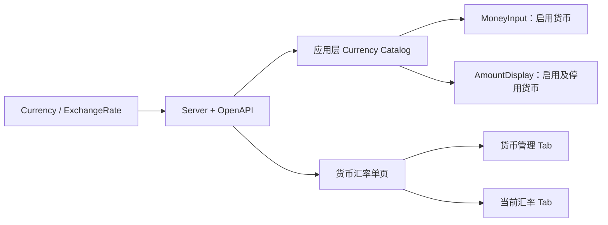

# 系统货币与当前汇率管理技术设计

## 1. 文档状态

- 状态：已确认
- 确认日期：2026-07-29
- 需求文档：`specs/system-currency-management/requirements.md`

## 2. 设计目标

建立固定 CNY 基准、每个非 CNY 一条当前汇率的货币体系；以 Server Currency 数据为生产运行时唯一真相源，同时驱动管理页面、`MoneyInput` 与 `AmountDisplay`。

## 3. 总体架构



基础组件保持 API、Store 和权限无关。应用层 Catalog 负责读取、校验、缓存及映射 Server DTO，组件只消费中立数据。

## 4. 领域不变量

1. 基准币固定为 CNY，不持久化可配置 `isBase`。
2. CNY 始终启用、`minorUnit=2`，且没有 ExchangeRate。
3. 每个非 CNY 最多一条当前 ExchangeRate。
4. 非 CNY 启用时必须已有合法 ExchangeRate。
5. 停用外币保留 ExchangeRate 和历史展示元数据。
6. amount 与 rate 跨公共边界均使用 decimal string。
7. 首期不存在有效期、历史版本或删除接口。

## 5. 数据库设计

### 5.1 Currency

```prisma
model Currency {
  id          String   @id @default(dbgenerated("gen_random_uuid()")) @db.Uuid
  code        String   @unique(map: "currencies_code_key") @db.VarChar(3)
  name        String   @db.VarChar(128)
  englishName String?  @map("english_name") @db.VarChar(128)
  symbol      String?  @db.VarChar(16)
  minorUnit   Int      @default(2) @map("minor_unit") @db.SmallInt
  enabled     Boolean  @default(false)
  sortOrder   Int      @default(0) @map("sort_order")
  version     Int      @default(1)
  createdAt   DateTime @default(now()) @map("created_at") @db.Timestamptz(6)
  updatedAt   DateTime @default(now()) @updatedAt @map("updated_at") @db.Timestamptz(6)

  exchangeRate ExchangeRate?

  @@index([enabled, sortOrder, code, id], map: "currencies_enabled_sort_order_code_id_idx")
  @@map("currencies")
}
```

约束：

- code 匹配 `^[A-Z]{3}$`。
- name 非空白；nullable 文本如果存在则不得为空白。
- `minorUnit BETWEEN 0 AND 4`。
- `sortOrder >= 0`、`version >= 1`。
- id、code、minorUnit 创建后不可更新。
- CNY 必须启用且 `minorUnit=2`，禁止删除。

### 5.2 ExchangeRate

```prisma
model ExchangeRate {
  id                 String   @id @default(dbgenerated("gen_random_uuid()")) @db.Uuid
  currencyId         String   @unique(map: "exchange_rates_currency_id_key") @map("currency_id") @db.Uuid
  foreignUnitsPerCny Decimal  @map("foreign_units_per_cny") @db.Decimal(30, 12)
  version            Int      @default(1)
  createdAt          DateTime @default(now()) @map("created_at") @db.Timestamptz(6)
  updatedAt          DateTime @default(now()) @updatedAt @map("updated_at") @db.Timestamptz(6)

  currency Currency @relation(fields: [currencyId], references: [id], onDelete: Restrict, onUpdate: Restrict)

  @@index([updatedAt(sort: Desc), id(sort: Desc)], map: "exchange_rates_updated_at_id_idx")
  @@map("exchange_rates")
}
```

约束：

- `foreignUnitsPerCny > 0`。
- `version >= 1`。
- currencyId 唯一且创建后不可更新。
- 禁止关联固定 CNY UUID。
- 删除启用货币的汇率时由数据库 trigger 拒绝。

### 5.3 跨表约束

`BEFORE INSERT OR UPDATE OF enabled ON currencies` trigger 在非 CNY 从停用变为启用时检查 ExchangeRate 是否存在，失败使用稳定约束名映射为 `CURRENCY_EXCHANGE_RATE_REQUIRED`。

## 6. Migration 与 Seed

1. `currency_exchange_rate_schema_and_permissions`
   - Audit enum。
   - Currency、ExchangeRate、约束、索引和 trigger。
   - 八项权限及 system_admin 授权。
2. `currency_seed`
   - 稳定 UUID 的 CNY、TWD、MYR、USD。
   - 排序依次为 10、20、30、40。
   - 仅 CNY 启用。
   - 不插入 ExchangeRate。
   - 迁移末尾断言四币数量、启用状态和零汇率。

## 7. Server API

### 7.1 Currency Catalog

```text
GET /api/currency-catalog
operationId: currency_catalog_list
```

只要求正常 Session，返回全部货币：

```ts
interface CurrencyCatalogItemDto {
  id: string
  code: string
  name: string
  englishName: string | null
  symbol: string | null
  minorUnit: number
  enabled: boolean
  isBase: boolean
  sortOrder: number
}
```

### 7.2 Currency Management

```text
GET   /api/currencies
GET   /api/currencies/{currencyId}
POST  /api/currencies
PATCH /api/currencies/{currencyId}
POST  /api/currencies/{currencyId}/enable
POST  /api/currencies/{currencyId}/disable
```

Create 不接受 enabled；Update 不接受 id、code、minorUnit 或 enabled。Update、enable、disable 携带 `expectedVersion`。

### 7.3 ExchangeRate Management

```text
GET   /api/exchange-rates
GET   /api/exchange-rates/{exchangeRateId}
POST  /api/exchange-rates
PATCH /api/exchange-rates/{exchangeRateId}
```

列表以 Currency 为主表 `LEFT JOIN` ExchangeRate，覆盖所有非 CNY 货币及 `currentRate: ExchangeRateDto | null`。

```ts
interface CreateExchangeRateRequestDto {
  currencyId: string
  foreignUnitsPerCny: string
}

interface UpdateExchangeRateRequestDto {
  foreignUnitsPerCny: string
  expectedVersion: number
}
```

`foreignUnitsPerCny` 接受最多 18 位整数、12 位小数的正 decimal string；响应返回规范化字符串。

## 8. 权限与审计

权限：

```text
currencies:read
currencies:create
currencies:update
currencies:enable
currencies:disable
exchange-rates:read
exchange-rates:create
exchange-rates:update
```

Audit：

```text
CURRENCY_CREATED
CURRENCY_UPDATED
CURRENCY_ENABLED
CURRENCY_DISABLED
EXCHANGE_RATE_CREATED
EXCHANGE_RATE_UPDATED
```

业务写与 Audit 使用同一 TransactionClient。metadata 只记录 currencyCode、changedFields、old/new 比例字符串和 version，不记录完整请求体。

## 9. 事务与并发

1. 事务第一条 SQL 应用现有 timeout。
2. 锁顺序固定为 Currency 到 ExchangeRate。
3. Currency 和 ExchangeRate 写入使用 `version + expectedVersion`。
4. 无实际变化的更新不增加 version，不写冗余 Audit。
5. 数据库唯一约束、锁冲突和版本冲突映射为稳定业务错误。
6. 网络失败导致结果未知时，Web 重新查询状态而不自动重试 mutation。

## 10. Web Currency Catalog

应用层目录建议：

```text
src/currency-catalog/
├── types.ts
├── validation.ts
├── provider.ts
├── default-provider.ts
└── adapter.ts
```

职责：

- 对 Server DTO 做运行时白名单校验。
- 按 authEpoch 与 userId 隔离缓存。
- 合并并发加载，支持 Abort。
- 本地写成功立即失效。
- 使用只携带固定事件类型的 BroadcastChannel 通知同源标签页。
- 提供 selectable 和 resolve 两种读取方式。

Catalog 失败不得回退到静态四币种。

## 11. 基础组件

### 11.1 中立类型

```ts
interface CurrencyDescriptor {
  code: string
  name: string
  symbol: string | null
  minorUnit: 0 | 1 | 2 | 3 | 4
  disabled?: boolean
  isBase?: boolean
}
```

### 11.2 MoneyInput

- amount 保持 `string | null`。
- currency 改为运行时 `string | null`。
- 由调用方传入动态 `currencyOptions`、loading 和 error 状态。
- 不直接依赖 Catalog provider、API 或 Store。
- UI 组件的金额精度只来自当前 descriptor 的 `minorUnit`。
- 切换货币不换算、不舍入、不改写 amount。
- 当前停用货币作为 disabled option 保留，避免 FaSelect 错显第一项。

### 11.3 AmountDisplay

- 接收调用方解析后的 CurrencyDescriptor。
- 动态使用 symbol、minorUnit 和 code。
- 启用与停用货币使用相同格式化规则。
- 未解析时展示原始 decimal text 与 code，不假设符号或精度。
- 与 MoneyInput 共用金额精度和格式化纯函数。

## 12. 管理页面

### 12.1 单页容器

- 菜单名称固定为“货币汇率”，页面只创建一个 `FaPageHeader` 和一个 `FaPageMain`。
- 使用现有 `FaTabs`，Tab 固定为“货币管理”和“当前汇率”。
- 容器只协调权限、活动 Tab 与 route query，不读取业务 API，也不持有两个领域的分页或 mutation 状态。
- 两个面板使用 `defineAsyncComponent`；`FaTabs` 默认只挂载活动内容，因此隐藏 Tab 不发请求。
- `meta.auth` 使用 `['currencies:read', 'exchange-rates:read']` 的 any-of 语义；Tab 继续按各自读取权限过滤。

### 12.2 货币管理面板

- 使用 `QsGenericTable`，页面级 Header/Main 由外层单页统一提供。
- 列：名称、code、符号、minorUnit、基准币、汇率状态、启停状态、排序、更新时间、操作。
- 创建/编辑使用 `QsGenericModal`，启停使用独立确认 Modal。
- 无删除入口。

### 12.3 当前汇率面板

- 顶部固定说明 `1 CNY = X CODE`。
- 比例使用 `FaInput type="text"`。
- 使用 decimal.js 校验并预览双向公式。
- 未配置显示明确状态，不使用 `0` 或 `1` 占位。
- 不展示历史或有效期控件。

## 13. 路由与视觉

- `/system/basic-data/currencies` 是唯一可见菜单，标题为“货币汇率”，使用 `currencies:read OR exchange-rates:read`。
- `/system/basic-data/exchange-rates` 保留为隐藏兼容路由，重定向到 `/system/basic-data/currencies?tab=exchange-rates`。
- canonical 路由使用 `tabMerge: 'routeName'`，避免 query 切换制造两个应用标签页。
- 货币 Tab 使用无 `tab` 参数的规范地址；当前汇率 Tab 使用 `tab=exchange-rates`，刷新后保持选择。
- Basic Data 父路由保持权限中立。
- 复用现有 Noto 字体、语义颜色 Token、Fa 组件与 Lucide 图标。
- 不增加装饰性渐变、统计卡堆叠或第二套设计系统。

## 14. TDD 与验证

实施顺序：

1. Schema、migration、permission、Audit 与 seed 契约。
2. DTO、decimal normalizer 和错误映射。
3. Server query、mutation、事务、并发和 E2E。
4. OpenAPI 与 Web contract。
5. Web API、Catalog、MoneyInput、AmountDisplay。
6. 货币汇率单页、两个业务面板、路由、权限和 Audit 展示。
7. 浏览器与全量门禁。

最终命令：

```bash
pnpm -C server check
pnpm -C server build
pnpm -C server openapi:generate
node --run ci:server-e2e
node --run contract:sync
node --run contract:check
pnpm -C web check
pnpm -C web build
node --run check
git diff --check
```
