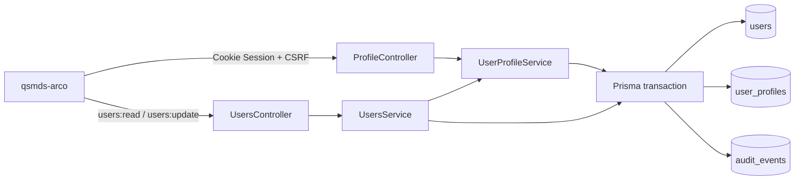

# 用户资料扩展技术设计

> 2026-10-20 变更：头像从「URL 输入」改为「上传到统一媒体管线」；个人资料与管理端手机号改为固定 `+86` + 11 位输入，存储仍是 E.164。本文第 13 节中旧的 Avatar URL 描述以文末「17. 头像上传与手机号输入改造」为准；接口契约仍保持 `avatarUrl` 字符串与 `PATCH /api/profile` 不变。

## 1. 设计目标

本设计在不扩大普通用户系统管理权限的前提下，为每个 `User` 建立一条逻辑上严格一对一的 `UserProfile`，并提供：

- 已正常登录用户读取、修改本人公开资料的独立接口。
- `system_admin` 通过现有用户管理权限读取、修改公开资料和内部备注的能力。
- 与现有 Session、CSRF、强制改密、Audit、OpenAPI 和 Fantastic-admin Web 架构一致的实现。

首期不把资料并入 `AuthContextDto`，不新增业务权限码，也不新增个人资料路由。个人资料是认证身份域中的独立资源，账户菜单通过根层 Modal 承载交互。

## 2. 当前约束与核心决策

| 主题 | 当前约束 | 设计决策 |
| --- | --- | --- |
| 普通用户授权 | `PermissionGuard` 默认拒绝未声明业务权限的路由 | 新增 `@RequireAuthenticatedSession()`，只跳过业务权限查询，不跳过 Session 和强制改密 Guard |
| 一对一关系 | PostgreSQL 外键无法反向保证每个 User 必有 Profile | 主键外键保证“至多一条”；migration 回填和全部正式创建事务保证“至少一条” |
| 管理权限 | `users:read`、`users:update` 已是系统管理权限 | 继续复用，不新增 `profile:*` 权限 |
| Audit metadata | 只接受 scalar，不接受数组 | `changedFields` 保存为稳定排序、逗号分隔的字符串 |
| Web 身份数据 | `AuthContextDto` 只承载认证与权限真相 | Profile 使用 `appAccount` 身份域内的非持久缓存，失败不改变认证状态 |
| 管理员更新 | 一个 Modal 当前只发一个 mutation | 扩展现有 `PATCH /api/users/:userId`，在服务端原子更新 User 和 Profile |
| OpenAPI | Server 快照是契约真相源 | 只改 Server DTO/Controller，通过根脚本同步，不手改 Web 生成类型 |

## 3. 总体架构



事务所有权如下：

- 本人更新由 `UserProfileService` 开启事务，并在同一事务中写 Profile 与 Audit。
- 管理员更新由 `UsersService` 开启现有用户更新事务，调用 `UserProfileService` 的事务内更新能力，再由 `UsersService` 写一次 Audit。
- `UserProfileService` 的事务内方法不自行提交、不嵌套开启事务，也不重复写 Audit。

## 4. 数据模型

### 4.1 Prisma 模型

在 `User` 上新增可选关系：

```prisma
profile UserProfile?
```

关系在 Prisma 中必须声明为可选，因为数据库外键只能从 `user_profiles.user_id` 指向 `users.id`，无法仅凭普通外键表达 User 的全参与约束。

新增模型：

```prisma
model UserProfile {
  userId          String   @id @map("user_id") @db.Uuid
  email           String?  @db.VarChar(254)
  emailNormalized String?  @unique(map: "user_profiles_email_normalized_key") @map("email_normalized") @db.VarChar(254)
  mobileE164      String?  @unique(map: "user_profiles_mobile_e164_key") @map("mobile_e164") @db.VarChar(16)
  avatarUrl       String?  @map("avatar_url") @db.VarChar(2048)
  remark          String?  @db.Text
  createdAt       DateTime @default(now()) @map("created_at") @db.Timestamptz(6)
  updatedAt       DateTime @updatedAt @map("updated_at") @db.Timestamptz(6)

  user User @relation(fields: [userId], references: [id], onDelete: Cascade)

  @@map("user_profiles")
}
```

### 4.2 数据库约束

新 migration 创建以下具名约束和索引：

- `user_profiles_pkey`：`user_id` 主键，保证每个 User 至多一条 Profile。
- `user_profiles_user_id_fkey`：关联 `users.id`，使用 `ON DELETE CASCADE`。
- `user_profiles_email_normalized_key`：`email_normalized` 唯一索引。
- `user_profiles_mobile_e164_key`：`mobile_e164` 唯一索引。
- `user_profiles_email_pair_check`：`email` 与 `email_normalized` 必须同时为空或同时非空。
- `user_profiles_mobile_e164_check`：非空手机号必须匹配 `^\+[1-9][0-9]{7,14}$`。

PostgreSQL 唯一索引允许多行 `NULL`，因此两个可空唯一字段不需要 partial index。

不在数据库中重复实现邮箱格式、Unicode NFC 或 URL parser；这些规则由应用层执行，避免 PostgreSQL 与 Node.js 产生两套不一致语义。

### 4.3 历史数据回填

创建表后在同一 migration 中执行：

```sql
INSERT INTO "user_profiles" (
  "user_id",
  "created_at",
  "updated_at"
)
SELECT
  "id",
  CURRENT_TIMESTAMP,
  CURRENT_TIMESTAMP
FROM "users";
```

migration 不修改既有 migration 文件。回填后，全部已有 User 均有一条空 Profile。

### 4.4 后续创建不变量

以下两个正式 User 创建入口在现有事务的 `user.create` 中增加嵌套创建：

```ts
profile: { create: {} }
```

- `UsersService.create()`：管理端新建普通用户。
- `AuthAdminService.bootstrap()`：首次创建 `system_admin`。

User、Profile、角色关系和 Audit 必须一起提交或一起回滚。管理员恢复流程只更新既有 User，不创建新 Profile。

Profile 缺失被视为数据不变量损坏：读取和更新均返回固定 `500 INTERNAL_ERROR`，不使用 `upsert` 静默修复。

## 5. 认证与授权设计

### 5.1 新增内部路由声明

在认证装饰器中新增：

```ts
export const REQUIRE_AUTHENTICATED_SESSION_METADATA = Symbol(
  'qianshu.auth.require-authenticated-session',
)

export const RequireAuthenticatedSession = ():
  MethodDecorator & ClassDecorator =>
  SetMetadata(REQUIRE_AUTHENTICATED_SESSION_METADATA, true)
```

`PermissionGuard` 对该 metadata 使用独立分支：

1. 路由不得同时声明非空 `@RequirePermissions()`；冲突时默认拒绝，并由单元测试固定行为。
2. 从请求读取 `RequestAuthContext`。
3. 有可信身份则通过，且不查询 `AccessControlService`。
4. 缺少身份则返回 `401 AUTHENTICATION_REQUIRED`。

该声明只影响业务权限 Guard。全局 Guard 顺序保持不变：

1. `CsrfProtectionGuard`
2. `AuthenticationGuard`
3. `PasswordChangeRequiredGuard`
4. `PermissionGuard`

因此：

- 未登录用户仍被 `AuthenticationGuard` 拒绝。
- `mustChangePassword=true` 仍被 `PasswordChangeRequiredGuard` 拒绝。
- Profile 路由不需要也不会获得 `users:read` 或 `users:update`。
- 不复用 `@Public()`、`@OptionalSession()` 或 `@AllowPasswordChangeRequired()`。

### 5.2 管理员边界

现有管理接口继续使用：

- 读取：`@RequirePermissions('users:read')`
- 更新：`@RequirePermissions('users:update')`

普通用户本人接口与管理接口完全分离。即使普通用户能够修改本人公开资料，也不能读取 `remark`、不能指定 `userId`，更不能调用 `/api/users` 管理资源。

## 6. 本人资料 API

### 6.1 响应 DTO

新增 `CurrentUserProfileDto`：

```ts
interface CurrentUserProfileDto {
  userId: string
  email: string | null
  mobileE164: string | null
  avatarUrl: string | null
  createdAt: string
  updatedAt: string
}
```

本人查询的 Prisma select 只选择以上字段，不能先读取完整 Profile 再依赖序列化排除。`emailNormalized` 和 `remark` 不进入本人 DTO、OpenAPI schema 或 Service 返回对象。

### 6.2 更新 DTO

新增 `UpdateCurrentUserProfileRequestDto`：

```ts
interface UpdateCurrentUserProfileRequestDto {
  email?: string | null
  mobileE164?: string | null
  avatarUrl?: string | null
}
```

规则：

- 至少提交一个字段；空对象返回 `422 VALIDATION_FAILED`。
- 通过 `Object.hasOwn()` 区分“字段未提交”和“提交 `null`”。
- `null` 表示清空；空字符串无效。
- 全局 `whitelist + forbidNonWhitelisted` 拒绝 `userId`、`remark`、`emailNormalized` 和其他额外字段。

### 6.3 接口契约

| 方法 | 路径 | operationId | 成功响应 | 特殊错误 |
| --- | --- | --- | --- | --- |
| `GET` | `/api/profile` | `profile_get` | `200 CurrentUserProfileDto` | `401 AUTHENTICATION_REQUIRED`、`403 PASSWORD_CHANGE_REQUIRED` |
| `PATCH` | `/api/profile` | `profile_update` | `200 CurrentUserProfileDto` | `400` malformed request、`401 AUTHENTICATION_REQUIRED`、`403 CSRF_REJECTED/PASSWORD_CHANGE_REQUIRED`、`409 EMAIL_ALREADY_EXISTS/MOBILE_ALREADY_EXISTS`、`422 VALIDATION_FAILED` |

两者均声明：

- `session: 'required'`
- `authorization: false`
- `privateNoStore: true`

`PATCH` 额外声明：

- `csrf: true`
- `badRequest: true`
- `conflict: true`
- `validation: true`

Controller 从 `getRequestAuthContext(request).userId` 取得唯一目标身份，不接受 path、query 或 body 中的用户标识。

## 7. 管理员用户 API 扩展

### 7.1 User 响应

现有 `UserDto` 增加必需的嵌套 `profile`：

```ts
interface AdminUserProfileDto {
  email: string | null
  mobileE164: string | null
  avatarUrl: string | null
  remark: string | null
  createdAt: string
  updatedAt: string
}

interface UserDto {
  // existing fields
  profile: AdminUserProfileDto
}
```

`USER_RESPONSE_SELECT` 明确选择 Profile 的公开资料、备注和时间字段，仍不选择 `emailNormalized`。用户列表与单用户读取使用同一响应投影。

### 7.2 管理员更新请求

现有 `UpdateUserRequestDto` 调整为真正的部分 PATCH：

```ts
interface UpdateUserRequestDto {
  displayName?: string
  email?: string | null
  mobileE164?: string | null
  avatarUrl?: string | null
  remark?: string | null
}
```

设计选择说明：响应使用嵌套 `profile` 清楚表达 User 聚合结构；更新请求保持扁平，以复用现有表单字段错误路径，并让 Web 只提交实际变更字段。

空对象返回 `422 VALIDATION_FAILED`。User 和 Profile 的修改、唯一冲突处理及一次 `USER_UPDATED` Audit 在同一事务中完成。任一失败都会回滚全部字段。

新建用户接口本期不接受 Profile 字段；创建后得到空 Profile，管理员可再通过编辑操作维护。

## 8. 规范化与校验

### 8.1 Email

非空 Email 的处理顺序：

1. `normalize('NFC')`
2. `trim()`
3. 校验非空、邮箱格式和展示值不超过 254 Unicode code point
4. 使用 `toLowerCase()` 生成 `emailNormalized`
5. 再次校验 normalized 值不超过 254 Unicode code point

展示值保存到 `email`，唯一比较值保存到 `emailNormalized`。清空 Email 时两列同时写 `NULL`。

### 8.2 Mobile

- 只接受 `^\+[1-9]\d{7,14}$`。
- 不自动添加国家码，不删除空格、横线或括号。
- 只有 `null` 表示清空。

### 8.3 Avatar URL

- 最大 2048 Unicode code point。
- 使用 `new URL()` 验证为绝对 URL。
- 只允许 `http:` 和 `https:`。
- 拒绝包含 URL username 或 password 的地址。
- Server 不抓取、不探测、不代理该 URL。

### 8.4 Remark

- 仅管理员更新 DTO 包含。
- `normalize('NFC')` 后 trim。
- 最大 2000 Unicode code point，允许内部换行。
- 只有 `null` 表示清空；空字符串无效，Web 空输入转换为 `null`。

### 8.5 校验层次

- DTO 负责类型、nullable、基础长度和额外字段拒绝。
- `UserProfileService` 的纯规范化函数负责 trim/NFC、Email、E.164、URL、空 PATCH 和二次长度校验。
- Service 校验失败统一抛出 `422 VALIDATION_FAILED`，并提供稳定的字段错误，不透传底层 parser 或数据库消息。
- 单元测试直接调用 Service，确保绕过 Controller 时业务边界仍成立。

## 9. 唯一冲突与事务

数据库唯一索引是并发条件下的最终真相。Service 捕获 Prisma `P2002`，只识别已知 target：

| Prisma target | API error |
| --- | --- |
| `emailNormalized`、`email_normalized` 或 `user_profiles_email_normalized_key` | `409 EMAIL_ALREADY_EXISTS` |
| `mobileE164`、`mobile_e164` 或 `user_profiles_mobile_e164_key` | `409 MOBILE_ALREADY_EXISTS` |

Prisma 7 与 PostgreSQL adapter 的实际 `meta.target` 形状必须由真实 PostgreSQL E2E 固定。未知 `P2002` target 不猜测字段，统一收敛为固定 `500 INTERNAL_ERROR`。

本人更新顺序：

1. 规范化可信 Session userId 和 PATCH。
2. 开启 Prisma transaction 并应用现有 transaction timeout。
3. 确认 Profile 存在。
4. 更新已提交字段。
5. 写入同事务 Audit。
6. 返回受限的本人 Profile 投影。

管理员更新顺序：

1. 规范化 path userId、displayName 和 Profile PATCH。
2. 开启现有 Users transaction 并应用 timeout。
3. 区分 `USER_NOT_FOUND` 与 Profile 不变量损坏。
4. 更新 User 和/或 Profile。
5. 写入一次 Audit。
6. 返回完整管理 `UserDto`。

Profile 修改不改变用户名、密码、状态或权限，因此不增加 `authVersion`，也不撤销 Session。

## 10. Audit 设计

本人和管理员资料修改均复用 `AuditEventType.USER_UPDATED`：

```ts
{
  actorType: AuditActorType.USER,
  actorUserId: currentUserId,
  targetType: 'User',
  targetId: targetUserId,
  metadata: {
    changedFields: 'avatarUrl,email,mobileE164',
  },
}
```

`changedFields` 定义为请求中实际存在且通过校验的字段名：

- 使用 camelCase 稳定字段名。
- 去重后按字典序排序。
- 使用英文逗号连接为单个 scalar string。
- 管理员更新可额外包含 `displayName`、`remark`。
- 不记录修改前值、修改后值或资料摘要。

Web 只提交实际有差异的字段，减少无意义 Audit。Server 收到非空但值相同的合法 PATCH 时，仍按“接受的更新字段”记录 Audit，不读取或暴露历史值来构造差异。

## 11. Server 模块与文件边界

新增：

```text
server/src/modules/profile/
  dto/current-user-profile.dto.ts
  dto/update-current-user-profile-request.dto.ts
  profile.controller.ts
  profile.module.ts
  user-profile.normalizer.ts
  user-profile.service.ts
```

职责：

- `profile.controller.ts`：HTTP、OpenAPI、可信请求上下文。
- `user-profile.normalizer.ts`：纯规范化、校验与 changed field 生成。
- `user-profile.service.ts`：Profile 查询、事务内写入、本人事务与冲突映射。
- `profile.module.ts`：导入 `PrismaModule`、`AuthModule`，导出 `UserProfileService` 供 `UsersModule` 复用。

调整：

- `http.modules.ts` 注册 `ProfileModule`。
- `UsersModule` 导入 `ProfileModule`。
- `UsersService` 注入 `UserProfileService`。
- `users.persistence.ts` 扩展 Profile select 和 mapper。
- `AuthAdminService` 和 `UsersService.create()` 嵌套创建空 Profile。

避免把 Profile 逻辑放入 Auth Service；资料更新不属于认证凭证生命周期。

## 12. Web 数据与 API 设计

### 12.1 API 模块

新增 `src/api/modules/profile.ts`，使用与现有 API 一致的 factory：

```ts
createProfileApi(client) {
  return {
    get: (signal?: AbortSignal) =>
      client.get<CurrentUserProfileDto>('profile', {
        errorPresentation: 'local',
        ...(signal === undefined ? {} : { signal }),
      }),
    update: (data: UpdateCurrentUserProfileRequestDto) =>
      client.patch<CurrentUserProfileDto>('profile', data, {
        errorPresentation: 'local',
        retry: false,
      }),
  }
}
```

所有类型来自 OpenAPI 生成结果，不扩展手写 DTO，不手改 ignored 的 `types.gen.ts`。

### 12.2 身份域状态

Profile 状态归入现有 `appAccount` Store：

```ts
type ProfileState = 'idle' | 'loading' | 'ready' | 'unavailable'

profile: CurrentUserProfileDto | null
profileState: ProfileState
profileErrorCode: string | null
```

新增能力：

- `loadProfile({ force?: boolean })`
- `updateProfile(patch)`
- `clearProfile()`

约束：

- 保持 `persist: false`，不得把 Email、手机号或 Avatar URL 写入 `localStorage`。
- `cleanIdentityDomain()` 同步清空 Profile，并通过现有 `AbortSignal` 取消旧请求。
- 请求应用响应前同时核对 `authEpoch` 和 `userId`，迟到响应不能覆盖新身份。
- Profile GET 失败只把 `profileState` 置为 `unavailable`；不得把 Auth 置为不可用，不得卸载业务 Shell。
- `avatar` 改为 `profile?.avatarUrl ?? ''`，远程图失败继续使用现有 fallback。
- 进入 `authenticated` 后后台加载；打开 Modal 时强制刷新以取得最新资料。

资料更新成功后用响应整体替换缓存。对 Network/5xx 的未知 mutation 结果，不自动重试 PATCH；强制 GET 后只比较本次提交字段：

- 服务端状态与规范化提交一致：收敛为成功。
- 不一致或 GET 失败：保留 Modal，提示“结果尚未确认”，允许用户重新加载后决定。

现有 `BroadcastChannel` 增加无数据载荷的 `PROFILE_CHANGED`：

- 成功更新的标签页只广播事件类型，不广播任何 Profile 字段。
- 其他已认证标签页收到后重新 GET Profile。
- 退出、切换身份和 Session 失效继续由现有身份边界清理全部 Profile 状态。

`AuthContextDto` 保持不变，避免每次资料修改触发权限路由重建。

## 13. Web UI 设计

### 13.1 入口与生命周期

- `AppAccountButton` 在“修改密码”之前增加“个人资料”。
- 点击后发送 `global-profile-visible`。
- 根 `App.vue` 持有 `profileVisible`，与现有修改密码 Modal 使用相同生命周期。
- 只有 `authState === 'authenticated'` 时可打开。
- 退出、Session 失效或进入强制改密状态时立即关闭。
- 403 页面已有账户按钮，因此无管理路由权限的 `operations_staff` 仍可进入本人资料。

现有未接线的 `AppAccountButton/profile.vue` 直接改造成正式 Modal，不新增同义占位组件。

### 13.2 本人资料 Modal

Modal 最大宽度：

```text
max-w-[calc(100%-1.5rem)] sm:max-w-[720px]
```

内容布局：

```text
Desktop: 160px avatar preview | form
Mobile:  avatar preview
         form
```

使用 `md:grid-cols-[160px_minmax(0,1fr)]` 切换，不使用横向滚动。

界面内容：

- 只读：显示名、用户名。
- 可编辑：Email、E.164 手机号、Avatar URL。
- 不显示：`remark`、`emailNormalized`。
- Avatar URL 只有通过本地绝对 `http/https` 校验后才进入预览，输入未完成时不发起图片请求。
- 保存期间锁定关闭和重复提交。
- 没有实际差异时禁用保存。
- 成功后更新头像、展示成功 Toast 并关闭。
- 加载失败展示可重试状态，不把空资料误当加载成功。

组件复用：`FaModal`、`FaForm`、`FaFormItem`、`FaInput`、`FaAvatar`、`FaAlert`、`FaButton`。

所有样式使用 `bg-background`、`bg-muted`、`border-border`、`text-foreground`、`text-muted-foreground`、`text-destructive` 等语义 token，支持亮色和暗色主题。

三个 `clearable` 输入都显式把清空值恢复为 `''`；构造 API payload 时再转换为 `null`。

### 13.3 管理员用户 Modal

- create 模式保持现有账号字段，不增加 Profile 输入。
- edit 模式新增 Email、手机号、Avatar URL 和管理员备注。
- 备注使用现有 `FaTextarea`。
- Modal 桌面宽度扩展到 `720px`，移动端单列。
- Web 根据初始值构造部分 PATCH，只提交实际变化字段。
- `EMAIL_ALREADY_EXISTS`、`MOBILE_ALREADY_EXISTS` 映射到相应字段；`remark` 不进入普通用户组件。

### 13.4 文案与 i18n

新增应用级 `accountProfile` locale，不修改 shared package 文案，以免影响其他示例应用：

```text
src/locales/lang/app/components/account-profile/en.json
src/locales/lang/app/components/account-profile/zh-cn.json
src/locales/lang/app/components/account-profile/zh-tw.json
```

菜单中文明确使用“个人资料”。

## 14. OpenAPI 与生成物

Server DTO 和 Controller 是唯一编辑入口。实现后执行：

```bash
node --run contract:sync
node --run contract:check
```

提交：

- `server/openapi/openapi.json`
- `web/openapi/openapi.json`

不提交 ignored 的 `web/apps/qsmds-arco/src/api/generated/types.gen.ts`。现有 operationId 不删除或改名；只新增 `profile_get`、`profile_update`，并扩展 `UserDto` 与 `users_update` 请求 schema。

## 15. TDD 与验证策略

### 15.1 Server 单元测试顺序

先写失败测试，再实现：

1. `user-profile-schema.spec.ts`
   - Prisma 字段、映射、关系、具名索引和 migration SQL。
2. Auth decorator / Guard tests
   - `@RequireAuthenticatedSession()` 正常身份通过且不查询权限。
   - 缺少身份返回 401。
   - 不放宽强制改密边界。
3. Profile DTO / OpenAPI tests
   - nullable、长度、额外字段、响应投影和错误契约。
4. Normalizer / Service tests
   - NFC、Email normalized、E.164、URL、Remark、null 清空、空 PATCH。
   - `P2002` 映射、缺失 Profile、不泄露底层错误。
   - Profile 与 Audit 同事务，metadata 不含资料值。
5. Controller / Module tests
   - 目标身份只来自 RequestAuthContext。
6. Users / bootstrap tests
   - 两个创建入口嵌套创建 Profile。
   - User + Profile + Audit 任一失败整体回滚。

### 15.2 Migration 回放 E2E

常规 CI 从空库一次性应用全部 migrations，不能证明历史用户回填。新增独立回放测试：

1. 在隔离 CI PostgreSQL 中开启事务。
2. 创建随机临时 schema 并设置 `search_path`。
3. 执行旧认证 migration。
4. 插入两条既有 User。
5. 执行新 Profile migration。
6. 断言 User/Profile 数量一致、字段为空、时间非空。
7. 断言主键、两个唯一索引、Check、FK 和 Cascade。
8. `finally` 执行 `ROLLBACK`，不留下 fixture。

### 15.3 HTTP E2E

新增 `profile-api.e2e-spec.ts`：

- 匿名 401。
- 强制改密 403。
- 无任何管理权限的普通用户正常 GET/PATCH 本人资料。
- CSRF、额外字段、空 PATCH、null 清空。
- Email/手机号冲突及无部分提交。
- Audit 脱敏和响应精确字段。
- 普通用户仍不能调用 `/api/users`。

扩展 management E2E：

- 新建用户自动有 Profile。
- `users:read` 返回管理员 Profile。
- `users:update` 原子更新 Profile 与 `remark`。
- Profile 随 User 删除级联清理。

所有直接创建 User 的测试与浏览器 fixture 必须同步创建空 Profile，不能依赖运行时自愈。

### 15.4 Web 测试

- `test/api/profile.test.ts`：method、path、payload、GET abort、PATCH no-retry。
- `test/views/profile.logic.test.ts`：规范化、差异 payload、字段错误、未知结果收敛。
- identity-domain tests：清空、迟到响应、非持久化、脱敏广播。
- account profile component test：入口、组件体系、语义 token、响应式布局、普通用户无 `remark`。
- user form test：管理员字段和部分 PATCH。
- Browser E2E：使用无管理权限用户打开 Modal、更新、重开/刷新验证、头像回退、`390x844` 不溢出、暗色主题。

### 15.5 验证命令

开发期定向验证：

```bash
pnpm -C server test -- \
  user-profile-schema.spec.ts \
  profile-dtos.spec.ts \
  user-profile.service.spec.ts \
  profile.controller.spec.ts \
  users.service.spec.ts \
  auth-admin.service.spec.ts \
  --runInBand

pnpm -C server prisma:validate
pnpm -C server typecheck

node --run contract:sync
node --run contract:check

pnpm -C web exec tsx --test \
  apps/qsmds-arco/test/api/profile.test.ts \
  apps/qsmds-arco/test/views/profile.logic.test.ts

pnpm -C web --filter qsmds-arco run typecheck
```

完整验收：

```bash
pnpm -C server check
node --run ci:server-e2e
node --run contract:check
pnpm -C web check
pnpm -C web build
node --run ci:browser-auth-e2e
git diff --check
```

正式 E2E 使用根目录 `node --run ci:server-e2e` 创建隔离 PostgreSQL。不得用直连开发库的 `pnpm -C server test:e2e` 代替最终验收，避免本地数据影响最后管理员等用例。

## 16. 部署与回滚

### 16.1 部署顺序

由于首期不使用数据库 trigger，旧 Server 在新 migration 之后仍可能创建缺少 Profile 的 User。部署必须在暂停用户创建写流量的窗口中完成：

1. 停止或隔离旧 Server 写流量。
2. 执行 `prisma migrate deploy`。
3. 启动包含 Profile 嵌套创建的新 Server。
4. 验证 User 与 Profile 数量一致后恢复流量。
5. 部署 Web 并进行真实浏览器验证。

当前单实例/开发部署满足该条件。若未来要求零停机滚动升级，需要单独设计 temporary trigger 或两阶段兼容部署，不在本期范围内。

### 16.2 回滚边界

- 应用代码可回滚，但旧代码不会维护新增 Profile。
- 已应用 migration 不做自动 down migration，不删除用户资料表或资料数据。
- 若应用回滚，暂停用户创建写流量并修复版本后再恢复。
- 数据异常通过只读计数和显式修复 migration 处理，不在 GET 中自愈。

## 17. 风险与取舍

| 风险 | 处理 |
| --- | --- |
| 数据库无法仅靠 FK 保证 User 全参与 | migration 回填、创建事务、缺失即失败、回放 E2E；不引入 trigger |
| 唯一冲突 target 随 adapter 形状变化 | 真实 PostgreSQL E2E 固定已知形状；未知 target fail closed |
| Profile 请求迟到覆盖新登录用户 | `AbortSignal + authEpoch + userId` 三重校验 |
| PATCH 网络失败导致结果未知 | 禁止自动重试 mutation，GET 对账后收敛 |
| Audit 泄露 PII | 只写固定字段名字符串，测试反向断言资料值不存在 |
| 外部头像不可用 | URL 本地校验、浏览器失败回退，Server 不抓取 |
| 管理员保存出现部分成功 | User、Profile、Audit 统一由一个服务端事务提交 |

## 18. 本期不做

- Email/手机号登录、验证、通知、找回。
- Avatar 上传、对象存储、服务端下载或图片处理。
- Profile 独立管理权限、菜单或路由。
- `emailNormalized` 的任何公共 API 暴露。
- 组织、部门、租户或数据范围扩展。
- 数据库 trigger、零停机两阶段 migration。
- 删除 User 或 Profile 的新公共接口。

## 19. 待确认的设计定案

进入任务拆分前需要确认以下定案：

1. 一对一采用“数据库保证至多一条 + migration/正式事务保证至少一条”，首期不加 trigger。
2. 管理响应使用嵌套 `profile`；管理员 PATCH 使用扁平、全可选字段并拒绝空对象。
3. `remark` 最大 2000 Unicode code point，仅管理员可见和修改。
4. Avatar URL 除限制 `http/https` 外，同时拒绝内嵌 username/password。
5. Audit `changedFields` 使用排序后的逗号分隔字符串，不扩大 Audit metadata 公共结构。
6. Profile 缓存在现有 `appAccount` 身份域，不扩张 `AuthContextDto`；跨标签只广播 `PROFILE_CHANGED` 事件类型。
7. 部署 Profile migration 时暂停旧 Server 的用户创建写流量，不为滚动兼容引入 trigger。

## 20. 2026-10-20 头像上传与手机号输入改造

### 20.1 手机号

- Web 表单使用 `FaInput` 的 `#start` 插槽渲染固定 `+86`，用户只输入 11 位。
- 表单真值仍是 `mobileE164`；可写计算属性负责剥离/拼接，PATCH 契约不变。
- 号段规则 `^1[3-9]\d{9}$`；错误区分为 `mobileLengthInvalid`、`mobileSegmentInvalid`、`mobileDigitsInvalid`、`mobileForeignInvalid`。
- `parseStoredMobileE164` 识别存量：`+86` + 11 位可回显；其他值标记 `unsupported`。
- 未触碰的存量非大陆号码保持原值，只改邮箱/头像不会把它清空；用户可显式清除或重新输入。不做自动转换或数据库回填。
- 管理端用户表单复用同一 composable 与校验选项。

### 20.2 头像

- `UserProfile` 新增 `avatarMediaAssetId`（唯一索引、`media_assets` 外键 `ON DELETE RESTRICT`）；`MediaAsset` 增加反向关系。`avatar_url` 仍是公开地址，新列只用于 READY 引用保护与回收。
- `media_assets_upload_purpose_check` 增加 `USER_AVATAR`；`enforce_ready_media_asset_reference()` 与 `user_profiles` 延迟约束触发器增加头像分支。
- `POST /api/profile/avatar-uploads`：Session + CSRF、无需业务权限；multipart `mediaType=IMAGE` + `file`；复用 `SalesOrderDocumentMultipartParser`、`MediaAssetService.prepare`、现有 jpg/png/webp + 10 MiB + sharp 校验；返回 `{ mediaAssetId, avatarUrl }`，资产保持 `UPLOADING`。
- `GET/HEAD /api/profile/avatars/:id/content`：Session 必需；`READY` 对所有已登录用户可读，`UPLOADING` 仅上传者本人可读；`private, no-store` + ETag。
- `PATCH /api/profile` 收到 `avatarUrl` 时解析本系统同源内容 URL：校验用途/所有者/过期时间，绑定 `avatar_media_asset_id`，同事务 `activate`，并把旧资产 `markUnreferencedForTrash`。外部 URL 继续接受，但会解除媒体绑定。
- 管理端 `PATCH /api/users/:userId` 复用同一绑定；`avatarActorUserId` 传管理员 id，允许管理员代传头像。
- 浏览器上传前压缩为最大边 512px、质量 0.85 的 WebP；压不动/解码失败时回退原文件，服务端仍做真实内容与体积校验。
- 共用 `FaImageUpload` 与新的 `QsAvatarUploader`；上传失败区分可重试（网络/503）与需重新选择（422）。
- 布局：左侧 160px 区块只放头像上传，不再混排姓名/账号；显示名与账号移到右侧表单顶部，以分隔线与字段区隔开。
