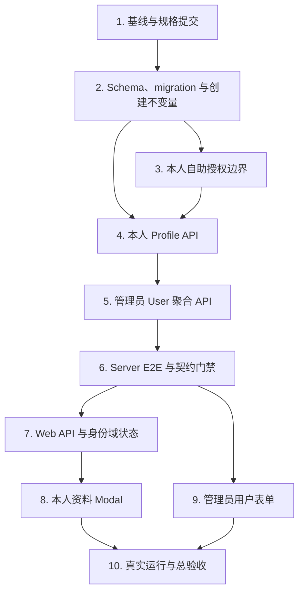

# 用户资料扩展实施计划

## 1. 执行规则

- 本清单只有在用户确认后才进入 Phase 4 实施。
- 每个新功能或复杂修改严格执行 TDD：先运行新增测试并确认因目标能力缺失而失败，再做最小实现，最后重构和完整验证。
- 实施过程中实时更新本文件的 checkbox；不得在代码未完成或验证失败时提前勾选。
- Server、Web 和根目录保持独立依赖域，不在仓库根创建 pnpm workspace 产物。
- 不手改 Prisma 生成文件或 Web API 生成类型；分别通过 `prisma generate` 和 OpenAPI 生成链路产生。
- 不修改既有 migration，不删除文件，不提交 `.env`、密钥、日志、构建产物或敏感数据。
- 若实施中必须偏离已确认的 `requirements.md` 或 `design.md`，先暂停执行、更新设计并重新确认。

需求编号指向 `requirements.md` 第 9 节的 12 条 EARS 验收标准。

## 2. 依赖顺序

## 3. 实施任务

- [ ] 1. 固化规格、检查基线并建立首个提交
  - [ ] 1.1 检查 `git status --short`、现有差异和根目录违规产物，确认不会覆盖用户工作。
  - [ ] 1.2 运行现有基线：`pnpm -C server check`、`node --run contract:check`、`pnpm -C web check`；若失败，先记录并区分基线问题与本功能问题。
  - [ ] 1.3 检查 `requirements.md`、`design.md`、`tasks.md` 的一致性和 Markdown 空白错误。
  - [ ] 1.4 只暂存三个规格文件，复核 staged diff 和敏感文件范围。
  - [ ] 1.5 创建提交：`docs: 明确用户资料扩展需求与设计`。
  - _Requirements: 1-12_

- [ ] 2. 以 TDD 建立 UserProfile Schema、migration 与创建不变量
  - [ ] 2.1 先新增并运行失败的 `server/src/infrastructure/database/user-profile-schema.spec.ts`，固定 Prisma 字段、映射、关系、具名约束和 migration SQL。
  - [ ] 2.2 先新增并运行失败的 `server/test/user-profile-migration.e2e-spec.ts`：在随机临时 schema 中回放旧 migration、插入历史 User、再执行新 migration。
  - [ ] 2.3 在 `server/prisma/schema.prisma` 新增 `UserProfile` 和 `User.profile`，创建新的不可变 migration；实现历史回填、主键外键、Cascade、两个唯一索引及 Email/Mobile Check。
  - [ ] 2.4 在真实 PostgreSQL 回放测试中验证：一人一 Profile、初始字段为空、时间非空、多行 `NULL` 合法、重复非空值和非法 E.164 被拒绝、删除 User 后级联删除；测试最终必须 rollback。
  - [ ] 2.5 先扩展并运行失败的 `users.service.spec.ts` 与 `auth-admin.service.spec.ts`，要求两个正式 User 创建入口在原事务中嵌套 `profile: { create: {} }`。
  - [ ] 2.6 修改 `UsersService.create()` 和 `AuthAdminService.bootstrap()`；验证 Profile、Role 或 Audit 失败时 User 不会单独提交，恢复管理员流程不创建或 upsert Profile。
  - [ ] 2.7 使用 `rg` 重新枚举全部直接创建 User 的测试和浏览器 fixture，并同步显式创建空 Profile，包括 auth、session、management E2E 与 `scripts/browser-auth/provision-admin.mjs`。
  - [ ] 2.8 运行 schema/创建路径定向测试、`pnpm -C server prisma:validate`、`pnpm -C server typecheck` 和隔离 migration E2E。
  - [ ] 2.9 更新本任务状态，复核 staged diff 后创建提交：`feat: 添加用户资料数据模型与创建不变量`。
  - _Requirements: 1, 2_

- [ ] 3. 以 TDD 增加“正常登录但无需业务权限”的授权边界
  - [ ] 3.1 先扩展并运行失败的 `auth.decorators.spec.ts`、`permission.guard.spec.ts`，必要时补充 `password-change-required.guard.spec.ts`。
  - [ ] 3.2 测试固定 `@RequireAuthenticatedSession()` 的 Controller/Method metadata、有身份时不查询 `AccessControlService`、无身份时返回 `401 AUTHENTICATION_REQUIRED`。
  - [ ] 3.3 测试该声明与非空 `@RequirePermissions()` 同时存在时 fail closed，且不等价于 `Public`、`OptionalSession` 或 `AllowPasswordChangeRequired`。
  - [ ] 3.4 实现认证 metadata 和 `PermissionGuard` 独立分支，不改变全局 Guard 顺序。
  - [ ] 3.5 运行 Auth Guard 定向测试，确认 `mustChangePassword=true` 仍由前置 Guard 返回 `403 PASSWORD_CHANGE_REQUIRED`。
  - _Requirements: 3, 4, 8, 10, 11_

- [ ] 4. 以 TDD 实现本人 Profile DTO、规范化器、Service 与 HTTP API
  - [ ] 4.1 先新增并运行失败的 `profile-dtos.spec.ts` 和 `user-profile.normalizer.spec.ts`，覆盖 nullable、空 PATCH、空字符串、额外字段、Unicode 长度与纯规范化规则。
  - [ ] 4.2 实现 `CurrentUserProfileDto` 和 `UpdateCurrentUserProfileRequestDto`；本人响应精确限定为 `userId/email/mobileE164/avatarUrl/createdAt/updatedAt`。
  - [ ] 4.3 实现纯 `user-profile.normalizer.ts`：Email NFC/trim/lowercase normalized、E.164、绝对 `http/https` URL、URL credentials 拒绝、`Object.hasOwn()` 和稳定 `changedFields`。
  - [ ] 4.4 先新增并运行失败的 `user-profile.service.spec.ts`，覆盖受限 select、null 清空、同事务 Audit、缺失 Profile、Audit 失败回滚和安全异常收敛。
  - [ ] 4.5 实现 `UserProfileService`：本人 GET、本人 PATCH、供 `UsersService` 复用的事务内更新方法；不得请求 Avatar URL，不改变 `authVersion` 或 Session。
  - [ ] 4.6 测试并实现 Prisma `P2002` 已知 target 到 `EMAIL_ALREADY_EXISTS`、`MOBILE_ALREADY_EXISTS` 的映射；未知 target 固定返回内部错误，不透传数据库信息。
  - [ ] 4.7 先新增并运行失败的 `profile.controller.spec.ts`、`profile.module.spec.ts`，确认 userId 只来自 `RequestAuthContext`，且 Controller 不声明 `users:*` 权限。
  - [ ] 4.8 实现 `ProfileController`、`ProfileModule` 并注册 `HTTP_MODULES`；固定 `profile_get`、`profile_update`、Session、CSRF、no-store 和错误 metadata。
  - [ ] 4.9 先新增并运行失败的 `server/test/profile-api.e2e-spec.ts`，覆盖匿名、强制改密、无管理权限用户、CSRF、额外字段、null 清空、409、事务回滚、精确响应和 Audit 脱敏。
  - [ ] 4.10 在隔离 PostgreSQL 验证 Prisma 7 adapter 的真实 `P2002 meta.target`，根据测试证据完成最小映射实现。
  - [ ] 4.11 运行 Profile 定向单元/E2E、`prisma:validate`、`typecheck`，再通过 `contract:sync` 和 `contract:check` 生成并校验本人接口契约。
  - [ ] 4.12 更新任务状态并创建提交：`feat: 添加本人资料接口`。该提交同时包含任务 3 的内部授权边界。
  - _Requirements: 3-11_

- [ ] 5. 以 TDD 扩展管理员 User 聚合读取与原子 PATCH
  - [ ] 5.1 先扩展并运行失败的 `users-dtos.spec.ts`、`users.persistence.spec.ts`、`users.service.spec.ts`、`users.controller.spec.ts` 和 `users.module.spec.ts`。
  - [ ] 5.2 测试固定必需的嵌套 `UserDto.profile`：允许公开资料、`remark` 和时间字段，禁止 `emailNormalized`。
  - [ ] 5.3 测试固定扁平、全可选的管理 PATCH；拒绝空对象、额外字段、非法 Profile 值，并保持既有 displayName 更新可用。
  - [ ] 5.4 扩展 `USER_RESPONSE_SELECT` 和 mapper；Profile 缺失必须作为不变量损坏失败，不得运行时 upsert。
  - [ ] 5.5 扩展 `UsersService`，在一个现有事务中更新 User/Profile 并写一次 `USER_UPDATED` Audit；唯一冲突或 Audit 失败时全部回滚。
  - [ ] 5.6 确认 Audit 只记录排序后的字段名，可包含 `displayName`、`remark`，不能包含任何资料值。
  - [ ] 5.7 扩展 management E2E：创建用户自动有 Profile；`users:read` 返回 Profile；`users:update` 可更新 Profile/remark；权限不足继续拒绝。
  - [ ] 5.8 确认新建用户 API 不接受 Profile 输入，普通用户本人能力不放宽 `/api/users`。
  - _Requirements: 2, 6, 7, 9, 11, 12_

- [ ] 6. 同步公共契约并完成 Server 总门禁
  - [ ] 6.1 运行 `node --run contract:sync`，只通过生成链路更新 `server/openapi/openapi.json` 与 `web/openapi/openapi.json`。
  - [ ] 6.2 检查只新增 `profile_get/profile_update` 并扩展 `UserDto/users_update`；本人 schema 不包含 `remark`、`emailNormalized`。
  - [ ] 6.3 运行 `pnpm -C server check` 和 `node --run ci:server-e2e`；不得用共享开发库的 `pnpm -C server test:e2e` 代替正式结果。
  - [ ] 6.4 再运行 `node --run contract:check` 和 `git diff --check`，确认 migration 二次 deploy、状态检查和 OpenAPI 字节级比较通过。
  - [ ] 6.5 如验证失败，先报告并修复根因，补回归测试后重跑完整门禁。
  - [ ] 6.6 更新任务状态并创建提交：`feat: 扩展管理员用户资料维护`。
  - _Requirements: 1-9, 11, 12_

- [ ] 7. 以 TDD 实现 Web Profile API 与账户身份域状态
  - [ ] 7.1 先新增并运行失败的 `test/api/profile.test.ts`，固定 GET/PATCH method、`profile` path、AbortSignal、local error presentation 和 PATCH no-retry；同时扩展 `management.test.ts`，固定管理员 PATCH 也禁止自动重试。
  - [ ] 7.2 新增 `src/api/modules/profile.ts`，所有 DTO 只从 OpenAPI 生成类型导入，不手改 `types.gen.ts`。
  - [ ] 7.3 先新增并运行失败的 `test/views/profile.logic.test.ts`，覆盖空字符串转 `null`、规范化、差异 PATCH、字段错误映射和未知 mutation 结果对账。
  - [ ] 7.4 先新增并运行失败的 `profile-lifecycle.test.ts`，并扩展 identity-domain tests，覆盖并发 GET 去重、Profile 非持久化、身份清理、Abort、`authEpoch + userId` 迟到响应拒绝和脱敏广播。
  - [ ] 7.5 在 `appAccount` Store 增加 `profile/profileState/profileErrorCode`、加载、更新和清理能力；Profile GET 失败不得改变认证状态或卸载 Shell。
  - [ ] 7.6 把账户头像来源改为当前 Profile 的 `avatarUrl`，无值或加载失败继续使用既有 fallback。
  - [ ] 7.7 扩展现有 BroadcastChannel：只发送无数据的 `PROFILE_CHANGED`，接收端重新 GET，不广播 Email、手机号或 URL。
  - [ ] 7.8 运行 Web API、logic、identity-domain 定向测试和 app typecheck。
  - _Requirements: 3, 4, 6, 7, 9, 10, 11_

- [ ] 8. 以 TDD 实现普通用户本人资料 Modal
  - [ ] 8.1 先新增并运行失败的 account-profile component/static test，固定账户菜单入口、Fantastic-admin 组件、语义 token、桌面双区、移动单列和普通用户无 `remark`。
  - [ ] 8.2 在 Browser E2E 中先增加“无管理权限用户打开个人资料并修改本人资料”的失败场景，确认失败原因为入口/界面尚未实现。
  - [ ] 8.3 把现有未接线 `AppAccountButton/profile.vue` 改为正式 `FaModal` 表单，不新增同义组件。
  - [ ] 8.4 在 `AppAccountButton` 增加“个人资料”入口，通过 `global-profile-visible` 交给根 `App.vue` 管理单一 Modal 生命周期。
  - [ ] 8.5 实现只读显示名/用户名、Email/Mobile/Avatar URL、有效 URL 才预览、失败 fallback、加载重试、提交锁和无差异禁用；源码与 DOM 均不得出现普通用户 `remark`、`emailNormalized`。
  - [ ] 8.6 增加应用级 `accountProfile` 的 `zh-cn/zh-tw/en` locale，不修改 shared package 文案。
  - [ ] 8.7 确认退出、Session 失效、切换身份和强制改密状态会关闭 Modal 并清理 Profile。
  - [ ] 8.8 运行 Profile API/logic/component tests、Web typecheck 和相关 Browser 场景，确认未新增 UI 依赖、硬编码颜色或横向滚动。
  - [ ] 8.9 更新任务状态并创建提交：`feat: 添加个人资料编辑入口`。该提交同时包含任务 7。
  - _Requirements: 3, 4, 8, 10, 11_

- [ ] 9. 以 TDD 扩展管理员用户资料表单
  - [ ] 9.1 先扩展 `users.logic.test.ts`、`system-management.test.ts` 和 user form tests，固定 create 模式不出现 Profile 输入、edit 模式出现 Email/Mobile/Avatar/remark；受 `UserDto.profile` 影响的 fixture 只补真实嵌套 Profile，不增加兼容 fallback。
  - [ ] 9.2 测试 Web 只构造实际变化的部分 PATCH，空资料转 `null`，Email/Mobile 冲突映射到对应字段。
  - [ ] 9.3 扩展 `user-form-modal.vue`：桌面宽度 `720px`、移动单列、`FaTextarea` 管理备注、提交期间防重复与关闭保护。
  - [ ] 9.4 确认 Profile 和 displayName 仍由一次 `managementApi.users.update()` 原子提交，不顺序调用两个 mutation，并显式设置 `retry: false` 避免重复 Audit。
  - [ ] 9.5 运行 users logic/form tests、management API tests、Web typecheck 和 lint。
  - [ ] 9.6 更新任务状态并创建提交：`feat: 完善管理员用户资料表单`。
  - _Requirements: 6, 7, 9, 12_

- [ ] 10. 完成隔离 E2E、本地 migration、真实浏览器和全量验收
  - [ ] 10.1 运行 `pnpm -C server check`、`node --run ci:server-e2e`、`node --run contract:check`，保存最新通过证据。
  - [ ] 10.2 运行 `pnpm -C web check`、`pnpm -C web build`、`node --run ci:browser-auth-e2e`；Browser fixture 不得依赖开发库或隐式 Profile 自愈。
  - [ ] 10.3 本地部署前先只读确认数据库目标和当前进程，不输出连接字符串；暂停旧 Server 用户创建写流量后执行 migration，再启动新 Server。
  - [ ] 10.4 验证 `/api/health` 的 database 状态、Server/Web 端口和进程均真实就绪；不能只以 watcher 或前端端口作为成功依据。
  - [ ] 10.5 只读核对本地 User/Profile 数量一致、唯一约束存在；不得输出 Email、手机号、URL、备注或连接信息。
  - [ ] 10.6 在真实 Chrome 桌面端验证：普通用户入口、GET/PATCH、头像即时更新/失败回退、刷新持久化、无 `/api/users` 权限；管理员验证 Profile/remark；双标签页验证 `PROFILE_CHANGED` 只触发重新 GET 且不携带资料值。
  - [ ] 10.7 在 `390x844` 移动视口验证单列、不溢出、可滚动和可提交；分别检查亮色、暗色主题。
  - [ ] 10.8 验证强制改密用户不能打开/调用 Profile，Audit 事件只有字段名且不含 PII；Browser 断言必须同时检查真实 API、Store/DOM 状态，不能只检查 Toast。
  - [ ] 10.9 对发现的问题先补失败回归测试再修复；每个独立修复使用 `fix: 中文描述` 小提交并重新运行受影响门禁。
  - [ ] 10.10 运行最终 `node --run test:root`、`git diff --check`、`git status --short`，检查无根违规产物、无 `.env`、无密钥、无生成目录和无未提交功能改动。
  - [ ] 10.11 把本清单全部真实完成项勾选，复核提交历史；不执行 push，除非用户另行明确要求。
  - _Requirements: 1-12_

## 4. Git 提交计划

| 检查点 | Commit message | 主要内容 |
| --- | --- | --- |
| Task 1 | `docs: 明确用户资料扩展需求与设计` | requirements、design、tasks |
| Task 2 | `feat: 添加用户资料数据模型与创建不变量` | Prisma、migration、历史回填、创建路径、fixtures |
| Tasks 3-4 | `feat: 添加本人资料接口` | 登录自助授权边界、Profile DTO/Service/Controller、本人 E2E、契约 |
| Tasks 5-6 | `feat: 扩展管理员用户资料维护` | User 聚合响应/更新、管理 E2E、契约门禁 |
| Tasks 7-8 | `feat: 添加个人资料编辑入口` | Web API、身份域状态、账户入口、本人 Modal、locale |
| Task 9 | `feat: 完善管理员用户资料表单` | 管理员 Profile/remark 表单与测试 |
| Task 10 | 按实际问题使用 `fix:`；无代码变化则不制造空提交 | 浏览器/运行时验证发现的独立修复 |

每次提交前：

1. 只暂存当前检查点的明确文件。
2. 运行 `git diff --cached --check`。
3. 审查 `git diff --cached --stat` 和完整 staged diff。
4. 确认未包含 `.env`、敏感信息、日志、构建产物或无关用户修改。

## 5. 需求覆盖矩阵

| Requirement | 主要任务 |
| --- | --- |
| 1. 历史 User 回填 | 2, 6, 10 |
| 2. 新 User 同事务创建 Profile | 2, 5, 6, 10 |
| 3. 本人 GET 精确公开资料 | 3, 4, 6, 7, 8, 10 |
| 4. 本人 PATCH 仅三字段 | 3, 4, 6, 7, 8, 10 |
| 5. 额外字段 422 | 4, 6, 10 |
| 6. Email 冲突 409 且无部分提交 | 4, 5, 6, 7, 9, 10 |
| 7. Mobile 冲突 409 且无部分提交 | 4, 5, 6, 7, 9, 10 |
| 8. 强制改密边界 | 3, 4, 6, 8, 10 |
| 9. Audit 脱敏 | 4, 5, 6, 7, 9, 10 |
| 10. 普通用户账户菜单自助维护 | 3, 7, 8, 10 |
| 11. 普通用户不能访问 remark/他人资料 | 3, 4, 5, 6, 8, 10 |
| 12. 管理员继续使用 users 权限 | 5, 6, 9, 10 |
